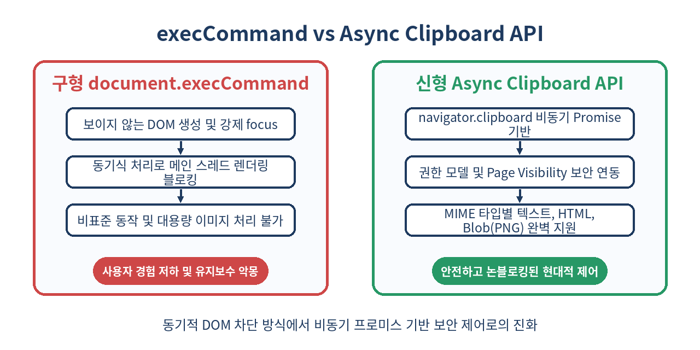
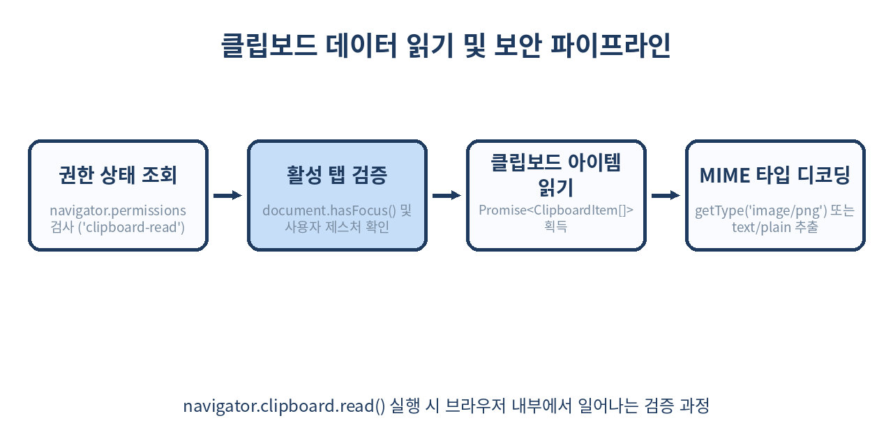

# 📋 Async Clipboard API 완벽 가이드: document.execCommand의 종말과 안전한 클립보드 제어

> 보이지 않는 `<textarea>`를 만들고, DOM에 붙이고, 강제로 focus를 맞춘 뒤 `document.execCommand('copy')`를 호출하던 시절은 끝났습니다.
> 이제 웹은 프로미스 기반의 `navigator.clipboard` API를 통해 텍스트뿐만 아니라 HTML, PNG 이미지 등 다양한 미디어를 안전하고 비동기적으로 제어합니다.

---

## 📌 목차
1. 🧭 1. 레거시 클립보드의 한계: execCommand는 왜 폐기되었는가?
2. ⚡ 2. Async Clipboard API의 등장과 핵심 철학
3. 📝 3. 텍스트 다루기: writeText와 readText 초간단 활용법
4. 🎨 4. 리치 데이터 다루기: ClipboardItem과 write()의 모든 것
5. 🖼️ 5. 이미지(PNG/Blob) 복사와 붙여넣기 실전 파이프라인
6. 🛡️ 6. 브라우저 보안 정책: Permissions API와 Page Focus 제약
7. ⚖️ 7. 구형 방식과 신형 API의 완전 비교
8. 🔄 8. 하위 호환성을 보장하는 Fallback 유틸리티 함수 작성
9. 🧩 9. React 컴포넌트 실전 패턴: useClipboard 훅 만들기
10. ⚠️ 10. 실무 함정: Safari 제약, Iframe 격리, SVG 이슈
11. 🚫 11. Async Clipboard API를 쓰면 안 되는 경우
12. 🧾 12. 정리
13. 📚 13. 참고 자료

---

## 🧭 1. 레거시 클립보드의 한계: execCommand는 왜 폐기되었는가?

수년 동안 웹 개발자들은 '코드 복사' 버튼 하나를 만들기 위해 수많은 꼼수를 동원해야 했습니다.
과거 표준이었던 `document.execCommand('copy')`와 `document.execCommand('paste')`는 근본적으로 텍스트 에디터 엔진을 제어하기 위해 설계된 오래된 동기식 API였습니다.

```js
// ❌ 과거 우리가 작성했던 고통스러운 복사 로직
function legacyCopyText(text) {
  const textarea = document.createElement('textarea');
  textarea.value = text;
  textarea.style.position = 'fixed';
  textarea.style.left = '-9999px';
  textarea.style.top = '0';
  document.body.appendChild(textarea);
  
  textarea.focus();
  textarea.select();
  
  try {
    const successful = document.execCommand('copy');
    return successful;
  } catch (err) {
    return false;
  } finally {
    document.body.removeChild(textarea);
  }
}
```

이 구형 방식은 다음과 같은 치명적인 결함들을 안고 있었습니다:

- **동기식 블로킹(Synchronous Blocking)**: 클립보드 I/O는 OS 수준의 시스템 호출을 수반합니다. 대용량 데이터나 이미지 처리를 동기식으로 실행하면 메인 스레드가 정지되어 브라우저 프레임 드롭(Jank)이 발생합니다.
- **포커스 강제 탈취(Focus Stealing)**: 숨겨진 `<textarea>`에 강제로 `.focus()`를 줌으로써 가상 키보드가 튀어나오거나, 기존 폼 입력 필드의 캐럿 위치를 잃어버리는 UX 참사가 발생했습니다.
- **권한 관리의 부재**: 웹사이트가 사용자의 클립보드 내용을 몰래 읽어가는 행위를 브라우저가 사전에 통제하기 어려웠습니다.
- **표준화 실패**: 브라우저마다 반환값의 의미가 달랐고, 동작 여부가 파편화되어 있었습니다.

결국 W3C는 `document.execCommand()`를 공식 Deprecated 상태로 지정하고, 시스템 클립보드를 비동기적이고 안전하게 다룰 수 있는 새로운 표준을 만들었습니다.

---

## ⚡ 2. Async Clipboard API의 등장과 핵심 철학

**Async Clipboard API**는 `navigator.clipboard` 객체를 통해 브라우저 메인 스레드를 차단하지 않고 OS 클립보드를 제어하는 현대적인 웹 표준입니다.

이 API의 핵심 철학은 3가지로 압축됩니다:
1. **Promise 기반 논블로킹(Non-blocking)**: 모든 읽기/쓰기 작업이 비동기로 동작하여 UI 렌더링에 일절 영향을 주지 않습니다.
2. **엄격한 보안 샌드박스**: 클립보드 읽기는 사용자의 명시적 허락(Permission)을 요구하며, 반드시 **활성화된 탭(Active Document)**이자 **보안 컨텍스트(HTTPS)**에서만 동작합니다.
3. **MIME 타입 기반 다중 포맷 지원**: 순수 텍스트뿐만 아니라 `text/html`, `image/png`, 임의의 커스텀 웹 MIME 타입을 캡슐화한 `ClipboardItem`을 통해 다양한 데이터를 패키징할 수 있습니다.

```js
// navigator.clipboard 인터페이스 핵심 메서드 4가지
navigator.clipboard.writeText(text); // 텍스트 쓰기 (Promise<void>)
navigator.clipboard.readText();      // 텍스트 읽기 (Promise<string>)
navigator.clipboard.write(items);    // ClipboardItem 목록 쓰기 (Promise<void>)
navigator.clipboard.read();         // ClipboardItem 목록 읽기 (Promise<ClipboardItems>)
```

---

## 📝 3. 텍스트 다루기: writeText와 readText 초간단 활용법

가장 널리 쓰이는 일반 텍스트의 복사 및 붙여넣기는 단 한 줄의 코드로 깔끔하게 완성됩니다.

### 3.1 텍스트 복사 (writeText)

`writeText`는 전달된 문자열을 클립보드에 기록하는 프로미스를 반환합니다.

```js
async function handleCopyCode(codeString) {
  try {
    await navigator.clipboard.writeText(codeString);
    console.log('클립보드 복사 성공!');
  } catch (error) {
    console.error('클립보드 쓰기 실패:', error);
  }
}
```

### 3.2 텍스트 읽기 (readText)

`readText`는 클립보드의 텍스트 내용을 읽어옵니다. 이때 사용자가 브라우저 프롬프트에서 '허용'을 누르지 않거나 권한이 거부되면 프로미스가 거부(Reject)됩니다.

```js
async function handlePasteCode() {
  try {
    const text = await navigator.clipboard.readText();
    console.log('읽어온 클립보드 내용:', text);
    return text;
  } catch (error) {
    if (error.name === 'NotAllowedError') {
      console.warn('사용자가 클립보드 접근 권한을 거부했습니다.');
    } else {
      console.error('클립보드 읽기 에러:', error);
    }
    return null;
  }
}
```

---

## 🎨 4. 리치 데이터 다루기: ClipboardItem과 write()의 모든 것

웹 에디터나 대시보드를 구축할 때는 일반 텍스트뿐만 아니라, 서식이 포함된 HTML이나 메타데이터를 함께 복사해야 하는 경우가 흔합니다.
이때 `navigator.clipboard.write()`와 `ClipboardItem` 생성자를 사용합니다.

### 4.1 다중 MIME 타입 제공 (Multi-Representation)

사용자가 복사한 데이터를 일반 메모장에 붙여넣으면 '플레인 텍스트'가 들어가고, 노션이나 구글 독스에 붙여넣으면 '스타일이 적용된 서식 텍스트'가 들어가게 만들 수 있습니다.

```js
async function copyRichSnippet() {
  const plainText = 'Hello Logic-Phantom! (https://logic-phantom.github.io)';
  const htmlContent = '<strong>Hello Logic-Phantom!</strong> <a href="https://logic-phantom.github.io">공식 블로그</a>';

  // 각 MIME 타입에 맞게 Blob 생성
  const textBlob = new Blob([plainText], { type: 'text/plain' });
  const htmlBlob = new Blob([htmlContent], { type: 'text/html' });

  // 하나의 ClipboardItem 안에 두 가지 표현(representation)을 동시에 담기
  const clipboardItem = new ClipboardItem({
    'text/plain': textBlob,
    'text/html': htmlBlob,
  });

  try {
    await navigator.clipboard.write([clipboardItem]);
    console.log('서식 텍스트와 플레인 텍스트가 동시에 복사되었습니다.');
  } catch (err) {
    console.error('리치 클립보드 쓰기 실패:', err);
  }
}
```

수신하는 애플리케이션은 자신의 능력에 따라 지원하는 최적의 MIME 타입을 자동으로 골라서 소비합니다.

---

## 🖼️ 5. 이미지(PNG/Blob) 복사와 붙여넣기 실전 파이프라인

Async Clipboard API의 진가는 브라우저에서 캔버스(Canvas) 렌더링 결과나 캡처된 이미지를 파일 다운로드 없이 바로 클립보드로 전송할 때 발휘됩니다.



### 5.1 캔버스 이미지 클립보드로 복사하기

현재 웹 표준은 보안상의 이유로 클립보드 쓰기 시 **`image/png`** 포맷을 가장 안정적으로 지원합니다.

```js
async function copyCanvasToClipboard(canvasElement) {
  return new Promise((resolve, reject) => {
    canvasElement.toBlob(async (blob) => {
      if (!blob) {
        return reject(new Error('Canvas toBlob 생성 실패'));
      }

      try {
        const item = new ClipboardItem({ [blob.type]: blob });
        await navigator.clipboard.write([item]);
        console.log('PNG 이미지가 성공적으로 클립보드에 복사되었습니다.');
        resolve();
      } catch (err) {
        reject(err);
      }
    }, 'image/png');
  });
}
```

### 5.2 클립보드에서 이미지 꺼내서 렌더링하기

붙여넣기 시에는 `navigator.clipboard.read()`를 호출하여 `ClipboardItem` 목록을 순회합니다.

```js
async function pasteImageFromClipboard(targetImgElement) {
  try {
    const items = await navigator.clipboard.read();

    for (const item of items) {
      // PNG 이미지 타입이 포함되어 있는지 검사
      if (item.types.includes('image/png')) {
        const blob = await item.getType('image/png');
        const objectUrl = URL.createObjectURL(blob);
        
        targetImgElement.src = objectUrl;
        targetImgElement.onload = () => URL.revokeObjectURL(objectUrl);
        console.log('클립보드 이미지 렌더링 완료');
        return;
      }
    }
    console.warn('클립보드에 PNG 이미지가 없습니다.');
  } catch (err) {
    console.error('이미지 읽기 실패:', err);
  }
}
```

---

## 🛡️ 6. 브라우저 보안 정책: Permissions API와 Page Focus 제약

클립보드는 사용자의 민감한 정보(비밀번호, 개인 메시지, API 키 등)가 머무는 임시 저장소입니다. 따라서 브라우저는 매우 엄격한 보안 울타리를 쳐두었습니다.



### 6.1 보안 3원칙

1. **보안 컨텍스트(Secure Context) 필수**: 오직 `https://` 또는 로컬호스트(`http://localhost`) 환경에서만 `navigator.clipboard` 객체가 노출됩니다. 일반 `http://`에서는 `undefined`입니다.
2. **사용자 제스처(User Activation) 요구**: 사용자의 클릭이나 키보드 이벤트 핸들러 내부(`transient user activation`)에서 트리거되지 않은 무단 `write` 호출은 거부됩니다. (페이지 로드되자마자 자동 복사 불가)
3. **활성 문서(Active Focused Document)**: 브라우저 창이나 탭이 포커스를 잃은 상태(`document.hasFocus() === false`)에서는 읽기/쓰기가 즉시 `DOMException: Document is not focused`로 실패합니다.

### 6.2 Permissions API로 권한 사전 확인하기

`navigator.permissions` 쿼리를 사용해 사전에 클립보드 읽기 권한을 파악하고 사용자에게 자연스러운 안내 UI를 제공할 수 있습니다.

```js
async function checkClipboardPermission() {
  if (!navigator.permissions) return 'unknown';

  try {
    // clipboard-read 또는 clipboard-write
    const permissionStatus = await navigator.permissions.query({
      name: 'clipboard-read',
    });
    
    console.log('현재 클립보드 읽기 권한:', permissionStatus.state); // 'granted' | 'denied' | 'prompt'
    
    permissionStatus.onchange = () => {
      console.log('권한 상태가 변경됨:', permissionStatus.state);
    };
    
    return permissionStatus.state;
  } catch (err) {
    // Firefox 등 일부 브라우저는 아직 clipboard-read 쿼리를 지원하지 않음
    return 'unsupported';
  }
}
```

---

## ⚖️ 7. 구형 방식과 신형 API의 완전 비교

과거 방식과 현대 방식을 체계적으로 대조해 보면 다음과 같습니다.

| 구분 | 구형 (document.execCommand) | 신형 (Async Clipboard API) |
| :--- | :--- | :--- |
| **실행 방식** | 동기식 (메인 스레드 블로킹) | 비동기식 (Promise 기반 논블로킹) |
| **지원 데이터** | 기본적으로 플레인 텍스트 위주 | Text, HTML, Image(PNG), Web Custom Data |
| **DOM 조작 필요성** | `<textarea>` 생성 및 DOM 부착 필수 | DOM 조작 일절 불필요 |
| **보안 요구조건** | 별도 권한 프롬프트 없음 (취약) | HTTPS, Page Focus, Permissions 연동 |
| **에러 핸들링** | boolean 반환 또는 silent fail | Promise catch (구체적인 DOMException) |
| **Iframe 지원** | 부모 프레임 권한 상속 | `allow="clipboard-write; clipboard-read"` 명시 필요 |
| **표준 상태** | Deprecated (비권장) | W3C 권고 진행 중 표준 사양 |

---

## 🔄 8. 하위 호환성을 보장하는 Fallback 유틸리티 함수 작성

아직 레거시 브라우저(Internet Explorer, 구형 WebView)나 비보안 환경(HTTP 내부 테스트망)을 지원해야 하는 실무 환경을 위해, 안전한 폴백(Fallback) 함수를 구축하는 것이 모범 사례입니다.

```js
/**
 * 환경에 관계없이 텍스트를 안정적으로 복사하는 범용 유틸리티
 * @param {string} text 
 * @returns {Promise<boolean>}
 */
export async function copyTextToClipboard(text) {
  // 1. 최신 Async Clipboard API 우선 시도
  if (navigator.clipboard && window.isSecureContext) {
    try {
      await navigator.clipboard.writeText(text);
      return true;
    } catch (err) {
      console.warn('Async Clipboard API 복사 실패, 폴백 시도:', err);
    }
  }

  // 2. 레거시 execCommand 폴백 시도
  try {
    const textArea = document.createElement('textarea');
    textArea.value = text;
    
    // 화면 깜빡임 및 스크롤 튐 방지 스타일링
    textArea.style.position = 'fixed';
    textArea.style.top = '0';
    textArea.style.left = '-9999px';
    textArea.style.opacity = '0';
    textArea.setAttribute('readonly', '');
    
    document.body.appendChild(textArea);
    
    // iOS 대응 포커스 및 셀렉션
    textArea.focus();
    textArea.select();
    textArea.setSelectionRange(0, 99999);

    const successful = document.execCommand('copy');
    document.body.removeChild(textArea);
    
    return successful;
  } catch (fallbackErr) {
    console.error('모든 복사 방식 실패:', fallbackErr);
    return false;
  }
}
```

---

## 🧩 9. React 컴포넌트 실전 패턴: useClipboard 훅 만들기

현대 React 애플리케이션에서 '복사됨' 툴팁을 2초간 띄우고 상태를 복원하는 로직을 커스텀 훅으로 추상화하면 가독성과 재사용성이 크게 향상됩니다.

```jsx
import { useState, useCallback } from 'react';
import { copyTextToClipboard } from './clipboardUtils';

export function useClipboard({ timeout = 2000 } = {}) {
  const [copied, setCopied] = useState(false);
  const [error, setError] = useState(null);

  const copy = useCallback(async (text) => {
    if (!text) return false;

    try {
      const success = await copyTextToClipboard(text);
      if (success) {
        setCopied(true);
        setError(null);
        setTimeout(() => setCopied(false), timeout);
        return true;
      } else {
        throw new Error('클립보드 쓰기 명령이 실패했습니다.');
      }
    } catch (err) {
      setError(err);
      setCopied(false);
      return false;
    }
  }, [timeout]);

  return { copy, copied, error };
}

// 사용 예제 컴포넌트
export function CodeSnippet({ code }) {
  const { copy, copied } = useClipboard({ timeout: 1500 });

  return (
    <div className="code-box">
      <pre><code>{code}</code></pre>
      <button onClick={() => copy(code)} aria-label="코드 복사">
        {copied ? '✅ 복사 완료!' : '📋 복사하기'}
      </button>
    </div>
  );
}
```

---

## ⚠️ 10. 실무 함정: Safari 제약, Iframe 격리, SVG 이슈

프로덕션 환경에서 Async Clipboard API를 도입할 때 가장 자주 마주치는 세 가지 함정이 있습니다.

### 10.1 Safari의 엄격한 제스처 타이머 제약
WebKit(Safari)은 사용자 클릭 이벤트가 발생한 직후 **즉시** `write()` 또는 `writeText()`가 호출되지 않고, 중간에 비동기 네트워크 통신(`fetch`)이 끼어들면 제스처 권한을 만료시켜 버립니다.

```js
// ❌ Safari에서 100% 에러 발생 (NotAllowedError: The request is not allowed by the user agent)
button.addEventListener('click', async () => {
  const res = await fetch('/api/get-share-link'); // 비동기 API 호출 지연
  const data = await res.json();
  await navigator.clipboard.writeText(data.url); // 거부됨!
});

// ⭕ 해결책: Promise를 ClipboardItem 안에 직접 전달 (Safari 13.1+ 지원)
button.addEventListener('click', () => {
  const textPromise = fetch('/api/get-share-link')
    .then(res => res.json())
    .then(data => new Blob([data.url], { type: 'text/plain' }));

  const item = new ClipboardItem({
    'text/plain': textPromise // Promise<Blob>을 통째로 넘김
  });

  navigator.clipboard.write([item]);
});
```

### 10.2 Iframe 내에서의 Permissions Policy 누락
모달 팝업이나 임베디드 위젯을 `<iframe>`으로 띄웠을 때 복사 버튼이 먹통이 되는 원인은 부모 프레임의 권한 위임이 빠졌기 때문입니다.

```html
<!-- iframe 태그에 반드시 allow 속성 선언 -->
<iframe 
  src="https://widget.example.com" 
  allow="clipboard-write; clipboard-read">
</iframe>
```

### 10.3 SVG 이미지 복사의 브라우저 미지원
현재 대부분의 브라우저는 `image/svg+xml`의 직접적인 클립보드 쓰기를 차단합니다(XSS 벡터 위험성 때문). 벡터 그래픽을 복사하려면 SVG 코드를 캔버스에 래스터라이즈하여 `image/png` Blob으로 변환하거나, `text/plain`으로 원본 XML 문자열을 전송해야 합니다.

---

## 🚫 11. Async Clipboard API를 쓰면 안 되는 경우

현대적인 API라고 해서 무조건 만능은 아닙니다. 다음 상황에서는 대안을 선택해야 합니다:

1. **서버 사이드 렌더링(SSR) 환경에서의 무조건적 호출**: Node.js 서버 환경에는 `navigator.clipboard`가 존재하지 않습니다. 반드시 `typeof window !== 'undefined'` 가드를 작성해야 합니다.
2. **백그라운드 탭에서의 주기적 데이터 동기화**: 백그라운드 탭은 창 포커스를 얻지 못하므로 영구적으로 접근이 차단됩니다. 탭 간 통신은 `BroadcastChannel`이나 `Web Locks API`, `IndexedDB`를 사용하세요.
3. **대용량 파일(수십 MB 이상의 바이너리)**: OS 클립보드는 휘발성 메모리에 적재되므로 기기 전체의 성능 저하를 부릅니다. 파일 공유는 `Web Share API`나 파일 드래그 앤 드롭(`DataTransfer`), Blob 다운로드 방식을 채택하는 것이 맞습니다.

---

## 🧾 12. 정리

- `document.execCommand`는 메인 스레드를 차단하고 DOM을 어지럽히는 레거시 기술로 완전히 퇴출되었습니다.
- `navigator.clipboard`는 Promise 기반으로 동작하며, 메인 스레드 렌더링에 일절 영향을 주지 않는 현대적 표준입니다.
- `writeText` / `readText`로 텍스트를 손쉽게 다루고, `write` / `read`와 `ClipboardItem`을 통해 서식 있는 HTML과 PNG 이미지를 제어할 수 있습니다.
- 반드시 **HTTPS**, **유저 인터랙션**, **활성 탭 포커스**가 유지되는 상태에서만 실행됩니다.
- Safari의 타이밍 이슈를 방지하려면 비동기 fetch 호출 시 `ClipboardItem`에 `Promise<Blob>`을 직접 전달하는 패턴을 기억해야 합니다.

> ✨ **한 줄 요약**
> 꼼수로 DOM을 조작하던 시대는 끝났다. 비동기 Promise와 ClipboardItem으로 브라우저 클립보드를 우아하게 정복하자.

---

## 📚 13. 참고 자료

- [MDN Web Docs: Clipboard API](https://developer.mozilla.org/en-US/docs/Web/API/Clipboard_API)
- [W3C Clipboard Operations Specification](https://www.w3.org/TR/clipboard-apis/)
- [web.dev: Unblocking clipboard access](https://web.dev/articles/async-clipboard)
- [WebKit Blog: Modernizing Clipboard Access in Safari](https://webkit.org/blog/10247/link-click-analytics-and-the-clipboard-api/)
