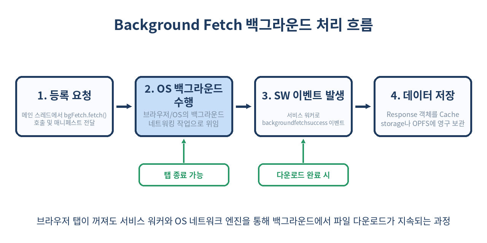
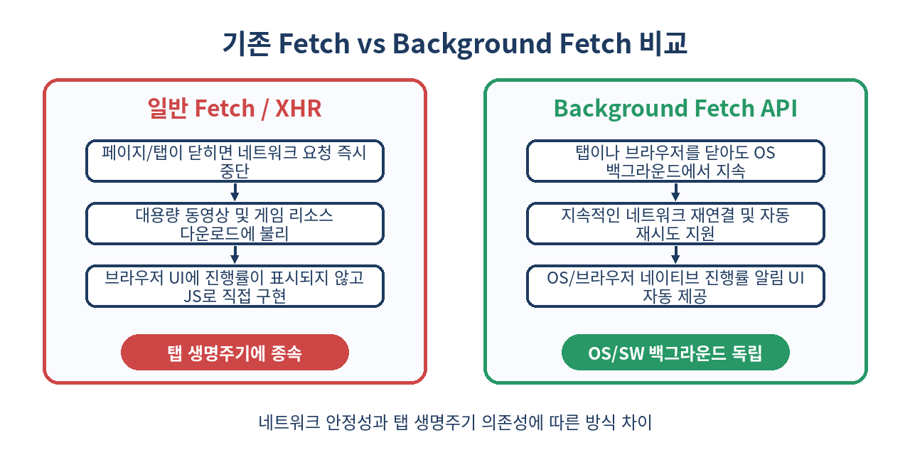

# 📥 Background Fetch API 완벽 가이드: 탭을 닫아도 계속되는 백그라운드 대용량 파일 다운로드·업로드

> 브라우저 탭을 실수로 닫아 진행 중이던 2GB 동영상 다운로드가 취소된 경험이 있으신가요?
> **Background Fetch API**는 페이지 생명주기를 넘어 OS 백그라운드에서 파일 전송을 완수하는 차세대 웹 표준 기술입니다.

---

## 📌 목차
1. [🧭 1. 백그라운드 파일 전송의 시대와 한계](#-1-백그라운드-파일-전송의-시대와-한계)
2. [💡 2. Background Fetch API란 무엇인가?](#-2-background-fetch-api란-무엇인가)
3. [⚙️ 3. 핵심 작동 원리와 서비스 워커 레이어](#-3-핵심-작동-원리와-서비스-워커-레이어)
4. [🛠️ 4. Background Fetch 등록과 옵션 설정](#-4-background-fetch-등록과-옵션-설정)
5. [📊 5. 진행률(Progress) 추적과 UI 업데이트](#-5-진행률progress-추적과-ui-업데이트)
6. [🔔 6. 백그라운드 이벤트 처리 (backgroundfetchsuccess / fail / click)](#-6-백그라운드-이벤트-처리-backgroundfetchsuccess--fail--click)
7. [🔄 7. 기존 Fetch, SW Fetch, Streams API와의 차이점 비교](#-7-기존-fetch-sw-fetch-streams-api와의-차이점-비교)
8. [🧩 8. 실전 예제: 서비스 워커와 OPFS를 연계한 대용량 파일 다운로드](#-8-실전-예제-서비스-워커와-opfs를-연계한-대용량-파일-다운로드)
9. [⚠️ 9. 실무 함정 및 쓰면 안 되는 예외 케이스](#-9-실무-함정-및-쓰면-안-되는-예외-케이스)
10. [🔒 10. 브라우저 지원 현황과 보안·권한 정책](#-10-브라우저-지원-현황과-보안권한-정책)
11. [🧾 11. 정리 및 한 줄 요약](#-11-정리-및-한-줄-요약)

---

## 🧭 1. 백그라운드 파일 전송의 시대와 한계

웹 애플리케이션이 네이티브 데스크톱 및 모바일 앱의 영역을 빠르게 대체하면서, 4K 동영상 파일, 무손실 음원 앨범, 3D WebGL 자산, 오프라인 맵 데이터 등 **기가바이트(GB) 단위의 대용량 자산**을 브라우저에서 다루는 일이 흔해졌습니다.

하지만 기존의 웹 네트워킹 기술 방식은 심각한 한계를 지니고 있었습니다:

1. **탭/페이지 생명주기 종속성**: standard `fetch()`나 `XMLHttpRequest`는 사용자가 탭을 닫거나 다른 URL로 이동하면 즉시 Abort 처리됩니다.
2. **서비스 워커 수명 제한**: 서비스 워커(Service Worker)의 `fetch` 이벤트를 이용하더라도 브라우저는 리소스 절약을 위해 백그라운드에서 Idle 상태인 서비스 워커 프로세스를 수분 내에 강제 종료(Kill)합니다.
3. **네트워크 변동성 대응 부재**: 모바일 환경에서 지하철을 타거나 Wi-Fi에서 LTE로 전환될 때 소켓 연결이 끊기면 재연결 로직을 애플리케이션 레벨에서 복잡하게 처리해야 했습니다.

Background Fetch API는 이러한 문제를 깔끔하게 해결합니다.

---

## 💡 2. Background Fetch API란 무엇인가?

**Background Fetch API**는 메인 스레드나 서비스 워커 프로세스가 종료되어도, 브라우저 엔진(및 운영체제의 다운로드 매니저)이 백그라운드에서 네트워크 요청을 계속해서 수행할 수 있도록 해주는 W3C 웹 API 표준입니다.



### 주요 특장점
- **탭 독립성**: 다운로드가 시작된 후 탭을 닫거나 브라우저를 완전히 최소화해도 전송이 유지됩니다.
- **네이티브 UI 제공**: 브라우저와 OS 알림창을 통해 사용자에게 파일 다운로드/업로드 진행률(Progress Bar)과 일시정지/취소 버튼이 제공됩니다.
- **자동 재시도**: 네트워크 연결이 끊기면 연결이 복구될 때까지 대기했다가 자동으로 전송을 재개합니다.
- **서비스 워커 연동**: 전송이 성공하거나 실패했을 때 서비스 워커 이벤트가 트리거되어 후속 처리(Cache 저장, OPFS 기록, 사용자 알림 표시 등)를 진행할 수 있습니다.

---

## ⚙️ 3. 핵심 작동 원리와 서비스 워커 레이어

Background Fetch는 웹 개발자가 직접 네트워크 연결을 유지하는 방식이 아닙니다. **요청 매니페스트를 작성하여 브라우저에 위임(Delegate)**하는 구조입니다.

1. **등록 단계 (Registration)**: 메인 JS 스레드에서 `navigator.serviceWorker.ready`를 통해 `BackgroundFetchManager` 객체에 접근하고 `fetch()` 메서드로 요청을 등록합니다.
2. **위임 실행 단계 (Execution)**: 브라우저가 사용자에게 다운로드 허용 알림/UI를 보여주고, 내부 OS 수준의 네트워크 프로세스에서 HTTP 요청을 차례로 전송합니다. 이때 메인 페이지 스레드는 종료되어도 무방합니다.
3. **이벤트 수신 단계 (Completion Event)**: 모든 파일 전송이 끝나면 브라우저가 서비스 워커를 부팅시키고 `backgroundfetchsuccess` 또는 `backgroundfetchfail` 이벤트를 발화합니다.

---

## 🛠️ 4. Background Fetch 등록과 옵션 설정

Background Fetch를 등록하는 방법은 매우 간단합니다. 서비스 워커 등록 객체(`ServiceWorkerRegistration`)의 `backgroundFetch` 속성을 이용합니다.

```js
// main.js - 메인 스레드
async function startBackgroundDownload() {
  // 1. 서비스 워커 등록 확인
  const registration = await navigator.serviceWorker.ready;
  
  if (!('backgroundFetch' in registration)) {
    console.warn('Background Fetch API를 지원하지 않는 브라우저입니다.');
    return;
  }

  // 2. 백그라운드 패치 요청 등록
  try {
    const bgFetch = await registration.backgroundFetch.fetch(
      'download-game-assets-v1', // 고유 작업 ID (Tag ID)
      [
        '/assets/models/character.glb',
        '/assets/textures/terrain.png',
        '/assets/audio/background.mp3'
      ], // 단일 URL 또는 URL 배열/Request 객체 배열
      {
        title: '대용량 게임 리소스 다운로드',
        icons: [
          { src: '/images/icon-192.png', sizes: '192x192', type: 'image/png' }
        ],
        downloadTotal: 150 * 1024 * 1024 // 총 예상 다운로드 크기 (150MB, 진행률 표시용)
      }
    );

    console.log('Background Fetch 등록 성공:', bgFetch.id);
  } catch (error) {
    console.error('Background Fetch 등록 실패:', error);
  }
}
```

### `BackgroundFetchOptions` 핵심 옵션 표

| 옵션명 | 타입 | 설명 | 필수 여부 |
|---|---|---|---|
| `title` | `string` | OS 및 브라우저 다운로드 UI 알림창에 표기될 제목 | 권장 |
| `icons` | `Array<Icon>` | 다운로드 알림창에 표시될 이모지/아이콘 이미지 리스트 | 선택 |
| `downloadTotal` | `number` | 총 다운로드 예상 크기(Bytes). 브라우저가 정확한 % 진행률바를 계산할 때 사용 | 권장 |

---

## 📊 5. 진행률(Progress) 추적과 UI 업데이트

페이지가 열려 있는 동안에는 메인 스레드에서 `BackgroundFetchRegistration` 객체의 `progress` 이벤트를 구독하여 실시간 UI를 업데이트할 수 있습니다.

```js
// main.js
async function trackProgress(bgFetchId) {
  const registration = await navigator.serviceWorker.ready;
  const bgFetch = await registration.backgroundFetch.get(bgFetchId);

  if (!bgFetch) return;

  bgFetch.addEventListener('progress', () => {
    // bgFetch.downloaded: 지금까지 다운로드된 바이트 수
    // bgFetch.downloadTotal: 전체 바이트 수 (등록 시 지정한 값)
    const percent = Math.round((bgFetch.downloaded / bgFetch.downloadTotal) * 100);
    
    console.log(`현재 진행률: ${percent}% (${bgFetch.downloaded} / ${bgFetch.downloadTotal} bytes)`);
    
    // DOM 진행률 바 업데이트
    const progressBar = document.getElementById('my-progress-bar');
    if (progressBar) {
      progressBar.value = percent;
    }
  });
}
```

---

## 🔔 6. 백그라운드 이벤트 처리 (backgroundfetchsuccess / fail / click)

탭이 닫힌 상태에서 다운로드가 끝나면 서비스 워커가 이벤트를 받아서 후속 조치를 취해야 합니다.

```js
// sw.js - 서비스 워커 스레드

// 1. 모든 파일 다운로드가 성공적으로 완료된 경우
self.addEventListener('backgroundfetchsuccess', (event) => {
  const bgFetch = event.registration;

  event.waitUntil((
    async () => {
      // Cache Storage 열기
      const cache = await caches.open('offline-game-assets-v1');
      
      // 백그라운드 패치로 전달받은 모든 요청/응답 쌍 가져오기
      const records = await bgFetch.matchAll();
      
      const recordPromises = records.map(async (record) => {
        const response = await record.responseReady;
        // Cache Storage에 저장
        await cache.put(record.request, response);
      });

      await Promise.all(recordPromises);
      
      // 성공 상태 알림 표시
      await event.updateUI({ title: '모든 게임 자산 다운로드 완료!' });
    }
  )());
});

// 2. 다운로드가 실패했거나 취소된 경우
self.addEventListener('backgroundfetchfail', (event) => {
  console.error('Background fetch 실패:', event.registration.id);
  // 실패한 리소스 정리 작업 수행 가능
});

// 3. 사용자가 브라우저 OS 알림창 UI를 클릭했을 때
self.addEventListener('backgroundfetchclick', (event) => {
  const bgFetch = event.registration;

  event.waitUntil((
    async () => {
      // 이미 열려 있는 탭이 있다면 포커스, 없으면 새 창 열기
      const windowClients = await self.clients.matchAll({ type: 'window' });
      for (const client of windowClients) {
        if (client.url.includes('/download-page') && 'focus' in client) {
          return client.focus();
        }
      }
      if (self.clients.openWindow) {
        return self.clients.openWindow('/download-page');
      }
    }
  )());
});
```

---

## 🔄 7. 기존 Fetch, SW Fetch, Streams API와의 차이점 비교

네트워크 요청을 수행하는 웹 표준 기술들의 특성을 명확히 비교해 보겠습니다.



| 구분 | 일반 `fetch()` | SW `fetch` Intercept | Background Fetch API |
|---|---|---|---|
| **수행 주체** | 메인 JS 스레드 | 서비스 워커 스레드 | OS / 브라우저 네이티브 엔진 |
| **탭 닫힘 지속 여부** | ❌ 즉시 취소 | ⚠️ SW 수명(수분) 후 중단 | ✅ 완료 시까지 완벽 지속 |
| **네이티브 진행 UI** | ❌ 직접 구현 필요 | ❌ 직접 구현 필요 | ✅ OS/브라우저 알림창 자동 제공 |
| **자동 재요청(Auto Retry)** | ❌ 직접 작성 | ❌ 직접 작성 | ✅ 브라우저 차원 자동 지원 |
| **업로드 지원** | ✅ 가능 | ✅ 가능 | ✅ 가능 (대용량 POST/PUT 지원) |
| **적합한 용도** | API 통신, 소형 자원 | 동적 Caching, PWA 오프라인 | GB 단위 자산, 오프라인 미디어 다운로드 |

---

## 🧩 8. 실전 예제: 서비스 워커와 OPFS를 연계한 대용량 파일 다운로드

Cache Storage는 크기가 수백 MB를 넘어서면 정리를 당할 위험이 있습니다. **Origin Private File System (OPFS)**과 연계하면 백그라운드 패치로 받은 GB 단위 대용량 파일을 고성능 로컬 파일 시스템에 안전하게 보관할 수 있습니다.

```js
// sw.js - Background Fetch + OPFS 연동
self.addEventListener('backgroundfetchsuccess', (event) => {
  const bgFetch = event.registration;

  event.waitUntil((
    async () => {
      // OPFS 루터 디렉토리 확보
      const root = await navigator.storage.getDirectory();
      const mediaFolder = await root.getDirectoryHandle('downloaded_videos', { create: true });

      const records = await bgFetch.matchAll();

      for (const record of records) {
        const response = await record.responseReady;
        const blob = await response.blob();
        
        // URL 패턴 기반 파일명 추출
        const url = new URL(record.request.url);
        const fileName = url.pathname.split('/').pop() || 'file.bin';
        
        // OPFS 파일 핸들 생성 및 작성
        const fileHandle = await mediaFolder.getFileHandle(fileName, { create: true });
        const accessHandle = await fileHandle.createWritable();
        await blob.stream().pipeTo(accessHandle);
      }

      await event.updateUI({ title: 'OPFS 저장 완료!' });
    }
  )());
});
```

---

## ⚠️ 9. 실무 함정 및 쓰면 안 되는 예외 케이스

Background Fetch API를 도입할 때 반드시 경계해야 하는 실무 함정들과 유의사항입니다.

### 1. 🚫 CORS 헤더 미비로 인한 실패
- 백그라운드 패치는 교차 출처(Cross-Origin) 리소스를 다운로드할 때 매우 엄격한 CORS 검증을 거칩니다.
- 서버에서 `Access-Control-Allow-Origin: *` 또는 허용 도메인이 설정되어 있지 않으면 `backgroundfetchfail` 이벤트가 발생하며 전체 다운로드가 실패합니다.

### 2. 🚫 인증 토큰(JWT, Cookie) 만료 문제
- 대용량 파일 다운로드가 백그라운드에서 1~2시간 이상 진행되는 동안 HTTP Authorization Header의 Short-lived JWT 토큰이 만료되면 중간 요청이 `401 Unauthorized`를 반환합니다.
- **해결책**: 백그라운드 패치를 시작할 때 **Presigned URL**이나 쿠키 기반 세션을 사용하거나, 만료 시간이 충분히 긴 다운로드 전용 렌더링 토큰을 발급받아 요청해야 합니다.

### 3. 🚫 소형 JSON API 호출에 오용
- 몇 KB 수준의 일반 AJAX 요청이나 실시간 데이터 동기화에 Background Fetch를 사용하면 안 됩니다.
- 브라우저가 매번 네이티브 알림 UI를 표시하려고 시도하거나 알림 권한을 요청하므로 사용자 경험(UX)을 크게 해칩니다.

### 4. 🚫 디스크 용량 부족(QuotaExceededError)
- 다운로드 시작 전 `navigator.storage.estimate()`를 사용하여 사용자의 남은 디스크 용량을 사전에 확인해야 합니다. 디스크 용량이 부족하면 브라우저가 패치를 즉시 중단시킵니다.

---

## 🔒 10. 브라우저 지원 현황과 보안·권한 정책

### 브라우저 지원 현황 (2026년 기준)
- **Chrome / Edge / Opera (Chromium 기반)**: 버전 74+ 완벽 지원 (Android 포함)
- **Safari (macOS / iOS)**: Safari 18.2+ 이후 기능 플래그 및 PWA 환경에서 부분 도입 지원
- **Firefox**: 개발 중 (Nightly 플래그 뒤에 위치)

### 보안 및 사용자 프라이버시 정책
1. **HTTPS 필수**: Background Fetch는 보안 컨텍스트(`https://` 및 `localhost`)에서만 작동합니다.
2. **사용자 알림 강제**: 악성 웹사이트가 사용자가 모르는 사이에 백그라운드에서 대용량 데이터를 몰래 받거나 전송(Data Exfiltration)하는 것을 막기 위해, 브라우저는 반드시 OS 알림 영역에 진행 상태를 노출하도록 표준화되어 있습니다.

---

## 🧾 11. 정리 및 한 줄 요약

- **Background Fetch API**는 탭이 닫히거나 브라우저가 최소화되어도 대용량 파일 다운로드/업로드를 지속하는 웹 표준 기술입니다.
- 브라우저 및 OS 네이티브 레벨에서 다운로드 UI와 진행률 바를 자동으로 제어하며, 네트워크 단절 시 자동 재시도를 지원합니다.
- 완료 시 **서비스 워커**의 `backgroundfetchsuccess` 이벤트를 통해 **Cache Storage**나 **OPFS**에 데이터를 영구 저장할 수 있습니다.
- 대용량 동영상, PWA 오프라인 리소스 패키지, 3D 게임 자원 다운로드에 매우 적합하며, CORS 설정과 Presigned URL 활용이 핵심입니다.

> ✨ **한 줄 요약**
> 페이지가 꺼져도 멈추지 않는 대용량 웹 I/O, Background Fetch API와 서비스 워커로 완벽 구현하자!

---

## 📚 참고 자료
- [W3C Background Fetch Specification](https://wicg.github.io/background-fetch/)
- [MDN Web Docs - Background Fetch API](https://developer.mozilla.org/en-US/docs/Web/API/Background_Fetch_API)
- [chrome.dev - Introducing Background Fetch](https://developer.chrome.com/blog/background-fetch/)
