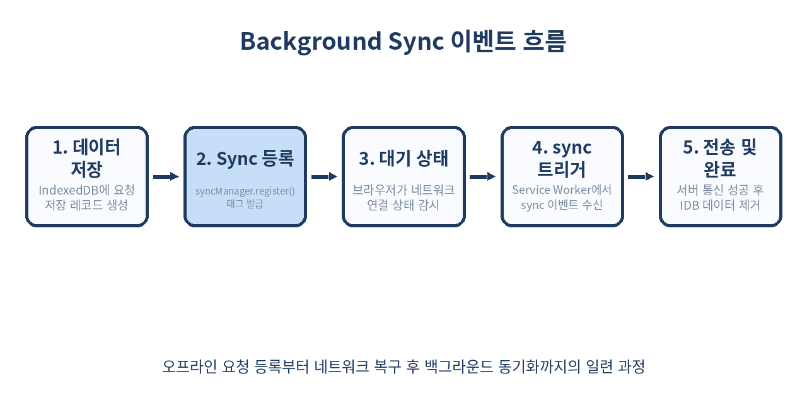
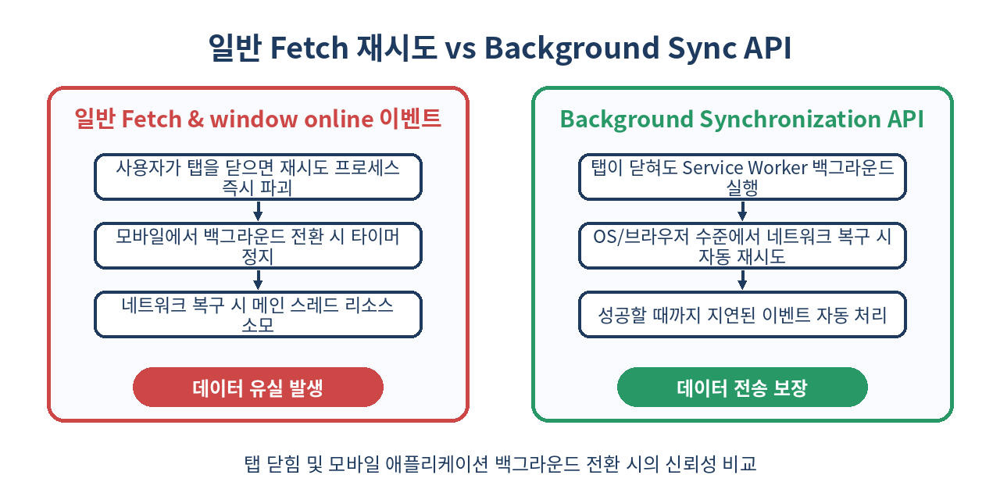

# 🔄 Background Synchronization API 완벽 가이드: 네트워크가 끊겨도 지워지지 않는 백그라운드 데이터 동기화

> 모바일 네트워크 환경이나 불안정한 엘리베이터 안에서도 사용자의 데이터 전송 요청은 결코 유실되어서는 안 됩니다.
> 웹 애플리케이션에서 네트워크 연결이 복구되는 즉시 백그라운드에서 안전하게 데이터를 전송하는 **Background Synchronization API(Background Sync API)**의 원리와 실무 적용법을 상세히 살펴봅니다.

---

## 📌 목차
1. 🧭 백그라운드 동기화(Background Sync)란 무엇인가?
2. 🔌 기존 오프라인 대응 방식의 한계
3. 🏗️ Background Synchronization API 핵심 아키텍처
4. ⚙️ 서비스 워커 등록과 Sync Tags 관리
5. 💾 IndexedDB와 연동한 오프라인 폼 저장 패턴
6. 📡 Service Worker의 sync 이벤트 처리와 네트워크 재시도
7. ⏱️ Background Sync vs Periodic Background Sync 비교
8. 🛡️ 보안, 권한 모델 및 브라우저 지원 현황
9. ⚠️ 실무 함정: Sync 큐 상한과 지연 문제
10. ❌ Background Sync를 사용하면 안 되는 경우
11. 🧪 Chrome DevTools를 활용한 오프라인 동기화 디버깅
12. 🧾 정리

---

## 🧭 1. 백그라운드 동기화(Background Sync)란 무엇인가?

모바일 웹 사용 중 터널을 지나거나 엘리베이터에 탈 때 메시지를 보내거나 폼을 제출하면 어떻게 될까요? 일반적인 웹 앱에서는 `Failed to fetch` 에러 메시지가 뜨며 전송이 실패하고, 사용자가 입력한 데이터는 날아가 버리기 십상입니다.

**Background Synchronization API**는 웹 앱이 오프라인 상태이거나 네트워크 연결이 불안정할 때 발생한 데이터 요청을 브라우저에 등록해 두고, **네트워크 연결이 다시 정상화되었을 때 백그라운드에서 이를 자동으로 서버에 전송**해 주는 W3C 커뮤니티 그룹 표준 웹 API입니다.

핵심 특징은 사용자가 **웹 페이지 탭을 이미 닫았더라도 서비스 워커(Service Worker)가 브라우저 백그라운드에서 깨어나 데이터를 전송**한다는 점입니다.

---

## 🔌 2. 기존 오프라인 대응 방식의 한계

Background Sync API가 도입되기 전, 웹 개발자들은 `window.addEventListener('online', ...)` 이벤트를 통해 네트워크 복구를 감지하곤 했습니다.

하지만 이 방식에는 치명적인 약점들이 존재했습니다.

| 구분 | 기존 `window.addEventListener('online')` | Background Synchronization API |
| :--- | :--- | :--- |
| **탭 닫힘 대응** | 탭을 닫으면 이벤트 핸들러가 파괴되어 전송 불가능 | 탭을 닫거나 브라우저가 백그라운드에 있어도 서비스 워커가 실행 |
| **재시도 보장** | 네트워크가 순간적으로 켜졌다가 꺼지면 재시도 로직 구현이 까다로움 | 브라우저/OS 차원에서 백오프(Backoff) 알고리즘을 적용하여 보장 |
| **메인 스레드 영향** | 무거운 요청 처리 시 UI 렌더링에 영향 | 서비스 워커 별도 스레드에서 비동기 처리 |
| **실행 주체** | DOM 메인 스레드 Context | Service Worker Global Context (`ServiceWorkerGlobalScope`) |

기존 방식은 사용자가 웹 페이지를 켜둔 상태에서만 동작했기 때문에, 모바일 사용자 환경에서는 데이터 유실율이 매우 높았습니다.

---

## 🏗️ 3. Background Synchronization API 핵심 아키텍처

Background Sync는 크게 두 가지 영역의 협업으로 이루어집니다.
1. **메인 스레드 (DOM WindowContext)**: 사용자의 요청 데이터(예: 작성된 댓글, 폼 데이터)를 `IndexedDB`에 안전하게 저장한 뒤, `ServiceWorkerRegistration.sync.register('tag-name')`을 호출하여 브라우저에 동기화 작업이 대기 중임을 등록합니다.
2. **서비스 워커 스레드 (ServiceWorkerGlobalScope)**: 브라우저가 네트워크 연결이 복구되었음을 감지하면 서비스 워커를 활성화하고 `self.addEventListener('sync', ...)` 이벤트를 트리거합니다. 이벤트 내에서 `IndexedDB`에 대기 중인 데이터를 읽어 백엔드 API로 전송합니다.



이 구조 덕분에 데이터 저장은 메인 스레드에서 안전하게 이뤄지고, 네트워크 전송 및 재시도는 백그라운드 서비스 워커가 든든하게 담당하게 됩니다.

---

## ⚙️ 4. 서비스 워커 등록과 Sync Tags 관리

Background Sync를 사용하기 위해서는 서비스 워커 등록과 지원 여부 확인이 필수적입니다.

```js
// main.js - 메인 스레드
async function registerBackgroundSync(tagName) {
  if (!('serviceWorker' in navigator) || !('SyncManager' in window)) {
    console.warn('Background Sync API를 지원하지 않는 브라우저입니다.');
    return false;
  }

  try {
    const registration = await navigator.serviceWorker.ready;
    // 동기화 태그 등록 (중복 호출되어도 동일 태그는 합쳐짐)
    await registration.sync.register(tagName);
    console.log(`[Main] Background sync 등록 완료: ${tagName}`);
    return true;
  } catch (error) {
    console.error('[Main] Background sync 등록 실패:', error);
    return false;
  }
}
```

등록된 태그 목록을 확인하려면 `registration.sync.getTags()` 메서드를 활용할 수 있습니다.

```js
// 등록되어 대기 중인 sync 태그 조회
const registration = await navigator.serviceWorker.ready;
const tags = await registration.sync.getTags();
if (tags.includes('outbox-messages')) {
  console.log('아직 처리되지 않은 메시지 동기화가 대기 중입니다.');
}
```

---

## 💾 5. IndexedDB와 연동한 오프라인 폼 저장 패턴

`sync` 이벤트는 네트워크가 복구되었을 때 단순히 "동기화를 수행하라"는 신호(Signal)만 전달할 뿐, 복잡한 HTTP Request Body 데이터 자체를 직접 품고 전달되지는 않습니다.

따라서 클라이언트 측 폼 데이터나 아웃박스(Outbox) 요청은 **IndexedDB**에 먼저 저장해야 합니다.

```js
// db.js - IndexedDB Helper (idb 라이브러리 예시 또는 Pure JS)
function openOutboxDB() {
  return new Promise((resolve, reject) => {
    const request = indexedDB.open('AppOutboxDB', 1);
    request.onupgradeneeded = (e) => {
      const db = e.target.result;
      if (!db.objectStoreNames.contains('outbox')) {
        db.createObjectStore('outbox', { keyPath: 'id', autoIncrement: true });
      }
    };
    request.onsuccess = () => resolve(request.result);
    request.onerror = () => reject(request.error);
  });
}

async function saveToOutbox(data) {
  const db = await openOutboxDB();
  return new Promise((resolve, reject) => {
    const tx = db.transaction('outbox', 'readwrite');
    const store = tx.objectStore('outbox');
    const req = store.add({ ...data, timestamp: Date.now() });
    req.onsuccess = () => resolve(req.result);
    req.onerror = () => reject(req.error);
  });
}
```

폼 제출 시 오프라인 여부를 체크하거나 요청 실패 시 무조건 Outbox에 넣은 뒤 Sync를 등록하는 패턴이 실무에서 널리 쓰입니다.

```js
// form-handler.js
document.querySelector('#comment-form').addEventListener('submit', async (e) => {
  e.preventDefault();
  const payload = {
    text: document.querySelector('#comment-input').value,
    authorId: getCurrentUserId(),
  };

  // 1. IndexedDB에 오프라인 요청 저장
  await saveToOutbox(payload);

  // 2. Background Sync 등록
  const registered = await registerBackgroundSync('sync-outbox-comments');
  
  if (registered) {
    alert('네트워크 상태에 따라 메시지가 전송됩니다.');
  } else {
    // 폴백(Fallback): 직접 fetch 시도
    sendDirectly(payload);
  }
});
```

---

## 📡 6. Service Worker의 sync 이벤트 처리와 네트워크 재시도

이제 서비스 워커 파일(`sw.js`)에서 `sync` 이벤트를 수신하고, IndexedDB의 데이터를 꺼내어 서버로 전송하는 구현을 작성해 봅시다.

`event.waitUntil()`을 사용하여 동기화 Promise가 완료될 때까지 서비스 워커가 종료되지 않도록 유지하는 것이 핵심입니다.

```js
// sw.js - Service Worker
self.addEventListener('sync', (event) => {
  console.log(`[SW] Sync 이벤트 감지: ${event.tag}`);

  if (event.tag === 'sync-outbox-comments') {
    // event.waitUntil로 작업 완료 보장
    event.waitUntil(processOutboxComments());
  }
});

async function processOutboxComments() {
  const db = await openOutboxDB();
  const items = await getAllOutboxItems(db);

  for (const item of items) {
    try {
      const response = await fetch('/api/comments', {
        method: 'POST',
        headers: { 'Content-Type': 'application/json' },
        body: JSON.stringify(item),
      });

      if (response.ok) {
        // 전송 성공 시 IndexedDB에서 해당 항목 삭제
        await deleteOutboxItem(db, item.id);
        console.log(`[SW] 데이터 전송 성공 및 DB 삭제: ${item.id}`);
      } else {
        // 4xx, 5xx 에러 시 예외 throw -> waitUntil이 reject되어 브라우저가 추후 재시도
        throw new Error(`Server returned status: ${response.status}`);
      }
    } catch (err) {
      console.error('[SW] 데이터 전송 실패. 추후 재시도됩니다:', err);
      // Promise rejection을 발생시켜 브라우저에게 재시도 필요성을 알림
      throw err;
    }
  }
}
```

> 💡 **주의**: `event.waitUntil()`에 전달된 Promise가 reject되면, 브라우저는 내부 백오프 전략에 따라 잠시 후 `sync` 이벤트를 다시 발송합니다.

---

## ⏱️ 7. Background Sync vs Periodic Background Sync 비교

Chrome 80+ 부터는 주기적으로 백그라운드 데이터를 동기화하는 **Periodic Background Synchronization API**도 지원됩니다. 두 기술은 용도와 트리거 조건이 명확히 다릅니다.



| 구분 | One-off Background Sync | Periodic Background Sync |
| :--- | :--- | :--- |
| **인터페이스** | `registration.sync` | `registration.periodicSync` |
| **주요 목적** | 오프라인 시 발생한 사용자 액션 즉시 보정 | 뉴스, 날씨, 피드 등 백그라운드 데이터 정기 갱신 |
| **트리거 시점** | 네트워크 연결 복구 직후 즉시 발생 | 지정된 주기(minInterval)마다 브라우저 판단 하에 발생 |
| **권한 요구** | 별도 권한 팝업 없음 (PWA 기본) | `periodic-background-sync` 권한 및 Site Engagement 점수 필요 |
| **유휴 상태 요구** | 상관없음 | 기기 배터리 및 Wi-Fi 상태 영향 받음 |

---

## 🛡️ 8. 보안, 권한 모델 및 브라우저 지원 현황

Background Sync API는 브라우저의 전력 제어 및 사생활 보호 정책의 영향을 받습니다.

### 브라우저 지원 현황 (2026년 기준)
- **Chromium 계열** (Chrome, Edge, Opera, Samsung Internet): 완전 지원 (`Desktop` & `Android`)
- **Safari (WebKit / iOS & macOS)**: 제한적 지원 또는 미지원 (서비스 워커 기본 기능만 제공하고 `SyncManager` 표준 도입 지연)
- **Firefox**: 플래그(`dom.serviceworkers.background_sync`)를 통해 테스트 가능하나 기본 비활성화

### 보안 및 사용자 경험 정책
1. **HTTPS 필수**: 서비스 워커 스펙과 동일하게 `localhost`를 제외한 모든 환경에서 TLS/HTTPS가 강제됩니다.
2. **원천 태그 캡처 제한**: 브라우저 스토리지 용량을 과도하게 사용하는 공격을 막기 위해 1개 등록당 태그 길이와 큐 개수가 제한됩니다.
3. **크로스 오리진 제한**: Service Worker Scope 외의 도메인으로 임의 핑을 쏘는 대량 트래픽 생성 행위를 방지합니다.

--- 

## ⚠️ 9. 실무 함정: Sync 큐 상한과 지연 문제

실무에 Background Sync를 적용할 때 겪을 수 있는 대표적인 3가지 문제점과 해결책입니다.

### 1. 무한 재시도 굴레 (Infinite Retry Loop)
만약 백엔드 엔드포인트에서 `400 Bad Request` (유효하지 않은 데이터)가 발생했는데도 `event.waitUntil()`을 reject 시키면 브라우저는 데이터를 계속 재전송하려고 시도합니다.
- **해결책**: HTTP `4xx` (클라이언트 오류)인 경우 DB에서 항목을 삭제하거나 실패 보관함으로 옮기고 Promise를 resolve 처리해야 합니다. 오직 `5xx` 서버 에러나 네트워크 연결 실패(`TypeError`) 시에만 Promise를 reject 하세요.

```js
if (response.status >= 400 && response.status < 500) {
  console.error('클라이언트 유효성 오류. 재시도를 중단합니다.');
  await moveToDeadLetterQueue(db, item);
  await deleteOutboxItem(db, item.id);
  return; // reject하지 않음
}
```

### 2. 인증 토큰 만료 (Auth Token Expiration)
오프라인 상태가 10시간 이상 지속된 후 네트워크가 켜졌다면, IndexedDB에 저장을 시도할 당시의 JWT Access Token이 이미 만료되었을 가능성이 높습니다.
- **해결책**: 서비스 워커 내에서 Refresh Token을 이용해 토큰을 새로 갱신한 뒤 fetch를 실행하거나, IndexedDB에 토큰 대신 원시 데이터만 저장하고 전송 시점에 최신 토큰을 주입해야 합니다.

### 3. Safari 미지원 환경 고려 (Progressive Enhancement)
Safari 사용자는 `registration.sync` 접근 시 TypeError가 발생합니다.
- **해결책**: 점진적 향상(Progressive Enhancement) 기법을 사용하여, API 미지원 브라우저는 기존의 `window.addEventListener('online')` 방식을 폴백으로 사용해야 합니다.

---

## ❌ 10. Background Sync를 사용하면 안 되는 경우

Background Sync API가 모든 비동기 통신의 만능 해결책은 아닙니다.

1. **즉각적인 서버 응답 UI가 필요한 경우**
   - 결제 승인, 실시간 1:1 채팅, 비밀번호 변경처럼 서버의 승인 결과값(Response Body)이 화면에 바로 표시되어야 하는 경우 사용해서는 안 됩니다.
2. **실시간성이 생명인 데이터**
   - 주식 매수/매도 주문이나 게임 액션처럼 네트워크가 끊겼다가 1시간 뒤에 전송되어도 의미가 없는 시의성 데이터.
3. **대용량 파일 업로드 (100MB 이상)**
   - 대용량 파일은 백그라운드 동기화보다는 **Background Fetch API**를 사용하는 것이 브라우저 메모리 관리 및 백그라운드 스레드 유지를 위해 훨씬 적합합니다.

---

## 🧪 11. Chrome DevTools를 활용한 오프라인 & Sync 이벤트 테스트 및 디버깅

네트워크가 실제 끊길 때까지 기다리지 않고 개발자 도구에서 쉽게 동기화를 테스트할 수 있습니다.

1. **개발자 도구 열기**: `F12` -> **Application** 탭 클릭
2. **Service Workers 항목 이동**: 좌측 사이드바의 `Application > Service Workers` 선택
3. **Offline 체크박스 활성화**: 메인 화면에서 Throttling을 `Offline`으로 설정
4. **폼 입력 및 Sync 등록**: 웹 앱에서 데이터를 작성하고 제출 (IndexedDB에 저장됨 확인)
5. **Sync 이벤트 수동 수신**: DevTools의 Service Workers 메뉴 내 **Sync** 입력 란에 태그 이름(`sync-outbox-comments`)을 입력하고 **Push** 버튼 클릭
6. **Background Services 로그 확인**: `Application > Background Services > Background Sync` 메뉴에서 트리거 기록 및 실패 로그를 타임라인으로 수집 가능


---

## 🧾 12. 정리

- **Background Synchronization API**는 오프라인 시 발생한 사용자 요청을 브라우저에 등록하고, 네트워크 복구 시 백그라운드 서비스 워커를 통해 전달하는 기술입니다.
- **IndexedDB + Service Worker** 구조를 사용하여 탭이 닫히거나 브라우저가 켜져 있지 않아도 무결성 있게 데이터를 전송할 수 있습니다.
- 백엔드의 `4xx` 에러와 `5xx` 에러를 명확히 구분하여 무한 재시도 루프에 빠지지 않도록 처리해야 합니다.
- Safari 등 미지원 브라우저 환경을 대비해 `online` 이벤트 폴백을 함께 갖추는 점진적 향상 전략이 필수적입니다.

> ✨ **한 줄 요약**
> unstable한 모바일 환경에서도 사용자의 오프라인 데이터를 안전하게 보존하려면 **IndexedDB와 Background Sync API**를 결합해 신뢰성 높은 웹 앱을 구축하세요.

---

## 📚 참고 자료
- [MDN Web Docs - Background Synchronization API](https://developer.mozilla.org/en-US/docs/Web/API/Background_Synchronization_API)
- [Chrome Developers - Introducing Background Sync](https://developer.chrome.com/blog/background-sync/)
- [W3C Web Incubator Community Group - Web Background Synchronization Spec](https://wicg.github.io/background-sync/spec/)
