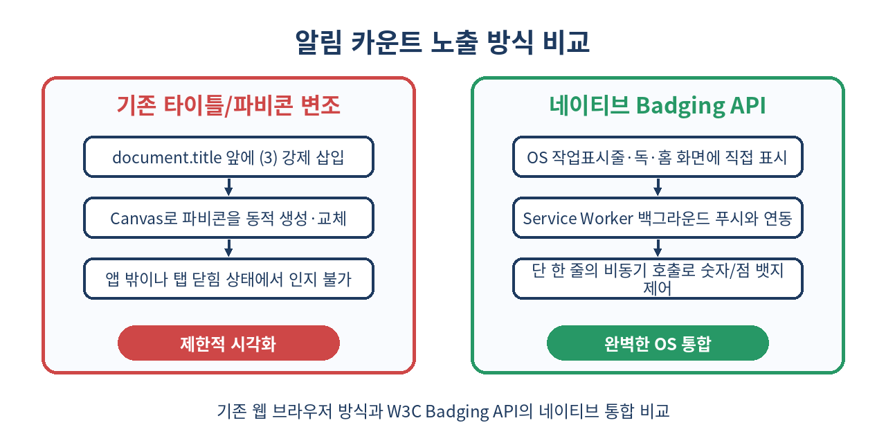
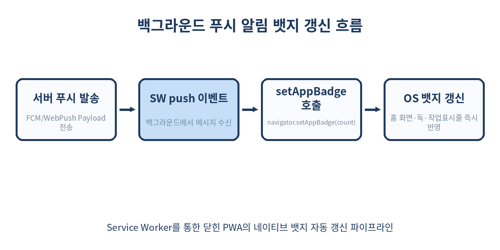

# 🔴 Badging API 완벽 가이드: PWA 앱 아이콘에 실시간 알림 뱃지 달기

> "새 메시지가 도착했는데 앱을 열기 전까지는 알 방법이 없다면, 사용자는 알림 센터의 푸시를 지우는 순간 그 사실을 잊어버립니다."
> 웹 애플리케이션을 OS 네이티브 앱처럼 탈바꿈시키는 핵심 열쇠, W3C Badging API의 설계 원리와 실무 아키텍처를 파헤칩니다.

---

## 📌 목차
1. [Badging API란 무엇인가?](#-1-badging-api란-무엇인가)
2. [기존 웹의 한계와 네이티브 뱃지의 필요성](#-2-기존-웹의-한계와-네이티브-뱃지의-필요성)
3. [브라우저 및 운영체제 지원 현황](#-3-브라우저-및-운영체제-지원-현황)
4. [Badging API 핵심 메서드: setAppBadge와 clearAppBadge](#-4-badging-api-핵심-메서드-setappbadge와-clearappbadge)
5. [숫자 뱃지와 점(Flag) 뱃지의 동작 차이](#-5-숫자-뱃지와-점flag-뱃지의-동작-차이)
6. [포그라운드(Window Context)에서의 실시간 동기화](#-6-포그라운드window-context에서의-실시간-동기화)
7. [백그라운드(Service Worker)와 푸시 알림 결합 아키텍처](#-7-백그라운드service-worker와-푸시-알림-결합-아키텍처)
8. [운영체제별 렌더링 동작과 플랫폼 제약](#-8-운영체제별-렌더링-동작과-플랫폼-제약)
9. [IndexedDB 및 BroadcastChannel을 활용한 다중 탭 일관성 유지](#-9-indexeddb-및-broadcastchannel을-활용한-다중-탭-일관성-유지)
10. [실무 함정과 주의해야 할 에러 패턴](#-10-실무-함정과-주의해야-할-에러-패턴)
11. [Badging API를 쓰면 안 되는 안티패턴](#-11-badging-api를-쓰면-안-되는-안티패턴)
12. [프로덕션 레벨 종합 구현 예제](#-12-프로덕션-레벨-종합-구현-예제)
13. [기술 비교: 타이틀 변경 vs 파비콘 vs Badging API](#-13-기술-비교-타이틀-변경-vs-파비콘-vs-badging-api)
14. [정리](#-14-정리)
15. [참고 자료](#-15-참고-자료)

---

## 🧭 1. Badging API란 무엇인가?

모바일이나 데스크톱 환경에서 네이티브 메신저(카카오톡, Slack, Teams 등)를 사용할 때 가장 직관적으로 미확인 이벤트를 인지하는 수단은 **앱 아이콘 우측 상단에 붙은 작은 빨간 숫자 뱃지**입니다.

과거 웹 환경에서는 사용자가 웹 앱을 데스크톱 PWA(Progressive Web App)로 설치하거나 모바일 홈 화면에 추가하더라도, 앱 아이콘 자체에 뱃지를 달 수 있는 표준 인터페이스가 없었습니다.

**Badging API**는 웹 애플리케이션이 설치된 환경(Installed Web App)에서 OS의 앱 런처, 작업 표시줄(Taskbar), 독(macOS Dock), 모바일 홈 화면에 표시되는 **앱 아이콘에 미확인 알림 개수나 단순 인디케이터(Dot)를 브라우저 네이티브 엔진 레벨에서 직접 렌더링**할 수 있도록 표준화한 W3C 명세입니다.

```js
// 단 한 줄로 앱 아이콘에 숫자 뱃지 노출
await navigator.setAppBadge(7);

// 뱃지 제거
await navigator.clearAppBadge();
```

이 API는 메인 스레드(`Window`)뿐만 아니라 백그라운드 워커 스레드(`ServiceWorkerGlobalScope`)에서도 동작하도록 설계되어, 앱이 닫혀 있더라도 백그라운드 푸시 알림과 연동해 뱃지를 실시간으로 조작할 수 있습니다.

---

## 🧩 2. 기존 웹의 한계와 네이티브 뱃지의 필요성

Badging API가 등장하기 전, 웹 개발자들은 사용자에게 미확인 알림의 존재를 알리기 위해 비표준적인 '눈속임 기법'을 동원해야 했습니다.

1. **문서 타이틀 변조 (`document.title`)**: `document.title = '(3) Logic-Phantom Tech Blog'`처럼 타이틀 앞에 숫자를 덧붙였습니다. 하지만 이 방식은 브라우저 탭이 열려 있을 때만 보이며, 브라우저가 최소화되거나 탭이 수십 개 켜져 타이틀이 축약되면 전혀 인지할 수 없습니다.
2. **동적 파비콘(Favicon) 캔버스 렌더링**: `<canvas>` 엘리먼트에 원본 아이콘을 그린 뒤 빨간 원과 숫자를 합성하고, 이를 `canvas.toDataURL()`로 변환해 `<link rel="icon">`의 `href`를 실시간 교체했습니다. 메모리 릭과 메인 스레드 연산 낭비가 극심했을 뿐 아니라, OS 레벨의 앱 아이콘에는 전혀 영향을 주지 못했습니다.



Badging API는 브라우저 내부 렌더링 트리를 벗어나 **운영체제(OS)의 뱃지 서브시스템(Windows Shell, macOS Dock Tile, Android BadgeProvider 등)과 직접 통신**하여 신뢰성 있고 일관된 사용자 경험을 보장합니다.

---

## 🌐 3. 브라우저 및 운영체제 지원 현황

Badging API는 PWA가 설치된 컨텍스트에서 주로 동작하며, 브라우저 엔진과 OS의 지원 상태를 정확히 파악해야 합니다.

| 플랫폼 / 브라우저 | 지원 여부 | 표시 위치 | 비고 |
| :--- | :--- | :--- | :--- |
| **Chrome / Edge (Windows)** | ✅ 지원 | 작업표시줄(Taskbar) 앱 아이콘 | 숫자 및 플래그 완벽 지원 |
| **Chrome / Edge (macOS)** | ✅ 지원 | Dock 앱 아이콘 | 정수 카운트 완벽 지원 |
| **Chrome (Android)** | ✅ 지원 (v119+) | 홈 화면 / 앱 서랍 바로가기 | 런처에 따라 점(Dot) 또는 숫자 |
| **Safari (macOS Sonoma 14+)** | ✅ 지원 | Dock에 추가된 웹 앱 | PWA로 Dock 추가 시 완벽 동작 |
| **Safari (iOS 16.4+)** | ✅ 지원 | 홈 화면에 추가된 PWA | Web Push 권한 획득 시 지원 |
| **Firefox** | ⚠️ 미지원 (개발 중) | - | 플래그 비활성화 상태 |

> ⚠️ **중요 제약 사항**:
> Badging API는 일반 탭(브라우저 주소창이 노출된 상태)에서는 무시되거나 에러 없이 실패할 수 있습니다. 브라우저는 보안과 UI 혼선을 방지하기 위해 **PWA 매니페스트를 통해 기기에 설치된 앱(Standalone Display Mode)** 또는 **macOS/Windows의 독립 창 컨텍스트**에서만 실제 OS 뱃지 갱신을 허용합니다.

---

## 🛠️ 4. Badging API 핵심 메서드: setAppBadge와 clearAppBadge

Badging API 인터페이스는 매우 단순하고 직관적입니다. 전역 `navigator` 객체(워커에서는 `WorkerNavigator`)에 프로미스 기반 메서드 2개로 제공됩니다.

```js
// 1. 기능 감지 (Feature Detection)
if ('setAppBadge' in navigator && 'clearAppBadge' in navigator) {
  console.log('Badging API를 지원하는 환경입니다.');
} else {
  console.warn('Badging API를 지원하지 않는 브라우저입니다.');
}
```

### 4.1 `navigator.setAppBadge(contents)`

앱 아이콘에 뱃지를 부여합니다. 파라미터로 숫자를 전달하거나, 파라미터 없이 호출할 수 있습니다.

```js
// A. 양의 정수를 전달: 해당 숫자가 뱃지로 표시됨
await navigator.setAppBadge(5);

// B. 인자 없이 호출: 숫자가 아닌 일반 표시(Dot, Flag)가 뱃지로 렌더링됨
await navigator.setAppBadge();
```

### 4.2 `navigator.clearAppBadge()`

표시된 모든 뱃지를 완전히 지웁니다.

```js
await navigator.clearAppBadge();
```

참고로, `navigator.setAppBadge(0)`을 호출하는 것은 `navigator.clearAppBadge()`를 호출하는 것과 규약상 완전히 동일합니다. 즉, 카운트가 `0`이 되면 브라우저는 뱃지 UI를 화면에서 제거합니다.

```js
// 두 코드는 완전히 동일하게 동작합니다.
await navigator.setAppBadge(0);
await navigator.clearAppBadge();
```

---

## 🔢 5. 숫자 뱃지와 점(Flag) 뱃지의 동작 차이

`setAppBadge()`는 인자 전달 여부에 따라 두 가지 모드로 동작합니다.

### 5.1 숫자 뱃지 (`Numeric Badge`)

`navigator.setAppBadge(count)`에 `1` 이상의 정수를 넘기면 OS는 해당 숫자를 아이콘 위에 표시합니다.

- 허용 타입: 64비트 부호 없는 정수(`unsigned long long`).
- 만약 숫자가 99나 999를 초과하는 경우, OS UI 정책에 따라 `99+` 또는 `999+`로 축약되어 표기됩니다.
- 소수점이 포함된 실수를 전달하면 자바스크립트의 표준 정수 변환 규칙에 따라 소수점이 버려집니다(`Math.trunc`).

```js
// 읽지 않은 메일 12개 설정
const unreadEmails = 12;
await navigator.setAppBadge(unreadEmails);
```

### 5.2 점/인디케이터 뱃지 (`Flag Badge`)

인자를 생략하고 `navigator.setAppBadge()`를 호출하면, 구체적인 카운트를 알 수 없거나 카운트가 무의미하지만 사용자에게 확인이 필요한 변경 사항이 있음을 알리는 **도트(Dot)**가 렌더링됩니다.

```js
// 구체적인 개수는 모르지만 읽지 않은 공지사항이 있음을 알림
await navigator.setAppBadge();
```

---

## 🖥️ 6. 포그라운드(Window Context)에서의 실시간 동기화

사용자가 웹 앱 창을 켜둔 상태에서 실시간 웹소켓(WebSocket) 메시지나 SSE(Server-Sent Events)를 수신할 때의 구현 패턴입니다.

사용자가 알림 목록 창을 스크롤하여 모든 알림을 확인하면 자동으로 뱃지를 지워주어야 합니다.

```js
// src/badgeManager.js
export class BadgeManager {
  constructor() {
    this.isSupported = 'setAppBadge' in navigator;
  }

  async update(count) {
    if (!this.isSupported) return;

    try {
      if (count > 0) {
        await navigator.setAppBadge(count);
      } else {
        await navigator.clearAppBadge();
      }
    } catch (error) {
      console.error('뱃지 갱신 실패:', error);
    }
  }

  async clear() {
    if (!this.isSupported) return;
    try {
      await navigator.clearAppBadge();
    } catch (error) {
      console.error('뱃지 초기화 실패:', error);
    }
  }
}
```

페이지가 가시성 상태(`document.visibilityState`)를 바꿀 때 포커스 이벤트를 감지하여 뱃지를 비워줄 수도 있습니다.

```js
const badge = new BadgeManager();

document.addEventListener('visibilitychange', () => {
  if (document.visibilityState === 'visible') {
    // 사용자가 앱으로 복귀했으므로 현재 활성 뷰에 따라 뱃지 초기화
    markCurrentThreadAsRead().then(() => badge.clear());
  }
});
```

---

## 📡 7. 백그라운드(Service Worker)와 푸시 알림 결합 아키텍처

Badging API의 진가는 **앱이 완전히 종료되어 있는 상태**에서 발휘됩니다.
사용자가 브라우저나 PWA 창을 모두 닫았더라도, 백그라운드에서 Push Event를 수신한 Service Worker가 즉각 뱃지를 올릴 수 있습니다.



### 7.1 Service Worker 내부 구현 (`sw.js`)

```js
// sw.js - 서비스 워커 스크립트

self.addEventListener('push', (event) => {
  let payload = {};
  if (event.data) {
    try {
      payload = event.data.json();
    } catch (e) {
      payload = { title: '새 알림', body: event.data.text(), badgeCount: 1 };
    }
  }

  const title = payload.title || 'Logic-Phantom 알림';
  const options = {
    body: payload.body,
    icon: '/images/icons/icon-192x192.png',
    badge: '/images/icons/monochrome-badge.png',
    data: payload.url || '/',
  };

  event.waitUntil(
    (async () => {
      // 1. 네이티브 OS 푸시 배너 표시
      await self.registration.showNotification(title, options);

      // 2. Badging API를 지원하는 워커 환경인지 검사
      if ('setAppBadge' in navigator) {
        // 페이로드에 총 미확인 개수가 담겨 있으면 해당 값 설정
        if (typeof payload.badgeCount === 'number') {
          await navigator.setAppBadge(payload.badgeCount);
        } else {
          // 카운트가 없다면 플래그 뱃지 활성화
          await navigator.setAppBadge();
        }
      }
    })()
  );
});

self.addEventListener('notificationclick', (event) => {
  event.notification.close();

  event.waitUntil(
    (async () => {
      // 1. 앱 창 열기 또는 포커스
      const allClients = await clients.matchAll({ type: 'window', includeUncontrolled: true });
      let targetClient = allClients[0];

      if (targetClient) {
        await targetClient.focus();
      } else {
        targetClient = await clients.openWindow(event.notification.data || '/');
      }

      // 2. 알림을 클릭했으므로 뱃지 제거
      if ('clearAppBadge' in navigator) {
        await navigator.clearAppBadge();
      }
    })()
  );
});
```

이 구조를 통해 PWA는 네이티브 iOS/Android 앱과 100% 동일한 사용자 경험을 제공하게 됩니다. 사용자는 푸시 배너를 놓치더라도 나중에 홈 화면의 아이콘 뱃지를 보고 앱을 실행할 동기를 얻습니다.

---

## 💻 8. 운영체제별 렌더링 동작과 플랫폼 제약

운영체제마다 시스템 UI 철학이 다르기 때문에 동일한 `navigator.setAppBadge(10)`을 호출하더라도 시각적 표현에 차이가 존재합니다.

### 8.1 Windows 10/11
- **표시 위치**: 작업 표시줄(Taskbar)에 고정된 PWA 아이콘 우측 하단.
- **특징**: 직사각형 또는 원형의 강조색 배경 안에 흰색 숫자가 명확히 렌더링됩니다. 창이 활성화되어 있어도 작업표시줄 뱃지는 유지됩니다.

### 8.2 macOS (Chrome, Safari PWA)
- **표시 위치**: Dock(독) 트레이의 앱 아이콘 우측 상단.
- **특징**: macOS 고유의 붉은 타원형 뱃지 디자인이 적용됩니다. 최대 4자리 이상의 숫자가 오면 뱃지 가로 길이가 유연하게 늘어납니다.

### 8.3 Android (Chromium 계열)
- **표시 위치**: 런처(Nova, OneUI, Pixel Launcher 등)의 앱 바로가기 아이콘 모서리.
- **주의점**: 안드로이드 OEM 제조사 및 런처의 알림 점(Notification Dots) 설정에 종속적입니다. 시스템 설정에서 '앱 아이콘에 뱃지 표시'를 꺼둔 사용자의 기기에서는 브라우저가 호출을 성공해도 화면에 나타나지 않습니다.

### 8.4 iOS / iPadOS (Safari Web Push)
- **표시 위치**: 스프링보드(홈 화면)에 '홈 화면에 추가'된 PWA 아이콘.
- **요구 조건**: 사용자가 사이트에서 Web Push 권한을 명시적으로 허용한 상태여야 하며, 반드시 홈 화면에 설치된 Standalone 웹 앱 모드여야 동작합니다.

---

## 🔄 9. IndexedDB 및 BroadcastChannel을 활용한 다중 탭 일관성 유지

사용자가 데스크톱에서 브라우저 창 3개를 동시에 띄워두고 한 탭에서 메일을 읽었을 때, 다른 탭과 앱 런처 뱃지가 즉각 동기화되지 않으면 데이터 불일치가 발생합니다.

이를 해결하기 위해 **BroadcastChannel API**와 로컬 저장소를 결합하여 단일 진실 공급원(Single Source of Truth) 패턴을 구현합니다.

```js
// src/syncedBadge.js
const channel = new BroadcastChannel('app-badge-sync');

export class SyncedBadgeController {
  constructor(storageKey = 'unread_count') {
    this.key = storageKey;
    this.initListener();
  }

  initListener() {
    channel.onmessage = (event) => {
      const { type, count } = event.data;
      if (type === 'BADGE_UPDATED') {
        this.applyToOS(count);
      }
    };
  }

  async setBadge(count) {
    const safeCount = Math.max(0, parseInt(count, 10) || 0);
    localStorage.setItem(this.key, safeCount.toString());
    
    // 1. 현재 탭에서 OS 뱃지 갱신
    await this.applyToOS(safeCount);

    // 2. 다른 열려 있는 모든 탭으로 전파
    channel.postMessage({ type: 'BADGE_UPDATED', count: safeCount });
  }

  async applyToOS(count) {
    if (!('setAppBadge' in navigator)) return;

    try {
      if (count > 0) {
        await navigator.setAppBadge(count);
      } else {
        await navigator.clearAppBadge();
      }
    } catch (err) {
      console.debug('Badge API not available in this context:', err);
    }
  }
}
```

---

## ⚠️ 10. 실무 함정과 주의해야 할 에러 패턴

Badging API를 프로덕션 환경에 배포할 때 맞닥뜨리는 대표적인 함정들입니다.

### 1. 음수(-) 또는 NaN 전달 시 `TypeError` 발생
`setAppBadge()`는 0 이상의 정수(`unsigned long long`)를 기대합니다. 음수를 넘기면 프로미스가 거부(Reject)됩니다.

```js
// ❌ TypeError 발생
await navigator.setAppBadge(-1);

// ⭕ 방어적 파싱 코드 필수
const safeCount = Math.max(0, Math.floor(rawCount) || 0);
await navigator.setAppBadge(safeCount);
```

### 2. 권한(Permission) 문제
일부 브라우저(특히 모바일 사파리)에서는 **알림 권한(Notification Permission)이 거부된 상태에서는 `setAppBadge` 호출이 무시되거나 에러를 발생**시킵니다.

```js
async function safeSetBadge(count) {
  if (!('setAppBadge' in navigator)) return;
  
  if ('Notification' in window && Notification.permission !== 'granted') {
    // 알림 권한이 없으면 뱃지 갱신이 불가능할 수 있음
    return;
  }

  try {
    await navigator.setAppBadge(count);
  } catch (err) {
    if (err.name === 'NotAllowedError') {
      console.warn('사용자가 알림 권한을 차단했습니다.');
    }
  }
}
```

### 3. 설치되지 않은 일반 탭에서의 묵시적 무시
일반 웹 탭에서 `setAppBadge()`를 호출하면 아무런 에러 없이 `Promise.resolve()`가 반환되지만, 실제 사용자의 화면에는 아무것도 나타나지 않습니다. 사용자가 PWA를 설치했는지 확인하는 플래그와 함께 사용하는 것이 바람직합니다.

---

## 🚫 11. Badging API를 쓰면 안 되는 안티패턴

Badging API는 강력하지만 오용하면 사용자의 피로도를 급격히 높입니다.

1. **개인 식별 정보(PII)나 민감한 데이터를 유추할 수 있는 값 노출**:
   - 예: 계좌 잔액 앞자리, 주식 손익률 등을 뱃지에 숫자로 올리면 화면이 잠겨 있어도 외부인에게 노출됩니다.
2. **마케팅 목적의 무한 카운트 증가**:
   - 사용자가 실제 확인해야 할 중요 메시지가 없음에도 단순 접속 유도를 위해 `setAppBadge(99)`를 강제 호출하면 사용자는 즉시 앱을 삭제(Uninstall)합니다.
3. **1초 미만 단위의 고빈도 갱신**:
   - 주식 호가 변동, 초 단위 카운트다운 타이머를 뱃지로 표현하려 하지 마세요. OS 쉘의 IPC 통신 부하로 배터리 소모가 극심해지며 시스템에 의해 호출이 스로틀링(Throttling)됩니다.

---

## 💻 12. 프로덕션 레벨 종합 구현 예제

프론트엔드 React / Vue / Vanilla 환경 어디서나 즉시 사용할 수 있는 완벽한 싱글톤 알림 뱃지 관리자 모듈입니다.

```ts
// src/utils/NotificationBadgeService.ts

type BadgeValue = number | undefined;

class NotificationBadgeService {
  private static instance: NotificationBadgeService;
  private currentCount: number = 0;
  private isSupported: boolean = false;

  private constructor() {
    this.isSupported = typeof navigator !== 'undefined' && 'setAppBadge' in navigator;
  }

  public static getInstance(): NotificationBadgeService {
    if (!NotificationBadgeService.instance) {
      NotificationBadgeService.instance = new NotificationBadgeService();
    }
    return NotificationBadgeService.instance;
  }

  /**
   * 뱃지 숫자를 지정합니다. 0이면 뱃지를 제거합니다.
   */
  public async setCount(count: number): Promise<void> {
    if (!this.isSupported) return;

    const sanitized = Math.max(0, Math.floor(count));
    this.currentCount = sanitized;

    try {
      if (sanitized === 0) {
        await navigator.clearAppBadge();
      } else {
        await navigator.setAppBadge(sanitized);
      }
    } catch (error) {
      this.handleError('setCount', error);
    }
  }

  /**
   * 숫자 없이 단순 점(Dot) 뱃지만 띄웁니다.
   */
  public async showDot(): Promise<void> {
    if (!this.isSupported) return;

    try {
      await navigator.setAppBadge();
    } catch (error) {
      this.handleError('showDot', error);
    }
  }

  /**
   * 뱃지를 즉시 제거합니다.
   */
  public async clear(): Promise<void> {
    if (!this.isSupported) return;

    this.currentCount = 0;
    try {
      await navigator.clearAppBadge();
    } catch (error) {
      this.handleError('clear', error);
    }
  }

  /**
   * 뱃지 숫자를 1 증가시킵니다.
   */
  public async increment(delta: number = 1): Promise<void> {
    await this.setCount(this.currentCount + delta);
  }

  /**
   * 뱃지 숫자를 1 감소시킵니다.
   */
  public async decrement(delta: number = 1): Promise<void> {
    await this.setCount(Math.max(0, this.currentCount - delta));
  }

  private handleError(action: string, error: unknown): void {
    console.warn(`[NotificationBadgeService] ${action} failed:`, error);
  }
}

export const badgeService = NotificationBadgeService.getInstance();
```

```js
// 사용처 예시
import { badgeService } from './utils/NotificationBadgeService';

// 새 웹소켓 메시지 수신 시
socket.on('NEW_MESSAGE', () => {
  badgeService.increment();
});

// 채팅방 입장 시
function onEnterChatRoom() {
  badgeService.clear();
}
```

---

## 📊 13. 기술 비교: 타이틀 변경 vs 파비콘 vs Badging API

| 비교 항목 | `document.title` 조작 | 동적 Favicon 변경 | **Badging API** |
| :--- | :--- | :--- | :--- |
| **표시 영역** | 브라우저 탭 상단 제목 | 브라우저 탭 아이콘 | **OS 작업표시줄, 독, 홈 화면** |
| **앱 닫힘 시 동작** | ❌ 동작 불가 | ❌ 동작 불가 | **✅ Service Worker 연동 가능** |
| **구현 복잡도** | 매우 낮음 (`title = ...`) | 높음 (Canvas, Base64 생성) | **매우 낮음 (메서드 1줄)** |
| **메인스레드 부하** | 극소 | 큼 (이미지 인코딩/디코딩) | **없음 (비동기 OS 위임)** |
| **모바일 홈 화면 지원** | ❌ 불가 | ❌ 불가 | **✅ 지원 (Android, iOS PWA)** |
| **W3C 웹 표준** | 비표준 트릭 | 비표준 트릭 | **공식 웹 표준 (W3C)** |

---

## 🧾 14. 정리

- **Badging API**는 설치형 웹 앱(PWA)이 운영체제의 앱 아이콘 위에 숫자 카운트나 알림 인디케이터(Dot)를 직접 표시할 수 있도록 지원하는 표준 규약입니다.
- `navigator.setAppBadge(count)`와 `navigator.clearAppBadge()`의 직관적인 비동기 인터페이스를 제공하며, `count`에 0을 전달하면 뱃지가 제거됩니다.
- 메인 스레드뿐 아니라 **Service Worker 백그라운드 환경에서도 동작**하므로, 사용자가 웹 앱을 닫아두었을 때도 Web Push와 연계하여 실시간 뱃지 카운트를 최신으로 유지할 수 있습니다.
- Windows 작업 표시줄, macOS Dock, Android 홈 화면, iOS 16.4+ 홈 화면 PWA 등 모던 주요 플랫폼을 폭넓게 지원합니다.
- 음수 값 전달 방지, 알림 권한 선행 확인, 다중 탭 간 BroadcastChannel 동기화 등 실무 방어 코드를 갖추어 도입해야 합니다.

> ✨ **한 줄 요약**
> PWA를 진짜 네이티브 앱으로 완성하는 마지막 퍼즐, `navigator.setAppBadge()`로 닫혀 있는 앱 위에도 살아있는 인터랙션을 전달하세요.

---

## 📚 참고 자료
- [W3C Badging API Specification](https://w3c.github.io/badging/)
- [MDN Web Docs: Badging API](https://developer.mozilla.org/en-US/docs/Web/API/Badging_API)
- [web.dev: Badging for app icons](https://web.dev/articles/badging-api)
- [Apple Developer: Web Push and Badging for Web Apps in iOS and macOS](https://webkit.org/blog/13878/web-push-for-web-apps-on-ios-and-ipados/)
