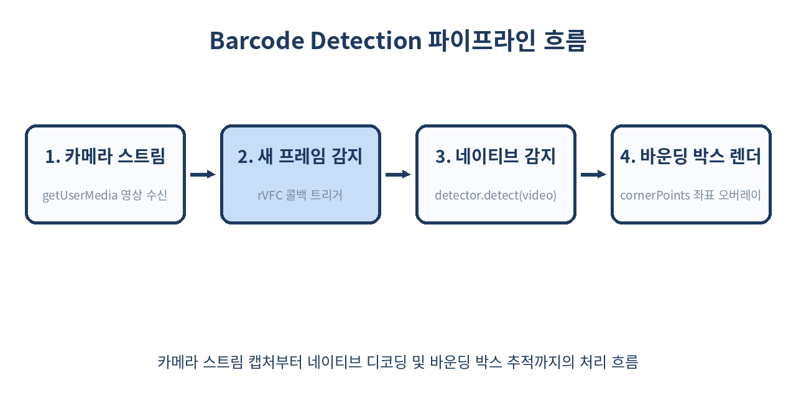
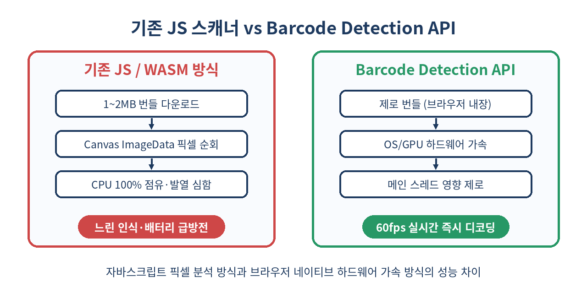

# 📷 Barcode Detection API 완벽 가이드: 무거운 라이브러리 없는 초경량·고성능 네이티브 QR·바코드 스캐너

> 번들 크기 1MB가 넘는 자바스크립트/WASM 라이브러리 없이, 브라우저와 운영체제의 하드웨어 가속 엔진으로 QR 코드와 바코드를 60fps로 감지하는 네이티브 표준 API를 깊이 파헤칩니다.
> 카메라 영상 스트림 처리, 고성능 파이프라인 설계, 폴백 전략, 실무 배포 함정까지 단계별로 다룹니다.

---

## 📌 목차
1. 웹 바코드 인식의 잔혹사: 번들 폭탄과 CPU 병목
2. Barcode Detection API란 무엇인가?
3. 지원 포맷 확인과 브라우저 기능 감지
4. 기본 동작 원리: 정적 이미지와 Canvas 디코딩
5. 실시간 웹캠/모바일 카메라 연동 파이프라인
6. requestVideoFrameCallback()과의 결합으로 60fps 달성하기
7. 감지 결과 객체와 cornerPoints를 활용한 UI 오버레이
8. 기존 JS/WASM 스캐너 vs Barcode Detection API 심층 비교
9. 실무 프로덕션 아키텍처: 점진적 향상과 동적 폴백 구현
10. 모바일 PWA 환경에서의 초점(Focus)과 플래시(Torch) 제어
11. 실무 함정 및 주의사항
12. 이 API를 쓰면 안 되는 상황
13. 총정리
14. 참고 자료

---

## 🧭 1. 웹 바코드 인식의 잔혹사: 번들 폭탄과 CPU 병목

물류 관리, 티켓 검표, 간편 결제, 모바일 웹 로그인 등 웹 애플리케이션에서 QR 코드와 바코드를 스캔해야 하는 유스케이스는 폭발적으로 증가했습니다.

과거 웹 프론트엔드 환경에서 바코드를 읽으려면 대가가 가혹했습니다.

```text
[기존 방식의 병목 구조]
카메라 영상 (MediaStream)
  └─> <canvas>에 매 프레임 그리기 (drawImage)
        └─> getImageData()로 거대한 ImageData 픽셀 배열 추출 (메인 스레드 블로킹)
              └─> jsQR / ZXing JS 라이브러리로 픽셀 전수 분석 (CPU 100% 점유, 발열, 배터리 방전)
```

- **번들 크기 비대화**: `zxing-js`나 순수 JS 기반 바코드 파서 라이브러리는 최소 500KB에서 1.5MB에 이르는 무거운 번들을 로드해야 했습니다.
- **심각한 성능 저하**: `getImageData()` 호출은 GPU 메모리에서 CPU 메모리로의 역방향 읽기를 유발(Readback)하여 파이프라인 스톨을 일으킵니다.
- **모바일 배터리 광탈**: 자바스크립트 엔진이 매 프레임 수백만 픽셀을 순회하느라 스마트폰이 순식간에 뜨거워지고 프레임레이트가 15fps 이하로 곤두박질쳤습니다.

브라우저는 이 문제를 해결하기 위해 OS 및 하드웨어(NPU, GPU)에 이미 내장된 머신 비전 가속기를 직접 호출할 수 있는 네이티브 인터페이스를 마련했습니다. 그것이 바로 **Barcode Detection API**입니다.

---

## 🧩 2. Barcode Detection API란 무엇인가?

Barcode Detection API는 W3C Web Incubator Community Group(WICG)의 **Shape Detection API** 명세 중 가장 먼저 실용화된 규격입니다.

핵심 특징은 다음과 같습니다.
- **하드웨어 가속**: 기기의 운영체제(Android의 Google Play Services 비전 모듈, macOS/iOS의 CoreImage/Vision 프레임워크, Windows의 Windows.Media.FaceAnalysis)를 브라우저가 직접 호출합니다.
- **제로 번들(Zero Bundle)**: 외부 라이브러리를 단 1바이트도 import할 필요가 없습니다.
- **폭넓은 입력 소스 지원**: `HTMLVideoElement`, `HTMLImageElement`, `HTMLCanvasElement`, `Blob`, `ImageData`, `ImageBitmap`, `OffscreenCanvas` 등 거의 모든 웹 그래픽 소스를 입력으로 받습니다.
- **비동기 Promise 기반**: 연산이 메인 스레드를 멈추지 않고 비동기 백그라운드 태스크로 처리됩니다.

---

## 🔍 3. 지원 포맷 확인과 브라우저 기능 감지

Barcode Detection API를 사용하기 전에 먼저 브라우저가 전역 `BarcodeDetector` 객체를 지원하는지 확인해야 합니다.
또한 플랫폼마다 하드웨어 레벨에서 지원하는 바코드 규격이 다르므로, 정적 메서드 `BarcodeDetector.getSupportedFormats()`를 호출해 런타임에 지원 형식을 검사해야 합니다.

```js
// feature-detection.js
export async function checkBarcodeSupport() {
  if (!('BarcodeDetector' in window)) {
    console.warn('현재 브라우저는 Barcode Detection API를 지원하지 않습니다.');
    return { supported: false, formats: [] };
  }

  try {
    const supportedFormats = await BarcodeDetector.getSupportedFormats();
    console.log('지원하는 바코드 포맷:', supportedFormats);
    return { supported: true, formats: supportedFormats };
  } catch (error) {
    console.error('지원 포맷 조회 실패:', error);
    return { supported: false, formats: [] };
  }
}
```

표준에서 정의하는 대표적인 포맷 목록은 다음과 같습니다.
- 2D 매트릭스: `qr_code`, `data_matrix`, `aztec`, `pdf417`
- 1D 선형 바코드: `ean_13`, `ean_8`, `code_128`, `code_39`, `code_93`, `upc_a`, `upc_e`, `itf`, `codabar`

특정 포맷만 감지하도록 제한하면 하드웨어 디코더가 불필요한 알고리즘을 생략하므로 탐색 속도가 2~3배 이상 빨라집니다.

```js
// QR 코드와 EAN-13 상품 바코드만 전문적으로 스캔하는 인스턴스
const detector = new BarcodeDetector({
  formats: ['qr_code', 'ean_13']
});
```

---

## 🖼️ 4. 기본 동작 원리: 정적 이미지와 Canvas 디코딩

가장 단순한 형태는 사용자가 파일 입력(`input type="file"`)으로 올린 이미지 파일이나 `<canvas>`에 그려진 그래픽에서 바코드를 추출하는 것입니다.

```js
// static-scan.js
async function scanBarcodeFromImage(imageElement) {
  const detector = new BarcodeDetector({ formats: ['qr_code'] });

  try {
    // detect()는 비동기 Promise를 반환하며 감지된 결과 배열을 넘겨줍니다.
    const barcodes = await detector.detect(imageElement);

    if (barcodes.length === 0) {
      console.log('감지된 바코드가 없습니다.');
      return null;
    }

    for (const barcode of barcodes) {
      console.log(`포맷: ${barcode.format}`);
      console.log(`원시 데이터: ${barcode.rawValue}`);
      console.log('바운딩 박스:', barcode.boundingBox);
    }

    return barcodes;
  } catch (err) {
    console.error('바코드 디코딩 실패:', err);
    throw err;
  }
}
```

`detect()` 메서드는 `CanvasImageSource` 인터페이스를 만족하는 객체라면 무엇이든 직접 전달받을 수 있으므로 복잡한 전처리 과정이 일절 필요 없습니다.

---

## 🎥 5. 실시간 웹캠/모바일 카메라 연동 파이프라인

실무에서 가장 흔히 마주하는 요구사항은 모바일 카메라 화면을 띄우고 실시간으로 QR 코드를 인식하는 기능입니다.

카메라 스트림을 획득하고 `<video>` 요소에 연결하는 기본 구성입니다.

```js
// camera-stream.js
async function startCamera(videoElement) {
  const constraints = {
    audio: false,
    video: {
      facingMode: { ideal: 'environment' }, // 후면 카메라 우선
      width: { ideal: 1280 },
      height: { ideal: 720 }
    }
  };

  const stream = await navigator.mediaDevices.getUserMedia(constraints);
  videoElement.srcObject = stream;
  await videoElement.play();
  return stream;
}
```

카메라 스트림이 준비되었으면 이제 프레임별로 `detector.detect(videoElement)`를 호출해야 합니다.
이때 어떤 루프 방식을 쓰느냐가 전체 앱의 전력 효율과 반응성을 결정짓습니다.

---

## ⚡ 6. requestVideoFrameCallback()과의 결합으로 60fps 달성하기

많은 개발자가 실시간 비디오 처리에 습관적으로 `requestAnimationFrame(rAF)`이나 `setInterval()`을 사용합니다.
하지만 이는 심각한 낭비를 유발합니다.

1. 카메라 영상은 대개 30fps로 들어오는데 화면 디스플레이가 60Hz나 120Hz(ProMotion)라면 동일한 비디오 프레임을 2~4번 중복 검사하게 됩니다.
2. `setInterval`은 비디오 프레임 싱크와 무관하게 동작하여 티어링(Tearing)이나 지연을 초래합니다.

최신 웹 표준인 **`HTMLVideoElement.requestVideoFrameCallback()` (rVFC)**를 사용하면 비디오 파이프라인에 **새로운 비디오 프레임이 실제로 디코딩되어 도착한 정확한 시점**에만 콜백이 실행됩니다.



```js
// continuous-scanner.js
export class NativeBarcodeScanner {
  constructor(videoElement, onDetected, options = {}) {
    this.video = videoElement;
    this.onDetected = onDetected;
    this.formats = options.formats || ['qr_code'];
    this.detector = new BarcodeDetector({ formats: this.formats });
    this.isScanning = false;
    this.isBusy = false; // detect() 중복 호출 방지용 락
  }

  start() {
    if (this.isScanning) return;
    this.isScanning = true;

    const processFrame = async (now, metadata) => {
      if (!this.isScanning) return;

      // 이전 디코딩 작업이 아직 진행 중이면 현재 프레임은 건너뜁니다.
      if (!this.isBusy) {
        this.isBusy = true;
        try {
          const barcodes = await this.detector.detect(this.video);
          if (barcodes.length > 0) {
            this.onDetected(barcodes, metadata);
          }
        } catch (err) {
          console.warn('프레임 감지 오류:', err);
        } finally {
          this.isBusy = false;
        }
      }

      // rVFC가 지원되면 rVFC를, 미지원 브라우저는 rAF를 폴백으로 사용
      if ('requestVideoFrameCallback' in this.video) {
        this.video.requestVideoFrameCallback(processFrame);
      } else {
        requestAnimationFrame(() => processFrame(performance.now(), {}));
      }
    };

    if ('requestVideoFrameCallback' in this.video) {
      this.video.requestVideoFrameCallback(processFrame);
    } else {
      requestAnimationFrame(() => processFrame(performance.now(), {}));
    }
  }

  stop() {
    this.isScanning = false;
  }
}
```

이 방식으로 구현하면 CPU 점유율이 5% 미만으로 억제되며, 스마트폰의 발열 없이 지속적으로 매끄러운 스캔이 가능해집니다.

---

## 🎯 7. 감지 결과 객체와 cornerPoints를 활용한 UI 오버레이

`detect()` 호출이 성공하면 반환되는 `DetectedBarcode` 객체는 단순 텍스트 정보뿐 아니라 시각적 좌표 정보도 풍부하게 제공합니다.

```typescript
interface DetectedBarcode {
  boundingBox: DOMRectReadOnly; // 단순 직사각형 경계 (x, y, width, height)
  cornerPoints: Array<{ x: number; y: number }>; // 기울어진 4개 꼭짓점 좌표
  format: string; // 'qr_code', 'ean_13' 등
  rawValue: string; // 바코드 본문 문자열
}
```

특히 `cornerPoints`는 QR 코드가 비스듬하게 회전되어 있거나 투영 왜곡(Perspective Distortion)이 발생했을 때도 정확한 4개 정점의 좌표를 제공합니다.
이를 오버레이 `<canvas>`에 그리면 카메라 뷰파인더 위에 QR 코드 영역을 증강현실(AR)처럼 정밀하게 트래킹할 수 있습니다.

```js
// overlay-drawer.js
export function drawBarcodeOverlay(canvas, barcodes, videoWidth, videoHeight) {
  const ctx = canvas.getContext('2d');
  ctx.clearRect(0, 0, canvas.width, canvas.height);

  const scaleX = canvas.width / videoWidth;
  const scaleY = canvas.height / videoHeight;

  for (const code of barcodes) {
    const points = code.cornerPoints;
    if (!points || points.length < 4) continue;

    // 4개 코너를 연결하는 다각형 그리기
    ctx.beginPath();
    ctx.moveTo(points[0].x * scaleX, points[0].y * scaleY);
    for (let i = 1; i < points.length; i++) {
      ctx.lineTo(points[i].x * scaleX, points[i].y * scaleY);
    }
    ctx.closePath();

    ctx.lineWidth = 3;
    ctx.strokeStyle = '#279866'; // logic-phantom 테마 그린
    ctx.fillStyle = 'rgba(39, 152, 102, 0.2)';
    ctx.stroke();
    ctx.fill();

    // 바코드 내용 라벨 표시
    ctx.fillStyle = '#1E3A5F';
    ctx.font = 'bold 14px sans-serif';
    ctx.fillText(code.rawValue, points[0].x * scaleX, (points[0].y * scaleY) - 8);
  }
}
```

---

## ⚖️ 8. 기존 JS/WASM 스캐너 vs Barcode Detection API 심층 비교

두 기술 방식의 차이를 표로 정리해 보겠습니다.

| 비교 항목 | 기존 JS/WASM 방식 (`html5-qrcode`, `zxing`) | Barcode Detection API | 비고 |
| :--- | :--- | :--- | :--- |
| **번들 용량** | 400KB ~ 1.5MB (Gzip 기준) | **0 KB (내장 API)** | 초기 번들 로딩 최적화 |
| **메모리 복사** | 필수 (`getImageData` 호출로 픽셀 전송) | **불필요 (GPU/OS 버퍼 직접 처리)** | 메모리 병목 원천 제거 |
| **CPU 점유율** | 60% ~ 100% (메인/워커 스레드 부하) | **5% 미만 (하드웨어 엔진 가속)** | 기기 발열 및 배터리 절약 |
| **인식 지연(Latency)** | 프레임당 50ms ~ 120ms | **프레임당 5ms ~ 15ms** | 즉각적인 반응성 |
| **지원 포맷 지정** | 라이브러리 지원 범위에 종속 | **플랫폼 네이티브 비전 엔진 종속** | OS 수준 업그레이드 수혜 |
| **브라우저 호환성** | 전 브라우저 (IE11 제외) | **Chromium 기반 전역 지원, Safari 부분** | 하위 호환 폴백 설계 필요 |



---

## 🏗️ 9. 실무 프로덕션 아키텍처: 점진적 향상과 동적 폴백 구현

Barcode Detection API는 Chromium 계열 브라우저(Chrome, Edge, Opera, Samsung Internet)와 Android Webview에서는 완벽하게 동작하지만, Safari(iOS) 및 Firefox 데스크톱에서는 실험적 플래그 뒤에 숨겨져 있거나 아직 완전 지원되지 않는 환경이 존재합니다.

따라서 프로덕션 서비스에서는 **점진적 향상(Progressive Enhancement)** 기법을 사용하여, 네이티브 API가 있으면 초경량 경로를 타고, 미지원 환경에서만 WASM 폴백 라이브러리를 동적 `import()`로 지연 로딩해야 합니다.

```js
// barcode-service.js
export class UniversalBarcodeScanner {
  constructor(options = {}) {
    this.options = options;
    this.engine = null;
  }

  async init() {
    if ('BarcodeDetector' in window) {
      const supported = await BarcodeDetector.getSupportedFormats().catch(() => []);
      if (supported.includes('qr_code')) {
        console.log('⚡ 고성능 네이티브 BarcodeDetector 엔진 사용');
        this.engine = {
          type: 'native',
          detector: new BarcodeDetector({ formats: this.options.formats || ['qr_code'] })
        };
        return;
      }
    }

    // 네이티브 미지원 시에만 수백 KB의 폴백 모듈을 비동기 청크로 분할 로드
    console.log('🔄 폴백 WASM 스캐너 엔진 지연 로드 중...');
    const { ZXingWasmScanner } = await import('./fallback/zxing-wasm-scanner.js');
    this.engine = {
      type: 'wasm',
      detector: new ZXingWasmScanner(this.options)
    };
  }

  async scan(imageSource) {
    if (!this.engine) {
      await this.init();
    }

    if (this.engine.type === 'native') {
      return await this.engine.detector.detect(imageSource);
    } else {
      return await this.engine.detector.scan(imageSource);
    }
  }
}
```

이 구조를 적용하면 80% 이상의 사용자(Chromium 계열 및 지원 환경)는 무거운 바코드 스크립트를 아예 다운로드받지 않아 첫 로딩 속도(LCP)와 네트워크 비용이 획기적으로 개선됩니다.

---

## 🔦 10. 모바일 PWA 환경에서의 초점(Focus)과 플래시(Torch) 제어

어두운 창고나 상품 매장에서 바코드를 인식하려면 카메라 플래시(Torch) 켜기와 근접 초점 조절이 필수적입니다.
`MediaStreamTrack.applyConstraints()`의 고급 제어 API와 결합하면 네이티브 앱과 동일한 스캔 환경을 구축할 수 있습니다.

```js
// torch-control.js
export async function toggleTorch(mediaStream, enable) {
  const track = mediaStream.getVideoTracks()[0];
  if (!track) return false;

  const capabilities = track.getCapabilities();
  
  // 플래시 기능 지원 여부 확인
  if (!capabilities.torch) {
    console.warn('이 기기는 웹에서 플래시 제어를 지원하지 않습니다.');
    return false;
  }

  try {
    await track.applyConstraints({
      advanced: [{ torch: enable }]
    });
    return true;
  } catch (err) {
    console.error('플래시 설정 실패:', err);
    return false;
  }
}

// 줌(Zoom) 배율 조정
export async function setCameraZoom(mediaStream, zoomLevel) {
  const track = mediaStream.getVideoTracks()[0];
  const capabilities = track.getCapabilities();

  if (!capabilities.zoom) return;

  const min = capabilities.zoom.min;
  const max = capabilities.zoom.max;
  const clampedZoom = Math.min(Math.max(zoomLevel, min), max);

  await track.applyConstraints({
    advanced: [{ zoom: clampedZoom }]
  });
}
```

---

## ⚠️ 11. 실무 함정 및 주의사항

실제 프로덕션 환경에 Barcode Detection API를 투입할 때 반드시 마주치는 주의사항입니다.

### 1) HTTPS 보안 컨텍스트 필수
`BarcodeDetector`와 `navigator.mediaDevices.getUserMedia`는 모두 **보안 컨텍스트(Secure Context)**에서만 노출됩니다. `http://` 환경(단, `localhost` 제외)에서는 `window.BarcodeDetector`가 `undefined`로 떨어집니다.

### 2) 비디오의 readyState 확인 없이 detect() 호출 금지
`<video>` 태그가 메타데이터를 로드하기 전(`video.readyState < HTMLMediaElement.HAVE_CURRENT_DATA`), `detect()`를 호출하면 `InvalidStateError` 예외가 발생합니다.
반드시 `loadeddata` 이벤트 이후 또는 비디오가 재생 시작된 시점에 감지를 시작해야 합니다.

```js
if (videoElement.readyState < 2) {
  await new Promise(resolve => {
    videoElement.addEventListener('loadeddata', resolve, { once: true });
  });
}
```

### 3) 원거리 저화소 바코드의 해상도 트레이드오프
바코드가 너무 멀리 있거나 세밀한 고밀도 2D 코드(DataMatrix)인 경우 720p 영상에서는 픽셀이 뭉개져 네이티브 엔진도 인식을 못 할 수 있습니다.
이때는 `width: { ideal: 1920 }` 풀HD 제약 조건을 주되, rVFC 인터벌을 걸어 디코딩 주기를 조절해야 배터리 소모를 막을 수 있습니다.

--- 

## 🚫 12. 이 API를 쓰면 안 되는 상황

아무리 뛰어난 기술이라도 적절하지 않은 사용처가 있습니다.

- **100% 크로스 브라우징이 단일 코드베이스로 강제되는 상황**: Safari iOS 구형 버전이나 특수 임베디드 웹뷰를 지원해야 하면서 폴백 라이브러리를 동적 로딩할 아키텍처적 여유가 없는 경우.
- **표준 외 커스텀 비표준 바코드 체계**: 제조 공장 등에서 자체 개발한 독자 인코딩 매트릭스를 판독해야 하는 경우 (이때는 OpenCV WASM 등 커스텀 머신비전 파이프라인 필요).
- **극단적으로 훼손된 바코드 복원 처리**: 이미지 필터(이진화, 샤프닝, 모폴로지 연산)를 거쳐 손상된 바코드를 복원해야 하는 경우 네이티브 API는 블랙박스 형태이므로 중간 이미지 처리가 어렵습니다.

---

## 🧾 13. 총정리

- **Barcode Detection API**는 외부 라이브러리 없이 브라우저와 OS의 네이티브 가속 엔진으로 QR/바코드를 즉각 디코딩하는 웹 표준 기술입니다.
- 기존 자바스크립트 스캐너 대비 번들 크기는 **0KB**, CPU 점유율은 **5% 미만**으로 하락하며 모바일 배터리 소모와 발열을 원천 차단합니다.
- `requestVideoFrameCallback()`과 조합하여 새로운 비디오 프레임이 디코딩되는 순간에만 실행되도록 파이프라인을 설계해야 최상의 효율을 얻습니다.
- `cornerPoints` 속성을 활용하면 기울어진 QR 코드의 외곽 4개 정점을 추적하여 실시간 AR 바운딩 박스를 매끄럽게 그릴 수 있습니다.
- Chromium 계열 외 브라우저 대응을 위해 네이티브 지원 여부를 런타임에 판별하고 필요할 때만 WASM 스캐너를 동적으로 `import()`하는 폴백 설계를 채택하는 것이 정석입니다.

> ✨ **한 줄 요약**
> 거대한 바코드 라이브러리를 지우고, 브라우저 네이티브 Barcode Detection API로 60fps 무발열 스캔을 구현하세요.

---

## 📚 참고 자료
- [W3C WICG Barcode Detection API 명세](https://wicg.github.io/shape-detection-api/#barcode-detection-api)
- [MDN Web Docs: BarcodeDetector](https://developer.mozilla.org/en-US/docs/Web/API/BarcodeDetector)
- [web.dev: Barcode Detection API - An image detection API](https://web.dev/articles/shape-detection)
- [W3C Media Capture and Streams](https://w3c.github.io/mediacapture-main/)
