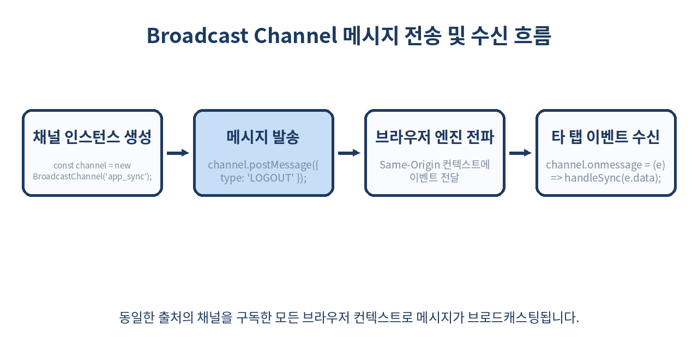
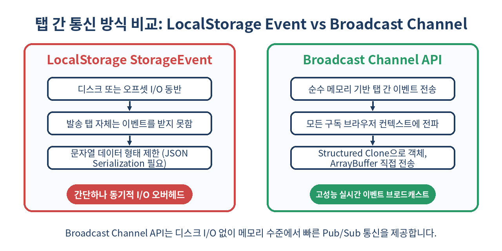

# 📡 Broadcast Channel API 완벽 가이드: 브라우저 탭 간 실시간 데이터 동기화

> 서버를 거치지 않고 웹 브라우저의 여러 탭, 창, iframe 간에 실시간 메시지를 주고받는 가장 깔끔하고 빠른 Web API를 다룹니다.

---

## 📌 목차
1. 🧭 1. 멀티 탭 웹 환경과 브라우저 통신 문제
2. 📡 2. Broadcast Channel API란 무엇인가?
3. ⚖️ 3. 기존 탭 간 통신 기법과의 비교
4. 💻 4. 기본 사용법과 핵심 API 사양
5. 🧬 5. Structured Clone 알고리즘과 전송 가능 복사체
6. 🔐 6. 실무 유스케이스 1: 다중 탭 인증 상태 & 로그아웃 동기화
7. 🛒 7. 실무 유스케이스 2: 장바구니 및 실시간 상태 동기화
8. 🚀 8. 성능 최적화와 메모리 누수 방지 (Channel Closing)
9. 🛡️ 9. 동일 출처 정책(Same-Origin Policy)과 보안 고려사항
10. ⚠️ 10. 실무 함정 1: 페이지 로드 타이밍과 메시지 유실
11. 🔄 11. 실무 함정 2: 무한 메시지 루프(Echo Back) 방지 전략
12. 🚫 12. Broadcast Channel API를 쓰면 안 되는 경우
13. 🧾 13. 정리
14. 📚 14. 참고 자료

---

## 🧭 1. 멀티 탭 웹 환경과 브라우저 통신 문제

현대 웹 애플리케이션 사용자들은 동일한 웹 사이트를 여러 탭이나 창에 띄워두고 작업하는 경우가 흔합니다. 예를 들어 쇼핑몰에서 상품 목록 탭과 상품 상세 탭을 함께 열어두거나, 관리자 페이지에서 여러 대시보드 탭을 동시에 조작하는 상황입니다.

이때 한 쪽 탭에서 **로그아웃**을 하거나, **장바구니 항목을 수정**했음에도 다른 탭에 즉시 반영되지 않는다면 사용자 경험(UX)이 심각하게 손상됩니다. 사용자는 다른 탭에서 작업을 계속하다가 결제 오류를 겪거나, 이미 변경된 데이터에 중복 요청을 보내게 됩니다.

과거에는 이를 해결하기 위해 백엔드 서버에 WebSocket 연결을 유지하거나, 짧은 주기로 롱 폴링(Long Polling)을 수행했습니다. 하지만 클라이언트 단에서 단순히 해결할 수 있는 데이터 동기화를 위해 서버 리소스와 네트워크 대역폭을 소모하는 것은 극히 비효율적입니다.

---

## 📡 2. Broadcast Channel API란 무엇인가?

`Broadcast Channel API`는 동일한 출처(Same-Origin: 프로토콜, 도메인, 포트가 동일)를 공유하는 브라우저 컨텍스트(탭, 창, iframe, Service Worker, Web Worker) 간에 일대다(1:N) 메시지 브로드캐스팅을 가능하게 해주는 순수 웹 표준 API입니다.

중앙 서버나 백엔드 인프라가 전혀 필요치 않으며, 브라우저의 프로세스 간 통신(IPC) 메커니즘을 기반으로 동작하여 매우 빠른 반응 속도와 효율적인 메모리 사용을 보장합니다.



구독하고자 하는 통신 채널의 이름(Name)을 지정하여 `BroadcastChannel` 객체를 생성하기만 하면, 해당 채널 이름을 구독하고 있는 동일 출처의 모든 컨텍스트로 이벤트가 실시간 전파됩니다.

---

## ⚖️ 3. 기존 탭 간 통신 기법과의 비교

Broadcast Channel API가 등장하기 전에도 탭 간 통신을 구현하기 위한 몇 가지 우회 기법이 존재했습니다. 각각의 장단점을 정리하면 다음과 같습니다.

| 통신 기법 | 메커니즘 | 데이터 형태 | 주요 장점 | 주요 단점 및 한계 |
| :--- | :--- | :--- | :--- | :--- |
| **LocalStorage Event** | `window.addEventListener('storage', ...)` | 단순 문자열 (JSON) | 호환성 뛰어남 (구형 브라우저) | 동기식 디스크/스토리지 I/O 발생, 동일 탭 전파 안 됨 |
| **Shared Worker** | 중앙 웹 워커 스레드를 통한 메시징 | 객체 가능 | 상태 공유 및 정교한 제어 가능 | 코드 복잡도 매우 높음, Safari 지원 제약 역사 |
| **Broadcast Channel** | 메모리 기반 메시지 브로드캐스팅 | Structured Clone 가능 객체 | API가 매우 직관적이고 고성능 | 다른 출처(Cross-Origin) 통신 불가 |
| **Window.postMessage** | Target Window 참조를 통한 직접 통신 | Structured Clone 가능 객체 | Cross-Origin 통신 지원 | `window.open` 참조나 iframe 참조가 반드시 필요 |

StorageEvent 방식은 로컬 스토리지에 데이터를 썼다 지우는 과정에서 불필요한 I/O가 발생하며, 데이터 크기가 커지면 브라우저 메인 스레드 지연을 유발할 수 있습니다. 반면 Broadcast Channel API는 순수 메모리 상에서 Pub/Sub 패턴으로 동작하므로 오버헤드가 매우 적습니다.

---

## 💻 4. 기본 사용법과 핵심 API 사양

Broadcast Channel API의 인터페이스는 극도로 간결합니다. 기본 사용 패턴은 채널 생성, 메시지 전송, 메시지 수신, 채널 닫기 4단계로 구성됩니다.

```js
// 1. 채널 인스턴스 생성 (동일한 채널 이름을 공유해야 함)
const authChannel = new BroadcastChannel('auth_status_channel');

// 2. 메시지 발송 (객체, 배열, 원시값 등 자유롭게 전송 가능)
function broadcastLogout() {
  authChannel.postMessage({
    type: 'LOGOUT_EVENT',
    timestamp: Date.now(),
    reason: 'USER_CLICK'
  });
}

// 3. 메시지 수신 이벤트 리스너 등록
authChannel.onmessage = (event) => {
  console.log('수신된 데이터:', event.data);
  if (event.data.type === 'LOGOUT_EVENT') {
    alert('다른 탭에서 로그아웃되었습니다. 로그인 페이지로 이동합니다.');
    window.location.href = '/login';
  }
};

// 4. 에러 처리 리스너 등록
authChannel.onmessageerror = (errorEvent) => {
  console.error('메시지 역직렬화 실패:', errorEvent);
};

// 5. 사용 완료 시 채널 닫기
function cleanup() {
  authChannel.close();
}
```

이벤트 리스너는 `onmessage` 프로퍼티 할당 방식 외에도 `addEventListener('message', callback)` 형태로 등록할 수 있습니다.

---

## 🧬 5. Structured Clone 알고리즘과 전송 가능 복사체

`postMessage`를 통해 전달되는 모든 데이터는 브라우저의 **Structured Clone 알고리즘**을 통해 복사됩니다. 즉, 단순 JSON 문자열화(`JSON.stringify`)가 다룰 수 없는 복잡한 자바스크립트 객체 구조를 손실 없이 전달할 수 있습니다.

### 지원되는 주요 데이터 타입
- **원시 타입 및 객체**: `Map`, `Set`, `Date`, `RegExp`
- **바이너리 데이터**: `ArrayBuffer`, `TypedArray` (`Uint8Array` 등), `DataView`，`Blob`, `File`
- **순환 참조(Circular Reference)**를 포함하는 객체 그래프

```js
// complexData.js - 복잡한 데이터 구조 브로드캐스팅 예시
const dataChannel = new BroadcastChannel('complex_data');

const map = new Map();
map.set('user', { name: 'Alice' });
map.set('created', new Date());

// 순환 참조 객체 생성
const circularObj = { title: 'Broadcast' };
circularObj.self = circularObj;

// postMessage로 직접 전송 가능!
dataChannel.postMessage({
  metadata: map,
  circular: circularObj,
  buffer: new Uint8Array([1, 2, 3, 4]).buffer
});
```

⚠️ **주의사항**: DOM Element, Function, Error 객체, ES6 Symbol 및 WebGL/Canvas 관련 객체는 Structured Clone으로 복사할 수 없으며, 전송 시 `DataCloneError` 예외가 발생합니다.

---

## 🔐 6. 실무 유스케이스 1: 다중 탭 인증 상태 & 로그아웃 동기화

가장 대표적인 사용 사례는 보안 및 인증 동기화입니다. 사용자가 A 탭에서 로그아웃을 누르면, 열려 있던 B 탭과 C 탭에서도 토큰 메모리 세션을 즉시 파기하고 민감한 정보를 화면에서 숨겨야 합니다.

```javascript
// authManager.js - 인증 싱클톤 모듈
class AuthSyncManager {
  constructor() {
    this.channel = new BroadcastChannel('app_auth_channel');
    this.initListener();
  }

  initListener() {
    this.channel.onmessage = (event) => {
      const { action, payload } = event.data;
      switch (action) {
        case 'SESSION_EXPIRED':
        case 'LOGOUT':
          this.handleRemoteLogout(payload);
          break;
        case 'LOGIN_SUCCESS':
          this.handleRemoteLogin(payload);
          break;
        default:
          break;
      }
    };
  }

  logout() {
    // 1. 현재 탭의 로컬 토큰 파기
    sessionStorage.clear();
    // 2. 타 탭으로 로그아웃 이벤트 브로드캐스팅
    this.channel.postMessage({ action: 'LOGOUT', payload: { timestamp: Date.now() } });
    // 3. 로그인 페이지 이동
    window.location.href = '/login';
  }

  handleRemoteLogout(payload) {
    sessionStorage.clear();
    console.warn(`[${payload.timestamp}] 타 탭에 의해 로그아웃 되었습니다.`);
    window.location.reload();
  }
}

export const authSync = new AuthSyncManager();
```

---

## 🛒 7. 실무 유스케이스 2: 장바구니 및 실시간 상태 동기화

전자상거래 웹 사이트나 React/Vue 기반 대시보드에서 전역 상태(State)의 일부를 탭 간 동기화할 때 유용합니다. Redux, Zustand 등의 상태 관리 라이브러리와 결합하여 스토어 변경 사항을 브로드캐스팅할 수 있습니다.



```typescript
// cartStoreSync.ts - Zustand 스토어와 Broadcast Channel 연동
import { create } from 'zustand';

interface CartState {
  items: string[];
  addItem: (item: string, isRemote?: boolean) => void;
}

const cartChannel = new BroadcastChannel('cart_sync_channel');

export const useCartStore = create<CartState>((set) => {
  // 다른 탭으로부터의 이벤트 수신
  cartChannel.onmessage = (event) => {
    const { type, item } = event.data;
    if (type === 'ADD_ITEM') {
      set((state) => ({ items: [...state.items, item] }));
    }
  };

  return {
    items: [],
    addItem: (item, isRemote = false) => {
      set((state) => ({ items: [...state.items, item] }));
      
      // 로컬 액션일 때만 메시지 전송 (무한 루프 방지)
      if (!isRemote) {
        cartChannel.postMessage({ type: 'ADD_ITEM', item });
      }
    },
  };
});
```

---

## 🚀 8. 성능 최적화와 메모리 누수 방지 (Channel Closing)

BroadcastChannel은 가비지 컬렉션(Garbage Collection)의 대상이 되지만, 명시적으로 `close()`를 호출하지 않으면 이벤트 리스너 참조로 인해 브라우저 메모리에 유지될 수 있습니다.

특히 싱글 페이지 애플리케이션(SPA)의 컴포넌트 라이프사이클 내에서 생성 시 파괴를 철저히 관리해야 합니다.

```jsx
// React 컴포넌트 내에서의 안전한 사용 예시
import React, { useEffect } from 'react';

export const ThemeSyncComponent = () => {
  useEffect(() => {
    const themeChannel = new BroadcastChannel('theme_channel');

    themeChannel.onmessage = (e) => {
      document.body.dataset.theme = e.data.theme;
    };

    // 언마운트 시 명시적 채널 닫기 필수
    return () => {
      themeChannel.close();
    };
  }, []);

  const toggleTheme = (newTheme) => {
    const themeChannel = new BroadcastChannel('theme_channel');
    themeChannel.postMessage({ theme: newTheme });
    themeChannel.close(); // 단발성 전송 후 즉시 해제
  };

  return <button onClick={() => toggleTheme('dark')}>다크 모드 적용</button>;
};
```

---

## 🛡️ 9. 동일 출처 정책(Same-Origin Policy)과 보안 고려사항

Broadcast Channel API는 엄격하게 **동일 출처 정책(SOP)**을 따릅니다.

- `https://example.com` 과 `https://example.com:8080` (포트 다름) -> **통신 불가**
- `https://example.com` 과 `http://example.com` (프로토콜 다름) -> **통신 불가**
- `https://sub.example.com` 과 `https://example.com` (서브도메인 다름) -> **통신 불가**

### 보안 체크리스트
1. **민감 정보 직접 전송 금지**: 비밀번호, 원시 JWT 토큰, 개인정보 등은 Broadcast Channel 메시지에 실어 보내지 않는 것이 좋습니다. 동일 출처 내의 악성 XSS 스크립트가 채널 이름을 도청(`listening`)하여 데이터를 탈취할 수 있습니다.
2. **이벤트 검증**: 메시지를 수신했을 때 `event.data` 구조가 예상한 포맷인지 반드시 검증(`Type Check`) 후 비즈니스 로직을 실행하세요.

---

## ⚠️ 10. 실무 함정 1: 페이지 로드 타이밍과 메시지 유실

Broadcast Channel API는 **Pub/Sub (발행/구독)** 모델입니다. 메시지는 메시지를 전송하는 시점에 이미 연결을 맺고 있는 타 탭으로만 전달되며, 메시지가 보관되거나 저장되는 큐(Queue) 메커니즘이 없습니다.

```text
[탭 A] 메시지 전송 (12:00:00)
  │
  ├──> [탭 B] 이미 열려있음 -> 메시지 수신 성공! ⭕
  └──> [탭 C] 12:00:01에 페이지 로드 시작 -> 메시지 못 받음! ❌
```

### 해결 방법: 초기 상태 요청 패킷 (Handshake Pattern)
새로 열린 탭이 초기화될 때 기존 탭들에게 현재 상태 데이터를 요청하는 핸드셰이크 방식을 적용합니다.

```js
// newlyOpenedTab.js
const channel = new BroadcastChannel('state_sync');

// 1. 신규 탭 로드 시 기존 탭들에게 상태 동기화 요청
channel.postMessage({ type: 'REQUEST_CURRENT_STATE' });

channel.onmessage = (e) => {
  if (e.data.type === 'RESPONSE_CURRENT_STATE') {
    console.log('기존 탭으로부터 전달받은 상태:', e.data.state);
  }
};

// existingTab.js (기존에 켜져 있던 탭)
const channel = new BroadcastChannel('state_sync');
channel.onmessage = (e) => {
  if (e.data.type === 'REQUEST_CURRENT_STATE') {
    // 신규 탭에 현재 상태를 응답
    channel.postMessage({
      type: 'RESPONSE_CURRENT_STATE',
      state: currentGlobalState
    });
  }
};
```

---

## 🔄 11. 실무 함정 2: 무한 메시지 루프(Echo Back) 방지 전략

Broadcast Channel API의 한 가지 핵심적 사양은 **'메시지를 발송한 자기 자신 인스턴스는 해당 메시지 이벤트를 받지 않는다'**는 점입니다.

그러나 아래와 같은 잘못된 리액티브 상태 구조에서는 **핑퐁(Ping-Pong) 무한 루프**가 발생할 수 있습니다.

```text
[탭 A] 상태 변경 -> Broadcast 전송
   └─> [탭 B] 수신 -> 탭 B 상태 변경 -> (상태 변경 감지) -> Broadcast 전송
          └─> [탭 A] 수신 -> 탭 A 상태 변경 -> Broadcast 전송... (무한 반복 🔥)
```

### 루프 방지 핵심 패턴
1. **이벤트 출처 식별자(Sender ID) 부여**: 각 탭마다 고유한 `tabId`를 발급하고 자신이 보낸 메시지는 처리하지 않거나 플래그 제어.
2. **상태 변경 원인(Source) 분리**: UI 조작에 의한 원본 이벤트와 브로드캐스트 수신으로 인한 업데이트를 구분합니다.

```js
const TAB_ID = crypto.randomUUID();
const channel = new BroadcastChannel('sync_channel');

function updateStateAndNotify(newState) {
  applyToDOM(newState);
  // Sender ID 포함
  channel.postMessage({ sender: TAB_ID, payload: newState });
}

channel.onmessage = (event) => {
  // 자신이 발송한 이벤트이거나 수신 출처가 명확할 때 재전파 차단
  if (event.data.sender === TAB_ID) return;
  
  // UI 업데이트만 수행하고 다시 postMessage를 부르지 않음
  applyToDOM(event.data.payload);
};
```

---

## 🚫 12. Broadcast Channel API를 쓰면 안 되는 경우

아무리 뛰어난 API라도 적절하지 않은 사용처에 적용하면 독이 됩니다.

1. **서로 다른 도메인/서브도메인 간 통신이 필요한 경우**
   - SOP 정책으로 인해 완전 불가능합니다. 이 경우 `window.postMessage`와 hidden iframe 기법을 활용해야 합니다.
2. **메시지 영속성(Persistence) 및 오프라인 보장이 필요한 경우**
   - 탭이 닫혀있거나 메시지 발송 시점에 탭이 없으면 메시지가 소멸합니다. 데이터 보관이 필요하다면 IndexedDB나 Service Worker의 Background Sync를 써야 합니다.
3. **대용량 미디어 스트리밍 또는 초당 수백 회 이상의 고주파수 데이터**
   - 메인 스레드 간 직렬화/복사 비용이 누적될 수 있습니다. 대용량 바이너리는 `SharedArrayBuffer`나 `OffscreenCanvas` 기법을 고려하세요.

---

## 🧾 13. 정리

- **서버 무개입 탭 간 통신**: Broadcast Channel API는 동일 출처의 모든 브라우저 컨텍스트 간 메시지를 전송하는 순수 웹 표준 API입니다.
- **고성능 & 풍부한 데이터**: LocalStorage Event 방식과 달리 디스크 I/O가 없으며 Structured Clone 알고리즘으로 객체, Date, TypedArray 등을 직접 전달합니다.
- **단순한 인터페이스**: `new BroadcastChannel(name)`, `postMessage()`, `onmessage`, `close()` 4가지로 완벽히 제어 가능합니다.
- **메모리 관리 유의**: 컴포넌트 해제 시 `close()`를 호출하여 리소스 누수를 막아야 합니다.
- **설계 주의점**: 메시지 보관 기능이 없으므로 Initial Handshake 패턴을 적용하고, 탭 간 무한 핑퐁 루프 방지용 `sender` 식별자를 둬야 합니다.

> ✨ **한 줄 요약**
> 복잡한 백엔드 연결 없이 `new BroadcastChannel()` 하나만으로 멀티 탭 사용자의 경험을 실시간 동기화로 극대화하자!

---

## 📚 14. 참고 자료
- [MDN Web Docs - BroadcastChannel API](https://developer.mozilla.org/en-US/docs/Web/API/Broadcast_Channel_API)
- [HTML Living Standard - BroadcastChannel](https://html.spec.whatwg.org/multipage/web-messaging.html#broadcast-channel)
- [MDN Web Docs - Structured Clone Algorithm](https://developer.mozilla.org/en-US/docs/Web/API/Web_Workers_API/Structured_clone_algorithm)
