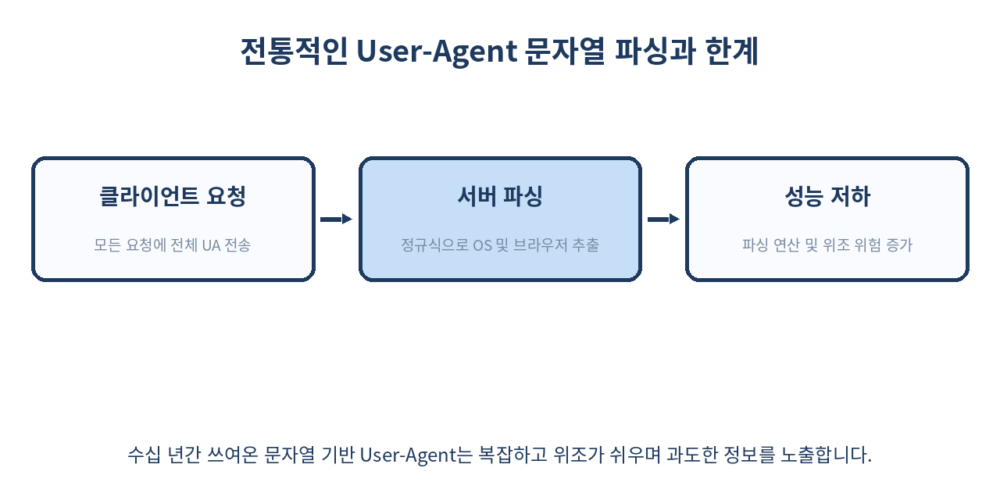
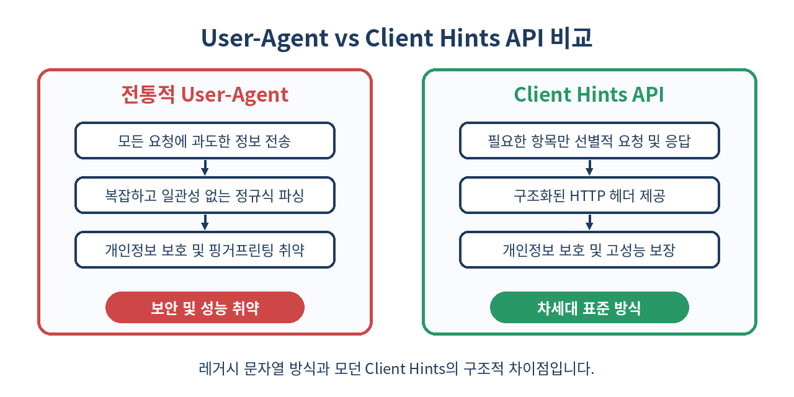

# 📡 Client Hints API 완벽 가이드: User-Agent 헤더의 종말과 정밀한 브라우저·기기 제어

> 고질적인 User-Agent 문자열의 파싱 지옥에서 벗어나, 서버가 필요한 최소한의 기기 정보만 안전하게 요청하는 차세대 웹 표준 클라이언트 힌트(Client Hints)의 모든 것을 알아봅니다.
> 이 글에서는 Client Hints API의 등장 배경, 핵심 헤더 구조, JavaScript API 연동 방법, 실무 적용 시 주의사항과 함정까지 심층적으로 다룹니다.

---

## 📌 목차
1. 🧐 왜 우리는 User-Agent 문자열을 버려야 하는가?
2. 🧭 Client Hints API의 핵심 개념과 동작 원리
3. 📋 주요 요청 헤더: Sec-Ch-UA와 관련 속성
4. 📱 기기 메모리, 네트워크, 하드웨어 정보 수집하기
5. 💻 JavaScript에서 navigator.userAgentData 활용하기
6. 
7. ⚙️ 서버(Express / Next.js)에서의 Accept-CH 설정
8. 🛡️ 개인정보 보호와 핑거프린팅 방어 메커니즘
9. ⚠️ 실무 함정 및 쓰면 안 되는 경우
10. 
11. 🧾 정리 및 핵심 요약
12. 📚 참고 자료

---

## 🧐 1. 왜 우리는 User-Agent 문자열을 버려야 하는가?

웹 개발 초기부터 브라우저는 서버에 자신의 정체를 알리기 위해 `User-Agent` HTTP 헤더를 전달해 왔습니다. 하지만 이 문자열은 다음과 같은 거대한 문제점들을 안고 있었습니다.

- **과도한 정보 노출**: OS 버전, 세부 빌드 번호, 하드웨어 아키텍처 등 사용자의 프라이버시를 침해할 수 있는 수많은 정보가 포함됩니다.
- **위조의 용이성**: 브라우저 확장 프로그램이나 프락시를 통해 쉽게 조작할 수 있어 신뢰성이 떨어집니다.
- **파싱의 복잡성**: 각 브라우저마다 제각각인 포맷 때문에 정규식 지옥에 빠지기 일쑤였습니다.

전통적인 `User-Agent` 문자열의 전형적인 구조는 다음과 같습니다:

```text
Mozilla/5.0 (Windows NT 10.0; Win64; x64) AppleWebKit/537.36 (KHTML, like Gecko) Chrome/120.0.0.0 Safari/537.36 Edg/120.0.0.0
```

위와 같은 길고 복잡한 문자열을 파싱하기 위해 백엔드 개발자들은 복잡한 정규식을 작성해야 했습니다. 다음은 Node.js 환경에서 기존 User-Agent를 파싱할 때 겪는 전형적인 코드 파편입니다.

```javascript
// 전통적인 정규식 기반 User-Agent 파싱의 고통
const userAgent = req.headers['user-agent'] || '';
const isChrome = /Chrome\/([0-9.]+)/.test(userAgent);
const isWindows = /Windows NT ([0-9.]+)/.test(userAgent);

if (isChrome && isWindows) {
  // 특정 버전에 따른 분기 처리 지옥 시작
  console.log('레거시 파싱 방식 실행');
}
```

이와 같은 비효율적이고 프라이버시를 위협하는 문자열 대신, 필요한 정보만 명시적으로 요청하는 메커니즘이 바로 **Client Hints API**입니다.

---

## 🧭 2. Client Hints API의 핵심 개념과 동작 원리

Client Hints는 W3C에서 제정한 표준으로, 서버가 브라우저에게 "나는 이런 정보가 필요해"라고 요청(`Accept-CH`)하면, 브라우저는 보안과 프라이버시가 보장된 구조화된 헤더 형태로 응답하는 방식입니다.

- **명시적 요청**: 서버가 원하지 않는 정보는 기본적으로 전송되지 않아 네트워크 대역폭과 프라이버시를 동시에 지킵니다.
- **구조화된 형식**: 비정형 문자열 대신 키-값 형태의 구조화된 HTTP 헤더를 사용합니다.

클라이언트와 서버 간의 통신 흐름은 다음과 같은 생명주기를 가집니다.

1. **최초 요청**: 클라이언트가 서버에 접속합니다. 서버는 응답 헤더(`Accept-CH`)를 통해 필요한 힌트 목록을 알립니다.
2. **이후 요청**: 브라우저는 서버가 요구한 힌트 헤더(`Sec-Ch-UA-*`)를 자동으로 후속 요청에 포함시켜 전달합니다.
3. **동적 제어**: 서버는 수신된 구조화된 데이터를 기반으로 최적화된 리소스(이미지, 스크립트 등)를 반환합니다.

---

## 📋 3. 주요 요청 헤더: Sec-Ch-UA와 관련 속성

서버 응답이나 메타 태그를 통해 브라우저는 다음과 같은 주요 저수준 힌트 헤더를 수신할 수 있습니다.

- `Sec-Ch-UA`: 사용 중인 브라우저 브랜드와 버전
- `Sec-Ch-UA-Mobile`: 모바일 기기 여부 (`?0` 또는 `?1`)
- `Sec-Ch-UA-Platform`: 운영체제 이름 (`"Windows"`, `"macOS"`, `"Android"` 등)
- `Sec-Ch-UA-Full-Version-List`: 브라우저의 전체 버전 목록 (고해상도 정보)

실제 크로미움(Chromium) 기반 브라우저가 전송하는 HTTP 요청 헤더의 예시는 다음과 같습니다.

```http
GET /index.html HTTP/1.1
Host: example.com
Sec-Ch-UA: "Not_A Brand";v="8", "Chromium";v="120", "Google Chrome";v="120"
Sec-Ch-UA-Mobile: ?0
Sec-Ch-UA-Platform: "macOS"
Sec-Ch-UA-Platform-Version: "14.1.0"
```

각 헤더 값은 RFC 8941 구조화된 필드(Structured Fields for HTTP) 명세에 따르며, 문자열, 불리언(`?0`, `?1`), 정수형 등 명확한 타입을 가집니다.

---

## 📱 4. 기기 메모리, 네트워크, 하드웨어 정보 수집하기

정적 브라우저 정보뿐만 아니라 동적인 기기 상태와 네트워크 환경도 힌트로 받아올 수 있습니다. 이를 통해 서버 측에서부터 사용자의 네트워크 상태나 하드웨어 성능에 맞춘 적응형(Adaptive) 웹 페이지를 구성할 수 있습니다.

- `Save-Data`: 사용자가 데이터 절약 모드를 켜두었는지 여부 (`on`)
- `Device-Memory`: 기기의 대략적인 RAM 용량 (예스코어 기준 `0.25`, `0.5`, `1`, `2`, `4`, `8` GB 등)
- `Downlink`: 예상 네트워크 대역폭 속도 (Mbps 단위)
- `RTT`: 왕복 지연 시간 (Round Trip Time, 밀리초 단위)
- `Ect`: 유효 연결 유형 (`4g`, `3g`, `2g`, `slow-2g`)

다음은 네트워크 및 하드웨어 힌트를 활용하기 위한 `Accept-CH` 설정 예시입니다.

```http
Accept-CH: Device-Memory, Downlink, RTT, Save-Data
```

서버에서는 이 값들을 읽어 저사양 기기나 네트워크가 느린 사용자에게는 고용량 동영상 대신 압축된 정적 이미지를 서빙하는 등의 최적화를 수행할 수 있습니다.

---

## 💻 5. JavaScript에서 navigator.userAgentData 활용하기

서버 측뿐만 아니라 클라이언트 JavaScript 환경에서도 `navigator.userAgentData` 객체를 통해 안전하게 기기 정보를 조회할 수 있습니다. 기본 정보는 즉시 접근 가능하지만, 민감할 수 있는 고해상도(High Entropy) 값은 비동기 메서드를 통해 요청해야 합니다.

```javascript
if (navigator.userAgentData) {
  // 저해상도 기본 정보 (즉시 접근 가능)
  console.log('브라우저 브랜드:', navigator.userAgentData.brands);
  console.log('모바일 여부:', navigator.userAgentData.mobile);
  console.log('플랫폼:', navigator.userAgentData.platform);
  
  // 고해상도 정보 요청 (비동기 처리)
  navigator.userAgentData.getHighEntropyValues([
    'architecture',
    'model',
    'platformVersion',
    'fullVersionList'
  ]).then((ua) => {
    console.log('고해상도 기기 아키텍처:', ua.architecture);
    console.log('디바이스 모델명:', ua.model);
    console.log('플랫폼 세부 버전:', ua.platformVersion);
    console.log('전체 버전 리스트:', ua.fullVersionList);
  }).catch((err) => {
    console.error('고해상도 정보 획득 실패:', err);
  });
} else {
  console.log('Client Hints를 지원하지 않는 레거시 브라우저입니다.');
}
```

이 방식은 불필요한 시스템 정보를 한 번에 노출하지 않고, 프론트엔드 애플리케이션이 구체적으로 필요한 순간에만 권한 기반으로 정보를 취득할 수 있게 보장합니다.

---

## 

---

## ⚙️ 6. 서버(Express / Next.js)에서의 Accept-CH 설정

서버에서 Client Hints를 수신하려면 초기 응답 헤더에 `Accept-CH`를 포함하거나 HTML 문서 내에 메타 태그를 삽입해야 합니다. HTTP 응답 헤더를 통한 설정이 캐싱 및 성능 면에서 가장 권장됩니다.

HTML 문서 내에 메타 태그를 활용하는 방법은 다음과 같습니다.

```html
<!DOCTYPE html>
<html lang="ko">
<head>
  <meta charset="UTF-8">
  <meta http-equiv="Accept-CH" content="Sec-Ch-UA, Sec-Ch-UA-Platform, Device-Memory, Viewport-Width">
  <title>Client Hints 예제</title>
</head>
<body>
  <h1>Client Hints 적용 페이지</h1>
</body>
</html>
```

Node.js Express 환경에서 미들웨어를 활용해 `Accept-CH` 헤더를 전파하고 요청 값을 핸들링하는 실무 예시 코드입니다.

```javascript
const express = require('express');
const app = express();

// 클라이언트 힌트 요청 헤더를 전역으로 설정하는 미들웨어
app.use((req, res, next) => {
  res.setHeader(
    'Accept-CH',
    'Sec-Ch-UA, Sec-Ch-UA-Platform, Sec-Ch-UA-Mobile, Device-Memory, Downlink'
  );
  // 크리티컬 힌트 설정 (필요시 최초 요청 즉시 반영 유도)
  res.setHeader('Critical-CH', 'Sec-Ch-UA-Platform, Device-Memory');
  next();
});

app.get('/', (req, res) => {
  const platform = req.get('Sec-Ch-UA-Platform') || 'Unknown Platform';
  const memory = req.get('Device-Memory') || 'Unknown Memory';
  const isMobile = req.get('Sec-Ch-UA-Mobile') === '?1';

  res.json({
    message: 'Client Hints 성공적으로 수신됨',
    deviceInfo: {
      platform,
      memory: `${memory} GB`,
      isMobile,
    }
  });
});

app.listen(3000, () => {
  console.log('서버가 3000번 포트에서 실행 중입니다.');
});
```

---

## 🛡️ 7. 개인정보 보호와 핑거프린팅 방어 메커니즘

Client Hints는 웹 상의 악의적인 추적 기법인 핑거프린팅(Browser Fingerprinting)을 방어하기 위해 설계되었습니다.

- **저해상도 기본값**: 기본 요청에는 브라우저 패밀리와 대략적인 운영체제 이름 등 최소한의 정보만 제공합니다.
- **고해상도(High Entropy) 통제**: 디바이스 모델명, 정확한 CPU 아키텍처, 세부 빌드 번호 같은 고해상도 정보는 브라우저가 사용자의 프라이버시를 보호하기 위해 선별적으로 제공하거나 차단할 수 있습니다.
- **엔트로피 감소**: 기존 User-Agent는 수천 가지의 고유 조합을 만들어내어 개인을 특정하기 쉬웠으나, Client Hints는 유사한 기기끼리 그룹화(K-anonymity 개념 적용)하여 추적을 어렵게 만듭니다.

---

## ⚠️ 8. 실무 함정 및 쓰면 안 되는 경우

1. **HTTPS 필수**: Client Hints는 보안 컨텍스트(HTTPS) 환경에서만 동작합니다. 로컬 개발 시 `localhost`가 아니라면 HTTP 환경에서 헤더가 누락될 수 있습니다.
2. **레거시 브라우저 지원**: 일부 구형 브라우저나 사생활 보호 브라우저는 Client Hints를 지원하지 않으므로, 기존 `User-Agent` 폴백(Fallback) 로직을 완전히 제거하면 안 됩니다.
3. **캐시 미스 주의**: 클라이언트 힌트 헤더 값에 따라 응답이 달라진다면 CDN이나 서버 캐시 키(Cache Key)에 해당 헤더를 반드시 포함해야 합니다. (`Vary: Sec-Ch-UA-Platform` 등 설정 필수)

실무 도입 여부를 판단하기 위한 비교 표는 다음과 같습니다.

| 구분 | 권장하는 경우 | 피해야 하는 경우 |
|---|---|---|
| 프로토콜 환경 | HTTPS 및 모던 웹 서비스 인프라 | 레거시 HTTP 전용 내부망 |
| 브라우저 타겟 | 크로미움 기반 모던 브라우저 및 사파리(일부 지원) | 구형 임베디드 웹뷰, 구형 스마트 TV 브라우저 |
| 최적화 목적 | 동적 리소스 서빙, 이미지 압축, 적응형 UI | 단순 접속 통계, 레거시 로그 분석 시스템 |

---

## 

---

## 🧾 9. 정리 및 핵심 요약

- Client Hints API는 복잡하고 위험한 기존 User-Agent 문자열을 대체하는 모던 웹 표준입니다.
- 서버와 클라이언트가 명시적으로 필요한 정보만 주고받아 프라이버시와 성능을 동시에 챙깁니다.
- `navigator.userAgentData`를 통해 프론트엔드에서도 간편하게 기기 스펙을 조회할 수 있습니다.
- HTTPS 환경, 캐시 키 설정(`Vary`), 레거시 폴백에 주의하며 점진적으로 도입해야 합니다.

> ✨ **한 줄 요약**
> User-Agent의 파싱 지옥에서 벗어나 안전하고 정밀하게 기기를 제어하려면 Client Hints API를 도입하자.

---

## 📚 참고 자료
- [MDN Web Docs: User-Agent Client Hints](https://developer.mozilla.org/en-US/docs/Web/API/User-Agent_Client_Hints_API)
- [W3C Working Draft: User-Agent Client Hints](https://wicg.github.io/ua-client-hints/)
- [Google Developers: Improving user privacy and developer experience with User-Agent Client Hints](https://web.dev/user-agent-client-hints/)
- [HTTP RFC 8941: Structured Field Values for HTTP](https://datatracker.ietf.org/doc/html/rfc8941)
