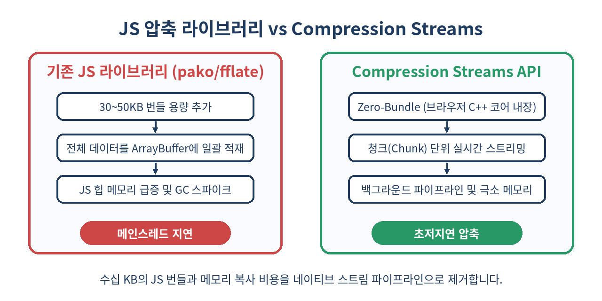
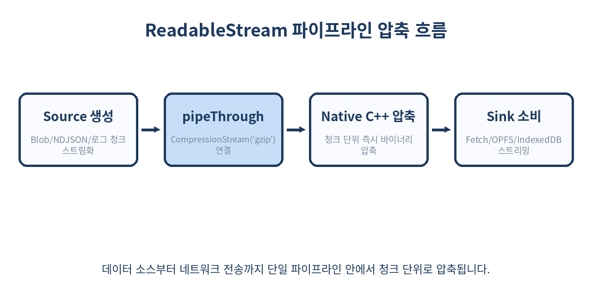

# 🗜️ Compression Streams API 완벽 가이드: 외부 라이브러리 없는 고성능 브라우저 스트리밍 압축

> 브라우저에서 대용량 JSON, 원격 로그, 오프라인 캐시 데이터를 다룰 때 아직도 수십 킬로바이트짜리 `pako`나 `fflate` 번들을 불러오고 계신가요?
> Web Streams 표준과 결합된 네이티브 `Compression Streams API`를 활용하면 번들 오버헤드 0바이트, 메모리 복사 없는 초고속 스트리밍 압축·압축해제를 구현할 수 있습니다.

---

## 📌 목차
1. 🧭 배경: 프론트엔드 데이터 압축의 오랜 고통과 한계
2. 💡 Compression Streams API란 무엇인가?
3. ⚙️ 핵심 아키텍처: Web Streams와의 매끄러운 통합
4. 📊 기존 외부 라이브러리 vs 네이티브 API 아키텍처 비교
5. 🛠️ 기초 실습: 텍스트 및 바이너리 데이터의 압축과 해제
6. 🌊 스트리밍 파이프라인: 대용량 NDJSON 실시간 압축 전송
7. 🚀 고급 실전: Fetch API 스트리밍 응답의 실시간 압축 해제
8. 💾 IndexedDB & OPFS 연계: 로컬 스토리지 극대화 패턴
9. 🧵 Web Worker와의 결합: CPU 집약적 워크로드 분리
10. ⚠️ 실무 함정과 안티패턴: 이것만은 절대 하지 마라
11. 🚫 이 API를 쓰면 안 되는 경우
12. 🌐 브라우저 지원 현황과 폴리백 전략
13. 🧾 정리
14. 📚 참고 자료

---

## 🧭 1. 배경: 프론트엔드 데이터 압축의 오랜 고통과 한계

현대 웹 애플리케이션은 단순한 문서 뷰어가 아닙니다. 브라우저에서 수 메가바이트 단위의 원격 진단 로그(Telemetry)를 배치로 묶어 분석 서버로 전송하고, 캔버스 그래픽 및 3D 모델(GLTF/OBJ) 데이터를 로컬에 캐싱하며, 오프라인 우선(Local-First) 환경을 위해 대규모 SQLite 데이터베이스나 IndexedDB 레코드를 다룹니다.

그러나 클라이언트에서 데이터를 압축하려면 늘 다음 세 가지 장벽에 부딪혔습니다.

1. **번들 크기 증가**: `pako`, `jszip`, `fflate` 같은 서드파티 라이브러리를 설치하면 번들 용량이 최소 15KB에서 60KB 이상 늘어납니다.
2. **메모리 복제와 스파이크**: 압축할 대용량 데이터를 메모리상에 거대한 `Uint8Array` 또는 통 문자열로 한 번에 올려놓고 압축 함수를 호출해야 했습니다. 수십 MB 크기의 데이터는 브라우저 JS 힙을 순간적으로 잠식하고 가비지 컬렉터(GC) 스파이크를 일으켜 메인 스레드를 멈추게 만들었습니다.
3. **스트리밍 부재**: 네트워크 요청을 받거나 생성하는 족족 흐르는 청크(Chunk)를 중간에서 압축할 수 없었습니다. 모든 데이터 수집이 끝날 때까지 버퍼링해야만 압축 알고리즘을 돌릴 수 있었습니다.

브라우저는 이미 내부 C++ 엔진 수준에서 HTTP 헤더(`Content-Encoding: gzip`)를 파싱하기 위한 초고속 zlib 모듈을 탑재하고 있었습니다. **"왜 이 네이티브 압축 엔진을 웹 자바스크립트 표준 API로 열어주지 않는가?"**라는 오랜 요구 끝에 탄생한 것이 바로 `Compression Streams API`입니다.

---

## 💡 2. Compression Streams API란 무엇인가?

`Compression Streams API`는 웹 브라우저 네이티브 환경에서 **스트림(Stream)** 기반으로 바이트 데이터를 압축(`CompressionStream`)하거나 압축을 푸는(`DecompressionStream`) 표준 인터페이스입니다. W3C Web Incubator Community Group(WICG)에서 제안되어 WHATWG Streams 표준에 편입되었습니다.

핵심 특징은 다음과 같습니다.

- **Zero-Bundle**: 브라우저 내장 C++ 구현체를 직접 호출하므로 자바스크립트 번들 용량이 전혀 늘어나지 않습니다.
- **스트림 네이티브**: `TransformStream` 인터페이스를 구현하므로 `ReadableStream`과 `WritableStream` 사이에 `pipeThrough()`로 자연스럽게 끼워 넣을 수 있습니다.
- **표준 압축 포맷 지원**: 업계 표준인 `gzip`, `deflate`, `deflate-raw` 포맷을 내장 지원합니다.
- **워커 및 메인 스레드 범용 지원**: `window`, `WorkerGlobalScope`, `ServiceWorker` 어디서나 동일한 인터페이스로 동작합니다.

---

## ⚙️ 3. 핵심 아키텍처: Web Streams와의 매끄러운 통합

`CompressionStream`과 `DecompressionStream`은 본질적으로 `TransformStream` 객체입니다. 즉, 바이트 청크(`Uint8Array` 또는 `ArrayBufferView`)를 입력받아 압축 또는 압축 해제된 바이트 청크를 출력하는 파이프 변환기입니다.

```js
// gzip 압축 스트림 생성
const compressor = new CompressionStream('gzip');

// transform 스트림의 구조
// compressor.readable: 압축된 결과 바이트가 나오는 ReadableStream
// compressor.writable: 원본 바이트를 밀어 넣는 WritableStream
```

지원되는 세 가지 포맷의 차이는 다음과 같습니다.

| 포맷 인자 | 규격 RFC | 구조적 특징 | 주요 사용처 |
| :--- | :--- | :--- | :--- |
| `'gzip'` | RFC 1952 | 10바이트 헤더 + Deflate 압축 바이트 + CRC32 체크섬/길이 | HTTP 압축, 파일 저장(.gz), 범용 웹 통신 |
| `'deflate'` | RFC 1950 | 2바이트 zlib 헤더 + Deflate 압축 바이트 + Adler-32 체크섬 | PDF 내부 스트림, zlib 호환 패킷 통신 |
| `'deflate-raw'` | RFC 1951 | 헤더와 체크섬이 없는 순수 LZ77/허프만 압축 비트열 | 커스텀 프로토콜, ZIP 컨테이너 압축 블록 |



---

## 📊 4. 기존 외부 라이브러리 vs 네이티브 API 아키텍처 비교

기존 방식과 브라우저 네이티브 방식의 기술적 차이를 정리해 보겠습니다.

| 비교 항목 | 서드파티 라이브러리 (`pako`, `fflate`) | Compression Streams API (네이티브) |
| :--- | :--- | :--- |
| **번들 용량 오버헤드** | 최소 15KB ~ 최대 60KB (gzip 기준) | **0 바이트 (브라우저 C++ 코어 내장)** |
| **연산 실행 계층** | V8/JSC 자바스크립트 런타임 힙 | **브라우저 네이티브 바이너리 (C++ zlib/libdeflate)** |
| **메모리 소비 방식** | 전체 버퍼 단일 할당 또는 수동 청크 관리 | **Web Streams 파이프라인 기반 자동 배압(Backpressure) 제어** |
| **GC 압박** | 압축 루프 도중 단기 객체 다량 생성 | **극소화된 TypedArray 청크 스트리밍으로 GC 스파이크 방지** |
| **Fetch API 연동** | 수신 후 `arrayBuffer()` 대기 후 변환 | **`response.body.pipeThrough()`로 수신과 동시에 실시간 해제** |
| **런타임 지원** | 모든 브라우저 및 Node.js 구버전 | **모든 모던 브라우저 (Chrome, Safari, Firefox), Node 18+, Deno** |

---

## 🛠️ 5. 기초 실습: 텍스트 및 바이너리 데이터의 압축과 해제

단일 텍스트 문자열을 압축하고, 다시 원본 문자열로 복원하는 가장 직관적인 유틸리티 함수를 작성해 봅니다. 이 과정에서 `TextEncoderStream`과 `TextDecoderStream`을 결합하면 완벽한 스트림 파이프라인이 완성됩니다.

```js
/**
 * 문자열을 gzip 바이너리(Uint8Array)로 압축합니다.
 * @param {string} inputString 
 * @returns {Promise<Uint8Array>}
 */
export async function compressString(inputString) {
  const inputStream = new Blob([inputString]).stream();
  const compressedStream = inputStream.pipeThrough(new CompressionStream('gzip'));
  
  // Response 객체를 활용해 스트림을 편리하게 ArrayBuffer로 버퍼링
  const response = new Response(compressedStream);
  const buffer = await response.arrayBuffer();
  return new Uint8Array(buffer);
}

/**
 * gzip 바이너리(Uint8Array)를 원본 문자열로 복원합니다.
 * @param {Uint8Array} compressedBytes 
 * @returns {Promise<string>}
 */
export async function decompressToString(compressedBytes) {
  const inputStream = new Blob([compressedBytes]).stream();
  const decompressedStream = inputStream
    .pipeThrough(new DecompressionStream('gzip'))
    .pipeThrough(new TextDecoderStream());

  const response = new Response(decompressedStream);
  return await response.text();
}

// 사용 예시
const originalText = 'Logic-Phantom 고성능 웹 최적화 '.repeat(500);
console.log('원본 바이트 길이:', new TextEncoder().encode(originalText).length); // 37,500 bytes

const compressed = await compressString(originalText);
console.log('압축 바이트 길이:', compressed.length); // 약 200~300 bytes (압축률 99% 이상)

const restored = await decompressToString(compressed);
console.log('복원 성공 여부:', originalText === restored); // true
```

`Blob.prototype.stream()`과 `new Response(stream).arrayBuffer()` 패턴을 결합하면 장황한 `ReadableStreamDefaultReader` 루프 없이도 3~4줄로 안전하게 버퍼를 변환할 수 있습니다.

---

## 🌊 6. 스트리밍 파이프라인: 대용량 NDJSON 실시간 압축 전송

클라이언트 사이드 로깅 모듈에서 수천 건의 사용자 인터랙션 로그를 서버로 전송할 때, 전체 로그를 메모리에 모아두고 직렬화하면 메모리 누수가 발생합니다. 생성기(Generator)와 `ReadableStream`을 사용해 로그가 생성되는 족족 압축하여 `fetch` 바디로 전송할 수 있습니다.



```js
/**
 * 대용량 객체 배열을 NDJSON(Newline Delimited JSON) 스트림으로 변환하고
 * gzip 압축을 거쳐 서버로 청크 단위 스트리밍 전송합니다.
 */
export async function streamLogsWithCompression(logsIterator) {
  const sourceStream = new ReadableStream({
    async pull(controller) {
      const { value, done } = await logsIterator.next();
      if (done) {
        controller.close();
        return;
      }
      // JSON 한 줄과 개행 문자를 바이트로 인코딩하여 인큐
      const line = JSON.stringify(value) + '\n';
      controller.enqueue(new TextEncoder().encode(line));
    }
  });

  // 파이프라인 연결: 원본 바이트 -> Gzip 압축 스트림
  const compressedStream = sourceStream.pipeThrough(new CompressionStream('gzip'));

  // Fetch 바디에 ReadableStream을 직접 전달 (HTTP/2, HTTP/3 환경 필수)
  const response = await fetch('/api/telemetry/batch-stream', {
    method: 'POST',
    headers: {
      'Content-Type': 'application/x-ndjson',
      'Content-Encoding': 'gzip' // 서버에게 바디가 gzip 압축되어 있음을 알림
    },
    body: compressedStream,
    // 브라우저가 fetch body 스트리밍을 수행하기 위해 필수적인 플래그
    duplex: 'half'
  });

  if (!response.ok) {
    throw new Error(`전송 실패: ${response.status}`);
  }

  console.log('스트리밍 압축 전송 완료');
}
```

> 💡 **중요**: `fetch()` 요청 본문에 `ReadableStream`을 전달할 때는 반드시 `{ duplex: 'half' }` 옵션을 명시해야 브라우저 표준 명세에 따라 전이중(duplex) 스트림 에러가 발생하지 않습니다.

---

## 🚀 7. 고급 실전: Fetch API 스트리밍 응답의 실시간 압축 해제

일반적인 웹 통신에서는 브라우저가 `Content-Encoding: gzip` 응답을 감지하면 자동으로 투명하게 압축을 해제해 줍니다. 그러나 다음과 같은 특수 상황에서는 클라이언트 자바스크립트가 바이너리 압축 스트림을 수동으로 풀어야 합니다.

1. **서버가 프록시/CDN 캐시 무효화를 피하기 위해** 의도적으로 `Content-Type: application/octet-stream` 형태로 원시 gzip 바이너리를 전송하는 경우
2. **WebSocket 또는 WebTransport 데이터 채널**을 통해 압축된 바이너리 프레임을 지속적으로 수신할 때
3. **대용량 정적 데이터 덤프**(예: 사전 데이터, 지도 타일 데이터셋)를 `.gz` 파일 그대로 받아 실시간으로 파싱할 때

다음은 100MB 크기의 대형 gzip 압축 CSV 파일을 원격에서 다운로드하면서, 전체 파일을 다 받기 전에 **수신되는 청크 단위로 즉시 압축을 풀고 행 단위로 파싱**하는 코드입니다.

```js
export async function streamDecompressRemoteGzip(url, onRowParsed) {
  const response = await fetch(url);
  if (!response.ok || !response.body) {
    throw new Error('스트림을 열 수 없습니다.');
  }

  // 파이프라인: HTTP 응답 스트림 -> DecompressionStream -> TextDecoderStream
  const textStream = response.body
    .pipeThrough(new DecompressionStream('gzip'))
    .pipeThrough(new TextDecoderStream());

  const reader = textStream.getReader();
  let partialLine = '';

  while (true) {
    const { value, done } = await reader.read();
    if (done) break;

    // 텍스트 청크를 개행 기준으로 분할 처리
    const chunk = partialLine + value;
    const lines = chunk.split('\n');
    
    // 마지막 불완전한 라인은 다음 청크를 위해 보관
    partialLine = lines.pop() || '';

    for (const line of lines) {
      if (line.trim()) {
        onRowParsed(line.split(','));
      }
    }
  }

  if (partialLine.trim()) {
    onRowParsed(partialLine.split(','));
  }
}
```

이 방식을 적용하면 100MB의 gzip 파일이 1GB의 압축 해제 텍스트로 늘어나더라도 브라우저 메모리는 **현재 처리 중인 청크 버퍼(수십 KB)만 점유**하므로 저사양 모바일 기기에서도 메모리 고갈(OOM) 크래시 없이 안전하게 대용량 데이터를 처리할 수 있습니다.

---

## 💾 8. IndexedDB & OPFS 연계: 로컬 스토리지 극대화 패턴

브라우저의 `IndexedDB`나 `Origin Private File System(OPFS)`에 구조화된 JSON 데이터나 텍스트 캐시를 저장할 때, Compression Streams API를 파이프라인에 끼워 넣으면 스토리지 용량을 최대 80~90% 절약할 수 있습니다.

다음은 OPFS 전용 고성능 파일 핸들에 압축 스트림을 바로 파이핑하는 패턴입니다.

```js
/**
 * 거대한 JSON 객체를 gzip 압축하여 OPFS에 직접 기록합니다.
 */
export async function saveCompressedToOPFS(fileName, dataObject) {
  const root = await navigator.storage.getDirectory();
  const fileHandle = await root.getFileHandle(fileName, { create: true });
  const writable = await fileHandle.createWritable();

  // JSON 문자열 스트림 생성
  const jsonString = JSON.stringify(dataObject);
  const textStream = new Blob([jsonString]).stream();

  // 압축 스트림을 거쳐 OPFS WritableStream으로 직접 파이핑
  await textStream
    .pipeThrough(new CompressionStream('gzip'))
    .pipeTo(writable);

  console.log(`[OPFS] ${fileName} 압축 저장 완료`);
}

/**
 * OPFS에 저장된 압축 파일을 복원하여 JSON 객체로 읽어옵니다.
 */
export async function loadCompressedFromOPFS(fileName) {
  const root = await navigator.storage.getDirectory();
  const fileHandle = await root.getFileHandle(fileName);
  const file = await fileHandle.getFile();

  const decompressedStream = file.stream()
    .pipeThrough(new DecompressionStream('gzip'))
    .pipeThrough(new TextDecoderStream());

  const response = new Response(decompressedStream);
  const jsonText = await response.text();
  return JSON.parse(jsonText);
}
```

중간에 거대한 임시 바이너리 버퍼를 할당하지 않고 `ReadableStream`과 `WritableFileStream`을 다이렉트로 연결(`pipeTo`)하므로 브라우저 입출력 대역폭을 극한까지 활용할 수 있습니다.

---

## 🧵 9. Web Worker와의 결합: CPU 집약적 워크로드 분리

아무리 C++ 네이티브 압축이라 할지라도, 수십 메가바이트의 원시 데이터를 고속으로 압축할 때는 필연적으로 CPU 코어를 사용합니다. 만약 화면에서 복잡한 CSS 3D 렌더링이나 60fps 애니메이션이 돌고 있다면 메인 스레드 프레임 드랍이 일어날 수 있습니다.

`CompressionStream`은 Dedicated Worker에서도 완벽하게 동작하므로, 스트림을 Worker로 넘겨 메인 스레드 인터랙션을 100% 보존할 수 있습니다.

```js
// worker.js
self.onmessage = async (e) => {
  const { arrayBuffer } = e.data;
  
  const inputStream = new Blob([arrayBuffer]).stream();
  const compressedStream = inputStream.pipeThrough(new CompressionStream('gzip'));
  
  const response = new Response(compressedStream);
  const compressedBuffer = await response.arrayBuffer();

  // Zero-Copy 전송(Transferable Objects)을 통해 결과 반환
  self.postMessage({ compressedBuffer }, [compressedBuffer]);
};
```

```js
// main.js
const worker = new Worker(new URL('./worker.js', import.meta.url), { type: 'module' });

export function compressInWorker(dataBuffer) {
  return new Promise((resolve) => {
    worker.onmessage = (e) => {
      resolve(new Uint8Array(e.data.compressedBuffer));
    };
    // 원본 버퍼 소유권을 워커로 이전하여 메인 스레드 메모리 즉시 해제
    worker.postMessage({ arrayBuffer: dataBuffer.buffer }, [dataBuffer.buffer]);
  });
}
```

메인 스레드와 워커 간의 데이터 이동 시 `Transferable Objects`를 결합하면 버퍼 복사 비용마저 완전히 0으로 만들 수 있습니다.

---

## ⚠️ 10. 실무 함정과 안티패턴: 이것만은 절대 하지 마라

### 1) 작은 페이로드의 역효과 (Negative Compression)
압축 알고리즘(Gzip/Deflate)은 헤더 메타데이터와 허프만 트리 테이블을 포함합니다. 수백 바이트 미만의 작은 JSON이나 텍스트를 무작정 압축하면 **오히려 원본보다 파일 크기가 커집니다.**
- **실무 규칙**: 페이로드 크기가 최소 1KB~2KB를 초과할 때만 압축을 수행하십시오.

### 2) Content-Encoding 헤더와 이중 압축 실수
클라이언트에서 `CompressionStream('gzip')`으로 수동 압축한 뒤 `fetch()` 바디에 넣고 헤더에 `Content-Encoding: gzip`을 지정했습니다. 이때 웹 서버의 리버스 프록시(Nginx, Cloudflare 등)가 업스트림 요청에 대해 무지성으로 gzip 압축을 한 번 더 수행하거나, 서버 애플리케이션 프레임워크가 바디를 자동으로 압축 해제하지 못해 손상된 데이터로 간주하는 경우가 흔합니다.
- 서버 엔드포인트가 `Content-Encoding: gzip` 페이로드를 직접 디코딩하도록 인프라 파이프라인이 구성되어 있는지 사전에 확인해야 합니다.

### 3) 에러 처리와 스트림 중단 락(Lock) 누수
`ReadableStream`이 파이프 도중 깨지거나 잘못된 압축 포맷(예: 손상된 gzip 바이트)을 주입받으면 `DecompressionStream`은 에러를 던지며 스트림을 잠급니다(`locked`).
이때 `reader.releaseLock()`이나 `stream.cancel()`을 적절히 호출하지 않으면 브라우저 내부 파일 디스크립터나 버퍼 자원이 해제되지 않는 누수가 발생합니다.

```js
// 안티패턴: try-catch 없는 단순 파이핑
const decompressed = stream.pipeThrough(new DecompressionStream('gzip'));

// 올바른 패턴: 파이프라인 에러 포획
try {
  const decompressed = stream.pipeThrough(new DecompressionStream('gzip'));
  const reader = decompressed.getReader();
  // ... 처리
} catch (err) {
  console.error('압축 해제 실패: 올바른 gzip 포맷이 아닙니다.', err);
  // 적절한 폴백 수행
}
```

### 4) `deflate` vs `deflate-raw` 불일치 버그
서버 라이브러리(Node.js `zlib.deflateRaw`, Go `compress/flate`)에서 헤더 없는 원시 Deflate 데이터를 보냈는데 클라이언트에서 `new DecompressionStream('deflate')`를 사용하면 zlib 매직 헤더(2바이트)를 찾지 못해 즉시 파싱 실패 예외(`DataError`)를 발생시킵니다. 서버 인코더의 스펙을 반드시 명확히 매칭해야 합니다.

---

## 🚫 11. 이 API를 쓰면 안 되는 경우

Compression Streams API가 만능은 아닙니다. 다음 상황에서는 사용하지 않는 것이 좋습니다.

1. **이미 압축된 미디어 형식 (JPEG, PNG, WebP, MP4, WOFF2 등)**:
   이미 고도로 압축된 바이너리는 Deflate 알고리즘을 거쳐도 0.1%도 줄어들지 않으며 CPU 사이클만 낭비합니다.
2. **초저지연 WebSocket RPC (단일 패킷 통신)**:
   수십 바이트 크기의 실시간 커맨드 패킷에 압축 스트림을 연결하면 스트림 초기화 오버헤드와 청크 플러시(Flush) 지연으로 인해 네트워크 RTT보다 브라우저 지연이 더 커집니다.
3. **Brotli (`br`) 또는 Zstandard (`zstd`) 알고리즘이 필수인 경우**:
   현재 표준 명세는 `gzip`, `deflate`, `deflate-raw`만을 지원합니다. 만약 더 높은 압축률의 Brotli나 초고속 디코딩의 Zstandard 알고리즘을 클라이언트에서 반드시 써야 한다면 WebAssembly(WASM) 기반 컴파일러 라이브러리를 사용해야 합니다.

---

## 🌐 12. 브라우저 지원 현황과 폴리백 전략

2026년 현재 `Compression Streams API`는 모든 주요 모던 브라우저에서 기본 탑재되어 있으며 Baseline 확정 상태입니다.

- **Chrome / Edge**: 80 버전 이상 (2020년 도입)
- **Safari**: 16.4 버전 이상 (2023년 도입)
- **Firefox**: 113 버전 이상 (2023년 도입)
- **Node.js**: v18.0.0 이상 (전역 사용 가능)
- **Deno / Bun**: 완벽 지원

안전한 런타임 기능 감지(Feature Detection) 및 폴리백 코드는 다음과 같이 구성합니다.

```js
export function isCompressionStreamSupported() {
  return typeof CompressionStream !== 'undefined' &&
         typeof DecompressionStream !== 'undefined';
}

export async function safeCompress(data) {
  if (isCompressionStreamSupported()) {
    const cs = new CompressionStream('gzip');
    const stream = new Blob([data]).stream().pipeThrough(cs);
    return new Uint8Array(await new Response(stream).arrayBuffer());
  }

  // 지원하지 않는 구형 브라우저 환경에서는 동적 import로 pako 로드
  console.warn('CompressionStream 미지원 환경: pako 라이브러리로 폴백합니다.');
  const { gzip } = await import('pako');
  return gzip(data);
}
```

이렇게 작성하면 모던 브라우저 사용자 99%는 0바이트 번들로 최고 속도의 네이티브 압축을 누리고, 극소수 레거시 브라우저에서만 지연 로딩(Code Splitting)으로 서드파티 스크립트를 다운로드하게 만들 수 있습니다.

---

## 🧾 13. 정리

- `Compression Streams API`는 브라우저 내장 C++ zlib 엔진을 활용해 **자바스크립트 번들 추가 없이(0KB)** 고성능 압축을 제공합니다.
- `gzip`, `deflate`, `deflate-raw` 포맷을 표준 지원하며, Web Streams 파이프라인에 직접 결합할 수 있습니다.
- 전체 버퍼를 메모리에 다 올릴 필요 없이 **청크(Chunk) 단위로 실시간 압축·해제**하므로 메모리 스파이크와 GC 지연을 방지합니다.
- `fetch()` 요청 본문 스트리밍(`duplex: 'half'`), 대용량 로그 수집, OPFS/IndexedDB 로컬 캐싱, Web Worker 오프로딩과 궁합이 뛰어납니다.
- 페이로드가 1KB 미만이거나 이미 압축된 이미지/동영상에는 적용하지 않는 것이 실무 원칙입니다.

> ✨ **한 줄 요약**
> 외부 라이브러리 번들 없이, 브라우저 네이티브 스트림 파이프라인으로 메모리 낭비 없는 초고속 압축을 구현하라.

---

## 📚 14. 참고 자료

- [MDN Web Docs: Compression Streams API](https://developer.mozilla.org/en-US/docs/Web/API/Compression_Streams_API)
- [WHATWG: Compression Streams Standard Specification](https://wicg.github.io/compression/)
- [web.dev: Compression Streams in the Browser](https://web.dev/articles/compression-streams)
- [W3C Streams API Standard](https://streams.spec.whatwg.org/)
