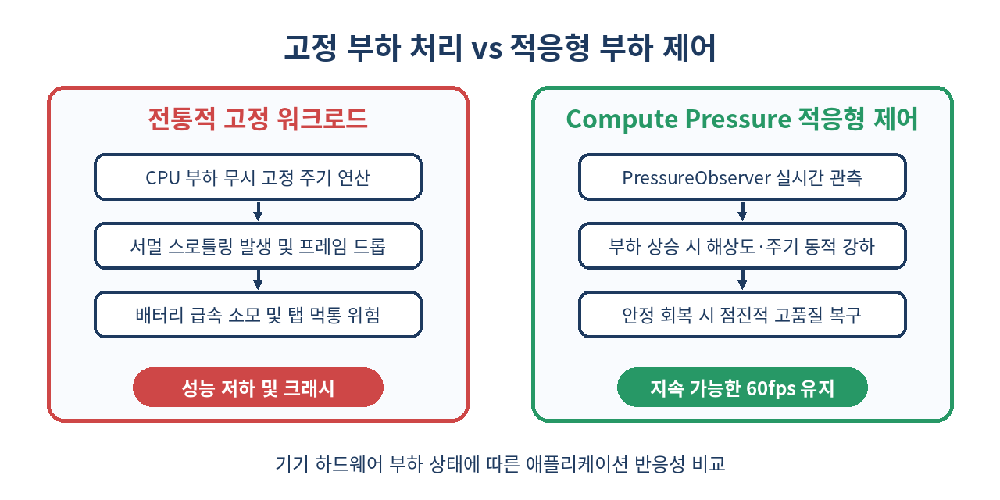
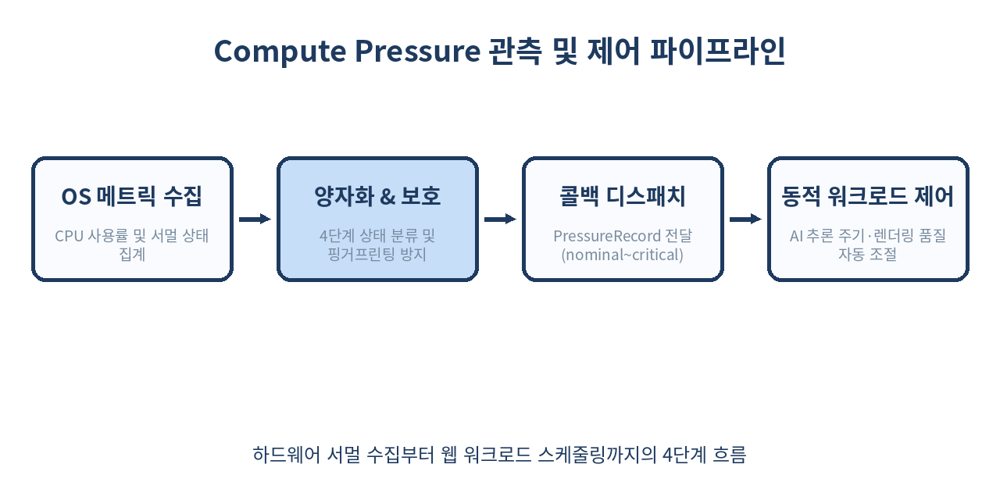

# 🌡️ Compute Pressure API 완벽 가이드: 브라우저 발열·CPU 부하 감지와 적응형 성능 제어

> "모든 사용자 기기가 고성능 데스크톱은 아니다. 하드웨어가 뜨거워지면 웹앱 스스로 연산량을 낮춰야 한다."
> 브라우저 내 로컬 AI 모델 실행, 실시간 화상 처리, 고화질 WebGPU 캔버스가 일상화된 시대에 기기 과열과 배터리 고갈을 방지하는 차세대 웹 표준 API를 다룹니다.

---

## 📌 목차
1. 🧭 Compute Pressure API의 등장 배경
2. 🔍 기존 성능 측정의 한계: 왜 performance.now()로는 부족한가?
3. ⚙️ 핵심 아키텍처: PressureObserver와 4가지 압력 상태
4. 🛡️ 보안과 프라이버시: 하드웨어 핑거프린팅을 막는 양자화 설계
5. 💻 기본 사용법: PressureObserver 인스턴스화와 옵션
6. 🎬 실전 구현 ①: 화상회의/비디오 필터 실시간 해상도 다운스케일링
7. 🤖 실전 구현 ②: 브라우저 로컬 AI(WebLLM / ONNX) 추론 스케줄링
8. 🔄 히스테리시스(Hysteresis) 패턴: 상태 플래핑(Flapping) 방지 기법
9. ⚖️ 기존 최적화 API와의 비교 (Navigator.hardwareConcurrency, Web Workers)
10. ⚠️ 실무 함정과 주의해야 할 제약 조건
11. 🚫 Compute Pressure API를 쓰면 안 되는 경우
12. 🧾 정리
13. 📚 참고 자료

---

## 🧭 1. Compute Pressure API의 등장 배경

과거의 웹 애플리케이션은 서버에서 렌더링된 HTML을 받아 보여주거나 가벼운 DOM 조작을 처리하는 것이 대부분이었습니다. 그러나 오늘날의 웹은 완전히 다릅니다.

- **Transformers.js, WebLLM**과 같은 온디바이스 브라우저 AI 모델 구동
- **WebCodecs, WebRTC**를 통한 다자간 실시간 비디오 인코딩 및 배경 블러/세그멘테이션
- **WebGPU, Babylon.js, Three.js** 기반의 3D AAA급 인터랙티브 그래픽
- **WASM 기반 포토/비디오 에디터**(Figma, Adobe Web 등)

이러한 워크로드는 CPU와 GPU를 극한까지 활용합니다. 하지만 모바일 디바이스, 씬(Thin) 노트북, 팬리스(Fanless) 태블릿은 지속적인 고부하 작업 시 **서멀 스로틀링(Thermal Throttling)**이 발생합니다. CPU 클록이 강제로 50% 이하로 떨어지며, 웹 애플리케이션은 즉각적으로 초당 프레임 수(FPS)가 급락하고 탭이 얼어붙는 현상(Jank)을 겪습니다.



`Compute Pressure API`는 웹 애플리케이션이 운영체제와 하드웨어의 연산 압력(부하 및 발열)을 표준화된 방식으로 관측하여, **시스템이 한계에 도달하기 전에 선제적으로 작업량을 줄이고, 환경이 안정화되면 다시 품질을 높이는 '적응형 성능(Graceful Degradation & Dynamic Quality Adjustment)'**을 구현할 수 있도록 W3C에서 제정한 표준 API입니다.

---

## 🔍 2. 기존 성능 측정의 한계: 왜 performance.now()로는 부족한가?

많은 개발자가 프레임 드롭이나 지연을 감지하기 위해 기존의 웹 API를 조합해 왔습니다.

| 측정 방식 | 측정 대상 | 한계점 |
|---|---|---|
| `requestAnimationFrame` 델타 측정 | 메인 스레드 렌더링 주기 | 이미 프레임 드롭이 발생한 **사후(Post-facto)** 감지만 가능 |
| `PerformanceObserver` (Long Tasks) | 50ms 초과 메인 스레드 블로킹 | 하드웨어 발열이나 백그라운드 스레드(Worker) 부하 미반영 |
| `navigator.hardwareConcurrency` | 논리 코어 수 | 고정된 값으로, 현재 CPU 점유율이나 발열 상태 확인 불가 |
| `Battery Status API` (사용 제한) | 배터리 잔량 및 충전 상태 | 보안/개인정보 이슈로 사장되었으며, CPU 부하와 직결되지 않음 |

기존 방식은 메인 스레드가 이미 멈춘 뒤에야 문제를 알아챕니다. 또한 Web Worker나 WebGPU 파이프라인에서 막대한 연산이 돌아가고 있을 때 메인 스레드는 한가해 보일 수 있지만, 하드웨어 칩셋 전체는 과열되어 쓰로틀링 직전일 수 있습니다.

Compute Pressure API는 **시스템 전체(System-wide)의 하드웨어 수준 부하**를 브라우저 엔진이 OS로부터 직접 조회하여 알려주므로, 선제적 방어가 가능합니다.

---

## ⚙️ 3. 핵심 아키텍처: PressureObserver와 4가지 압력 상태

Compute Pressure API의 핵심은 `PressureObserver` 인터페이스입니다. 관측 대상 소스(`source`)는 현재 표준에서 `"cpu"`를 지원합니다.

브라우저는 시스템 상태를 분석하여 다음 4가지 표준 압력 상태(`PressureState`) 중 하나를 전달합니다.

```text
[ nominal ]  ──(부하 증가)──>  [ fair ]  ──(서멀 경고)──>  [ serious ]  ──(한계치)──>  [ critical ]
     │                            │                             │                          │
   정상                         안정적 부하                     심각한 발열                치명적 과부하
 최상의 품질 유지             일부 비필수 작업 유예           해상도/연산 주기 대폭 감소     최소 기능만 유지
```

1. **`nominal` (정상)**: 시스템 부하가 매우 낮고 발열이 없는 최적의 상태입니다. 모든 고사양 기능(고해상도 비디오, 60fps 렌더링, 정밀 AI 추론)을 제한 없이 구동합니다.
2. **`fair` (안정적 부하)**: 부하가 다소 발생했으나 시스템이 안정적으로 처리 가능한 범위입니다. 사용자 경험을 해치지 않는 선에서 불필요한 백그라운드 프리페칭이나 부가 이펙트를 중단할 수 있습니다.
3. **`serious` (심각한 부하)**: 하드웨어 발열이 심해지고 쿨링팬이 최대 속도로 돌며, 곧 서멀 스로틀링이 일어날 가능성이 큽니다. 비디오 해상도를 낮추고 AI 추론 프레임을 반감시켜야 합니다.
4. **`critical` (치명적 과부하)**: 시스템이 한계에 도달하여 극심한 스로틀링이 발생 중입니다. 비디오 필터를 완전히 끄거나 오디오 전용 모드로 전환하고, 즉각적인 연산 감축 조치를 취해야 합니다.



---

## 🛡️ 4. 보안과 프라이버시: 하드웨어 핑거프린팅을 막는 양자화 설계

브라우저에 하드웨어 센서나 CPU 사용률을 그대로 노출하면 심각한 보안 문제가 발생합니다. 악의적인 스크립트가 정밀한 CPU 부하 곡선을 추적하여 사용자의 키 입력 패턴을 유추(Side-channel timing attack)하거나, CPU 쿨링 특성을 분석해 고유 기기를 식별(Fingerprinting)할 수 있기 때문입니다.

Compute Pressure API는 이를 방지하기 위해 엄격한 보안 완화 조치를 표준 레벨에 내장했습니다.

- **상태의 양자화(Quantization)**: 정밀한 실수 백분율(예: 83.42%) 대신 4단계 정성적 상태(`nominal`, `fair`, `serious`, `critical`)만 전달합니다.
- **속도 제한(Rate Limiting)**: 이벤트 발생 주기에 최소 간격(기본 수백 밀리초 단위)을 강제합니다.
- **최상위 활성 윈도우(Active Focused Document)**: 사용자가 보고 있는 최상위 활성 탭에서만 활성화됩니다. 백그라운드 탭이나 포커스를 잃은 iframe에서는 관측이 일시 중단됩니다.
- **Permissions Policy**: `compute-pressure` 권한 정책을 통해 iframe 삽입 시 명시적 허용(`allow="compute-pressure"`)이 필요합니다.

---

## 💻 5. 기본 사용법: PressureObserver 인스턴스화와 옵션

브라우저 지원 여부를 확인하고 관측을 시작하는 기본 코드 패턴입니다.

```js
// 1. 브라우저 지원 여부 확인
if ('PressureObserver' in window) {
  try {
    // 2. 콜백 함수 정의
    const handlePressureChange = (records, observer) => {
      for (const record of records) {
        console.log(`[Pressure Source]: ${record.source}`);
        console.log(`[Current State]: ${record.state}`);
        console.log(`[Timestamp]: ${record.time}`);

        switch (record.state) {
          case 'nominal':
            applyQualityProfile('ultra');
            break;
          case 'fair':
            applyQualityProfile('high');
            break;
          case 'serious':
            applyQualityProfile('medium');
            break;
          case 'critical':
            applyQualityProfile('low');
            break;
        }
      }
    };

    // 3. 옵저버 생성
    const observer = new PressureObserver(handlePressureChange);

    // 4. CPU 소스 관측 시작 (샘플링 간격 설정 가능: 단위 ms)
    await observer.observe('cpu', {
      sampleInterval: 1000 // 최소 1000ms 간격으로 수집 (브라우저 정책에 따라 더 길어질 수 있음)
    });
    console.log('Compute Pressure 관측이 시작되었습니다.');
  } catch (error) {
    console.error('PressureObserver 시작 실패:', error);
  }
} else {
  console.warn('이 브라우저는 Compute Pressure API를 지원하지 않습니다.');
}
```

관측을 중단하려면 `unobserve()` 또는 `disconnect()`를 호출합니다.

```js
// 특정 소스 해제
observer.unobserve('cpu');

// 전체 옵저버 해제
observer.disconnect();
```

---

## 🎬 6. 실전 구현 ①: 화상회의/비디오 필터 실시간 해상도 다운스케일링

WebRTC 화상회의나 캔버스 기반 비디오 배경 블러(Canvas Background Blur) 처리 시, 발열이 발생하면 필터 렌더링 해상도를 단계별로 낮추는 실무 패턴입니다.

```js
class AdaptiveVideoProcessor {
  constructor(videoElement, canvasElement) {
    this.video = videoElement;
    this.canvas = canvasElement;
    this.ctx = canvasElement.getContext('2d');
    
    // 해상도 스케일 계수 (1.0 = 원본 해상도)
    this.scaleFactor = 1.0;
    this.blurRadius = 15;
    this.isRunning = false;
    this.observer = null;
  }

  async init() {
    if ('PressureObserver' in window) {
      this.observer = new PressureObserver((records) => {
        const latest = records[records.length - 1];
        this.adjustQuality(latest.state);
      });

      await this.observer.observe('cpu', { sampleInterval: 1500 });
    }
    this.startRenderLoop();
  }

  adjustQuality(state) {
    console.info(`[VideoEngine] 시스템 압력 변경 감지: ${state}`);
    switch (state) {
      case 'nominal':
        this.scaleFactor = 1.0; // 1080p 전체 해상도 처리
        this.blurRadius = 15;
        break;
      case 'fair':
        this.scaleFactor = 0.75; // 75% 스케일 다운
        this.blurRadius = 10;
        break;
      case 'serious':
        this.scaleFactor = 0.5; // 50% 스케일 다운 (연산량 1/4)
        this.blurRadius = 6;
        break;
      case 'critical':
        this.scaleFactor = 0.25; // 필터 연산 최소화 혹은 바이패스
        this.blurRadius = 0; // 블러 효과 끔
        break;
    }
  }

  startRenderLoop() {
    this.isRunning = true;
    const render = () => {
      if (!this.isRunning) return;

      const targetWidth = Math.floor(this.video.videoWidth * this.scaleFactor);
      const targetHeight = Math.floor(this.video.videoHeight * this.scaleFactor);

      if (this.canvas.width !== targetWidth && targetWidth > 0) {
        this.canvas.width = targetWidth;
        this.canvas.height = targetHeight;
      }

      if (this.blurRadius > 0) {
        this.ctx.filter = `blur(${this.blurRadius}px)`;
      } else {
        this.ctx.filter = 'none';
      }

      this.ctx.drawImage(this.video, 0, 0, targetWidth, targetHeight);
      requestAnimationFrame(render);
    };
    requestAnimationFrame(render);
  }

  destroy() {
    this.isRunning = false;
    if (this.observer) {
      this.observer.disconnect();
    }
  }
}
```

사용자는 쿨링팬이 굉음을 내며 브라우저 탭이 멈추는 대신, 비디오 필터 품질이 살짝 낮아지면서도 통화가 매끄럽게 지속되는 경험을 누리게 됩니다.

---

## 🤖 7. 실전 구현 ②: 브라우저 로컬 AI(WebLLM / ONNX) 추론 스케줄링

브라우저에서 WebGPU나 WASM 기반 소형 언어 모델(SLM)을 실행할 때, 연속적인 토큰 생성은 CPU/GPU를 100% 점유하여 다른 UI 반응성을 마비시킵니다. 시스템 부하에 따라 추론 딜레이(Yielding)를 적응형으로 주입하는 아키텍처입니다.

```js
class AdaptiveModelScheduler {
  constructor(inferenceEngine) {
    this.engine = inferenceEngine;
    this.yieldDelayMs = 0;
    this.batchChunkSize = 8;
    this.observer = null;
  }

  async startMonitoring() {
    if (!('PressureObserver' in window)) return;

    this.observer = new PressureObserver((records) => {
      const state = records[records.length - 1].state;
      this.reschedule(state);
    });

    await this.observer.observe('cpu', { sampleInterval: 2000 });
  }

  reschedule(state) {
    switch (state) {
      case 'nominal':
        this.yieldDelayMs = 0;      // 풀 스피드 추론
        this.batchChunkSize = 8;
        break;
      case 'fair':
        this.yieldDelayMs = 5;      // 이벤트 루프에 짧은 양보
        this.batchChunkSize = 4;
        break;
      case 'serious':
        this.yieldDelayMs = 25;     // UI 프레임 확보를 위한 명시적 슬립
        this.batchChunkSize = 2;
        break;
      case 'critical':
        this.yieldDelayMs = 80;     // 심각한 쿨다운 딜레이
        this.batchChunkSize = 1;
        break;
    }
  }

  async *generateStream(promptTokens) {
    let processed = 0;
    while (processed < promptTokens.length) {
      const chunk = promptTokens.slice(processed, processed + this.batchChunkSize);
      const output = await this.engine.forward(chunk);
      processed += chunk.length;
      yield output;

      // 시스템 압력 상태에 따라 메인 스레드에 제어권 반환 및 열 방출 유도
      if (this.yieldDelayMs > 0) {
        await new Promise((r) => setTimeout(r, this.yieldDelayMs));
      }
    }
  }
}
```

---

## 🔄 8. 히스테리시스(Hysteresis) 패턴: 상태 플래핑(Flapping) 방지 기법

Compute Pressure API를 적용할 때 가장 자주 범하는 실수는 **상태가 바뀔 때마다 즉각 품질을 올렸다 내리는 진동(Oscillation/Flapping) 현상**입니다.

```text
[부하 높음: serious] ──> 품질 다운그레이드 ──> [즉시 부하 하강: nominal] ──> 즉시 품질 업그레이드 ──> [다시 발열: serious] (무한 반복!)
```

품질을 낮출 때는 **즉시 반응**하되, 품질을 다시 올릴 때는 시스템이 충분히 식었는지 확인하는 **히스테리시스(Hysteresis) 쿨다운 타이머**가 반드시 필요합니다.

```js
class PressureHysteresisManager {
  constructor(onQualityChange) {
    this.onQualityChange = onQualityChange;
    this.currentState = 'nominal';
    this.upgradeTimer = null;
    this.COOLDOWN_PERIOD_MS = 10000; // 10초간 안정 상태가 유지되어야 업그레이드
  }

  processRecord(record) {
    const newState = record.state;
    const severityOrder = { nominal: 0, fair: 1, serious: 2, critical: 3 };

    const currentSeverity = severityOrder[this.currentState];
    const newSeverity = severityOrder[newState];

    if (newSeverity > currentSeverity) {
      // 1. 부하가 심해지면 지체 없이 즉각 다운그레이드
      if (this.upgradeTimer) {
        clearTimeout(this.upgradeTimer);
        this.upgradeTimer = null;
      }
      this.currentState = newState;
      this.onQualityChange(this.currentState);
    } else if (newSeverity < currentSeverity) {
      // 2. 부하가 낮아졌다면 즉시 올리지 않고 쿨다운 대기
      if (!this.upgradeTimer) {
        this.upgradeTimer = setTimeout(() => {
          this.currentState = newState;
          this.onQualityChange(this.currentState);
          this.upgradeTimer = null;
          console.log(`[Hysteresis] 하드웨어가 10초간 안정되어 품질을 ${newState}로 복구합니다.`);
        }, this.COOLDOWN_PERIOD_MS);
      }
    }
  }
}
```

이 패턴을 적용해야 화면 해상도가 1~2초마다 깜빡거리며 요동치는 치명적인 UX 퇴행을 막을 수 있습니다.

---

## ⚖️ 9. 기존 최적화 API와의 비교

Compute Pressure API는 기존의 성능 및 하드웨어 API와 상호 보완적으로 작동합니다.

| 비교 항목 | Compute Pressure API | PerformanceObserver (Long Tasks) | Navigator.hardwareConcurrency | Web Workers |
|---|---|---|---|---|
| **주요 역할** | 하드웨어 서멀/CPU 부하 관측 | 메인 스레드 지연 블록 감지 | 기기의 논리 코어 수 확인 | 작업을 멀티스레드로 분산 |
| **시점** | **선제적/진행형** (부하 상태 감지) | **사후적** (이미 밀린 작업 측정) | **정적** (초기 실행 시 결정) | **상시** (실행 메커니즘) |
| **측정 범위** | 시스템 전반 (OS/하드웨어) | 브라우저 메인 스레드 | CPU 스펙 | 스레드 분리 |
| **피드백 형태** | 4단계 정성적 상태 | 작업 시간(ms) 메트릭 | 숫자 (예: 8, 16) | N/A |
| **최적 조합** | Worker 스케줄링 조율에 활용 | 메인 스레드 렌더링 병목 분석 | 초기 워커 풀 크기 결정 | 백그라운드 연산 실행 |

---

## ⚠️ 10. 실무 함정과 주의해야 할 제약 조건

1. **샘플링 간격의 하한선**: `sampleInterval` 옵션에 `100`ms를 넘겨도 브라우저는 프라이버시 보호와 배터리 절약을 위해 자체 최소 간격(통상 1,000ms 수준) 미만으로 콜백을 주지 않습니다. 초고빈도 센서처럼 기대해서는 안 됩니다.
2. **백그라운드 탭 비활성화**: 탭이 백그라운드로 넘어가거나 창 포커스를 잃으면 콜백이 멈춥니다. 탭이 다시 포커스를 얻을 때 최신 상태가 한 번에 전달되므로, 활성화 시점 복원 로직을 구성해야 합니다.
3. **iframe 권한 선언 누락**: 외부 위젯이나 서브도메인 iframe에서 API를 쓰려면 메인 페이지에서 iframe 태그에 반드시 `allow="compute-pressure"`를 명시해야 합니다.
4. **브라우저 지원율과 점진적 향상(Progressive Enhancement)**: Chromium 기반 브라우저(Chrome, Edge, Opera 등)는 데스크톱과 일부 모바일에서 정식 지원하지만, Safari와 Firefox는 아직 구현 검토 단계입니다. 따라서 반드시 `'PressureObserver' in window` 기능 탐지를 감싸고 폴백(Fallback)을 준비해야 합니다.

---

## 🚫 11. Compute Pressure API를 쓰면 안 되는 경우

- **단순 벤치마킹이나 프로파일링 목적**: 이 API는 정밀한 CPU 사용률 수치(%)나 나노초 단위 지표를 주지 않습니다. 성능 디버깅에는 Chrome DevTools의 Performance 패널을 써야 합니다.
- **정적 웹사이트 / 텍스트 중심 블로그**: 연산량이 미미한 일반 쇼핑몰 상세 페이지나 게시판에 이 API를 걸고 스크립트를 감시하는 것은 불필요한 번들 크기와 런타임 오버헤드만 낳습니다.
- **네트워크 대역폭 조절 목적으로의 오용**: 하드웨어 발열과 네트워크 전송 속도는 별개입니다. 네트워크 상태 적응에는 `Network Information API (navigator.connection)`를 사용해야 합니다.

---

## 🧾 12. 정리

- **하드웨어 친화적 웹**: 고부하 브라우저 애플리케이션(AI, WebRTC, WebGPU)은 이제 하드웨어의 서멀 상태를 능동적으로 고려해야 합니다.
- **4단계 표준 상태**: `nominal`, `fair`, `serious`, `critical`을 통해 시스템이 한계에 도달하기 전 선제적 조치를 취할 수 있습니다.
- **보안 중심 설계**: 정밀 수치 대신 4단계 양자화 상태를 제공하여 핑거프린팅과 사이드 채널 공격을 원천 차단합니다.
- **품질 적응과 히스테리시스**: 부하 상승 시 즉각 다운그레이드하되, 복구 시에는 쿨다운 기간을 두어 상태 진동을 방지해야 완벽한 UX를 유지할 수 있습니다.
- **점진적 향상**: 최신 브라우저에서는 쾌적한 배터리 수명과 프레임 유지를, 미지원 브라우저에서는 기존 고정 파이프라인으로 안전하게 폴백합니다.

> ✨ **한 줄 요약**
> Compute Pressure API는 브라우저가 기기의 발열과 CPU 부하를 실시간으로 감지하여 스스로 연산량을 조절하게 해주는 차세대 적응형 웹의 핵심 열쇠다.

---

## 📚 참고 자료
- [W3C Compute Pressure Level 1 Working Draft](https://www.w3.org/TR/compute-pressure/)
- [MDN Web Docs: Compute Pressure API](https://developer.mozilla.org/en-US/docs/Web/API/Compute_Pressure_API)
- [Chrome for Developers: Compute Pressure API Guide](https://developer.chrome.com/docs/web-platform/compute-pressure/)
