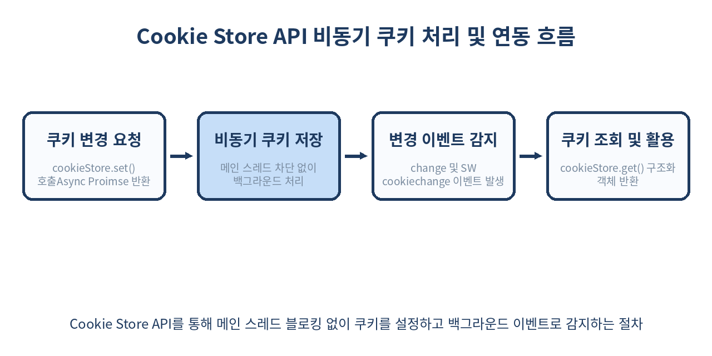
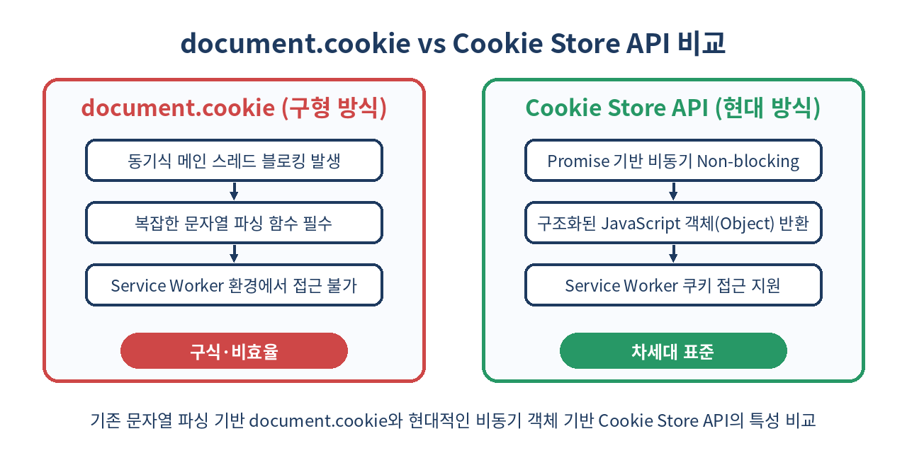

# 🍪 Cookie Store API 완벽 가이드: document.cookie의 종말과 비동기·서비스워커 쿠키 제어

> 브라우저의 대표적인 legacy API인 `document.cookie`의 성능 병목과 문자열 파싱 지옥에서 벗어나세요.
> `Cookie Store API`를 활용해 메인 스레드 블로킹 없는 비동기 쿠키 관리 및 Service Worker 연동 기법을 깊이 있게 다룹니다.

---

## 📌 목차
1. 🧭 1. 왜 document.cookie는 문제일까? (동기식 I/O와 파싱 지옥)
2. 💡 2. Cookie Store API란 무엇인가?
3. ⚡ 3. 기본 사용법: 쿠키 조회 (get / getAll)
4. ✍️ 4. 기본 사용법: 쿠키 생성과 수정 (set)
5. 🗑️ 5. 기본 사용법: 쿠키 삭제 (delete)
6. 📡 6. 쿠키 변경 실시간 감지: change 이벤트
7. ⚙️ 7. Service Worker에서의 쿠키 제어 및 cookiechange 구독
8. 📊 8. document.cookie vs Cookie Store API 성능 및 스펙 비교
9. 🛡️ 9. 보안 및 옵션 제어 (SameSite, Secure, Domain, Path, Partitioned)
10. ⚠️ 10. 실무 적용 시 만나는 함정과 주의점
11. 🚫 11. Cookie Store API를 사용하면 안 되는 경우
12. 🛠️ 12. 실무 프로덕션 폴리필 & 안전한 래퍼 패턴
13. 🧾 13. 정리
14. 📚 참고 자료

---

## 🧭 1. 왜 document.cookie는 문제일까? (동기식 I/O와 파싱 지옥)

웹 개발자라면 누구나 한 번쯤 `document.cookie`를 다루며 고통받은 경험이 있을 것입니다. 1990년대 초 창안된 `document.cookie` API는 2026년 현재 기준 프론트엔드 생태계에서 가장 낙후된 API 중 하나입니다.

```js
// 기존 document.cookie 사용의 전형적인 모습
// 1. 쿠키 읽기: 단순 문자열로 반환되어 직접 정규식이나 split()으로 파싱해야 함
const getCookie = (name) => {
  const value = `; ${document.cookie}`;
  const parts = value.split(`; ${name}=`);
  if (parts.length === 2) return parts.pop().split(';').shift();
};

// 2. 쿠키 쓰기: 속성 할당 연산자(=)처럼 보이지만 실제로는 커스텀 파싱 세터 동작
document.cookie = "user_theme=dark; path=/; max-age=31536000; SameSite=Lax;";
```

### existing document.cookie의 3대 결함
1. **메인 스레드 동기식(Synchronous) I/O 블로킹**
   `document.cookie`에 접근하거나 값을 읽고 쓸 때, 브라우저는 디스크나 메모리 디비에 접근하는 I/O 작업을 메인 스레드에서 즉시(동기적으로) 수행합니다. 쿠키 데이터가 많거나 디스크 I/O가 느린 모바일 환경에서는 렌더링 프레임 드롭(Jank)과 INP(Interaction to Next Paint) 저하의 주요 원인이 됩니다.
2. **비직관적인 문자열 인터페이스**
   객체(Object)나 Map 구조가 아닌 `"key1=val1; key2=val2"` 형태의 단일 문자열로 노출됩니다. 만약 `HttpOnly` 속성을 가지지 않은 쿠키 여러 개를 파싱하려면 매번 문자열 처리를 해야 하며, 쿠키를 지울 때도 만료일을 과거로 설정하는 꼼수를 써야 합니다.
3. **Service Worker 환경 사용 불가**
   `document.cookie`는 DOM의 `document` 객체에 의존하므로, DOM이 없는 Worker 스레드(Web Worker, Service Worker)에서는 쿠키를 직접 읽거나 변경할 방법이 전혀 없었습니다.

---

## 💡 2. Cookie Store API란 무엇인가?

`Cookie Store API`는 기존 `document.cookie`가 가진 한계를 극복하기 위해 W3C 및 Chromium 팀이 제안한 modern 비동기 웹 API입니다. Promise 기반으로 동작하며, JSON 형태의 구조화된 객체를 반환합니다.

```js
// Cookie Store API를 활용한 깔끔한 비동기 쿠키 조회
try {
  const sessionCookie = await cookieStore.get('session_id');
  if (sessionCookie) {
    console.log('세션 값:', sessionCookie.value);
    console.log('만료 시간:', new Date(sessionCookie.expires));
  }
} catch (err) {
  console.error('쿠키 읽기 실패:', err);
}
```

### Cookie Store API의 핵심 이점
- **Non-blocking Promise 기반**: 모든 I/O 작업이 비동기로 처리되어 메인 스레드가 멈추지 않습니다.
- **Service Worker 전격 지원**: `self.cookieStore`를 통해 백그라운드 스레드에서도 쿠키 조회 및 변경이 가능합니다.
- **이벤트 기반 동기화**: `cookiechange` 이벤트를 리스닝하여 탭 간 또는 브라우저 내 쿠키 변화를 즉시 실시간으로 감지할 수 있습니다.



---

## ⚡ 3. 기본 사용법: 쿠키 조회 (get / getAll)

`cookieStore.get()`과 `cookieStore.getAll()`을 사용하여 원하는 쿠키를 명확한 객체 형태로 가져올 수 있습니다.

### 단일 쿠키 조회 (`get`)

`cookieStore.get(name)` 메서드는 단일 쿠키 객체를 포함하는 Promise를 반환합니다. 쿠키가 존재하지 않으면 `null`을 반환합니다.

```js
// 특정 이름으로 쿠키 검색
const userToken = await cookieStore.get('auth_token');

console.log(userToken);
/* 출력 결과 (Cookie Object):
{
  name: "auth_token",
  value: "eyJhbGciOiJIUzI1NiIsIn...",
  domain: "example.com",
  path: "/",
  expires: 1762512000000,
  secure: true,
  sameSite: "lax"
}
*/
```

### 조건 검색 및 전체 조회 (`getAll`)

`cookieStore.getAll()`은 조건 객체 또는 인자 없이 호출하여 일치하는 모든 쿠키 배열을 반환합니다.

```js
// 1. 모든 쿠키 가져오기
const allCookies = await cookieStore.getAll();
console.log(`현재 저장된 총 쿠키 개수: ${allCookies.length}`);

// 2. 특정 조건(name, url)으로 쿠키 검색
const prefixCookies = await cookieStore.getAll({
  name: 'theme_',
  url: 'https://example.com/dashboard'
});
```

---

## ✍️ 4. 기본 사용법: 쿠키 생성과 수정 (set)

`cookieStore.set()`은 오버로딩되어 두 가지 방식으로 사용할 수 있습니다.

### 1. 단순 키-값 전달

```js
// 기본 옵션으로 쿠키 설정 (기본 path='/', sameSite='lax' 적용)
await cookieStore.set('sidebar_collapsed', 'true');
```

### 2. 옵션 객체 전달

상세한 보안 및 만료 정책을 설정할 때는 객체 형태 전달을 권장합니다.

```js
// 상세 세팅을 포함한 쿠키 생성
await cookieStore.set({
  name: 'access_token',
  value: 'abc123xyz456',
  expires: Date.now() + 24 * 60 * 60 * 1000, // 24시간 뒤 만료 (ms 단위)
  domain: 'example.com',
  path: '/api',
  secure: true,
  sameSite: 'strict',
  partitioned: false // CHIPS (Cookies Having Independent Partitioned State)
});
```

---

## 🗑️ 5. 기본 사용법: 쿠키 삭제 (delete)

더 이상 `expires=Thu, 01 Jan 1970 00:00:00 GMT` 같은 꼼수를 쓸 필요가 없습니다. `cookieStore.delete()` 메서드로 직관적으로 삭제가 가능합니다.

```js
// 단순 이름으로 삭제
await cookieStore.delete('sidebar_collapsed');

// 특정 domain 및 path 스코프의 쿠키 정확히 삭제
await cookieStore.delete({
  name: 'access_token',
  domain: 'example.com',
  path: '/api'
});
```

---

## 📡 6. 쿠키 변경 실시간 감지: change 이벤트

`cookieStore`는 `EventTarget`을 상속받으므로 `change` 이벤트를 등록할 수 있습니다. 이를 통해 사용자가 다른 탭에서 로그아웃을 하거나 쿠키를 업데이트할 때 앱의 상태를 즉시 동기화할 수 있습니다.

```js
// 창/탭 내부에서 쿠키 변화 구독
cookieStore.addEventListener('change', (event) => {
  console.log('--- 쿠키 변경 감지됨 ---');
  
  // 새로 추가되거나 변경된 쿠키 목록
  for (const cookie of event.changed) {
    console.log(`[변경/추가] ${cookie.name} = ${cookie.value}`);
    if (cookie.name === 'user_theme') {
      applyTheme(cookie.value);
    }
  }

  // 삭제된 쿠키 목록
  for (const cookie of event.deleted) {
    console.log(`[삭제됨] ${cookie.name}`);
    if (cookie.name === 'auth_token') {
      redirectToLogin();
    }
  }
});
```

---

## ⚙️ 7. Service Worker에서의 쿠키 제어 및 cookiechange 구독

`Cookie Store API`의 가장 강력한 특징은 Service Worker 환경 지원입니다. Service Worker에서는 백그라운드 구독(`cookieStore.subscribe`) 시스템을 이용할 수 있습니다.

### Service Worker 등록 및 구독 설정 (`sw.js`)

```js
// sw.js - 서비스 워커 내부 코드
self.addEventListener('activate', (event) => {
  event.waitUntil(
    // 특정 쿠키 목록의 변경 사항에 대한 구독 등록
    self.registration.cookies.subscribe([
      { name: 'session_token', url: '/api' }
    ])
  );
});

// 쿠키 변경 백그라운드 이벤트 처리
self.addEventListener('cookiechange', (event) => {
  const sessionChange = event.changed.find(c => c.name === 'session_token');
  const sessionDeleted = event.deleted.find(c => c.name === 'session_token');

  if (sessionDeleted) {
    console.log('[SW] 세션 쿠키 삭제됨: 오프라인 캐시 및 동기화 상태 초기화');
    clearUserDataCache();
  } else if (sessionChange) {
    console.log('[SW] 세션 쿠키 변경됨: 새로운 헤더 갱신 준비');
  }
});
```



---

## 📊 8. document.cookie vs Cookie Store API 성능 및 스펙 비교

| 항목 | `document.cookie` | `Cookie Store API` (`window.cookieStore`) |
| :--- | :--- | :--- |
| **I/O 방식** | 동기식 (Main Thread Blocking) | **비동기식 (Promise 기반, Non-blocking)** |
| **반환 데이터 타입** | 단일 연결 문자열 (`string`) | **구조화된 객체 배열 (`CookieObject[]`)** |
| **Service Worker 접근** | ❌ 불가능 (DOM 필수) | **✅ 가능 (`self.cookieStore`)** |
| **실시간 이벤트 감지** | ❌ 불가능 (폴링 구현 필수) | **✅ 가능 (`change` / `cookiechange` 이벤트)** |
| **쿠키 삭제 방법** | `max-age=0` 또는 과거 만료일 직접 지정 | **`cookieStore.delete(name)` 호출** |
| **기본 보안 옵션** | 지정하지 않으면 미적용 | **HTTPS 필수(Secure Contexts 제한), SameSite=Lax 기본** |
| **HttpOnly 쿠키 읽기** | ❌ 보안상 읽기 불가 | ❌ **동일하게 읽기 불가 (보안 원칙 준수)** |

---

## 🛡️ 9. 보안 및 옵션 제어 (SameSite, Secure, Domain, Path, Partitioned)

`Cookie Store API`는 기본적으로 **Secure Contexts (HTTPS 또는 localhost)** 환경에서만 동작합니다.

### 주요 보안 필드 속성

```js
await cookieStore.set({
  name: '__Host-session',
  value: 'secure_value_xyz',
  // 1. Secure: 보안 연결(HTTPS)에서만 전송
  secure: true,
  // 2. SameSite: 'strict' | 'lax' | 'none'
  sameSite: 'strict',
  // 3. Partitioned: CHIPS 표준 지원 (서드파티 파티셔닝 쿠키)
  partitioned: true,
  // 4. Path: 쿠키 유효 경로 지정
  path: '/'
});
```

> 🔒 **`__Host-` 및 `__Secure-` 쿠키 접두사 규칙 지원**
> Cookie Store API는 W3C 쿠키 접두사 명세(`__Host-`, `__Secure-`)를 엄격히 준수합니다. 예를 들어 `__Host-` 접두사가 붙은 쿠키에 `domain`을 명시하거나 `secure: false`로 설정하면 Promise는 즉시 `TypeError`로 rejection됩니다.

---

## ⚠️ 10. 실무 적용 시 만나는 함정과 주의점

### 1. HttpOnly 쿠키는 읽을 수 없다
`Cookie Store API` 역시 기존 브라우저 자바스크립트 보안 정책을 따릅니다. 서버에서 `HttpOnly` 플래그를 세팅하여 발급한 쿠키는 `cookieStore.get()`이나 `getAll()`로 접근할 수 없으며 `null` 또는 빈 배열이 반환됩니다.

### 2. 브라우저 지원 현황 및 호환성 차이
Chromium 계열(Chrome, Edge, Opera) 및 Android 브라우저에서는 완벽히 지원되지만, **Safari (WebKit) 및 Firefox (Gecko)** 일부 버전에서는 구현이 진행 중이거나 플래그 뒤에 숨겨져 있을 수 있습니다. 따라서 **기능 탐지(Feature Detection)**가 필수적입니다.

```js
if ('cookieStore' in window) {
  // Cookie Store API 사용
  await cookieStore.set('key', 'value');
} else {
  // 폴리필 또는 document.cookie 대체
  document.cookie = "key=value; path=/";
}
```

### 3. 만료 시간 단위는 Milliseconds (ms)
`document.cookie`의 `max-age`는 초(second) 단위이고 `expires`는 GMT 날짜 문자열인 반면, `cookieStore.set({ expires })`에 넘기는 값은 **UNIX Timestamp (밀리초, ms)**입니다. 단위 착오로 인해 쿠키가 생성되자마자 만료되는 버그가 자주 발생하므로 주의해야 합니다.

---

## 🚫 11. Cookie Store API를 사용하면 안 되는 경우

1. **HTTP-Only 민감 세션 정보 처리시**
   인증 토큰 등 XSS 취약점에 민감하여 `HttpOnly`로 선언된 쿠키는 자바스크립트 레벨에서 접근해서는 안 되며, Cookie Store API 역시 동작하지 않습니다. 쿠키 발급 및 갱신은 HTTP 응답 헤더(`Set-Cookie`)에 위임하세요.
2. **Safari / Firefox 구형 브라우저 무조건 지원 환경**
   폴리필(Polyfill) 라이브러리를 동반하지 않고 크로스 브라우저 전체에 `window.cookieStore`를 바로 사용하는 코드를 배포하면 런타임 `TypeError`가 발생합니다.
3. **대용량 구조화 데이터 저장**
   쿠키의 도메인 당 크기 제한(보통 4KB 내외)은 그대로 유지됩니다. 큰 객체나 복잡한 클라이언트 상태 저장은 `IndexedDB`나 `Origin Private File System (OPFS)`를 사용하는 것이 옳습니다.

---

## 🛠️ 12. 실무 프로덕션 폴리필 & 안전한 래퍼 패턴

프로덕션 환경에서 안전하게 사용할 수 있는 래퍼(Wrapper) 헬퍼 모듈 패턴을 소개합니다.

```js
// safeCookieStore.js
export const safeCookieStore = {
  async get(name) {
    if ('cookieStore' in window) {
      const cookie = await window.cookieStore.get(name);
      return cookie ? cookie.value : null;
    }
    // Fallback: document.cookie 파싱
    const match = document.cookie.match(new RegExp('(^| )' + name + '=([^;]+)'));
    return match ? decodeURIComponent(match[2]) : null;
  },

  async set(name, value, options = {}) {
    if ('cookieStore' in window) {
      await window.cookieStore.set({
        name,
        value,
        path: options.path || '/',
        expires: options.maxAgeDays ? Date.now() + options.maxAgeDays * 86400000 : undefined,
        sameSite: options.sameSite || 'lax',
        secure: options.secure !== false
      });
    } else {
      // Fallback: document.cookie
      let cookieStr = `${encodeURIComponent(name)}=${encodeURIComponent(value)}; path=${options.path || '/'}`;
      if (options.maxAgeDays) {
        cookieStr += `; max-age=${options.maxAgeDays * 86400}`;
      }
      if (options.sameSite) {
        cookieStr += `; SameSite=${options.sameSite}`;
      }
      if (options.secure !== false) {
        cookieStr += `; Secure`;
      }
      document.cookie = cookieStr;
    }
  },

  async delete(name, path = '/') {
    if ('cookieStore' in window) {
      await window.cookieStore.delete({ name, path });
    } else {
      document.cookie = `${encodeURIComponent(name)}=; path=${path}; expires=Thu, 01 Jan 1970 00:00:00 GMT`;
    }
  }
};
```

--- 

## 🧾 13. 정리

- `document.cookie`는 메인 스레드를 블로킹하는 동기식 문자열 I/O로, 현대적인 프론트엔드 웹 성능을 저해합니다.
- `Cookie Store API`는 Promise 기반 비동기 Non-blocking API로 웹 애플리케이션 반응성(INP)을 획기적으로 개선합니다.
- 쿠키 정보가 JSON 객체 형태로 주고받아지므로 복잡한 문자열 파싱 헬퍼 함수가 불필요합니다.
- `change` 이벤트 및 Service Worker 백그라운드 `cookiechange` 구독을 통해 실시간 상태 반응형 웹 구현이 가능해집니다.
- `HttpOnly` 쿠키는 읽을 수 없으며, 미지원 브라우저(Safari 등) 대응을 위한 기능 탐지 및 폴리필 준비가 필요합니다.

> ✨ **한 줄 요약**
> 동기식 `document.cookie`의 성능 병목과 파싱 지옥을 버리고, 비동기 Promise와 Service Worker를 전격 지원하는 `Cookie Store API`로 전환하세요.

---

## 📚 참고 자료

- [MDN Web Docs: Cookie Store API](https://developer.mozilla.org/en-US/docs/Web/API/Cookie_Store_API)
- [W3C Cookie Store API Specification](https://wicg.github.io/cookie-store/)
- [Chrome Developers: Async Cookie Store API](https://developer.chrome.com/docs/capabilities/web-apis/cookie-store-api)
