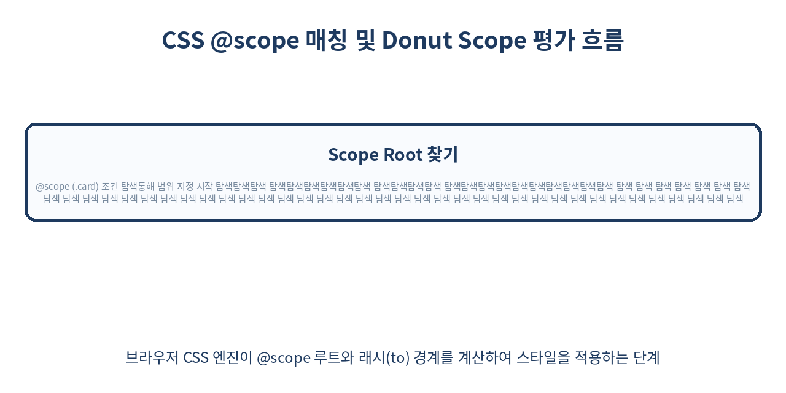
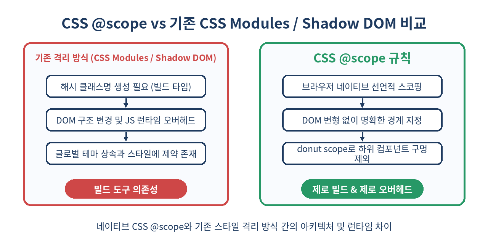

# 🎯 CSS @scope 규칙 완벽 가이드: BEM과 CSS Modules 없이 완성하는 스타일 캡슐화

> **웹 스타일링의 오랜 난제였던 스타일 충돌(Class Collision)과 과도한 specificity 경쟁, 이제 브라우저 네이티브 기능으로 해결할 수 있습니다.**  
> 외부 라이브러리나 래핑 해시 기반 커스텀 툴셋 없이도 pure CSS만으로 완벽한 스타일 캡슐화를 구현해 주는 `CSS @scope` 규칙의 메커니즘과 실제 활용법을 탐구합니다.

---

## 📌 목차
1. 🧭 1. 왜 스타일 캡슐화는 늘 어려운 숙제였을까?
2. 🔬 2. CSS @scope 규칙의 개념과 캡슐화 메커니즘
3. 📐 3. 기본 문법과 Root - Scoping Limit 구성하기
4. 🍩 4. Donut Scope: 원하는 하위 요소 영역 구멍 뚫기
5. ⚖️ 5. Cascade와 Scoping Proximity: 명시도 규칙의 변화
6. 📊 6. 기존 스타일 격리 방식과의 비교 (CSS Modules vs Shadow DOM vs @scope)
7. 🛠️ 7. 컴포넌트 프레임워크(React, Vue 등)에서의 최신 적용 기법
8. ⚡ 8. @scope와 CSS Container Queries의 미친 시너지 효과
9. ⚠️ 9. 실무 적용 시 만나는 함정 및 주의할 점
10. 🌐 10. 브라우저 지원 현황과 안전한 Fallback 전략
11. 🧾 11. 정리

---

## 🧭 1. 왜 스타일 캡슐화는 늘 어려운 숙제였을까?

웹 애플리케이션의 규모가 가파르게 커지면서 CSS의 가장 근본적인 특성인 **전역 네임스페이스(Global Namespace)**와 **캐스케이딩(Cascading)**은 단순한 장점을 넘어 거대한 관리적 부채로 다가왔습니다. HTML 문서 전체에서 작성되는 모든 클래스명과 요소 선택자는 단 하나의 전역 네임스페이스를 공유합니다. 이로 인해 컴포넌트 단위 개발이 대세가 된 모던 웹 생태계에서는 스타일 우발적 오염(Accidental Side-effects)과 명시도 전쟁(Specificity Wars)이 빈번하게 발생합니다.

개발자들은 오랜 기간 이 문제를 극복하기 위해 다양한 기술적 우회책과 설계 패턴을 발명하고 도입해 왔습니다.

```html
<!-- BEM 패턴: 명명 규칙을 통해 인위적으로 충돌 방지 -->
<div class="product-card product-card--featured">
  <h2 class="product-card__title">상품명</h2>
  <button class="product-card__button product-card__button--primary">구매하기</button>
</div>

<!-- CSS Modules / CSS-in-JS: 빌드 타임 혹은 런타임에 고유 난수 해시 부여 -->
<div class="ProductCard_card_1a8f9 ProductCard_featured_9z2b4">
  <h2 class="ProductCard_title_3x7c1">상품명</h2>
  <button class="ProductCard_button_5v2e3">구매하기</button>
</div>
```

웹 생태계가 지나온 대표적인 스타일 격리 접근법들은 저마다 뚜렷한 한계점과 비용을 지니고 있습니다.

1. **BEM (Block Element Modifier) 명명 규칙**
   - **원리**: 클래스 이름을 `block__element--modifier` 형태로 엄격하게 작성하여 클래스명 중복을 수동으로 방지합니다.
   - **한계**: HTML 클래스 구문이 매우 길어져 가독성을 해치며, 오직 개발자의 자율적 규율에 의존하므로 신규 팀원의 실수나 휴먼 에러를 시스템적으로 막을 수 없습니다.

2. **CSS Modules (빌드 타임 해싱)**
   - **원리**: Webpack, Vite 등의 번들러가 작성된 CSS 클래스명 뒤에 `.card_title_x8f3a`와 같은 무작위 해시 문자열을 결합하여 전역 네임스페이스를 강제로 분리합니다.
   - **한계**: 반드시 JavaScript 빌드 툴체인이 강제되며, 서버 사이드 리액트 컴포넌트(RSC)나 micro-frontend 환경에서 클래스명 동기화 이슈 및 CSS 파일 분할 파편화 문제가 발생합니다.

3. **CSS-in-JS (Styled-Components, Emotion)**
   - **원리**: JavaScript 런타임 시점에 스타일을 평가하고 동적으로 `<style>` 태그를 Head 요소에 주입합니다.
   - **한계**: JS 번들 사이즈 증가, 런타임 CPU 스타일 계산 오버헤드, React 18의 Concurrent Mode와의 호환성 문제, 그리고 SSR 환경에서의 CSS 주입 딜레이로 인한 레이아웃 시프트(CLS) 위험이 존재합니다.

4. **Shadow DOM (Web Components)**
   - **원리**: 브라우저의 DOM 트리를 캡슐화하여 외부의 그 어떤 CSS도 내부로 침투하지 못하도록 완전 격리(Encapsulation)를 제공합니다.
   - **한계**: 격리가 너무 완고하여 전역 폰트, 테마 시스템 변수, 공통 리셋 스타일을 전달하기 어렵고, SSR 지원이 복잡하며, accessibility(A11y) 트리가 분리되는 부작용이 있습니다.

5. **Tailwind CSS (Atomic CSS)**
   - **원리**: 사전 정의된 유틸리티 클래스를 HTML 태그에 직접 조합하여 커스텀 CSS 작성을 극도로 줄입니다.
   - **한계**: HTML 구조가 심각하게 비대해지며, 시맨틱 웹 태그 스타일링이나 컴포넌트 자체의 기하학적 캡슐화 규칙을 CSS 파일 단에서 직관적으로 파악하기 어렵습니다.

이처럼 기존 해결책들은 스타일 충돌 문제를 해결하는 대신 **빌드 복잡도 증가**, **런타임 성능 저하**, **HTML 마크업 오염**이라는 또 다른 기회비용을 정당화해야 했습니다. 네이티브 CSS 차원에서 브라우저가 직접 특정 DOM 영역으로 스타일의 적용 범위(Scope)를 제한할 수 있는 표준 명세의 필요성이 수십 년간 제기되어 온 배경입니다.

---

## 🔬 2. CSS @scope 규칙의 개념과 캡슐화 메커니즘

W3C의 **CSS Cascading and Inheritance Level 6** 사양에 새롭게 포함된 `@scope` At-rule은 도구나 JS 런타임의 개입 없이 브라우저의 CSS 스타일 파싱 엔진이 선언적으로 범위 규칙을 해석하게 만드는 브라우저 네이티브 기술입니다.

`@scope`는 DOM 트리의 탐색 범위(Traversal Boundary)에 따라 스타일 선택자(Selector)의 유효 범위를 제한합니다.

```
       [ Document Root ]
               │
       <div class="card">   ◄─── [Scope Root] 스타일 경계 시작점
               │
         ┌─────┴─────┐
         ▼           ▼
      <h2>        <p>        ◄─── [Scoped Rules 적용 대상]
         │
  <div class="comments">   ◄─── [Scoping Limit] 스타일 경계 종료점 (Donut Limit)
         │
       <p>                   ◄─── [스타일 적용 대상에서 완벽 제외]
```

### `@scope` 캡슐화 메커니즘의 3가지 핵심 원칙

1. **범위 루트 (Scope Root)**
   - `@scope (<selector>)` 구문을 통해 스코프가 시작되는 부모 요소를 정의합니다.
   - 스코프 블록 내부에서 선언된 모든 셀렉터는 이 Scope Root의 하위(Descendants) DOM 요소에만 매칭됩니다.

2. **범위 한계 (Scoping Limit)**
   - `to (<selector>)` 구문을 추가하여 스코프가 하위 트리를 내려가다가 탐색 및 스타일에 적용을 **중단할 지점**을 지정합니다.
   - 이를 통해 자식 컴포넌트의 영역을 '구멍(Hole)'으로 뚫어내는 **도넛 스코핑(Donut Scoping)**이 가능해집니다.

3. **DOM 구조 및 선택자 명시도의 비침습성**
   - Shadow DOM처럼 DOM 구조 자체를 캡슐화하거나 Shadow Root를 생성하지 않고 기존 Light DOM 위에서 동작합니다.
   - 클래스명을 해싱하여 마크업을 변경할 필요가 없습니다. 개발자 도구에서 원본 마크업과 CSS 선택자 구조가 그대로 보존됩니다.

---

## 📐 3. 기본 문법과 Root - Scoping Limit 구성하기

`@scope` 규칙은 **명시적 범위 선언(Explicit Scope)** 방식과 HTML 인라인 스타일 태그를 이용한 **암묵적 범위 선언(Implicit Scope)** 방식을 모두 지원합니다.

### 1. 명시적 범위 선언 (Explicit Scope)

외부 CSS 파일이나 일반 `<style>` 블록 내에서 괄호 안에 선택자를 전달하여 범위 루트를 지정합니다.

```css
/* 글로벌 스타일시트에 작성된 카드 컴포넌트 스코프 */
@scope (.media-card) {
  /* :scope 가상 클래스는 Scope Root (.media-card) 자신을 직접 가리킵니다. */
  :scope {
    display: grid;
    grid-template-columns: 120px 1fr;
    gap: 1.5rem;
    padding: 1.25rem;
    background-color: #ffffff;
    border: 1px solid #e2e8f0;
    border-radius: 12px;
    box-shadow: 0 4px 6px -1px rgba(0, 0, 0, 0.1);
  }

  /* .media-card 내부에 존재하는 img 요소에만 제한 적용 */
  img {
    width: 100%;
    height: 120px;
    object-fit: cover;
    border-radius: 8px;
  }

  /* .media-card 내부의 .title 클래스에 적용 */
  .title {
    margin: 0 0 0.5rem 0;
    font-size: 1.25rem;
    font-weight: 700;
    color: #0f172a;
  }

  /* .media-card 내부의 .description 클래스에 적용 */
  .description {
    margin: 0;
    font-size: 0.95rem;
    line-height: 1.6;
    color: #475569;
  }
}
```

상기 스타일시트는 페이지 내의 다른 영역에 존재하는 ``, `.title`, `.description` 요소에 수백 개가 있더라도 오직 `.media-card` 내부의 자식 요소에만 제한적으로 매칭됩니다.

### 2. 암묵적 범위 선언 (Implicit Scope)

HTML 인라인 스타일 태그 HTML 내부에 타겟팅 대상 없이 `@scope`를 작성하면, 해당 `<style>` 태그의 부모 요소가 자동으로 Scope Root로 지정됩니다.

```html
<article class="user-profile-card">
  <!-- 타겟 선택자를 생략한 @scope는 부모인 .user-profile-card를 루트로 지정합니다 -->
  <style>
    @scope {
      :scope {
        display: flex;
        align-items: center;
        gap: 1rem;
        padding: 1rem;
        background: #f8fafc;
      }
      img {
        border-radius: 50%;
        width: 48px;
        height: 48px;
      }
      .username {
        font-weight: 600;
        color: #1e293b;
      }
    }
  </style>

  
  <div>
    <span class="username">김개발</span>
  </div>
</article>
```

### `:scope` pseudo-class 선택자의 특징

`@scope` 블록 내부에서 `:scope` 구문은 Scope Root 요소를 참조합니다. 이때 중요한 특징이 있습니다:
- `:scope`를 생략하고 자식 선택자만 적는 경우 (예: `img`)는 `:scope img` 또는 `:scope descendent img`와 동등하게 평가됩니다.
- `:scope` 선택자의 specificity(명시도)는 `:scope` pseudo-class 자체의 명시도 `(0, 1, 0)`으로 계산되는 것이 아니라, 범위 루트로 지정된 원본 선택자(예: `.media-card` → `(0, 1, 0)`)의 명시도를 그대로 계승하거나 `:scope` 고유 명시도 규칙을 적용받습니다.

---

## 🍩 4. Donut Scope: 원하는 하위 요소 영역 구멍 뚫기

기존 CSS에서는 부모 컴포넌트에 스타일을 부여할 때, 그 내부에 중첩(Nest)된 하위 자식 컴포넌트까지 부모의 스타일 선택자가 원치 않게 연쇄 적용(Cascade down)되는 심각한 문제가 있었습니다. `@scope`의 **Donut Scope** 기능은 루트 뒤에 `to (<limit-selector>)` 구문을 배치하여 스타일 적용의 하한선(Limit)을 선언할 수 있습니다.

```html
<!-- complex HTML 구조 예시 -->
<main class="article-container">
  <h1 class="title">아티클 메인 제목</h1>
  <p class="paragraph">이 단락은 아티클 본문의 핵심 내용을 담고 있습니다.</p>

  <!-- 독립적인 자식 컴포넌트: 댓글 영역 -->
  <section class="comment-widget">
    <h2 class="title">댓글 목록 (3)</h2>
    <p class="paragraph">댓글 본문 내의 텍스트 내용입니다.</p>
  </section>

  <!-- 독립적인 자식 컴포넌트: 추천 상품 바 -->
  <aside class="recommended-products">
    <h3 class="title">관련 추천 상품</h3>
    <p class="paragraph">상품 설명 텍스트입니다.</p>
  </aside>
</main>
```

상기 HTML 구조에서 `.article-container` 내부를 스타일링하되, 자식 컴포넌트인 `.comment-widget` 및 `.recommended-products` 내부로는 외부 아티클 스타일이 절대 침투하지 못하게 차단하려면 다음과 같이 Donut Scope를 구성합니다.

```css
/* .article-container에서 출발하여 .comment-widget 및 .recommended-products를 만나는 순간 스코프 중단 */
@scope (.article-container) to (.comment-widget, .recommended-products) {
  /* 아티클 영역 내의 직접적인 h1, h2, h3 선택 */
  h1, h2, h3 {
    letter-spacing: -0.02em;
    color: #0f172a;
    border-bottom: 2px solid #e2e8f0;
    padding-bottom: 0.5rem;
  }

  /* 아티클 영역 내의 본문 p 선택 */
  .paragraph {
    font-size: 1.125rem;
    line-height: 1.8;
    color: #334155;
    margin-bottom: 1.5rem;
  }

  /* 강조 링크 */
  a {
    color: #2563eb;
    text-decoration: underline;
  }
}
```



이 구문이 실행되면 브라우저는 DOM 트리를 탐색하며 스타일 매칭을 수행하다가, `.comment-widget` 및 `.recommended-products` 클래스를 가진 요소를 만나는 순간 해당 경계 하위 트리에 대한 스타일 계산을 즉시 중단합니다. 

따라서 `.comment-widget` 내부에 포함된 `.paragraph`나 `.title`은 부모의 `.article-container` 스코프 스타일 규칙에 영향을 받지 않고 오롯이 자신의 고유한 스타일을 안전하게 유지합니다.

---

## ⚖️ 5. Cascade와 Scoping Proximity: 명시도 규칙의 변화

CSS 스타일 충돌을 해결할 때 브라우저는 **Cascading 알파벳 순서 규칙(Cascade Order)**에 따라 최종 스타일 적용 여부를 판가름합니다. W3C 명세에 따라 `@scope`가 도입되면서 Cascading 정렬 단계에 **Scoping Proximity (스코프 근접성)**라는 새로운 우선순위 축이 추가되었습니다.

### Cascade 정렬 기준 (우선순위 순서)

1. **Importance & Origin**: `!important` 선언 및 사용자/브라우저/작성자 스타일시트 출처
2. **Context**: Normal DOM tree vs Shadow DOM context
3. **Scoping Proximity (스코프 근접성)**: ⭐ `@scope`로 지정된 루트와의 DOM 거리
4. **Specificity (명시도)**: ID `(1,0,0)`, Class/Attribute `(0,1,0)`, Element `(0,0,1)` 계산값
5. **Order of Appearance**: 스타일시트 내 선언 순서 (후순위 승리)

### Scoping Proximity 작동 방식

두 개의 스코프 스타일 규칙이 동일한 요소를 두고 상충할 때, 선택자의 Specificity(명시도)가 완전히 동일하거나 심지어 스타일시트 상 뒤에 선언되었더라도 **스타일 대상 요소와 DOM 트일상 더 가까운(더 직계 부모인) Scope Root의 규칙이 무조건 승리**합니다.

```html
<!-- 중첩된 테마 컨텍스트 HTML -->
<div class="theme-provider light-theme">
  <div class="card">
    <p class="description">이 텍스트의 글자 색상은 무엇일까요?</p>

    <!-- 안쪽에 중첩된 다크 테마 영역 -->
    <div class="theme-provider dark-theme">
      <p class="description">이 텍스트의 글자 색상은 무엇일까요?</p>
    </div>
  </div>
</div>
```

```css
/* 1. 라이트 테마 스코프 규칙 선언 */
@scope (.light-theme) {
  .description {
    color: #1e293b; /* 라이트 모드용 어두운 글자색 */
    background-color: #ffffff;
  }
}

/* 2. 다크 테마 스코프 규칙 선언 */
@scope (.dark-theme) {
  .description {
    color: #f8fafc; /* 다크 모드용 밝은 글자색 */
    background-color: #0f172a;
  }
}
```

전통적인 CSS Cascading 규칙이라면 뒤에 작성된 `.dark-theme`의 `.description`이 앞서 작성된 스타일을 덮어씌우는 것뿐이었지만, 만약 스타일시트 선언 순서를 다음과 같이 뒤바꾸더라도 Scoping Proximity에 의해 완벽한 결과가 보장됩니다:

```html
<!-- 라이트 테마 내부에 다크 테마가 중첩된 경우 -->
```

안쪽 `.dark-theme` 내부의 `<p class="description">` 요소 입장에서는:
- `.light-theme` 스코프 루트까지의 거리: 3단계 조상 (p -> div.card -> div.light-theme)
- `.dark-theme` 스코프 루트까지의 거리: 1단계 조상 (p -> div.dark-theme)

`.dark-theme` 스코프 루트가 DOM 트리 구조상 target 요소와 더 **근접(Proximity)**하므로, Specificity를 편법적으로 올리거나 `!important`를 남발하지 않고도 `.dark-theme` 내부 스타일이 자연스럽게 적용됩니다.

---

## 📊 6. 기존 스타일 격리 방식과의 비교 (CSS Modules vs Shadow DOM vs @scope)



모던 웹 패러다임에서 쓰이는 주요 스타일 격리 메커니즘 4가지의 기술적 차이점과 트레이드오프를 정밀 비교한 명세표입니다.

| 비교 기준 항목 | BEM Architecture | CSS Modules | Shadow DOM (Web Components) | Native CSS `@scope` |
| :--- | :--- | :--- | :--- | :--- |
| **격리 메커니즘** | 개발자 네이밍 컨벤션 | 번들러 기반 클래스명 해싱 | 브라우저 DOM 트리 물리적 분리 | 브라우저 CSS 파싱 엔진 범주 격리 |
| **빌드 툴체인 필수 여부** | 불필요 | **필수 (Webpack, Vite 등)** | 불필요 | **불필요 (Pure Native CSS)** |
| **Donut Scope 지원** | 불가능 | 불가능 | Open/Closed 모드 제어 | **완벽 지원 (`to ()` 구문)** |
| **Scoping Proximity 지원** | 불가능 | 불가능 | 지원 안 함 | **완벽 지원 (DOM 거리 기반 우선순위)** |
| **글로벌 테마/변수 상속** | 용이함 | `:global` 키워드 필요 | 매우 까다로움 (`::part`, CSS Custom Prop) | **자연스럽게 상속 및 호환** |
| **HTML DOM 변경 여부** | 클래스명 팽창 | 클래스명 난수 변경 | Shadow Root 생성, DOM 파편화 | **HTML 마크업 변경 전혀 없음** |
| **런타임 메모리/CPU 비용**| Zero | Zero | DOM 노드 별도 관리에 따른 오버헤드 | **브라우저 네이티브 최적화 (Zero JS)** |
| **SSR / Hydration 안정성** | 높음 | 높음 (동기화 설정 필요) | Declarative Shadow DOM 필요 | **최상 (웹 표준 HTML/CSS 그대로 전송)** |

CSS `@scope`는 기존 빌드 툴 방식(CSS Modules)의 **가벼움과 직관성**을 유지하면서, Shadow DOM의 **강력한 브라우저 엔진 차원 캡슐화**라는 장점만을 결합한 최적의 기술적 타협점을 선사합니다.

---

## 🛠️ 7. 컴포넌트 프레임워크(React, Vue 등)에서의 최신 적용 기법

React, Vue, Svelte, Angular 등 최신 컴포넌트 기반 프레임워크와 `@scope`를 결합하면 대규모 웹 애플리케이션의 DX(개발자 경험)를 비약적으로 개선할 수 있습니다.

### 1. React (Next.js / Server Components)에서의 활용

React 환경에서 더 이상 빌드 타임 CSS Modules의 `styles.cardTitle`과 같은 개체 참조를 남발할 필요가 없습니다. 일반 표준 클래스명을 사용하여 깔끔한 마크업을 유지할 수 있습니다.

```tsx
// UserProfileCard.tsx
import React from 'react';
import './UserProfileCard.css';

interface UserProfileProps {
  user: {
    avatar: string;
    name: string;
    role: string;
    bio: string;
  };
}

export function UserProfileCard({ user }: UserProfileProps) {
  return (
    <article class="user-card-scope">
      <div class="header">
        
        <div class="meta">
          <h3 class="name">{user.name}</h3>
          <span class="badge">{user.role}</span>
        </div>
      </div>
      <p class="bio">{user.bio}</p>
    </article>
  );
}
```

```css
/* UserProfileCard.css */
@scope (.user-card-scope) {
  :scope {
    background: #ffffff;
    border-radius: 16px;
    padding: 1.5rem;
    border: 1px solid #f1f5f9;
  }

  .header {
    display: flex;
    align-items: center;
    gap: 1rem;
  }

  .avatar {
    width: 56px;
    height: 56px;
    border-radius: 50%;
  }

  .name {
    font-size: 1.125rem;
    font-weight: 700;
    color: #0f172a;
    margin: 0;
  }

  .badge {
    display: inline-block;
    padding: 0.25rem 0.5rem;
    background: #eff6ff;
    color: #2563eb;
    font-size: 0.75rem;
    border-radius: 4px;
  }

  .bio {
    margin-top: 1rem;
    color: #64748b;
    font-size: 0.875rem;
  }
}
```

### 2. Vue 3 Single File Components (SFC)와의 결합

Vue 3는 자체적으로 `<style scoped>` 기능을 제공하여 해시 속성(`data-v-f32165`)을 요소에 추가합니다. 하지만 `@scope`를 도입하면 속성 주입 없이 깔끔한 순수 표준 스타일링이 가능해집니다.

```vue
<!-- ModalDialog.vue -->
<template>
  <div class="modal-dialog-root">
    <div class="modal-header">
      <h2><slot name="title">기본 모달 제목</slot></h2>
    </div>
    <div class="modal-body">
      <slot></slot>
    </div>
  </div>
</template>

<style scoped>
/* Native @scope를 활용하여 모달 바디 내부에 삽입되는 외부 스롯(Slot) 컴포넌트와의 경계 정의 */
@scope (.modal-dialog-root) to (.modal-body) {
  :scope {
    position: fixed;
    top: 50%;
    left: 50%;
    transform: translate(-50%, -50%);
    width: 90%;
    max-width: 500px;
    background: white;
    box-shadow: 0 20px 25px -5px rgba(0, 0, 0, 0.1);
    border-radius: 8px;
  }

  .modal-header {
    padding: 1rem 1.5rem;
    border-bottom: 1px solid #eee;
  }

  h2 {
    font-size: 1.25rem;
    margin: 0;
  }
}
</style>
```

---

## ⚡ 8. @scope와 CSS Container Queries의 미친 시너지 효과

최신 모던 CSS의 백미는 **`@scope` (스타일 범주 캡슐화)**와 **`@container` (레이아웃 반응형 격리)**의 결합에 있습니다. 기존의 Media Queries가 오직 브라우저 뷰포트 크기만을 기준으로 삼았다면, 이 두 조합은 완전한 자립형 모듈(Self-contained Responsive Component)을 만들어 냅니다.

```css
/* 독립적인 프로필 컴포넌트 스코프 및 컨테이너 선언 */
@scope (.profile-widget) {
  :scope {
    /* 1. 이 컴포넌트 자체를 인라인 크기 기준의 Container로 등록 */
    container-type: inline-size;
    container-name: profile-card;

    display: block;
    padding: 1rem;
    border: 1px solid #e2e8f0;
    border-radius: 12px;
  }

  /* 2. 일반 스코프 내부 기본 레이아웃 (모바일/좁은 공간 기준) */
  .widget-wrapper {
    display: flex;
    flex-direction: column;
    align-items: center;
    gap: 1rem;
    text-align: center;
  }

  .avatar {
    width: 80px;
    height: 80px;
    border-radius: 50%;
  }

  .details .name {
    font-size: 1.1rem;
    font-weight: 600;
  }

  /* 3. 스코프 내부에서 컨테이너 쿼리(Container Queries)를 적용하여 조건별 레이아웃 재배치 */
  @container profile-card (min-width: 420px) {
    .widget-wrapper {
      flex-direction: row;
      text-align: left;
    }

    .avatar {
      width: 100px;
      height: 100px;
    }

    .details .name {
      font-size: 1.4rem;
    }
  }

  @container profile-card (min-width: 650px) {
    :scope {
      background-color: #f8fafc;
      padding: 2rem;
    }

    .widget-wrapper {
      gap: 2rem;
    }
  }
}
```

이 조합을 활용하면, 이 컴포넌트가 사이드바(300px)에 배치되든, 메인 콘텐츠 영역(800px)에 배치되든 상관없이 외부 환경과 격리된 상태에서 **클래스 충돌 없이 스코프 내에서만 완벽히 동작하는 반응형 디자인**을 구현할 수 있습니다.

---

## ⚠️ 9. 실무 적용 시 만나는 함정 및 주의할 점

`@scope` 규칙이 스타일 캡슐화의 강력한 솔루션이지만, 브라우저 스타일 시스템의 기본 특성에 대한 오해로 인해 발생할 수 있는 실무 함정 4가지를 반드시 숙지해야 합니다.

### 1. 하향 상속 속성(Inherited Properties)은 Donut Limit을 뚫고 전달된다
`@scope`는 **선택자 매칭(Selector Matching)**의 범위를 차단하는 것이지, CSS의 고유한 **속성 상속(Inheritance)**을 차단하는 것이 아닙니다.

```css
/* to (.child-component)로 구멍을 뚫었음에도 불구하고 */
@scope (.parent-component) to (.child-component) {
  :scope {
    color: #2563eb;          /* inherited property */
    font-family: 'Inter', sans-serif; /* inherited property */
  }
}
```

`.child-component` 내부의 요소를 선택하는 CSS 규칙은 차단되지만, 부모 요소에 설정된 `color`, `font-family`, `line-height`, `visibility` 등 CSS 명세상 상속되는 속성(Inherited Properties)은 `.child-component` 내부 요소에 자연스럽게 전달됩니다.  
*해결책:* 완벽한 값 초기화가 필요한 경우 자식 컴포넌트 시작 부분에 `all: unset;` 또는 `all: initial;`을 명시해야 합니다.

### 2. Specificity (명시도) 계산 방식의 특수성
`@scope` 블록 내부에서 선언된 선택자의 Specificity는 범위를 제한했다고 해서 자동으로 증가하거나 감소하지 않습니다.

```css
/* Specificity: (0, 1, 0) - .card 클래스 1개 */
.card { color: red; }

@scope (.card) {
  /* Specificity: (0, 0, 1) - p 태그 1개 */
  p { color: blue; }
}

/* 외부 일반 규칙 Specificity: (0, 1, 1) - .card와 p 결합 */
.card p { color: green; } /* ⚠️ 이 규칙의 명시도가 더 높아 승리합니다! */
```

`@scope` 내부의 `p` 선택자는 Specificity `(0, 0, 1)`로 계산되므로, 외부에서 더 높은 Specificity인 `.card p` `(0, 1, 1)`로 덮어쓰면 외부 스타일이 승리합니다. 스코프가 명시도 승리를 무조건 보장하는 것은 아니며, 동일 Specificity일 때 Scoping Proximity가 개입합니다.

### 3. CSS Custom Properties(CSS 변수)의 전역 버블링 및 상속
`@scope` 내부에서 선언된 `--main-color: red;`와 같은 CSS 변수는 변수가 선언된 DOM 요소 이하의 모든 자식 요소(Donut Limit 내부 포함)로 그대로 전달되어 상속됩니다.

### 4. DOM 선택자 디버깅 및 브라우저 DevTools 차이
Chrome 및 Safari DevTools 최신 버전에서는 `@scope` 블록별로 스타일이 그룹화되어 보여지지만, 개발자 도구의 Element Inspector에서 선택자 오버라이드 관계를 파악할 때 Scoping Proximity에 의해 순서가 바뀐 항목을 혼동할 수 있으므로 DevTools 패널의 Computed tab을 반드시 병행 확인해야 합니다.

---

## 🌐 10. 브라우저 지원 현황과 안전한 Fallback 전략

### 브라우저 지원 현황 (2024년 기준)

- **Chromium (Chrome, Edge, Opera 등)**: v118 이상 완벽 지원 (2023년 10월 탑재)
- **Safari (WebKit)**: macOS / iOS Safari 17.4 이상 완벽 지원 (2024년 3월 탑재)
- **Firefox (Gecko)**: Firefox 128+ 지원 시작 (플래그 옵션 및 지속적 안정화 진행 중)

주요 브라우저엔진 3사(Chromium, WebKit, Gecko)가 모두 `@scope`에 대한 구현 및 표준 합의를 완료함에 따라, Baseline 기능으로 자리잡아 가고 있습니다.

### 안전한 Fallback 및 점진적 향상(Progressive Enhancement) 전략

구형 브라우저 환경을 지원해야 하는 프로덕션 서비스를 위한 safe-guard 코드 작성법입니다.

```css
/* 1. 기본 폴백 스타일 (전통적 BEM 또는 결합 선택자 스타일) */
.media-card {
  border: 1px solid #e2e8f0;
  padding: 1rem;
}
.media-card .title {
  font-size: 1.25rem;
  color: #0f172a;
}

/* 2. @supports At-rule을 사용한 네이티브 @scope 기능 감지 및 기능 향상 */
@supports (@scope (.test) {}) {
  /* 레거시 전역 스타일 해제 또는 오버라이딩 */
  .media-card .title {
    color: initial;
  }

  /* 최신 @scope 캡슐화 적용 */
  @scope (.media-card) {
    :scope {
      border: 1px solid #e2e8f0;
      padding: 1rem;
    }
    .title {
      font-size: 1.25rem;
      color: #0f172a;
    }
  }
}
```

또한, **PostCSS** 툴체인을 활용하는 프로젝트의 경우 `postcss-scoping` 또는 관련 폴백 플러그인을 빌드 단계에 추가하면, `@scope`를 지원하지 않는 브라우저 대상 빌드 시 자동으로 Class prefix 해싱 문법으로 트랜스파일하여 제공할 수 있습니다.

---

## 🧾 11. 정리

- **네이티브 캡슐화의 도래**: CSS Modules, CSS-in-JS 등 복잡한 JS 빌드 도구셋과 런타임 라이브러리 없이도 pure CSS만으로 안전한 컴포넌트 단위 스타일 캡슐화 가능.
- **Donut Scoping (`to`)**: 하위 자식 컴포넌트의 스타일 영역을 직관적으로 제외할 수 있어 중첩 컴포넌트 구조에서 스타일 오염 완벽 차단.
- **Scoping Proximity**: 명시도(Specificity) 꼼수나 `!important` 오남용 없이, DOM 트리의 물리적 거리에 기반한 깔끔한 Cascading 우선순위 정립.
- **최신 CSS 피처와의 시너지**: Container Queries, CSS Grid/Flexbox와 연동되어 진정한 의미의 독립 자립형 컴포넌트(Self-contained Component) 설계 구축.
- **실무 유의점**: Selector 범주의 매칭 억제일 뿐, Inherited CSS 속성은 Donut 경계를 넘어 전달되므로 상속 속성에 대한 가이드라인 필요.

> ✨ **한 줄 요약**  
> `CSS @scope`는 런타임 오버헤드와 마크업 오염 없이 브라우저 네이티브 엔진의 파싱 성능을 100% 활용하여 완벽한 스타일 격리를 선언적으로 달성할 수 있는 모던 웹 개발의 핵심 피처입니다.

---

## 📚 참고 자료
- [W3C CSS Cascading and Inheritance Level 6 Specification](https://www.w3.org/TR/css-cascade-6/#scoped-styles)
- [MDN Web Docs: CSS @scope at-rule](https://developer.mozilla.org/en-US/docs/Web/CSS/@scope)
- [Chrome Developers: Limit the reach of your selectors with the CSS @scope rule](https://developer.chrome.com/docs/css-ui/at-scope)
