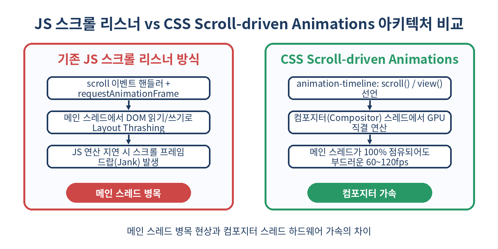
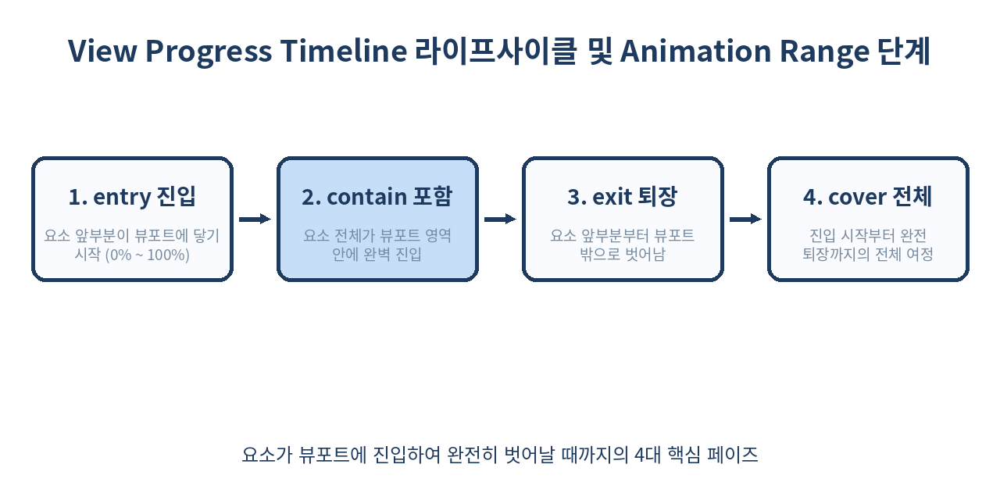

# 📜 CSS Scroll-driven Animations 완벽 가이드: JS 없는 60fps 스크롤 인터랙션

> "스크롤 위치에 반응하는 애니메이션을 만들기 위해 수십 킬로바이트의 JavaScript 라이브러리를 번들링하고 `window.addEventListener('scroll')`의 버벅임에 고통받던 시대는 끝났습니다."
> 웹 표준으로 정착한 CSS Scroll-driven Animations를 통해 JavaScript 단 한 줄 없이 브라우저 컴포지터 스레드에서 구동되는 초경량 60~120fps 인터랙션을 구현하는 방법을 심층 분석합니다.

---

## 📌 목차
1. [왜 지금 스크롤 애니메이션 패러다임이 바뀌고 있는가?](#-1-왜-지금-스크롤-애니메이션-패러다임이-바뀌고-있는가)
2. [Scroll-driven Animations 핵심 아키텍처: 컴포지터 스레드의 혁신](#-2-scroll-driven-animations-핵심-아키텍처-컴포지터-스레드의-혁신)
3. [Scroll Progress Timeline: 스크롤 컨테이너 기반 추적](#-3-scroll-progress-timeline-스크롤-컨테이너-기반-추적)
4. [View Progress Timeline: 뷰포트 내 요소 가시성 추적](#-4-view-progress-timeline-뷰포트-내-요소-가시성-추적)
5. [animation-range 정복: entry, exit, cover, contain 완전 분석](#-5-animation-range-정복-entry-exit-cover-contain-완전-분석)
6. [실전 패턴 1: 상단 읽기 진행률 바 (Reading Progress Indicator)](#-6-실전-패턴-1-상단-읽기-진행률-바-reading-progress-indicator)
7. [실전 패턴 2: 뷰포트 진입 패럴랙스 줌 & 페이드인 카드](#-7-실전-패턴-2-뷰포트-진입-패럴랙스-줌--페이드인-카드)
8. [실전 패턴 3: 부드럽게 쌓이는 스태킹 카드 (Sticky Stacked Cards)](#-8-실전-패턴-3-부드럽게-쌓이는-스태킹-카드-sticky-stacked-cards)
9. [timeline-scope: 부모-형제 요소 간 스크롤 타임라인 공유](#-9-timeline-scope-부모-형제-요소-간-스크롤-타임라인-공유)
10. [JS 솔루션(GSAP ScrollTrigger, Intersection Observer)과의 기술 비교](#-10-js-솔루션gsap-scrolltrigger-intersection-observer과의-기술-비교)
11. [실무 함정(Pitfalls)과 쓰면 안 되는 안티패턴](#-11-실무-함정pitfalls과-쓰면-안-되는-안티패턴)
12. [브라우저 지원 현황 및 폴리필·점진적 향상 전략](#-12-브라우저-지원-현황-및-폴리필점진적-향상-전략)
13. [정리 및 핵심 요약](#-13-정리-및-핵심-요약)
14. [참고 자료](#-14-참고-자료)

---

## 🧭 1. 왜 지금 스크롤 애니메이션 패러다임이 바뀌고 있는가?

그동안 웹에서 스크롤 연동 애니메이션(Scroll-linked / Scroll-triggered Animations)을 구현하려면 개발자들은 항상 복잡한 딜레마에 부딪혔습니다.

```js
// ❌ 고전적인 메인 스레드 스크롤 리스너 안티패턴
window.addEventListener('scroll', () => {
  const scrollY = window.scrollY;
  const height = document.documentElement.scrollHeight - window.innerHeight;
  const progress = scrollY / height;
  
  // 매 스크롤 틱마다 메인 스레드에서 DOM 스타일을 강제로 변경 -> Layout Thrashing 유발
  document.getElementById('progress-bar').style.transform = `scaleX(${progress})`;
});
```

이러한 자바스크립트 기반 방식은 다음과 같은 치명적인 한계를 가집니다:
1. **메인 스레드 블로킹(Main Thread Contention)**: 무거운 JS 연산, 리액트 재조정(Reconciliation), 서드파티 스크립트 실행이 겹치면 스크롤 이벤트 디스패치가 지연되어 심각한 프레임 드랍(Jank)이 발생합니다.
2. **레이아웃 스래싱(Layout Thrashing)**: `getBoundingClientRect()`나 `scrollTop`을 반복해서 읽고 DOM 스타일을 변경하는 순간 브라우저는 강제 동기식 레이아웃(Reflow)을 유발합니다.
3. **번들 크기 증가**: GSAP ScrollTrigger, Locomotive Scroll, Framer Motion 같은 서드파티 라이브러리를 추가하면 수십~수백 KB의 초기 JS 페이로드가 늘어납니다.

이 문제를 근본적으로 해결하기 위해 W3C CSS 워킹 그룹이 제정한 표준이 바로 **CSS Scroll-driven Animations Level 1**입니다.
기존 CSS 애니메이션이 `시간(Time)`의 흐름에 따라 진행되었다면, Scroll-driven Animations는 애니메이션의 진행률을 `스크롤 위치(Scroll Position)` 또는 `요소의 뷰포트 진입도(View Visibility)`에 직접 바인딩합니다.

---

## ⚙️ 2. Scroll-driven Animations 핵심 아키텍처: 컴포지터 스레드의 혁신

브라우저 렌더링 파이프라인에서 가장 중요한 원칙은 **"가능한 한 작업을 메인 스레드(Main Thread)에서 컴포지터 스레드(Compositor Thread)로 오프로드하라"**입니다.



기존 JS 기반 스크롤 리스너는 사용자의 스크롤 입력을 OS -> 브라우저 프로세스 -> 렌더러 프로세스의 메인 스레드로 전달한 뒤, 이벤트 루프를 거쳐 DOM 스타일을 변경하고 다시 렌더링 트리를 재계산해야 했습니다.

반면 CSS Scroll-driven Animations는 선언적인 CSS 속성(`animation-timeline`)으로 브라우저 엔진에 타임라인 관계를 등록합니다. 그 결과:
- **하드웨어 가속 컴포지터 실행**: `transform`이나 `opacity` 같은 컴포지터 친화적 속성을 애니메이션화하면, 메인 스레드가 무거운 연산으로 100% 멈춰 있어도 스크롤 애니메이션은 GPU/컴포지터 스레드에서 완전한 60~120fps로 매끄럽게 렌더링됩니다.
- **코드 분량 격감**: 복잡한 상태 관리와 리사이즈 이벤트 리스너, 클린업 로직이 사라지고 CSS 몇 줄로 압축됩니다.

| 비교 항목 | 전통적 JS 스크롤 리스너 | CSS Scroll-driven Animations |
| :--- | :--- | :--- |
| **실행 스레드** | 메인 스레드 (JS Event Loop) | **컴포지터 스레드 (GPU 가속)** |
| **메인 스레드 부하 시 프레임** | 드랍 및 버벅임 발생 (Jank) | **독립적으로 60~120fps 유지** |
| **초기 번들 크기** | 라이브러리 추가 시 +20~80KB | **0 KB (브라우저 네이티브)** |
| **반응형 리사이즈 대응** | resize 핸들러에서 재계산 필요 | **브라우저가 지오메트리 자동 갱신** |
| **SSR / SSG 호환성** | 클라이언트 hydration 후 활성화 | **HTML/CSS 파싱 즉시 작동** |

---

## 📏 3. Scroll Progress Timeline: 스크롤 컨테이너 기반 추적

CSS Scroll-driven Animations는 크게 두 종류의 타임라인을 제공합니다. 첫 번째는 **Scroll Progress Timeline**입니다.
스크롤 컨테이너의 스크롤바가 최상단(0%)에서 최하단(100%)까지 이동하는 진행률을 애니메이션 타임라인으로 사용합니다.

### 3.1 `scroll()` 익명 타임라인 함수

가장 빠르고 간결하게 타임라인을 연결하는 방법은 `animation-timeline: scroll()` 단축 함수를 사용하는 것입니다.

```css
/* scroll([ <scroller> || <axis> ]) */
.progress-bar {
  animation-name: fill-bar;
  animation-timeline: scroll(); /* 기본값: scroll(nearest block) */
}

@keyframes fill-bar {
  from {
    transform: scaleX(0);
  }
  to {
    transform: scaleX(1);
  }
}
```

`scroll()` 함수는 2개의 선택적 인자를 받습니다:
1. `<scroller>` (추적 대상 스크롤러):
   - `nearest` (기본값): DOM 트리상 가장 가까운 스크롤 가능한 상위 조상 요소
   - `root`: 최상위 도큐먼트 뷰포트 (`<html>` / `<body>` 스크롤러)
   - `self`: 애니메이션을 적용받는 자기 자신의 내부 스크롤바
2. `<axis>` (스크롤 축):
   - `block` (기본값): 블록 쓰기 방향 축 (일반적인 상하 수직 스크롤)
   - `inline`: 인라인 방향 축 (좌우 수평 스크롤)
   - `y`: 물리적 Y축
   - `x`: 물리적 X축

### 3.2 명명된 스크롤 타임라인 (`scroll-timeline-name`)

동일한 스크롤 컨테이너를 여러 독립된 요소가 참조하거나, DOM 구조상 부모가 아닌 특정 스크롤러를 가리켜야 할 때는 명명된(Named) 타임라인을 정의합니다.

```css
/* 스크롤을 발생시키는 컨테이너 */
.custom-scroll-container {
  overflow-y: scroll;
  scroll-timeline-name: --galleryTimeline;
  scroll-timeline-axis: block;
  /* 단축 표기: scroll-timeline: --galleryTimeline block; */
}

/* 해당 스크롤 진행률을 참조하는 내부 또는 관련 자식 */
.gallery-counter {
  animation-name: update-counter;
  animation-timeline: --galleryTimeline;
}
```

> 💡 **주의**: 명명된 타임라인 식별자는 반드시 CSS 커스텀 프로퍼티처럼 두 개의 하이픈(`--`)으로 시작해야 합니다.

---

## 👁️ 4. View Progress Timeline: 뷰포트 내 요소 가시성 추적

두 번째 타임라인은 요소가 스크롤 영역(뷰포트)에 들어오고 나가는 상대적 위치를 추적하는 **View Progress Timeline**입니다.
기존의 `IntersectionObserver`로 진입 비율(intersection ratio)을 추적하던 작업을 완벽하게 대체합니다.

### 4.1 `view()` 익명 타임라인 함수

요소 스스로가 스크롤러 화면에 보이는 구간을 기준으로 애니메이션을 구동합니다.

```css
.reveal-card {
  animation-name: fade-in-up;
  animation-timeline: view(); /* 기본값: view(block nearest) */
  animation-fill-mode: both;
}

@keyframes fade-in-up {
  from {
    opacity: 0;
    transform: translateY(60px);
  }
  to {
    opacity: 1;
    transform: translateY(0);
  }
}
```

### 4.2 인셋 오프셋 조정 (`view-timeline-inset`)

요소가 정확히 뷰포트 경계선에 닿았을 때가 아니라, 화면 상단 또는 하단에서 일정 여백(예: 100px 안쪽)에 도달했을 때부터 타임라인을 시작하고 싶다면 인셋을 지정합니다.

```css
.card-with-offset {
  /* 상단 10%, 하단 20% 마진을 두어 타임라인 활성 영역을 좁힘 */
  animation-timeline: view(block 10% 20%);
}
```

---

## 🎯 5. animation-range 정복: entry, exit, cover, contain 완전 분석

View Progress Timeline을 실무에서 능수능란하게 다루기 위해 반드시 이해해야 하는 핵심 속성이 바로 `animation-range`입니다.
타임라인의 0%와 100%가 요소의 어느 위치와 일치하는지를 정밀하게 정의합니다.



### 5.1 4대 Range 네임스페이스

브라우저는 요소가 스크롤 영역을 통과할 때 다음과 같은 4가지 페이즈 키워드를 제공합니다:

| 페이즈 키워드 | 시작 지점 (0%) | 종료 지점 (100%) | 용도 |
| :--- | :--- | :--- | :--- |
| **`cover`** (기본값) | 요소의 선두가 뷰포트 진입 직전 | 요소의 꼬리가 뷰포트 완전 이탈 | 전체 스크롤 기간에 걸쳐 완만하게 변해야 하는 배경 효과 |
| **`entry`** | 요소의 선두가 뷰포트 진입 직전 | 요소 전체가 뷰포트 안으로 완전 진입 | 화면에 등장하면서 나타나는 Reveal 페이드인 애니메이션 |
| **`exit`** | 요소의 선두가 뷰포트를 벗어나기 시작 | 요소의 꼬리가 뷰포트 밖으로 완전 이탈 | 화면 상단으로 사라질 때 페이드아웃 및 축소 효과 |
| **`contain`** | 요소 전체가 뷰포트 안으로 완전 진입 | 요소의 선두가 뷰포트 탈출 시작 | 화면 중앙에 완전히 머무는 동안 진행되는 애니메이션 |

### 5.2 문법과 실무 적용

`animation-range`는 `<시작 범위> <종료 범위>` 쌍으로 선언합니다.

```css
/* 예시 1: 요소가 화면 아래에서 0% 보일 때 시작하여, 완전히 다 들어왔을 때 애니메이션 100% 완료 */
.fade-box {
  animation-name: reveal;
  animation-timeline: view();
  animation-range: entry 0% entry 100%;
}

/* 예시 2: 단축 문법 (하나만 적으면 해당 페이즈의 0%~100%를 의미) */
.fade-box-short {
  animation-range: entry; /* entry 0% entry 100% 와 동일 */
}

/* 예시 3: 진입 중간부터 화면 탈출 직전까지 */
.sticky-highlight {
  animation-range: entry 50% exit 50%;
}
```

---

## 💻 6. 실전 패턴 1: 상단 읽기 진행률 바 (Reading Progress Indicator)

블로그 포스트나 뉴스 기사 상단에 페이지 스크롤 정도를 보여주는 인디케이터입니다. 기존에는 JS scroll 이벤트로 구현했으나, CSS 단 몇 줄로 완벽히 동작합니다.

```html
<!-- HTML 구조 -->
<div class="reading-progress"></div>
<main class="article-content">
  <!-- 긴 본문 내용 -->
</main>
```

```css
/* CSS */
.reading-progress {
  position: fixed;
  top: 0;
  left: 0;
  width: 100%;
  height: 5px;
  background: linear-gradient(90deg, #5B8FD4, #279866);
  transform-origin: 0% 50%;
  z-index: 9999;
  
  /* Scroll Progress Timeline 바인딩 */
  animation-name: progress-scale;
  animation-timing-function: linear;
  animation-timeline: scroll(root block);
}

@keyframes progress-scale {
  from {
    transform: scaleX(0);
  }
  to {
    transform: scaleX(1);
  }
}
```

> 🚀 **성능 최적화 포인트**: `width` 속성을 0%에서 100%로 변경하면 매 프레임마다 레이아웃(Layout) 재계산이 발생합니다. 반드시 `transform: scaleX()`와 `transform-origin: left`를 사용하여 GPU 컴포지터 레이어에서만 픽셀을 변형하도록 작성해야 합니다.

---

## 🖼️ 7. 실전 패턴 2: 뷰포트 진입 패럴랙스 줌 & 페이드인 카드

스크롤을 내릴 때 각 섹션 카드가 부드럽게 떠오르며, 내부 썸네일 이미지는 패럴랙스(Parallax) 줌 효과를 주는 모던 웹 UI 패턴입니다.

```html
<div class="card-grid">
  <article class="feature-card">
    <div class="image-wrapper">
      
    </div>
    <h3>초고속 렌더링 파이프라인</h3>
    <p>CSS 네이티브 스레드에서 구동되는 초경량 인터랙션을 경험해 보세요.</p>
  </article>
</div>
```

```css
.feature-card {
  border-radius: 16px;
  overflow: hidden;
  background: #ffffff;
  box-shadow: 0 10px 30px rgba(0, 0, 0, 0.08);
  
  /* 카드 전체의 뷰포트 등장 애니메이션 */
  animation: card-appear linear both;
  animation-timeline: view();
  animation-range: entry 10% contain 25%;
}

.parallax-img {
  width: 100%;
  height: 280px;
  object-fit: cover;
  transform-origin: center center;
  
  /* 이미지 자체의 연속 패럴랙스 줌 */
  animation: image-zoom linear both;
  animation-timeline: view();
  animation-range: cover 0% cover 100%;
}

@keyframes card-appear {
  from {
    opacity: 0;
    transform: translateY(50px) scale(0.96);
  }
  to {
    opacity: 1;
    transform: translateY(0) scale(1);
  }
}

@keyframes image-zoom {
  from {
    transform: scale(1.15);
  }
  to {
    transform: scale(1);
  }
}
```

---

## 📇 8. 실전 패턴 3: 부드럽게 쌓이는 스태킹 카드 (Sticky Stacked Cards)

여러 개의 카드가 스크롤됨에 따라 상단에 고정(`position: sticky`)되면서, 다음 카드가 위로 덮일 때 이전 카드가 축소되며 어두워지는 고급 시각 효과입니다.

```html
<div class="stack-container">
  <div class="stack-card" style="--index: 1;">Card 01</div>
  <div class="stack-card" style="--index: 2;">Card 02</div>
  <div class="stack-card" style="--index: 3;">Card 03</div>
  <div class="stack-card" style="--index: 4;">Card 04</div>
</div>
```

```css
.stack-container {
  padding-bottom: 50vh;
}

.stack-card {
  position: sticky;
  top: 120px;
  height: 350px;
  margin-bottom: 40px;
  background: #1E3A5F;
  color: #ffffff;
  border-radius: 24px;
  padding: 40px;
  transform-origin: 50% 0%;
  
  /* 스택 카드 축소 애니메이션 */
  animation: stack-down linear both;
  animation-timeline: view();
  /* 카드가 상단 sticky 위치에 도달하여 다음 요소와 겹쳐 나갈 때만 발동 */
  animation-range: exit-crossing 0% exit-crossing 100%;
}

@keyframes stack-down {
  to {
    transform: scale(calc(1 - 0.08 * (4 - var(--index))));
    filter: brightness(0.65);
  }
}
```

--- 

## 🔍 9. timeline-scope: 부모-형제 요소 간 스크롤 타임라인 공유

기본적으로 명명된 타임라인(`scroll-timeline-name`, `view-timeline-name`)은 해당 요소와 그 하위(자식) 요소에서만 접근할 수 있습니다. 즉 DOM 계층에서 형제(Sibling) 요소나 부모(Ancestor) 요소는 참조가 불가능합니다.

이 한계를 뛰어넘기 위해 도입된 속성이 바로 **`timeline-scope`**입니다.

```html
<div class="carousel-wrapper">
  <!-- 슬라이드 스크롤러 컨테이너 -->
  <div class="slides-scroller">
    <div class="slide">Slide A</div>
    <div class="slide">Slide B</div>
  </div>
  
  <!-- 형제 위치에 존재하는 외부 인디케이터 닷(Dots) -->
  <div class="timeline-pagination"></div>
</div>
```

```css
/* 상위 공통 조상에서 스코프를 미리 선언 */
.carousel-wrapper {
  timeline-scope: --carouselTimeline;
}

.slides-scroller {
  overflow-x: auto;
  scroll-timeline-name: --carouselTimeline;
  scroll-timeline-axis: inline;
}

/* 형제 관계인 인디케이터가 스크롤러의 타임라인을 그대로 제어 */
.timeline-pagination {
  animation: sync-dots linear both;
  animation-timeline: --carouselTimeline;
}

@keyframes sync-dots {
  from { transform: translateX(0); }
  to { transform: translateX(100px); }
}
```

`timeline-scope` 덕분에 복잡한 디자인 시스템 컴포넌트에서도 React `useRef`나 전역 이벤트 버스 없이 CSS만으로 완벽한 상태 연동이 가능합니다.

---

## ⚖️ 10. JS 솔루션(GSAP ScrollTrigger, Intersection Observer)과의 기술 비교

프로젝트 설계 단계에서 어떤 기술을 채택해야 할지 명확한 판단 기준을 제시합니다.

| 평가 항목 | CSS Scroll-driven | Intersection Observer | GSAP ScrollTrigger |
| :--- | :--- | :--- | :--- |
| **기본 패러다임** | 선언적 CSS 타임라인 바인딩 | 비동기 교차 감지 이벤트 콜백 | JS 타임라인 엔진 기반 스크롤 트리거 |
| **메인 스레드 비동기성** | **완전 독립 (컴포지터 가속)** | 메인 스레드 이벤트 루프 수신 | 메인 스레드 RAF 틱 기반 동기화 |
| **번들 오버헤드** | **0 KB** | 0 KB (네이티브 API) | 약 25 ~ 45 KB (코어 포함) |
| **스크롤 수치 기반 제어** | CSS 단위 및 퍼센트 바인딩 | 임계값(Threshold) 단계별 콜백 | 정밀한 픽셀·벨로시티 기반 물리 모션 |
| **복잡한 3D/Canvas 제어** | 불가능 (CSS 스타일 속성 한정) | 간접 트리거 가능 | **탁월 (Three.js, WebGL 직결 가능)** |
| **사운드/비디오 타임코드 제어**| 불가능 | 제어 가능 | **매우 손쉬움** |
| **구형 브라우저 대응** | 폴리필 필요 | IE 제외 전 브라우저 표준 | 전 브라우저 광범위 지원 |

> 📌 **선택 가이드**:
> - **CSS Scroll-driven**: DOM 요소의 `transform`, `opacity`, `clip-path`, `filter` 등 UI 장식성 및 인터랙티브 인터페이스에 무조건 1순위로 채택합니다.
> - **GSAP ScrollTrigger**: 스크롤 속도(Velocity)에 반응하는 관성 물리 시뮬레이션, WebGL/Three.js 셰이더 조작, 캔버스 시퀀스 렌더링이 필요한 하이엔드 크리에이티브 웹에 적합합니다.
> - **Intersection Observer**: 화면 진입 시 비디오 재생/일시정지, 분석용 뷰 카운트 로깅, 무한 스크롤 데이터 페칭처럼 **"부수 효과(Side-effect) JS 코드 실행"**이 필요할 때 씁니다.

---

## ⚠️ 11. 실무 함정(Pitfalls)과 쓰면 안 되는 안티패턴

실무 도입 시 가장 빈번하게 발생하는 버그와 주의사항입니다.

### 1. `animation-duration`을 명시하는 실수
Scroll-driven Animations에서 타임라인의 진행은 '초(seconds)' 단위의 시간이 아니라 스크롤 위치에 100% 종속됩니다. `animation-duration`을 5s, 10s 등으로 지정하면 일부 브라우저 엔진에서 타임라인 매핑이 꼬이거나 무시될 수 있습니다. 생략하거나 `auto`로 두는 것이 원칙입니다.

### 2. 레이아웃 리플로우 유발 속성 애니메이션화
```css
/* ❌ 치명적인 성능 저하 유발 */
@keyframes bad-progress {
  from { width: 0; margin-top: 100px; }
  to { width: 100%; margin-top: 0; }
}

/* ⭕ 컴포지터 스레드 유지 (무조건 60fps) */
@keyframes good-progress {
  from { transform: scaleX(0) translateY(100px); }
  to { transform: scaleX(1) translateY(0); }
}
```
아무리 컴포지터 스레드 타임라인이라도 `width`, `height`, `top`, `margin`을 건드리면 강제로 메인 스레드 레이아웃을 다시 돌려야 하므로 프레임 드랍이 재발합니다.

### 3. 접근성 무시 (`prefers-reduced-motion` 미대응)
전정기관 장애가 있거나 멀미를 겪는 사용자를 위해 미디어 쿼리로 스크롤 애니메이션을 해제하거나 단순화해야 합니다.

```css
@media (prefers-reduced-motion: reduce) {
  .reveal-card,
  .parallax-img,
  .stack-card {
    animation: none !important;
    transform: none !important;
    opacity: 1 !important;
  }
}
```

--- 

## 🌐 12. 브라우저 지원 현황 및 점진적 향상(Progressive Enhancement) 전략

2025~2026년 기준, Chrome, Edge 등 Chromium 기반 브라우저(115+)와 Safari(18+)는 Scroll-driven Animations를 기본 지원합니다. Firefox 역시 최신 엔진에서 구현을 완료하여 표준 웹 플랫폼 전반에서 사용성이 급격히 확대되었습니다.

구형 브라우저와의 호환성을 완벽히 보장하려면 `@supports` 문을 활용한 점진적 향상 기법과 공식 폴리필을 조합합니다.

### 12.1 CSS `@supports`를 통한 안전한 폴백

```css
/* 기본 스타일: 모든 환경에서 콘텐츠가 안전하게 노출되도록 보장 */
.feature-item {
  opacity: 1;
  transform: none;
}

/* Scroll-driven Animations를 지원하는 브라우저에서만 고급 모션 활성화 */
@supports (animation-timeline: view()) {
  .feature-item {
    animation: smooth-fade-in linear both;
    animation-timeline: view();
    animation-range: entry 15% contain 30%;
  }
  
  @keyframes smooth-fade-in {
    from {
      opacity: 0;
      transform: translateY(40px);
    }
    to {
      opacity: 1;
      transform: translateY(0);
    }
  }
}
```

### 12.2 공식 폴리필 적용

구형 환경에서도 동일한 사용자 경험을 제공해야 한다면 Chrome 팀이 관리하는 공식 폴리필을 사용할 수 있습니다.

```bash
npm install @flackr/scroll-timeline
```

```js
// 브라우저가 지원하지 않을 때만 조건부 동적 임포트
if (!CSS.supports('animation-timeline', 'scroll()')) {
  import('@flackr/scroll-timeline');
}
```

---

## 🧾 13. 정리 및 핵심 요약

- **선언적 60fps**: CSS Scroll-driven Animations는 스크롤 위치와 가시성을 타임라인으로 삼아 자바스크립트 없이 컴포지터 스레드에서 GPU 가속 인터랙션을 수행합니다.
- **두 가지 타임라인**: 전체 스크롤바 진행도를 추적하는 `scroll()`, 특정 요소의 화면 진입 및 탈출을 추적하는 `view()`를 목적에 맞게 선택합니다.
- **정밀한 제어**: `animation-range`의 `entry`, `exit`, `cover`, `contain` 키워드를 활용해 애니메이션 시작과 끝 지점을 픽셀 단위 계산 없이 직관적으로 지정할 수 있습니다.
- **성능 수칙**: 타임라인이 아무리 빨라도 `width`, `top`을 건드리면 리플로우가 발생합니다. 반드시 `transform`과 `opacity` 위주로 설계하십시오.
- **접근성 준수**: 스크롤과 연결된 시각적 변형은 멀미를 유발할 수 있으므로 `@media (prefers-reduced-motion)` 처리를 필수로 포함해야 합니다.

> ✨ **한 줄 요약**  
> 스크롤 애니메이션의 무거운 JS 라이브러리를 걷어내고, 네이티브 CSS 타임라인으로 진짜 60fps 인터랙션을 완성하세요.

---

## 📚 참고 자료
- [W3C CSS Scroll-driven Animations Level 1 Specification](https://www.w3.org/TR/scroll-animations-1/)
- [MDN Web Docs: CSS scroll-driven animations](https://developer.mozilla.org/en-US/docs/Web/CSS/CSS_scroll-driven_animations)
- [Chrome for Developers: Scroll-driven animations guide](https://developer.chrome.com/docs/css-ui/scroll-driven-animations)
- [Scroll-driven Animations Polyfill GitHub Repository](https://github.com/flackr/scroll-timeline)
- [Can I use: CSS animation-timeline](https://caniuse.com/css-animation-timeline)
