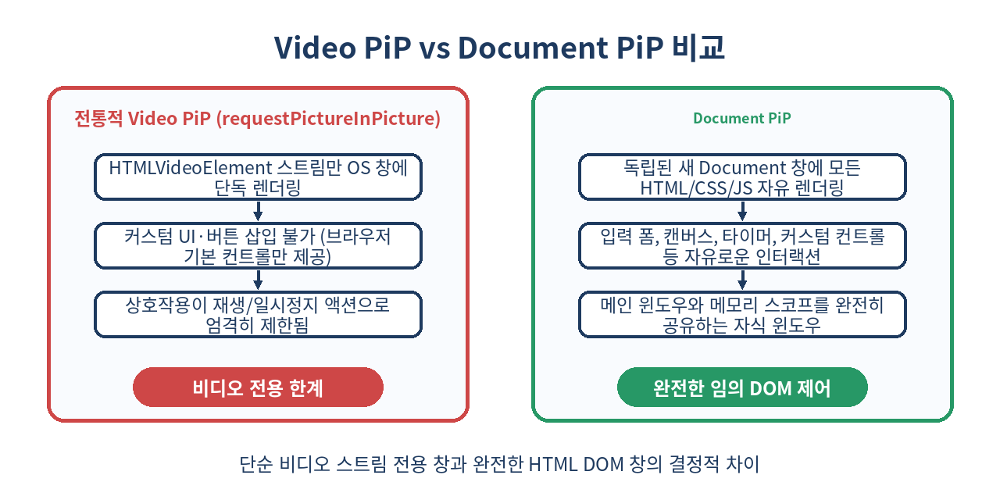
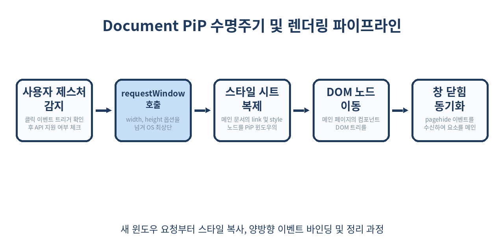

# 🪟 Document Picture-in-Picture API 완벽 가이드: 비디오를 넘어 임의의 DOM을 OS 플로팅 창으로 띄우기

> "유튜브처럼 영상을 보며 작업하듯, 이제 메모장, 화상 회의 컨트롤러, 실시간 주식 차트, 포모도로 타이머도 모니터 구석에 항상 띄워둘 수 있습니다."
> 비디오 엘리먼트라는 좁은 울타리를 넘어, 임의의 완전한 HTML/CSS 트리를 Always-on-top 플로팅 창으로 승격시키는 Document Picture-in-Picture API의 원리와 실무 패턴을 파헤칩니다.

---

## 📌 목차
1. 🧭 서론: `<video>` 전용 PiP의 한계와 새로운 웹 창작의 지평
2. 🔍 Document Picture-in-Picture API란 무엇인가?
3. ⚖️ Video PiP vs Document PiP: 상세 비교 분석
4. 🚀 핵심 아키텍처: 메인 윈도우와 PiP 윈도우의 관계
5. 💻 기본 구현: 플로팅 창 열기와 생명주기 제어
6. 🎨 핵심 난제: 메인 문서의 CSS 스타일시트 복제 전략
7. 🔄 양방향 상호작용: 상태 공유 및 이벤트 위임
8. 🛡️ 보안 모델 및 제약 사항 (Security & Permissions)
9. ⏱️ 실무 응용: Always-on-Top 생산성 포모도로 타이머 구축
10. ⚠️ 실무 개발 시 반드시 주의해야 할 함정들
11. 🚫 Document PiP를 쓰면 안 되는 경우
12. 🌐 브라우저 지원 현황과 폴백(Fallback) 전략
13. 🧾 정리
14. 📚 참고 자료

---

## 🧭 1. 서론: `<video>` 전용 PiP의 한계와 새로운 웹 창작의 지평

지금까지 브라우저에서 '픽처 인 픽처(Picture-in-Picture, PiP)'라고 하면 오직 HTML `<video>` 요소의 전유물이었습니다. `HTMLVideoElement.requestPictureInPicture()` 메서드는 사용자가 다른 작업을 하는 동안 데스크톱 최우측 하단에 항상 떠 있는(Always-on-top) 비디오 플레이어를 제공함으로써 큰 호평을 받았습니다.

하지만 비즈니스 요구사항은 영상 재생에 머무르지 않았습니다:
- **화상 회의 툴(Google Meet, Zoom Web)**: 다른 탭이나 프로그램을 보면서도 마이크 음소거, 카메라 토글, 참가자 발언 상태를 즉시 조작하고 싶다.
- **음악/오디오 플레이어**: 재생 목록을 열람하고 가사를 스크롤하며 이퀄라이저를 조작하고 싶다.
- **주식/가상자산 대시보드**: 실시간 호가창과 캔들 차트를 띄워두고 즉시 매수/매도 주문을 넣고 싶다.
- **생산성 도구**: 타이핑 중인 메모장이나 뽀모도로 타이머를 항상 최상단에 띄워 시간 관리를 하고 싶다.

기존 Video PiP에서는 이를 구현하기 위해 **`<canvas>`에 UI를 프레임 단위로 억지로 그린 뒤 `captureStream()`을 통해 가짜 비디오 트랙을 만들어 PiP로 띄우는 기괴한 꼼수**를 써야 했습니다. 이 방식은 렌더링 부하가 극심하고, 버튼 클릭이나 텍스트 입력 같은 마우스·키보드 상호작용을 처리하기가 불가능에 가까웠습니다.

이러한 구조적 한계를 종식하기 위해 등장한 표준이 바로 **Document Picture-in-Picture API**입니다.

---

## 🔍 2. Document Picture-in-Picture API란 무엇인가?

Document Picture-in-Picture API는 **임의의 HTML 요소와 인터랙티브 UI를 담을 수 있는 최상위 Always-on-top 브라우징 컨텍스트(창)**를 생성하는 웹 표준 API입니다.

이 API를 호출하면 브라우저는 일반 팝업 창(`window.open`)과 유사하지만, 운영체제 레벨에서 **다른 모든 창보다 항상 위에 머무르는(Always-on-top)** 독립된 전용 윈도우를 열어줍니다.

가장 중요한 특징은 이 플로팅 윈도우가 메인 페이지와 **동일한 출처(Same-origin)** 내에서 동작하며, 메인 페이지의 JavaScript 메모리 힙(Heap)과 실행 스코프를 완전히 공유한다는 점입니다. 복잡한 `postMessage` 직렬화 통신 없이도 일반적인 DOM 조작과 함수 호출, 전역 상태(Zustand, Redux, Signals 등)를 메인 스레드에서 즉시 공유할 수 있습니다.

---

## ⚖️ 3. Video PiP vs Document PiP: 상세 비교 분석

두 API는 이름에 'Picture-in-Picture'를 공유하지만, 동작 방식과 목적에서 근본적인 차이가 있습니다.



| 비교 항목 | 전통적 Video PiP (`requestPictureInPicture`) | 차세대 Document PiP (`documentPictureInPicture.requestWindow`) |
| :--- | :--- | :--- |
| **지원 대상** | 오직 `<video>` 요소 (미디어 스트림) | 완전한 HTML 문서 (모든 DOM 노드, 캔버스, 폼 등) |
| **UI 커스터마이징** | 불가능 (OS/브라우저가 제공하는 기본 미디어 버튼만 노출) | 100% 웹 표준 CSS와 커스텀 컴포넌트로 자유로운 스타일링 |
| **사용자 인터랙션** | 재생, 일시정지, 타임라인 이동 등 극소수 미디어 세션 액션 | 클릭, 스크롤, 텍스트 타이핑, 드래그 앤 드롭 등 모든 웹 이벤트 |
| **오디오/사운드** | 비디오 요소 내부 사운드 트랙 재생 | Web Audio API, 다중 오디오 소스, 마이크 스트림 처리 가능 |
| **스타일시트 지원** | 해당 없음 (OS 네이티브 렌더링 프레임) | 메인 창의 CSS, Tailwind, Styled-components 그대로 상속/주입 가능 |
| **다중 창 지원** | 화면당 브라우저 전체에서 단 1개 | 화면당 브라우저 전체에서 단 1개의 PiP 윈도우 활성화 |

---

## 🚀 4. 핵심 아키텍처: 메인 윈도우와 PiP 윈도우의 관계

Document PiP 창은 완전히 새로운 웹사이트를 여는 것이 아닙니다. 메인 페이지의 `window` 객체 자식으로 열리는 보조 브라우징 컨텍스트입니다.

```text
+-------------------------------------------------------------+
| Main Window (window)                                        |
|  - App State (React/Vue/Pinia Store, Signals, Memory)       |
|  - Main DOM Tree                                            |
|                                                             |
|         | (documentPictureInPicture.requestWindow())        |
|         v                                                   |
|  +-------------------------------------------------------+  |
|  | PiP Window (pipWindow)                                |  |
|  |   Always-on-top OS Frame                              |  |
|  |   - pipWindow.document.body.appendChild(myComponent)  |  |
|  |   - Stylesheets copied into pipWindow.document.head   |  |
|  |   - Shares identical JS execution context & memory!   |  |
|  +-------------------------------------------------------+  |
+-------------------------------------------------------------+
```

1. **단일 힙 메모리 공유**: `pipWindow` 내부에서 발생하는 함수 호출은 메인 스레드에서 직접 실행됩니다. 별도의 Web Worker나 iframe처럼 메시지를 JSON으로 직렬화할 필요가 전혀 없습니다.
2. **소유권과 생명주기 종속성**: 메인 페이지가 새로고침되거나 닫히면, `pipWindow`는 운영체제 레벨에서 브라우저에 의해 즉시 자동으로 닫힙니다.
3. **DOM 이전(Transplantation)**: 메인 페이지에 있던 특정 DOM 요소를 `appendChild()`나 `replaceChildren()`을 사용해 PiP 창의 `document.body`로 물리적으로 옮겨놓고, 창이 닫힐 때 다시 메인 창으로 복구하는 패턴이 기본 설계 원칙입니다.

---

## 💻 5. 기본 구현: 플로팅 창 열기와 생명주기 제어

Document Picture-in-Picture API는 전역 `window.documentPictureInPicture` 인터페이스를 통해 접근합니다. 창을 생성할 때는 반드시 **사용자의 명시적인 클릭이나 키보드 입력 같은 유저 제스처(User Gesture)** 컨텍스트 내부에서 호출해야 합니다.



```js
// Document PiP 지원 여부 확인
if ('documentPictureInPicture' in window) {
  const openPipBtn = document.getElementById('open-pip-btn');
  openPipBtn.addEventListener('click', toggleDocumentPip);
} else {
  console.warn('이 브라우저는 Document Picture-in-Picture API를 지원하지 않습니다.');
}

let pipWindowInstance = null;

async function toggleDocumentPip() {
  // 이미 PiP 창이 열려있다면 닫기
  if (window.documentPictureInPicture.window) {
    window.documentPictureInPicture.window.close();
    return;
  }

  try {
    // 1. 항상 최상단에 머무는 OS 전용 창 요청 (가로/세로 픽셀 지정 가능)
    const pipWindow = await window.documentPictureInPicture.requestWindow({
      width: 360,
      height: 480,
    });
    pipWindowInstance = pipWindow;

    // 2. PiP로 내보낼 컴포넌트 컨테이너 찾기
    const floatingWidget = document.getElementById('my-floating-widget');
    const widgetPlaceholder = document.getElementById('widget-placeholder');

    // 원래 위치에 보이지 않는 자리 표시자(Placeholder)를 두어 레이아웃 붕괴 방지
    widgetPlaceholder.style.display = 'block';

    // 3. 메인 창의 DOM 요소를 PiP 창의 body로 이동
    pipWindow.document.body.appendChild(floatingWidget);

    // 4. PiP 창이 닫힐 때 (사용자가 X 버튼을 누르거나 close() 호출 시)
    pipWindow.addEventListener('pagehide', () => {
      // DOM 요소를 다시 메인 문서의 자리로 원복
      const originalContainer = document.getElementById('widget-wrapper');
      originalContainer.insertBefore(floatingWidget, widgetPlaceholder);
      widgetPlaceholder.style.display = 'none';
      pipWindowInstance = null;
      console.log('Document PiP 창이 닫혔으며 요소를 메인 문서로 복구했습니다.');
    });

  } catch (err) {
    console.error('Document PiP 창 생성 실패:', err);
  }
}
```

`requestWindow()`가 반환하는 `pipWindow`는 표준 `Window` 객체입니다. 따라서 `pipWindow.document`, `pipWindow.addEventListener`, `pipWindow.resizeTo` 등의 표준 윈도우 인터페이스를 그대로 활용할 수 있습니다.

---

## 🎨 6. 핵심 난제: 메인 문서의 CSS 스타일시트 복제 전략

`documentPictureInPicture.requestWindow()`로 열린 새 창은 **완전히 빈 백지 상태의 HTML 문서**입니다. 메인 페이지에서 화려하게 작성했던 CSS 파일, Tailwind 클래스, 웹 폰트, 인라인 `<style>` 태그는 PiP 창에 자동으로 상속되지 않습니다.

따라서 메인 창의 스타일시트들을 복사하여 PiP 창의 `<head>`에 주입해주어야 메인 페이지와 동일한 룩앤필을 유지할 수 있습니다.

### 전략 1: 모든 `<link>` 및 `<style>` 태그 직접 복사 (가장 범용적)

```js
function copyAllStylesheetsToPip(pipDoc) {
  // 1. 외부 CSS 링크 및 인라인 스타일 태그 순회
  const styles = document.querySelectorAll('link[rel="stylesheet"], style');
  
  styles.forEach((styleElement) => {
    // deep clone하여 PiP 문서의 head에 붙여넣음
    pipDoc.head.appendChild(styleElement.cloneNode(true));
  });
}
```

### 전략 2: `CSSStyleSheet` 객체 직접 주입 (Constructable Stylesheets 대응)

동적으로 생성된 CSSStyleSheet나 CSS-in-JS 도구를 사용 중이라면 `document.styleSheets` 컬렉션을 순회하며 텍스트를 추출해 붙여넣는 방식을 결합해야 합니다.

```js
function copyAllStyles(pipDoc) {
  // link 태그 복제
  document.querySelectorAll('link[rel="stylesheet"]').forEach((link) => {
    const newLink = pipDoc.createElement('link');
    newLink.rel = 'stylesheet';
    newLink.href = link.href;
    pipDoc.head.appendChild(newLink);
  });

  // document.styleSheets 내부의 cssRules 복제 (CORS 주의)
  Array.from(document.styleSheets).forEach((sheet) => {
    try {
      const rules = Array.from(sheet.cssRules).map((rule) => rule.cssText).join('');
      const style = pipDoc.createElement('style');
      style.textContent = rules;
      pipDoc.head.appendChild(style);
    } catch (e) {
      // 서드파티 CDN 등 CORS 제한이 걸린 스타일시트는 link로 처리
      if (sheet.href) {
        const link = pipDoc.createElement('link');
        link.rel = 'stylesheet';
        link.href = sheet.href;
        pipDoc.head.appendChild(link);
      }
    }
  });
}
```

이 함수를 `requestWindow()` 직후에 호출하면, PiP 창 내부로 옮겨간 DOM 컴포넌트가 즉시 메인 페이지와 100% 동일한 디자인으로 깨짐 없이 렌더링됩니다.

---

## 🔄 7. 양방향 상호작용: 상태 공유 및 이벤트 위임

Document PiP의 진정한 힘은 **자유로운 입력 및 상태 반응성**에 있습니다. 메인 창에 정의된 React/Vue의 State Setter나 일반 이벤트 핸들러가 PiP 내부의 버튼을 누를 때 아무런 오버헤드 없이 직결되어 호출됩니다.

```html
<!-- 메인 페이지 마크업 -->
<div id="meeting-controller" class="controller-panel">
  <button id="toggle-mic-btn">🎤 마이크 끄기</button>
  <button id="toggle-cam-btn">📹 카메라 끄기</button>
  <span id="call-duration">00:00</span>
</div>
```

```js
// 애플리케이션 상태 (메인 메모리)
const appState = {
  isMicMuted: false,
  isCamOff: false,
  secondsElapsed: 0,
};

function setupPipInteractions(pipWindow) {
  const pipDoc = pipWindow.document;
  const micBtn = pipDoc.getElementById('toggle-mic-btn');
  const camBtn = pipDoc.getElementById('toggle-cam-btn');
  const timerText = pipDoc.getElementById('call-duration');

  // PiP 창 내부의 버튼 클릭이 메인 윈도우의 상태를 직접 수정
  micBtn.addEventListener('click', () => {
    appState.isMicMuted = !appState.isMicMuted;
    micBtn.textContent = appState.isMicMuted ? '🔇 마이크 켜기' : '🎤 마이크 끄기';
    micBtn.classList.toggle('muted', appState.isMicMuted);
    
    // 실제 WebRTC 미디어 트랙 음소거 반영
    toggleAudioTrack(!appState.isMicMuted);
  });

  camBtn.addEventListener('click', () => {
    appState.isCamOff = !appState.isCamOff;
    camBtn.textContent = appState.isCamOff ? '📷 카메라 켜기' : '📹 카메라 끄기';
    toggleVideoTrack(!appState.isCamOff);
  });

  // 메인 창의 타이머 인터벌이 PiP 창의 DOM을 직접 갱신
  const timerInterval = setInterval(() => {
    appState.secondsElapsed++;
    const mins = String(Math.floor(appState.secondsElapsed / 60)).padStart(2, '0');
    const secs = String(appState.secondsElapsed % 60).padStart(2, '0');
    timerText.textContent = `${mins}:${secs}`;
  }, 1000);

  // 창이 닫히면 인터벌 정리
  pipWindow.addEventListener('pagehide', () => {
    clearInterval(timerInterval);
  });
}
```

메인 창과 PiP 창 사이에 복잡한 채널 통신 코드가 전혀 필요 없음을 알 수 있습니다.

---

## 🛡️ 8. 보안 모델 및 제약 사항 (Security & Permissions)

Document PiP API는 강력한 Always-on-top 권한을 가지므로, 악의적인 광고 팝업이나 피싱 UI로 악용되는 것을 방지하기 위해 엄격한 보안 샌드박스 정책이 적용됩니다.

### 1. 일회성 사용자 활성화 (Transient User Activation) 필수
`documentPictureInPicture.requestWindow()`는 `click`, `keydown` 등의 유저 제스처 이벤트 리스너 내부에서만 호출할 수 있습니다. `setTimeout`이나 네트워크 응답 콜백 속에서 단독으로 호출하면 즉시 `NotAllowedError: Must be handling a user gesture to open a PiP window.` 예외를 던집니다.

### 2. 브라우저 전체에서 단 1개의 PiP 윈도우만 허용
운영체제 화면 전체에서 오직 **단 1개의 PiP 윈도우**만 열릴 수 있습니다. 다른 탭이나 다른 사이트에서 새 PiP 창을 열면, 이전에 열려 있던 PiP 창은 경고 없이 자동으로 닫힙니다.

### 3. 출처 보안 및 주소창 배지
PiP 창 상단 바에는 OS 네이티브 윈도우 타이틀바가 표시되며, 브라우저는 사용자가 피싱 페이지에 속지 않도록 창 상단에 **현재 출처(Origin)**를 강제로 노출합니다. 또한 `window.location.href`를 임의로 변경하여 외부 사이트로 리다이렉트하는 행위가 차단됩니다.

### 4. 권한 정책 (Permissions-Policy)
iframe 내부에서 Document PiP를 실행하려면 부모 문서에서 명시적으로 허용해야 합니다:
```html
<iframe src="https://meeting.example.com" allow="document-picture-in-picture"></iframe>
```

---

## ⏱️ 9. 실무 응용: Always-on-Top 생산성 포모도로 타이머 구축

다른 코딩 작업을 하거나 문서를 작성하는 동안 모니터 한구석에 작게 띄워두고 집중을 돕는 포모도로 타이머를 완전한 코드로 구현해 보겠습니다.

```html
<!-- index.html -->
<!DOCTYPE html>
<html lang="ko">
<head>
  <meta charset="UTF-8" />
  <title>Document PiP 포모도로 타이머</title>
  <style>
    #pomodoro-box {
      width: 280px;
      padding: 20px;
      border-radius: 12px;
      background: #1E3A5F;
      color: #F9FBFE;
      font-family: -apple-system, BlinkMacSystemFont, sans-serif;
      text-align: center;
      box-shadow: 0 4px 16px rgba(0,0,0,0.2);
    }
    .time-display { font-size: 42px; font-weight: bold; margin: 15px 0; color: #A8C9EF; }
    .btn-group button {
      background: #5B8FD4; border: none; color: white;
      padding: 8px 16px; margin: 0 4px; border-radius: 6px; cursor: pointer;
      font-weight: 600;
    }
    .btn-group button:hover { background: #279866; }
  </style>
</head>
<body>
  <h1>생산성 대시보드</h1>
  <button id="btn-pip-toggle">📌 항상 위에 타이머 띄우기</button>

  <div id="pomodoro-container" style="margin-top: 20px;">
    <div id="pomodoro-box">
      <h3>⏳ FOCUS TIME</h3>
      <div class="time-display" id="timer-text">25:00</div>
      <div class="btn-group">
        <button id="btn-start">시작</button>
        <button id="btn-pause">정지</button>
        <button id="btn-reset">리셋</button>
      </div>
    </div>
  </div>

  <script src="app.js"></script>
</body>
</html>
```

```js
// app.js
const btnPipToggle = document.getElementById('btn-pip-toggle');
const pomodoroBox = document.getElementById('pomodoro-box');
const pomodoroContainer = document.getElementById('pomodoro-container');

let timeLeft = 25 * 60; // 25분
let timerId = null;

function updateDisplay() {
  const m = String(Math.floor(timeLeft / 60)).padStart(2, '0');
  const s = String(timeLeft % 60).padStart(2, '0');
  const text = `${m}:${s}`;
  
  const timerElem = pomodoroBox.querySelector('#timer-text');
  if (timerElem) timerElem.textContent = text;
}

// 타이머 액션 핸들러 바인딩
pomodoroBox.querySelector('#btn-start').addEventListener('click', () => {
  if (timerId) return;
  timerId = setInterval(() => {
    if (timeLeft > 0) {
      timeLeft--;
      updateDisplay();
    } else {
      clearInterval(timerId);
      timerId = null;
      alert('집중 세션이 완료되었습니다! 잠시 휴식하세요.');
    }
  }, 1000);
});

pomodoroBox.querySelector('#btn-pause').addEventListener('click', () => {
  clearInterval(timerId);
  timerId = null;
});

pomodoroBox.querySelector('#btn-reset').addEventListener('click', () => {
  clearInterval(timerId);
  timerId = null;
  timeLeft = 25 * 60;
  updateDisplay();
});

// PiP 창 토글 로직
btnPipToggle.addEventListener('click', async () => {
  if (!('documentPictureInPicture' in window)) {
    alert('현재 브라우저는 Document PiP를 지원하지 않습니다.');
    return;
  }

  // 이미 열려 있으면 닫기
  if (window.documentPictureInPicture.window) {
    window.documentPictureInPicture.window.close();
    return;
  }

  try {
    const pipWindow = await window.documentPictureInPicture.requestWindow({
      width: 320,
      height: 240,
    });

    // 1. 메인 문서의 모든 스타일시트 복제
    document.querySelectorAll('style, link[rel="stylesheet"]').forEach((node) => {
      pipWindow.document.head.appendChild(node.cloneNode(true));
    });

    // 2. DOM 요소를 PiP 윈도우로 이동
    pipWindow.document.body.appendChild(pomodoroBox);

    // 3. 닫힐 때 메인 화면으로 안전하게 원복
    pipWindow.addEventListener('pagehide', () => {
      pomodoroContainer.appendChild(pomodoroBox);
      btnPipToggle.textContent = '📌 항상 위에 타이머 띄우기';
    });

    btnPipToggle.textContent = '❌ 플로팅 타이머 닫기';
  } catch (err) {
    console.error('PiP 창 열기 실패:', err);
  }
});
```

이 코드를 실행하고 버튼을 누르면, 모니터 우측 하단에 25분 카운트다운 타이머가 작고 깔끔한 플로팅 창으로 뜹니다. VS Code를 전체화면으로 띄우거나 노션을 작성하는 중에도 타이머는 항상 시야에 고정되어 있습니다.

---

## ⚠️ 10. 실무 개발 시 반드시 주의해야 할 함정들

### 1. `document` 객체의 스코프 혼동 버그
가장 빈번하게 발생하는 버그입니다. DOM 요소가 `pipWindow`로 이동한 후, 메인 창의 코드에서 `document.getElementById('my-el')`을 호출하면 `null`이 반환됩니다! 요소가 이제 `pipWindow.document` 트리에 속해 있기 때문입니다.
- **해결책**: 요소를 찾을 때 전역 `document`를 남발하지 말고 컴포넌트의 루트 컨테이너 레퍼런스(`containerRef.querySelector(...)`)를 유지하거나, 현재 마운트된 문서(`element.ownerDocument`)를 동적으로 참조해야 합니다.

```js
// 잘못된 예: 전역 document를 신뢰함
const btn = document.querySelector('#action-btn'); // PiP로 이동 시 null!

// 올바른 예: 요소의 현재 소속 Document를 조회
const ownerDoc = floatingElement.ownerDocument;
const btn = ownerDoc.querySelector('#action-btn');
```

### 2. 창 닫힘 시 메모리 누수와 이벤트 리스너 미해제
사용자가 PiP 창의 'X' 버튼을 눌러 창을 닫았을 때 `pagehide` 이벤트를 제대로 처리하지 않으면, 백그라운드에서 동작 중이던 `requestAnimationFrame` 루프나 `setInterval`이 유령처럼 계속 실행되어 메인 윈도우의 메모리를 갉아먹습니다. 반드시 `pagehide` 리스너에서 타이머를 해제하고 원본 DOM 위치로 복구하세요.

### 3. 미디어 쿼리(`@media`)의 뷰포트 크기 변화
메인 화면에서 가로 1200px에 최적화되어 있던 CSS가 가로 300px 크기의 작은 PiP 윈도우에 들어가면 모바일 반응형 미디어 쿼리가 강제로 트리거될 수 있습니다. PiP 내부로 들어갈 컴포넌트는 반응형 미디어 쿼리 대신 **CSS Container Queries (`@container`)**를 사용하여 자체 폭에 맞추어 스타일이 적응하도록 설계하는 것이 유지보수에 훨씬 유리합니다.

---

## 🚫 11. Document PiP를 쓰면 안 되는 경우

Document Picture-in-Picture API가 아무리 강력하더라도, 모든 상황에 적합한 만능 은탄환은 아닙니다.

1. **단순한 비디오 재생만 필요한 경우**
   - 별도의 커스텀 컨트롤 바나 채팅창, 필기 도구가 필요 없고 오직 MP4/HLS 영상 재생만 원한다면 기존 `HTMLVideoElement.requestPictureInPicture()`를 사용하는 것이 맞습니다. 브라우저가 하드웨어 가속 최적화와 OS 네이티브 미디어 버튼을 더 가볍게 제공합니다.
2. **복잡한 다중 페이지 네비게이션이 필요한 경우**
   - PiP 창은 어디까지나 메인 앱의 보조 '위젯/컨트롤러' 목적입니다. PiP 창 안에서 라우팅을 수행하고 새 페이지로 링크 이동을 유도하는 구조는 UX를 심각하게 해치며 보안 정책상 리다이렉트가 제한될 수 있습니다.
3. **모바일 브라우저 환경**
   - Document Picture-in-Picture API는 데스크톱 멀티 윈도우 OS(Windows, macOS, Linux, ChromeOS)에 최적화된 API입니다. 모바일 기기(Android, iOS)에서는 데스크톱 플로팅 윈도우 개념이 브라우저 뷰와 맞지 않아 지원되지 않거나 기능이 제한됩니다.

---

## 🌐 12. 브라우저 지원 현황과 폴백(Fallback) 전략

| 브라우저 / 엔진 | 지원 현황 | 비고 |
| :--- | :--- | :--- |
| **Google Chrome / Chromium** | ✅ 지원 (Chrome 116+) | 완전 지원 |
| **Microsoft Edge** | ✅ 지원 (Edge 116+) | 완전 지원 |
| **Apple Safari (WebKit)** | ⏳ 표준 제안 논의 중 | WebKit 표준화 트래커에서 긍정적 검토 중 |
| **Mozilla Firefox (Gecko)** | ⏳ 의견 수렴 단계 (Standards Position) | Firefox 팀에서 보안 및 표준 명세 검토 중 |

현재 Chromium 계열 브라우저에서 공식 표준으로 적극 지원되고 있습니다. 미지원 브라우저 사용자를 위해 다음과 같은 점진적 향상(Progressive Enhancement) 패턴을 반드시 적용해야 합니다.

```js
function handleOpenWidget() {
  if ('documentPictureInPicture' in window) {
    // 1순위: 최신 Document PiP로 Always-on-top 창 띄우기
    openInDocumentPip();
  } else {
    // 2순위 Fallback: 브라우저 화면 우하단에 position: fixed 플로팅 모달로 띄우기
    openInFloatingModal();
  }
}

function openInFloatingModal() {
  const widget = document.getElementById('my-floating-widget');
  widget.classList.add('inline-pip-fallback');
  console.log('Document PiP 미지원 환경이므로 화면 내 고정 모달로 폴백합니다.');
}
```

이렇게 폴백을 구성하면 Safari나 Firefox 사용자에게도 페이지 우측 하단에 고정되는 오버레이 UI를 제공할 수 있어 UX 단절이 없습니다.

---

## 🧾 13. 정리

- **DOM 전체의 플로팅화**: Document Picture-in-Picture API는 비디오뿐 아니라 모든 HTML/CSS 컴포넌트를 OS 최상단 Always-on-top 창으로 띄울 수 있는 표준 API입니다.
- **동일 실행 스코프**: 메인 윈도우와 메모리 및 자바스크립트 실행 컨텍스트를 100% 공유하므로 `postMessage` 없이 직관적으로 상태와 이벤트를 제어할 수 있습니다.
- **스타일 복제 필수**: 새로 열린 PiP 창은 빈 문서이므로 메인 페이지의 `<link>` 및 `<style>`을 복사해 넣어야 디자인이 깨지지 않습니다.
- **엄격한 수명주기 관리**: 유저 제스처를 통해서만 열 수 있으며, `pagehide` 이벤트를 감지해 이동했던 DOM 노드를 원래 자리로 원복하고 타이머 리소스를 해제해야 합니다.
- **화상 회의·생산성 도구의 혁신**: 미팅 제어 바, 포모도로 타이머, 실시간 시세 위젯 등 웹 애플리케이션의 작업 연속성을 비약적으로 높여줍니다.

> ✨ **한 줄 요약**
> 비디오라는 껍질을 깨고 나온 Document PiP로, 웹 앱의 모든 UI를 데스크톱 최상단 플로팅 위젯으로 해방시키세요.

---

## 📚 14. 참고 자료
- [W3C Document Picture-in-Picture Specification (Draft)](https://wicg.github.io/document-picture-in-picture/)
- [MDN Web Docs: Document Picture-in-Picture API](https://developer.mozilla.org/en-US/docs/Web/API/Document_Picture-in-Picture_API)
- [Chrome Developers: Picture-in-Picture for any Element](https://developer.chrome.com/docs/web-platform/document-picture-in-picture)
