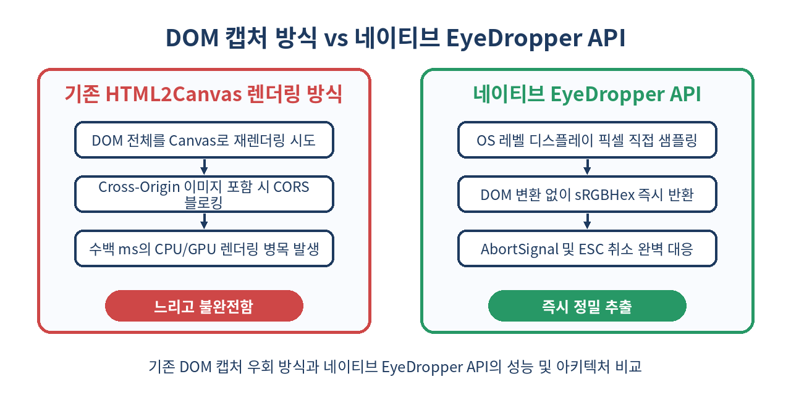
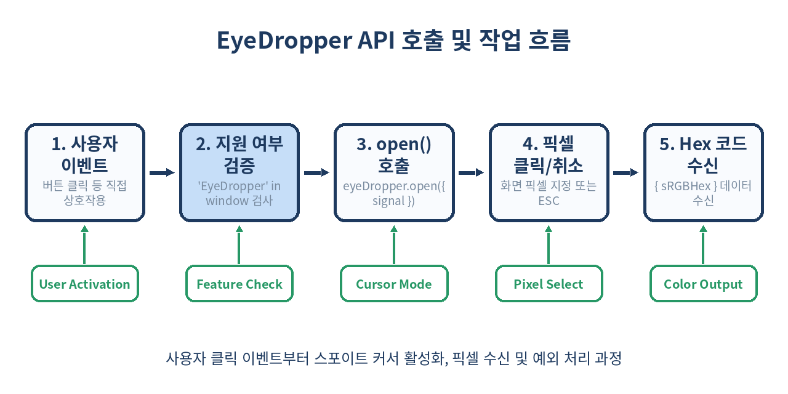

# 🎨 EyeDropper API 완벽 가이드: html2canvas 없는 브라우저 네이티브 화면 스포이트

> 웹 기반 그래픽 에디터나 디자인 시스템 툴에서 화면 픽셀의 정확한 색상을 추출하는 것은 오랜 숙제였습니다.
> 이제 무거운 캔버스 캡처 라이브러리 없이, 단 한 줄의 네이티브 JavaScript 코드로 OS 디스플레이 전체 픽셀을 추출해 보세요.

---

## 📌 목차
1. 🎨 1. EyeDropper API의 등장 배경과 필요성
2. 🔬 2. 기존 웹 컬러 피커의 한계와 html2canvas 우회책
3. ⚙️ 3. EyeDropper API 기본 동작 원리와 지원 현황
4. 💻 4. 실전 코드: 기본적인 픽셀 색상 추출 구현
5. 🛑 5. AbortSignal을 통한 사용자 취소 및 타임아웃 처리
6. 📊 6. 기존 캔버스 렌더링 방식 vs EyeDropper API 심층 비교
7. 🖼️ 7. 멀티 모니터 및 브라우저 창 밖 영역 추출 동작 분석
8. 🛡️ 8. 보안 및 프라이버시 모델 (User Activation & Security)
9. 🧩 9. React / Vue 컴포넌트 커스텀 훅으로 추상화하기
10. ⚠️ 10. 실무 적용 시 주의사항과 Browser Fallback 전략
11. ❌ 11. EyeDropper API를 사용하면 안 되는 상황
12. 🧾 12. 정리 및 요약

---

## 🎨 1. EyeDropper API의 등장 배경과 필요성

웹 애플리케이션의 복잡도가 높아지면서 **Figma, Canva, Photoshop Web, Webflow**와 같이 브라우저 상에서 동작하는 고성능 디자인 도구들이 대세로 자리 잡았습니다. 이러한 도구에서 사용자가 요구하는 가장 필수적인 기능 중 하나가 바로 화면의 특정 지점을 클릭하여 Hex 색상 값을 얻어내는 **스포이트(Eyedropper) 툴**입니다.

그러나 과거 사양의 브라우저 샌드박스 보안 모델에서는 애플리케이션이 렌더링된 화면 이외의 디스플레이 픽셀 데이터에 직접 접근하는 것을 엄격히 금지했습니다. 이로 인해 개발자들은 억지로 DOM을 HTML Canvas로 재렌더링하는 거대 라이브러리를 동원하거나 돋보기 UI를 시뮬레이션해야 했습니다.

`EyeDropper API`는 브라우저 네이티브 수준에서 디스플레이 픽셀 샘플링을 안전하게 제공하기 위해 도입된 W3C 사양 명세입니다. 사용자의 동의 하에 커서를 스포이트 모드로 전환하고, 클릭한 지점의 RGB 픽셀 값을 16진수 문자열(`sRGBHex`) 형태로 되돌려줍니다.

---

## 🔬 2. 기존 웹 컬러 피커의 한계와 html2canvas 우회책

EyeDropper API가 도입되기 전, 브라우저에서 스포이트 기능을 구현하려면 기술적으로 막대한 비용이 발생했습니다.

가장 대표적인 우회 기법은 `html2canvas` 또는 `dom-to-image` 라이브러리를 활용하는 것이었습니다. 이 방식은 현재 DOM 트리 전체를 복제한 뒤, SVG 이미지로 변환하거나 Inline CSS를 적용하여 `<canvas>` 요소에 2D 렌더링을 재수행하는 방식을 사용했습니다.

```js
// ❌ 기존 방식: html2canvas를 활용한 억지 스포이트 구현
import html2canvas from 'html2canvas';

async function pickColorWithCanvas(x, y) {
  // 1. 현재 화면 DOM 전체를 캡처하여 Canvas에 그림 (엄청난 CPU/GPU 부하)
  const canvas = await html2canvas(document.body, {
    useCORS: true,
    logging: false,
  });
  const ctx = canvas.getContext('2d');
  
  // 2. 해당 좌표의 RGBA 픽셀 읽기
  const pixel = ctx.getImageData(x, y, 1, 1).data;
  const hex = `#${((1 << 24) + (pixel[0] << 16) + (pixel[1] << 8) + pixel[2]).toString(16).slice(1)}`;
  
  return hex;
}
```

이러한 우회 기법은 다음과 같은 심각한 한계점이 존재했습니다:

1. **성능 저하**: 대형 DOM 구조나 고해상도 모니터에서 Canvas 렌더링 시간이 수백 ms ~ 수 초 이상 소요되어 렌더링 프레임이 심각하게 저하됩니다.
2. **CORS 제한**: 서드파티 서버에서 로드된 ``, `<video>`, `<iframe>` 요소는 캔버스 렌더링 시 **Tainted Canvas** 보안 오류를 발생시키며 픽셀 추출이 거부됩니다.
3. **CSS 미지원**: 복잡한 Shadow DOM, CSS Filter, Mix-Blend-Mode, WebGL 컨텍스트 등은 Canvas에 정확히 복제되지 않고 깨집니다.
4. **영역 제한**: 웹 브라우저 뷰포트 외부(OS 툴바, 타 애플리케이션 창 등)는 절대로 캡처할 수 없습니다.

---

## ⚙️ 3. EyeDropper API 기본 동작 원리와 지원 현황

`EyeDropper API`는 이러한 우회책들을 단숨에 해결합니다. 개발자가 API를 호출하면 브라우저 제어 권한이 운영체제의 전역 돋보기 스포이트 모드로 이관되며, 사용자가 마우스로 클릭한 디스플레이의 개별 픽셀 색상을 직접 읽어옵니다.



### 브라우저 지원 현황
- **Chromium 계열** (Chrome 95+, Edge 95+, Opera 81+): 완벽 지원
- **Desktop Chrome / Edge**: 윈도우(Windows) 및 macOS, Linux 전반 지원
- **Safari (WebKit)**: 현재 공식 지원 표준 평가 중 (기술 검토 단계)
- **Firefox**: 개발자 플래그 지원 검토 중

따라서 모던 대시보드 및 프로페셔널 웹 도구에서는 `EyeDropper API`를 최우선으로 사용하고, 미지원 브라우저에서는 기존의 `<input type="color">` 또는 HTML2Canvas 우회책을 Fallback으로 구성하는 방식이 표준 패턴입니다.

---

## 💻 4. 실전 코드: 기본적인 픽셀 색상 추출 구현

EyeDropper API 사용법은 믿기지 않을 정도로 간단합니다. `window.EyeDropper` 인스턴스를 생성한 후 `open()` 메서드를 호출하기만 하면 됩니다.

```js
// ✅ EyeDropper API 기본 사용 예제
async function triggerColorPicker() {
  // 1. 브라우저 지원 여부 확인 (Feature Detection)
  if (!('EyeDropper' in window)) {
    alert('이 브라우저는 EyeDropper API를 지원하지 않습니다.');
    return;
  }

  const eyeDropper = new EyeDropper();

  try {
    // 2. open() 메서드 호출 -> 돋보기 스포이트 UI 활성화
    const result = await eyeDropper.open();
    
    // 3. 추출된 Hex 코드 출력 ({ sRGBHex: '#ff5733' } 형태)
    console.log('선택한 색상 (Hex):', result.sRGBHex);
    document.body.style.backgroundColor = result.sRGBHex;
  } catch (error) {
    // 4. 사용자가 ESC 키를 누르거나 픽셀 선택을 취소한 경우
    console.warn('스포이트 색상 추출이 취소되었습니다:', error);
  }
}
```

`open()` 메서드는 **Promise**를 반환합니다. 사용자가 화면 상의 픽셀을 클릭하면 해당 위치의 색상 정보를 포함하는 결과 객체 `{ sRGBHex: string }`을 해결(Resolve)합니다.



---

## 🛑 5. AbortSignal을 통한 사용자 취소 및 타임아웃 처리

스포이트 툴이 활성화되었을 때, 사용자가 픽셀을 선택하지 않거나 애플리케이션의 상태가 바뀔 경우(예: 페이지 이동, 폼 리셋, 모달 닫기) 스포이트 모드를 프로그래밍 방식으로 강제 종료해야 할 필요가 있습니다.

`EyeDropper.open()` 옵션은 `signal` 매개변수를 지원하여 `AbortController`와 결합할 수 있습니다.

```js
// ✅ AbortSignal을 활용한 타임아웃 및 강제 종료 제어
async function pickColorWithTimeout(timeoutMs = 5000) {
  if (!('EyeDropper' in window)) return;

  const eyeDropper = new EyeDropper();
  const controller = new AbortController();

  // 5초 후 자동으로 스포이트 모드 중단
  const timerId = setTimeout(() => {
    controller.abort(new DOMException('시간 초과로 취소되었습니다.', 'AbortError'));
  }, timeoutMs);

  try {
    const result = await eyeDropper.open({ signal: controller.signal });
    clearTimeout(timerId);
    return result.sRGBHex;
  } catch (err) {
    if (err.name === 'AbortError') {
      console.log('스포이트가 중단되었습니다:', err.message);
    } else {
      console.error('색상 추출 예외 발생:', err);
    }
    return null;
  }
}
```

사용자가 직접 `ESC` 키를 눌러 취소하는 경우에도 `DOMException` 예외가 발생하므로, 반드시 `try...catch` 구문으로 에러 처리를 감싸야 합니다.

---

## 📊 6. 기존 캔버스 렌더링 방식 vs EyeDropper API 심층 비교

두 기술 방식의 주요 특징과 성능 특성을 비교해 보겠습니다.

| 비교 항목 | 기존 HTML2Canvas / DOM 캡처 방식 | 네이티브 EyeDropper API |
| :--- | :--- | :--- |
| **추출 성능** | 매우 느림 (DOM 크기에 따라 100~3000ms) | 초고속 (클릭 즉시 1ms 이내 반환) |
| **메모리 / CPU 사용량** | 캔버스 메모리 급증, CPU 100% 점유 | OS 네이티브 파이프라인 활용, 지표 변화 거의 없음 |
| **웹 브라우저 외부 추출** | 불가능 (웹 뷰포트 내부만 가능) | **가능** (OS 바탕화면, 타 애플리케이션 화면도 가능) |
| **CORS 이미지 제한** | Tainted Canvas 에러 발생하여 읽기 불가 | 제한 없음 (화면에 표시된 픽셀 자체를 추출) |
| **브라우저 지원율** | 모든 브라우저 (JS 폴리필) | Chromium 계열 (Chrome, Edge, Opera) |
| **사용자 경험 (UX)** | 커스텀 돋보기 UI 렌더링 필요 | OS/브라우저 표준 픽셀 확대 돋보기 UI 제공 |

---

## 🖼️ 7. 멀티 모니터 및 브라우저 창 밖 영역 추출 동작 분석

EyeDropper API의 가장 강력한 장점 중 하나는 **웹 브라우저의 뷰포트 경계를 뛰어넘는다는 점**입니다.

개발자가 웹 페이지 내부의 버튼을 통해 `open()`을 호출하더라도, 일단 스포이트 모드가 활성화되면 마우스 커서는 브라우저 창 바깥으로 이동할 수 있습니다:

- 모니터 구석의 **OS 작업 표시줄**
- 옆 모니터에 떠 있는 **IDE(VS Code, WebStorm) 인터페이스 색상**
- 듀얼 모니터 환경의 **동영상 플레이어 화면**

운영체제의 컴포지터(Compositor) 레벨에서 최종 출력 픽셀을 읽어오기 때문에, 믹스 블렌딩이나 디스플레이 프로파일(sRGB, Display P3) 변환이 완료된 최종 실효 색상 값을 정확히 반환합니다.

---

## 🛡️ 8. 보안 및 프라이버시 모델 (User Activation & Security)

디스플레이 픽셀을 읽어온다는 점에서 **프라이버시 침해 우려**가 제기될 수 있습니다. (예: 악성 스크립트가 사용자의 개인정보나 다른 창의 비밀번호 텍스트 픽셀을 무단으로 훔쳐보는 공격)

이를 방지하기 위해 브라우저는 강력한 보안 제약 조건을 강제합니다:

1. **User Activation (사용자 이니시어티브 필수)**:
   개발자가 스크립트로 `eyeDropper.open()`을 무단 자동 실행(`onload` 등)할 수 없으며, 반드시 사용자의 직접적인 클릭(`click`), 키보드 입력(`keydown`) 이벤트 핸들러 내부에서만 호출할 수 있습니다.
2. **시각적 표시 (Visual Indicator)**:
   스포이트 모드가 시작되면 마우스 커서가 즉시 OS 픽셀 돋보기 커서로 전환되어 사용자가 현재 색상 추출 모드임을 명확히 인지할 수 있습니다.
3. **단일 픽셀 수신 제한**:
   웹 사이트는 전체 화면 캡처 이미지를 스트림으로 전달받지 못하며, 사용자가 **직접 클릭한 오직 1개 픽셀의 Hex 문자열**만 수신할 수 있습니다.

---

## 🧩 9. React / Vue 컴포넌트 커스텀 훅으로 추상화하기

실무 프론트엔드 프로젝트에 즉시 적용할 수 있도록 React 커스텀 훅(`useEyeDropper`)으로 추상화한 코드입니다.

```tsx
// src/hooks/useEyeDropper.ts
import { useState, useCallback } from 'react';

interface UseEyeDropperReturn {
  isSupported: boolean;
  color: string | null;
  openPicker: () => Promise<string | null>;
}

export const useEyeDropper = (): UseEyeDropperReturn => {
  const [color, setColor] = useState<string | null>(null);
  const isSupported = typeof window !== 'undefined' && 'EyeDropper' in window;

  const openPicker = useCallback(async () => {
    if (!isSupported) {
      console.warn('EyeDropper API가 지원되지 않는 환경입니다.');
      return null;
    }

    const eyeDropper = new (window as any).EyeDropper();

    try {
      const result = await eyeDropper.open();
      setColor(result.sRGBHex);
      return result.sRGBHex;
    } catch (err) {
      // 사용자가 ESC로 취소했거나 에러 발생 시 처리
      return null;
    }
  }, [isSupported]);

  return { isSupported, color, openPicker };
};
```

### React 컴포넌트 사용 예시

```tsx
// src/components/ColorPickerButton.tsx
import React from 'react';
import { useEyeDropper } from '../hooks/useEyeDropper';

export const ColorPickerButton: React.FC = () => {
  const { isSupported, color, openPicker } = useEyeDropper();

  return (
    <div className="flex items-center gap-4">
      <button
        onClick={openPicker}
        disabled={!isSupported}
        className="px-4 py-2 bg-blue-600 text-white rounded disabled:bg-gray-400"
      >
        {isSupported ? '🎨 스포이트로 색상 추출' : '스포이트 미지원 브라우저'}
      </button>
      
      {color && (
        <div className="flex items-center gap-2">
          <span
            className="w-6 h-6 rounded border border-gray-300"
            style={{ backgroundColor: color }}
          />
          <code className="text-sm font-mono">{color}</code>
        </div>
      )}
    </div>
  );
};
```

---

## ⚠️ 10. 실무 적용 시 주의사항과 Browser Fallback 전략

EyeDropper API를 실무 서비스에 도입할 때 반드시 체크해야 하는 3가지 포인트입니다.

### 1. Feature Detection 및 Fallback 구현
Safari나 Firefox 사용자를 위해 API 미지원 환경에서는 `<input type="color">`를 대체 수단으로 제공해야 합니다.

```js
// ✅ 실무 표준 프로그레시브 인핸스먼트 전략
async function handlePickColor(nativeInputRef) {
  if ('EyeDropper' in window) {
    const eyeDropper = new EyeDropper();
    try {
      const { sRGBHex } = await eyeDropper.open();
      applyColor(sRGBHex);
    } catch (e) {
      /* 취소 처리 */
    }
  } else {
    // EyeDropper API 미지원 시 네이티브 color input 클릭 트리거
    nativeInputRef.current?.click();
  }
}
```

### 2. 크로스 오리진 Iframe 제약
크로스 오리진(Cross-Origin) `<iframe>` 내부에서 호출하는 경우 `Permissions-Policy` 설정이나 샌드박스 정책으로 인해 제한받을 수 있으므로 최상위 메인 프레임(`top window`)에서 호출하는 것을 권장합니다.

### 3. 색상 공간(Color Space) 고려
`result.sRGBHex`는 항상 **sRGB 색상 공간**의 6자리 Hex 형식(`#RRGGBB`)을 반환합니다. Display P3 와이드 컬러 가무트를 지원하는 고성능 모니터에서 추출 시 sRGB 영역으로 클램핑(Clamping)되어 반환됩니다.

---

## ❌ 11. EyeDropper API를 사용하면 안 되는 상황

EyeDropper API가 항상 정답은 아닙니다. 다음 상황에서는 사용하지 않아야 합니다.

1. **사용자 개입 없는 백그라운드 색상 분석**:
   `EyeDropper`는 오직 **사용자가 돋보기 UI로 특정 픽셀을 선택할 때만** 동작합니다. 이미지 전체의 대표 색상 Palette Palette 추출이나 픽셀 분석을 자동화하려면 `<canvas>`의 `getImageData()`나 WebGL을 써야 합니다.
2. **실시간 모션 추적 및 프레임 감지**:
   동영상 재생 중 지속적으로 픽셀 값을 추적하거나 동영상의 색상을 매 프레임 파싱하는 용도로 사용할 수 없습니다.
3. **모바일 브라우저 전용 터치 인터페이스**:
   일부 모바일 브라우저에서는 스포이트 커서 UI 조작이 정교하지 않거나 지원되지 않을 수 있으므로 모바일 환경 테스트가 필수적입니다.

---

## 🧾 12. 정리 및 요약

- **EyeDropper API**는 브라우저 내부 및 OS 화면 전체의 픽셀 색상을 초고속으로 추출하는 네이티브 W3C Web API입니다.
- 기존 `html2canvas`와 같은 무거운 DOM 캡처 라이브러리 방식의 **성능 저하, CORS 에러, CSS 미지원 이슈**를 완벽히 해결합니다.
- `new EyeDropper().open({ signal })` 메서드로 간편하게 호출하며, `AbortController`를 통해 스포이트 상태를 취소/제어할 수 있습니다.
- 보안을 위해 반드시 **사용자 직접 클릭(User Activation)**에 의해서만 활성화됩니다.
- Safari/Firefox 대응을 위해 `'EyeDropper' in window` 조건문 기반의 **Fallback 전략**을 구상해야 합니다.

> ✨ **한 줄 요약**
> 무거운 Canvas DOM 캡처 꼼수 대신, 단 한 줄의 네이티브 `EyeDropper API`로 디스플레이의 모든 픽셀 색상을 1ms 만에 정확히 추출하세요!

---

## 📚 참고 자료
- [W3C EyeDropper API Specification](https://wicg.github.io/eyedropper-api/)
- [MDN Web Docs - EyeDropper API](https://developer.mozilla.org/en-US/docs/Web/API/EyeDropper_API)
- [Chrome Developers - Picking colors with the EyeDropper API](https://developer.chrome.com/docs/capabilities/web-apis/eyedropper)
