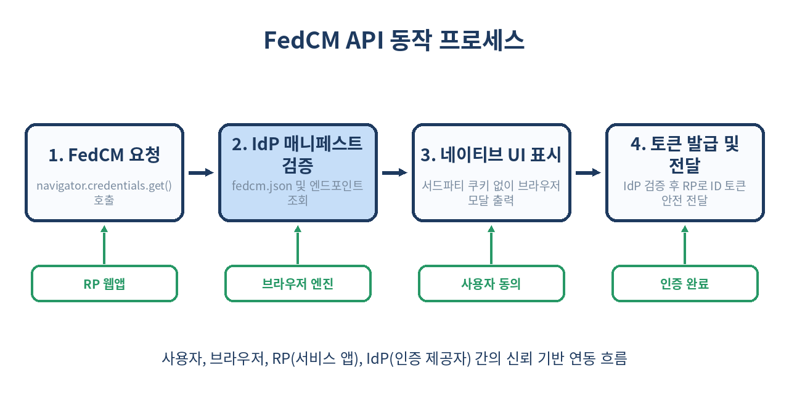
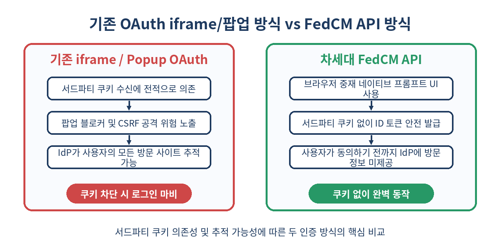

# 🔐 FedCM API 완벽 가이드: 서드파티 쿠키 폐지 시대의 차세대 브라우저 통합 로그인

> 서드파티 쿠키 차단으로 위기를 맞은 Google, Kakao, Apple 간편로그인(OAuth).
> 웹 브라우저 네이티브 수준에서 개인정보를 보호하며 통합 인증을 지원하는 FedCM(Federated Credential Management) API의 모든 것을 파헤칩니다.

---

## 📌 목차
1. [서드파티 쿠키의 종말과 웹 인증의 위기](#-1-서드파티-쿠키의-종말과-웹-인증의-위기)
2. [FedCM(Federated Credential Management) API란?](#-2-fedcmfederated-credential-management-api란)
3. [FedCM API의 메커니즘과 동작 흐름](#-3-fedcm-api의-메커니즘과-동작-흐름)
4. [IdP(인증 제공자) 측 매니페스트 및 엔드포인트 구성](#-4-idp인증-제공자-측-매니페스트-및-엔드포인트-구성)
5. [RP(서비스 앱)에서의 FedCM API 연동 코드](#-5-rp서비스-앱에서의-fedcm-api-연동-코드)
6. [기존 OAuth 팝업/리다이렉트 방식과의 명확한 비교](#-6-기존-oauth-팝업리다이렉트-방식과의-명확한-비교)
7. [프라이버시 보호 알고리즘과 브라우저 중재 모델](#-7-프라이버시-보호-알고리즘과-브라우저-중재-모델)
8. [실무 적용 시 만나는 함정과 주의사항](#-8-실무-적용-시-만나는-함정과-주의사항)
9. [FedCM API를 쓰면 안 되는 경우와 대안](#-9-fedcm-api를-쓰면-안-되는-경우와-대안)
10. [개발 및 테스트 환경(Origin Trial, Chrome Flag) 설정](#-10-개발-및-테스트-환경origin-trial-chrome-flag-설정)
11. [멀티 IdP 지원과 FedCM API의 미래](#-11-멀티-idp-지원과-fedcm-api의-미래)
12. [정리](#-12-정리)
13. [참고 자료](#-13-참고-자료)

---

## 🧭 1. 서드파티 쿠키의 종말과 웹 인증의 위기

지나친 웹 추적(Tracking)과 사생활 침해를 막기 위해 Safari(ITP), Firefox(ETP)에 이어 Chrome까지 서드파티 쿠키(3rd-party Cookies) 제한 및 차단을 적용하면서 기존 웹 생태계의 '소셜 로그인(Federated Authentication)'이 직격탄을 맞았습니다.

기존의 간편로그인은 서비스 웹사이트(RP: Relying Party)가 구글이나 카카오 같은 인증 제공자(IdP: Identity Provider)의 iframe을 띄우거나 팝업을 열어 IdP 세션 쿠키를 확인하는 방식에 의존했습니다.

```text
[기존 소셜 로그인 동작 환경]
RP 웹사이트 (example.com)
  └─> iframe / 팝업으로 IdP (accounts.google.com) 호출
        └─> 서드파티 쿠키 전송을 통해 로그인 상태 자동 감지
              ⚠️ 브라우저의 서드파티 쿠키 차단 시 로그인 실패 발생!
```

서드파티 쿠키가 블록되면 사용자 세션을 감지할 수 없어 팝업 창이 계속 뜨거나, '자동 로그인' 기능이 작동하지 않는 심각한 사용자 경험(UX) 저하가 발생합니다. 바로 이 문제를 해결하기 위해 W3C와 브라우저 제조사들이 협력하여 만든 표준 API가 **FedCM API**입니다.

---

## 💡 2. FedCM(Federated Credential Management) API란?

**FedCM API**는 브라우저 엔진이 중간에서 '신뢰할 수 있는 브라우커(Trusted Broker)' 역할을 수행하여, 서드파티 쿠키나 웹 스토리지 꼼수 없이도 사용자가 안전하게 연동 로그인을 수행할 수 있도록 돕는 차세대 웹 API입니다.

웹 개발자가 `navigator.credentials.get()`에 FedCM 옵션을 전달하면, 브라우저가 직접 네이티브 UI 모달을 띄워 사용자에게 동의를 구하고 계정 토큰을 전달받아 RP 서비스로 넘겨줍니다.

Key Benefits:
- **서드파티 쿠키 차단 우회**: 쿠키 전달 대신 브라우저의 전용 HTTPS 통신 채널을 사용
- **사생활 보호**: 사용자가 특정 계정을 선택해 동의하기 전까지 RP는 사용자의 정보를 전혀 알 수 없음
- **보안 강화**: 팝업 방식에서 발생하는 Clickjacking 및 CSRF 공격 가능성 차단
- **일관된 UX**: 브라우저 UI 가이드라인을 따르는 깔끔하고 빠른 로그인 경험 제공

---

## 🔄 3. FedCM API의 메커니즘과 동작 흐름

FedCM의 전체적인 처리 과정은 브라우저의 엄격한 제어 하에 단계별로 진행됩니다.



1. **인증 요청**: RP 웹앱이 JS로 FedCM API 호출
2. **매니페스트 검증**: 브라우저가 IdP 서버의 `/.well-known/fedcm.json` 파일 및 설정 정보를 검증
3. **계정 및 UI 표출**: 브라우저가 IdP의 계정 엔드포인트에서 활성화된 세션 정보를 받아와 네이티브 UI로 출력
4. **사용자 승인 및 토큰 발급**: 사용자가 특정 계정을 선택하면 IdP 토큰 엔드포인트에서 발급한 ID 토큰(JWT)을 RP 웹앱에 반환

---

## 🛠️ 4. IdP(인증 제공자) 측 매니페스트 및 엔드포인트 구성

FedCM을 지원하려는 인증 제공자(Google, Kakao 또는 자체 OIDC 서버)는 브라우저가 액세스할 수 있는 몇 가지 표준 JSON 엔드포인트를 노출해야 합니다.

### 1) well-known 파일 (`/.well-known/fedcm.json`)

IdP 도메인의 루트 경로에 위치하며, IdP 매니페스트의 실제 위치를 지정합니다.

```json
{
  "provider_urls": [
    "https://auth.example-idp.com/fedcm/config.json"
  ]
}
```

### 2) FedCM 구성 파일 (`config.json`)

IdP의 브랜딩 정보와 인증에 필요한 엔드포인트 URL을 제공합니다.

```json
{
  "accounts_endpoint": "/fedcm/accounts",
  "client_metadata_endpoint": "/fedcm/client_metadata",
  "id_token_endpoint": "/fedcm/token",
  "login_url": "/login",
  "branding": {
    "background_color": "#1e3a5f",
    "color": "#ffffff",
    "icons": [
      {
        "url": "https://auth.example-idp.com/logo.png",
        "size": 32
      }
    ]
  }
}
```

### 3) 계정 정보 엔드포인트 (`/fedcm/accounts`)

현재 브라우저 세션에 로그인되어 있는 계정 목록을 반환합니다. 브라우저는 요청 시 `Sec-Fetch-Dest: webidentity` 헤더를 부착하여 요청합니다.

```json
{
  "accounts": [
    {
      "id": "user_12345",
      "name": "홍길동",
      "email": "gildong@example.com",
      "given_name": "길동",
      "picture": "https://auth.example-idp.com/profiles/12345.jpg",
      "approved_clients": ["client_app_abc"]
    }
  ]
}
```

---

## 💻 5. RP(서비스 앱)에서의 FedCM API 연동 코드

서비스 앱(RP)에서 사용자가 '소셜 로그인' 버튼을 눌렀을 때 실행되는 프론트엔드 자바스크립트 코드 예시입니다.

```js
async function handleFedCMLogin() {
  // 1. 브라우저의 FedCM 지원 여부 확인
  if (!window.IdentityCredential) {
    console.warn('이 브라우저는 FedCM API를 지원하지 않습니다. 기존 OAuth 팝업으로 폴백합니다.');
    fallbackToLegacyOAuth();
    return;
  }

  try {
    // 2. FedCM 인증 요청
    const credential = await navigator.credentials.get({
      identity: {
        context: 'signin', // 'signin' | 'signup' | 'use'
        providers: [
          {
            configURL: 'https://auth.example-idp.com/fedcm/config.json',
            clientId: 'client_app_abc',
            nonce: 'random_secure_nonce_12345'
          }
        ]
      }
    });

    // 3. 발급받은 ID 토큰 확인
    if (credential && credential.token) {
      console.log('발급된 ID 토큰:', credential.token);
      
      // 4. 자체 백엔드 서버로 토큰 전송하여 검증 및 세션 생성
      const response = await fetch('/api/v1/auth/fedcm-verify', {
        method: 'POST',
        headers: { 'Content-Type': 'application/json' },
        body: JSON.stringify({ token: credential.token })
      });

      const result = await response.json();
      if (result.success) {
        window.location.href = '/dashboard';
      }
    }
  } catch (err) {
    // 사용자가 모달을 닫았거나 인증이 취소된 경우
    console.error('FedCM 로그인 중 오류 또는 취소 발생:', err.name, err.message);
  }
}
```

---

## ⚖️ 6. 기존 OAuth 팝업/리다이렉트 방식과의 명확한 비교

기존 간편로그인 방식과 FedCM API 방식의 특성을 다각도로 비교해 봅니다.



| 비교 항목 | 기존 OAuth 팝업 / iframe 방식 | 차세대 FedCM API 방식 |
| :--- | :--- | :--- |
| **서드파티 쿠키 의존도** | **100% 필수** (차단 시 기능 마비) | **전혀 사용하지 않음** (0%) |
| **사용자 추적 방지** | IdP가 사용자의 모든 RP 방문 정보 수집 가능 | 브라우저 중재로 동의 전까지 방문 차단 |
| **UI 렌더링 주체** | IdP 페이지 (웹 팝업 / DOM iframe) | **브라우저 네이티브 UI 모달** |
| **보안 취약점** | Clickjacking, CSRF, 팝업 차단 이슈 | 브라우저 커널 수준 보안 통제 |
| **자동 로그인 경험** | 쿠키 세션 기반 숨은 iframe 재인증 | 브라우저 `auto-reauthn` 특성 지원 |
| **크로스 플랫폼 지원** | 모바일/데스크톱 모든 웹 브라우저 | Chrome/Edge 지원, Safari 표준화 진행 중 |

---

## 🛡️ 7. 프라이버시 보호 알고리즘과 브라우저 중재 모델

FedCM의 핵심 혁신은 **'Timing and Tracker Prevention'**입니다.

기존 방식에서는 사용자가 `example.com`에 들어가는 순간, `accounts.google.com`으로 서드파티 요청이 날아가 사용자의 IP와 방문한 웹사이트 주소가 IdP에 유출되었습니다.

```text
[기존 문제점]
사용자 ──> example.com 접속 ──> (자동 추적) IdP에게 "이 사용자 웹사이트 A 방문함" 전송

[FedCM 신뢰 브라우커 모델]
사용자 ──> example.com 접속
  └─> 브라우저가 중간에서 요청을 낚아채 IdP 계정 존재 여부만 비밀리에 조회
  └─> 사용자가 [홍길동으로 계속하기] 클릭 시에만 IdP에 선택 사실 통보
```

FedCM 모델에서는 사용자가 브라우저 모달 창의 버튼을 진짜로 클릭하기 전까지, IdP는 사용자가 어떤 사이트(RP)를 방문했는지 알 수 없도록 무의미한 네트워크 핑만 전달받습니다.

---

## ⚠️ 8. 실무 적용 시 만나는 함정과 주의사항

### 1. CORS 및 Cross-Origin HTTP 헤더 필수
IdP 엔드포인트는 통신 시 반드시 `Sec-Fetch-Dest: webidentity` 헤더를 검증해야 하며, 요청 브라우저에 적절한 CORS 헤더(`Access-Control-Allow-Origin`, `Access-Control-Allow-Credentials: true`)를 응답해야 합니다.

### 2. SameSite 및 Cookie 설정 이슈
IdP의 `/fedcm/accounts` 엔드포인트로 전송되는 인증 쿠키는 `SameSite=None; Secure` 설정이 기본이어야 브라우저가 해당 계정을 감지할 수 있습니다.

### 3. 사용자 동의 철회(Prevent Silent Re-auth)
자동 로그인(`auto-reauthn`)을 설정한 경우, 사용자가 로그아웃 시 `IdentityCredential.preventSilentAccess()`를 호출하지 않으면 사용자가 원치 않는데도 재로그인이 무한 반복되는 버그에 빠질 수 있습니다.

```js
// 사용자가 명시적으로 로그아웃할 때 반드시 호출!
async function handleLogout() {
  if (window.IdentityCredential && IdentityCredential.preventSilentAccess) {
    await IdentityCredential.preventSilentAccess();
  }
  // 서비스 로그아웃 처리
}
```

---

## 🚫 9. FedCM API를 쓰면 안 되는 경우와 대안

FedCM이 강력한 차세대 표준이지만 모든 경우에 만병통치약은 아닙니다.

### 1. 서비스 내부의 전용 아이디/비밀번호 로그인
- FedCM은 **소셜/연동 인증(Federated Identity)** 전용입니다.
- 자체 서비스 ID/PW 기반 인증에는 **Credential Management API** (`navigator.credentials.get({password: true})`) 또는 **Passkeys (WebAuthn)**를 사용해야 합니다.

### 2. 구형 브라우저 및 IE 환경 지원 필수인 서비스
- Chromium 기반 브라우저(Chrome 108+, Edge 108+) 외의 환경에서는 완벽 지원되지 않을 수 있습니다.
- 대안: 기존의 Popup/Redirect 기반 OAuth 2.0 표준 흐름을 **Fallback** 코드로 반드시 함께 준비해야 합니다.

---

## 🧪 10. 개발 및 테스트 환경(Origin Trial, Chrome Flag) 설정

로컬 개발 환경(`localhost`)에서는 SSL 적용이 없더라도 테스트가 가능하도록 브라우저 플래그 설정이 제공됩니다.

Chrome 주소창에 다음 플래그를 입력하여 설정할 수 있습니다:

1. `chrome://flags/#fedcm` ➔ **Enabled**로 변경
2. `chrome://flags/#fedcm-without-third-party-cookies` ➔ **Enabled**로 변경
3. 로컬 테스트 도메인 지정: `chrome://flags/#bypass-app-banner-engagement-checks` 활성화

또한 상용 환경 배포 전 testing을 위해서는 Google/Chrome의 **Origin Trial**을 신청해 응답 헤더에 Trial Token을 포함시킬 수 있습니다.

---

## 🔮 11. 멀티 IdP 지원과 FedCM API의 미래

초기 FedCM은 단일 IdP(예: Google 전용) 선택 모달 위주였으나, 최근 표준(W3C Web identity Working Group)에서는 한 번의 프롬프트에서 **구글, 카카오, 네이버, 애플 등 여러 IdP를 한 번에 선택할 수 있는 Multi-IdP 기능**이 도입되었습니다.

```js
// 최신 Multi-IdP 사양 예시
navigator.credentials.get({
  identity: {
    providers: [
      { configURL: 'https://accounts.google.com/gsi/fedcm/config.json', clientId: '...' },
      { configURL: 'https://kauth.kakao.com/fedcm/config.json', clientId: '...' }
    ]
  }
});
```

앞으로는 사용자가 로그인 버튼을 누르기도 전에 브라우저가 "이 웹사이트에서 구글로 로그인하시겠습니까, 카카오로 로그인하시겠습니까?"를 스마트하게 추천해주는 시대가 열릴 것입니다.

---

## 🧾 12. 정리

- **서드파티 쿠키 종말**: 기존 iframe/팝업 기반 간편로그인은 쿠키 차단 정책에 의해 작동 불능 위험에 처해 있습니다.
- **FedCM API 등장**: 브라우저 중재 네이티브 UI를 통해 개인정보를 보호하면서 서드파티 쿠키 없이 연동 로그인을 구현합니다.
- **핵심 흐름**: `navigator.credentials.get()` ➔ IdP 매니페스트 확인 ➔ 네이티브 UI 출력 ➔ 안전한 Token 반환.
- **프라이버시 우수성**: 사용자가 실제 승인하기 전까지 IdP에 사용자 방문 기록을 노출하지 않습니다.
- **실무 대응**: 기존 OAuth 리다이렉트 방식을 Fallback으로 유지하면서 FedCM API를 점진 도입하는 방식을 추천합니다.

> ✨ **한 줄 요약**  
> FedCM API는 서드파티 쿠키 없는 시대에도 안전하고 끊김 없는 차세대 소셜 로그인을 완성하는 브라우저 표준 기술이다.

---

## 📚 참고 자료

- [W3C Federated Credential Management API 명세](https://w3c-fedid.github.io/fedcm/)
- [Chrome Developers: FedCM API 가이드](https://developer.chrome.com/docs/privacy-sandbox/fedcm/)
- [MDN Web Docs: Federated Credential Management API](https://developer.mozilla.org/en-US/docs/Web/API/FedCM_API)
