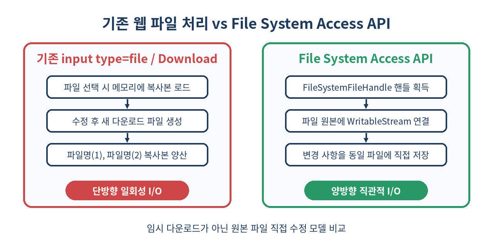
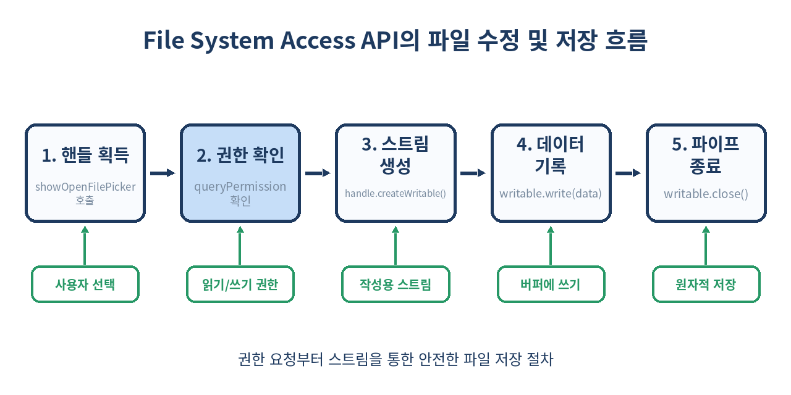

# 📂 File System Access API 완벽 가이드: 브라우저에서 사용자 로컬 파일을 직접 열고 수정하는 차세대 웹 I/O

> 웹 애플리케이션에서 사용자의 로컬 파일을 읽고, 수정하고, 기존 위치에 바로 저장할 수 있는 File System Access API를 심층 다룹니다.
> 더 이상 `input type="file"`과 다운로드 클릭 연발로 원본 파일(1).txt 복사본을 양산하지 마세요.

---

## 📌 목차
1. 🧭 File System Access API란 무엇인가?
2. 🆚 기존 웹 파일 처리 방식과의 격차
3. 🧩 핵심 인터페이스: FileSystemHandle 이해하기
4. 📖 파일 열기 및 읽기: showOpenFilePicker
5. 📝 파일 수정 및 저장: WritableStream과 FileSystemWritableFileStream
6. 💾 새 파일 저장하기: showSaveFilePicker
7. 📁 디렉토리(폴더) 통째로 다루기: showDirectoryPicker
8. 🛡️ 보안 및 권한 모델: read, readwrite, 그리고 지속성
9. ⚖️ File System Access API vs Origin Private File System (OPFS)
10. 💻 실무 예제: 브라우저 기반 마크다운 에디터 구현
11. ⚠️ 실무 함정 및 주의사항
12. 🚫 이 API를 사용하면 안 되는 경우
13. 🧾 정리
14. 📚 참고 자료

---

## 🧭 1. File System Access API란 무엇인가?

과거 웹 웹 애플리케이션은 데스크톱 네이티브 소프트웨어(예: VS Code, Photoshop, MS Word) 대비 근본적인 한계를 지니고 있었습니다. 바로 **사용자의 로컬 파일 시스템에 존재하는 파일의 원본을 직접 수정하고 저장할 수 없다**는 점이었습니다.

File System Access API는 웹 애플리케이션이 사용자 승인 하에 사용자의 디바이스 내 파일이나 폴더에 직접 접근하고, 읽고, 변경 사항을 **동일한 파일 원본에 바로 덮어쓸 수 있게** 만들어주는 W3C 표준 브라우저 API입니다.

이 API를 활용하면 웹 기반의 IDE, 이미지/비디오 에디터, 문서 작성 도구, CAD 프로그램 등이 네이티브 앱과 완벽히 동일한 사용자 경험(UX)을 제공할 수 있게 됩니다.

---

## 🆚 2. 기존 웹 파일 처리 방식과의 격차

웹에서 파일 I/O를 다루는 방식은 웹의 발전 과정에 따라 극명한 차이를 보입니다.



| 구분 | 기존 방식 (`<input type="file">` + Download) | File System Access API |
| :--- | :--- | :--- |
| **파일 접근** | 단발성 선택 (파일의 메모리 스냅샷만 전달) | 지속 가능한 `FileSystemFileHandle` 획득 |
| **저장 방식** | 새로운 파일 다운로드 (`<a download>`) | 원본 파일에 직접 덮어쓰기 (`write`) |
| **파일명 유지** | `document(1).docx`, `document(2).docx` 양산 | 원본 파일명 및 경로 유지 |
| **폴더 구조** | `<input webkitdirectory>` (읽기 전용 단발) | 폴더 내 파일 생성, 삭제, 순회, 수정 모두 가능 |
| **사용자 경험** | 매번 파일 선택 및 저장 경로 지정 필요 | 단 1회 승인 후 단축키 `Ctrl+S`로 원자적 저장 |

---

## 🧩 3. 핵심 인터페이스: FileSystemHandle 이해하기

File System Access API는 객체 지향적인 핸들 구조를 기반으로 작동합니다.

- **`FileSystemHandle`**: 모든 파일 시스템 엔트리의 최상위 추상 인터페이스입니다. `kind` (`'file'` 또는 `'directory'`)와 `name` 속성을 제공합니다.
- **`FileSystemFileHandle`**: 개별 파일을 나타냅니다. 파일 내용을 읽기 위한 `getFile()` 메서드와 쓰기 스트림을 생성하는 `createWritable()` 메서드를 포함합니다.
- **`FileSystemDirectoryHandle`**: 폴더를 나타냅니다. 폴더 내부의 파일/하위 폴더 순회, 파일 및 폴더 생성(`getFileHandle`, `getDirectoryHandle`), 삭제(`removeEntry`) 등의 기능을 제공합니다.

이 핸들 객체들은 **IndexedDB에 그대로 저장**할 수 있습니다! 즉, 페이지를 새로고침하거나 브라우저를 닫았다가 다시 열어도 저장된 핸들을 불러와 동일한 파일에 접근할 수 있습니다.

---

## 📖 4. 파일 열기 및 읽기: showOpenFilePicker

사용자에게 파일 선택 창을 띄우려면 `window.showOpenFilePicker()`를 호출합니다.

```js
// 파일 열기 옵션 설정
const pickerOptions = {
  types: [
    {
      description: '텍스트 및 마크다운 파일',
      accept: {
        'text/plain': ['.txt', '.md'],
        'text/markdown': ['.md']
      }
    }
  ],
  excludeAcceptAllOption: false,
  multiple: false // true 지정 시 여러 파일 선택 가능
};

async function openFile() {
  try {
    // 1. 파일 선택 창 표시 및 핸들 배열 반환
    const [fileHandle] = await window.showOpenFilePicker(pickerOptions);
    
    // 2. File 객체 획득 (메모리 상의 스냅샷)
    const file = await fileHandle.getFile();
    
    // 3. 내용 읽기
    const content = await file.text();
    console.log(`파일명: ${file.name}, 파일 크기: ${file.size} bytes`);
    
    return { fileHandle, content };
  } catch (err) {
    if (err.name === 'AbortError') {
      console.log('사용자가 파일 선택을 취소했습니다.');
    } else {
      console.error('파일 열기 중 오류 발생:', err);
    }
  }
}
```

--- 

## 📝 5. 파일 수정 및 저장: WritableStream과 FileSystemWritableFileStream

File System Access API의 정수는 바로 **파일 직접 쓰기** 기능입니다. 파일을 작성할 때는 스트림(Stream) 기반의 `FileSystemWritableFileStream`을 사용합니다.



```js
async function saveFileContent(fileHandle, newContent) {
  try {
    // 1. 쓰기 가능한 스트림 생성
    // (이 시점에 OS 레벨에서 임시 백업 파일이 생성됨)
    const writable = await fileHandle.createWritable();
    
    // 2. 데이터 쓰기 (Blob, ArrayBuffer, TypedArray, string 모두 지원)
    await writable.write(newContent);
    
    // 3. 스트림 닫기
    // (close가 성공적으로 호출되는 순간 원본 파일에 원자적으로 커밋됨)
    await writable.close();
    
    console.log('파일 저장 완료!');
  } catch (err) {
    console.error('파일 저장 실패:', err);
  }
}
```

`createWritable()`과 `close()`의 조합은 **원자성(Atomicity)**을 보장합니다. 쓰기 작업 중간에 에러가 나거나 브라우저가 강제 종료되어도 원본 파일이 손상되지 않고 커밋되지 않습니다.

---

## 💾 6. 새 파일 저장하기: showSaveFilePicker

기존 파일 열기가 아니라, 웹에서 작성한 새 문서나 이미지 export 작업을 수행할 때는 `window.showSaveFilePicker()`를 사용합니다.

```js
async function saveNewFile(data) {
  const options = {
    suggestedName: 'untitled.md',
    types: [{
      description: 'Markdown File',
      accept: { 'text/markdown': ['.md'] }
    }]
  };

  try {
    // 사용자가 저장 위치와 파일 이름을 선택
    const handle = await window.showSaveFilePicker(options);
    
    const writable = await handle.createWritable();
    await writable.write(data);
    await writable.close();
    
    // 이제 handle을 보관하면 추후 Ctrl+S로 계속 저장 가능!
    return handle;
  } catch (err) {
    if (err.name !== 'AbortError') {
      console.error('새 파일 저장 에러:', err);
    }
  }
}
```

---

## 📁 7. 디렉토리(폴더) 통째로 다루기: showDirectoryPicker

단일 파일뿐만 아니라 폴더 전체에 접근하여 프로젝트 단위 작업을 수행할 수 있습니다.

```js
async function readWorkspace() {
  try {
    const dirHandle = await window.showDirectoryPicker({
      mode: 'readwrite' // 'read' 또는 'readwrite'
    });
    
    console.log(`선택한 디렉토리명: ${dirHandle.name}`);
    
    // 디렉토리 내부 파일 및 폴더 재귀 순회
    for await (const [name, handle] of dirHandle.entries()) {
      if (handle.kind === 'file') {
        console.log(`📄 파일: ${name}`);
      } else if (handle.kind === 'directory') {
        console.log(`📁 폴더: ${name}`);
      }
    }
    
    // 특정 파일 생성 또는 가져오기
    const newFileHandle = await dirHandle.getFileHandle('config.json', { create: true });
    
    // 파일 삭제
    // await dirHandle.removeEntry('old-file.txt');
    
  } catch (err) {
    console.error('디렉토리 접근 에러:', err);
  }
}
```

---

## 🛡️ 8. 보안 및 권한 모델: read, readwrite, 그리고 지속성

웹 브라우저가 사용자 로컬 파일 시스템에 접근하는 만큼, 매우 강력하고 엄격한 보안 모델이 적용됩니다.

1. **사용자 제스처 필수**: `showOpenFilePicker` 등은 반드시 버튼 클릭, 키보드 이벤트 등 사용자 액션 핸들러 내부에서 호출되어야 합니다. (스크립트 자동 실행 불가)
2. **명시적 권한 승인**: 파일 선택 창을 통해 선택된 파일만 접근 가능하며, 쓰기 권한은 별도의 브라우저 프롬프트로 사용자에게 동의를 구합니다.
3. **권한 상태 조회 및 재요청**: IndexedDB에 저장된 핸들을 브라우저 세션 재방문 시 사용할 때는 권한 상태를 확인해야 합니다.

```js
async function verifyPermission(fileHandle, readWrite) {
  const options = {};
  if (readWrite) {
    options.mode = 'readwrite';
  }
  
  // 1. 현재 권한 상태 확인 ('granted', 'denied', 'prompt')
  if ((await fileHandle.queryPermission(options)) === 'granted') {
    return true;
  }
  
  // 2. 권한 프롬프트 표시
  if ((await fileHandle.requestPermission(options)) === 'granted') {
    return true;
  }
  
  return false;
}
```

---

## ⚖️ 9. File System Access API vs Origin Private File System (OPFS)

웹 스토리지 표준 중 파일 시스템 관련 기술은 크게 두 가지로 나뉩니다. 목적과 유즈케이스가 명확히 다르므로 반드시 구분해야 합니다.

| 구분 | File System Access API | Origin Private File System (OPFS) |
| :--- | :--- | :--- |
| **파일 위치** | 사용자가 선택한 실제 로컬 파일 시스템 (바탕화면, 내 문서 등) | 브라우저 샌드박스 내부 (사용자 눈에 안 보임) |
| **접근 주체** | 사용자와 웹 앱이 파일을 공유 및 상호작용 | 해당 도메인(Origin) 전용 격리 공간 |
| **사용자 개입** | 파일 선택 픽커 UI 필수 | 픽커 없이 스크립트로 즉시 파일 I/O 가능 |
| **I/O 성능** | 일반적인 수준 (OS 파일 시스템 오버헤드) | 극도로 빠른 초고성능 SyncAccessHandle 지원 |
| **주요 목적** | 에디터, 문서 도구, IDE 등 원본 수정 웹 앱 | SQLite WASM, 데이터베이스, 대용량 캐시 저장소 |

---

## 💻 10. 실무 예제: 브라우저 기반 마크다운 에디터 구현

다음은 IndexedDB 저장 기능과 단축키 저장(`Ctrl+S`)이 포함된 완전한 마크다운 에디터 스니펫입니다.

```jsx
import React, { useState, useEffect, useRef } from 'react';

export function MarkdownEditor() {
  const [content, setContent] = useState('');
  const [fileName, setFileName] = useState('열린 파일 없음');
  const handleRef = useRef(null);

  // 키보드 단축키 Ctrl+S / Cmd+S 바인딩
  useEffect(() => {
    const handleKeyDown = (e) => {
      if ((e.ctrlKey || e.metaKey) && e.key === 's') {
        e.preventDefault();
        saveCurrentFile();
      }
    };
    window.addEventListener('keydown', handleKeyDown);
    return () => window.removeEventListener('keydown', handleKeyDown);
  }, [content]);

  // 파일 열기
  const openFile = async () => {
    try {
      const [handle] = await window.showOpenFilePicker({
        types: [{ accept: { 'text/markdown': ['.md'], 'text/plain': ['.txt'] } }]
      });
      
      const file = await handle.getFile();
      const text = await file.text();
      
      handleRef.current = handle;
      setFileName(file.name);
      setContent(text);
    } catch (err) {
      if (err.name !== 'AbortError') alert('파일 열기 실패');
    }
  };

  // 파일 저장 (기존 파일 원본 수정)
  const saveCurrentFile = async () => {
    if (!handleRef.current) {
      return saveAsNewFile();
    }
    
    try {
      const writable = await handleRef.current.createWritable();
      await writable.write(content);
      await writable.close();
      alert('저장되었습니다!');
    } catch (err) {
      console.error(err);
      alert('저장 중 오류가 발생했습니다.');
    }
  };

  // 다른 이름으로 저장
  const saveAsNewFile = async () => {
    try {
      const handle = await window.showSaveFilePicker({
        suggestedName: 'document.md',
        types: [{ accept: { 'text/markdown': ['.md'] } }]
      });
      const writable = await handle.createWritable();
      await writable.write(content);
      await writable.close();
      
      handleRef.current = handle;
      setFileName(handle.name);
      alert('새 파일로 저장되었습니다.');
    } catch (err) {
      if (err.name !== 'AbortError') alert('저장 실패');
    }
  };

  return (
    <div style={{ padding: '20px', fontFamily: 'sans-serif' }}>
      <div style={{ marginBottom: '10px', display: 'flex', gap: '10px', alignItems: 'center' }}>
        <button onClick={openFile}>📂 파일 열기</button>
        <button onClick={saveCurrentFile}>💾 저장 (Ctrl+S)</button>
        <button onClick={saveAsNewFile}>📝 다른 이름으로 저장</button>
        <span>현재 파일: <strong>{fileName}</strong></span>
      </div>
      <textarea
        value={content}
        onChange={(e) => setContent(e.target.value)}
        rows={20}
        style={{ width: '100%', fontFamily: 'monospace', fontSize: '14px' }}
      />
    </div>
  );
}
```

---

## ⚠️ 11. 실무 함정 및 주의사항

1. **파이어폭스(Firefox) 및 사파리(Safari) 크로스 브라우저 호환성**
   - File System Access API의 크롬/에지(Chromium 계열) 지원은 완벽하지만, Firefox와 Safari는 보안 및 사생활 침해 우려를 이유로 `showOpenFilePicker` 등 사용자 로컬 파일 직접 수정 API 지원을 거부하거나 유예하고 있습니다.
   - **대응책**: `showOpenFilePicker` 존재 여부를 확인하고, 미지원 브라우저에서는 기존 `<input type="file">` 및 `a[download]` 폴리필(Polyfill)로 래핑해주는 라이브러리(예: `browser-fs-access`)를 적극 활용해야 합니다.

2. **민감한 시스템 디렉토리 블로킹**
   - 사용자가 C드라이브 전체, `C:\Windows`, `System32` 또는 MacOS의 `/System` 디렉토리를 선택하더라도 브라우저 차원에서 실행이 즉시 차단되고 에러가 던져집니다.

3. **탭 종료 시 쓰기 불완전 완료 이슈**
   - `writable.write()`를 호출했더라도 `await writable.close()`가 완료되기 전에 사용자가 탭을 닫아버리면 임시 버퍼 파일이 삭제되고 원본에 반영되지 않습니다. 중요한 작업 시에는 `beforeunload` 이벤트 처리가 필요합니다.

---

## 🚫 12. 이 API를 사용하면 안 되는 경우

- **민감 데이터의 브라우저 내부 캐싱 목적인 경우**
  - 사용자의 실제 로컬 디렉토리가 아닌 단순히 앱의 상태나 캐시, DB를 저장하려면 OPFS(Origin Private File System)나 IndexedDB를 사용해야 합니다.
- **모바일 웹 중심의 서비스 환경**
  - 안드로이드/iOS의 브라우저 샌드박스 정책 및 브라우저 호환성 제약으로 인해 모바일 환경에서는 사용성이 크게 제한됩니다.
- **모든 브라우저에서 100% 동일한 네이티브 파일 접근 경험이 필수인 경우**
  - Safari/Firefox 유저층이 비중이 높다면 Electron, Tauri 등 데스크톱 전용 런타임을 고려하는 것이 타당합니다.

---

## 🧾 13. 정리

- **File System Access API**는 브라우저 내에서 사용자 승인 하에 로컬 파일 및 폴더를 열고, 수정하고, 원본에 원자적으로 덮어쓸 수 있게 해주는 혁신적인 W3C 표준 API입니다.
- **`showOpenFilePicker`**, **`showSaveFilePicker`**, **`showDirectoryPicker`**를 사용해 안전하게 핸들을 획득합니다.
- 획득한 **`FileSystemFileHandle`** 객체는 IndexedDB에 보존 가능하므로 서비스 재방문 시 원활한 UX를 제공할 수 있습니다.
- Safari/Firefox 호환성 이슈가 있으므로 **`browser-fs-access`** 패키지 등을 활용한 샌드백/폴리필 구현이 실무의 핵심입니다.

> ✨ **한 줄 요약**
> 웹에서도 이제 임시 다운로드 없이 데스크톱 앱처럼 로컬 파일 원본을 직접 열고 수정할 수 있습니다.

---

## 📚 참고 자료
- [W3C File System Access API 명세서](https://wicg.github.io/file-system-access/)
- [MDN Web Docs - File System Access API](https://developer.mozilla.org/en-US/docs/Web/API/File_System_Access_API)
- [web.dev - The File System Access API: simplifying access to local files](https://web.dev/articles/file-system-access)
