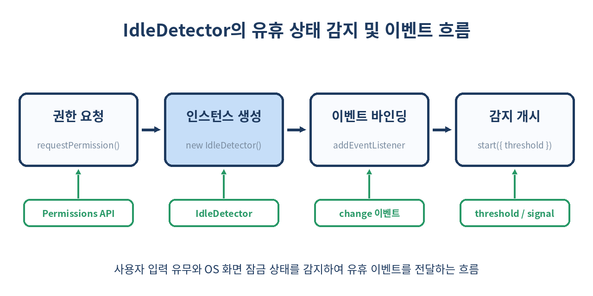
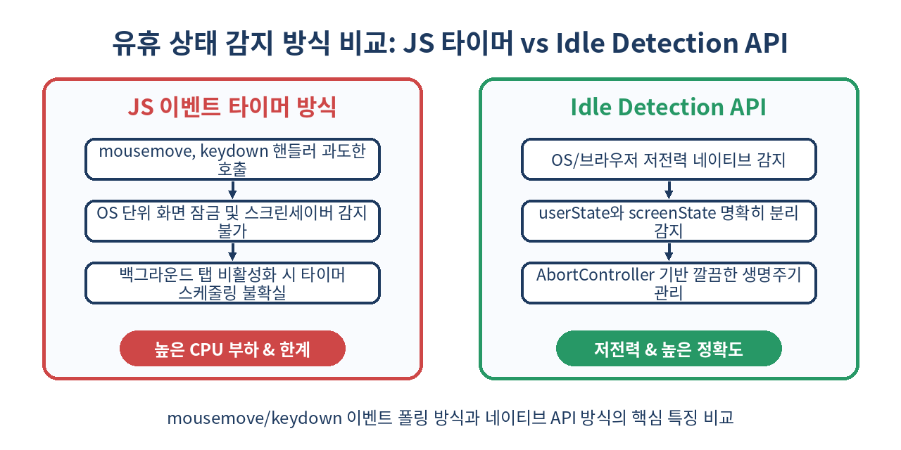

# 💤 Idle Detection API 완벽 가이드: 키보드·마우스 미입력과 화면 잠금을 감지하는 브라우저 네이티브 유휴 제어

> "사용자가 자리를 비웠거나 OS 화면을 잠갔을 때, 여러분의 웹 앱은 무엇을 하고 있나요?"
> 더 이상 `mousemove`나 `keydown` 이벤트에 무거운 타이머를 달지 마세요. 브라우저 네이티브 **Idle Detection API**를 활용해 사용자 및 시스템의 유휴 상태를 정확하고 저전력으로 감지하는 방법을 정리합니다.

---

## 📌 목차
1. 🧭 유휴 상태 감지(Idle Detection)란 무엇인가?
2. ⚠️ 기존 JS 타이머 기반 유휴 감지의 한계와 문제점
3. 💡 Idle Detection API의 핵심 개념과 동작 원리
4. 🔒 보안 정책 및 Permissions API 연동
5. 🛠️ Idle Detection API 기본 사용법 및 코드 가이드
6. 📊 IdleState 구조: userState와 screenState의 이해
7. 🛑 AbortController를 이용한 감지 중단 및 자원 해제
8. 🔄 실시간 협업 도구 및 금융 세션 타임아웃 실무 패턴
9. ⚖️ 기존 방식 vs Idle Detection API 완벽 비교
10. 🚨 실무 적용 시 주의할 점 및 브라우저 호환성 함정
11. 🧾 정리
12. 📚 참고 자료

---

## 🧭 1. 유휴 상태 감지(Idle Detection)란 무엇인가?

모던 웹 애플리케이션이 점점 데스크톱 소프트웨어 수준으로 복잡해짐에 따라, **"사용자가 현재 디바이스에서 실제로 작업 중인가?"**를 파악하는 일이 매우 중요해졌습니다.

예를 들어 다음과 같은 시나리오를 생각해 봅시다.
- **Slack / Teams 등 메신저 웹 앱**: 자리를 비운 사용자 상태를 '부재중(Away)'으로 자동 전환하여 동료들에게 정확한 프레젠스(Presence)를 제공
- **금융 / 보안 시스템**: 일정 시간 사용자가 반응을 보이지 않거나 화면을 잠그면 즉시 세션을 종료하고 재인증 요구
- **대용량 데이터 스트리밍 / 렌더링**: 자리를 비운 동안 GPU/CPU 소비가 큰 3D Canvas 애니메이션이나 불필요한 WebSocket 핑 폭주를 일시 중지

이러한 요구사항을 충족하기 위해 브라우저에 도입된 표준 API가 바로 **Idle Detection API**입니다.

---

## ⚠️ 2. 기존 JS 타이머 기반 유휴 감지의 한계와 문제점

Idle Detection API가 등장하기 전, 개발자들은 주로 다음과 같은 이벤트를 수신하고 `setTimeout`을 갱신하는 이른바 **'이벤트 폴링/디바운싱'** 기법을 사용했습니다.

```js
// ❌ 기존 방식: 마우스 movement나 키보드 입력을 매번 캡처하여 타이머 리셋
let idleTimer;

function resetIdleTimer() {
  clearTimeout(idleTimer);
  idleTimer = setTimeout(() => {
    console.log("사용자가 5분간 미입력 상태입니다.");
    setUserStatus("away");
  }, 5 * 60 * 1000);
}

window.addEventListener("mousemove", resetIdleTimer);
window.addEventListener("keydown", resetIdleTimer);
window.addEventListener("scroll", resetIdleTimer);
```

하지만 이 방식에는 심각한 실무적 한계가 존재했습니다.

1. **과도한 이벤트 발생과 성능 저하**: `mousemove`나 `scroll` 이벤트는 초당 수십~수백 번 발생합니다. 이를 캡처하고 디바운스/쓰로틀링하는 과정에서 메인 스레드 메모리와 CPU 자원이 불필요하게 낭비됩니다.
2. **OS 화면 잠금 감지 불가**: 사용자가 PC를 두고 화장실에 가면서 `Win + L`이나 `Cmd + Ctrl + Q`로 **화면을 잠그더라도**, 웹 앱은 이를 알 수 없습니다. 사용자가 키마를 움직이지 않는 타이머 시간이 다 되어서야 유휴로 처리됩니다.
3. **멀티 모니터 및 타 앱 사용 시 오판**: 사용자가 웹 앱 탭 밖에서 다른 프로그램(예: IDE, 문서 작성기)을 활발히 사용 중이더라도, 해당 웹 탭 입장에서는 '아무런 DOM 이벤트가 안 들어오는 상태'이므로 자리를 비운 것으로 오해할 수 있습니다.
4. **백그라운드 탭 타이머 제약**: 브라우저 정책상 탭이 백그라운드에 위치하면 `setTimeout` 및 `setInterval`의 정확도가 현저히 떨어지거나 실행이 지연됩니다.

--- 

## 💡 3. Idle Detection API의 핵심 개념과 동작 원리

Idle Detection API는 브라우저가 **운영체제(OS)의 입력 subsystem 및 디스플레이 관리자(Display Server)**와 직접 연동하여 사용자의 유휴 상태를 판별하는 방식입니다.



웹 앱이 DOM 이벤트를 일일이 훔쳐보는 대신, 브라우저가 OS 레벨에서 제공하는 사용자 유휴 상태 정보를 캡처하므로 다음과 같은 장점을 갖습니다.

- **체크 임계값(Threshold)**: 최소 `60000ms`(1분) 단위로 유휴 상태 감지 기준을 설정합니다.
- **독립된 2가지 상태 판별**: 단순 키마 미입력 상태(`userState`)와 OS 화면 잠금/스크린세이버 상태(`screenState`)를 독립적으로 캡처합니다.
- **저전력 구조**: 메인 스레드에 이벤트 리스너를 계속 띄워둘 필요가 없어 배터리 및 CPU 소비가 극도로 낮습니다.

---

## 🔒 4. 보안 정책 및 Permissions API 연동

Idle Detection API는 개인정보 보호 및 보안 강화를 위해 **엄격한 보안 요구사항**을 적용받습니다.

1. **Secure Context (HTTPS)**: 반드시 `https://` 또는 `localhost` 환경에서만 작동합니다.
2. **User Activation (사용자 상호작용)**: 사용자의 첫 클릭이나 키보드 입력 없이 무단으로 권한 팝업을 띄울 수 없습니다.
3. **Explicit Permission**: `idle-detection` 권한 요청을 거쳐 사용자의 명시적 허가를 받아야 합니다.

Permissions API를 활용해 권한 상태를 사전 체크하고 요청하는 표준 방법은 다음과 같습니다.

```js
async function requestIdlePermission() {
  try {
    // 1. Permissions API로 현재 권한 상태 확인
    const state = await navigator.permissions.query({ name: 'idle-detection' });
    
    if (state.state === 'denied') {
      console.warn('사용자가 Idle Detection 권한을 거부했습니다.');
      return false;
    }

    // 2. IdleDetector 권한 요청 (사용자 제스처 내에서 호출 필요)
    const permission = await IdleDetector.requestPermission();
    return permission === 'granted';
  } catch (error) {
    console.error('Idle Detection 권한 확인 중 오류:', error);
    return false;
  }
}
```

---

## 🛠️ 5. Idle Detection API 기본 사용법 및 코드 가이드

`IdleDetector` 인스턴스를 생성하고 이벤트 리스너를 바인딩하여 유휴 상태 감지를 시작하는 전형적인 코드 구조를 살펴봅니다.

```js
async function startIdleMonitoring() {
  // 1. 브라우저 지원 여부 검사
  if (!('IdleDetector' in window)) {
    console.log('이 브라우저는 Idle Detection API를 지원하지 않습니다.');
    return;
  }

  // 2. 권한 획득
  const isGranted = await requestIdlePermission();
  if (!isGranted) return;

  // 3. AbortController 생성 (감지 중단용)
  const controller = new AbortController();
  const { signal } = controller;

  // 4. IdleDetector 인스턴스 생성
  const idleDetector = new IdleDetector();

  // 5. 상태 변경 이벤트 핸들러 등록
  idleDetector.addEventListener('change', () => {
    const { userState, screenState } = idleDetector;
    console.log(`[상태 변경] User: ${userState}, Screen: ${screenState}`);

    if (userState === 'idle') {
      console.log('사용자가 자리를 비웠습니다.');
    } else if (userState === 'active') {
      console.log('사용자가 돌아와 활동을 시작했습니다.');
    }

    if (screenState === 'locked') {
      console.log('OS 화면이 잠겼거나 스크린세이버가 작동 중입니다.');
    }
  });

  try {
    // 6. 감지 시작 (최소 임계값: 60,000ms = 1분)
    await idleDetector.start({
      threshold: 60000,
      signal
    });
    console.log('Idle Detection 감지가 시작되었습니다.');
  } catch (err) {
    console.error('Idle Detection 감지 시작 실패:', err);
  }

  return controller; // 감지를 중단할 수 있는 컨트롤러 반환
}
```

---

## 📊 6. IdleState 구조: userState와 screenState의 이해

`IdleDetector` 객체는 유휴 상태를 2가지 명확한 프로퍼티로 분리하여 제공합니다.

| 프로퍼티 | 가능한 값 | 의미 | 설명 |
| :--- | :--- | :--- | :--- |
| `userState` | `'active'` | 활동 중 | 지정된 `threshold` 시간 내에 사용자가 키보드/마우스/터치 등을 조작함 |
| | `'idle'` | 유휴 상태 | 지정된 `threshold` 시간 동안 디바이스에 사용자 입력이 없음 |
| `screenState` | `'unlocked'` | 화면 열림 | 화면이 정상적으로 켜져 있고 잠겨있지 않음 |
| | `'locked'` | 화면 잠김 | OS 화면 잠금, 스크린세이버 작동, 또는 디스플레이가 켜지지 않은 상태 |

두 값의 조합에 따라 애플리케이션의 동작을 극도로 세밀하게 제어할 수 있습니다.

```js
idleDetector.addEventListener('change', () => {
  const { userState, screenState } = idleDetector;

  if (screenState === 'locked') {
    // 화면이 잠겼다면 즉시 기밀 데이터 화면 모자이크 처리 및 자동 로그아웃 준비
    maskSensitiveContent();
  } else if (userState === 'idle') {
    // 화면은 켜져 있으나 자리를 비운 경우 '부재중' 태그 표시
    setPresenceStatus('away');
  } else {
    // 정상 활동
    unmaskContent();
    setPresenceStatus('online');
  }
});
```

---

## 🛑 7. AbortController를 이용한 감지 중단 및 자원 해제

`IdleDetector.start()`는 `signal` 파라미터로 `AbortSignal`을 전달받습니다. 싱글 페이지 애플리케이션(SPA) 환경에서 컴포넌트 언마운트 시 메모리 누수를 방지하기 위해 관찰을 중단할 수 있습니다.

React Hook 패턴을 이용한 작성예시를 살펴봅시다.

```jsx
import { useEffect, useState } from 'react';

export function useIdleDetection(threshold = 60000) {
  const [idleState, setIdleState] = useState({ userState: 'active', screenState: 'unlocked' });

  useEffect(() => {
    if (!('IdleDetector' in window)) return;

    const controller = new AbortController();
    const idleDetector = new IdleDetector();

    const handleStateChange = () => {
      setIdleState({
        userState: idleDetector.userState,
        screenState: idleDetector.screenState,
      });
    };

    idleDetector.addEventListener('change', handleStateChange);

    async function init() {
      const permission = await IdleDetector.requestPermission();
      if (permission === 'granted') {
        try {
          await idleDetector.start({ threshold, signal: controller.signal });
        } catch (e) {
          if (e.name !== 'AbortError') console.error(e);
        }
      }
    }

    init();

    // Cleanup: 컴포넌트 언마운트 시 AbortSignal을 통한 감지 즉시 중단
    return () => {
      controller.abort();
      idleDetector.removeEventListener('change', handleStateChange);
    };
  }, [threshold]);

  return idleState;
}
```

---

## 🔄 8. 실시간 협업 도구 및 금융 세션 타임아웃 실무 패턴

Idle Detection API는 실무에서 매우 유용한 두 가지 대표적 패턴을 제공합니다.

### 패턴 A: 협업 툴(Figma, Slack 스타일) WebSocket 트래픽 최적화

사용자가 자리를 비웠을 때 서버로 보내는 커서 위치 전송(Heartbeat) 및 실시간 동기화 인터벌을 줄여 서버 턴 및 대역폭을 90% 이상 절감할 수 있습니다.

```js
idleDetector.addEventListener('change', () => {
  if (idleDetector.userState === 'idle') {
    // 유휴 상태 시 WebSocket 핑 주기를 1초에서 30초로 변경
    webSocketManager.setHeartbeatInterval(30000);
    webSocketManager.sendPresence('away');
  } else {
    // 복귀 시 원래 복구
    webSocketManager.setHeartbeatInterval(1000);
    webSocketManager.sendPresence('active');
  }
});
```

### 패턴 B: 보안 금융 서비스 세션 자동 타임아웃 및 보안 화면 전환

```js
let logoutTimer = null;

idleDetector.addEventListener('change', () => {
  if (idleDetector.screenState === 'locked') {
    // OS 화면이 잠기면 대기시간 없이 30초 후 즉시 강제 로그아웃
    logoutTimer = setTimeout(forceLogout, 30000);
    showLockScreenModal();
  } else if (idleDetector.userState === 'active') {
    if (logoutTimer) clearTimeout(logoutTimer);
    hideLockScreenModal();
  }
});
```

---

## ⚖️ 9. 기존 방식 vs Idle Detection API 완벽 비교



두 유휴 감지 방식의 특성을 표로 상세 비교해 봅시다.

| 항목 | 기존 JS 이벤트 디바운싱 방식 | Idle Detection API 방식 |
| :--- | :--- | :--- |
| **감지 주체** | 브라우저 DOM 이벤트 (`mousemove`, `keydown`) | OS 레벨 입력 파이프라인 및 디스플레이 관리자 |
| **CPU/배터리 자원** | 높음 (연속 이벤트 핸들러 및 타이머 동작) | 극히 낮음 (OS가 알림을 보낼 때만 반응) |
| **화면 잠금 감지** | **불가** (OS 잠금 여부 알 방법 없음) | **가능** (`screenState === 'locked'`) |
| **최소 감지 시간** | 0초 단위부터 마음대로 설정 가능 | 최소 **60초 (60,000ms)** 이상 설정 필수 |
| **사용자 권한** | 권한 요청 필요 없음 | 명시적 권한 승인 필수 (`idle-detection`) |
| **백그라운드 감지** | 탭 비활성화 시 타이머 스케줄링 불확실 | 백그라운드 탭에서도 OS 유휴 상태 정확 감지 |
| **브라우저 호환성** | 모든 브라우저 100% 지원 | Chromium 계열 브라우저 중심 지원 |

---

## 🚨 10. 실무 적용 시 주의할 점 및 브라우저 호환성 함정

Idle Detection API를 production 환경에 도입하기 전에 반드시 염두에 두어야 할 함정과 가이드라인입니다.

### 1. 최소 threshold 제한 (60,000ms)
`IdleDetector.start({ threshold })` 호출 시 `threshold` 값은 **최소 60,000ms(1분)** 이상이어야 합니다. 60초 미만의 값(예: 30초)을 넣으면 브라우저가 `TypeError` 예외를 발생시킵니다.

```js
// ❌ InvalidTypeError 발생!
await idleDetector.start({ threshold: 10000, signal });

// ✅ 최소 60,000ms 이상 작성
await idleDetector.start({ threshold: 60000, signal });
```

### 2. 브라우저 지원 범위 (Cross-Browser Issues)
현재 Idle Detection API는 **Chrome, Edge, Opera 등 Chromium 기반 브라우저(버전 94+)**에서 동작합니다. Safari(WebKit)와 Firefox(Gecko)는 사생활 침해(사용자의 컴퓨터 앞 유무 모니터링 가능성) 우려를 이유로 API 구현을 보류 중이거나 반대 입장을 표명하고 있습니다.

따라서 **점진적 향상(Progressive Enhancement)** 기법이 필수적입니다.

```js
if ('IdleDetector' in window) { // Modern API 사용
  useNativeIdleDetector();
} else { // Fallback: 기존 이벤트 타이머 사용
  useLegacyTimerFallback();
}
```

### 3. 사용자 권한 거부 대응 패턴
사용자가 브라우저 권한 팝업에서
