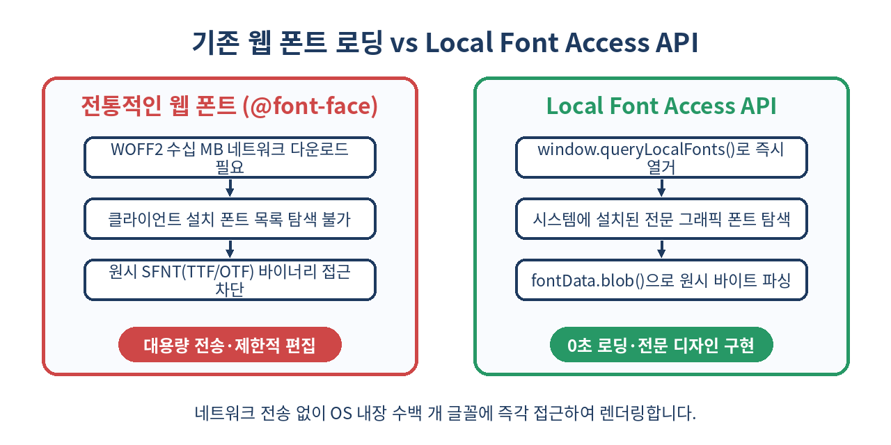
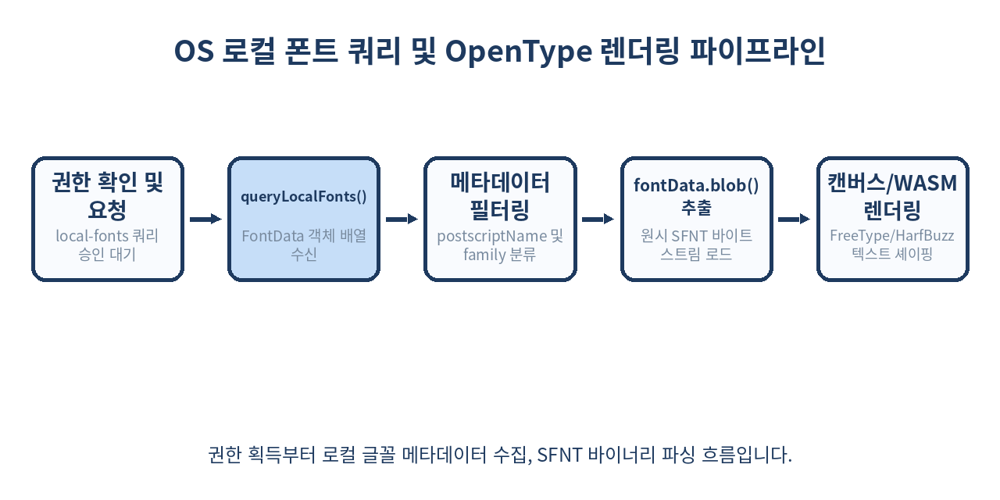

# 🔤 Local Font Access API 완벽 가이드: 브라우저에서 OS 설치 폰트를 직접 읽고 렌더링하기

> "Figma, Photopea, 웹 기반 CAD를 만들 때 사용자의 Mac/Windows에 설치된 수백 개의 전문 폰트를 어떻게 웹에서 자유롭게 쓸 수 있을까?"
> 네트워크 다운로드와 별도 데스크톱 에이전트 없이, OS 로컬 폰트의 메타데이터와 원시 SFNT(TrueType/OpenType) 바이너리를 직접 제어하는 Local Font Access API를 심층 분석합니다.

---

## 📌 목차
1. 🧭 웹 타이포그래피의 한계와 Local Font Access API의 탄생
2. 🔍 Local Font Access API의 핵심 동작 원리
3. 🔐 권한 모델: local-fonts Permission과 사용자 프라이버시
4. 📋 window.queryLocalFonts()로 설치된 글꼴 열거하기
5. 🎯 FontData 인터페이스: PostScript Name, Family, Style 분석
6. 🧪 postscriptNames 필터를 통한 특정 글꼴 고속 조회
7. 📦 fontData.blob()으로 저수준 SFNT 바이너리 추출하기
8. 🎨 Canvas 2D 및 WebGL/WebGPU 텍스트 엔진과 결합하기
9. ⚙️ WebAssembly(FreeType, HarfBuzz)를 활용한 전문 글꼴 셰이핑
10. 📊 전통적인 @font-face 및 CSS Font Loading API와의 비교
11. ⚠️ 실무 함정: 브라우저 호환성, 핑거프린팅, 메모리 관리
12. 🚫 이럴 때는 쓰지 마세요 (안티패턴 및 대안)
13. 🧾 13. 정리
14. 📚 참고 자료

---

## 🧭 1. 웹 타이포그래피의 한계와 Local Font Access API의 탄생

웹 브라우저는 기본적으로 샌드박스 환경에서 구동됩니다. 전통적인 웹 환경에서 글꼴을 렌더링할 때 개발자가 취할 수 있는 선택지는 매우 제한적이었습니다.

1. **`@font-face`를 통한 웹 폰트 다운로드**: WOFF, WOFF2 형식의 글꼴 파일을 네트워크로 받아오는 방식입니다. 영문 글꼴은 수십~수백 KB로 가볍지만, 한글·한자·일본어 등 CJK 글꼴은 글자 수가 11,172자에 달해 파일 크기가 수십 MB에 이릅니다. 서브셋(Subset)을 생성하더라도 전문 출판, 디자인, 그래픽 툴에서는 전체 글리프가 필요하므로 엄청난 네트워크 대역폭과 초기 지연 시간이 발생합니다.
2. **CSS `font-family` 시스템 폰트 폴백**: `font-family: "Helvetica Neue", Arial, sans-serif;`처럼 사용자 OS에 설치되어 있을 것으로 추정되는 이름을 선언하는 방식입니다. 하지만 자바스크립트는 사용자의 운영체제에 실제로 해당 폰트가 설치되어 있는지 목록을 열거(`enumerate`)할 수 없으며, 설치되지 않았다면 브라우저가 임의의 대체 폰트로 대체해 레이아웃이 깨집니다.
3. **데스크톱 헬퍼 에이전트 도입**: 과거 Figma는 로컬 폰트를 읽기 위해 사용자의 PC에 로컬 웹서버(`localhost:port`)를 띄우는 별도의 데스크톱 헬퍼 데몬(Figma Font Helper)을 설치하도록 강제했습니다.



이러한 구조적 한계를 극복하고 브라우저 기반의 전문 디자인 도구(Figma, Canva, 웹 CAD, 문서 편집기, 동영상 자막 툴)가 데스크톱 네이티브 앱과 동일한 타이포그래피 제어권을 확보할 수 있도록 W3C 웹 인큐베이터 커뮤니티 그룹(WICG)에서 표준화한 사양이 바로 **Local Font Access API**입니다.

---

## 🔍 2. Local Font Access API의 핵심 동작 원리

Local Font Access API는 보안 샌드박스를 준수하면서도 OS 글꼴 테이블에 직접 접근할 수 있는 두 가지 핵심 기능을 제공합니다.

- **시스템 글꼴 목록 열거 (`queryLocalFonts`)**: 사용자가 설치한 서체의 패밀리명(`family`), 전체 이름(`fullName`), PostScript 이름(`postscriptName`), 스타일(`style`)을 배열 형태로 탐색합니다.
- **원시 SFNT 데이터 추출 (`blob()`)**: 단순히 화면에 CSS로 띄우는 것을 넘어, OpenType(OTF) 및 TrueType(TTF)의 원시 바이너리 스트림(SFNT 컨테이너)을 `Blob` 형태로 직접 추출하여 자바스크립트나 WebAssembly 엔진에 공급할 수 있습니다.

```text
+---------------------------------------------------------+
|                   Web Application                       |
+---------------------------------------------------------+
                           │  1. queryLocalFonts()
                           ▼
+---------------------------------------------------------+
|      Local Font Access API (Browser Permissions)        |
+---------------------------------------------------------+
                           │  2. fontData.blob()
                           ▼
+---------------------------------------------------------+
|               OS Font Manager / System API              |
|   - Windows: DirectWrite                                |
|   - macOS: CoreText                                     |
|   - Linux: Fontconfig / FreeType                        |
+---------------------------------------------------------+
```

브라우저는 Windows의 `DirectWrite`, macOS의 `CoreText`, Linux의 `Fontconfig`와 같은 네이티브 OS 폰트 서브시스템과 통신하여 무결성이 검증된 폰트 테이블만 추출합니다.

---

## 🔐 3. 권한 모델: local-fonts Permission과 사용자 프라이버시

설치된 글꼴 목록은 사용자의 직업(디자이너, 개발자, 특정 언어권 번역가 등), 사용하는 OS, 구매한 상용 소프트웨어 패키지를 유추할 수 있는 결정적인 **브라우저 핑거프린팅(Browser Fingerprinting)** 벡터가 됩니다. 따라서 Local Font Access API는 엄격한 보안 모델을 따릅니다.

1. **보안 컨텍스트(HTTPS)**: `https://` 또는 `localhost` 환경에서만 동작합니다.
2. **Permissions API 연동**: `local-fonts`라는 명시적 권한 이름으로 관리됩니다.
3. **사용자 제스처(User Gesture) 필수**: 페이지가 로드되자마자 백그라운드에서 임의로 호출할 수 없으며, 버튼 클릭 등 명시적인 사용자 인터랙션 이벤트 핸들러 내부에서 호출되어야 프롬프트가 표시됩니다.
4. **Permissions-Policy 제어**: iframe 내부에서 사용할 경우 부모 창이 `allow="local-fonts"` 헤더나 속성을 명시적으로 부여해야 합니다.

```js
// 권한 상태 확인 유틸리티 함수
async function checkFontPermission() {
  if (!('queryLocalFonts' in window)) {
    console.warn('현재 브라우저는 Local Font Access API를 지원하지 않습니다.');
    return 'unsupported';
  }

  try {
    const status = await navigator.permissions.query({ name: 'local-fonts' });
    console.log(`로컬 폰트 권한 상태: ${status.state}`); // 'granted' | 'denied' | 'prompt'
    
    status.onchange = () => {
      console.log(`권한 상태가 변경되었습니다: ${status.state}`);
    };
    
    return status.state;
  } catch (err) {
    console.error('권한 상태 조회 실패:', err);
    return 'error';
  }
}
```

---

## 📋 4. window.queryLocalFonts()로 설치된 글꼴 열거하기

`window.queryLocalFonts()`는 사용자의 동의를 거쳐 시스템에 설치된 모든 로컬 글꼴의 `FontData` 객체 배열을 담은 Promise를 반환합니다.

```js
async function loadSystemFonts() {
  try {
    // 사용자 제스처 이벤트 내에서 호출되어야 함
    const availableFonts = await window.queryLocalFonts();
    
    console.log(`총 ${availableFonts.length}개의 글꼴을 발견했습니다.`);

    const fontListSummary = availableFonts.slice(0, 5).map(font => ({
      postscriptName: font.postscriptName,
      fullName: font.fullName,
      family: font.family,
      style: font.style,
    }));

    console.table(fontListSummary);
    return availableFonts;
  } catch (err) {
    if (err.name === 'NotAllowedError') {
      console.error('사용자가 폰트 접근 권한을 거부했습니다.');
    } else {
      console.error('글꼴 목록 조회 중 오류 발생:', err);
    }
    return [];
  }
}
```

이 메서드를 호출하면 브라우저는 사용자에게 **"이 사이트에서 컴퓨터에 설치된 글꼴을 확인하도록 허용하시겠습니까?"**라는 대화상자를 띄우며, 사용자가 승인하면 배열이 반환됩니다.

---

## 🎯 5. FontData 인터페이스: PostScript Name, Family, Style 분석

반환되는 `FontData` 객체는 각 폰트 페이스(Font Face)의 핵심 식별 정보를 표준화된 속성으로 제공합니다.

| 속성 (`FontData`) | 데이터 타입 | 설명 | 예시 |
| :--- | :--- | :--- | :--- |
| `postscriptName` | `string` | OpenType `name` 테이블에 명시된 고유 식별자. CSS `@font-face`의 `src: local()`에서 사용 가능 | `"Pretendard-Bold"`, `"FiraCode-Retina"` |
| `fullName` | `string` | 폰트 패밀리와 스타일이 결합된 전체 표시용 이름 | `"Pretendard Bold"`, `"Fira Code Retina"` |
| `family` | `string` | 동일한 디자인 계열을 묶는 패밀리 이름 | `"Pretendard"`, `"Fira Code"` |
| `style` | `string` | 굵기(Weight)와 기울기(Italic) 등의 스타일 변형 | `"Bold"`, `"Regular"`, `"Italic"` |

실무에서는 중복된 패밀리명을 그룹핑하여 디자인 에디터의 폰트 선택 드롭다운 UI를 구성합니다.

```js
// 패밀리 단위로 그룹화하는 유틸리티
function groupFontsByFamily(fontDataArray) {
  const grouped = new Map();

  for (const font of fontDataArray) {
    if (!grouped.has(font.family)) {
      grouped.set(font.family, []);
    }
    grouped.get(font.family).push({
      postscriptName: font.postscriptName,
      fullName: font.fullName,
      style: font.style,
      fontData: font
    });
  }

  return grouped;
}
```

---

## 🧪 6. postscriptNames 필터를 통한 특정 글꼴 고속 조회

사용자 시스템에 글꼴이 수천 개 설치되어 있다면 모든 폰트 메타데이터를 파싱하여 배열로 만드는 데 수백 밀리초의 오버헤드가 발생할 수 있습니다. 이미 필요한 글꼴의 `postscriptName`을 알고 있다면 옵션 객체를 전달하여 성능을 대폭 끌어올릴 수 있습니다.

```js
async function getSpecificFonts(targetPostscriptNames) {
  try {
    // 필요한 글꼴만 배열로 지정하여 필터링 요청
    const fonts = await window.queryLocalFonts({
      postscriptNames: targetPostscriptNames,
    });

    console.log(`일치하는 글꼴 ${fonts.length}개 반환됨`);
    return fonts;
  } catch (error) {
    console.error('특정 글꼴 조회 실패:', error);
    return [];
  }
}

// 사용 예시
const targetList = ['AppleSDGothicNeo-Bold', 'D2Coding-Bold', 'Roboto-Regular'];
const loadedTargets = await getSpecificFonts(targetList);
```

`postscriptNames` 필터를 사용할 경우 브라우저는 내부 OS 폰트 캐시에서 일치하는 글꼴만 추출하여 직렬화하므로 메모리 사용량과 탐색 시간을 획기적으로 줄여줍니다.

---

## 📦 7. fontData.blob()으로 저수준 SFNT 바이너리 추출하기

Local Font Access API의 진정한 강점은 메타데이터 조회를 넘어 **원시 폰트 바이너리 데이터**에 직접 접근할 수 있다는 점입니다. `FontData.prototype.blob()` 메서드는 TTF/OTF 파일의 원시 바이너리가 담긴 `Promise<Blob>`을 반환합니다.

```js
async function extractRawFontBytes(fontData) {
  try {
    // SFNT 바이너리 Blob 획득
    const blob = await fontData.blob();
    console.log(`폰트: ${fontData.fullName}, 바이너리 크기: ${blob.size} bytes, MIME: ${blob.type}`);

    // ArrayBuffer로 변환
    const arrayBuffer = await blob.arrayBuffer();
    const dataView = new DataView(arrayBuffer);

    // OpenType/TrueType 시그니처 매직 넘버 검증 (첫 4바이트)
    // 0x00010000 (TrueType), 0x4F54544F ('OTTO' - OpenType CFF)
    const sfntVersion = dataView.getUint32(0, false);
    
    if (sfntVersion === 0x00010000) {
      console.log('이 서체는 TrueType (TTF) 아웃라인을 사용합니다.');
    } else if (sfntVersion === 0x4F54544F) {
      console.log('이 서체는 OpenType (CFF) 아웃라인을 사용합니다.');
    } else {
      console.log(`기타 SFNT 포맷 (매직 넘버: 0x${sfntVersion.toString(16)})`);
    }

    return arrayBuffer;
  } catch (err) {
    console.error('원시 폰트 바이너리 추출 실패:', err);
    throw err;
  }
}
```

추출된 `Blob`은 `URL.createObjectURL(blob)`을 통해 동적 CSS `@font-face`로 주입할 수도 있고, WebAssembly 기반 파서(FreeType, OpenType.js 등)에 전달하여 커브 좌표를 직접 추출할 수도 있습니다.



---

## 🎨 8. Canvas 2D 및 WebGL/WebGPU 텍스트 엔진과 결합하기

로컬 폰트 바이너리를 추출하면 브라우저의 CSS 렌더링에 의존하지 않고, 자체 그래픽 파이프라인에서 정밀한 글꼴 렌더링을 구현할 수 있습니다.

### 8.1 FontFace API와 동적 등록

`new FontFace` 객체에 로컬 폰트의 `ArrayBuffer`를 전달하여 브라우저의 폰트 레지스트리(`document.fonts`)에 즉시 등록할 수 있습니다.

```js
async function registerLocalFontToDocument(fontData) {
  const blob = await fontData.blob();
  const buffer = await blob.arrayBuffer();
  
  // 임의의 고유 패밀리명으로 등록
  const customFamilyName = `Local_${fontData.postscriptName}`;
  const fontFace = new FontFace(customFamilyName, buffer);

  // 폰트 파싱 및 로드
  await fontFace.load();
  document.fonts.add(fontFace);

  console.log(`CSS 및 Canvas에서 사용할 수 있도록 등록 완료: ${customFamilyName}`);
  return customFamilyName;
}

// Canvas 2D에서 렌더링하기
async function renderToCanvas(canvas, fontData, text) {
  const family = await registerLocalFontToDocument(fontData);
  const ctx = canvas.getContext('2d');

  ctx.clearRect(0, 0, canvas.width, canvas.height);
  ctx.font = `48px "${family}"`;
  ctx.fillStyle = '#1E3A5F';
  ctx.fillText(text, 50, 100);
}
```

--- 

## ⚙️ 9. WebAssembly(FreeType, HarfBuzz)를 활용한 전문 글꼴 셰이핑

전문 출판 소프트웨어나 복잡한 문자 체계(아랍어의 이어쓰기, 힌디어의 합자, 고급 리가추어)를 처리하려면 단순 브라우저 텍스트 렌더러로는 부족합니다. Rust나 C++로 작성된 **FreeType**(래스터라이저)과 **HarfBuzz**(텍스트 셰이퍼)를 WASM으로 빌드하여 브라우저 내부에서 완벽한 폰트 레이아웃을 계산할 수 있습니다.

```js
// WebAssembly 기반 텍스트 셰이핑 의사 파이프라인
class WasmTypographyEngine {
  constructor(wasmModule) {
    this.module = wasmModule;
  }

  async initFont(fontData) {
    const blob = await fontData.blob();
    const buffer = await blob.arrayBuffer();
    
    // WASM 메모리 힙에 원시 폰트 바이트 복사
    const byteLength = buffer.byteLength;
    const heapPtr = this.module._malloc(byteLength);
    const heapBytes = new Uint8Array(this.module.HEAPU8.buffer, heapPtr, byteLength);
    heapBytes.set(new Uint8Array(buffer));

    // HarfBuzz 폰트 객체 생성
    this.fontHandle = this.module._hb_font_create_from_buffer(heapPtr, byteLength);
  }

  shapeText(utf8Text) {
    // WASM 내부 HarfBuzz가 각 글자의 글리프 인덱스, X/Y 오프셋, 커닝을 정밀 계산
    const glyphInfoPtr = this.module._shape_text(this.fontHandle, utf8Text);
    return this.parseGlyphOutput(glyphInfoPtr);
  }
}
```

이 방식을 적용하면 플랫폼 간(macOS, Windows, iOS, Android) 텍스트 렌더링 픽셀 불일치 문제를 100% 해소하고 일관된 디자인 출력을 보장할 수 있습니다.

---

## 📊 10. 전통적인 @font-face 및 CSS Font Loading API와의 비교

| 비교 항목 | 전통적 CSS `@font-face` | CSS Font Loading API | Local Font Access API |
| :--- | :--- | :--- | :--- |
| **폰트 출처** | 원격 웹 서버 (WOFF2/TTF) | 원격 웹 서버 또는 로컬 캐시 | **사용자 OS 로컬 설치 글꼴** |
| **목록 열거 가능 여부** | 불가능 | 불가능 | **가능 (`queryLocalFonts`)** |
| **원시 바이너리 획득** | `fetch()`로 우회 (CORS 필요) | 불가능 (`FontFace` 래핑) | **가능 (`fontData.blob()`)** |
| **사용자 권한 승인** | 불필요 | 불필요 | **필수 (`local-fonts` 프롬프트)** |
| **네트워크 대역폭 소모** | 폰트 크기만큼 지속 소모 | 폰트 크기만큼 지속 소모 | **0 KB (로컬 I/O만 발생)** |
| **적합한 유즈케이스** | 일반 반응형 웹페이지, 블로그 | 폰트 로딩 시점 동적 제어 | **Figma류 디자인 툴, CAD, 비디오 에디터** |

---

## ⚠️ 11. 실무 함정: 브라우저 호환성, 핑거프린팅, 메모리 관리

### 11.1 브라우저 파편화
Local Font Access API는 Chromium 계열(Chrome 103+, Edge 103+, Opera) 데스크톱 환경에서 강력하게 지원됩니다. 반면 **Firefox와 Safari(WebKit)는 프라이버시 침해(기기 핑거프린팅) 우려로 인해 해당 API 구현에 매우 보수적**입니다. 따라서 모바일 환경이나 크로스 브라우저 지원이 필수적인 경우 반드시 기능 감지(Feature Detection)와 함께 적절한 폴백 메커니즘을 구성해야 합니다.

```js
function isLocalFontAccessSupported() {
  return 'queryLocalFonts' in window;
}
```

### 11.2 Blob 메모리 누수
사용자가 500개의 글꼴을 가지고 있을 때, 모든 글꼴의 `.blob()`을 호출하여 메모리에 적재하면 브라우저 탭 메모리가 수 GB까지 치솟아 OOM(Out of Memory) 크래시가 발생할 수 있습니다.
- **해결책**: 메타데이터 목록(`queryLocalFonts()`)만 먼저 파싱하고, 사용자가 실제로 캔버스에서 특정 글꼴을 선택하여 렌더링할 때 비동기 지연 로딩(Lazy Loading)으로 `.blob()`을 요청하십시오.

### 11.3 폰트 파일 수정 및 삭제 트래킹 불가
사용자가 웹 앱을 띄워둔 상태에서 OS 폰트 관리자를 통해 새 글꼴을 설치하거나 기존 글꼴을 삭제하더라도 브라우저는 이를 자동으로 감지하는 이벤트를 제공하지 않습니다. 목록을 최신화하려면 다시 `queryLocalFonts()`를 명시적으로 호출해야 합니다.

---

## 🚫 12. 이럴 때는 쓰지 마세요 (안티패턴 및 대안)

### 1. 일반 콘텐츠 웹사이트 및 블로그
일반적인 랜딩 페이지, 쇼핑몰, 블로그에서 단순히 특정 폰트로 본문을 보여주고 싶다고 해서 Local Font Access API를 호출하면 사용자에게 불필요한 권한 요청 프롬프트를 띄우게 되어 이탈률이 급증합니다. 이 경우에는 표준 WOFF2 웹 폰트 서브셋과 `font-display: swap`을 사용하십시오.

### 2. 모바일 웹 브라우저 환경
iOS(Safari)와 Android(Chrome)에서는 모바일 OS 정책 및 보안상의 이유로 시스템 폰트 직접 열거 기능이 제공되지 않거나 비활성화되어 있습니다. 데스크톱 프로덕션 툴을 타깃으로 설계해야 합니다.

### 3. 사용자 동의 없는 사용자 프로파일링 목적
방문자의 신원을 식별하기 위해 설치된 폰트 목록을 몰래 긁어가려는 행위는 브라우저의 남용 탐지 엔진에 의해 차단될 수 있으며, 권한 프롬프트로 인해 사용자 신뢰를 완전히 잃게 됩니다.

---

## 🧾 13. 정리

- **OS 폰트 직접 접근**: Local Font Access API는 데스크톱 OS에 설치된 글꼴 메타데이터와 원시 SFNT 바이트에 접근할 수 있게 해주는 최신 브라우저 표준입니다.
- **0초 네트워크 로딩**: 대용량 CJK 글꼴이나 상용 전문 폰트를 웹 서버에서 내려받을 필요 없이 사용자 로컬 스토리지에서 즉시 로드합니다.
- **원시 바이너리 추출**: `fontData.blob()`을 통해 폰트 바이너리를 확보함으로써 WebAssembly(FreeType/HarfBuzz) 기반 자체 텍스트 셰이핑 엔진을 구동할 수 있습니다.
- **보안과 프라이버시**: HTTPS 보안 컨텍스트, 사용자 제스처 기반의 명시적 `local-fonts` 권한 승인이 강제됩니다.
- **전문 웹 워크로드의 열쇠**: 브라우저 기반 디자인 에디터, 3D 그래픽 엔진, 비디오 렌더러가 데스크톱 네이티브 앱과 동일한 성능과 유연성을 확보할 수 있습니다.

> ✨ **한 줄 요약**  
> Local Font Access API는 웹을 단순한 문서 뷰어에서 데스크톱 수준의 전문 타이포그래피 작업실로 진화시키는 핵심 브라우저 표준이다.

---

## 📚 참고 자료
- [W3C Local Font Access API Specification](https://wicg.github.io/local-font-access/)
- [MDN Web Docs: Local Font Access API](https://developer.mozilla.org/en-US/docs/Web/API/Local_Font_Access_API)
- [Chrome for Developers: Use advanced typography with the Local Font Access API](https://developer.chrome.com/docs/capabilities/web-apis/local-fonts)
- [W3C Permissions API Specification](https://w3c.github.io/permissions/)
