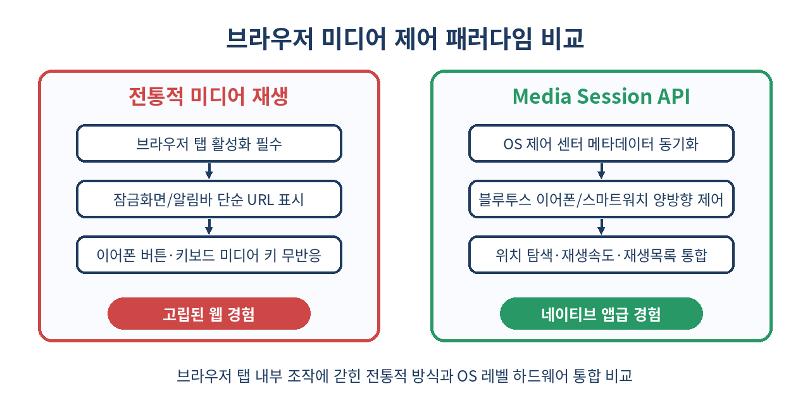
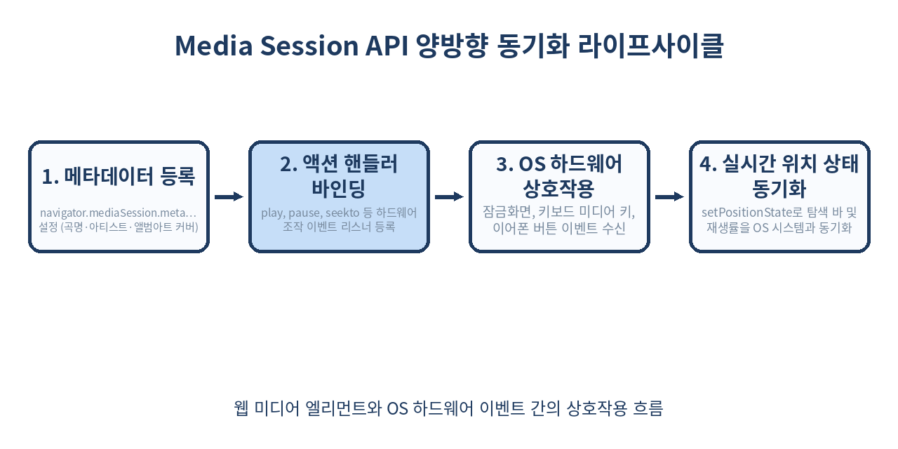

# 🎵 Media Session API 완벽 가이드: 브라우저 밖 OS 제어 센터와 이어폰 버튼까지 정복하는 웹 미디어 컨트롤

> "웹은 샌드박스 안에 갇혀 있어야만 하는가?"
> 브라우저 탭을 최소화하거나 스마트폰 화면을 잠그더라도, 사용자의 귀에 꽂힌 블루투스 이어폰 버튼과 OS 잠금화면 미디어 컨트롤러를 네이티브 앱처럼 장악하는 법을 살펴봅니다.

---

## 📌 목차
1. 🧭 웹 미디어의 오랜 한계와 OS 레벨 통합의 필요성
2. 🧩 Media Session API란 무엇인가?
3. 🖼️ MediaMetadata로 잠금화면과 제어 센터 꾸미기
4. 🎮 setActionHandler: 키보드·이어폰·스마트워치 이벤트 수신하기
5. ⏱️ setPositionState: 탐색 바(Scrubber)와 재생 진행률 동기화
6. 🎬 실무 구현: React/TypeScript 오디오 플레이어 풀 스택 구현체
7. 🔄 백그라운드 재생과 오디오 포커스(Audio Focus) 제어 원리
8. ⚖️ 기존 HTML5 Media Event vs Media Session API 비교
9. ⚠️ 실무 함정: 메모리 누수, 크롬 백그라운드 정책, PWA 제약
10. 🚫 Media Session API를 쓰지 말아야 할 경우
11. 🧾 정리: 핵심 요약 및 체크리스트
12. 📚 참고 자료

---

## 🧭 1. 웹 미디어의 오랜 한계와 OS 레벨 통합의 필요성

웹 브라우저에서 오디오 스트리밍이나 팟캐스트, 영상 플레이어를 만들 때 가장 큰 사용자 경험(UX) 장벽은 바로 **‘브라우저 밖과의 단절’**이었습니다.

사용자는 멜론이나 스포티파이, 유튜브 뮤직 같은 네이티브 앱에 익숙해져 있습니다. 화면을 끈 상태에서도 스마트폰 잠금화면에서 앨범 아트를 보고, 에어팟이나 갤럭시 버즈의 터치 패드로 일시정지하거나 다음 곡으로 넘깁니다. 키보드의 물리 재생/일시정지 버튼(`PlayPause`, `MediaTrackNext`)을 누르는 것도 당연한 일상입니다.

하지만 순수 `<audio>`나 `<video>` 태그만 사용한 웹 앱은 어떨까요?
- 스마트폰 화면을 잠그면 기껏해야 브라우저 아이콘과 함께 무성의한 웹 페이지 제목이나 도메인 URL만 노출됩니다.
- 블루투스 이어폰 버튼을 두 번 탭해도 다음 곡 재생 핸들러가 동작하지 않습니다.
- 탐색 바(Seek Bar)가 비활성화되어 화면을 켜고 브라우저 탭을 직접 찾아 들어가야만 시간을 조절할 수 있습니다.

이러한 간극을 완벽히 메우기 위해 W3C와 웹 표준 그룹이 도입한 사양이 바로 **Media Session API**입니다.



---

## 🧩 2. Media Session API란 무엇인가?

Media Session API는 웹 페이지가 재생 중인 오디오/비디오의 상태를 브라우저를 넘어 **운영체제(OS)의 네이티브 미디어 인터페이스와 동기화**할 수 있도록 연결해 주는 표준 웹 API입니다.

`navigator.mediaSession` 객체를 통해 접근할 수 있으며, 크게 3가지 핵심 축으로 구성됩니다:

1. **`MediaMetadata`**: 제목(title), 아티스트(artist), 앨범(album), 다해상도 앨범 아트워크(artwork) 정보 전달
2. **`setActionHandler(action, handler)`**: 시스템이나 하드웨어(키보드, 헤드폰, 카플레이/안드로이드 오토, 스마트워치)에서 발생한 동작 명령을 감지하여 실행
3. **`setPositionState(stateDict)`**: 현재 재생 위치(position), 총 재생 시간(duration), 재생 배속(playbackRate)을 OS에 알려주어 잠금화면 탐색 바를 정확하게 렌더링

브라우저 지원율 또한 매우 뛰어납니다. 2026년 현재 Chrome, Edge, Safari(iOS/macOS), Samsung Internet, Firefox 등 주요 모던 브라우저 전반에서 완벽하게 지원됩니다.

```js
// 브라우저 지원 여부 확인
if ('mediaSession' in navigator) {
  console.log('🎉 Media Session API를 지원하는 환경입니다.');
} else {
  console.warn('⚠️ Media Session API를 지원하지 않는 레거시 브라우저입니다.');
}
```

---

## 🖼️ 3. MediaMetadata로 잠금화면과 제어 센터 꾸미기

가장 먼저 해야 할 일은 시스템 UI에 표시될 곡 정보를 등록하는 것입니다. `MediaMetadata` 생성자에 메타데이터 객체를 전달하여 `navigator.mediaSession.metadata`에 할당합니다.

```js
function updateMetadata(track) {
  if (!('mediaSession' in navigator)) return;

  navigator.mediaSession.metadata = new MediaMetadata({
    title: track.title, // 트랙 제목
    artist: track.artist, // 아티스트/가수 이름
    album: track.album, // 앨범/재생목록 이름
    artwork: [
      { src: track.cover96,   sizes: '96x96',   type: 'image/png' },
      { src: track.cover128,  sizes: '128x128', type: 'image/png' },
      { src: track.cover192,  sizes: '192x192', type: 'image/png' },
      { src: track.cover256,  sizes: '256x256', type: 'image/png' },
      { src: track.cover384,  sizes: '384x384', type: 'image/png' },
      { src: track.cover512,  sizes: '512x512', type: 'image/png' },
    ]
  });
}
```

### 💡 artwork 배열 구성 팁
OS마다 미디어 컨트롤러의 크기가 천차만별입니다. 애플워치나 알림 바의 작은 썸네일부터, 안드로이드 14+ 및 macOS 제어 센터의 전면 고해상도 블러 배경까지 대응하려면 다양한 크기의 아이콘 배열을 전달해야 합니다. 브라우저는 디바이스 DPI와 화면 크기에 맞춰 가장 적절한 이미지를 자동으로 선택합니다.

---

## 🎮 4. setActionHandler: 키보드·이어폰·스마트워치 이벤트 수신하기

사용자가 에어팟 몸통을 누르거나, 키보드의 미디어 키를 누르거나, 화면 제어 센터에서 버튼을 클릭했을 때 브라우저는 해당 액션 이벤트를 발생시킵니다.

`navigator.mediaSession.setActionHandler(actionType, callback)`을 사용해 원하는 액션을 구독할 수 있습니다.

```js
const audio = document.getElementById('my-audio');

// 1. 재생 (Play)
navigator.mediaSession.setActionHandler('play', async () => {
  try {
    await audio.play();
    navigator.mediaSession.playbackState = 'playing';
  } catch (err) {
    console.error('재생 실패:', err);
  }
});

// 2. 일시정지 (Pause)
navigator.mediaSession.setActionHandler('pause', () => {
  audio.pause();
  navigator.mediaSession.playbackState = 'paused';
});

// 3. 이전 트랙 (Previous Track)
navigator.mediaSession.setActionHandler('previoustrack', () => {
  playPreviousTrack();
});

// 4. 다음 트랙 (Next Track)
navigator.mediaSession.setActionHandler('nexttrack', () => {
  playNextTrack();
});

// 5. 특정 시간으로 이동 (Seek To - 잠금화면 탐색 바 조작 시 발생)
navigator.mediaSession.setActionHandler('seekto', (details) => {
  if (details.fastSeek && 'fastSeek' in audio) {
    audio.fastSeek(details.seekTime);
  } else {
    audio.currentTime = details.seekTime;
  }
  updatePositionState();
});
```

### 지원 가능한 Action 목록

| 액션 이름 | 발생 조건 | 지원 파라미터 | 용도 |
|---|---|---|---|
| `'play'` | OS 재생 버튼, 이어폰 1회 탭 | 없음 | 재생 시작 |
| `'pause'` | OS 일시정지 버튼, 이어폰 1회 탭 | 없음 | 재생 정지 |
| `'previoustrack'` | 이전 곡 버튼, 이어폰 3회 탭 | 없음 | 이전 트랙 이동 |
| `'nexttrack'` | 다음 곡 버튼, 이어폰 2회 탭 | 없음 | 다음 트랙 이동 |
| `'seekto'` | 탐색 바(Scrubber) 드래그 | `seekTime`, `fastSeek` | 임의 시간 점프 |
| `'seekbackward'` | 10초 뒤로 가기 버튼 | `seekOffset` (기본값 설정 가능) | 되감기 |
| `'seekforward'` | 10초 앞으로 가기 버튼 | `seekOffset` (기본값 설정 가능) | 빨리감기 |
| `'skipad'` | 광고 건너뛰기 버튼 | 없음 | 동영상 광고 스킵 |
| `'stop'` | OS 정지 버튼 | 없음 | 미디어 완전 중단 |

> **주의:** 특정 액션에 대해 `null`을 전달하면(`setActionHandler('nexttrack', null)`), OS 제어 센터에서 해당 버튼이 비활성화되거나 UI에서 숨겨집니다. 마지막 곡일 때 다음 곡 버튼을 끄는 방식으로 활용할 수 있습니다.

---

## ⏱️ 5. setPositionState: 탐색 바(Scrubber)와 재생 진행률 동기화

잠금화면에서 오디오가 현재 몇 분 몇 초를 지나고 있는지 정확히 표시하고, 사용자가 프로그레스 바를 드래그해 탐색할 수 있도록 하려면 `setPositionState`를 호출해야 합니다.



```js
function updatePositionState() {
  if (!('setPositionState' in navigator.mediaSession)) return;
  
  // 미디어 메타데이터가 아직 로드되지 않았거나 duration이 비정상일 경우 방어
  if (isNaN(audio.duration) || audio.duration === Infinity || audio.duration <= 0) {
    return;
  }

  navigator.mediaSession.setPositionState({
    duration: audio.duration,         // 총 재생 시간(초)
    playbackRate: audio.playbackRate, // 배속 (1.0, 1.5, 2.0 등)
    position: audio.currentTime       // 현재 재생 시점(초)
  });
}

// 오디오 이벤트에 리스너 연결
audio.addEventListener('play', updatePositionState);
audio.addEventListener('pause', updatePositionState);
audio.addEventListener('ratechange', updatePositionState);
audio.addEventListener('seeked', updatePositionState);
```

매 프레임(예: `timeupdate` 이벤트 발생 시마다 수 초에 수십 번)마다 `setPositionState`를 호출할 필요는 없습니다. OS 자체 타이머가 `playbackRate`와 `position`을 기반으로 내부 시계를 가산하여 부드럽게 프로그레스 바를 갱신하기 때문입니다. 상태 변화가 일어나는 시점(재생 시작, 일시정지, 배속 변경, 탐색 완료)에만 호출해주면 충분합니다.

---

## 🎬 6. 실무 구현: React/TypeScript 오디오 플레이어 풀 스택 구현체

실제 프로덕션 환경(Next.js 또는 React SPA)에서 커스텀 훅으로 안전하게 사용할 수 있는 완성형 코드를 작성해 봅니다.

```tsx
import { useEffect, useRef, useState, useCallback } from 'react';

export interface Track {
  id: string;
  title: string;
  artist: string;
  album: string;
  src: string;
  cover: string;
}

export function useMediaSessionPlayer(playlist: Track[]) {
  const [currentIndex, setCurrentIndex] = useState(0);
  const [isPlaying, setIsPlaying] = useState(false);
  const audioRef = useRef<HTMLAudioElement | null>(null);

  const currentTrack = playlist[currentIndex];

  // 오디오 엘리먼트 초기화 (싱글톤 보장)
  useEffect(() => {
    const audio = new Audio();
    audioRef.current = audio;

    const handlePlay = () => {
      setIsPlaying(true);
      if ('mediaSession' in navigator) {
        navigator.mediaSession.playbackState = 'playing';
      }
    };

    const handlePause = () => {
      setIsPlaying(false);
      if ('mediaSession' in navigator) {
        navigator.mediaSession.playbackState = 'paused';
      }
    };

    audio.addEventListener('play', handlePlay);
    audio.addEventListener('pause', handlePause);

    return () => {
      audio.removeEventListener('play', handlePlay);
      audio.removeEventListener('pause', handlePause);
      audio.pause();
      audio.src = '';
    };
  }, []);

  // 트랙 변경 핸들러
  const playTrack = useCallback((index: number) => {
    const target = playlist[index];
    if (!target || !audioRef.current) return;

    setCurrentIndex(index);
    audioRef.current.src = target.src;
    audioRef.current.play().catch((err) => console.warn('Autoplay blocked:', err));
  }, [playlist]);

  const nextTrack = useCallback(() => {
    if (currentIndex < playlist.length - 1) {
      playTrack(currentIndex + 1);
    } else {
      playTrack(0); // 루프
    }
  }, [currentIndex, playlist.length, playTrack]);

  const prevTrack = useCallback(() => {
    if (currentIndex > 0) {
      playTrack(currentIndex - 1);
    } else {
      playTrack(playlist.length - 1);
    }
  }, [currentIndex, playlist.length, playTrack]);

  // Media Session 메타데이터 및 액션 핸들러 동기화
  useEffect(() => {
    if (!('mediaSession' in navigator) || !currentTrack) return;

    // 1. 메타데이터 갱신
    navigator.mediaSession.metadata = new MediaMetadata({
      title: currentTrack.title,
      artist: currentTrack.artist,
      album: currentTrack.album,
      artwork: [
        { src: currentTrack.cover, sizes: '512x512', type: 'image/jpeg' }
      ]
    });

    const audio = audioRef.current;
    if (!audio) return;

    // 2. 액션 핸들러 등록
    navigator.mediaSession.setActionHandler('play', () => audio.play());
    navigator.mediaSession.setActionHandler('pause', () => audio.pause());
    navigator.mediaSession.setActionHandler('previoustrack', prevTrack);
    navigator.mediaSession.setActionHandler('nexttrack', nextTrack);
    
    navigator.mediaSession.setActionHandler('seekto', (details) => {
      if (details.seekTime !== undefined) {
        audio.currentTime = details.seekTime;
      }
    });

    navigator.mediaSession.setActionHandler('seekbackward', (details) => {
      const offset = details.seekOffset || 10;
      audio.currentTime = Math.max(audio.currentTime - offset, 0);
    });

    navigator.mediaSession.setActionHandler('seekforward', (details) => {
      const offset = details.seekOffset || 10;
      audio.currentTime = Math.min(audio.currentTime + offset, audio.duration);
    });

    // 클린업
    return () => {
      if ('mediaSession' in navigator) {
        navigator.mediaSession.setActionHandler('play', null);
        navigator.mediaSession.setActionHandler('pause', null);
        navigator.mediaSession.setActionHandler('previoustrack', null);
        navigator.mediaSession.setActionHandler('nexttrack', null);
        navigator.mediaSession.setActionHandler('seekto', null);
      }
    };
  }, [currentTrack, nextTrack, prevTrack]);

  return {
    currentTrack,
    isPlaying,
    togglePlay: () => {
      if (!audioRef.current) return;
      if (isPlaying) audioRef.current.pause();
      else audioRef.current.play();
    },
    nextTrack,
    prevTrack
  };
}
```

---

## 🔄 7. 백그라운드 재생과 오디오 포커스(Audio Focus) 제어 원리

Media Session API는 단독으로 소리를 출력하는 API가 아닙니다. 반드시 HTML5 `<audio>` 또는 `<video>`, 혹은 Web Audio API(`AudioContext`)와 연동되어야 합니다.

### 모바일 브라우저의 백그라운드 오디오 유지 조건
모바일 브라우저(특히 iOS Safari와 Android Chrome)는 사용자가 다른 앱으로 전환하거나 화면을 끌 때 페이지의 리소스를 동결(freeze)시킵니다. 하지만 다음 조건을 만족하면 오디오 재생 스레드를 차단하지 않습니다:

1. 사용자의 명시적인 유저 인터랙션(클릭, 터치)으로 재생이 시작되었을 것
2. 오디오가 무음(Silent) 트랙이 아니거나 유효한 오디오 버퍼를 스트리밍하고 있을 것
3. `navigator.mediaSession.playbackState`가 `'playing'` 상태로 유지되고 있을 것

### OS 레벨 오디오 포커스 경쟁
사용자가 웹에서 팟캐스트를 듣다가 전화가 오거나, 내비게이션 안내 음성이 나오거나, 인스타그램 릴스를 켜면 OS는 브라우저에게 오디오 포커스를 뺏어갑니다. 이때 브라우저는 내부적으로 `pause` 이벤트를 발생시키며, 개발자는 이를 감지하여 UI와 MediaSession 상태를 즉시 일시정지로 전환해야 합니다.

---

## ⚖️ 8. 기존 HTML5 Media Event vs Media Session API 비교

| 구분 | 순수 HTML5 Media Events | Media Session API | 비고 |
|---|---|---|---|
| **제어 영역** | 웹 페이지 내부 DOM | OS 제어 센터, 잠금화면, 알림바 | 시스템 통합 |
| **하드웨어 키보드** | 제어 불가 (포커스 있을 때만 제한적) | 키보드 미디어 키 완벽 가로채기 | 글로벌 단축키 |
| **블루투스 기기** | 지원 불가 | 에어팟, 갤럭시 버즈 터치 제어 지원 | 하드웨어 연동 |
| **스마트워치** | 화면에 안 뜸 | 애플워치, 갤럭시 워치 미디어 컨트롤 지원 | 웨어러블 호환 |
| **탐색 바(Scrubber)** | 웹 컴포넌트 내부 Slider만 조작 가능 | OS 잠금화면 프로그레스 바 양방향 조작 | `setPositionState` |
| **상태 통보** | 없음 | `playbackState = 'playing' / 'paused'` | 시스템 상태 머신 동기화 |

---

## ⚠️ 9. 실무 함정: 메모리 누수, 크롬 백그라운드 정책, PWA 제약

실무에서 Media Session API를 도입할 때 가장 흔하게 마주치는 4가지 함정과 해결책입니다.

### 1. SPA 페이지 이동 시 Action Handler 잔존 메모리 누수
컴포넌트가 언마운트되었음에도 `setActionHandler`를 `null`로 초기화하지 않으면, 이미 사라진 컴포넌트의 클로저 스코프가 가비지 컬렉터에 수집되지 않습니다. 반드시 언마운트 훅에서 `null`을 명시적으로 바인딩해야 합니다.

### 2. iOS Safari의 엄격한 자동재생(Autoplay) 정책과 비동기 트랙 로딩
`nexttrack` 액션 핸들러 안에서 비동기 `fetch()`로 다음 곡 URL을 받아온 후 `audio.play()`를 호출하면, iOS Safari는 이를 '사용자 인터랙션 컨텍스트 상실'로 간주하여 오디오 재생을 차단(`NotAllowedError`)합니다.
- **해결책**: 다음 곡 URL을 미리 프리패치(Prefetch)해 두거나, `nexttrack`이 호출되자마자 오디오 엘리먼트에 버퍼를 즉시 연결해야 합니다.

### 3. PWA Standalone 모드에서의 백그라운드 유지
PWA(Progressive Web App)를 홈 화면에 추가한 후 백그라운드 오디오를 재생할 때, 매니페스트(`manifest.json`)와 서비스 워커 구성이 잘못되면 OS가 앱을 몇 분 뒤 강제 종료할 수 있습니다. `web-app-capable` 메타 태그와 적절한 백그라운드 재생 세션을 유지해야 합니다.

### 4. `duration`이 무한대인 라이브 스트리밍(HLS/DASH) 처리
실시간 라디오나 라이브 스트리밍의 경우 `audio.duration`이 `Infinity`를 반환합니다. 이 값을 그대로 `setPositionState`에 넣으면 TypeError가 발생합니다. 스트리밍 미디어의 경우 `duration` 설정을 건너뛰어야 합니다.

```js
// 라이브 스트리밍 안전 처리
if (Number.isFinite(audio.duration) && audio.duration > 0) {
  navigator.mediaSession.setPositionState({
    duration: audio.duration,
    playbackRate: audio.playbackRate,
    position: audio.currentTime
  });
}
```

---

## 🚫 10. Media Session API를 쓰지 말아야 할 경우

강력한 API이지만, 모든 웹 서비스에 적합한 것은 아닙니다. 다음 상황에서는 도입을 피하는 것이 좋습니다:

1. **짧은 효과음 위주의 웹 게임 / UI 인터랙션**: 버튼 클릭음, 알림 팝업 사운드 등에 메타데이터를 등록하면 사용자의 스마트폰 잠금화면과 제어 센터에 쓰레기 데이터가 깜빡이며 UX를 크게 훼손합니다.
2. **배경 자동 루프 동영상 (비디오 배너)**: 랜딩 페이지 상단에 반복 재생되는 무음 비디오에 핸들러를 붙이면 사용자가 듣고 있던 멜론/스포티파이 음악이 중단되는 참사가 일어납니다.
3. **단순 파일 미리보기**: 2~3초짜리 음성 메모나 짧은 오디오 클립 미리보기는 브라우저 내부 오디오 태그만으로 충분합니다.

---

## 🧾 11. 정리: 핵심 요약 및 체크리스트

- **OS와 하드웨어 장악**: Media Session API는 웹 오디오/비디오를 시스템 제어 센터, 잠금화면, 블루투스 이어폰 버튼, 스마트워치와 완벽하게 연결해 줍니다.
- **핵심 삼총사**: `metadata`로 앨범 정보와 이미지를 그리고, `setActionHandler`로 하드웨어 제어 명령을 가로채며, `setPositionState`로 탐색 바를 동기화합니다.
- **반드시 클린업**: SPA 환경에서 컴포넌트 언마운트 시 핸들러에 `null`을 넣어 메모리 누수를 방지해야 합니다.
- **라이브 스트리밍 방어**: `duration`이 유효한 유한수(finite number)인지 검증 후 `setPositionState`를 호출해야 에러가 발생하지 않습니다.
- **네이티브 수준의 몰입감**: 오디오북, 팟캐스트, 음악 스트리밍, 동영상 강의 플랫폼이라면 웹에서도 네이티브 앱과 동일한 완성도를 제공할 수 있습니다.

> ✨ **한 줄 요약**
> 브라우저 탭을 닫아도, 사용자의 손끝과 잠금화면은 당신의 웹 플레이어와 연결되어 있습니다.

---

## 📚 참고 자료
- [W3C Media Session Standard](https://w3c.github.io/mediasession/)
- [MDN Web Docs - Media Session API](https://developer.mozilla.org/en-US/docs/Web/API/Media_Session_API)
- [web.dev - Customize media notifications and handle playlists](https://web.dev/articles/media-session)
- [Chrome for Developers - Audio/Video Background Playback Policy](https://developer.chrome.com/blog/background-audio-video-policies/)
