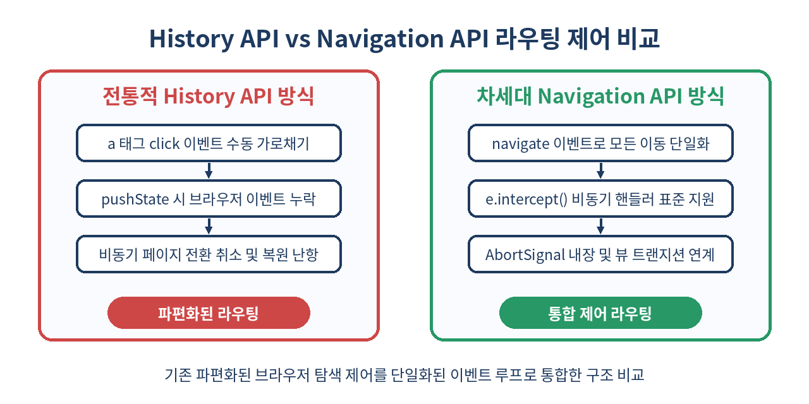
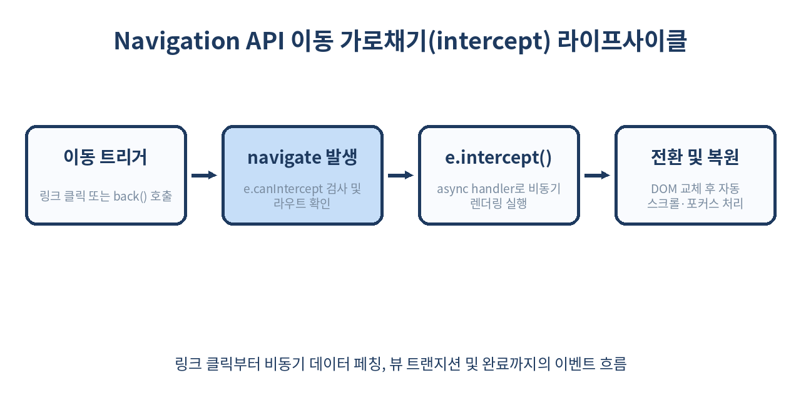

# 🧭 Navigation API 완벽 가이드: history.pushState의 종말과 차세대 SPA 라우팅

> "웹은 10년 넘게 `history.pushState()`라는 불완전한 봉합선 위에서 단일 페이지 애플리케이션(SPA)을 지탱해 왔습니다."
> 이제 브라우저 네이티브 `Navigation API`가 링크 클릭, 브라우저 뒤로가기, 폼 제출, 스크롤 복원, 비동기 트랜지션까지 단 하나의 인터페이스로 통합합니다.

---

## 📌 목차
1. [History API가 품고 있던 10년 묵은 결함들](#-1-history-api가-품고-있던-10년-묵은-결함들)
2. [Navigation API란 무엇인가?](#-2-navigation-api란-무엇인가)
3. [아키텍처 비교: History API vs Navigation API](#-3-아키텍처-비교-history-api-vs-navigation-api)
4. [핵심 이벤트: navigate와 intercept 완벽 해부](#-4-핵심-이벤트-navigate와-intercept-완벽-해부)
5. [NavigationType과 목적지 메타데이터(e.destination) 제어](#-5-navigationtype과-목적지-메타데이터edestination-제어)
6. [AbortSignal 기반의 동시 탐색 요청 및 경쟁 상태(Race Condition) 방지](#-6-abortsignal-기반의-동시-탐색-요청-및-경쟁-상태race-condition-방지)
7. [View Transitions API와의 네이티브 결합 패턴](#-7-view-transitions-api와의-네이티브-결합-패턴)
8. [스크롤 복원(Scroll Restoration)과 포커스 관리의 혁신](#-8-스크롤-복원scroll-restoration과-포커스-관리의-혁신)
9. [탐색 항목(NavigationEntry)과 상태(State) 불변성 다루기](#-9-탐색-항목navigationentry과-상태state-불변성-다루기)
10. [프로덕션급 미니 SPA 라우터 구현 실습](#-10-프로덕션급-미니-spa-라우터-구현-실습)
11. [실무 적용 시 함정과 주의점](#-11-실무-적용-시-함정과-주의점)
12. [Navigation API를 쓰면 안 되는 경우](#-12-navigation-api를-쓰면-안-되는-경우)
13. [정리 및 차세대 웹 라우팅의 미래](#-13-정리-및-차세대-웹-라우팅의-미래)
14. [참고 자료](#-14-참고-자료)

---

## 🧭 1. History API가 품고 있던 10년 묵은 결함들

2010년대 초 HTML5와 함께 등장한 `window.history.pushState()`와 `popstate` 이벤트는 웹 생태계를 MPA에서 SPA로 전환시킨 일등 공신이었습니다. 하지만 이 API는 SPA 전용 라우팅을 목적으로 설계된 것이 아니라, 단순한 브라우저 세션 히스토리 조작 도구에 불과했습니다. 이로 인해 현대 웹 개발자들은 수많은 기괴한 우회책(Workaround)을 강제당해 왔습니다.

### 1. 전역 이동 가로채기 부재
`pushState()`와 `replaceState()`는 호출되어도 브라우저에서 **어떤 이벤트도 발생시키지 않습니다**.
```js
// 이 코드는 URL을 바꾸지만, 브라우저는 침묵합니다.
history.pushState({ page: 2 }, '', '/page-2');
// window.addEventListener('popstate', ...)는 반응하지 않습니다!
```
따라서 모든 SPA 프레임워크(React Router, Vue Router 등)는 `history.pushState` 메서드 자체를 원숭이 패치(Monkey Patching)하거나 자체 래퍼 함수를 통해서만 URL 변경을 감지해야 했습니다.

### 2. 링크 클릭 가로채기(Link Interception)의 비효율
페이지 내의 `<a>` 태그를 클릭할 때 브라우저가 새 HTML을 내려받지 못하게 하려면, 최상위 `document`에 클릭 리스너를 걸고 다음과 같은 번거로운 방어 로직을 작성해야 했습니다.
- 마우스 좌클릭인지 검사 (`e.button === 0`)
- `Ctrl`, `Meta`, `Shift`, `Alt` 키가 눌리지 않았는지 검사
- `target="_blank"`가 아닌지 검사
- `download` 속성이 없는지 검사
- 동일 출처(Origin)인지 검사
- 조건을 만족할 때만 `e.preventDefault()` 호출 후 라우터 디스패치

### 3. 비동기 전환 취소 불가
페이지 이동 도중 사용자가 뒤로가기를 연속 클릭하거나 다른 링크를 눌렀을 때, 이전 페이지가 진행 중이던 네트워크 요청을 자동으로 취소하거나 트랜지션을 중단할 표준 수단이 전무했습니다.

---

## 🧭 2. Navigation API란 무엇인가?

W3C Web Incubator Community Group(WICG)에서 주도하여 Chromium 102부터 도입된 **Navigation API(`window.navigation`)**는 위에서 언급한 History API의 모든 태생적 한계를 해결하기 위해 바닥부터 재설계된 표준 브라우저 라우팅 API입니다.

Navigation API의 핵심 사상은 **"모든 유형의 네비게이션을 단일 파이프라인에서 감지하고, 비동기 핸들러를 통해 가로채며, 실패 시 원상 복구한다"**는 점입니다.

```js
// 브라우저 뒤로가기, 링크 클릭, 폼 전송, 프로그래밍 방식 이동 모두 이 한 곳으로 집결합니다.
navigation.addEventListener('navigate', (event) => {
  if (!event.canIntercept) return;
  
  event.intercept({
    async handler() {
      const response = await fetch(event.destination.url);
      const html = await response.text();
      document.getElementById('app').innerHTML = extractContent(html);
    }
  });
});
```

---

## 🧭 3. 아키텍처 비교: History API vs Navigation API

두 API의 접근 방식은 근본적으로 다릅니다. History API가 "URL 문자열을 수동 조작하고 파편화된 이벤트를 조합"하는 방식이었다면, Navigation API는 "브라우저 네비게이션 라이프사이클 자체를 가로채는 방식"입니다.



| 비교 항목 | History API | Navigation API |
| :--- | :--- | :--- |
| **전역 네비게이션 감지** | 불가능 (popstate, hashchange 분리 및 pushState 미발생) | **단일 `navigate` 이벤트로 모든 이동 감지** |
| **링크 클릭 가로채기** | click 리스너 + 수동 조건문 + `e.preventDefault()` | **`e.canIntercept` 검사 후 `e.intercept()` 한 줄** |
| **비동기 처리 지원** | 지원 안 함 (수동 Promise 체이닝) | **`handler()`에 async 함수 직접 등록 가능** |
| **취소 제어** | 복잡한 수동 AbortController 관리 | **`event.signal` (내장 AbortSignal) 자동 연동** |
| **페이지 이동 함수** | `history.pushState()`, `history.back()` (반환값 void) | **`navigation.navigate()`, `navigation.back()` (Promise 반환)** |
| **상태(State) 보존** | 복사본 직렬화 한계, 새로고침 시 유실 위험 | **`navigation.currentEntry.getState()`로 엄격 관리** |
| **스크롤 및 포커스 복원** | `history.scrollRestoration` 수동 처리 | **`e.scroll()` 및 `focusReset` 자동화 옵션 제공** |

---

## 🧭 4. 핵심 이벤트: navigate와 intercept 완벽 해부

Navigation API의 심장은 `navigate` 이벤트입니다. 사용자가 페이지를 이동하려고 할 때 브라우저는 대상 URL로 네트워크 요청을 보내기 직전에 `navigate` 이벤트를 발송합니다.

### e.intercept()의 작동 메커니즘



`event.intercept()`는 브라우저의 기본 전체 페이지 로딩(Full Page Reload) 동작을 일시 중단시키고, 개발자가 넘겨준 비동기 핸들러가 실행되는 동안 URL 주소창을 목적지 URL로 동기화합니다.

```js
navigation.addEventListener('navigate', (event) => {
  // 1. 다운로드 속성이나 크로스 오리진인 경우 가로챌 수 없음
  if (!event.canIntercept) return;

  const url = new URL(event.destination.url);

  // 2. 가로채기 선언
  event.intercept({
    async handler() {
      try {
        // 로딩 스피너 표시
        showGlobalSpinner();
        
        // 라우트 데이터 페칭
        const data = await fetchPageData(url.pathname, { signal: event.signal });
        
        // DOM 갱신
        renderPage(data);
      } finally {
        hideGlobalSpinner();
      }
    },
    // 스크롤 복원 시점 제어 ('after-transition' 또는 'manual')
    scroll: 'after-transition',
    // 네비게이션 완료 후 포커스를 초기화할지 여부
    focusReset: 'after-transition'
  });
});
```

### intercept 옵션 상세
- **`handler`**: Promise를 반환하는 함수입니다. 이 Promise가 해결(resolve)될 때까지 브라우저는 네비게이션이 진행 중인 것으로 간주하며, 성공 시 `navigatesuccess` 이벤트를, 실패(reject) 시 `navigateerror` 이벤트를 발생시킵니다.
- **`scroll`**: 기본값은 `'after-transition'`입니다. 비동기 렌더링이 끝난 직후 브라우저가 알아서 스크롤을 맨 위나 이전 위치로 복원합니다.
- **`focusReset`**: 네비게이션 완료 후 스크린 리더 및 키보드 사용자를 위해 포커스를 첫 번째 포커스 가능 요소(또는 body)로 안전하게 리셋합니다.

---

## 🧭 5. NavigationType과 목적지 메타데이터(e.destination) 제어

`event.destination` 객체는 이동하고자 하는 목표 지점의 상세 정보를 담고 있습니다. 또한 `event.navigationType`을 통해 사용자가 어떤 방식으로 이동을 시도했는지 정확히 분기할 수 있습니다.

```js
navigation.addEventListener('navigate', (event) => {
  const dest = event.destination;
  
  console.log('이동 목표 URL:', dest.url);
  console.log('목적지 상태 객체:', dest.getState());
  console.log('기존 히스토리 항목인가?:', dest.key, dest.id, dest.index);

  switch (event.navigationType) {
    case 'push':
      // 일반 링크 클릭 또는 navigation.navigate()
      console.log('새로운 페이지 푸시');
      break;
    case 'replace':
      // 리다이렉트 또는 navigation.navigate(..., { history: 'replace' })
      console.log('현재 엔트리 교체');
      break;
    case 'reload':
      // 브라우저 새로고침 버튼 또는 navigation.reload()
      console.log('페이지 새로고침');
      break;
    case 'traverse':
      // 브라우저 뒤로가기 / 앞으로가기
      console.log('히스토리 탐색 (방문 기록 간 이동)');
      break;
  }
});
```

`traverse` 타입일 때는 이미 이전에 방문했던 캐시된 렌더 트리를 즉시 재사용하거나 스크롤 위치만 신속하게 복구하는 등 차별화된 최적화가 가능합니다.

---

## 🧭 6. AbortSignal 기반의 동시 탐색 요청 및 경쟁 상태(Race Condition) 방지

SPA의 가장 흔한 버그 중 하나는 사용자가 링크 A를 누른 뒤 응답이 오기 전에 링크 B를 눌렀을 때, 뒤늦게 도착한 A의 비동기 데이터가 B의 화면을 덮어써 버리는 **경쟁 상태(Race Condition)**입니다.

Navigation API는 `navigate` 이벤트 객체에 브라우저가 직접 관리하는 **`event.signal` (AbortSignal)**을 기본 탑재하여 이 문제를 근본적으로 해결했습니다.

```js
navigation.addEventListener('navigate', (event) => {
  if (!event.canIntercept) return;

  event.intercept({
    async handler() {
      // 사용자가 이 비동기 작업 도중 다른 곳을 클릭하면 event.signal이 즉시 abort됩니다.
      const response = await fetch(`/api/data${new URL(event.destination.url).pathname}`, {
        signal: event.signal
      });
      
      const json = await response.json();
      
      // signal이 취소되었다면 DOM 조작을 스킵할 수 있음
      if (event.signal.aborted) return;
      
      renderView(json);
    }
  });
});
```

새로운 네비게이션이 들어오는 순간 브라우저는 이전 핸들러의 `event.signal`에 즉시 abort 시그널을 전송합니다. 개발자가 별도로 취소 토큰이나 플래그 변수를 관리할 필요가 전혀 없습니다.

---

## 🧭 7. View Transitions API와의 네이티브 결합 패턴

Navigation API는 2026년 모던 프론트엔드의 핵심인 **View Transitions API**와 완벽한 호환성을 자랑합니다. `handler` 내부에서 `document.startViewTransition`을 호출하기만 하면 복잡한 애니메이션 라우터 라이브러리 없이도 네이티브 앱 수준의 화면 전환을 구현할 수 있습니다.

```js
navigation.addEventListener('navigate', (event) => {
  if (!event.canIntercept) return;

  event.intercept({
    async handler() {
      // 1. 필요한 데이터를 먼저 페칭
      const response = await fetch(event.destination.url);
      const newHtml = await response.text();
      const parser = new DOMParser();
      const newDoc = parser.parseFromString(newHtml, 'text/html');
      const newContent = newDoc.querySelector('#main-content').innerHTML;

      // 2. View Transitions API 지원 여부 확인
      if (!document.startViewTransition) {
        document.querySelector('#main-content').innerHTML = newContent;
        return;
      }

      // 3. 브라우저 트랜지션 실행
      const transition = document.startViewTransition(() => {
        document.querySelector('#main-content').innerHTML = newContent;
      });

      // 트랜지션 완료 대기
      await transition.finished;
    }
  });
});
```

`event.intercept()` 핸들러가 반환하는 Promise가 `transition.finished`와 연결되므로, 화면 전환 애니메이션이 부드럽게 끝날 때까지 브라우저 네비게이션 상태가 정합성을 유지합니다.

---

## 🧭 8. 스크롤 복원(Scroll Restoration)과 포커스 관리의 혁신

History API 시절, 무한 스크롤 피드에서 상세 페이지로 갔다가 뒤로 돌아올 때 정확한 스크롤 좌표를 복원하는 것은 개발자들의 악몽이었습니다.

Navigation API는 `event.scroll()` 메서드를 통해 비동기 렌더링이 완전히 끝난 정확한 시점에 스크롤을 복원할 수 있도록 지원합니다.

```js
navigation.addEventListener('navigate', (event) => {
  if (!event.canIntercept) return;

  event.intercept({
    // 브라우저의 기본 자동 스크롤을 지연시키고 수동 제어 모드로 전환
    scroll: 'manual',
    async handler() {
      // 1. 가상화 목록이나 무한 스크롤 데이터 복원
      await restoreFeedList();
      
      // 2. DOM이 완전히 채워진 바로 그 순간 브라우저에게 스크롤 복원을 요청!
      event.scroll();
    }
  });
});
```

만약 `event.scroll()`을 호출하지 않으면 스크롤 위치가 유지되며, 적절한 타이밍에 호출하면 브라우저가 내부 세션 스토리지에 기억해 둔 정확한 픽셀 좌표로 한 치의 오차도 없이 뷰포트를 이동시킵니다.

---

## 🧭 9. 탐색 항목(NavigationEntry)과 상태(State) 불변성 다루기

`navigation.entries()`를 호출하면 현재 세션 히스토리 스택 전체를 나타내는 `NavigationHistoryEntry` 배열을 읽을 수 있습니다. 이는 History API에서는 보안상의 이유로 절대 접근할 수 없었던 영역입니다.

```js
// 현재 열려 있는 탭의 히스토리 목록 확인
const entries = navigation.entries();
entries.forEach((entry, i) => {
  console.log(`[${i}] ${entry.url} (Key: ${entry.key}, ID: ${entry.id})`);
});

// 현재 활성화된 엔트리
const current = navigation.currentEntry;
console.log('현재 URL:', current.url);
console.log('보관된 상태:', current.getState());
```

### 상태(State) 갱신 시의 불변성 원칙
엔트리에 저장되는 상태는 일반 객체이지만 브라우저의 구조화 복사 알고리즘(Structured Clone Algorithm)을 거칩니다. 현재 엔트리의 상태를 바꾸고 싶다면 `navigation.updateCurrentEntry()`를 사용합니다.

```js
// 현재 엔트리의 상태만 교체 (페이지 이동 없음)
navigation.updateCurrentEntry({
  state: {
    ...navigation.currentEntry.getState(),
    filter: 'electronics',
    scrollPos: window.scrollY
  }
});

// 상태 변경 감지 이벤트
navigation.currentEntry.addEventListener('dispose', () => {
  console.log('이 히스토리 엔트리가 세션에서 제거되었습니다.');
});
```

---

## 🧭 10. 프로덕션급 미니 SPA 라우터 구현 실습

외부 라이브러리 없이 순수 Navigation API만을 사용해 링크 가로채기, 비동기 페이지 로딩, 뒤로가기/앞으로가기 버튼 연동, 오류 처리를 포함한 단 60줄짜리 라우터를 완성해 봅니다.

```js
// mini-router.js
class MiniRouter {
  constructor(routes, rootElement) {
    this.routes = routes;
    this.root = rootElement;
    this.init();
  }

  init() {
    if (!('navigation' in window)) {
      console.warn('Navigation API를 지원하지 않는 브라우저입니다.');
      return;
    }

    navigation.addEventListener('navigate', (event) => {
      // 이동을 가로챌 수 없거나 다운로드 요청인 경우 통과
      if (!event.canIntercept || event.downloadRequest || event.formData) {
        return;
      }

      const url = new URL(event.destination.url);
      const routeHandler = this.routes[url.pathname] || this.routes['*'];

      if (!routeHandler) return;

      event.intercept({
        handler: async () => {
          try {
            // 비동기 렌더링 함수 실행 (signal 전달)
            const html = await routeHandler({ signal: event.signal });
            
            if (event.signal.aborted) return;
            
            this.root.innerHTML = html;
          } catch (err) {
            if (err.name !== 'AbortError') {
              console.error('라우팅 렌더링 실패:', err);
              this.root.innerHTML = `<div class="error">오류 발생: ${err.message}</div>`;
            }
          }
        }
      });
    });
  }

  navigate(path, options = {}) {
    return navigation.navigate(path, options).finished;
  }

  back() {
    return navigation.back().finished;
  }
}

// 사용 예시
const router = new MiniRouter({
  '/': async () => '<h1>홈페이지</h1><a href="/about">소개로 이동</a>',
  '/about': async () => '<h1>소개 페이지</h1><a href="/">홈으로 이동</a>',
  '*': async () => '<h1>404 Not Found</h1>'
}, document.getElementById('app'));
```

HTML 문서의 모든 `<a>` 태그는 이제 아무런 수동 `onClick` 바인딩 없이도 자동으로 위 라우터를 통해 SPA 방식으로 동작합니다.

---

## 🧭 11. 실무 적용 시 함정과 주의점

### 1. 브라우저 호환성 및 폴리필(Polyfill) 전략
2026년 기준 Navigation API는 Chromium 계열 브라우저(Chrome, Edge, Opera, Whale)에서 완벽히 기본 지원되며, Safari 및 Firefox의 지원이 본격화되고 있습니다. 그러나 크로스 브라우징을 위해서는 공식 폴리필(`@virtualstate/navigation` 등)을 적용하거나 점진적 향상(Progressive Enhancement) 기법을 사용해야 합니다.

```js
if ('navigation' in window) {
  setupModernNavigation();
} else {
  setupLegacyHistoryFallback();
}
```

### 2. multipart/form-data와 POST 폼 제출 처리
사용자가 `<form method="POST">`를 제출할 때도 `navigate` 이벤트가 발생합니다. 이때 `event.formData`가 존재하므로, 이를 SPA 내부에서 처리할지 브라우저 기본 전송으로 넘길지 명확히 구분해야 합니다.
```js
navigation.addEventListener('navigate', (e) => {
  if (e.formData) {
    // 파일 업로드 등 네이티브 폼 제출은 intercept하지 않는 것이 안전함
    return;
  }
  // ...
});
```

### 3. handler 내부의 예외 처리 누락
`e.intercept()` 내부의 `handler` 함수에서 던져진 잡히지 않은 예외(Unhandled Rejection)는 브라우저 주소창과 화면 뷰의 불일치를 초래합니다. 반드시 `try...catch`로 감싸고 폴백 UI를 렌더링해야 합니다.

---

## 🧭 12. Navigation API를 쓰면 안 되는 경우

모든 상황에서 Navigation API 가로채기를 맹신해서는 안 됩니다. 다음과 같은 케이스에서는 브라우저의 기본 이동 파이프라인에 맡겨야 합니다.

- **서버 렌더링 세션 쿠키 갱신이 필수적인 경로**: 전체 페이지가 완전히 리로드되어야만 `Set-Cookie`나 보안 헤더가 올바르게 갱신되는 관리자 로그아웃/로그인 경로.
- **외부 결제/인증 팝업 리다이렉트**: PG사 결제창, OAuth 2.0 인가 엔드포인트 이동 등 도메인이 바뀌거나 엄격한 브라우저 정책(COOP/COEP)이 걸린 페이지.
- **대용량 파일 다운로드 링크**: `download` 속성이 부여된 링크는 가로채지 말아야 하며, 브라우저가 백그라운드 다운로드 매니저로 제어하도록 두어야 합니다.
- **레거시 멀티 페이지(MPA) 정적 사이트**: 굳이 SPA식 인터셉트가 필요 없는 단순 문서형 블로그나 위키 페이지.

---

## 🧾 13. 정리

- `Navigation API`는 10년 넘게 비표준 트릭과 원숭이 패치로 연명하던 `history.pushState`의 한계를 완전히 종식시킵니다.
- 단 하나의 `navigate` 이벤트만으로 링크 클릭, 뒤로가기, 프로그래밍 방식 이동 등 모든 브라우저 네비게이션을 가로챌 수 있습니다.
- `event.intercept()`는 비동기 핸들러를 지원하며, 페이지 전환 실패 시 안전하게 롤백합니다.
- `event.signal`을 기본 제공하여 이전 네비게이션의 지연된 비동기 요청을 자동으로 취소하고 경쟁 상태(Race Condition)를 원천 차단합니다.
- `View Transitions API`와 결합하여 순수 웹 표준만으로 네이티브 앱 급의 페이지 전환 애니메이션을 쉽게 구현할 수 있습니다.
- `event.scroll()`을 통해 비동기 렌더링 완료 타이밍에 정확히 일치하는 고성능 스크롤 복원이 가능합니다.

> ✨ **한 줄 요약**
> 복잡한 라우터 라이브러리 없이도, 브라우저 표준 `Navigation API` 단 하나면 견고하고 우아한 차세대 SPA를 구축할 수 있습니다.

---

## 📚 참고 자료
- [W3C Navigation API 명세서 (WICG)](https://wicg.github.io/navigation-api/)
- [MDN Web Docs: Navigation API](https://developer.mozilla.org/en-US/docs/Web/API/Navigation_API)
- [Chrome Developers: Modern client-side routing: the Navigation API](https://developer.chrome.com/docs/web-platform/navigation-api)
- [Chrome Developers: Smooth and simple transitions with the View Transitions API](https://developer.chrome.com/docs/web-platform/view-transitions)
