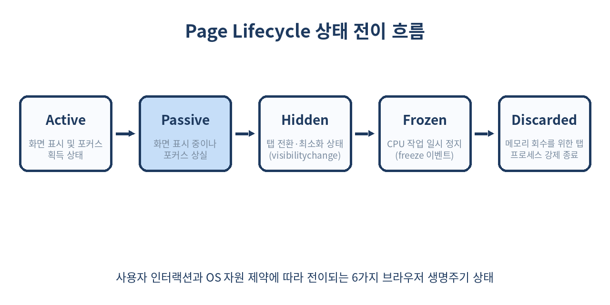
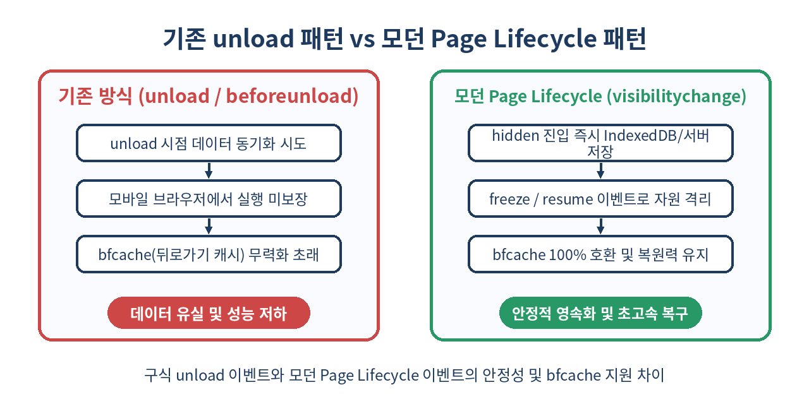

# 🔄 Page Lifecycle API 완벽 가이드: 탭 정지(Freeze)부터 메모리 폐기(Discard), bfcache 대응

> "사용자가 브라우저 탭을 열어둔 채 며칠 뒤 다시 돌아왔을 때, 왜 작성 중이던 폼 데이터가 증발하고 페이지가 새로고침될까?"
> 모바일 OS처럼 탭을 얼리고(Freeze) 버리는(Discard) 모던 브라우저의 생명주기를 이해하고, 데이터 유실 없는 회복탄력적 웹 애플리케이션을 구축하는 방법을 다룹니다.

---

## 📌 목차
1. 데스크톱과 모바일 OS 생명주기의 융합
2. Page Lifecycle API의 등장 배경과 핵심 철학
3. 브라우저 페이지의 6가지 핵심 상태 모델
4. 상태 전이 이벤트 총정리 (visibilitychange부터 freeze/resume까지)
5. `document.wasDiscarded`: 사라진 탭의 부활 감지하기
6. 왜 `window.onunload`는 현대 웹에서 안티패턴인가?
7. bfcache(Back/Forward Cache)와의 밀접한 연계 원리
8. 실전 구현 1: 안전한 자동 임시 저장(Auto-save) 아키텍처
9. 실전 구현 2: 고비용 리소스(WebSocket, Web Worker, 타이머) 절전 관리
10. 실전 구현 3: `page-lifecycle` 라이브러리로 크로스 브라우징 정복하기
11. 브라우저별 지원 현황 및 개발자 도구 디버깅 기법
12. 실무에서 반드시 주의해야 할 치명적 함정
13. 정리 및 체크리스트

---

## 🧭 1. 데스크톱과 모바일 OS 생명주기의 융합

과거 데스크톱 브라우저는 단순했습니다. 사용자가 URL을 입력하면 웹 페이지가 로드(`load`)되고, 링크를 누르거나 탭을 닫으면 페이지가 언로드(`unload`)되었습니다. 페이지가 백그라운드 탭에 놓여 있더라도 CPU와 메모리는 항상 페이지가 점유한 채로 유지되었습니다.

그러나 모바일 환경(iOS, Android)의 부상과 수십 개의 탭을 상시 열어두는 현대 데스크톱 사용 패턴은 이러한 전통적 모델을 파괴했습니다. 모바일 OS는 메모리가 부족해지면 백그라운드 앱을 사정없이 일시 중단(Suspend)하거나 프로세스를 강제 종료(Kill)하여 포그라운드 앱의 반응성을 확보합니다.

크롬(Chrome), 사파리(Safari), 엣지(Edge) 등 모던 웹 브라우저 역시 동일한 메커니즘을 채택했습니다. 메모리 세이버(Memory Saver), 에너지 세이버(Energy Saver)와 같은 기능이 브라우저의 기본 설정으로 안착하면서, 이제 웹 페이지는 **"언제든 브라우저에 의해 얼려지거나(Frozen), 프로세스가 통째로 폐기(Discarded)될 수 있는 존재"**가 되었습니다.

이러한 브라우저의 자원 관리 동작을 웹 개발자가 감지하고 예측 가능하게 제어할 수 있도록 W3C Web Platform Incubator Community Group(WICG)에서 표준화한 명세가 바로 **Page Lifecycle API**입니다.

---

## 🎯 2. Page Lifecycle API의 등장 배경과 핵심 철학

Page Lifecycle API가 해결하고자 하는 문제는 명확합니다.

- **시스템 자원의 극대화**: 사용자가 보지 않는 탭의 CPU 낭비를 0으로 줄이고, RAM을 시스템에 반환합니다.
- **사용자 경험의 일관성**: 브라우저가 메모리 확보를 위해 탭을 강제 종료하더라도, 사용자가 탭을 다시 클릭했을 때 아무 일도 없었던 것처럼 스크롤 위치와 작성 중이던 텍스트를 즉시 복원해야 합니다.
- **신뢰할 수 없는 종료 이벤트 대체**: 구형 `unload`, `beforeunload` 이벤트는 모바일 OS의 급작스러운 프로세스 킬 환경에서 거의 실행되지 않습니다. 이를 대체할 신뢰할 수 있는 생명주기 훅(Hook)이 절실했습니다.



모던 브라우저는 모바일 앱 생명주기(Android의 `onPause`, `onStop`, `onDestroy` 등)와 유사한 체계를 브라우저 탭에 도입했습니다.

---

## 📊 3. 브라우저 페이지의 6가지 핵심 상태 모델

Page Lifecycle 명세는 웹 페이지가 존재할 수 있는 상태를 6가지로 엄격하게 정의합니다.

| 상태 (State) | 가시성 (DOM) | 포커스 여부 | CPU 실행 여부 | 메모리 상주 | 설명 |
| :--- | :--- | :--- | :--- | :--- | :--- |
| **Active** | 표시됨 | 포커스 있음 | 정상 실행 | 유지 | 사용자가 현재 보고 상호작용 중인 상태 |
| **Passive** | 표시됨 | 포커스 없음 | 정상 실행 | 유지 | 분할 화면(Split View) 등에서 화면엔 보이나 다른 창에 포커스가 있는 상태 |
| **Hidden** | 보이지 않음 | 없음 | 백그라운드 실행 | 유지 | 다른 탭으로 전환되었거나 창이 최소화된 상태 |
| **Frozen** | 보이지 않음 | 없음 | **완전 중지 (0% CPU)** | 유지 | 브라우저가 CPU 사용을 일시 정지시킴. 타이머와 네트워크 콜백 중단 |
| **Terminated** | 보이지 않음 | 없음 | 실행 안 됨 | 해제 중 | 사용자가 명시적으로 탭을 닫거나 다른 페이지로 이동한 상태 |
| **Discarded** | 보이지 않음 | 없음 | 실행 안 됨 | **완전 해제 (0MB)** | 브라우저가 메모리 확보를 위해 탭의 렌더러 프로세스를 강제 종료한 상태 |

여기서 특히 중요한 상태는 **Frozen**과 **Discarded**입니다. 페이지가 이 상태로 전이될 때 자바스크립트는 더 이상 실행되지 않으며, 사전에 조치를 취하지 않으면 메모리 안의 모든 상태(React State, 입력 폼, Redux 스토어 등)가 소멸합니다.

---

## 🔔 4. 상태 전이 이벤트 총정리

페이지가 위 6가지 상태 사이를 오갈 때 발생하는 브라우저 표준 이벤트들의 호출 순서와 특징입니다.

```text
[Active / Passive] 
       │  (탭 전환, 화면 최소화)
       ▼  visibilitychange (document.visibilityState === 'hidden')
   [Hidden]
       │  (시간 경과 / 자원 절약 정책)
       ▼  freeze (document.onfreeze)
   [Frozen] ──── (메모리 부족 시 프로세스 킬) ────▶ [Discarded]
       │
       │  (사용자가 다시 해당 탭을 클릭)
       ▼  resume (document.onresume)
   [Hidden]
       │  
       ▼  visibilitychange (document.visibilityState === 'visible')
[Active / Passive]
```

### 주요 이벤트 상세 명세

1. **`visibilitychange`**:
   페이지의 가시성이 바뀔 때 발생합니다. `document.visibilityState`가 `'visible'` 혹은 `'hidden'`으로 바뀝니다.
   **데이터 영속화(Auto-save)의 절대적인 기준점**입니다.

2. **`freeze`**:
   브라우저가 해당 페이지의 CPU 작업을 동결하기 직전에 발생합니다. `document` 객체에서 청취할 수 있습니다.
   ```js
   document.addEventListener('freeze', (event) => {
     // 페이지가 CPU 동결 상태로 진입함
     // 열려 있는 WebSocket 연결 닫기, IndexedDB 트랜잭션 종료 등 자원 정리 수행
     console.log('Page is frozen:', event);
   });
   ```

3. **`resume`**:
   동결되었던 페이지가 다시 깨어날 때 발생합니다. `freeze` 직후 CPU가 멈췄다가 다시 재개되는 순간입니다.
   ```js
   document.addEventListener('resume', (event) => {
     // 페이지가 동결에서 풀려남
     // WebSocket 재연결, 낡은 캐시 데이터 무효화, UI 재동기화 수행
     console.log('Page is resumed:', event);
   });
   ```

4. **`pagehide`**:
   사용자가 페이지를 떠나거나(Navigation), 브라우저가 히스토리 순회(bfcache)를 위해 페이지를 저장하려고 할 때 발생합니다.
   `event.persisted`가 `true`이면 페이지가 메모리(bfcache)에 보존될 예정임을 의미합니다.

---

## 🧟 5. `document.wasDiscarded`: 사라진 탭의 부활 감지하기

사용자가 탭을 30개쯤 띄워두고 작업하다가, 3시간 전에 열어둔 탭을 다시 클릭했다고 가정해 봅시다. 브라우저는 이미 그 탭의 프로세스를 죽이고 메모리를 회수(Discarded)한 상태입니다.

사용자가 탭을 활성화하면 브라우저는 해당 URL로 페이지를 **처음부터 다시 로드(Full Reload)**합니다. 이때 개발자는 이 로드가 일반적인 최초 접속인지, 아니면 메모리 부족으로 강제 종료되었다가 되살아난(Discarded) 것인지 어떻게 구분할 수 있을까요?

이때 사용하는 것이 바로 **`document.wasDiscarded`** 프로퍼티입니다.

```js
// 페이지 로드 시점 (예: DOMContentLoaded 또는 컴포넌트 마운트)
window.addEventListener('DOMContentLoaded', () => {
  if (document.wasDiscarded) {
    console.warn('⚠️ 이 페이지는 브라우저 메모리 절약을 위해 폐기(Discarded)되었다가 복원되었습니다.');
    
    // 1. IndexedDB나 localStorage에서 이전에 자동 저장해둔 폼 상태 읽기
    restoreDraftState();
    
    // 2. 사용자가 보던 스크롤 위치 복구
    restoreScrollPosition();
    
    // 3. 사용자 안내 토스트 띄우기
    showToast('이전 작업 상태를 복원했습니다.');
  } else {
    console.log('✨ 정상적인 신규 방문입니다.');
  }
});
```

이 프로퍼티는 불리언(`boolean`) 값을 반환하며, 탭 폐기 후 재진입 시 `true`가 됩니다. 이를 통해 사용자가 입력하던 내용이 공중분해되어 겪는 최악의 UX를 완벽하게 방어할 수 있습니다.

---

## 🚫 6. 왜 `window.onunload`는 현대 웹에서 안티패턴인가?

수많은 레거시 웹 애플리케이션이 탭을 닫을 때 서버에 로그를 남기거나 데이터를 저장하기 위해 아래와 같은 코드를 사용합니다.

```js
// ❌ 절대 사용해서는 안 되는 위험한 안티패턴!
window.addEventListener('unload', () => {
  navigator.sendBeacon('/api/log-exit', JSON.stringify({ userId: 123 }));
});
```



이 코드가 치명적인 이유는 세 가지입니다.

1. **모바일 환경에서 실행 보장 불가**: 모바일 크롬이나 사파리에서는 홈 화면으로 나가거나 앱 스위처에서 스와이프하여 앱을 종료할 때 `unload` 이벤트가 **아예 발생하지 않습니다**.
2. **bfcache(Back/Forward Cache)의 영구 비활성화**: 브라우저는 `unload` 리스너가 등록된 페이지만 발견하면 "이 페이지는 종료 시점에 특별한 정리가 필요하므로 bfcache에 담으면 안 된다"고 판단하여 캐시 적재 대상에서 영구 제외합니다. 결과적으로 뒤로가기/앞으로가기 속도가 수십 배 느려집니다.
3. **`beforeunload`의 남용 문제**: 사용자의 의도치 않은 이탈을 막는 확인 대화상자 외에 데이터 저장 용도로 `beforeunload`를 쓰면 안 됩니다.

> 💡 **핵심 원칙**: 탭이 닫히는 순간을 기다리지 마십시오. **`visibilitychange`로 `document.visibilityState === 'hidden'`이 되는 순간이 곧 데이터 저장의 마지막 기회**입니다.

---

## ⚡ 7. bfcache(Back/Forward Cache)와의 밀접한 연계 원리

bfcache는 브라우저의 '뒤로가기'나 '앞으로가기' 탐색 시, 페이지를 처음부터 네트워크로 요청하고 렌더링하는 대신 **메모리(RAM)에 떠 있는 DOM 스냅샷 전체를 그대로 복원**하는 초고속 캐시 메커니즘입니다.

Page Lifecycle 관점에서 bfcache는 일종의 **Frozen 상태의 연장선**입니다.

```js
// 페이지를 떠날 때 (bfcache 진입 준비)
window.addEventListener('pagehide', (event) => {
  if (event.persisted) {
    console.log('📦 이 페이지는 bfcache에 저장될 예정입니다.');
  } else {
    console.log('🗑️ 이 페이지는 완전히 언로드됩니다.');
  }
});

// bfcache로부터 즉각 복원되었을 때
window.addEventListener('pageshow', (event) => {
  if (event.persisted) {
    console.log('⚡ bfcache로부터 0초 만에 즉시 복원되었습니다!');
    // 멈춰 있던 애니메이션 재개, 신규 데이터만 살짝 fetch
    refreshStaleData();
  }
});
```

페이지가 bfcache에 정상적으로 보존되려면 다음 조건을 지켜야 합니다.
- `unload` 리스너를 완전히 제거할 것
- `freeze` 및 `pagehide` 시점에 진행 중인 `fetch`나 IndexedDB 락을 닫을 것
- `Cache-Control: no-store` 헤더의 남용을 피할 것 (사파리/파이어폭스 영향)

---

## 🛠️ 8. 실전 구현 1: 안전한 자동 임시 저장(Auto-save) 아키텍처

가장 흔한 요구사항인 게시글 작성 폼에서 탭 전환, 브라우저 백그라운드 전환, 탭 폐기(Discard)에 대비하는 완벽한 자동 저장 패턴입니다.

```js
// autoSaver.js
class FormAutoSaver {
  constructor(formElement, storageKey) {
    this.form = formElement;
    this.storageKey = storageKey;
    this.init();
  }

  init() {
    // 1. 이전 세션에서 버려졌거나 저장된 데이터 복원
    this.restore();

    // 2. 가시성 변경 감지 (최고 우선순위 저장 시점)
    document.addEventListener('visibilitychange', () => {
      if (document.visibilityState === 'hidden') {
        this.save();
      }
    });

    // 3. 페이지 동결 직전 저장
    document.addEventListener('freeze', () => {
      this.save();
    });
  }

  save() {
    const formData = new FormData(this.form);
    const entries = Object.fromEntries(formData.entries());
    
    // IndexedDB 또는 localStorage에 영속화
    try {
      localStorage.setItem(this.storageKey, JSON.stringify({
        data: entries,
        savedAt: Date.now()
      }));
      console.log('💾 [AutoSaver] 데이터가 안전하게 임시 저장되었습니다.');
    } catch (err) {
      console.error('저장 실패:', err);
    }
  }

  restore() {
    const saved = localStorage.getItem(this.storageKey);
    if (!saved) return;

    try {
      const { data, savedAt } = JSON.parse(saved);
      // 24시간 이내 데이터만 복구
      if (Date.now() - savedAt < 24 * 60 * 60 * 1000) {
        Object.entries(data).forEach(([name, value]) => {
          const input = this.form.elements.namedItem(name);
          if (input) input.value = value;
        });
        console.log('🔄 [AutoSaver] 이전 작성 내용을 복구했습니다.');
      }
    } catch (e) {
      console.error('복원 실패:', e);
    }
  }
}
```

---

## 🔌 9. 실전 구현 2: 고비용 리소스(WebSocket, 타이머) 절전 관리

사용자가 탭을 다른 곳으로 돌렸거나 탭이 동결(Frozen)되었을 때 WebSocket 연결을 유지하려 들면 연결이 끊어지면서 온갖 예외(Timeout, Socket Reset)가 발생합니다. Page Lifecycle에 맞춰 연결을 우아하게 끊고 재개하는 매니저 클래스입니다.

```js
// connectionManager.js
class ResilientSocketManager {
  constructor(url) {
    this.url = url;
    this.ws = null;
    this.initLifecycle();
  }

  initLifecycle() {
    // 탭이 백그라운드로 가거나 Freeze 될 때
    const handleDeactivate = () => {
      if (document.visibilityState === 'hidden') {
        console.log('⏸️ 탭 비활성화: WebSocket 절전 모드 진입');
        this.disconnect();
      }
    };

    document.addEventListener('visibilitychange', handleDeactivate);
    document.addEventListener('freeze', handleDeactivate);

    // 탭이 포그라운드로 복귀하거나 Resume 될 때
    const handleActivate = () => {
      if (document.visibilityState === 'visible') {
        console.log('▶️ 탭 활성화: WebSocket 재연결');
        this.connect();
      }
    };

    document.addEventListener('visibilitychange', handleActivate);
    document.addEventListener('resume', handleActivate);
  }

  connect() {
    if (this.ws && this.ws.readyState === WebSocket.OPEN) return;
    
    this.ws = new WebSocket(this.url);
    this.ws.onopen = () => console.log('🌐 Socket 연결 성공');
    this.ws.onmessage = (e) => this.handleMessage(e.data);
  }

  disconnect() {
    if (this.ws) {
      // 정상 종료 코드 1000 전달
      this.ws.close(1000, 'Page Lifecycle 절전 종료');
      this.ws = null;
    }
  }

  handleMessage(data) {
    // 비즈니스 로직 처리
  }
}
```

---

## 📦 10. 실전 구현 3: `page-lifecycle` 라이브러리로 크로스 브라우징 정복하기

모든 브라우저(특히 사파리와 구형 파이어폭스)가 `freeze`나 `resume` 이벤트를 완전히 동일한 방식으로 지원하지는 않습니다. Google Chrome 팀의 Philip Walton이 제작한 공식 호환 라이브러리 `page-lifecycle`을 사용하면 6가지 상태를 완벽하게 단일 인터페이스로 제어할 수 있습니다.

```bash
npm install page-lifecycle
```

```js
import lifecycle from 'page-lifecycle';

// 1. 현재 페이지의 생명주기 상태 조회
console.log('현재 상태:', lifecycle.state);

// 2. 상태 변경 이벤트 구독 (active, passive, hidden, frozen, terminated, discarded)
lifecycle.addEventListener('statechange', (event) => {
  console.log(`상태 전이: ${event.oldState} ➔ ${event.newState}`);

  switch (event.newState) {
    case 'hidden':
      // UI 렌더링 루프 중지, 로컬 스토리지에 데이터 flush
      stopHeartbeat();
      flushPendingAnalytics();
      break;

    case 'frozen':
      // CPU 중단 직전, 무거운 작업 정리
      releaseWebWorkerLocks();
      break;

    case 'active':
      // 사용자 복귀, 실시간 알림 갱신
      restartHeartbeat();
      break;
  }
});
```

이 라이브러리는 `visibilitychange`, `pagehide`, `pageshow`, `freeze`, `resume`, `focus`, `blur` 이벤트를 크로스 브라우저 호환 방식으로 합성하여 일관된 `statechange` 이벤트를 제공합니다.

---

## 🔍 11. 브라우저별 지원 현황 및 개발자 도구 디버깅 기법

### 상태별 지원 브라우저 현황

| 기능 / 이벤트 | Chrome / Edge | Safari (WebKit) | Firefox (Gecko) |
| :--- | :--- | :--- | :--- |
| `visibilitychange` | 지원 (Chrome 33+) | 지원 (Safari 7+) | 지원 (Firefox 18+) |
| `document.wasDiscarded`| 지원 (Chrome 68+) | 미지원 (Polyfill 필요) | 미지원 |
| `freeze` / `resume` | 지원 (Chrome 68+) | 내부적 동결(이벤트 미발생) | 내부적 동결(이벤트 미발생) |
| `pagehide` / `pageshow`| 지원 | 지원 | 지원 |

### 크롬 개발자 도구에서 생명주기 강제 디버깅하기

개발 환경에서 탭이 얼리거나 버려지는 현상을 재현하기 위해 몇 시간을 기다릴 수는 없습니다. Chrome DevTools는 이를 즉시 시뮬레이션할 수 있는 강력한 패널을 제공합니다.

1. **Chrome DevTools 열기** (`F12`)
2. `Cmd + Shift + P` (Mac) 또는 `Ctrl + Shift + P` (Windows) 입력
3. **`Show Page Lifecycle`** 검색 후 실행
4. DevTools 하단에 추가된 패널에서:
   - **`Freeze page`**: 강제로 페이지를 Frozen 상태로 전환하여 타이머/JS가 멈추는지 확인
   - **`Discard page`**: 페이지를 강제 폐기하여 메모리에서 날려버리고, 재진입 시 `document.wasDiscarded` 동작 테스트
5. 주소창에 `chrome://discards` 입력:
   - 현재 열려 있는 모든 탭의 생명주기 상태(Active, Sleeping, Discarded), 메모리 점유율을 한눈에 확인하고 강제로 Discard 명령을 내릴 수 있습니다.

---

## ⚠️ 12. 실무에서 반드시 주의해야 할 치명적 함정

### 1. 비동기 `fetch`를 `hidden` 시점에 그냥 호출하는 실수
사용자가 탭을 닫거나 백그라운드로 보낼 때 일반 `fetch()`를 쏘면, 브라우저가 네트워크 요청이 끝나기 전에 프로세스를 즉시 동결하거나 종료하여 서버에 도달하지 못합니다.
- **해결책**: 백그라운드 전송에는 반드시 **`keepalive: true` 플래그**가 붙은 `fetch()`나 `navigator.sendBeacon()`을 사용해야 합니다.
```js
// 올바른 비동기 저장 요청
fetch('/api/draft', {
  method: 'POST',
  body: JSON.stringify(draftData),
  headers: { 'Content-Type': 'application/json' },
  keepalive: true // 탭이 닫혀도 브라우저 백그라운드에서 끝까지 전송 보장
});
```

### 2. IndexedDB 트랜잭션 락(Lock)을 건 채로 탭이 동결되는 현상
탭 A가 IndexedDB 트랜잭션을 열어두고 작업을 끝내지 않은 상태에서 사용자가 다른 탭으로 넘어가 탭 A가 `freeze`되면, 탭 B는 락이 풀릴 때까지 영원히 블로킹(Deadlock)에 빠질 수 있습니다.
- **해결책**: `freeze` 이벤트 발생 시 진행 중인 장기 트랜잭션을 커밋하거나 중단(Abort)해야 합니다.

### 3. `window.onbeforeunload`에서 복잡한 연산 수행 금지
`beforeunload`는 오직 **저장되지 않은 변경사항이 있음을 사용자에게 경고하는 팝업**을 띄우는 용도로만 사용해야 합니다. 여기서 무거운 정규화나 동기 통신을 시도하면 브라우저가 강제로 탭을 죽입니다.

---

## 🧾 13. 정리 및 체크리스트

- 현대 브라우저는 모바일 OS와 마찬가지로 **Active ➔ Passive ➔ Hidden ➔ Frozen ➔ Discarded** 생명주기를 거칩니다.
- `unload`와 `beforeunload`에 의존하는 코드는 전면 폐기하고, **`visibilitychange`와 `pagehide`를 핵심 저장 타이밍으로 채택**해야 합니다.
- 브라우저가 메모리 부족으로 탭을 강제 종료한 뒤 되살렸는지는 **`document.wasDiscarded`**로 감지할 수 있습니다.
- 뒤로가기 캐시(**bfcache**)를 파괴하지 않으려면 `unload` 이벤트 리스너를 완전히 없애야 합니다.
- 백그라운드 전환 시 서버 통신이 필요할 때는 반드시 `keepalive: true` 또는 `sendBeacon()`을 사용하십시오.

> ✨ **한 줄 요약**
> 탭이 닫히는 마지막 순간을 믿지 말고, 보이지 않게 되는(`hidden`) 그 순간 즉시 저장하고 대비하라.

---

## 📚 참고 자료
- [Page Lifecycle API 공식 가이드 (web.dev)](https://web.dev/articles/page-lifecycle-api)
- [W3C Page Lifecycle 명세 초안](https://wicg.github.io/page-lifecycle/)
- [Google Chrome page-lifecycle 라이브러리 GitHub](https://github.com/GoogleChromeLabs/page-lifecycle)
- [MDN Web Docs: Document: visibilitychange event](https://developer.mozilla.org/en-US/docs/Web/API/Document/visibilitychange_event)
- [MDN Web Docs: Back/forward cache (bfcache)](https://developer.mozilla.org/en-US/docs/Glossary/bfcache)
