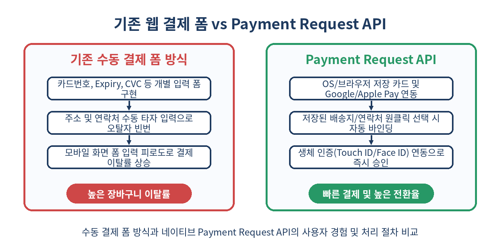
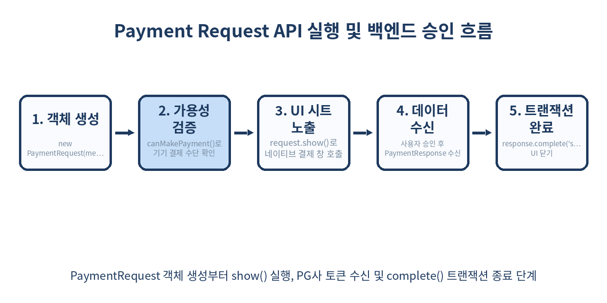

# 💳 Payment Request API 완벽 가이드: 복잡한 결제 폼 없는 브라우저 네이티브 체크아웃

> 모바일 웹에서 사용자가 장바구니에 상품을 담은 후 구매를 포기하는 가장 큰 원인은 '복잡한 결제 폼 입력'입니다.
> W3C 표준 웹 API인 **Payment Request API**를 활용하면 브라우저와 OS에 저장된 결제 수단, 배송지, 연락처 정보를 네이티브 UI로 빠르게 불러와 장바구니 이탈률을 획기적으로 낮출 수 있습니다.

---

## 📌 목차
1. 🧭 1. 웹 결제 폼의 한계와 Payment Request API의 등장 배경
2. ⚡ 2. 기존 폼 입력 방식 vs Payment Request API 비교
3. 🛠️ 3. PaymentRequest 객체 구조와 필수 파라미터 이해하기
4. 💳 4. supportedMethods 구성: basic-card, Apple Pay, Google Pay
5. 🔍 5. canMakePayment() 및 hasEnrolledInstrument() 사전 검증
6. 🚀 6. request.show() 실행과 PaymentResponse 핸들링
7. 📦 7. 배송지(Shipping Address) 및 배송 옵션(Shipping Options) 동적 처리
8. 🔄 8. shippingaddresschange & shippingoptionchange 실시간 이벤트 바인딩
9. 🔐 9. PG사 결제 승인 연동과 response.complete() 생명주기 관리
10. ⚠️ 10. 실무 적용 시 만나는 주요 함정과 보안 요구사항
11. ❌ 11. Payment Request API를 도입하면 안 되는 예외 케이스
12. 🧾 12. 정리

---

## 🧭 1. 웹 결제 폼의 한계와 Payment Request API의 등장 배경

전통적인 이커머스 웹사이트의 체크아웃(Checkout) 과정은 사용자 경험(UX) 측면에서 지극히 높은 피로도를 유발합니다. 특히 모바일 디바이스의 작은 터치스크린 환경에서 사용자는 다음과 같은 수많은 입력 폼 필드를 마주하게 됩니다.

- **결제 정보 입력**: 16자리 신용카드 번호, 만료월/연도(MM/YY), 3~4자리 CVC/CVV 보안 코드, 카드 비밀번호 앞 2자리
- **배송지 정보 입력**: 수령인 이름, 우편번호 검색 popup, 도로명 주소, 상세 주소, 수령인 휴대폰 번호
- **본인 인증 및 주소 검증**: SMS 2차 인증, 문자 수신 확인 후 6자리 번호 입력

이커머스 UX 연구 기관인 Baymard Institute의 2023년 조사에 따르면, 글로벌 이커머스 평균 장바구니 이탈률(Cart Abandonment Rate)은 약 **69.99%**에 달합니다. 이 중 결제를 포기한 사용자들의 상위 사유는 다음과 같습니다.

1. **계정 생성 요구** (24%)
2. **복잡하거나 너무 긴 체크아웃 과정** (18%)
3. **총 결제 금액을 미리 계산하여 보여주지 않음** (16%)
4. **결제 과정에서의 카드 정보 유출 불안감** (12%)

기존 브라우저의 `Autofill`(자동 완성) 기능이 도입되어 일정 부분 폼 입력 공수를 줄여주었지만, 개발자마다 HTML element의 `name`, `id`, `autocomplete` 속성(`autocomplete="cc-number"`, `autocomplete="shipping postal-code"` 등)을 다르게 구현하여 자동 완성이 실패하는 케이스가 비일비재했습니다. 또한, DOM 레벨에서 입력값을 직접 취급하므로 악성 서드파티 스크립트나 XSS(Cross-Site Scripting) 공격에 카드 데이터가 그대로 노출되는 심각한 보안 취약점을 안고 있었습니다.

이러한 파편화와 보안성 한계를 극복하고자 W3C의 Web Payments Working Group(Google, Apple, Mozilla, Microsoft, Stripe 등 참여)은 **Payment Request API**를 제안하고 웹 표준으로 명세화했습니다. 

Payment Request API는 웹사이트가 직접 입력 폼을 렌더링하지 않고, **브라우저 및 OS 레벨의 네이티브 보안 결제 시트(Bottom Sheet 또는 Modal UI)**를 호출하는 메커니즘을 제공합니다. 사용자는 이미 브라우저, Google 계정, Apple ID, Windows Hello 등에 안전하게 암호화되어 저장된 결제 수단과 배송지를 터치 한 번 또는 생체 인증(Touch ID / Face ID)만으로 선택할 수 있습니다.

---

## ⚡ 2. 기존 폼 입력 방식 vs Payment Request API 비교



두 결제 UX 방식의 핵심적 차이는 결제 데이터를 입력하고 처리하는 주체가 **'웹 애플리케이션의 DOM 폼'**인가 아니면 **'브라우저/OS 보안 샌드박스'**인가에 있습니다.

| 비교 항목 | 기존 웹 결제 폼 방식 (HTML DOM Form) | Payment Request API 방식 (Native UI) |
| :--- | :--- | :--- |
| **입력 주체** | DOM 폼을 통한 사용자 수동 키보드 입력 | OS/브라우저 저장 데이터 원클릭 선택 |
| **평균 체크아웃 시간** | 약 60초 ~ 120초 (주소 검색 및 카드 번호 입력) | 약 10초 ~ 15초 (생체 인증 기반 승인) |
| **본인 및 결제 인증** | CVC 직접 입력, PG사 모듈 호출, SMS 2차 인증 | Touch ID, Face ID, Windows Hello 생체 인증 통합 |
| **모바일 UX 레이아웃** | 가상 키보드 팝업으로 인한 화면 찌그러짐, 폼 이탈 | 네이티브 하단 바텀 시트(Bottom Sheet) 슬라이드 업 |
| **데이터 보안성 (XSS)** | DOM 스크립트 접근 가능, 키로거/XSS 공격 위험 | 브라우저 샌드박스 내부 처리, JS DOM 접근 불가 |
| **주소 유효성 검증** | 외부 우편번호 API 연동 및 유효성 로직 구현 필요 | OS/계정에 검증되어 등록된 정형 주소 데이터 전달 |
| **장바구니 전환율** | 기준선 (Baseline) | **평균 15% ~ 30% 전환율(Conversion Rate) 상승** |

---

## 🛠️ 3. PaymentRequest 객체 구조와 필수 파라미터 이해하기

Payment Request API를 사용하기 위해 가장 먼저 이해해야 하는 핵심 인터페이스는 `window.PaymentRequest` 클래스입니다. 생성자는 정확히 3개의 파라미터를 입력받습니다.

```js
const request = new PaymentRequest(methodData, details, options);
```

TypeScript 타입 정의를 기준으로 각 파라미터의 상세 구조를 살펴보겠습니다.

```typescript
// PaymentRequest 생성자 심층 구조
interface PaymentRequest {
  constructor(
    methodData: PaymentMethodData[],
    details: PaymentDetailsInit,
    options?: PaymentOptions
  );
}
```

### 1) `methodData`: 지원하는 결제 수단 정의 (Array)
웹사이트에서 수용할 수 있는 결제 수단과 각 수단별 세부 설정(Merchant ID, 카테고리 등)을 배열 형태로 전달합니다.

```javascript
const methodData = [
  {
    supportedMethods: 'https://google.com/pay',
    data: {
      apiVersion: 2,
      apiVersionMinor: 0,
      allowedPaymentMethods: [
        {
          type: 'CARD',
          parameters: {
            allowedAuthMethods: ['PAN_ONLY', 'CRYPTOGRAM_3DS'],
            allowedCardNetworks: ['VISA', 'MASTERCARD']
          },
          tokenizationSpecification: {
            type: 'PAYMENT_GATEWAY',
            parameters: {
              gateway: 'stripe',
              'stripe:version': '2020-08-27',
              'stripe:publishableKey': 'pk_test_TYooo5GHwqO5pMQwUPJmi58L'
            }
          }
        }
      ],
      merchantInfo: {
        merchantId: '12345678901234567890',
        merchantName: 'LogicPhantom Tech Store'
      }
    }
  },
  {
    supportedMethods: 'https://apple.com/apple-pay',
    data: {
      version: 3,
      merchantIdentifier: 'merchant.com.logicphantom.store',
      countryCode: 'KR',
      currencyCode: 'KRW',
      supportedNetworks: ['visa', 'masterCard', 'alipay'],
      merchantCapabilities: ['supports3DS']
    }
  }
];
```

### 2) `details`: 결제 금액, 상품 목록 및 배송 옵션 명세 (Object)
결제 시트에 표시될 총 금액(`total`), 세부 내역 목록(`displayItems`), 선택 가능한 배송 방법(`shippingOptions`), 그리고 결제수단별 할인/수수료 변경(`modifiers`) 정보를 포함합니다.

```javascript
const details = {
  id: 'order-20241025-00912',
  total: {
    label: '최종 결제 금액',
    amount: {
      currency: 'KRW',
      value: '149000'
    }
  },
  displayItems: [
    {
      label: '무선 리얼포스 키보드 (무소음)',
      amount: { currency: 'KRW', value: '144000' }
    },
    {
      label: '기본 배송비',
      amount: { currency: 'KRW', value: '5000' }
    }
  ],
  shippingOptions: [
    {
      id: 'standard-shipping',
      label: 'CJ대한통운 일반택배 (2-3일)',
      amount: { currency: 'KRW', value: '5000' },
      selected: true
    },
    {
      id: 'express-shipping',
      label: '오늘회/새벽배송 (내일 오전 7시 전 도착)',
      amount: { currency: 'KRW', value: '9000' },
      selected: false
    }
  ]
};
```

### 3) `options`: 추가 정보 수집 요청 옵션 (Object, 선택)
구매자로부터 결제 수단 외에 추가로 넘겨받아야 할 정보(배송지 주소, 수령인 이름, 이메일, 전화번호)를 명시합니다.

```javascript
const options = {
  requestShipping: true,      // 배송지 주소 선택 요청 여부
  requestPayerName: true,     // 주문자 이름 요청 여부
  requestPayerEmail: true,    // 주문자 이메일 요청 여부 (전자영수증 발송용)
  requestPayerPhone: true,    // 주문자 연락처 요청 여부 (배송 알림톡용)
  shippingType: 'shipping'    // UI 표시 명칭: 'shipping'(배송) | 'delivery'(배달) | 'pickup'(픽업)
};
```

---

## 💳 4. supportedMethods 구성: basic-card, Apple Pay, Google Pay

과거 W3C 초안 규약에서는 `'basic-card'`라는 표준 식별자를 사용하여 신용카드/체크카드 정보를 브라우저가 직접 양식 데이터로 전달하는 방식을 지원했습니다. 그러나 보안상 이슈(토큰화되지 않은 카드 번호 direct 전달 risk) 및 주요 결제 플랫폼(Apple, Google)과의 카드 네트워크 정책에 따라 **Chromium 100(2022년 4월 release)부터 `basic-card` 지원이 완벽히 폐기(Deprecated & Removed)**되었습니다.

따라서 현대 웹 개발 환경에서는 **URL 기반 결제 수단 식별자(URL-based Payment Method Identifiers)**를 사용해야 합니다.

### 주요 현대적 `supportedMethods` 식별자 및 특성

| 결제 수단 식별자 | 지원 브라우저 / OS | 필수 설정 데이터 사양 |
| :--- | :--- | :--- |
| `https://google.com/pay` | Chrome (Android, Desktop), Edge | Google Pay Web API Specification (apiVersion: 2) |
| `https://apple.com/apple-pay` | Safari (iOS, macOS, iPadOS) | Apple Pay JS API (version 3 이상, Merchant Validation 필수) |
| `https://pay.toss.im` (PG 커스텀) | 국내 주요 브라우저 통합 | 해당 PG사 발급 Merchant ID 및 토큰화 데이터 |

### 표준 디지털 지갑 통합 설정 코드 예시

```javascript
// Google Pay 및 Apple Pay 동시 지원을 위한 PaymentMethodData 구성
function getSupportedPaymentMethods() {
  return [
    // 1. Google Pay
    {
      supportedMethods: 'https://google.com/pay',
      data: {
        apiVersion: 2,
        apiVersionMinor: 0,
        allowedPaymentMethods: [
          {
            type: 'CARD',
            parameters: {
              allowedAuthMethods: ['PAN_ONLY', 'CRYPTOGRAM_3DS'],
              allowedCardNetworks: ['VISA', 'MASTERCARD']
            },
            tokenizationSpecification: {
              type: 'PAYMENT_GATEWAY',
              parameters: {
                gateway: 'stripe',
                'stripe:version': '2023-10-16',
                'stripe:publishableKey': 'pk_live_51NxEXAMPLE...'
              }
            }
          }
        ],
        merchantInfo: {
          merchantName: '테크 스토어'
        }
      }
    },
    // 2. Apple Pay (Safari 전용)
    {
      supportedMethods: 'https://apple.com/apple-pay',
      data: {
        version: 3,
        merchantIdentifier: 'merchant.kr.co.techstore',
        countryCode: 'KR',
        currencyCode: 'KRW',
        supportedNetworks: ['visa', 'masterCard'],
        merchantCapabilities: ['supports3DS']
      }
    }
  ];
}
```

---

## 🔍 5. canMakePayment() 및 hasEnrolledInstrument() 사전 검증

`PaymentRequest` 객체를 생성했다고 해서 바로 `request.show()`를 호출하면 안 됩니다. 사용자의 환경(브라우저 종류, 디바이스 보안 모듈, 저장된 카드 유무)에 따라 결제를 진행할 수 없는 경우 예외(Exception)가 발생하거나 비어있는 UI가 뜰 수 있습니다.

따라서 결제 버튼 렌더링 전 반드시 사전 검증 메서드를 실행하여 **네이티브 체크아웃 버튼**을 보여줄지, 기존 **PG 팝업/웹 폼 결제 UI**를 띄울지 결정하는 폴백(Fallback) 처리 로직을 구축해야 합니다.

### 사전 검증 메서드의 차이점

- `canMakePayment()`: 브라우저가 넘겨진 `supportedMethods` 중 최소 하나 이상의 결제 방식을 알고 있거나 실행 가능한지 확인합니다.
- `hasEnrolledInstrument()`: 해당 결제 방식에 사용자가 **실제로 결제 가능한 수단(카드, 계좌 등)을 활성 등록해 두었는지** 검증합니다. (참고: 브라우저 및 사용자 프라이버시 보호 정책에 따라 특정 환경에서는 보안상의 이유로 `canMakePayment()`와 동일한 결과값을 반환하거나 제한적 호출 횟수 임계값이 적용됩니다.)

```javascript
/**
 * 결제 버튼 초기화 및 사전 검증 함수
 */
async function initializeCheckoutFlow() {
  const checkoutBtn = document.getElementById('native-pay-button');
  const fallbackForm = document.getElementById('legacy-pay-form');

  // 1. API 지원 여부 1차 체크
  if (!window.PaymentRequest) {
    console.log('[PaymentRequest] 브라우저 미지원 -> 레거시 PG 결제 폼 활성화');
    activateFallbackUI();
    return;
  }

  const methodData = getSupportedPaymentMethods();
  const details = getOrderDetails();
  const options = getCheckoutOptions();

  try {
    const request = new PaymentRequest(methodData, details, options);

    // 2. 결제 수단 지원 여부 async 검증
    const canPay = await request.canMakePayment();

    if (canPay) {
      console.log('[PaymentRequest] 사용 가능 결제 수단 확인 완료');
      checkoutBtn.style.display = 'inline-block';
      checkoutBtn.addEventListener('click', () => startNativeCheckout(request));
    } else {
      console.warn('[PaymentRequest] 등록된 수단 없음 -> 폴백 처리');
      activateFallbackUI();
    }
  } catch (error) {
    console.error('[PaymentRequest] 사전 검증 오류:', error);
    activateFallbackUI();
  }
}

function activateFallbackUI() {
  document.getElementById('native-pay-button').style.display = 'none';
  document.getElementById('legacy-pay-form').style.display = 'block';
}
```

---

## 🚀 6. request.show() 실행과 PaymentResponse 핸들링

사용자가 결제 버튼을 클릭하면 `request.show()`를 호출하여 브라우저의 네이티브 결제 시트를 화면에 띄웁니다. `show()` 메서드는 사용자가 결제를 승인하거나 취소할 때까지 대기(Pending)하는 **Promise**를 반환합니다.



사용자가 결제를 승인하면 Promise는 `PaymentResponse` 객체로 **Resolve**됩니다. 

### `PaymentResponse` 객체가 담고 있는 핵심 필드

- `methodName`: 사용자가 최종 선택한 결제 수단 식별자 (예: `https://google.com/pay` 또는 `https://apple.com/apple-pay`)
- `details`: PG 토큰, 결제 인증 암호화 키 등 백엔드로 전송해야 할 핵심 데이터 (JSON)
- `shippingAddress`: 사용자가 선택한 배송지 주소 객체 (`requestShipping: true` 설정 시)
- `shippingOption`: 사용자가 선택한 배송 옵션 ID (`standard-shipping`, `express-shipping` 등)
- `payerName`, `payerEmail`, `payerPhone`: 주문자 수집 정보

```javascript
/**
 * 네이티브 결제 시트 호출 및 처리
 */
async function startNativeCheckout(request) {
  try {
    // request.show() 실행 시 브라우저 UI 오픈
    // 이 구문은 반드시 사용자 인터랙션(Click 이벤트 핸들러 내부)에서 호출되어야 함
    const response = await request.show();

    console.log('[PaymentResponse 수신]', response);

    // 백엔드로 전송할 결제 승인 데이터 페이로드 구성
    const paymentPayload = {
      requestId: response.requestId,
      methodName: response.methodName,
      tokenData: response.details, // Stripe/Google Pay 토큰 등이 포함됨
      shippingAddress: response.shippingAddress ? {
        recipient: response.shippingAddress.recipient,
        phone: response.shippingAddress.phone,
        addressLine: response.shippingAddress.addressLine,
        city: response.shippingAddress.city,
        region: response.shippingAddress.region,
        postalCode: response.shippingAddress.postalCode,
        country: response.shippingAddress.country
      } : null,
      payerInfo: {
        name: response.payerName,
        email: response.payerEmail,
        phone: response.payerPhone
      }
    };

    // 서버 결제 승인 API 호출
    const apiResult = await processPaymentOnBackend(paymentPayload);

    if (apiResult.success) {
      // 성공 처리: 네이티브 UI에 체크 표시 애니메이션 렌더링 후 닫힘
      await response.complete('success');
      window.location.href = `/order/complete?orderId=${apiResult.orderId}`;
    } else {
      // 서버 승인 실패: 네이티브 UI에 에러 표시 후 닫힘
      await response.complete('fail');
      alert(`결제 승인 실패: ${apiResult.errorMessage}`);
    }

  } catch (error) {
    // 예외 핸들링
    if (error.name === 'AbortError') {
      console.log('사용자가 브라우저 결제 시트의 [닫기/취소] 버튼을 눌렀습니다.');
    } else if (error.name === 'SecurityError') {
      console.error('보안 에러: HTTPS 환경이 아니거나 iframe 샌드박스 정책 위반입니다.');
    } else if (error.name === 'InvalidStateError') {
      console.error('이미 실행 중인 PaymentRequest 시트가 존재합니다.');
    } else {
      console.error('결제 처리 중 알 수 없는 에러:', error);
    }
  }
}
```

---

## 📦 7. 배송지(Shipping Address) 및 배송 옵션(Shipping Options) 동적 처리

실제 커머스 비즈니스에서는 배송 지역에 따라 배송비가 차등 적용되는 경우가 많습니다. (예: 제주도 및 도서산간 지역 추가 배송비 3,000원 적용, 해외 배송 시 국가별 요금 차등)

Payment Request API는 `PaymentAddress` 객체를 표준 인터페이스로 정의하여 제공합니다.

### `PaymentAddress` 인터페이스 세부 구성

```typescript
interface PaymentAddress {
  country: string;       // ISO 3166-1 alpha-2 국가 코드 (예: 'KR', 'US')
  addressLine: string[]; // 상세 주소 배열 (예: ['강남대로 390', '미진프라자 15층'])
  region: string;        // 시/도 (예: '서울특별시', '경기도', 'CA')
  city: string;          // 시/군/구 (예: '강남구', '성남시 분당구')
  dependentLocality: string; // 동/읍/면 (예: '역삼동')
  postalCode: string;    // 우편번호 (예: '06241')
  sortingCode: string;   // 우편 분류 코드
  organization: string; // 회사/기관명
  recipient: string;    // 수령인 이름
  phone: string;        // 수령인 연락처 (E.164 포맷)
}
```

---

## 🔄 8. shippingaddresschange & shippingoptionchange 실시간 이벤트 바인딩

네이티브 결제 시트 안에서 사용자가 배송지를 변경하거나, 배송 옵션(일반택배 ↔ 새벽배송)을 클릭할 때 웹사이트는 금액을 실시간 계산하여 네이티브 UI에 즉시 반영해야 합니다.

이 작업을 위해 `shippingaddresschange` 및 `shippingoptionchange` 이벤트와 **`event.updateWith()`** 메서드가 핵심적인 역할을 수행합니다.

### `event.updateWith(promiseOrDetails)` 메커니즘
`updateWith()`는 비동기 작업(서버 API 호출)이 진행되는 동안 브라우저 결제 시트에 **로딩 스피너 UI**를 띄우고, 작업 완료 시 새로운 `details` 객체로 결제 금액 및 배송비 항목을 즉시 업데이트합니다.

```javascript
/**
 * 배송지 및 배송 옵션 변경 이벤트 바인딩
 */
function bindPaymentEvents(request) {

  // 1. 사용자가 네이티브 시트에서 배송지 주소를 선택/변경할 때 발생
  request.addEventListener('shippingaddresschange', (event) => {
    // updateWith에 Promise를 전달하여 async 서버 로직 수행
    event.updateWith(async () => {
      const addr = request.shippingAddress;
      console.log(`[배송지 변경 감지] 국가: ${addr.country}, 시/도: ${addr.region}, 우편번호: ${addr.postalCode}`);

      try {
        // 백엔드 API에 신규 배송지 기준 배송비 및 배송 가능 여부 조회
        const calcResult = await fetchShippingCostApi({
          country: addr.country,
          region: addr.region,
          postalCode: addr.postalCode
        });

        if (!calcResult.isDeliverable) {
          // 배송 불가능 지역일 경우 에러 메시지 반환 -> 네이티브 UI에 에러 경고 표시
          return {
            error: '선택하신 지역은 현재 택배 배송이 불가능한 지역입니다.',
            total: currentDetails.total
          };
        }

        // 새로운 배송비가 반영된 details 계산
        const newShippingFee = calcResult.shippingFee;
        const itemPrice = 144000;
        const newTotal = itemPrice + newShippingFee;

        return {
          total: {
            label: '최종 결제 금액',
            amount: { currency: 'KRW', value: String(newTotal) }
          },
          displayItems: [
            { label: '상품 금액', amount: { currency: 'KRW', value: String(itemPrice) } },
            { label: `배송비 (${calcResult.regionZoneName})`, amount: { currency: 'KRW', value: String(newShippingFee) } }
          ],
          shippingOptions: calcResult.availableOptions // 업데이트된 배송 옵션 리스트
        };

      } catch (err) {
        console.error('배송비 계산 실패:', err);
        return {
          error: '배송비 계산 중 오류가 발생했습니다. 다시 시도해 주세요.'
        };
      }
    });
  });

  // 2. 사용자가 배송 방식(일반 ↔ 특송/새벽배송)을 클릭할 때 발생
  request.addEventListener('shippingoptionchange', (event) => {
    event.updateWith(() => {
      const selectedOptionId = request.shippingOption;
      console.log(`[배송 옵션 변경] 선택된 ID: ${selectedOptionId}`);

      const itemPrice = 144000;
      let shippingFee = 5000;
      let optionLabel = '일반 택배 배송비';

      if (selectedOptionId === 'express-shipping') {
        shippingFee = 9000;
        optionLabel = '새벽 배송 특급 수수료';
      }

      const updatedTotal = itemPrice + shippingFee;

      return Promise.resolve({
        total: {
          label: '최종 결제 금액',
          amount: { currency: 'KRW', value: String(updatedTotal) }
        },
        displayItems: [
          { label: '상품 금액', amount: { currency: 'KRW', value: String(itemPrice) } },
          { label: optionLabel, amount: { currency: 'KRW', value: String(shippingFee) } }
        ]
      });
    });
  });
}
```

---

## 🔐 9. PG사 결제 승인 연동과 response.complete() 생명주기 관리

`request.show()`가 Resolve 되어 `PaymentResponse` 객체를 획득했더라도 **실제 결제 승인이 완결된 상태가 아닙니다.**

이 단계에서 전달받은 `response.details`는 PG사(Stripe, Toss, KG 이니시스 등)가 발행한 **단회성 결제 토큰(Payment Token / One-time Cryptogram)**입니다. 이 토큰을 가맹점 백엔드 서버로 전송한 후, 백엔드에서 PG사 승인 API를 호출해야 비로소 실제 출금/승인이 완료됩니다.

이 흐름 전체의 안정성을 결정짓는 것이 바로 **`response.complete()` 생명주기 관리**입니다.

### `response.complete(result)` 파라미터 값

- `'success'`: 결제 완료 UI(그린 체크마크 등)를 보여주고 시트를 성공적으로 닫습니다.
- `'fail'`: 결제 실패 UI(레드 에러 표시)를 띄우며 시트를 닫습니다.
- `'unknown'`: 상태를 알 수 없음(네트워크 타임아웃 발생 시 처리).

### 백엔드 연동 전체 코드 (Express / Node.js 백엔드예시 포함)

#### [Client-Side Node/JS]
```javascript
async function executeFullPaymentCycle(response) {
  // 타임아웃 처리를 위한 AbortController 설정 (15초 초과 시 자동 예외)
  const controller = new AbortController();
  const timeoutId = setTimeout(() => controller.abort(), 15000);

  try {
    // 1. 서버 승인 요청
    const apiResponse = await fetch('/api/v1/payments/approve', {
      method: 'POST',
      headers: {
        'Content-Type': 'application/json',
        'X-CSRF-Token': getCsrfToken()
      },
      body: JSON.stringify({
        paymentMethod: response.methodName,
        paymentToken: response.details,
        orderId: 'ORD-2024-9901',
        amount: 149000,
        shippingInfo: response.shippingAddress
      }),
      signal: controller.signal
    });

    clearTimeout(timeoutId);
    const result = await apiResponse.json();

    if (apiResponse.ok && result.status === 'APPROVED') {
      // 2. 서버 결제 성공 -> 네이티브 UI 완료 애니메이션
      await response.complete('success');
      showOrderSuccessModal(result.orderId);
    } else {
      // 3. 서버 승인 거절 (잔액 부족, 한도 초과 등) -> 네이티브 UI 실패 처리
      await response.complete('fail');
      showErrorNotice(result.message || '카드 승인이 거절되었습니다.');
    }
  } catch (err) {
    clearTimeout(timeoutId);
    console.error('서버 승인 중 통신 에러 또는 타임아웃:', err);
    // 통신 장애 시 반드시 complete('fail')을 호출해야 브라우저 UI가 멈추지 않고 닫힘
    await response.complete('fail');
    alert('결제 처리 중 서버 통신 장애가 발생했습니다.');
  }
}
```

#### [Server-Side Node.js / Express 예시]
```javascript
// Express.js 백엔드 승인 엔드포인트
app.post('/api/v1/payments/approve', async (req, res) => {
  const { paymentMethod, paymentToken, orderId, amount } = req.body;

  try {
    // PG사(예: Stripe API)에 토큰 기반 최종 결제 승인 요청
    const paymentIntent = await stripe.paymentIntents.create({
      amount: amount, // 원화 (KRW)
      currency: 'krw',
      payment_method_data: {
        type: 'card',
        card: { token: paymentToken.id }
      },
      confirm: true,
      off_session: false
    });

    if (paymentIntent.status === 'succeeded') {
      // DB 주문 상태 업데이트 처리
      await db.orders.updateStatus(orderId, 'PAID', paymentIntent.id);
      return res.status(200).json({ status: 'APPROVED', orderId });
    } else {
      return res.status(400).json({ status: 'DECLINED', message: '카드 승인 실패' });
    }
  } catch (error) {
    console.error('PG 승인 오류:', error);
    return res.status(500).json({ status: 'ERROR', message: error.message });
  }
});
```

---

## ⚠️ 10. 실무 적용 시 만나는 주요 함정과 보안 요구사항

Payment Request API를 실제 상용 서비스에 배포할 때 반드시 점검해야 하는 6가지 핵심 실무 함정과 보안 가이드라인입니다.

### 1) HTTPS (Secure Context) 필수
Payment Request API는 강력한 보안 기능을 요구하므로 **HTTPS 환경(보안 컨텍스트)**에서만 작동합니다. HTTP 환경에서는 `window.PaymentRequest` 객체 자체가 `undefined`로 노출되어 호출이 불가능합니다. (단, `http://localhost` 개발 환경은 예외 허용)

### 2) `iframe` 내부에서의 `allow="payment"` 속성 선언
메인 웹페이지가 아닌 `iframe` 내부에서 Payment Request API를 호출하려면 해당 iframe 태그에 반드시 `allow="payment"` 특성이 지정되어 있어야 합니다.

```html
<!-- 올바른 iframe 권한 허용 선언 -->
<iframe src="https://checkout.techstore.co.kr/pay-widget" allow="payment"></iframe>
```

### 3) CSP(Content Security Policy) 정책 설정
웹서버의 HTTP 응답 헤더에 CSP가 적용되어 있는 경우, 결제 수단 URL 식별자 및 PG 토큰화 서버 주소를 허용해야 합니다.

```http
Content-Security-Policy: default-src 'self'; connect-src 'self' https://google.com/pay https://api.stripe.com;
```

### 4) 사용자 제스처(User Gesture) 제약 조건
`request.show()` 메서드는 반드시 버튼 클릭(`click`), 탭(`touchend`) 등 **사용자의 직접적인 제스처 이벤트 핸들러 내부 synchronously / direct async**로 실행되어야 합니다. 페이지 로드(`onload`) 시점이나 사용자 조작 없는 `setTimeout` 콜백 내부에서 호출하면 `SecurityError` 예외가 발생하며 블로킹됩니다.

### 5) Apple Pay 도메인 검증 (Merchant Domain Verification)
Apple Pay를 지원하고자 하는 경우, Apple Developer 계정에서 가맹점 도메인을 등록하고, 서버의 `.well-known/apple-developer-merchantid-domain-association` 경로에 인증서를 업로드하여 도메인 소유권을 승인받아야만 Safari에서 정상 동작합니다.

### 6) Chromium Fingerprinting 방지 호출 횟수 제한 (Quota Limit)
`canMakePayment()`를 무분별하게 반복 호출하면 브라우저는 이를 사용자 추적(Fingerprinting) 시도로 간주하여 `Promise<false>`를 반환하거나 호출을 차단합니다. 따라서 페이지 진입 시 단 **1회만 호출하여 상태를 캐싱**해야 합니다.

---

## ❌ 11. Payment Request API를 도입하면 안 되는 예외 케이스

Payment Request API가 뛰어난 UX를 제공하지만, 모든 웹 결제 시나리오의 완벽한 해답은 아닙니다. 다음과 같은 케이스에서는 도입을 제안하지 않거나 기존 PG 웹 팝업 방식과 병행해야 합니다.

### 1) 결제 시트 내부에서 쿠폰/포인트 입력 및 할인 적용이 복잡한 케이스
Payment Request API의 네이티브 UI는 브라우저가 제어하므로 네이티브 UI 내부에 **"쿠폰 번호 입력 폼"**이나 **"적립금 1,500원 사용 체크박스"** 같은 사용자 정의 Custom HTML Component를 렌더링할 수 없습니다. 
- **해결책**: 결제 버튼(Payment Request)을 누르기 전, 웹 페이지 폼 상단에서 쿠폰과 포인트를 먼저 적용한 뒤 최종 금액을 계산하여 `details` 객체로 넘겨야 합니다.

### 2) B2B 전용 결제 및 세금계산서/개인통관고유부호 필수 수집 케이스
대한민국 해외직구 시 필요한 **개인통관고유부호**, 사업자 세금계산서 발행을 위한 **사업자등록번호** 등 국가별 특수 규제 데이터 항목은 표준 `PaymentOptions` 필드(`requestShipping`, `requestPayerName` 등)에 포함되어 있지 않습니다.

### 3) 웹뷰(WebView) 기반 모바일 앱 내통합
Android `WebView` 또는 iOS `WKWebView` 환경에서는 기본적으로 `window.PaymentRequest`가 구현되어 있지 않거나 비활성화되어 있는 경우가 많습니다. 하이브리드 앱 환경에서는 API 호출 대신 Native App Bridge(JavaScript Interface)를 통해 앱 네이티브 결제 모듈을 직접 호출해야 합니다.

---

## 🧾 12. 정리

W3C **Payment Request API**는 웹 체크아웃 환경의 오랜 숙제였던 "복잡한 폼 입력"을 브라우저 보안 레이어의 네이티브 UI로 혁신한 웹 표준 규약입니다.

### 💡 핵심 체크리스트 요약

1. **사전 검증**: `PaymentRequest` 존재 여부 및 `canMakePayment()`로 폴백(Fallback) UI 분기 처리 구축
2. **현대적 식별자**: `basic-card`를 지우고 `https://google.com/pay`, `https://apple.com/apple-pay` 등 디지털 지갑 표준 식별자 사용
3. **동적 이벤트**: `shippingaddresschange`와 `shippingoptionchange` 이벤트 내에서 `event.updateWith()`를 사용하여 실시간 배송비 갱신
4. **완결성 보장**: 백엔드 승인 API 호출 성공 여부에 따라 반드시 `response.complete('success' | 'fail')` 호출
5. **보안 지침**: HTTPS 필수, iframe 내 `allow="payment"` 명시, 사용자 제스처 이벤트 내에서 `show()` 실행

결제 폼 입력 단계를 최소화하는 것은 이커머스 서비스의 **전환율(Conversion Rate)과 매출 성장에 가장 직관적인 동력**이 됩니다. 지금 서비스하고 있는 웹 서비스에 Payment Request API를 도입하여 사용자에게 가장 빠르고 안전한 네이티브 체크아웃 경험을 제공해 보시기 바랍니다.
