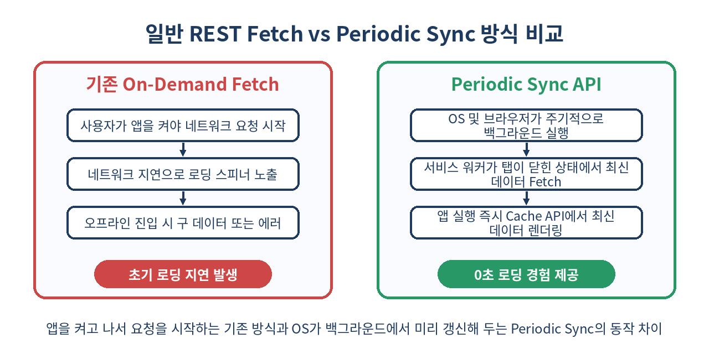
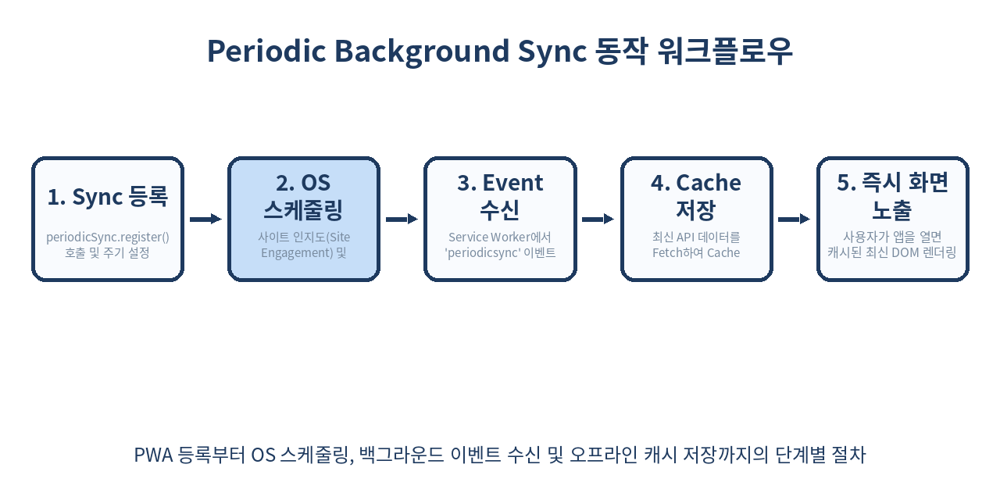

# ⏱️ Periodic Background Sync API 완벽 가이드: 앱을 열지 않아도 최신 뉴스·날씨 데이터를 백그라운드에서 주기적으로 갱신하기

> 사용자 관점에서 앱을 열었을 때 로딩 스피너를 기다리지 않고 **이미 최신 데이터가 렌더링되어 있는 경험**은 매우 매력적입니다.
> Periodic Background Sync API를 활용하면 사용자가 브라우저 탭을 열지 않더라도, OS와 브라우저가 최적의 타이밍을 계산해 데이터를 백그라운드에서 주기적으로 가져옵니다.

---

## 📌 목차
1. 🧭 Periodic Background Sync API란 무엇인가?
2. ⚡ 1회성 Background Sync와 Periodic Background Sync의 결정적 차이
3. 🔑 동작 조건과 사이트 인지도(Site Engagement Score)
4. 🛠️ 필수 전제 조건: PWA 설치 및 Service Worker 환경
5. 💻 실전 구현 (1): 브라우저 권한 확인 및 Sync 등록하기
6. ⚙️ 실전 구현 (2): Service Worker의 `periodicsync` 이벤트 수신
7. 📊 기존 방식 vs Periodic Background Sync 비교
8. 🧪 Chrome DevTools를 통한 테스트 및 디버깅
9. 🚫 실무 개발 시 겪는 함정과 오해
10. ⚠️ 사용하지 말아야 할 유즈케이스
11. 🧾 정리
12. 📚 참고 자료

---

## 🧭 1. Periodic Background Sync API란 무엇인가?

**Periodic Background Sync API**는 사용자가 웹 애플리케이션을 켜두지 않거나 탭을 모두 닫은 상태에서도 브라우저 서비스 워커(Service Worker)를 통해 **주기적으로 네트워크 데이터를 가져와 오프라인 캐시(Cache Storage)를 최신화**할 수 있게 해주는 차세대 PWA(Progressive Web Apps) API입니다.

뉴스 사이트의 최신 헤드라인, 주식 시세, 날씨 정보, 팟캐스트 에피소드 목록처럼 **주기적 갱신이 필요하지만 사용자가 매번 로딩 대기 시간을 겪을 필요가 없는 콘텐츠**에 최적화되어 있습니다.



기존 웹 애플리케이션은 사용자가 웹 페이지에 접속한 이후에야 REST API나 GraphQL 요청을 보냅니다. 그러나 Periodic Background Sync API를 적용하면 사용자가 출근길에 뉴스 앱을 클릭하는 순간, **이미 새벽에 백그라운드 동기화가 완료된 최신 기사**가 즉각적으로 화면에 렌더링됩니다.

---

## ⚡ 2. 1회성 Background Sync와 Periodic Background Sync의 결정적 차이

많은 개발자들이 기존의 `Background Sync API`와 `Periodic Background Sync API`를 혼동합니다. 두 API는 백그라운드 동작이라는 점은 같지만 **동기화 주도권과 목적**이 완전히 다릅니다.

| 구분 | Background Sync (1회성) | Periodic Background Sync (주기적) |
| :--- | :--- | :--- |
| **주요 목적** | 오프라인 상태에서 실패한 요청(폼 제출 등)의 **재시도** | 사용자가 앱을 열기 전 **데이터 미리 가져오기(Prefetch)** |
| **실행 횟수** | 네트워크가 연결되는 시점에 **단 1회** 실행 후 종료 | 브라우저 판단에 따라 **주기적으로 반복** 실행 |
| **호출 주체** | 사용자의 특정 액션 (예: 작성 완료 버튼 클릭) | OS 및 브라우저 스케줄러 (사용자 행동 예측) |
| **설치 요구** | PWA 설치 없이도 서비스 워커 지원 시 가능 | **PWA (A2HS) 설치** 및 high engagement score 필수 |
| **이벤트명** | `sync` | `periodicsync` |

1회성 Background Sync는 **"네트워크가 돌아오면 메시지를 전송해 줘"**라는 개념이라면, Periodic Background Sync는 **"12시간마다 최신 날씨를 미리 캐싱해 줘"**라는 개념입니다.

---

## 🔑 3. 동작 조건과 사이트 인지도(Site Engagement Score)

Periodic Background Sync는 사용자 기기의 배터리와 데이터(cellular data)를 소모합니다. 따라서 악의적인 웹사이트가 배경에서 무한대로 네트워크 요청을 보내 시스템 자원을 고갈시키는 것을 막기 위해 **매우 엄격한 제약 사항**이 존재합니다.

### 주요 제약 및 실행 규칙
1. **HTTPS 필수**: 무조건 보안 연결(Localhost 제외) 환경이어야 합니다.
2. **PWA 설치 (HomeScreen 추가)**: 브라우저 탭으로만 접속하는 사이트에서는 동작하지 않으며, 사용자가 기기 홈 화면에 앱을 설치(PWA)해야 합니다.
3. **사이트 인지도 점수 (Site Engagement Score)**: 브라우저는 사용자가 해당 앱을 자주 사용하는지 평가합니다. 사용률이 높을수록 백그라운드 실행 주기가 더 자주 부여됩니다.
4. **OS 및 시스템 상태 반영**: 기기가 배터리 절약 모드이거나 Wi-Fi 연결이 끊겨 있는 경우, 브라우저는 지정된 동기화 주기를 자동으로 지연시키거나 무시합니다.

> 💡 **Site Engagement Score란?**
> Chrome 브라우저가 사용자 행동(클릭, 스크롤, 체류 시간, 방문 횟수)을 종합하여 산출하는 0~100점 사이의 점수입니다. 주소창에 `chrome://site-engagement`를 입력하면 현재 내 브라우저의 사이트별 인지도 점수를 확인할 수 있습니다.

---

## 🛠️ 4. 필수 전제 조건: PWA와 Service Worker 환경 구축

Periodic Sync를 사용하려면 웹 앱이 **Service Worker**를 등록한 PWA 형태여야 합니다. 기본적인 웹 앱 구조를 설정합니다.

```html
<!-- index.html -->
<!DOCTYPE html>
<html lang="ko">
<head>
  <meta charset="UTF-8">
  <link rel="manifest" href="/manifest.json">
  <title>Periodic Sync News Reader</title>
</head>
<body>
  <h1>📰 오늘의 백그라운드 뉴스</h1>
  <div id="news-container">로딩 중...</div>

  <script src="app.js"></script>
</body>
</html>
```

```json
// manifest.json
{
  "name": "Periodic News PWA",
  "short_name": "NewsPWA",
  "start_url": "/",
  "display": "standalone",
  "background_color": "#ffffff",
  "icons": [
    {
      "src": "/icon-192.png",
      "sizes": "192x192",
      "type": "image/png"
    }
  ]
}
```

---

## 💻 5. 실전 구현 (1): 브라우저 권한 확인 및 Sync 등록하기

메인 메인 스레드(`app.js`)에서 `periodicSync` 객체가 존재하는지 확인하고 권한 상태에 따라 백그라운드 동기화를 등록합니다.



```javascript
// app.js

async function registerPeriodicNewsSync() {
  // 1. Service Worker 지원 여부 및 periodicSync API 지원 확인
  if (!('serviceWorker' in navigator)) {
    console.log('Service Worker를 지원하지 않는 브라우저입니다.');
    return;
  }

  const registration = await navigator.serviceWorker.ready;

  if (!('periodicSync' in registration)) {
    console.log('이 브라우저는 Periodic Background Sync API를 지원하지 않습니다.');
    return;
  }

  try {
    // 2. periodic-background-sync 권한 확인
    const status = await navigator.permissions.query({
      name: 'periodic-background-sync',
    });

    if (status.state === 'granted') {
      // 3. Periodic Sync 등록 (최소 간격 12시간 설정)
      await registration.periodicSync.register('update-news-feed', {
        minInterval: 12 * 60 * 60 * 1000, // 12시간 (ms 단위)
      });
      console.log('✅ Periodic Background Sync 등록 성공 (태그: update-news-feed)');
    } else {
      console.warn('⚠️ Periodic Background Sync 권한이 거부되었습니다.');
    }
  } catch (error) {
    console.error('❌ Periodic Sync 등록 실패:', error);
  }
}

// 서비스 워커 등록 후 Periodic Sync 실행
navigator.serviceWorker.register('/sw.js')
  .then(() => registerPeriodicNewsSync());
```

--- 

## ⚙️ 6. 실전 구현 (2): Service Worker의 `periodicsync` 이벤트 수신

이제 백그라운드에서 브라우저가 지정된 시점에 `periodicsync` 이벤트를 서비스 워커(`sw.js`)로 트리거합니다.

```javascript
// sw.js
const CACHE_NAME = 'news-cache-v1';
const NEWS_API_URL = 'https://api.example.com/latest-news';

self.addEventListener('install', (event) => {
  self.skipWaiting();
});

self.addEventListener('activate', (event) => {
  event.waitUntil(clients.claim());
});

// periodicSync 이벤트 수신
self.addEventListener('periodicsync', (event) => {
  if (event.tag === 'update-news-feed') {
    console.log('[SW] ⏱️ Periodic Sync 실행: 최신 뉴스 가져오는 중...');
    event.waitUntil(fetchAndCacheLatestNews());
  }
});

// 백그라운드에서 최신 데이터를 가져와 Cache Storage에 저장하는 함수
async function fetchAndCacheLatestNews() {
  try {
    const response = await fetch(NEWS_API_URL);
    if (!response.ok) throw new Error('네트워크 응답 오류');
    
    const cache = await caches.open(CACHE_NAME);
    // 응답 객체를 클론하여 캐시에 저장
    await cache.put(NEWS_API_URL, response.clone());
    
    console.log('[SW] ✅ 백그라운드 뉴스 캐싱 완료');
  } catch (error) {
    console.error('[SW] ❌ 백그라운드 동기화 실패:', error);
  }
}

// 메인 앱에서 fetch 요청 시 캐시 우선 전략(Cache First) 응답
self.addEventListener('fetch', (event) => {
  if (event.request.url.includes('/latest-news')) {
    event.respondWith(
      caches.match(event.request).then((cachedResponse) => {
        // 캐시된 데이터가 있으면 캐시 반환, 없으면 네트워크 요청
        return cachedResponse || fetch(event.request);
      })
    );
  }
});
```

---

## 📊 7. 기존 방식 vs Periodic Background Sync 비교

| 비판 요소 | 기존 REST Polling | Push Notification 기반 갱신 | Periodic Background Sync |
| :--- | :--- | :--- | :--- |
| **탭 닫힘 시 작동** | ❌ 불가 | ⭕ 가능 (푸시 수신 시 백그라운드 갱신) | ⭕ 가능 (브라우저 자체 스케줄링) |
| **서버 인프라 비용** | 없음 | ❌ 높음 (FCM / WebPush 서버 관리 필요) | ⭕ 없음 (클라이언트 단독 등록) |
| **배터리/데이터 효율** | ❌ 최악 (지속적 접속 유지) | ⚠️ 보통 (푸시 수신 시 순간 소모) | ⭕ 최상 (OS가 디바이스 상태 감지 후 통합 수행) |
| **실시간성** | 높음 (앱 켜진 상태) | 아주 높음 (즉시 전송) | ⚠️ 주기적 (정확한 정시 실행 미보장) |
| **사용자 방해 요소** | 없음 | ⚠️ 알림 팝업으로 방해 가능성 존재 | ⭕ 완전히 보이지 않는 백그라운드 갱신 |

---

## 🧪 8. Chrome DevTools를 통한 테스트 및 디버깅

Periodic Background Sync는 기본 최소 간격이 수 시간 단위이며, Site Engagement 점수에 의존하기 때문에 **실제 자연 실행을 기다리며 디버깅하는 것은 불가능**에 가깝습니다.
Chrome 개발자 도구(DevTools)에서는 이를 인위적으로 즉시 트리거하는 기능을 제공합니다.

### DevTools 시뮬레이션 방법
1. `F12`를 눌러 개발자 도구를 엽니다.
2. **Application** 탭으로 이동합니다.
3. 좌측 메뉴의 **Service Workers** 섹션을 선택합니다.
4. **Periodic Sync** 입력 폼을 찾습니다.
5. `Tag` 입력란에 코드에서 등록한 태그명(`update-news-feed`)을 입력합니다.
6. **Push** 버튼을 클릭합니다.
7. Console 탭에서 `[SW] ⏱️ Periodic Sync 실행` 로그와 `Cache Storage` 갱신 여부를 확인합니다.

```bash
# Console 출력 예시
[SW] ⏱️ Periodic Sync 실행: 최신 뉴스 가져오는 중...
[SW] ✅ 백그라운드 뉴스 캐싱 완료
```

---

## 🚫 9. 실무 개발 시 겪는 함정과 오해

### 함정 1: `minInterval: 1000`으로 설정하면 1초마다 실행될 것이라는 착각
`minInterval`은 개발자가 요청하는 **"최소 간격 힌트"**일 뿐입니다. 브라우저는 `minInterval` 값과 Site Engagement Score, 배터리 충전 여부, Wi-Fi 연결 여부를 종합 판단하여 실제 실행 주기를 결정합니다. 개발자가 `1초`로 지정하더라도 브라우저 판단에 따라 실제로는 몇 시간마다 실행되거나 아예 실행되지 않을 수 있습니다.

### 함정 2: Chrome 일반 탭(비-PWA)에서의 동작 기대
대부분의 브라우저(Chrome 포함)는 보안 및 자원 보호를 이유로 **설치된 PWA(Standalone Mode)**에서만 Periodic Sync 권한을 `granted`로 처리합니다. 일반 웹 브라우징 탭에서 `navigator.permissions.query({ name: 'periodic-background-sync' })`를 호출하면 `denied`가 반환됩니다.

### 함정 3: 브라우저별 미지원 문제 (Safari 및 Firefox)
현재 Periodic Background Sync API는 **Chromium 기반 브라우저(Chrome, Edge, Opera 등)**에서만 주로 지원되며, **Safari(WebKit) 및 Firefox(Gecko)는 지원하지 않습니다**.
반드시 `if ('periodicSync' in registration)` 기능 감지(Feature Detection) 코드를 포함시켜 Progressive Enhancement 방식으로 구현해야 합니다.

---

## ⚠️ 10. 사용하지 말아야 할 유즈케이스

Periodic Background Sync는 만능이 아닙니다. 아래와 같은 경우에는 이 API를 사용하면 안 됩니다.

1. **초 단위/분 단위 실시간 데이터가 필요한 경우 (예: 주식 체결가, 채팅 메시지)**
   - 브라우저 스케줄러는 실시간 정시 실행을 보장하지 않습니다. 실시간성이 핵심이라면 **WebSocket**이나 **WebTransport**, 혹은 **Push API**를 사용해야 합니다.
2. **사용자 결제 데이터 또는 중요 보안 인증 정보 갱신**
   - 백그라운드 스케줄링 중 네트워크 끊김이나 토큰 만료 에러가 발생할 수 있으므로 보안 직결 데이터는 사용자가 직접 실행하는 Foreground Fetch로 처리해야 합니다.
3. **대용량 미디어 파일(수 백 MB 비디오) 미리 다운로드**
   - 백그라운드 작업시간이 길어지면 브라우저가 서비스 워커 프로세스를 강제 종료(Kill)합니다. 대용량 파일은 **Background Fetch API**를 사용해야 합니다.

---

## 🧾 11. 정리

- **Periodic Background Sync API**는 PWA가 닫혀 있는 동안에도 최신 콘텐츠를 주기적으로 미리 가져와 캐싱하는 브라우저 네이티브 기술입니다.
- 기존 **1회성 Background Sync**가 오프라인 재시도 목적이라면, **Periodic Sync**는 데이터 미리 읽기(Prefetching) 목적입니다.
- 브라우저의 **Site Engagement Score**와 기기 상태(배터리, 네트워크)에 따라 동기화 주기가 브라우저에 의해 유동적으로 조정됩니다.
- Chromium 계열 PWA 환경에서 동작하며, Safari/Firefox 대응을 위한 **기능 감지(Feature Detection)** 조치가 필수적입니다.
- 실시간성 데이터는 Push API를 사용하고, 대용량 파일 다운로드는 Background Fetch API를 사용하는 등 목적에 맞는 백그라운드 API 선택이 필요합니다.

> ✨ **한 줄 요약**
> Periodic Background Sync API를 활용하면 사용자가 PWA를 실행하는 순간, 로딩 스피너 없는 0초 오프라인 렌더링 경험을 완성할 수 있습니다.

---

## 📚 12. 참고 자료
- [Chrome Dev Docs: Richer offline experiences with the Periodic Background Sync API](https://developer.chrome.com/docs/capabilities/periodic-background-sync)
- [MDN Web Docs: Web Periodic Background Synchronization API](https://developer.mozilla.org/en-US/docs/Web/API/Web_Periodic_Background_Synchronization_API)
- [W3C Web Periodic Background Sync Specification](https://wicg.github.io/periodic-background-sync/)
