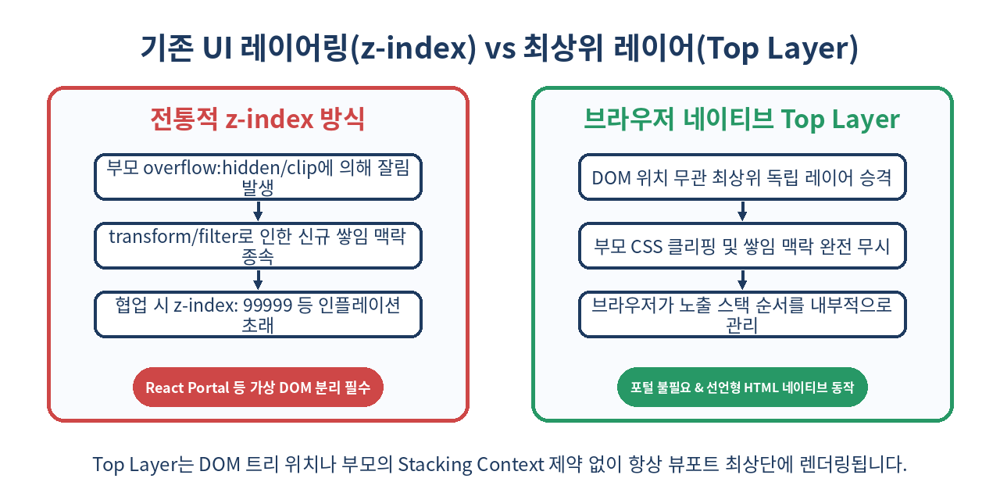
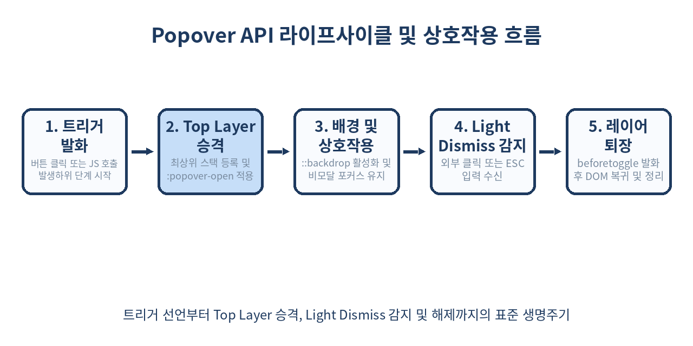

# 🎈 Popover API와 최상위 레이어(Top Layer) 완벽 가이드: z-index 지옥과 모달 라이브러리의 종말

> "드롭다운 하나 띄우자고 수십 킬로바이트의 포털 라이브러리와 z-index: 99999를 붙이던 시대는 끝났습니다."
> 브라우저 네이티브 최상위 레이어(Top Layer)와 Popover API가 웹 UI 아키텍처를 어떻게 근본적으로 바꾸어 놓았는지 상세한 코드와 동작 원리로 살펴봅니다.

---

## 📌 목차
1. 🧭 웹 프론트엔드를 괴롭혀온 'z-index 인플레이션'과 팝업의 비극
2. 🌐 최상위 레이어(Top Layer): 브라우저 뷰포트의 새로운 차원
3. 🎈 Popover API 기초: HTML 속성만으로 팝업 구현하기
4. ⚙️ `auto` vs `manual`: 팝오버의 두 가지 동작 모드 심층 분석
5. 💻 JavaScript 명령형 제어와 라이프사이클 이벤트 (`beforetoggle`, `toggle`)
6. 🎨 CSS 스타일링: `:popover-open`, `::backdrop`, 그리고 최신 진입/퇴장 애니메이션
7. ⚔️ `<dialog>` vs Popover API: 언제 무엇을 선택해야 하는가?
8. ⚓ CSS Anchor Positioning과의 결합: 날개 달린 툴팁과 드롭다운
9. ♿ 웹 접근성(a11y)과 포커스 관리: 라이브러리가 필요 없는 이유
10. ⚠️ 실무 도입 시 흔히 겪는 함정(Gotchas)과 해결책
11. 🚫 이런 상황에서는 Popover API를 쓰면 안 된다
12. 🧾 정리: 모던 웹 UI 아키텍처의 패러다임 전환
13. 📚 참고 자료

---

## 🧭 1. 웹 프론트엔드를 괴롭혀온 'z-index 인플레이션'과 팝업의 비극

웹 개발을 해본 개발자라면 누구나 한 번쯤 겪어보았을 악몽이 있습니다. 공통 네비게이션 바(GNB)의 드롭다운 메뉴를 열었는데, 메인 페이지 슬라이더의 `transform` 속성 때문에 메뉴가 슬라이더 뒤로 숨어버리는 현상입니다.

```css
/* 익숙하지만 고통스러운 임베디드 CSS의 역사 */
.header { z-index: 9999; }
.dropdown { z-index: 99999; }
.modal-overlay { z-index: 2147483647; /* 32비트 정수 최댓값 */ }
```

이런 현상이 일어나는 이유는 CSS의 **쌓임 맥락(Stacking Context)** 규칙 때문입니다. 부모 엘리먼트에 `position: relative/absolute`와 `z-index`, 혹은 `transform`, `opacity`, `filter`, `contain` 등의 속성이 부여되면 새로운 쌓임 맥락이 생성됩니다. 아무리 자식 엘리먼트에 `z-index: 99999`를 선언하더라도, 부모가 속한 쌓임 맥락의 레벨을 뚫고 올라갈 수는 없습니다.

게다가 부모 컨테이너에 `overflow: hidden`이나 `overflow: clip`이 걸려 있다면, 자식 드롭다운은 아예 경계선 밖으로 나가지 못하고 잘려버립니다. 이를 해결하기 위해 React 진영에서는 `ReactDOM.createPortal()`을 사용하여 DOM 노드를 강제로 `document.body` 직하위로 빼내는 기술을 사용해 왔습니다.

하지만 포털(Portal) 방식은 몇 가지 심각한 부작용을 동반합니다:
- **이벤트 버블링과 DOM 트리의 불일치**: React 가상 DOM 상에서는 부모-자식 관계이지만 브라우저 실제 DOM 상에서는 형제 또는 루트 직하위가 되어 포커스 트랩이나 스크린 리더 낭독 순서가 뒤틀립니다.
- **무거운 자바스크립트 의존성**: 모달 외부를 클릭했을 때 닫히는 `Light Dismiss`, `ESC` 키보드 입력 감지, 포커스 복원 로직을 모두 자바스크립트 리스너로 직접 구현해야 합니다.
- **번들 크기 증가**: Floating UI, Radix UI, Headless UI 등 별도의 외부 라이브러리가 필수적으로 수반되었습니다.

이 고질적인 구조적 한계를 브라우저 엔진 차원에서 완벽히 해결하기 위해 등장한 것이 바로 **Top Layer**와 **Popover API**입니다.

---

## 🌐 2. 최상위 레이어(Top Layer): 브라우저 뷰포트의 새로운 차원

브라우저 렌더링 엔진 내부에는 일반적인 DOM 트리 렌더 트리 외에 **최상위 레이어(Top Layer)**라는 독립적인 렌더링 평면이 존재합니다.

Top Layer는 일반적인 HTML 문서 흐름(Document Flow) 및 쌓임 맥락(Stacking Context)을 완전히 벗어납니다. 어떤 깊은 DOM 노드 안에 엘리먼트가 위치해 있든 상관없이, Top Layer에 승격된 엘리먼트는 뷰포트의 최상단 스택에 직접 배치됩니다.



### Top Layer의 핵심 특징
1. **CSS 쌓임 맥락 무시**: 부모 노드의 `z-index`, `transform`, `filter`, `perspective` 등의 영향을 전혀 받지 않습니다.
2. **`overflow: hidden` 탈출**: 조상 요소의 클리핑 영역에 잘리지 않고 온전하게 뷰포트에 표시됩니다.
3. **자동 스택 관리(LIFO)**: Top Layer에 들어간 엘리먼트들은 호출된 순서대로 브라우저가 관리하는 스택(Stack)에 쌓입니다. 나중에 열린 요소가 먼저 열린 요소 위에 자연스럽게 렌더링됩니다.
4. **가상 요소 `::backdrop` 제공**: Top Layer 요소 바로 뒤에 뷰포트 크기의 배경 가상 요소를 자동으로 생성하여 딤(Dim) 처리나 블러 효과를 네이티브로 적용할 수 있습니다.

과거에는 `<dialog>` 태그의 `showModal()` 메서드를 호출했을 때만 이 Top Layer를 이용할 수 있었지만, **Popover API의 등장으로 일반 `<div>`, `<section>`, `<nav>`, `<article>` 등 모든 HTML 엘리먼트가 선언형으로 Top Layer를 활용할 수 있게 되었습니다.**

---

## 🎈 3. Popover API 기초: HTML 속성만으로 팝업 구현하기

Popover API의 가장 혁신적인 점은 **단 한 줄의 자바스크립트도 없이** 완전한 상호작용 팝업을 만들 수 있다는 점입니다.

HTML에 두 가지 속성만 정의하면 브라우저가 팝업의 열기, 닫기, 외부 클릭 감지, ESC 닫기를 자동으로 처리합니다:
1. 팝업이 될 요소에 `popover` 속성을 선언합니다.
2. 팝업을 트리거할 `<button>` 또는 `<input type="button">`에 `popovertarget="ID"`를 선언합니다.

```html
<!-- 트리거 버튼 -->
<button type="button" popovertarget="notification-popover">
  알림 센터 열기
</button>

<!-- 팝오버 컨테이너 -->
<div id="notification-popover" popover>
  <h3>📢 시스템 알림</h3>
  <p>Popover API가 모든 최신 모던 브라우저에 기본 탑재되었습니다.</p>
  <button type="button" popovertarget="notification-popover" popovertargetaction="hide">
    닫기
  </button>
</div>
```

### 동작 메커니즘
- `popover` 속성이 선언된 요소는 페이지 로드 시 기본적으로 `display: none` 상태가 됩니다.
- 트리거 버튼을 클릭하면 브라우저가 대상 요소를 Top Layer로 승격시키고, `display: block`을 주입하여 화면에 노출합니다.
- `popovertargetaction` 속성을 통해 버튼의 동작을 명시적으로 제어할 수 있습니다:
  - `toggle` (기본값): 열려 있으면 닫고, 닫혀 있으면 엽니다.
  - `show`: 팝오버를 엽니다.
  - `hide`: 팝오버를 닫습니다.

별도의 이벤트 핸들러 등록 없이도 팝오버 영역 바깥을 마우스로 클릭하거나 키보드의 `Escape` 키를 누르면 브라우저가 스스로 판단하여 팝오버를 닫아줍니다(이 동작을 **Light Dismiss**라고 합니다).

---

## ⚙️ 4. `auto` vs `manual`: 팝오버의 두 가지 동작 모드 심층 분석

`popover` 속성은 두 가지 키워드 값을 지원합니다. 기본값은 `popover="auto"`입니다.

```html
<div popover="auto">자동 닫힘 팝오버 (기본값)</div>
<div popover="manual">수동 제어 팝오버</div>
```

두 모드의 차이점은 사용자 인터랙션과 스택 관리 정책에 있습니다.

| 구분 | `popover="auto"` | `popover="manual"` |
| :--- | :--- | :--- |
| **기본 목적** | 드롭다운, 메뉴, 툴팁, 콤보박스 | 토스트 메시지, 배너, 플로팅 비디오 | |
| **Light Dismiss (외부 클릭/ESC)** | **지원함** (외부 클릭 시 즉시 닫힘) | **지원하지 않음** (명시적으로 닫아야 함) |
| **동시 노출 여부** | 다른 `auto` 팝오버가 열리면 기존 팝오버 자동 닫힘 (단, 중첩 관계 제외) | 여러 개의 `manual` 팝오버가 동시에 화면에 존재 가능 |
| **포커스 복원** | 닫힐 때 직전 트리거 요소로 포커스 자동 복귀 | 자동 복귀 없음 (직접 제어 필요) |

### 1) `auto` 모드의 중첩(Nesting) 허용 규칙
`popover="auto"` 모드라 하더라도, 부모 팝오버 안에 자식 팝오버의 트리거가 존재하는 경우(예: 메뉴 안의 서브메뉴) 브라우저는 두 팝오버 간의 조상-자손 관계를 인식합니다. 따라서 서브메뉴 팝오버가 열려도 부모 메뉴 팝오버는 닫히지 않고 함께 Top Layer에 유지됩니다.

```html
<!-- 상위 메뉴 -->
<div id="main-menu" popover="auto">
  <button type="button" popovertarget="sub-menu">설정 상세 &gt;</button>
  
  <!-- 하위 메뉴: 상위 메뉴가 닫히지 않고 공존 -->
  <div id="sub-menu" popover="auto">
    <p>테마 변경</p>
    <p>언어 설정</p>
  </div>
</div>
```

### 2) `manual` 모드를 활용한 토스트(Toast) 알림
알림 메시지처럼 화면 구석에 여러 개가 떠 있어야 하고, 사용자가 다른 영역을 클릭해도 사라지지 않아야 하는 UI에는 `popover="manual"`이 최적입니다.

```html
<div id="toast-message" popover="manual" class="toast-box">
  <span>저장 완료되었습니다.</span>
  <button type="button" popovertarget="toast-message" popovertargetaction="hide">✕</button>
</div>
```

---

## 💻 5. JavaScript 명령형 제어와 라이프사이클 이벤트

선언형 HTML 외에도, 특정 비즈니스 로직(데이터 페칭 완료 후, 권한 체크 후 등) 이후 자바스크립트로 직접 제어할 수 있는 표준 DOM API가 제공됩니다.

### 명령형 API 메서드
모든 `HTMLElement`는 다음 세 가지 메서드를 상속받습니다:

```javascript
const popover = document.querySelector('#notification-popover');

// 1. 팝오버 열기 (이미 열려있으면 에러 없이 무시)
popover.showPopover();

// 2. 팝오버 닫기 (이미 닫혀있으면 에러 없이 무시)
popover.hidePopover();

// 3. 토글하기 (불리언 인자를 넘겨 강제 지정 가능)
const isOpen = popover.togglePopover(); // 현재 상태 반전 후 최종 열림 여부 반환
popover.togglePopover(true);  // show와 동일
popover.togglePopover(false); // hide와 동일
```

> ⚠️ **주의**: `popover` 속성이 선언되지 않은 요소에서 `showPopover()`를 호출하면 `DOMException: InvalidStateError`가 발생합니다.

### 라이프사이클 이벤트: `beforetoggle`과 `toggle`
팝오버의 상태가 변화할 때 브라우저는 두 가지 이벤트를 발생시킵니다.

```javascript
const popover = document.querySelector('#notification-popover');

// 상태 변화 직전 (진입 또는 퇴장 직전)
popover.addEventListener('beforetoggle', (event) => {
  console.log(`이전 상태: ${event.oldState}, 대상 상태: ${event.newState}`);
  // event.oldState: 'closed' | 'open'
  // event.newState: 'open' | 'closed'

  if (event.newState === 'open') {
    // 팝오버가 열리기 직전에 최신 데이터를 페칭하거나 DOM을 준비
    fetchNotificationData();
  }
});

// 상태 변화 완료 후
popover.addEventListener('toggle', (event) => {
  if (event.newState === 'closed') {
    // 폼 입력값 초기화, 임시 리소스 해제
    resetFormState();
  }
});
```



`beforetoggle` 이벤트는 애니메이션 트랜지션을 준비하거나, 비동기 상태를 반영하기에 가장 적합한 시점입니다.

---

## 🎨 6. CSS 스타일링: `:popover-open`, `::backdrop`, 그리고 최신 진입/퇴장 애니메이션

Popover API로 선언된 요소는 브라우저 User-Agent 기본 스타일시트(UA Stylesheet)에 의해 독특한 초기 스타일을 가집니다.

### 1) UA 기본 스타일 재설정
브라우저는 `[popover]` 요소에 기본적으로 다음과 같은 스타일을 적용합니다:

```css
/* 브라우저 기본 스타일 */
[popover] {
  position: fixed;
  inset: 0;
  width: fit-content;
  height: fit-content;
  margin: auto;
  border: solid;
  padding: 0.25em;
  background-color: canvas;
  color: canvastext;
  overflow: auto;
}

[popover]:not(:popover-open) {
  display: none !important;
}
```

따라서 커스텀 디자인을 적용할 때는 기본 테두리(`border: none`)와 마진(`margin: 0`)을 초기화해 주는 것이 일반적입니다.

```css
.custom-popover {
  margin: 0;
  border: none;
  padding: 1rem;
  border-radius: 8px;
  background: #ffffff;
  box-shadow: 0 10px 25px rgba(0, 0, 0, 0.15);
}
```

### 2) `::backdrop` 가상 요소 스타일링
`popover="auto"`나 `popover="manual"` 모두 `::backdrop` 가상 요소를 지원합니다. 팝오버가 열리면 팝오버 바로 뒤, 메인 문서 위에 배경 가상 요소가 렌더링됩니다.

```css
.custom-popover::backdrop {
  background-color: rgba(30, 58, 95, 0.5);
  backdrop-filter: blur(4px);
}
```

### 3) `@starting-style`과 `transition-behavior`를 이용한 진입/퇴장 부드러운 애니메이션
과거에는 `display: none`에서 `display: block`으로 전환될 때 CSS 트랜지션을 적용할 수 없어 복잡한 `setTimeout` 꼼수를 썼습니다. 하지만 최신 CSS 표준인 `@starting-style`과 `transition-behavior: allow-discrete`를 사용하면 순수 CSS만으로 부드러운 페이드 인/아웃 및 슬라이드 애니메이션을 완성할 수 있습니다.

```css
.animated-popover {
  margin: auto;
  border: none;
  border-radius: 12px;
  padding: 24px;
  opacity: 0;
  transform: scale(0.9) translateY(-10px);
  
  /* display 속성의 전환을 허용 */
  transition: 
    opacity 0.25s ease-out,
    transform 0.25s cubic-bezier(0.16, 1, 0.3, 1),
    display 0.25s allow-discrete,
    overlay 0.25s allow-discrete;
}

/* 열렸을 때의 목표 상태 */
.animated-popover:popover-open {
  opacity: 1;
  transform: scale(1) translateY(0);
}

/* DOM에 막 나타나는 첫 렌더링 프레임의 시작 상태 정의 */
@starting-style {
  .animated-popover:popover-open {
    opacity: 0;
    transform: scale(0.9) translateY(-10px);
  }
}

/* 배경(Backdrop)도 동일하게 부드러운 페이드 적용 */
.animated-popover::backdrop {
  background-color: rgba(0, 0, 0, 0);
  transition: 
    background-color 0.25s ease-out,
    display 0.25s allow-discrete,
    overlay 0.25s allow-discrete;
}

.animated-popover:popover-open::backdrop {
  background-color: rgba(0, 0, 0, 0.45);
}

@starting-style {
  .animated-popover:popover-open::backdrop {
    background-color: rgba(0, 0, 0, 0);
  }
}
```

---

## ⚔️ 7. `<dialog>` vs Popover API: 언제 무엇을 선택해야 하는가?

많은 개발자가 `<dialog>` 태그와 `popover` 속성의 차이점을 혼동합니다. 둘 다 Top Layer에 렌더링될 수 있지만, 본질적인 의도와 동작 방식은 완전히 다릅니다.

### 비교 요약표

| 비교 항목 | 모달 다이얼로그 (`<dialog>.showModal()`) | 팝오버 (`<div popover>`) |
| :--- | :--- | :--- |
| **HTML 요소** | 반드시 `<dialog>` 태그여야 함 | 어떤 태그든 가능 (`<div>`, `<menu>`, `<nav>` 등) |
| **모달성 (Modality)** | **완전 모달 (Modal)**: 배경 페이지가 `inert` 상태가 됨 | **비모달 (Non-modal)**: 배경과 상호작용 가능 |
| **포커스 트랩 (Focus Trap)** | 브라우저가 다이얼로그 내부로 포커스를 완벽히 가둠 | 포커스를 가두지 않음 (Tab 키로 외부 이동 가능) |
| **배경 클릭 닫기 (Light Dismiss)** | 기본 지원 안 됨 (직접 JS로 클릭 좌표 계산 필요) | **기본 내장 지원** (외부 클릭 시 즉시 닫힘) |
| **접근성 기본 역할(Role)** | `role="dialog"` 자동 부여 | 특정 역할을 강제하지 않음 (용도에 맞게 직접 지정) |
| **대표 사용처** | 중요 확인창, 회원가입 모달, 결제창 | 드롭다운 메뉴, 프로필 팝업, 툴팁, 토스트 알림 |

### 환상의 결합: `<dialog popover>`
놀랍게도 `<dialog>` 요소에 `popover` 속성을 함께 부여할 수 있습니다!

```html
<!-- 비모달이면서도 Light Dismiss와 시맨틱 dialog 역할을 동시에 갖는 창 -->
<dialog id="quick-search" popover>
  <input type="search" placeholder="빠른 검색..." />
  <ul>
    <li>문서 가이드</li>
    <li>API 레퍼런스</li>
  </ul>
</dialog>
```

이렇게 선언하면 `<dialog>`의 시맨틱 태그 역할(`role="dialog"`)을 유지하면서도, 복잡한 스크립트 없이 **바깥 영역 클릭 시 자동으로 닫히는 비모달 검색창**을 손쉽게 완성할 수 있습니다.

---

## ⚓ 8. CSS Anchor Positioning과의 결합: 날개 달린 툴팁과 드롭다운

Popover API의 고유한 특징 중 하나는 Top Layer에 뜨기 때문에 기본 위치가 `position: fixed` 기준(뷰포트 중앙)이라는 점입니다. 그렇다면 **특정 버튼 바로 아래에 드롭다운 메뉴나 툴팁을 부착**하려면 어떻게 해야 할까요?

과거에는 자바스크립트로 `getBoundingClientRect()`를 호출하여 위치를 계산하거나 Popper.js/Floating UI 같은 무거운 라이브러리를 사용했습니다. 하지만 최신 브라우저 표준인 **CSS Anchor Positioning**과 결합하면 자바스크립트 계산이 전혀 필요 없습니다.

```html
<!-- 앵커 기준점 버튼 -->
<button type="button" class="profile-btn" popovertarget="user-menu">
  내 계정 프로필
</button>

<!-- 앵커에 고정될 팝오버 -->
<div id="user-menu" popover class="menu-dropdown">
  <a href="/profile">마이페이지</a>
  <a href="/settings">환경설정</a>
  <a href="/logout">로그아웃</a>
</div>
```

```css
/* 1. 트리거 버튼을 앵커 이름으로 등록 */
.profile-btn {
  anchor-name: --profile-anchor;
}

/* 2. 팝오버가 해당 앵커를 참조하여 상대 위치 결정 */
.menu-dropdown {
  margin: 0;
  position-anchor: --profile-anchor;
  
  /* 앵커 버튼의 하단(bottom)을 드롭다운의 상단(top)으로 맞춤 */
  top: anchor(bottom);
  /* 앵커 버튼의 좌측(left)에 드롭다운 좌측을 정렬 */
  left: anchor(left);
  
  /* 버튼과의 간격 */
  margin-top: 8px;
}
```

CSS Anchor Positioning을 사용하면 사용자가 페이지를 스크롤하거나 뷰포트 크기를 변경해도, 브라우저가 네이티브 차원에서 GPU 가속을 통해 드롭다운의 위치를 앵커 버튼 바로 아래에 오차 없이 고정시켜 줍니다.

---

## ♿ 9. 웹 접근성(a11y)과 포커스 관리: 라이브러리가 필요 없는 이유

외부 라이브러리를 쓰지 않고 순수 자바스크립트로 팝업을 만들 때 가장 자주 누락되는 부분이 바로 **접근성(Accessibility)**입니다.

### 1) 자동 포커스 복원 (Focus Restoration)
Popover API(`auto` 모드)는 팝오버가 열리고 닫힐 때의 포커스 흐름을 브라우저가 완벽하게 처리합니다:
1. 팝오버가 열리면: 사용자가 `autofocus` 속성을 지정한 자식 요소가 있다면 그곳으로 포커스가 이동합니다.
2. 팝오버가 닫히면: **팝오버를 열었던 트리거 버튼으로 포커스가 즉시 자동 복원**됩니다.

시각 장애인이 스크린 리더를 이용하거나, 키보드로만 탐색하는 사용자가 팝업을 닫았을 때 초점이 페이지 맨 처음으로 날아가 버리는 치명적인 UX 결함이 브라우저 차원에서 기본적으로 방지됩니다.

### 2) 키보드 탐색 지원
- `ESC` 키 입력 시 즉시 닫히며 포커스가 복원됩니다.
- 비모달 구조이므로 `Tab` 키를 누르면 팝오버 내부 요소를 순회한 뒤 문서의 다음 포커스 가능 요소로 자연스럽게 이동합니다.

### 3) 올바른 WAI-ARIA 역할 부여 가이드
`popover` 속성은 시각적/동작적 특성을 부여할 뿐, **스크린 리더를 위한 시맨틱 역할(ARIA Role)을 자동으로 부여하지는 않습니다.** 따라서 용도에 맞게 명시적인 ARIA 속성을 선언하는 것이 권장됩니다.

```html
<!-- 드롭다운 액션 메뉴인 경우 -->
<button type="button" 
        popovertarget="action-menu" 
        aria-haspopup="menu" 
        aria-expanded="false">
  옵션 더보기
</button>

<ul id="action-menu" popover role="menu">
  <li role="menuitem"><button type="button">복사하기</button></li>
  <li role="menuitem"><button type="button">공유하기</button></li>
</ul>
```

---

## ⚠️ 10. 실무 도입 시 흔히 겪는 함정(Gotchas)과 해결책

현업 코드베이스에 Popover API를 도입할 때 마주치는 대표적인 함정 4가지와 해결책입니다.

### 1) Form Submit 버튼에 `popovertarget`을 혼용하는 실수
```html
<!-- ❌ 잘못된 코드: 폼 제출과 팝오버 토글이 동시에 충돌 발생 -->
<button type="submit" popovertarget="confirm-popover">제출하기</button>
```
- **원인**: 기본 동작(Submit)과 팝오버 토글 액션이 동시에 실행되어 예기치 못한 리로드나 상태 왜곡이 발생합니다.
- **해결책**: 트리거 버튼은 반드시 `type="button"`으로 선언하고, 폼 처리가 끝난 뒤 자바스크립트로 `.showPopover()`를 호출하십시오.

### 2) `overflow: auto` 기본값으로 인한 예기치 않은 스크롤바 노출
브라우저 UA 기본 스타일로 인해 `[popover]`에는 `overflow: auto`가 설정되어 있습니다. 팝오버 내부에 살짝이라도 여백이 맞지 않으면 불필요한 스크롤바가 생길 수 있습니다.
```css
/* ✅ 해결책: 불필요한 스크롤 방지 */
.my-popover {
  overflow: visible; /* 또는 overflow: hidden */
}
```

### 3) SPA 라우팅 이동 시 팝오버가 닫히지 않고 남아있는 현상
Next.js, React Router, SvelteKit 등 클라이언트 사이드 라우팅(CSR) 환경에서 `popover="manual"`로 띄운 요소는 페이지 URL이 바뀌어도 Top Layer에 계속 떠 있을 수 있습니다.
```javascript
// ✅ 라우터 페이지 전환 훅(useEffect 등)에서 명시적 닫기 처리
useEffect(() => {
  const activeManualPopovers = document.querySelectorAll('[popover="manual"]:popover-open');
  activeManualPopovers.forEach(el => el.hidePopover());
}, [pathname]);
```

### 4) `display: flex` 적용 시 사라지지 않는 버그처럼 보이는 현상
```css
/* ❌ 잘못된 스타일 선언: 기본 display: none을 덮어씀 */
.my-popover {
  display: flex;
}
```
- **원인**: `[popover]:not(:popover-open)` 상태에서는 `display: none`이어야 하는데, 개발자가 `.my-popover { display: flex; }`를 무조건 적용해 버리면 닫힌 상태에서도 화면에 상시 노출됩니다.
- **해결책**: 반드시 `:popover-open` 가상 클래스 내부에서 `display`를 재정의해야 합니다.
```css
/* ✅ 올바른 스타일 선언 */
.my-popover:popover-open {
  display: flex;
  flex-direction: column;
  gap: 12px;
}
```

---

## 🚫 11. 이런 상황에서는 Popover API를 쓰면 안 된다

Popover API가 아무리 훌륭해도 모든 레이어 UI를 대체할 수는 없습니다. 다음 상황에서는 Popover API 사용을 피해야 합니다.

1. **결제 모달, 약관 동의 등 배경과의 상호작용을 완전히 차단해야 하는 경우**
   - Popover API는 기본적으로 **비모달(Non-modal)** 특성을 가집니다. 사용자가 팝업 바깥의 중요 폼을 클릭하거나 배경을 수정하면 안 되는 시스템에서는 반드시 `<dialog>` 요소와 `.showModal()`을 사용해야 합니다.
2. **복잡한 윈도우 창 관리 시스템 (Draggable Desktop UI)**
   - OS 스타일의 다중 창 관리 시스템에서는 사용자가 창을 클릭할 때마다 해당 창이 앞으로 나와야(Bring to front) 합니다. Top Layer는 브라우저가 관리하는 순서 스택이 우선하므로, 복잡한 z-index 순서 교체가 잦은 도메인에서는 기존 가상 DOM 방식이 유리할 수 있습니다.
3. **구형 브라우저(Internet Explorer, iOS 16 이하 등)를 레거시 타깃으로 강제 지원해야 하는 경우**
   - Popover API는 Baseline Widely Available(Chrome 114+, Safari 17+, Firefox 125+) 표준이지만, 2023년 이전 브라우저 버전 지원이 필수적인 임베디드 웹뷰 환경에서는 폴리필(`@oddbird/popover-polyfill`)을 병행하거나 기존 라이브러리를 유지해야 합니다.

---

## 🧾 12. 정리: 모던 웹 UI 아키텍처의 패러다임 전환

Popover API와 Top Layer의 표준화는 프론트엔드 개발자들에게 큰 해방감을 선사했습니다.

- **쌓임 맥락 탈출**: 부모의 `overflow: hidden`과 `z-index` 지옥에서 벗어나 항상 안전하게 뷰포트에 렌더링됩니다.
- **선언형 HTML**: HTML 속성 두 줄(`popover`, `popovertarget`)만으로 열기/닫기/바깥 클릭 닫기(Light Dismiss)가 완성됩니다.
- **포털 없는 아키텍처**: React 포털이나 복잡한 DOM 트리 분리 로직 없이 컴포넌트 본연의 위치에서 관리할 수 있습니다.
- **CSS 현대화**: `@starting-style`과 `transition-behavior: allow-discrete`를 통해 `display: none` 요소도 부드러운 애니메이션을 구현할 수 있습니다.
- **완벽한 포커스 복원**: 스크린 리더 사용자와 키보드 사용자에게 최적화된 웹 접근성을 기본으로 보장합니다.

> ✨ **한 줄 요약**
> 팝업과 드롭다운을 위해 더 이상 무거운 포털 라이브러리와 z-index 인플레이션에 의존하지 마세요. 브라우저 네이티브 Top Layer와 Popover API가 가장 가볍고 표준적인 해답입니다.

---

## 📚 13. 참고 자료
- [MDN Web Docs - Popover API 공식 문서](https://developer.mozilla.org/en-US/docs/Web/API/Popover_API)
- [WHATWG HTML Living Standard - The popover attribute](https://html.spec.whatwg.org/multipage/popover.html)
- [Chrome for Developers - Introducing the popover API](https://developer.chrome.com/blog/introducing-popover-api)
- [W3C CSS Anchor Positioning Module Level 1](https://www.w3.org/TR/css-anchor-position-1/)
- [OddBird - Popover API Polyfill Repository](https://github.com/oddbird/popover-polyfill)
