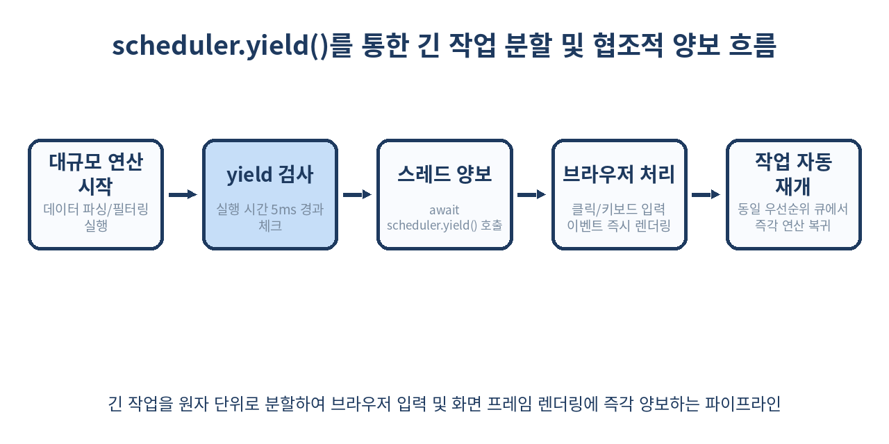
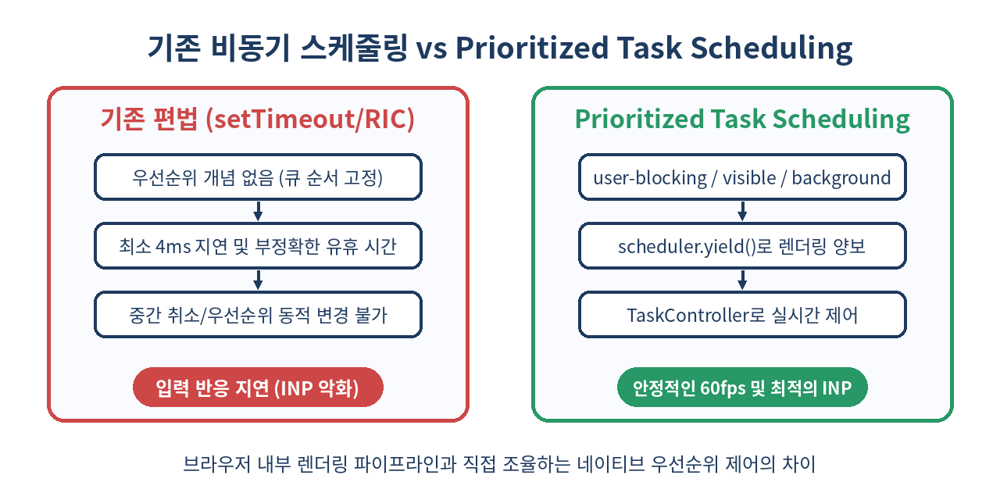

# ⏱️ Prioritized Task Scheduling API 완벽 가이드: scheduler.postTask와 scheduler.yield로 정복하는 INP 최적화

> "모든 자바스크립트는 평등하게 실행되어서는 안 된다."
> 사용자 입력 반응, 화면 애니메이션, 백그라운드 로깅의 가중치가 다르다면 브라우저 스케줄러에게 명확한 우선순위를 위임해야 합니다.

---

## 📌 목차
1. [단일 스레드의 한계와 INP(Interaction to Next Paint)의 위기](#-1-단일-스레드의-한계와-inpinteraction-to-next-paint의-위기)
2. [우리가 지금까지 써온 해킹들: setTimeout, requestAnimationFrame, requestIdleCallback](#-2-우리가-지금까지-써온-해킹들-settimeout-requestanimationframe-requestidlecallback)
3. [Prioritized Task Scheduling API란 무엇인가?](#-3-prioritized-task-scheduling-api란-무엇인가)
4. [3단계 우선순위(Priority Levels) 모델 심층 분석](#-4-3단계-우선순위priority-levels-모델-심층-분석)
5. [scheduler.postTask 기본 사용법과 Promise 기반 제어](#-5-schedulerposttask-기본-사용법과-promise-기반-제어)
6. [TaskController와 TaskSignal: 동적 우선순위 변경과 작업 취소](#-6-taskcontroller와-tasksignal-동적-우선순위-변경과-작업-취소)
7. [차세대 비동기 혁명: scheduler.yield() 완벽 해부](#-7-차세대-비동기-혁명-scheduleryield-완벽-해부)
8. [기존 방식 vs Task Scheduling 아키텍처 비교](#-8-기존-방식-vs-task-scheduling-아키텍처-비교)
9. [실전 구현: 대규모 검색 필터링과 자동완성 최적화](#-9-실전-구현-대규모-검색-필터링과-자동완성-최적화)
10. [실전 구현: 백그라운드 분석 데이터(Analytics) 큐 제어](#-10-실전-구현-백그라운드-분석-데이터analytics-큐-제어)
11. [실무에서 마주치는 치명적인 함정 5가지](#-11-실무에서-마주치는-치명적인-함정-5가지)
12. [이 API를 쓰면 안 되는 경우와 대안 기술](#-12-이-api를-쓰면-안-되는-경우와-대안-기술)
13. [브라우저 지원 현황과 Polyfill 적용 전략](#-13-브라우저-지원-현황과-polyfill-적용-전략)
14. [정리 및 차세대 웹 스케줄링의 미래](#-14-정리-및-차세대-웹-스케줄링의-미래)

---

## 🧭 1. 단일 스레드의 한계와 INP(Interaction to Next Paint)의 위기

모던 웹 애플리케이션은 데스크톱 네이티브 소프트웨어에 버금가는 복잡한 연산을 수행합니다. 리치 텍스트 에디터, 실시간 데이터 시각화 차트, 가상 스크롤, 클라이언트 사이드 머신러닝 모델 추론까지 브라우저 안에서 일어납니다. 하지만 브라우저의 본질은 변하지 않았습니다. **메인 스레드(Main Thread)는 단 하나**이며, 이 단일 스레드가 자바스크립트 실행, DOM 트리 구성, 스타일 계산, 레이아웃, 페인팅, 그리고 사용자 입력 이벤트 처리를 모두 도맡아 처리합니다.

2024년 구글이 Core Web Vitals의 핵심 지표를 FID(First Input Delay)에서 **INP(Interaction to Next Paint)**로 전격 교체하면서 프론트엔드 성능 엔지니어링의 패러다임이 뒤흔들렸습니다. FID가 사용자의 '첫 번째' 입력에 브라우저가 반응을 시작하기까지의 대기 시간만 측정했다면, INP는 사용자가 페이지에 머무는 전 생애주기 동안 발생하는 모든 클릭, 탭, 키보드 입력 후 **실제 화면 프레임이 갱신(Paint)될 때까지의 총 소요 시간**을 측정합니다.

메인 스레드에서 50ms 이상 소요되는 긴 작업(Long Task)이 실행 중일 때 사용자가 버튼을 클릭하면, 브라우저는 실행 중인 작업이 완전히 끝날 때까지 클릭 이벤트 핸들러를 큐에 쌓아두고 대기시킵니다. 작업이 끝난 뒤 이벤트 핸들러가 돌고, 상태가 변경되고, DOM이 다시 그려지기까지 200ms~500ms 이상의 시각적 지연이 발생합니다. 이는 사용자로 하여금 "앱이 멈췄다"는 불쾌한 UX를 느끼게 만들며 검색 엔진 최적화(SEO) 순위에도 치명타를 입힙니다.

우리는 중요한 작업(사용자 입력 반응)과 덜 중요한 작업(서버 로깅, 사전 페칭, 이미지 디코딩 후처리)을 메인 스레드 안에서 지능적으로 교통정리할 도구가 절실해졌습니다.

---

## 🛠️ 2. 우리가 지금까지 써온 해킹들: setTimeout, requestAnimationFrame, requestIdleCallback

Prioritized Task Scheduling API가 등장하기 전, 개발자들은 메인 스레드를 양보(Yield)하고 작업을 쪼개기 위해 온갖 편법을 동원했습니다.

### `setTimeout(fn, 0)`: 스레드 양보의 고전이자 함정
```js
function runHeavyTaskWithTimeout(chunks) {
  if (chunks.length === 0) return;
  
  const chunk = chunks.shift();
  processChunk(chunk);

  // 메인 스레드 렌더링 기회를 주기 위해 큐 뒤로 넘김
  setTimeout(() => runHeavyTaskWithTimeout(chunks), 0);
}
```
- **문제점 1 (클램핑 현상)**: HTML 명세에 따라 `setTimeout`이 5단계 이상 중첩 호출되면 브라우저는 타이머에 최소 4ms의 인위적인 지연(Clamping)을 강제합니다. 1,000개의 청크를 쪼개면 4초 이상의 불필요한 공백이 생깁니다.
- **문제점 2 (우선순위 부재)**: 태스크 큐의 맨 뒤로 들어갈 뿐, 이 작업이 긴급한지 단순 백그라운드 작업인지 브라우저는 전혀 알 수 없습니다.

### `requestAnimationFrame(rAF)`: 렌더링 직전 동기화
- 화면 주사율(60Hz, 120Hz)에 맞춰 페인팅 직전에 실행됩니다. 시각적 애니메이션에는 최적이지만, 백그라운드 데이터 처리나 입력 반응과는 목적이 완전히 다릅니다. rAF 내부에서 무거운 연산을 돌리면 프레임 드랍(Jank)이 직격으로 발생합니다.

### `requestIdleCallback(rIC)`: 브라우저가 쉴 때만 실행
- 브라우저 프레임 렌더링 후 남는 자투리 시간(Idle period)에 실행되므로 분석 로그 전송 등에 적합합니다.
- 하지만 **사파리(Safari)는 수년간 이 API를 제대로 지원하지 않았으며**, 유휴 상태 판정이 모호해 타이밍 예측이 극도로 어렵습니다. 또한 작업의 우선순위를 동적으로 격상하거나 세분화할 수 없습니다.

이러한 한계를 근본적으로 해결하기 위해 W3C와 웹 브라우저 벤더들은 브라우저 엔진의 네이티브 작업 스케줄러와 직접 대화할 수 있는 표준 API를 설계했습니다.

---

## 💡 3. Prioritized Task Scheduling API란 무엇인가?

**Prioritized Task Scheduling API**는 자바스크립트 코드가 브라우저의 태스크 큐에 실행할 함수를 등록할 때, 명시적인 **우선순위(Priority Level)**를 지정할 수 있게 해주는 웹 표준 API입니다.

글로벌 객체인 `window.scheduler`를 통해 노출되며, 핵심 인터페이스는 다음 세 가지로 구성됩니다.

1. **`scheduler.postTask(callback, options)`**: 우선순위, 실행 지연 시간(delay), 중단 신호(TaskSignal)를 설정하여 작업을 등록하고 `Promise`를 반환받는 메서드
2. **`TaskController` / `TaskSignal`**: `AbortController`를 확장하여 작업의 취소뿐만 아니라 **실행 도중 우선순위를 동적으로 변경**할 수 있는 제어 객체
3. **`scheduler.yield()`**: 현재 실행 중인 긴 작업 중간에 메인 스레드의 제어권을 브라우저에 자발적으로 양보하고, 렌더링이나 사용자 입력을 먼저 처리한 뒤 바로 원래 작업으로 복귀시키는 협조적 멀티태스킹 메서드

이 API를 사용하면 프레임워크나 복잡한 커스텀 가상 스케줄러 라이브러리(React Scheduler 등)의 도움 없이도 브라우저 네이티브 레벨에서 60fps/120fps를 매끄럽게 유지할 수 있습니다.

---

## 🎚️ 4. 3단계 우선순위(Priority Levels) 모델 심층 분석

`scheduler.postTask`는 직관적이고 강력한 세 가지 불연속 우선순위를 제공합니다.

| 우선순위 (`TaskPriority`) | 의도된 용도 | 브라우저 내부 스케줄링 동작 | 대표 예시 |
| :--- | :--- | :--- | :--- |
| `'user-blocking'` | 사용자의 즉각적인 상호작용 반응 | 최우선 큐에 적재. 다음 프레임 렌더링 전에 반드시 실행되어야 하는 최고 등급 | 버튼 클릭 피드백, 모달 열기, 아코디언 펼침, 폼 입력 검증 |
| `'user-visible'` (기본값) | 사용자에게 보이지만 즉각적이지 않은 작업 | 일반적인 렌더링 주기와 동기화되어 처리 | 검색 결과 목록 렌더링, 페이지 진입 시 주요 데이터 페칭 후 뷰 업데이트 |
| `'background'` | 사용자가 지연을 인지하지 못하는 작업 | 메인 스레드가 완전히 한가해지거나 유휴 시간에 실행 | 에러 및 사용자 행동 로깅, 인덱스드DB 동기화, 이미지 프리로딩 |

```js
// 브라우저 내부 큐 처리 순서
// 1. user-blocking 큐 비우기
// 2. user-visible 큐 비우기
// 3. background 큐 비우기
```

주의할 점은 `'user-blocking'` 우선순위가 무한정 실행될 경우 브라우저 렌더링 자체가 블로킹될 수 있다는 점입니다. 따라서 이 레벨은 50ms 미만의 아주 가벼운 DOM 변경 및 상태 반영 작업에만 사용해야 합니다.

---

## 🚀 5. scheduler.postTask 기본 사용법과 Promise 기반 제어

`scheduler.postTask()`는 비동기 함수 또는 일반 동기 함수를 콜백으로 받으며, 항상 콜백의 반환값을 감싸는 **`Promise`**를 리턴합니다. 따라서 `async/await`와 자연스럽게 결합됩니다.

### 기본 문법
```js
// 브라우저 지원 여부 확인
if ('scheduler' in window && 'postTask' in window.scheduler) {
  
  // 1. 사용자 상호작용에 즉각 반응하는 user-blocking 작업
  window.scheduler.postTask(() => {
    updateInteractiveFeedback();
    return '피드백 완료';
  }, { priority: 'user-blocking' })
  .then(result => console.log(result));

  // 2. 기본값: user-visible 작업
  window.scheduler.postTask(async () => {
    const data = await fetchSearchSuggestions();
    renderSuggestions(data);
  }); // options 생략 시 user-visible

  // 3. 지연 실행(delay)과 백그라운드 우선순위 결합
  window.scheduler.postTask(() => {
    sendAnalyticsPayload({ event: 'page_view', timestamp: Date.now() });
  }, {
    priority: 'background',
    delay: 2000 // 2초 후 background 큐에 진입
  });

} else {
  // 레거시 폴백 (setTimeout / Promise)
  console.warn('Prioritized Task Scheduling API를 지원하지 않는 브라우저입니다.');
}
```

`delay` 옵션은 `setTimeout`처럼 특정 밀리초 이후에 작업을 큐에 등록합니다. 하지만 `setTimeout`과 결정적으로 다른 점은 지정된 시간이 지난 후에도 설정된 `priority` 속성에 따라 큐의 적절한 위치에 삽입된다는 것입니다.

---

## 🔄 6. TaskController와 TaskSignal: 동적 우선순위 변경과 작업 취소

웹 앱의 상황은 실시간으로 변합니다. 사용자가 검색창에 빠르게 타이핑할 때 이전 검색 요청 렌더링은 취소되어야 하며, 화면 밖에 있던 컴포넌트가 뷰포트 안으로 스크롤되어 들어오면 해당 컴포넌트의 렌더링 우선순위는 `'background'`에서 `'user-visible'`로 즉시 승격되어야 합니다.

이를 가능하게 하는 것이 `TaskController`입니다.

```js
// 1. TaskController 생성 (초기 우선순위 지정 가능)
const controller = new TaskController({ priority: 'background' });

// 2. 컨트롤러의 signal을 전달하여 작업 등록
const heavyTaskPromise = window.scheduler.postTask(
  ({ signal }) => {
    // 작업 중간에 취소 여부를 점검할 수도 있음
    if (signal.aborted) {
      throw new DOMException('작업이 취소되었습니다.', 'AbortError');
    }
    return computeComplexHeatmap();
  },
  { signal: controller.signal }
);

// 상황 A: 사용자가 컴포넌트를 보기 시작함 -> 우선순위 즉시 승격!
function onUserScrolledIntoView() {
  console.log('우선순위를 user-visible로 승격합니다.');
  controller.setPriority('user-visible');
}

// 상황 B: 사용자가 다른 탭으로 이동함 -> 작업 전격 취소!
function onUserNavigatedAway() {
  console.log('불필요해진 작업을 취소합니다.');
  controller.abort('사용자가 화면을 벗어남');
}

// Promise 체인에서 취소(AbortError) 핸들링
heavyTaskPromise
  .then(data => drawHeatmap(data))
  .catch(err => {
    if (err.name === 'AbortError') {
      console.log('정상적으로 취소됨:', controller.signal.reason);
    } else {
      console.error('실제 연산 에러:', err);
    }
  });
```

`controller.setPriority('user-blocking')`를 호출하면 브라우저의 내부 스케줄러는 대기 큐에 머물고 있던 해당 태스크를 상위 우선순위 큐로 즉각 재배치합니다. 이것은 기존 웹 API로는 흉내조차 낼 수 없었던 강력한 기능입니다.

---

## ⚡ 7. 차세대 비동기 혁명: scheduler.yield() 완벽 해부

`scheduler.postTask()`가 독립된 함수 단위의 스케줄링이라면, **`scheduler.yield()`**는 **단일 거대 함수 내부에서 실행 흐름을 일시 정지하고 메인 스레드를 양보**하는 최첨단 협조적 멀티태스킹 API입니다.

### scheduler.yield()가 해결한 기존 yield의 문제점
과거에 개발자들은 긴 반복문 중간에 메인 스레드를 양보하기 위해 `await new Promise(resolve => setTimeout(resolve, 0))`라는 관용구를 사용했습니다. 하지만 이는 치명적인 부작용이 있었습니다.
1. `setTimeout(0)`으로 양보하면 기존 작업이 태스크 큐의 **맨 뒤로** 밀려납니다.
2. 다른 출처의 무관한 스크립트나 광고 스크립트가 끼어들어 원래 작업의 완료 시간이 기하급수적으로 늘어납니다(Task starvation).
3. 브라우저가 화면을 페인팅해야 하는 타이밍과 정확히 동기화되지 않습니다.

`scheduler.yield()`는 양보 시점의 작업 우선순위를 보존한 채 브라우저에게 제어권을 넘기며, 브라우저가 보류 중인 사용자 입력과 렌더링 프레임을 처리하자마자 **우선순위 큐의 최상단에서 즉각 재개**됩니다.

```js
async function processMillionRecords(records) {
  let lastYieldTime = performance.now();

  for (let i = 0; i < records.length; i++) {
    // 단위 데이터 연산
    transformRecord(records[i]);

    // 5ms 이상 경과했다면 메인 스레드에 양보 (5ms 버짓 규칙)
    if (performance.now() - lastYieldTime > 5) {
      if ('scheduler' in window && 'yield' in window.scheduler) {
        // 차세대 네이티브 양보: 렌더링 처리 후 최우선 복귀
        await window.scheduler.yield();
      } else {
        // 구형 브라우저 폴백
        await new Promise(resolve => setTimeout(resolve, 0));
      }
      lastYieldTime = performance.now();
    }
  }
  console.log('100만 건 데이터 처리 완료!');
}
```



위 흐름도처럼 5ms 단위로 잘게 쪼개진 연산 사이사이에 사용자의 마우스 클릭이나 키 입력이 들어오면 브라우저는 지체 없이 화면을 갱신합니다. INP 지표가 500ms에서 16ms 이내로 드라마틱하게 개선되는 비결입니다.

---

## 📊 8. 기존 방식 vs Task Scheduling 아키텍처 비교

기존의 주먹구구식 스케줄링 방식과 최신 Prioritized Task Scheduling API를 한눈에 비교해 봅니다.



| 비교 항목 | `setTimeout(fn, 0)` | `requestIdleCallback` | Prioritized Task Scheduling (`postTask` / `yield`) |
| :--- | :--- | :--- | :--- |
| **우선순위 제어** | 불가능 (단일 큐 맨 뒤 적재) | 불가능 (단순 유휴 시간 전용) | **3단계 세분화 (`user-blocking`, `user-visible`, `background`)** |
| **동적 우선순위 변경** | 불가 | 불가 | **가능 (`controller.setPriority`)** |
| **취소 (Cancellation)** | `clearTimeout` (ID 추적 번거로움) | `cancelIdleCallback` | **표준 `AbortSignal` 및 `controller.abort()` 지원** |
| **반환값 형태** | 정수 ID | 정수 ID | **표준 `Promise<T>` (async/await 완벽 호환)** |
| **지연 최소 시간** | 중첩 시 4ms 클램핑 강제 | 유휴 시간이 없으면 무기한 대기 | **정밀한 마이크로초 단위 스케줄러 큐 관리** |
| **스레드 양보 후 복귀** | 큐의 맨 뒤로 이동 (순서 역전 위험) | 해당 사항 없음 | **기존 우선순위를 유지하며 즉시 재개 (`yield`)** |

---

## 💻 9. 실전 구현: 대규모 검색 필터링과 자동완성 최적화

실무에서 흔히 발생하는 시나리오를 구현해 보겠습니다. 10만 개의 전자상거래 상품 목록에서 사용자가 검색어를 입력할 때, **(1) 입력 인풋 창의 텍스트와 로딩 인디케이터 표시는 즉시(`user-blocking`)** 반응해야 하고, **(2) 실제 목록 필터링 및 DOM 업데이트는 `user-visible`**로 처리하되, 사용자가 새 타이핑을 하면 이전 필터링은 즉시 취소되어야 합니다.

```js
class SmartSearchEngine {
  constructor(items) {
    this.items = items;
    this.currentTaskController = null;
  }

  onSearchInput(query) {
    // 1. 이전 검색 작업이 아직 돌고 있다면 즉시 취소
    if (this.currentTaskController) {
      this.currentTaskController.abort('신규 입력 발생으로 취소');
    }

    // 2. 새 검색을 위한 TaskController 생성
    this.currentTaskController = new TaskController({ priority: 'user-visible' });
    const signal = this.currentTaskController.signal;

    // 3. UI 인풋 피드백은 user-blocking으로 즉각 처리
    window.scheduler.postTask(() => {
      document.getElementById('search-spinner').classList.remove('hidden');
      document.getElementById('input-status').textContent = '검색 중...';
    }, { priority: 'user-blocking' });

    // 4. 대규모 필터링 연산은 user-visible로 큐에 진입
    window.scheduler.postTask(async () => {
      const filtered = [];
      let lastYield = performance.now();

      for (let i = 0; i < this.items.length; i++) {
        // 신규 타이핑으로 취소되었는지 주기적 확인
        if (signal.aborted) return;

        if (this.items[i].name.toLowerCase().includes(query.toLowerCase())) {
          filtered.push(this.items[i]);
        }

        // 5ms마다 브라우저에 양보
        if (performance.now() - lastYield > 5) {
          if ('yield' in window.scheduler) {
            await window.scheduler.yield();
          }
          lastYield = performance.now();
        }
      }

      return filtered;
    }, { signal })
    .then(results => {
      if (!results) return;
      this.renderResults(results);
      document.getElementById('search-spinner').classList.add('hidden');
      document.getElementById('input-status').textContent = `${results.length}건 검색됨`;
    })
    .catch(err => {
      if (err.name !== 'AbortError') {
        console.error('검색 중 오류 발생:', err);
      }
    });
  }

  renderResults(results) {
    const listEl = document.getElementById('result-list');
    listEl.innerHTML = results.slice(0, 50).map(r => `<li>${r.name}</li>`).join('');
  }
}
```

이 아키텍처를 적용하면 타이핑 도중 키보드 입력 지연(Input Delay)이 0에 수렴하며 브라우저가 버벅거리는 현상이 완전히 사라집니다.

---

## 📡 10. 실전 구현: 백그라운드 분석 데이터(Analytics) 큐 제어

사용자의 행동 로그 수집은 중요하지만, 절대 사용자 렌더링을 방해해서는 안 됩니다. `priority: 'background'`를 활용한 신뢰도 높은 배치(Batch) 로깅 매니저를 만듭니다.

```js
class BackgroundAnalyticsQueue {
  constructor(flushThreshold = 20) {
    this.queue = [];
    this.flushThreshold = flushThreshold;
    this.isFlushing = false;
  }

  track(event, payload) {
    this.queue.push({ event, payload, timestamp: Date.now() });

    if (this.queue.length >= this.flushThreshold) {
      this.scheduleFlush();
    }
  }

  scheduleFlush() {
    if (this.isFlushing) return;
    this.isFlushing = true;

    // 브라우저가 한가할 때 background 우선순위로 전송
    window.scheduler.postTask(async () => {
      try {
        const batchToSend = this.queue.splice(0, this.flushThreshold);
        
        await fetch('/api/analytics', {
          method: 'POST',
          headers: { 'Content-Type': 'application/json' },
          body: JSON.stringify(batchToSend),
          keepalive: true // 페이지 이탈 시에도 안전하게 전송
        });
        
        console.log(`[Analytics] ${batchToSend.length}건 백그라운드 전송 완료`);
      } catch (e) {
        console.warn('[Analytics] 전송 실패, 재시도 큐에 보관', e);
      } finally {
        this.isFlushing = false;
        // 남은 항목이 있다면 다음 유휴 시간에 전송
        if (this.queue.length > 0) {
          this.scheduleFlush();
        }
      }
    }, { priority: 'background', delay: 1000 });
  }
}

export const tracker = new BackgroundAnalyticsQueue();
```

이 방식은 사용자가 인터랙션을 활발히 진행 중일 때는 로그 전송 태스크를 완전히 후순위로 미뤄두었다가, 메인 스레드가 유휴 상태가 되었을 때 조용히 서버로 데이터를 전송합니다.

---

## ⚠️ 11. 실무에서 마주치는 치명적인 함정 5가지

Prioritized Task Scheduling API는 강력하지만 오용할 경우 심각한 부작용을 초래합니다.

### 1. `'user-blocking'`의 남용 (우선순위 인플레이션)
모든 작업을 빠르게 처리하고 싶다는 욕심에 모든 함수를 `priority: 'user-blocking'`으로 등록하는 경우입니다. 모든 작업이 최고 우선순위가 되면 결국 아무런 우선순위도 존재하지 않는 것과 같습니다. 브라우저 렌더러가 질식하여 오히려 INP가 폭락합니다.

### 2. 마이크로태스크(Microtask) 큐와의 실행 순서 혼동
`Promise.resolve().then(...)`으로 생성되는 마이크로태스크는 현재 태스크가 종료되는 즉시(Next Task로 넘어가기 전) 실행됩니다. `scheduler.postTask()`는 **매크로태스크(Macrotask)** 레벨에서 작동하므로 아무리 `'user-blocking'`이라도 대기 중인 마이크로태스크들이 모두 소진된 후에 실행됩니다.

### 3. 무한 루프 내에서의 yield 누락
`await scheduler.yield()`를 루프 내부에서 호출하더라도 연산 청크의 크기가 너무 크면 의미가 퇴색됩니다. 1회 연산당 실행 시간이 50ms를 넘지 않도록 측정 기준(Time-budgeting)을 반드시 동반해야 합니다.

### 4. DOM 가상화와의 충돌
`scheduler.postTask`로 비동기 렌더링을 쪼갰을 때, 이전 렌더링 작업이 끝나기 전에 사용자가 스크롤하여 대상 DOM 노드가 화면에서 언마운트되면 null 참조 예외가 발생할 수 있습니다. 항상 `signal.aborted` 또는 컴포넌트 생존 여부를 가드로 작성해야 합니다.

### 5. TaskSignal 누수(Memory Leak)
`TaskController`를 생성해 두고 전역 객체에 계속 참조를 유지하면 컨트롤러에 바인딩된 콜백 클로저와 DOM 엘리먼트들이 가비지 컬렉션(GC)되지 않습니다. 작업이 종료되거나 취소된 후에는 컨트롤러 참조를 `null`로 초기화해야 합니다.

---

## 🚫 12. 이 API를 쓰면 안 되는 경우와 대안 기술

Prioritized Task Scheduling API가 만능 열쇠는 아닙니다. 다음 상황에서는 다른 전용 기술을 사용해야 합니다.

| 상황 | Task Scheduling이 부적합한 이유 | 최적의 대안 기술 |
| :--- | :--- | :--- |
| **초대규모 순수 연산 (수백 MB 이미지/오디오 처리)** | 아무리 양보(yield)를 하더라도 메인 스레드의 총 CPU 점유 시간을 나누어 쓸 뿐임 | **Web Worker** 또는 **WebAssembly (WASM)** 멀티스레딩 |
| **CSS/캔버스 애니메이션 프레임 제어** | 모니터 화면 주사율과 동기화된 렌더링 파이프라인 타이밍을 보장하지 않음 | **`requestAnimationFrame`** 또는 **Web Animations API** |
| **네트워크 스트리밍 데이터 가공** | 스케줄러 큐 등록 오버헤드 발생 | **Streams API (`TransformStream`)** |
| **페이지 이탈 직전 최종 로그 전송** | 스케줄러가 실행되기 전에 페이지 컨텍스트가 파괴될 수 있음 | **`navigator.sendBeacon()`** |

---

## 🌐 13. 브라우저 지원 현황과 Polyfill 적용 전략

### 브라우저 호환성 현황
- **Chromium 기반 브라우저(Chrome, Edge, Opera 등)**: Chrome 94부터 `scheduler.postTask` 지원, Chrome 129부터 `scheduler.yield` 지원 완료
- **Firefox**: Nightly 플래그 뒤에서 구현 완료, 정식 표준 릴리즈 절차 진행 중
- **Safari (WebKit)**: 기술 프리뷰(Technology Preview)에서 적극 구현 및 표준화 협력 진행 중

### 안전한 크로스 브라우징 Polyfill 적용법
W3C Web Incubator Community Group(WICG)에서 공식적으로 유지보수하는 공식 폴리필 패키지를 설치하여 프로덕션 환경에 즉각 도입할 수 있습니다.

```bash
npm install scheduler-polyfill
```

```js
// 애플리케이션 엔트리 포인트 최상단 (index.js / main.ts)
import 'scheduler-polyfill';

// 이제 window.scheduler는 모든 모던/구형 브라우저에서 안전하게 동작합니다.
async function bootstrapApp() {
  await window.scheduler.postTask(() => {
    initCorePlugins();
  }, { priority: 'user-blocking' });
}
```

폴리필은 네이티브 API가 존재하지 않을 경우 `MessageChannel`과 `setTimeout`을 결합하여 최적화된 마이크로 스케줄러를 에뮬레이션합니다.

---

## 🧾 14. 정리 및 차세대 웹 스케줄링의 미래

- **메인 스레드의 교통정리**: 브라우저는 더 이상 자바스크립트를 선착순으로 처리하지 않으며, `scheduler.postTask`를 통해 개발자의 비즈니스 우선순위를 인식합니다.
- **3단계 명확한 분류**: `user-blocking`(즉각 반응), `user-visible`(일반 뷰 갱신), `background`(유휴 시간 백그라운드)로 목적에 부합하는 실행 계획을 수립하세요.
- **동적 제어와 양보**: `TaskController`로 런타임에 작업 중요도를 승격/취소하고, `scheduler.yield()`를 통해 긴 연산 중간마다 브라우저 렌더러에 숨통을 틔워줄 수 있습니다.
- **INP 60fps 사수**: 5ms 단위의 협조적 스레드 양보는 웹 바이탈(INP)을 녹색 범위(200ms 이하)로 유지하는 가장 현대적이고 우아한 해법입니다.
- **적재적소의 분리**: 수 초 이상 걸리는 무거운 순수 연산은 여전히 Web Worker의 몫이며, Task Scheduling은 **메인 스레드 상의 조정자(Orchestrator)** 역할을 담당합니다.

> ✨ **한 줄 요약**
> `scheduler.postTask`와 `scheduler.yield()`는 메인 스레드를 멈추지 않고 고성능 웹 앱을 완성하는 브라우저 네이티브 오케스트라 지휘자입니다.

---

## 📚 참고 자료
- [MDN Web Docs: Prioritized Task Scheduling API](https://developer.mozilla.org/en-US/docs/Web/API/Prioritized_Task_Scheduling_API)
- [web.dev: Optimize long tasks with scheduler.yield()](https://web.dev/articles/optimize-long-tasks-with-scheduler-yield)
- [W3C Task Scheduling Specification (Draft)](https://wicg.github.io/scheduling-apis/)
- [WICG scheduler-polyfill GitHub Repository](https://github.com/WICG/scheduling-apis)
