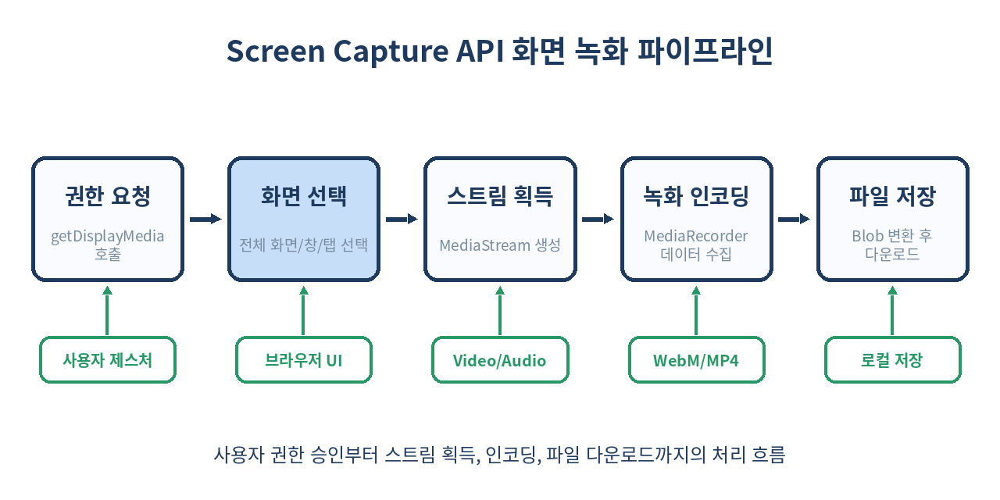
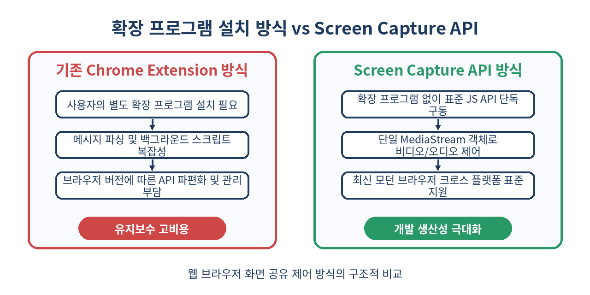

# 🖥️ Screen Capture API 완벽 가이드: 라이브러리 없이 구현하는 브라우저 네이티브 화면 공유 및 녹화

> 웹 화상 회의나 화면 녹화 기능을 구현하기 위해 더 이상 크롬 확장 프로그램(Chrome Extension)이나 무거운 외부 SDK를 설치할 필요가 없습니다. 현대 브라우저는 `Screen Capture API`를 통해 표준 자바스크립트 몇 줄만으로 고화질 화면과 오디오를 스트리밍할 수 있는 강력한 네이티브 능력을 제공합니다.

---

## 📌 목차
1. 🧭 1. Screen Capture API란 무엇인가?
2. ⚙️ 2. 기존 화면 공유 방식과의 비교
3. 🚀 3. 화면 스트림 획득 기초: getDisplayMedia()
4. 🎛️ 4. Display Media Constraints 제어와 캡처 범위 설정
5. 🔊 5. 시스템 오디오 및 브라우저 탭 소리 동시 캡처
6. 📹 6. MediaRecorder와 연동한 실시간 브라우저 화면 녹화기 구축
7. 🔄 7. 화면 공유 중단 감지 및 리소스 해제 처리
8. 🛡️ 8. 보안 권한 모델과 User Gesture 제약 조건
9. ⚡ 9. 탭 전환(Surface Switching) 및 자기 자신 캡처 제어
10. ⚠️ 10. 실무 개발 시 자주 발생하는 함정과 해결책
11. 🚫 11. Screen Capture API를 쓰면 안 되는 경우
12. 🧾 12. 정리

---

## 🧭 1. Screen Capture API란 무엇인가?

**Screen Capture API**는 웹 애플리케이션이 사용자의 모니터 전체, 특정 애플리케이션 창, 또는 브라우저 탭 화면을 `MediaStream` 형태로 직접 캡처할 수 있도록 지원하는 W3C 표준 브라우저 API입니다.

과거 웹에서 화면 공유를 구현하려면 화상 회의 서비스마다 전용 확장 프로그램을 Chrome 웹스토어에 등록하고, 사용자가 이를 직접 설치하도록 유도해야 했습니다. 하지만 modern 브라우저 환경에서는 `navigator.mediaDevices.getDisplayMedia()` 메서드 하나만으로 브라우저 수준의 UI 피커를 호출하여 안전하게 미디어 트랙을 전달받을 수 있습니다.

### 핵심 동작 메커니즘
1. **User Gesture 발동**: 클릭 이벤트 등 사용자의 명시적 상호작용 내에서 호출됩니다.
2. **Native UI Picker 노출**: OS 및 브라우저가 관리하는 보안 격리 영역에서 캡처 대상 선택 창(전체 화면, 창, 탭)을 표시합니다.
3. **MediaStream 생성**: 사용자가 승인하면 비디오 트랙(`MediaStreamTrack`)과 선택적 오디오 트랙을 포함한 `MediaStream` 객체가 생성됩니다.
4. **파이프라인 연결**: 생성된 스트림을 HTML5 `<video>` 요소, WebRTC `RTCPeerConnection`, 또는 `MediaRecorder` API에 바로 전달합니다.



Screen Capture API는 기존 `getUserMedia()`와 파이프라인 구조를 공유하지만, 하드웨어 장치(웹캠, 마이크)가 아닌 **디스플레이 출력 렌더링 파이프라인(GPU 프레임 버퍼 및 그래픽 서피스)**에서 비디오 프레임을 직접 수집한다는 핵심적인 차이점이 있습니다.

---

## ⚙️ 2. 기존 화면 공유 방식과의 비교

과거 웹RTC(WebRTC) 초기 시절의 확장 프로그램 기반 화면 공유 방식과 현대의 Screen Capture API를 비교해 보면 개발 환경과 사용자 경험 측면에서 매우 큰 차이가 존재합니다.

| 비교 항목 | 기존 확장 프로그램(Extension) 방식 | Screen Capture API (Web Standard) |
| :--- | :--- | :--- |
| **설치 필요성** | 사용자가 스토어에서 별도 확장 프로그램 설치 필수 | 외부 설치 전혀 없이 웹페이지에서 즉시 실행 |
| **구현 복잡도** | Extension Manifest V2/V3 및 백그라운드 메시징 작성 | `navigator.mediaDevices.getDisplayMedia()` 단일 호출 |
| **오디오 캡처** | 오디오 추출 설정이 매우 복잡하거나 제한적 | 탭 오디오 및 시스템 오디오 표준 옵션 제공 |
| **플랫폼 지원** | 데스크톱 브라우저에 한정되며 확장 프로그램 호환성 문제 | 데스크톱 및 주요 모바일 브라우저 표준 지원 |
| **보안 검증** | 웹스토어 심사 절차 필요 및 권한 누수 위험 | 브라우저 샌드박스 내 격리 및 표준 팝업 대화상자 |
| **유지보수 비용** | 브라우저 정책 변경마다 Extension 업데이트 필요 | W3C 표준 규격 준수로 하위 호환성 유지 |
| **성능 (FPS/CPU)** | 캡처 프레임 변환 시 프로세스 간 IPC 오버헤드 존재 | OS/GPU 프레임 버퍼 직접 접근으로 저지연 고성능 |



과거 방식은 `chrome.desktopCapture` API를 호출하고 백그라운드 스크립트와 웹 페이지 간에 `window.postMessage`를 통한 복잡한 릴레이 메시징 체계를 갖춰야 했습니다. 반면, 현대 표준 API는 비동기 프로미스(Promise) 패턴으로 단 몇 줄의 자바스크립트 코드만으로 동등 이상의 성능을 제공합니다.

---

## 🚀 3. 화면 스트림 획득 기초: getDisplayMedia()

Screen Capture API의 핵심 진입점은 `navigator.mediaDevices.getDisplayMedia()`입니다. 이 메서드는 비동기(Promise)로 작동하며, 사용자가 화면 공유를 허용하면 비디오 트랙(및 선택적 오디오 트랙)을 포함한 `MediaStream` 객체를 반환합니다.

### 완전한 실무 캡처 예제

다음 코드는 화면 캡처를 실행하고 비디오 엘리먼트에 출력을 연결하며, 메타데이터 로딩 및 예외 처리를 포함한 표준 예제입니다.

```html
<!DOCTYPE html>
<html lang="ko">
<head>
  <meta charset="UTF-8">
  <title>Screen Capture API Demo</title>
  <style>
    #screen-preview {
      width: 100%;
      max-width: 960px;
      height: auto;
      background-color: #000;
      border-radius: 8px;
    }
    .controls { margin-bottom: 12px; }
  </style>
</head>
<body>
  <div class="controls">
    <button id="start-btn">화면 공유 시작</button>
    <button id="stop-btn" disabled>화면 공유 중단</button>
  </div>
  <video id="screen-preview" autoplay playsinline muted></video>

  <script>
    const startBtn = document.getElementById('start-btn');
    const stopBtn = document.getElementById('stop-btn');
    const videoElement = document.getElementById('screen-preview');
    let currentStream = null;

    async function startScreenShare() {
      try {
        // 화면 공유 스트림 요청
        const mediaStream = await navigator.mediaDevices.getDisplayMedia({
          video: true,
          audio: false
        });

        currentStream = mediaStream;
        videoElement.srcObject = mediaStream;

        // 트랙 상태 탐색
        const videoTrack = mediaStream.getVideoTracks()[0];
        console.log('연결된 비디오 트랙 Label:', videoTrack.label);
        console.log('트랙 설정 값:', videoTrack.getSettings());

        // 스트림 내 모든 트랙이 종료될 때 UI 업데이트
        videoTrack.addEventListener('ended', () => {
          stopScreenShareUI();
        });

        startBtn.disabled = true;
        stopBtn.disabled = false;
      } catch (error) {
        handleCaptureError(error);
      }
    }

    function stopScreenShareUI() {
      if (currentStream) {
        currentStream.getTracks().forEach(track => track.stop());
        currentStream = null;
      }
      videoElement.srcObject = null;
      startBtn.disabled = false;
      stopBtn.disabled = true;
    }

    function handleCaptureError(error) {
      if (error.name === 'NotAllowedError') {
        console.warn('사용자가 화면 공유 팝업을 취소했거나 권한을 거부했습니다.');
      } else if (error.name === 'NotFoundError') {
        console.error('캡처 가능한 디스플레이 장치를 찾을 수 없습니다.');
      } else if (error.name === 'NotReadableError') {
        console.error('시스템 레벨에서 화면을 읽을 수 없습니다. OS 권한을 확인하세요.');
      } else {
        console.error('화면 공유 중 알 수 없는 에러 발생:', error);
      }
    }

    startBtn.addEventListener('click', startScreenShare);
    stopBtn.addEventListener('click', stopScreenShareUI);
  </script>
</body>
</html>
```

---

## 🎛️ 4. Display Media Constraints 제어와 캡처 범위 설정

`getDisplayMedia()`는 일반적인 카메라 스트림을 얻는 `getUserMedia()`와 유사하지만 사용 가능한 제약 조건(Constraints)에 차이가 있습니다. 브라우저 팝업 창에서 사용자가 처음부터 전체 화면, 창, 탭 중 어떤 것을 우선적으로 선택하도록 제안할지 힌트를 제공할 수 있습니다.

### 주요 Constraints 세부 설명

| 제약 조건 (Constraint) | 타입 | 기본값 | 설명 |
| :--- | :--- | :--- | :--- |
| `video.displaySurface` | String | undefined | 우선 선택 표출 서피스 (`'monitor'`, `'window'`, `'browser'`) |
| `video.width` | ConstrainULong | ideal | 캡처 비디오의 가로 해상도 제한 및 권장값 지정 |
| `video.height` | ConstrainULong | ideal | 캡처 비디오의 세로 해상도 제한 및 권장값 지정 |
| `video.frameRate` | ConstrainDouble | ideal | 프레임 레이트 (FPS) 제한 (예: 문서는 5~15fps, 동영상은 60fps) |
| `video.cursor` | String | `'always'` | 마우스 커서 표시 여부 (`'always'`, `'motion'`, `'never'`) |
| `audio` | Boolean / Object | false | 시스템/탭 오디오 포함 여부 및 오디오 제약 조건 |

### 캡처 옵션 고도화 및 세팅 확인 예제

```javascript
// 해상도 1080p, 60fps, 탭 우선 캡처 및 커서 항시 노출 제약 조건
const advancedConstraints = {
  video: {
    displaySurface: 'browser', // 'browser' (탭), 'window' (창), 'monitor' (전체 화면)
    width: { ideal: 1920, max: 3840 },
    height: { ideal: 1080, max: 2160 },
    frameRate: { ideal: 60, max: 60 },
    cursor: 'always'
  },
  audio: {
    suppressLocalAudioPlayback: false // 캡처 중인 오디오의 스피커 자체 출력 유지 여부
  }
};

async function captureWithCustomConstraints() {
  try {
    const stream = await navigator.mediaDevices.getDisplayMedia(advancedConstraints);
    const videoTrack = stream.getVideoTracks()[0];
    const settings = videoTrack.getSettings();

    console.log(`실제 캡처 서피스: ${settings.displaySurface}`);
    console.log(`실제 해상도: ${settings.width}x${settings.height} @ ${settings.frameRate}fps`);
    console.log(`마우스 커서 설정: ${settings.cursor}`);

    return stream;
  } catch (err) {
    console.error('맞춤 설정 스트림 획득 실패:', err);
  }
}
```

> **주의**: `displaySurface` 설정은 브라우저에게 주는 **힌트(Hint)**일 뿐입니다. 보안 및 사용자 주권 원칙에 따라 최종 결정권은 사용자에게 있으므로, 브라우저 피커 팝업에서 사용자가 다른 옵션을 선택할 수 있습니다. 따라서 반드시 `track.getSettings()`를 통해 결과값을 검증해야 합니다.

---

## 🔊 5. 시스템 오디오 및 브라우저 탭 소리 동시 캡처

화면 녹화나 튜토리얼을 제작할 때 디스플레이뿐만 아니라 **시스템 오디오(브라우저 탭 소리)** 및 **발언자의 마이크 소리**를 동시에 수집해야 하는 상황이 자주 발생합니다.

### 운영체제별 오디오 캡처 지원 범위

| 운영체제 (OS) | 브라우저 탭 오디오 | 전체 시스템 오디오 | 비고 |
| :--- | :--- | :--- | :--- |
| **Windows 10/11** | 지원 (완벽) | 지원 (완벽) | 전체 화면 및 탭 공유 시 선택 가능 |
| **macOS** | 지원 (완벽) | 제한적 / 불가능 | 탭 공유 시 탭 소리만 캡처 가능 (OS 보안 정책) |
| **Linux (PulseAudio/PipeWire)**| 지원 | 지원 (설정 의존) | PipeWire 환경에 따라 시스템 믹서 동기화 |
| **ChromeOS** | 지원 | 지원 | 크롬 OS 네이티브 믹서 연동 |

### 화면 오디오 + 사용자 마이크 오디오 합성 (Web Audio API 활용)

`getDisplayMedia()`로 수집한 탭/시스템 오디오와 `getUserMedia()`로 수집한 마이크 오디오 트랙을 `AudioContext`로 병합하여 하나의 스트림 트랙으로 만드는 실무 패턴입니다.

```javascript
async function getCombinedScreenAndMicAudio() {
  try {
    // 1. 화면 캡처 스트림 획득 (오디오 활성화)
    const displayStream = await navigator.mediaDevices.getDisplayMedia({
      video: true,
      audio: true
    });

    // 2. 마이크 입력 스트림 획득
    const micStream = await navigator.mediaDevices.getUserMedia({
      audio: {
        echoCancellation: true,
        noiseSuppression: true,
        autoGainControl: true
      }
    });

    // 3. Web Audio API Context 생성
    const audioContext = new (window.AudioContext || window.webkitAudioContext)();
    const destination = audioContext.createMediaStreamDestination();

    // 4. 화면 오디오 트랙이 존재하는지 확인 및 노드 연결
    if (displayStream.getAudioTracks().length > 0) {
      const displayAudioSource = audioContext.createMediaStreamSource(displayStream);
      const displayGain = audioContext.createGain();
      displayGain.gain.value = 0.7; // 시스템 오디오 볼륨 70%
      displayAudioSource.connect(displayGain).connect(destination);
    }

    // 5. 마이크 오디오 노드 연결
    if (micStream.getAudioTracks().length > 0) {
      const micAudioSource = audioContext.createMediaStreamSource(micStream);
      const micGain = audioContext.createGain();
      micGain.gain.value = 1.0; // 마이크 오디오 볼륨 100%
      micAudioSource.connect(micGain).connect(destination);
    }

    // 6. 합성된 오디오 트랙과 화면 비디오 트랙을 결합한 새로운 MediaStream 생성
    const combinedTracks = [
      ...displayStream.getVideoTracks(),
      ...destination.stream.getAudioTracks()
    ];

    const finalStream = new MediaStream(combinedTracks);
    return { finalStream, audioContext };
  } catch (error) {
    console.error('오디오 스트림 합성 실패:', error);
    throw error;
  }
}
```

---

## 📹 6. MediaRecorder와 연동한 실시간 브라우저 화면 녹화기 구축

획득한 화면 및 오디오 `MediaStream`은 `MediaRecorder` API와 연동하여 서버 전송 없이 브라우저 단에서 직접 파일(.webm, .mp4)로 저장할 수 있습니다.

### 인코더 코덱 지원 여부 및 비트레이트 설정

웹 브라우저 및 플랫폼별로 지원하는 영상 인코딩 코덱이 다릅니다. 안정성을 확보하기 위해 코덱 지원 여부(`MediaRecorder.isTypeSupported`)를 사전에 체크해야 합니다.

```javascript
function getSupportedMimeType() {
  const types = [
    'video/webm;codecs=vp9,opus',
    'video/webm;codecs=vp8,opus',
    'video/webm;codecs=h264,opus',
    'video/mp4;codecs=avc1,mp4a.40.2',
    'video/webm'
  ];

  for (const type of types) {
    if (MediaRecorder.isTypeSupported(type)) {
      return type;
    }
  }
  return '';
}
```

### 완벽한 화면 녹화 클래스 구현

아래 클래스는 녹화 시작, 일시정지, 재개, 중지 및 Blob 다운로드를 완전하게 제어하는 프로덕션 레벨 코드 패턴입니다.

```javascript
class ScreenRecorder {
  constructor() {
    this.mediaRecorder = null;
    this.recordedChunks = [];
    this.stream = null;
  }

  async startRecording() {
    // 화면 및 오디오 스트림 가져오기
    this.stream = await navigator.mediaDevices.getDisplayMedia({
      video: { width: 1920, height: 1080, frameRate: 30 },
      audio: true
    });

    const mimeType = getSupportedMimeType();
    if (!mimeType) {
      throw new Error('지원되는 미디어 코덱을 찾을 수 없습니다.');
    }

    const options = {
      mimeType: mimeType,
      videoBitsPerSecond: 5000000 // 5 Mbps 고화질 설정
    };

    this.recordedChunks = [];
    this.mediaRecorder = new MediaRecorder(this.stream, options);

    // 데이터 청크 수집 이벤트 핸들러
    this.mediaRecorder.ondataavailable = (event) => {
      if (event.data && event.data.size > 0) {
        this.recordedChunks.push(event.data);
      }
    };

    // 사용자가 상단 나눔 중지 바를 눌렀을 때 처리
    this.stream.getVideoTracks()[0].onended = () => {
      this.stopRecording();
    };

    // 1초(1000ms) 단위로 조각 데이터를 방출하도록 설정
    this.mediaRecorder.start(1000);
    console.log(`녹화 시작됨 [코덱: ${mimeType}]`);
  }

  pauseRecording() {
    if (this.mediaRecorder && this.mediaRecorder.state === 'recording') {
      this.mediaRecorder.pause();
      console.log('녹화 일시 정지됨');
    }
  }

  resumeRecording() {
    if (this.mediaRecorder && this.mediaRecorder.state === 'paused') {
      this.mediaRecorder.resume();
      console.log('녹화 재개됨');
    }
  }

  async stopRecording() {
    return new Promise((resolve) => {
      if (!this.mediaRecorder || this.mediaRecorder.state === 'inactive') {
        resolve(null);
        return;
      }

      this.mediaRecorder.onstop = () => {
        const blob = new Blob(this.recordedChunks, { type: this.mediaRecorder.mimeType });
        
        // 스트림 리소스 완전 정지
        if (this.stream) {
          this.stream.getTracks().forEach(track => track.stop());
        }

        console.log(`녹화 완료: 총 용량 ${(blob.size / (1024 * 1024)).toFixed(2)} MB`);
        resolve(blob);
      };

      this.mediaRecorder.stop();
    });
  }

  downloadBlob(blob, filename = 'screen-record.webm') {
    const url = URL.createObjectURL(blob);
    const a = document.createElement('a');
    a.style.display = 'none';
    a.href = url;
    a.download = filename;
    document.body.appendChild(a);
    a.click();
    setTimeout(() => {
      document.body.removeChild(a);
      URL.revokeObjectURL(url);
    }, 100);
  }
}
```

---

## 🔄 7. 화면 공유 중단 감지 및 리소스 해제 처리

화면 공유가 중단되는 시점은 애플리케이션 내의 '공유 중지' 버튼 클릭 외에도 **브라우저 하단의 플로팅 '공유 중지(Stop Sharing)' 시스템 바**를 사용자가 클릭하는 경우가 많습니다.

이를 올바르게 감지하여 웹페이지의 UI 상태를 복원하고, 메모리 누수를 방지하는 적절한 리소스 정리(Cleanup)가 필수적입니다.

```javascript
function attachTrackEndedListener(stream, onStopCallback) {
  const videoTrack = stream.getVideoTracks()[0];

  if (!videoTrack) return;

  const handleEnded = () => {
    console.log('사용자가 브라우저 시스템 UI에서 화면 공유를 중단했습니다.');
    
    // 1. 모든 관련 미디어 트랙 중지 (하드웨어/서피스 캡처 세션 해제)
    stream.getTracks().forEach(track => {
      track.stop();
      track.removeEventListener('ended', handleEnded);
    });

    // 2. 비디오 DOM 요소 초기화
    const videoElem = document.getElementById('screen-preview');
    if (videoElem) {
      videoElem.srcObject = null;
    }

    // 3. 애플리케이션 뷰/버튼 상태 원복 콜백 실행
    if (typeof onStopCallback === 'function') {
      onStopCallback();
    }
  };

  // 트랙에 ended 이벤트 리스너 바인딩
  videoTrack.addEventListener('ended', handleEnded);
}
```

---

## 🛡️ 8. 보안 권한 모델과 User Gesture 제약 조건

Screen Capture API는 사용자의 화면 전체 정보(개인정보, 암호, 이메일 등)가 노출될 수 있는 민감한 기능이므로 브라우저 샌드박스 보안 정책에 엄격하게 통제됩니다.

### 1. Transient Activation (사용자 활성화 제약)
`getDisplayMedia()`는 사용자 클릭(`click`), 키보드 입력(`keydown`) 등 **사용자의 직접적인 제스처(User Gesture) 내부에서만 즉시 실행**될 수 있습니다. 비동기 `setTimeout`이나 페이지 로드 직후(`DOMContentLoaded`)에 자동 호출하면 예외가 발생합니다.

```javascript
// ❌ 잘못된 방식 (User Gesture 없이 실행 -> InvalidStateError 또는 SecurityError)
window.addEventListener('load', async () => {
  await navigator.mediaDevices.getDisplayMedia({ video: true }); 
});

// ✅ 올바른 방식 (사용자 이벤트 핸들러 직속 실행)
document.getElementById('capture-btn').addEventListener('click', async () => {
  const stream = await navigator.mediaDevices.getDisplayMedia({ video: true });
});
```

### 2. Permissions-Policy HTTP 헤더 설정
타사(3rd-party) `iframe` 내부에서 화면 캡처 API를 호출하려면 상위 서빙 서버의 HTTP Response Header 및 `iframe` 태그 속성에 명시적인 캡처 권한이 부여되어야 합니다.

```http
# 서버 응답 헤더 예시 (Permissions-Policy)
Permissions-Policy: display-capture=(self "https://trusted-partner.com")
```

```html
<!-- iframe 태그 내 캡처 권한 부여 -->
<iframe src="https://trusted-partner.com/embed/share" allow="display-capture"></iframe>
```

---

## ⚡ 9. 탭 전환(Surface Switching) 및 자기 자신 캡처 제어

최근 Modern 브라우저(Chrome 107+)는 화면 공유 시 발생하는 무한 거울 현상(Infinite Mirroring Effect)이나 탭 전환 편의성을 제공하기 위해 새로운 제약 옵션을 지원합니다.

### 1. `selfBrowserSurface`: 자기 자신 탭 캡처 방지
현재 캡처 프로그램을 실행 중인 브라우저 탭 자체를 공유 대상 목록에서 제외하거나 포함하도록 지정합니다.

```javascript
const stream = await navigator.mediaDevices.getDisplayMedia({
  video: {
    // 'exclude': 현재 공유 버튼을 누른 탭을 팝업 목록에서 제외하여 거울 현상 방지
    // 'include': 포함 (기본값)
    selfBrowserSurface: 'exclude'
  }
});
```

### 2. `surfaceSwitching`: 공유 중 탭 전환 버튼 노출 여부
공유 중에도 브라우저 상단 바에 "이 탭 대신 공유" 버튼을 띄워 캡처 대상을 클릭 한 번으로 바꿀 수 있게 허용할지 제어합니다.

```javascript
const stream = await navigator.mediaDevices.getDisplayMedia({
  video: {
    // 'include': 브라우저 탭 상단에 다른 탭으로 즉시 전환 가능한 퀵 바 표시
    // 'exclude': 탭 전환 바를 숨김
    surfaceSwitching: 'include'
  }
});
```

### 3. Region Capture (특정 DOM 영역 크롭 캡처)
전체 화면이나 전체 탭이 아닌 웹 페이지 내부의 특정 `<div>` 영역만 타겟팅하여 트랙을 잘라내는(Crop) 최신 W3C 확장 규격입니다 (Chrome 지원).

```javascript
// 웹 페이지 내 특정 Element 영역만 비디오 트랙으로 자르기
async function cropElementCapture(targetElement) {
  const stream = await navigator.mediaDevices.getDisplayMedia({ video: true });
  const [track] = stream.getVideoTracks();

  if (typeof CropTarget !== 'undefined' && track.cropTo) {
    // DOM 요소를 CropTarget 객체로 변환
    const cropTarget = await CropTarget.fromElement(targetElement);
    // 비디오 트랙 크롭 적용
    await track.cropTo(cropTarget);
    console.log('특정 DOM 요소 영역으로 비디오 트랙 크롭 성공');
  }
  return stream;
}
```

---

## ⚠️ 10. 실무 개발 시 자주 발생하는 함정과 해결책

### 함정 1: 무한 거울 현상 (Infinite Hall of Mirrors)
사용자가 화면 전체(Monitor)나 현재 웹앱이 열려 있는 브라우저 탭을 선택하고 이를 동일한 화면 내 `<video>` 태그에 즉시 프리뷰로 보여줄 때 비디오가 무한 반복되어 렌더링되는 현상입니다.

* **해결책**:
  1. `selfBrowserSurface: 'exclude'` 옵션을 지정하여 현재 탭 선택을 차단합니다.
  2. 프리뷰 사용 시 비디오 피드백 루프를 차단하기 위해 캔버스에 그릴 때 오프셋을 두거나, 사용자가 공유 대상을 변경하도록 안내 문구를 띄웁니다.

### 함정 2: 4K 해상도 및 60FPS 설정 시 프레임 드랍 및 CPU 과점유
고해상도 디스플레이에서 초당 60프레임으로 화면을 캡처하고 동시에 MediaRecorder 인코딩까지 수행하면 저사양 노트북 환경에서 하드웨어 가속 한계로 CPU 사용량이 100%까지 치솟고 프레임 드랍이 심화됩니다.

* **해결책**:
  실무 목적에 맞추어 `frameRate` 및 `width` 최적화를 반드시 진행해야 합니다.

```javascript
// 프레젠테이션/문서 공유용 최적화 설정 (Low FPS, Dynamic Resolution)
const presentationConstraints = {
  video: {
    width: { max: 1920 },
    height: { max: 1080 },
    frameRate: { max: 15, ideal: 10 } // 문서/PPT 공유 시 10~15fps로 충분함
  }
};
```

### 함정 3: Safari(macOS / iOS) 미지원 및 동작 불일치
Safari 브라우저는 화면 공유 보안 모델이 매우 까다로우며, iOS/iPadOS Safari 환경에서는 `getDisplayMedia()` 오디오 캡처 지원에 제약이 존재합니다.

* **해결책**:
  기능 실행 전 크로스 브라우저 호환성을 체크하는 방어 코드를 작성합니다.

```javascript
function checkScreenCaptureSupport() {
  if (!navigator.mediaDevices || !navigator.mediaDevices.getDisplayMedia) {
    alert('현재 브라우저는 Screen Capture API를 지원하지 않습니다. 최신 Chrome, Edge, Safari를 사용하세요.');
    return false;
  }
  return true;
}
```

---

## 🚫 11. Screen Capture API를 쓰면 안 되는 경우

Screen Capture API는 만능이 아니며, 브라우저의 보안 정책 및 기술 구조적 한계로 인해 다음 유즈케이스에서는 사용에 적합하지 않습니다.

### 1. OTT 및 DRM 보호 콘텐츠 캡처 (Netflix, Disney+, Widevine Content)
Widevine, FairPlay 등 DRM(Digital Rights Management) 기술이 적용된 비디오 재생 영역을 `getDisplayMedia()`로 캡처할 경우, 브라우저의 보안 그래픽 파이프라인(Encrypted Media Extensions)이 작동하여 **검은 화면(Black Screen)**으로만 기록됩니다.
* **대안**: DRM 콘텐츠는 네이티브 앱 기반 결합 또는 전용 SDK 정책을 따라야 합니다.

### 2. 사용자의 동의 없는 백그라운드 몰래 녹화 (Silent Background Recording)
보안상 브라우저는 `getDisplayMedia()` 호출 시 반드시 화면 피커 UI를 노출하며, 공유 중일 때 브라우저 상단과 시스템 트레이에 화면 공유 중임을 나타내는 붉은색/파란색 인디케이터 아이콘을 명시합니다. 스크립트만으로 사용자 승인 없이 백그라운드 캡처를 진행하는 것은 불가능합니다.

### 3. 超 초저지연(Ultra Low Latency) 원격 제어 게임 스트리밍
원격 게이밍(예: GeForce Now) 수준의 1ms 미만 엔드투엔드 반응 속도가 요구되는 경우, 브라우저 비디오 인코더 pipeline 단계에서 일어나는 버퍼링(10 ~ 50ms)으로 인해 만족스러운 응답성을 얻기 어려울 수 있습니다.
* **대안**: WebGPU/WebCodecs 기반 합성 및 네이티브 C++ 바인딩 코덱 연동 구조를 채택해야 합니다.

---

## 🧾 12. 정리

Screen Capture API는 플러그인이나 외부 라이브러리 의존성을 완전히 elimination 하고 현대 웹 브라우저 네이티브 기술만으로 강력한 화면 공유 및 녹화 솔루션을 구축할 수 있게 해주는 현대 표준 기술입니다.

### 핵심 요약 체크리스트

1. **API 진입점**: `navigator.mediaDevices.getDisplayMedia(constraints)` 호출.
2. **권한 처리**: 반드시 사용자 이벤트(User Gesture) 내부에서 비동기로 실행.
3. **오디오 병합**: 시스템 오디오와 마이크 소리를 함께 녹화하려면 Web Audio API (`AudioContext`)를 믹서로 활용.
4. **녹화 및 다운로드**: `MediaRecorder` API와 결합하여 적절한 코덱(`webm`/`mp4`) 탐색 후 Blob 바이너리 파일로 저장.
5. **예외 및 리소스 처리**: `track.onended` 이벤트 바인딩을 통해 시스템 단 공유 중지 버튼 누름을 감지하고 `track.stop()`을 실행하여 메모리 정리.
6. **옵션 최적화**: `selfBrowserSurface: 'exclude'`, `frameRate` 제약 조건을 활용해 성능 저하 및 무한 거울 현상을 방지.

Screen Capture API와 WebRTC, MediaRecorder, WebAudio API를 상호 조합하면 별도의 프로그램 설치 없이 단 몇 줄의 자바스크립트 스크립트만으로도 고성능 SaaS 수준의 화상회의 및 화면 녹화 애플리케이션을 완성할 수 있습니다.
