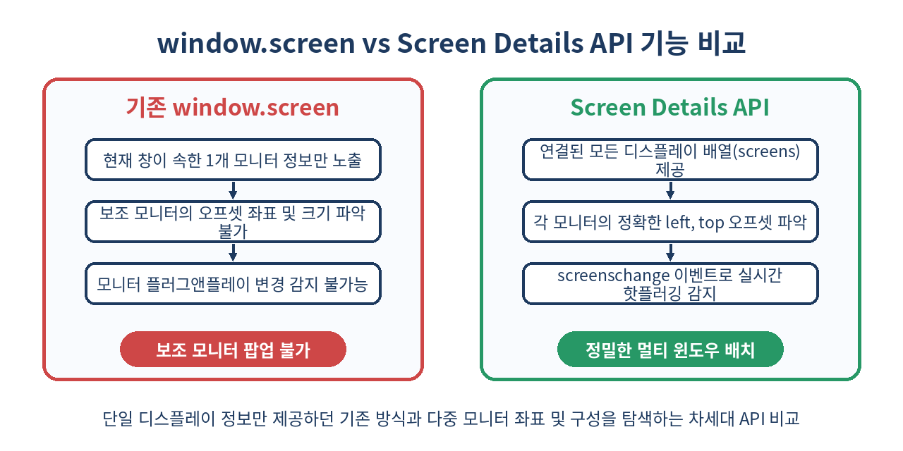
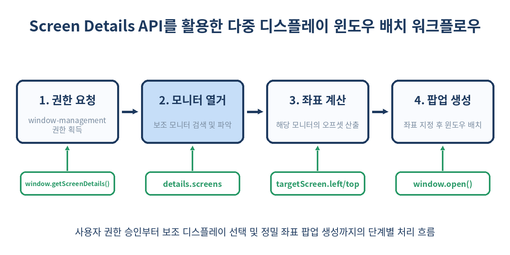

# 🖥️ Screen Details API 완벽 가이드: 브라우저에서 다중 모니터 위치를 감지하고 윈도우를 특정 디스플레이에 정밀 배치하기

> "웹 애플리케이션에서도 금융 트레이딩 룸, 영상 편집기, 프레젠테이션 모드처럼 여러 모니터에 창을 원하는 대로 정밀하게배치할 수는 없을까?"
> 기존 브라우저의 단일 디스플레이 한계를 극복하고 연결된 모든 모니터의 해상도, 물리적 위치(좌표 오프셋), 주/보조 모니터 여부를 감지하여 원하는 화면에 윈도우 및 전채 화면(Full Screen)을 띄우는 Screen Details API(구 Multi-Screen Window Placement API)의 모든 것을 파헤쳐 봅니다.

---

## 📌 목차
1. 🧭 1. 다중 모니터 시대, 기존 window.screen의 한계와 도전 과제
2. 💡 2. Screen Details API란 무엇인가?
3. 🔐 3. 권한 모델과 보안 요구사항 (`window-management`)
4. 🖥️ 4. ScreenDetails 및 ScreenDetailed 객체 핵심 구조 분석
5. 🗺️ 5. 연결된 모니터 목록 탐색 및 주/보조 디스플레이 판별
6. 🪟 6. 특정 모니터로 차세대 팝업 윈도우 정확히 띄우기
7. 🚀 7. 풀스크린 API와의 연동: 특정 모니터에 전체 화면 띄우기
8. 🔄 8. 모니터 연결·해제 및 해상도 변경 실시간 이벤팅
9. 📊 9. 기존 window.screen vs Screen Details API 기술 비교
10. ⚠️ 10. 실무 구축 시 주의해야 할 3가지 함정과 대응 전략
11. 🚫 11. Screen Details API를 사용하지 말아야 할 경우
12. 🧾 12. 정리
13. 📚 참고 자료

---

## 🧭 1. 다중 모니터 시대, 기존 window.screen의 한계와 도전 과제

오늘날의 웹은 단순한 문서 전달용 페이지에 머무르지 않습니다. 주식 및 암호화폐 트레이딩 대시보드, 영상/음향 편집 툴, 의료용 영상 분석기(PACS), 온라인 강의 및 발표용 프레젠터 등 고급 데스크톱 소프트웨어 수준의 웹 앱(Web App)이 활발히 구축되고 있습니다.

하지만 지금까지 웹 개발자들은 **다중 디스플레이(Multi-Monitor)** 환경을 제어할 때 큰 벽에 부딪혔습니다. 전통적인 웹 브라우저의 `window.screen` 객체는 오직 **'현재 브라우저 창이 위치한 디스플레이'** 1개의 정보만 반환했습니다.

- 사용자 PC에 모니터가 2개 이상 연결되어 있는지 파악할 수 없음
- 보조 모니터의 X, Y 좌표(Screen Offset)를 알 수 없어 `window.open()` 호출 시 팝업 창이 무조건 현재 창이 있는 모니터에만 뜸
- 사용자가 보조 모니터로 창을 직접 드래그해서 옮겨야만 하는 열악한 UX 제공

이러한 한계를 극복하기 위해 W3C와 브라우저 제조사들은 웹에서도 사용자의 다중 디스플레이 환경을 안전하게 파악하고 활용할 수 있는 **Screen Details API**를 도입했습니다.



---

## 💡 2. Screen Details API란 무엇인가?

**Screen Details API**(과거 *Multi-Screen Window Placement API*로 불림)는 브라우저가 사용자 기기에 연결된 모든 디스플레이의 세부 정보를 조회하고, 특정 디스플레이에 보조 창을 배치하거나 전체 화면(Fullscreen)을 요청할 수 있도록 해주는 웹 API입니다.

이 API를 활용하면 다음과 같은 고급 기능 작성이 가능해집니다:
- **슬라이드 프레젠테이션**: 1번 모니터(보조)에는 발표자용 슬라이드를 띄우고, 2번 모니터(메인 프로젝터)에는 청중용 전체 화면 슬라이드를 띄움
- **멀티 모니터 트레이딩 뷰**: '차트 분리' 버튼을 누르면 2번, 3번 모니터의 좌표를 자동 계산하여 각 모니터에 전용 차트 창을 분할 배치
- **비디오 클립 뷰어**: 메인 모니터에는 타임라인 에디터를, 보조 모니터에는 초고화질 프레임 뷰어 창을 배치



---

## 🔐 3. 권한 모델과 보안 요구사항 (`window-management`)

사용자의 모니터 수, 해상도, 배치 위치 좌표는 개인을 식별하거나 추적하는 데 악용될 수 있는 **핑거프린팅(Fingerprinting)** 정보입니다. 따라서 브라우저는 Screen Details API 접근 시 철저한 보안 통제를 적용합니다.

1. **HTTPS 필수**: 보안 컨텍스트(`Secure Context`)에서만 동작합니다.
2. **사용자 승인 권한**: API 호출 시 브라우저가 사용자에게 `window-management` 권한 승인 팝업을 표시합니다.
3. **사용자 제스처(User Activation) 요구**: `window.getScreenDetails()` 메서드 호출은 클릭이나 키보드 입력 같은 사용자 상호작용 이벤트 핸들러 내부에서 시작되어야 합니다.

### 권한 상태 확인 및 요청 코드 예시

```js
async function checkAndRequestScreenPermission() {
  if (!('getScreenDetails' in window)) {
    console.warn('현재 브라우저는 Screen Details API를 지원하지 않습니다.');
    return false;
  }

  try {
    // 1. Permissions API로 미리 권한 상태 확인
    const permissionStatus = await navigator.permissions.query({ name: 'window-management' });
    console.log(`현재 권한 상태: ${permissionStatus.state}`);

    if (permissionStatus.state === 'denied') {
      alert('다중 디스플레이 기능을 사용하려면 브라우저 설정에서 화면 관리 권한을 허용해 주세요.');
      return false;
    }

    return true;
  } catch (err) {
    console.error('권한 확인 중 오류 발생:', err);
    return false;
  }
}
```

---

## 🖥️ 4. ScreenDetails 및 ScreenDetailed 객체 핵심 구조 분석

`window.getScreenDetails()`를 호출하면 `ScreenDetails` 객체가 반환됩니다. 이 객체는 연결된 모든 디스플레이를 담고 있는 배열과 주요 상태 프로퍼티를 제공합니다.

```text
ScreenDetails
├── screens: [ ScreenDetailed, ScreenDetailed, ... ]  // 연결된 전체 디스플레이 리스트
├── currentScreen: ScreenDetailed                      // 현재 브라우저 창이 위치한 디스플레이
└── onscreenschange: EventListener                    // 모니터 연결/해제 감지 이벤트
```

### ScreenDetailed 객체의 프로퍼티 상세

각 디스플레이는 기존 `Screen` 객체를 확장한 `ScreenDetailed` 객체로 표현됩니다.

| 프로퍼티 | 타입 | 설명 |
|---|---|---|
| `left` | `number` | 가상 데스크톱 영역 내 모니터 왼쪽 시작 X 좌표 (px) |
| `top` | `number` | 가상 데스크톱 영역 내 모니터 상단 시작 Y 좌표 (px) |
| `width` | `number` | 모니터의 전체 가로 해상도 (px) |
| `height` | `number` | 모니터의 전체 세로 해상도 (px) |
| `availLeft` / `availTop` | `number` | 작업 표시줄을 제외한 사용 가능 영역 X/Y 좌표 |
| `availWidth` / `availHeight` | `number` | 작업 표시줄을 제외한 사용 가능 가로/세로 크기 |
| `isPrimary` | `boolean` | 운영체제(OS) 지정 주 모니터 여부 |
| `isInternal` | `boolean` | 내장 디스플레이(노트북 화면 등) 여부 |
| `isPrimary` | `boolean` | OS 메인 모니터 여부 |
| `devicePixelRatio` | `number` | 해당 모니터의 DPR (High-DPI / Retain 디스플레이 대응) |
| `label` | `string` | 모니터 이름 (예: "Built-in Retina Display", "Dell U2720Q") |

---

## 🗺️ 5. 연결된 모니터 목록 탐색 및 주/보조 디스플레이 판별

실제 코드를 작성하여 사용자 기기에 연결된 디스플레이 수와 각 모니터의 사양을 출력해 보겠습니다.

```js
// 사용자 버튼 클릭 이벤트와 연결 권장
async function discoverScreens() {
  try {
    // ScreenDetails 객체 가져오기 (권한 팝업이 노출될 수 있음)
    const screenDetails = await window.getScreenDetails();
    
    console.log(`총 ${screenDetails.screens.length}개의 모니터가 감지되었습니다.`);
    
    screenDetails.screens.forEach((screen, index) => {
      console.log(`--- [모니터 #${index + 1}] ---`);
      console.log(`라벨: ${screen.label}`);
      console.log(`위치 오프셋: (X: ${screen.left}px, Y: ${screen.top}px)`);
      console.log(`해상도: ${screen.width} x ${screen.height}`);
      console.log(`주 모니터 여부: ${screen.isPrimary ? 'YES' : 'NO'}`);
      console.log(`내장 화면 여부: ${screen.isInternal ? 'YES' : 'NO'}`);
      console.log(`DPR: ${screen.devicePixelRatio}`);
    });

    return screenDetails;
  } catch (err) {
    if (err.name === 'NotAllowedError') {
      console.error('사용자가 화면 관리 권한을 거부했습니다.');
    } else {
      console.error('디스플레이 정보 탐색 실패:', err);
    }
    return null;
  }
}
```

--- 

## 🪟 6. 특정 모니터로 차세대 팝업 윈도우 정확히 띄우기

Screen Details API의 핵심 가치는 **원하는 디스플레이 좌표로 창을 생성**하는 능력에 있습니다. `window.open()`의 `left`, `top`, `width`, `height` 옵션에 targetScreen의 좌표값을 직접 주입합니다.

### 보조 모니터에 정밀 팝업을 배치하는 실무 코드 패턴

```js
async function openWindowOnSecondaryScreen() {
  const screenDetails = await window.getScreenDetails();
  
  if (screenDetails.screens.length < 2) {
    alert('보조 모니터가 감지되지 않았습니다. 단일 모니터 환경입니다.');
    return;
  }

  // 1. 주 모니터가 아닌 첫 번째 보조 모니터 탐색
  const secondaryScreen = screenDetails.screens.find(s => !s.isPrimary) 
                         || screenDetails.screens[1];

  // 2. 보조 모니터 중앙에 팝업을 띄우기 위한 좌표 계산
  const popupWidth = 1024;
  const popupHeight = 768;
  
  // 작업 표시줄 영역을 고려한 availLeft, availTop 사용
  const left = secondaryScreen.availLeft + Math.round((secondaryScreen.availWidth - popupWidth) / 2);
  const top = secondaryScreen.availTop + Math.round((secondaryScreen.availHeight - popupHeight) / 2);

  // 3. window.open 옵션 설정
  const windowFeatures = [
    `left=${left}`,
    `top=${top}`,
    `width=${popupWidth}`,
    `height=${popupHeight}`,
    'menubar=no',
    'toolbar=no',
    'location=no',
    'status=no'
  ].join(',');

  // 4. 창 열기
  const popupWindow = window.open('https://app.example.com/sub-dashboard', 'SecondaryDashboard', windowFeatures);

  if (popupWindow) {
    popupWindow.focus();
    console.log(`보조 모니터(${secondaryScreen.label})에 성공적으로 창을 열었습니다.`);
  } else {
    alert('팝업 차단 기능이 활성화되어 있습니다. 팝업을 허용해 주세요.');
  }
}
```

---

## 🚀 7. 풀스크린 API와의 연동: 특정 모니터에 전체 화면 띄우기

Screen Details API는 W3C `Element.requestFullscreen()` 옵션과 결합하여, **현재 브라우저가 위치하지 않은 다른 모니터에 즉시 전체 화면**을 띄울 수 있습니다.

### 발표자 뷰 & 청중 프레젠테이션 예시

```html
<button id="start-presentation">보조 모니터에서 프레젠테이션 시작</button>
<div id="presentation-canvas" style="display:none;">
  <h1>청중용 프레젠테이션 화면</h1>
</div>

<script>
document.getElementById('start-presentation').addEventListener('click', async () => {
  const screenDetails = await window.getScreenDetails();
  
  // 보조 모니터 선택 (없으면 외부 모니터 중 첫 번째)
  const targetScreen = screenDetails.screens.find(s => s !== screenDetails.currentScreen) 
                    || screenDetails.currentScreen;

  const elem = document.getElementById('presentation-canvas');
  elem.style.display = 'block';

  try {
    // requestFullscreen의 screen 옵션 지정
    await elem.requestFullscreen({
      screen: targetScreen
    });
    console.log(`모니터 [${targetScreen.label}]에 전체화면 실행 완료`);
  } catch (err) {
    console.error('전체 화면 전환 실패:', err);
  }
});
</script>
```

---

## 🔄 8. 모니터 연결·해제 및 해상도 변경 실시간 이벤팅

사용자가 웹 앱 사용 중에 모니터 케이블을 뽑거나(Hot-Unplug), 모니터를 추가로 연결하거나, 해상도/디스플레이 방향(가로/세로)을 변경할 수 있습니다. Screen Details API는 이를 관찰하는 이벤트를 제공합니다.

### 1. `screenschange` 이벤트: 디스플레이 추가 및 제거 감지
```js
async function setupScreenChangeListener() {
  const screenDetails = await window.getScreenDetails();

  screenDetails.addEventListener('screenschange', () => {
    console.log('🖥️ 디스플레이 구성이 변경되었습니다!');
    console.log(`현재 연결된 총 모니터 수: ${screenDetails.screens.length}`);
    
    // UI 업데이트 또는 팝업 창 위치 재정렬 로직 호출
    updateDashboardLayout(screenDetails.screens);
  });
}
```

### 2. `currentscreenchange` 이벤트: 브라우저 창이 다른 모니터로 이동됨 감지
```js
async function setupCurrentScreenListener() {
  const screenDetails = await window.getScreenDetails();

  screenDetails.addEventListener('currentscreenchange', () => {
    const current = screenDetails.currentScreen;
    console.log(`🚚 브라우저 창이 이동되었습니다. 현재 모니터: ${current.label} (${current.width}x${current.height})`);
  });
}
```

### 3. 개별 모니터 속성 변경 감지 (`change` 이벤트)
```js
async function setupIndividualScreenListeners() {
  const screenDetails = await window.getScreenDetails();

  screenDetails.screens.forEach(screen => {
    screen.addEventListener('change', () => {
      console.log(`📐 모니터 [${screen.label}]의 해상도나 오프셋이 변경되었습니다.`);
    });
  });
}
```

---

## 📊 9. 기존 window.screen vs Screen Details API 기술 비교

| 비교 항목 | 기존 `window.screen` | 차세대 `Screen Details API` |
|---|---|---|
| **지원 모니터 범위** | 현재 창이 속한 단 1개 디스플레이 | 연결된 모든(N개) 다중 디스플레이 |
| **보조 모니터 오프셋(X, Y)** | 파악 불가 (`left`, `top` 고정 또는 0) | 각 모니터의 완벽한 가상 좌표 제공 (`left`, `top`) |
| **주/내장 모니터 판별** | 불가능 | `isPrimary`, `isInternal` 프로퍼티 제공 |
| **특정 모니터 팝업 열기** | 불가능 (현재 모니터에만 오픈) | 가능 (`window.open`에 좌표 전달) |
| **타 모니터 Fullscreen** | 불가능 | 가능 (`requestFullscreen({ screen })`) |
| **모니터 핫플러깅 감지** | 지원 안 함 | `screenschange` 이벤트 지원 |
| **보안 모델** | 동의 없이 즉시 조회 가능 (제한적 정보) | `window-management` 명시적 권한 동의 필요 |

---

## ⚠️ 10. 실무 구축 시 주의해야 할 3가지 함정과 대응 전략

### 1. High-DPI(Retina) 디스플레이 오프셋 계산 실수
서로 다른 devicePixelRatio(DPR)를 가진 모니터가 섞여 있을 때(예: 4K 200% 배율 노트북 화면 + 100% 1080p 외부 모니터), 브라우저의 CSS 픽셀 좌표와 OS의 실제 물리 픽셀 좌표 간에 오차가 발생할 수 있습니다.
- **대응책**: Screen Details API가 반환하는 `left`, `top`, `width`, `height`는 이미 **CSS 픽셀 단위로 정규화**된 값입니다. 별도로 `devicePixelRatio`를 곱하거나 나누지 말고 API가 제공하는 CSS 좌표 수치를 그대로 `window.open` 옵션에 주입해야 합니다.

### 2. 크로스 오리진 팝업 차단 및 User Gesture 만료
비동기로 `getScreenDetails()`를 기다리는 사이에 사용자 제스처(User Activation)가 만료되면 `window.open()`이 브라우저 팝업 차단기에 걸릴 수 있습니다.
- **대응책**: 페이지 초기화 시점에 권한 상태를 미리 체크하고, 버튼 클릭 핸들러 직후 동기식 흐름에 가깝게 `window.open`을 호출하도록 구조를 설계하세요.

```js
// ❌ 잘못된 예시: 긴 비동기 로직 후 팝업 호출
button.onclick = async () => {
  const data = await fetchLongData(); // 시간이 오래 걸림
  const details = await window.getScreenDetails();
  window.open(...); // 팝업 차단기에 걸릴 위험 매우 높음!
};

// ⭕ 올바른 예시: 클릭 즉시 권한 및 창 생성 실행
button.onclick = async () => {
  const details = await window.getScreenDetails(); // 빠르게 호출
  const targetScreen = details.screens[1];
  window.open('about:blank', 'TargetWin', `left=${targetScreen.left}...`); // 즉시 창 확보 후 로딩
};
```

### 3. 브라우저 호환성 및 폴백(Fallback) 처리
Screen Details API는 Chromium 기반 브라우저(Chrome 100+, Edge 100+, Opera 등)에서 강력하게 지원되지만, Safari 및 Firefox에서는 개인정보 보호 정책(Anti-Fingerprinting)으로 인해 아직 지원이 제한적이거나 개발 중입니다.
- **대응책**: 항상 기능 감지(`'getScreenDetails' in window`)를 수행하고, 미지원 브라우저에서는 기존의 단일 모니터 모달 레이어나 일반 팝업으로 분기하는 Graceful Degradation 전략이 필수적입니다.

---

## 🚫 11. Screen Details API를 사용하지 말아야 할 경우

1. **단일 창 위주의 일반적인 웹 사이트 / 블로그 / E-커머스 쇼핑몰**
   - 불필요한 `window-management` 권한 요청은 사용자에게 보안 경고심을 유발하고 이탈률을 높입니다.
2. **모바일 웹 및 PWA 환경**
   - 스마트폰이나 태블릿 기기는 단일 모니터가 기본이므로 이 API의 혜택을 받지 못하며, 권한 요청 자체가 거절될 확률이 높습니다.
3. **사용자의 다중 모니터 배치 상태를 트래킹/분석하려는 목적**
   - 사용자의 화면 구성을 서드파티 분석 툴에 무단 전송하는 행위는 privacy 지침 위반 및 핑거프린팅 시도로 간주되어 제재를 받을 수 있습니다.

---

## 🧾 12. 정리

- **Screen Details API**는 사용자 기기에 연결된 다중 모니터의 사양과 가상 좌표 오프셋을 파악할 수 있는 브라우저 네이티브 API입니다.
- `window.getScreenDetails()` 호출을 통해 주/보조 모니터 여부, 내장/외장 모니터 여부, 각 디스플레이의 CSS 좌표(`left`, `top`, `width`, `height`)를 정확히 가져옵니다.
- `window.open()`의 위치 좌표 지정과 `requestFullscreen({ screen })` 연동을 통해 보조 모니터에 차별화된 멀티 윈도우 UI를 제공할 수 있습니다.
- 보안을 위해 `Secure Context(HTTPS)`와 `window-management` 사용자 승인 권한이 필수적입니다.
- 트레이딩, 프레젠테이션, 미디어 에디터, 다중 대시보드 웹 앱 구축 시 필수적인 차세대 브라우저 표준 기술입니다.

> ✨ **한 줄 요약**  
> Screen Details API를 사용하면 브라우저에서도 사용자의 보조 모니터 위치를 정밀 감지하여 원하는 화면에 윈도우와 전체 화면을 완벽하게 배치할 수 있습니다.

---

## 📚 참고 자료
- [W3C Window Management Specification (Screen Details API)](https://w3c.github.io/window-management/)
- [MDN Web Docs - Screen Details API](https://developer.mozilla.org/en-US/docs/Web/API/Screen_Details_API)
- [Chrome Developers - Managing multi-display window placement](https://developer.chrome.com/docs/capabilities/web-apis/multi-screen-window-placement/)
