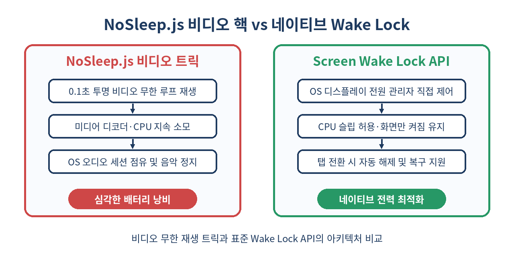
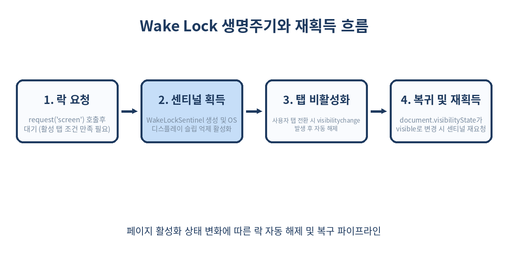

# 💡 Screen Wake Lock API 완벽 가이드: 브라우저 화면 꺼짐 방지와 배터리 최적화

> "요리 레시피를 보며 양념 묻은 손으로 폰 화면을 계속 톡톡 두드려본 적 있으신가요?"
> 피트니스 타이머, 바코드 티켓 입장권, 슬라이드 발표 도구, 웹 키오스크에 이르기까지 화면이 자동으로 꺼지면 사용자 경험은 순식간에 망가집니다. 과거 0.1초짜리 투명 비디오를 무한 반복 재생하던 기괴한 꼼수에서 벗어나, 이제 W3C 표준 **Screen Wake Lock API**로 OS 디스플레이 전원을 안전하고 배터리 친화적으로 제어하는 법을 완벽히 정리합니다.

---

## 📌 목차
1. [웹 브라우저와 화면 자동 꺼짐(Display Sleep)의 딜레마](#-1-웹-브라우저와-화면-자동-꺼짐display-sleep의-딜레마)
2. [과거의 꼼수 vs 표준 API: NoSleep.js의 비극](#-2-과거의-꼼수-vs-표준-api-nosleepjs의-비극)
3. [Screen Wake Lock API 핵심 인터페이스와 기본 사용법](#-3-screen-wake-lock-api-핵심-인터페이스와-기본-사용법)
4. [생명주기와 자동 해제(Auto-Release) 메커니즘](#-4-생명주기와-자동-해제auto-release-메커니즘)
5. [Page Visibility API와 완벽한 재획득(Re-acquire) 패턴](#-5-page-visibility-api와-완벽한-재획득re-acquire-패턴)
6. [보안 정책: Permissions-Policy와 iframe 제약](#-6-보안-정책-permissions-policy와-iframe-제약)
7. [예외 처리 전략: 저전력 모드와 거부 사유 대응](#-7-예외-처리-전략-저전력-모드와-거부-사유-대응)
8. [실전 프로덕션: 견고한 React useWakeLock 훅 구현](#-8-실전-프로덕션-견고한-react-usewakelock-훅-구현)
9. [대표적인 실무 활용 유즈케이스 4선](#-9-대표적인-실무-활용-유즈케이스-4선)
10. [브라우저 지원 현황과 점진적 향상(Progressive Enhancement)](#-10-브라우저-지원-현황과-점진적-향상progressive-enhancement)
11. [실무 함정과 안티패턴: 언제 쓰면 안 되는가?](#-11-실무-함정과-안티패턴-언제-쓰면-안-되는가)
12. [정리 및 체크리스트](#-12-정리-및-체크리스트)
13. [참고 자료](#-참고-자료)

---

## 🧭 1. 웹 브라우저와 화면 자동 꺼짐(Display Sleep)의 딜레마

스마트폰, 태블릿, 노트북 등 모든 모바일 OS는 배터리 절약과 디스플레이 번인(Burn-in) 방지를 위해 일정 시간 사용자 터치나 입력이 없으면 화면을 어둡게 만들고(Dimming), 잠시 후 디스플레이를 완전히 끕니다.

일반적인 웹 서핑에서는 이 동작이 매우 바람직합니다. 하지만 특정 성격의 웹 애플리케이션에서는 치명적인 불편을 초래합니다.

- **인터랙티브 요리 레시피 웹**: 손에 밀가루나 기름이 묻어 있어 화면을 만질 수 없는데 화면이 꺼짐
- **운동·타바타 인터벌 타이머**: 바닥에서 플랭크를 하며 남은 시간을 확인하려는데 30초 만에 화면이 잠김
- **공항 탑승권·콘서트 모바일 바코드/QR 티켓**: 게이트 입장을 기다리는 동안 화면이 꺼져 재인증 필요
- **웹 기반 키오스크 및 디지털 사이니지**: 매장 쇼케이스 태블릿이 절전 모드로 진입해 까만 화면만 표시됨
- **웹 슬라이드 프레젠테이션**: 발표 도중 질문을 받고 답하는 2분 사이 프로젝터 화면이 절전 모드로 전환됨

네이티브 앱은 Android의 `FLAG_KEEP_SCREEN_ON`이나 iOS의 `isIdleTimerDisabled = true`를 통해 운영체제에 화면 유지를 선언할 수 있었습니다. 웹에서는 오랫동안 이 권한이 허용되지 않아 온갖 변칙적인 해킹 방법이 동원되었습니다.

---

## 🕵️ 2. 과거의 꼼수 vs 표준 API: NoSleep.js의 비극

표준 API가 등장하기 전, 웹 개발자들은 `NoSleep.js` 같은 라이브러리를 사용했습니다. 이 라이브러리가 취한 방식은 놀랍게도 **"눈에 보이지 않는 0.1초짜리 투명 MP4 비디오를 `<video playsinline loop>`로 무한 재생"**하는 것이었습니다.

운영체제는 "사용자가 동영상을 감상 중"이라고 착각하여 화면 절전 타이머를 멈춥니다. 겉보기에는 작동했지만 실무에서는 온갖 재앙이 발생했습니다.

1. **배터리 광탈과 발열**: 하드웨어 비디오 디코더와 렌더러가 백그라운드에서 1초에 수십 번씩 비디오 프레임을 루프 처리하므로 CPU/GPU 점유율이 치솟습니다.
2. **백그라운드 음악 중단**: iOS Safari나 모바일 브라우저에서 사용자가 듣고 있던 Spotify나 유튜브 뮤직의 오디오 세션을 가짜 비디오가 가로채 음악이 끊겨버립니다.
3. **제어 불능 상태**: 탭을 닫거나 백그라운드로 전환되어도 미디어 파이프라인이 정리되지 않아 오작동을 유발합니다.



| 비교 항목 | NoSleep.js (비디오 루프 트릭) | Screen Wake Lock API (웹 표준) |
| :--- | :--- | :--- |
| **동작 원리** | 가짜 미디어 재생으로 OS 트릭킹 | OS 전원 관리 서브시스템에 정식 신호 전송 |
| **하드웨어 부하** | 비디오 디코더 활성화, CPU/GPU 낭비 | 부하 제로 (디스플레이 타이머 인터럽트만 차단) |
| **오디오 충돌** | 사용자의 백그라운드 음악을 강제 중단시킴 | 오디오 파이프라인과 완전 무관, 간섭 없음 |
| **배터리 수명** | 급격한 배터리 소모 및 기기 발열 유발 | 디스플레이 전력 외 추가 리소스 소모 없음 |
| **라이프사이클** | 탭 전환 시 직접 pause 관리 필요 | 탭 숨김 시 OS/브라우저가 자동 해제 및 복구 지원 |
| **라이브러리 크기** | 외부 번들(약 5~10KB) 의존 | **0KB** (브라우저 네이티브 표준 API) |

---

## ⚡ 3. Screen Wake Lock API 핵심 인터페이스와 기본 사용법

Screen Wake Lock API는 `navigator.wakeLock` 객체를 통해 단일 진입점을 제공합니다. 핵심 메서드는 `request()` 하나이며, 반환값으로 `WakeLockSentinel` 객체를 받습니다.

### 3.1 기능 지원 여부 감지 (Feature Detection)

가장 먼저 브라우저가 해당 API를 지원하는지 안전하게 확인해야 합니다.

```js
const isWakeLockSupported = 'wakeLock' in navigator;

if (!isWakeLockSupported) {
  console.warn('이 브라우저는 Screen Wake Lock API를 지원하지 않습니다.');
}
```

### 3.2 락(Lock) 요청과 센티널(Sentinel)

화면 꺼짐을 방지하려면 `navigator.wakeLock.request('screen')`을 호출합니다. 현재 W3C 스펙상 유일하게 허용되는 인자는 `'screen'`입니다. (과거 CPU 동작을 유지하는 `'system'` 락이 논의되었으나 개인정보 및 배터리 이슈로 폐기되었습니다.)

```js
// 센티널 인스턴스를 저장할 변수
let wakeLockSentinel = null;

async function acquireWakeLock() {
  try {
    // 반드시 'screen' 문자열 전달
    wakeLockSentinel = await navigator.wakeLock.request('screen');
    console.log('💡 화면 켜짐 유지(Wake Lock)가 활성화되었습니다.');

    // 락이 시스템이나 다른 요인으로 해제되었을 때의 이벤트 리스너
    wakeLockSentinel.addEventListener('release', () => {
      console.log('🔒 화면 켜짐 유지(Wake Lock)가 해제되었습니다.');
    });
  } catch (err) {
    // 사용자 권한 거부, 배터리 부족, 시스템 정책 등에 의한 예외
    console.error(`Wake Lock 요청 실패: ${err.name}, ${err.message}`);
  }
}
```

### 3.3 명시적 락 해제 (Release)

작업이 끝났다면 반드시 센티널의 `release()` 메서드를 호출하여 화면 절전 방지를 풀어주어야 합니다.

```js
async function releaseWakeLock() {
  if (wakeLockSentinel !== null) {
    await wakeLockSentinel.release();
    wakeLockSentinel = null;
    console.log('수동으로 Wake Lock을 해제했습니다.');
  }
}
```

`wakeLockSentinel.released` 불리언 프로퍼티를 통해 현재 센티널이 이미 해제되었는지 동기적으로 검사할 수도 있습니다.

```js
if (wakeLockSentinel && !wakeLockSentinel.released) {
  await wakeLockSentinel.release();
}
```

---

## 🔄 4. 생명주기와 자동 해제(Auto-Release) 메커니즘

Screen Wake Lock API의 가장 뛰어난 설계 철학은 **사용자 기기 배터리를 지키기 위해 브라우저가 주도권을 갖는다**는 점입니다.

개발자가 명시적으로 `release()`를 호출하지 않더라도, 다음 상황이 발생하면 브라우저는 **즉시 센티널을 자동 해제**합니다.

1. **탭 전환 또는 창 최소화**: 사용자가 다른 탭으로 이동하거나 브라우저를 백그라운드로 내릴 때
2. **디바이스 수동 잠금**: 사용자가 스마트폰의 전원 물리 버튼을 눌러 화면을 끌 때
3. **창 전체화면 종료 또는 문서 비활성화**: iframe이 분리되거나 포커스를 완전히 잃을 때

자동 해제가 발생하면 등록해 둔 `release` 이벤트 리스너가 호출되고, 기존 `wakeLockSentinel.released`는 `true`로 바뀝니다. **이 센티널 객체는 일회용(Disposed)이므로 재사용할 수 없습니다.** 다시 화면을 유지하려면 새로운 `request('screen')`을 호출해야 합니다.



---

## 🔁 5. Page Visibility API와 완벽한 재획득(Re-acquire) 패턴

실무에서 가장 흔히 겪는 버그가 바로 **"사용자가 카카오톡 알림을 확인하고 브라우저로 돌아왔더니 화면이 다시 꺼진다"**는 문제입니다.

사용자가 잠깐 다른 앱을 켰다 돌아오면 `document.visibilityState`가 `'hidden'`으로 변하면서 기존 Wake Lock은 영구 해제됩니다. 사용자가 앱으로 복귀했을 때(`'visible'`) 락을 **자동으로 재획득**하는 패턴을 반드시 작성해야 합니다.

```js
class ScreenLockManager {
  constructor() {
    this.sentinel = null;
    this.isActive = false;
    this.handleVisibilityChange = this.handleVisibilityChange.bind(this);
  }

  // 사용자가 기능 스위치를 켰을 때
  async enable() {
    this.isActive = true;
    document.addEventListener('visibilitychange', this.handleVisibilityChange);
    await this._request();
  }

  // 사용자가 기능 스위치를 껐을 때
  async disable() {
    this.isActive = false;
    document.removeEventListener('visibilitychange', this.handleVisibilityChange);
    if (this.sentinel) {
      await this.sentinel.release();
      this.sentinel = null;
    }
  }

  async _request() {
    // 탭이 화면에 보이지 않는 상태에서는 락을 요청해도 무조건 실패(AbortError/NotAllowedError)함
    if (document.visibilityState !== 'visible' || !this.isActive) {
      return;
    }

    try {
      this.sentinel = await navigator.wakeLock.request('screen');
      this.sentinel.addEventListener('release', () => {
        // 시스템에 의해 해제되었을 때 UI 상태 동기화 필요 시 처리
      });
      console.log('✅ Wake Lock 획득 성공');
    } catch (err) {
      console.warn('Wake Lock 획득 실패:', err.name);
    }
  }

  async handleVisibilityChange() {
    if (document.visibilityState === 'visible' && this.isActive) {
      // 사용자가 탭으로 복귀했을 때 자동으로 재획득
      await this._request();
    }
  }
}

export const screenLock = new ScreenLockManager();
```

> ⚠️ **주의사항**: `document.visibilityState === 'hidden'` 상태에서 `request('screen')`을 호출하면 브라우저는 즉시 `NotAllowedError` 프로미스 거부(Reject)를 던집니다. 반드시 가시성 상태를 확인한 후 요청해야 합니다.

---

## 🛡️ 6. 보안 정책: Permissions-Policy와 iframe 제약

악의적인 광고 배너나 제3자 서드파티 스크립트가 임베드된 iframe 안에서 멋대로 화면을 켜두어 사용자의 배터리를 고갈시키는 것을 막기 위해, W3C는 강력한 보안 정책을 적용했습니다.

### 6.1 Permissions Policy HTTP 응답 헤더

서버 레벨에서 특정 도메인에만 Screen Wake Lock 권한을 부여하거나 완전히 차단할 수 있습니다.

```http
# 동일 출처(Origin)에만 허용
Permissions-Policy: screen-wake-lock=(self)

# 특정 신뢰된 서드파티 도메인에 허용
Permissions-Policy: screen-wake-lock=(self "https://trusted-kiosk.example.com")

# 페이지 내 모든 스크립트의 Wake Lock 완전 차단
Permissions-Policy: screen-wake-lock=()
```

### 6.2 iframe `allow` 속성

서브도메인이나 제3자 서비스(예: 웹 결제 창, 지도 뷰어)를 iframe으로 삽입할 때, 명시적으로 `allow="screen-wake-lock"`을 부여하지 않으면 iframe 내부의 `request('screen')`은 `NotAllowedError`를 던집니다.

```html
<!-- iframe 내부에서 Wake Lock 사용을 명시적으로 승인 -->
<iframe 
  src="https://partner-recipe.example.com/embed"
  title="Recipe Viewer"
  allow="screen-wake-lock"
  width="100%"
  height="600">
</iframe>
```

---

## 🚨 7. 예외 처리 전략: 저전력 모드와 거부 사유 대응

`navigator.wakeLock.request('screen')`은 브라우저 환경에 따라 빈번히 거절될 수 있는 비동기 작업입니다. 발생 가능한 표준 에러와 대응책을 정리합니다.

| 에러 이름 | 발생 원인 | 권장 대응 방안 |
| :--- | :--- | :--- |
| `NotAllowedError` | 1. 탭이 활성화되지 않은 상태에서 호출<br>2. OS 저전력 모드(Low Power Mode) 활성화<br>3. 배터리 잔량이 위험 수준(20% 이하)<br>4. Permissions-Policy에 의해 차단됨 | 사용자에게 절전 모드 해제를 안내하거나, UI에 "화면 자동 켜짐 유지 불가" 알림 노출 |
| `AbortError` | 락을 요청하는 도중에 페이지가 닫히거나 프레임 전환이 일어남 | 요청 취소로 간주하고 무시하거나 재시도 큐 정리 |
| `TypeError` | `'screen'`이 아닌 잘못된 인자 전달 | 코드 정적 검사 및 타입스크립트 타입 점검 |

```typescript
async function safeRequestWakeLock(): Promise<WakeLockSentinel | null> {
  if (!('wakeLock' in navigator)) {
    return null;
  }

  try {
    return await navigator.wakeLock.request('screen');
  } catch (error: unknown) {
    if (error instanceof DOMException) {
      switch (error.name) {
        case 'NotAllowedError':
          // 배터리 절약 모드 또는 권한 부족
          showToast('기기 저전력 모드 또는 시스템 설정으로 인해 화면 유지를 켤 수 없습니다.');
          break;
        case 'AbortError':
          // 작업 중단
          break;
        default:
          console.error('Wake Lock 알 수 없는 오류:', error);
      }
    }
    return null;
  }
}
```

---

## ⚛️ 8. 실전 프로덕션: 견고한 React useWakeLock 훅 구현

React 환경에서 SPA 라우팅 전환, 컴포넌트 마운트/언마운트, 백그라운드 탭 복귀까지 빈틈없이 방어하는 완성형 커스텀 훅 예제입니다.

```tsx
import { useState, useEffect, useRef, useCallback } from 'react';

interface UseWakeLockOptions {
  autoReacquire?: boolean;
  onError?: (err: Error) => void;
  onRelease?: () => void;
}

export function useWakeLock(options: UseWakeLockOptions = {}) {
  const { autoReacquire = true, onError, onRelease } = options;
  
  const [isSupported, setIsSupported] = useState(false);
  const [isLocked, setIsLocked] = useState(false);
  
  const sentinelRef = useRef<WakeLockSentinel | null>(null);
  const isRequestedRef = useRef(false); // 사용자가 의도적으로 켰는지 여부

  useEffect(() => {
    setIsSupported('wakeLock' in navigator);
  }, []);

  const request = useCallback(async () => {
    if (!('wakeLock' in navigator)) {
      return false;
    }

    if (document.visibilityState !== 'visible') {
      return false;
    }

    try {
      // 이미 락이 존재하면 해제 후 재요청
      if (sentinelRef.current && !sentinelRef.current.released) {
        await sentinelRef.current.release();
      }

      const sentinel = await navigator.wakeLock.request('screen');
      sentinelRef.current = sentinel;
      isRequestedRef.current = true;
      setIsLocked(true);

      sentinel.addEventListener('release', () => {
        setIsLocked(false);
        sentinelRef.current = null;
        onRelease?.();
      });

      return true;
    } catch (err) {
      setIsLocked(false);
      onError?.(err as Error);
      return false;
    }
  }, [onError, onRelease]);

  const release = useCallback(async () => {
    isRequestedRef.current = false;
    if (sentinelRef.current && !sentinelRef.current.released) {
      await sentinelRef.current.release();
      sentinelRef.current = null;
    }
    setIsLocked(false);
  }, []);

  // Page Visibility 변화 감지 및 자동 재획득
  useEffect(() => {
    if (!isSupported || !autoReacquire) return;

    const handleVisibilityChange = async () => {
      if (document.visibilityState === 'visible' && isRequestedRef.current) {
        await request();
      }
    };

    document.addEventListener('visibilitychange', handleVisibilityChange);
    return () => {
      document.removeEventListener('visibilitychange', handleVisibilityChange);
    };
  }, [isSupported, autoReacquire, request]);

  // 컴포넌트 언마운트 시 자동 정리
  useEffect(() => {
    return () => {
      if (sentinelRef.current && !sentinelRef.current.released) {
        sentinelRef.current.release();
      }
    };
  }, []);

  return {
    isSupported,
    isLocked,
    request,
    release,
  };
}
```

### 8.1 컴포넌트 활용 예시

```tsx
export function RecipeViewer({ title, steps }: { title: string; steps: string[] }) {
  const { isSupported, isLocked, request, release } = useWakeLock({
    onError: (err) => alert(`화면 유지 실패: ${err.message}`),
  });

  return (
    <div className="recipe-container">
      <h2>{title}</h2>
      
      {isSupported && (
        <button 
          onClick={isLocked ? release : request}
          className={`wake-btn ${isLocked ? 'active' : ''}`}
        >
          {isLocked ? '💡 요리 모드 켜짐 (화면 유지)' : '🍳 요리 모드 켜기 (화면 유지)'}
        </button>
      )}

      <ol>
        {steps.map((step, idx) => (
          <li key={idx}>{step}</li>
        ))}
      </ol>
    </div>
  );
}
```

---

## 📱 9. 대표적인 실무 활용 유즈케이스 4선

### 9.1 인터랙티브 요리 및 DIY 작업 가이드
요리나 가구 조립은 사용자의 양손이 모두 오염되거나 도구를 쥐고 있는 상태입니다. 1~2분마다 화면이 꺼져 잠금을 해제해야 한다면 사용자는 서비스를 이탈합니다. **"요리 모드"** 토글을 제공하여 레시피 진행 중에만 화면을 유지시킵니다.

### 9.2 피트니스 및 인터벌 트레이닝(HIIT) 앱
휴대폰을 바닥이나 거치대에 두고 스쿼트, 버피, 플랭크를 수행할 때 화면이 잠기면 현재 남은 세트 수와 휴식 시간을 파악할 수 없습니다. 타이머가 카운트다운 중일 때만 동적으로 락을 획득하고 운동 종료 시 즉시 해제합니다.

### 9.3 모바일 티켓팅 및 탑승권 바코드 뷰어
공항 검색대, 영화관 입장, 야구장 게이트에서 바코드를 스캔하기 직전에 화면이 어두워지면 바코드 리더기가 인식에 실패합니다. QR 코드 모달이 열릴 때 락을 요청하고, 모달이 닫히면 해제합니다.

### 9.4 슬라이드 프레젠테이션 및 스피치 프롬프터
브라우저 기반 슬라이드 도구나 원고 프롬프터는 청중과의 소통 중 일시적으로 조작이 중단되는 경우가 많습니다. 발표 모드(F11) 진입 시 자동으로 락을 걸어 발표 사고를 미연에 방지합니다.

---

## 🌐 10. 브라우저 지원 현황과 점진적 향상(Progressive Enhancement)

Screen Wake Lock API는 현재 주요 모던 브라우저 전반에서 널리 지원되는 성숙한 표준입니다.

- **Chrome / Edge (Chromium)**: 버전 84 이상 완벽 지원
- **Safari (iOS / iPadOS)**: **iOS 16.4**부터 정식 지원
- **Safari (macOS)**: macOS 13.5 (Safari 16.4)부터 정식 지원
- **Android WebView**: Android 84 이상 지원
- **Firefox**: 데스크톱 지원 완료 (안드로이드 Firefox는 설정 플래그 필요)

### 점진적 기능 향상(Progressive Enhancement) 전략

Wake Lock API는 지원되지 않더라도 핵심 비즈니스 로직(예: 레시피 텍스트 읽기, 타이머 동작)을 파괴하지 않는 **대표적인 부가 기능(Enhancement)**입니다.

따라서 폴백 라이브러리로 억지로 `NoSleep.js`를 번들링하여 모든 사용자에게 미디어 부하를 안기기보다는, **지원 브라우저에는 네이티브 API를 제공하고 미지원 환경에서는 토글 버튼 자체를 노출하지 않거나 툴팁으로 안내**하는 설계가 훨씬 현대적이고 권장되는 방식입니다.

```js
if (!('wakeLock' in navigator)) {
  // UI 버튼 숨김 또는 비활성화 처리
  toggleButton.style.display = 'none';
}
```

---

## ⚠️ 11. 실무 함정과 안티패턴: 언제 쓰면 안 되는가?

강력한 권한일수록 오용했을 때의 대가가 큽니다. 프로덕션 환경에서 반드시 피해야 할 안티패턴입니다.

### 1. 웹사이트 접속 즉시 무조건 락 걸기 (절대 금지)
사용자의 명시적 동의나 특정 액션(재생 버튼 클릭, 요리 모드 켜기 등) 없이 첫 렌더링 시점에 락을 걸면, 사용자가 휴대폰을 책상에 둔 채 자리를 비웠을 때 배터리가 0%가 될 때까지 화면이 켜져 있게 됩니다. 이는 사용자 신뢰를 완전히 잃는 지름길입니다.

### 2. 컴포넌트 언마운트 시 release() 누락
SPA에서 페이지를 이동했음에도 `release()`를 부르지 않으면 센티널 참조가 살아남아 화면이 계속 유지되는 메모리/리소스 누수가 발생합니다. `useEffect`의 클린업 함수에서 반드시 정리해야 합니다.

### 3. 백그라운드 오디오 재생 앱에서의 오용
팟캐스트나 음악 스트리밍 웹 앱은 화면이 꺼진 상태(Background Audio)에서도 소리가 재생되어야 합니다. 화면을 억지로 켜둘 필요가 전혀 없으며, 이는 사용자의 주머니 속 배터리 낭비와 고열을 부릅니다.

### 4. release 이벤트 핸들러 미등록
사용자가 전원 버튼으로 강제 화면 잠금을 하거나 OS 절전 모드가 개입하면 락이 강제 회수됩니다. 센티널의 `release` 이벤트를 구독하지 않으면 프론트엔드 UI 상태(예: "화면 유지 중" 초록색 뱃지)와 실제 OS 상태가 불일치하게 됩니다.

---

## 🧾 12. 정리: 네이티브 Wake Lock 핵심 체크리스트

- [x] **0KB 네이티브 API**: 비디오 트릭(`NoSleep.js`)을 즉시 폐기하고 CPU/배터리 소모와 음악 중단 현상을 원천 차단했습니다.
- [x] **단일 진입점**: `navigator.wakeLock.request('screen')`으로 센티널을 발급받아 OS 디스플레이 타이머를 억제합니다.
- [x] **자동 해제 설계**: 탭 전환, 창 최소화, 기기 수동 잠금 시 브라우저가 사용자 배터리를 보호하기 위해 자동으로 락을 해제합니다.
- [x] **가시성 복구 파이프라인**: 탭 복귀 시 화면 유지를 이어가려면 `document.addEventListener('visibilitychange')`를 통한 재획득 패턴이 필수입니다.
- [x] **보안과 예외 방어**: 저전력 모드(`NotAllowedError`)와 `Permissions-Policy` 제약을 고려한 안전한 try-catch를 구축합니다.

> ✨ **한 줄 요약**
> 가짜 비디오 트릭을 걷어내고, 표준 Screen Wake Lock API와 Page Visibility 연동으로 배터리 친화적 화면 유지를 완성하자.

---

## 📚 참고 자료
- [W3C Screen Wake Lock API Specification](https://w3c.github.io/screen-wake-lock/)
- [MDN Web Docs: Screen Wake Lock API](https://developer.mozilla.org/en-US/docs/Web/API/Screen_Wake_Lock_API)
- [web.dev: Stay awake with the Screen Wake Lock API](https://web.dev/articles/wake-lock)
- [Can I use: Screen Wake Lock API](https://caniuse.com/wake-lock)
