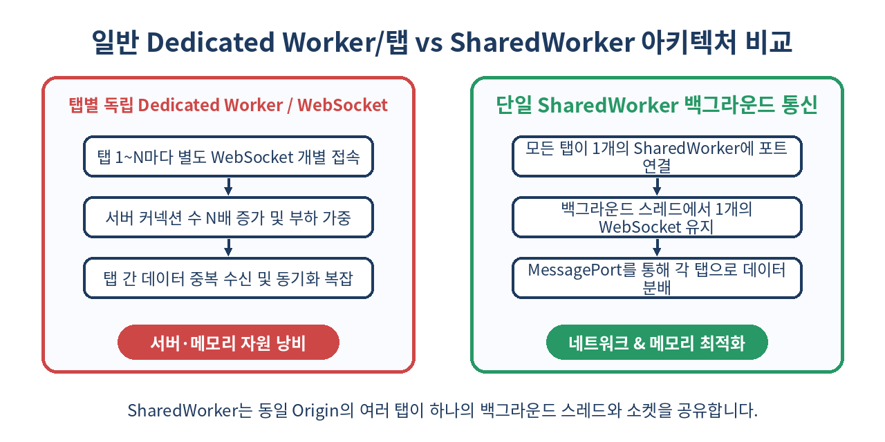
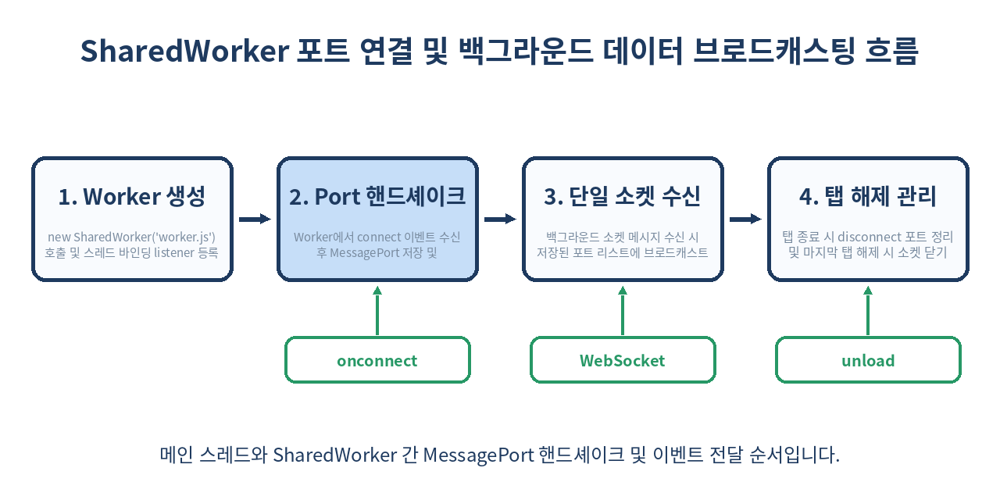

# 🧵 SharedWorker API 완벽 가이드: 다중 탭 단일 WebSocket 연결과 공유 멀티스레딩

> 사용자 웹 서비스에서 탭을 10개 열어두면 WebSocket 연결도 10개가 맺어져 백그라운드 서버가 비명을 지르고 있나요?
> `SharedWorker`를 활용하면 동일한 Origin의 모든 브라우저 탭이 단 하나의 백그라운드 스레드와 단 하나의 WebSocket 커넥션을 공유하도록 아키텍처를 혁신할 수 있습니다.

---

## 📌 목차
1. 🧭 1. SharedWorker란 무엇인가? (Dedicated Worker vs SharedWorker)
2. ⚡ 2. SharedWorker 아키텍처와 MessagePort 동작 메커니즘
3. 🛠️ 3. SharedWorker 기본 구현: 멀티 탭 핸드셰이크와 포트 관리
4. 📡 4. 실전 패턴 1: 다중 탭 단일 WebSocket 커넥션 통합
5. 🔄 5. 실전 패턴 2: 탭 간 글로벌 상태 동기화 및 메모리 공유
6. 🔒 6. 모듈형 SharedWorker (`type: 'module'`)와 Vite/Webpack 번들링
7. 📊 7. Broadcast Channel, Web Locks, SharedWorker 기술 비교
8. ⚠️ 8. 실무 함정 1: Chrome DevTools에서 SharedWorker 디버깅하기 (`chrome://inspect`)
9. ⚡ 9. 실무 함정 2: 탭 닫힘 감지와 메모리 누수 방지 (Port Lifecycle)
10. 📱 10. 실무 함정 3: Safari 및 모바일 환경에서의 제약과 Fallback 전략
11. 🚫 11. SharedWorker를 쓰면 안 되는 경우
12. 🧾 12. 정리
13. 📚 13. 참고 자료

---

## 🧭 1. SharedWorker란 무엇인가? (Dedicated Worker vs SharedWorker)

웹 브라우저의 기본 `Web Worker`(`DedicatedWorkerGlobalScope`)는 Worker 객체를 생성한 특정 브라우저 탭(페이지) 1개에 완전하게 종속됩니다. 메인 스레드의 UI 렌더링을 방해하지 않고 무거운 연산을 처리하는 데는 훌륭하지만, 사용자가 동일한 웹 앱을 10개의 탭으로 열 경우 10개의 독립된 Worker 스레드가 별도로 생성되어 CPU 및 메모리 자원이 중복 소비됩니다.

반면 **`SharedWorker`**(`SharedWorkerGlobalScope`)는 **동일 출처(Same-Origin: Protocol, Host, Port가 모두 동일)** 조건 내의 모든 브라우저 탭, `<iframe>`, 팝업 창이 **단 하나의 백그라운드 스레드**를 공유하여 통신할 수 있는 웹 네이티브 공유 멀티스레딩 API입니다.



### 백그라운드 스레드 모델 비교

| 구분 | Dedicated Worker | SharedWorker | Service Worker |
| :--- | :--- | :--- | :--- |
| **스코프 (Scope)** | `DedicatedWorkerGlobalScope` | `SharedWorkerGlobalScope` | `ServiceWorkerGlobalScope` |
| **소유권 (Ownership)** | 단일 브라우저 탭 (1:1) | 동일 Origin 내 다중 탭 (N:1) | Origin 전체 (도메인 범위 탭 및 백그라운드) |
| **주요 역할** | CPU 집약적 개별 연산 (이미지 처리 등) | **탭 간 통신, WebSocket 통합, 중앙 상태** | 네트워크 프록시, 캐싱, Push 알림 |
| **생명 주기 (Lifecycle)** | 탭 닫힘 시 즉시 소멸 | **모든 연결된 탭이 닫힐 때 소멸** | 브라우저 판단 및 이벤트 기반 수시 시작/종료 |
| **DOM 접근** | 불가 | 불가 | 불가 |

### 다중 탭 환경에서의 자원 절감 수치 예시 (탭 10개 기준)

실시간 주식 시세나 대시보드 웹 앱에서 탭 10개를 열었을 때, `SharedWorker` 적용 전후의 자원 소비량을 비교하면 다음과 같은 명확한 이점을 얻을 수 있습니다.

*   **TCP/TLS 핸드셰이크 및 커넥션 수**: 10개 ➡️ **1개** (90% 감소)
*   **서버 측 Heartbeat(Ping/Pong) 트래픽**: 10회/초 ➡️ **1회/초** (90% 절감)
*   **브라우저 탭별 메모리 풋프린트**: WebSocket 객체 및 파서 10개 duplicaton ➡️ **SharedWorker 1개 인스턴스 공유** (클라이언트 RAM 약 45MB~80MB 절감)

---

## ⚡ 2. SharedWorker 아키텍처와 MessagePort 동작 메커니즘

`DedicatedWorker`는 `worker.postMessage()`와 `worker.onmessage` 구문을 통해 메인 스레드와 Direct 1:1 메시지 통신을 수행합니다. 그러나 `SharedWorker`는 복수의 탭이 동시에 접근할 수 있어야 하므로, **`MessageChannel` API 기반의 `MessagePort`**를 메커니즘의 핵심으로 사용합니다.

### 1) 인스턴스 생성 및 식별자(Identifier) 규칙

메인 스레드에서 SharedWorker를 호출할 때 URL과 Name(선택 사항)을 전달합니다.

```javascript
// main.js
const worker = new SharedWorker('/workers/shared-kernel.js', 'MySharedApp');
```

브라우저는 내부에 공유 워커 레지스트리를 유지합니다. 만약 **동일한 Origin + 동일한 Worker URL + 동일한 Name**으로 생성된 워커가 이미 존재한다면 새로 스레드를 생성하지 않고 기존 스레드에 연결 포트(`MessagePort`)만 새로 생성하여 전달합니다.

> ⚠️ **주의**: Worker script URL이 동일하더라도 Name 매개변수가 다르면 서로 다른 SharedWorker 인스턴스가 생성됩니다.

### 2) `onconnect` 이벤트와 MessagePort 수신

새로운 탭이 `new SharedWorker()`를 호출하여 접속할 때마다 워커 내부에서는 `connect` 이벤트가 발화됩니다. 이 이벤트 객체의 `event.ports[0]`에 해당 탭과 1:1로 연결된 독점 `MessagePort`가 들어있습니다.

```js
// shared-kernel.js (Worker 내부)
self.onconnect = (event) => {
  // 생성된 탭과 통신할 독점 MessagePort 인스턴스 수득
  const port = event.ports[0];

  // 메시지 이벤트 수신
  port.onmessage = (e) => {
    console.log('클라이언트 탭으로부터 수신:', e.data);
    port.postMessage({ reply: 'ACK', received: e.data });
  };

  // onmessage 프로퍼티 설정 시 start()가 자동 호출되나, 
  // addEventListener('message') 사용 시에는 반드시 port.start()를 explicit하게 호출해야 함.
  port.start();
};
```

### 3) 데이터 직렬화와 Transferable Objects

`port.postMessage()`를 통해 탭과 워커 간에 데이터를 주고받을 때, 기본적으로 **구조화된 복사 알고리즘(Structured Clone Algorithm)**이 동작합니다. JSON 데이터, Array, Date, Map, Set 등은 안전하게 복사되지만, 대용량 바이너리 데이터(예: `ArrayBuffer`, `ImageBitmap`) 전송 시 복사 비용이 발생할 수 있습니다.

성능 극대화를 위해 소유권을 즉시 이전하는 **Transferable Objects** 기법을 적용할 수 있습니다.

```javascript
// 메인 스레드 -> SharedWorker로 100MB ArrayBuffer 소유권 무복사 이관
const bigBuffer = new ArrayBuffer(1024 * 1024 * 100);
worker.port.postMessage({ type: 'PROCESS_BUFFER', buffer: bigBuffer }, [bigBuffer]);

// 이 시점 이후 메인 스레드의 bigBuffer.byteLength는 0이 됨 (메모리 복사 없음)
```

---

## 🛠️ 3. SharedWorker 기본 구현: 멀티 탭 핸드셰이크와 포트 관리

여러 탭의 접속/해제를 추적하고 특정 탭 혹은 모든 탭으로 메세지를 라우팅하기 위해서는 워커 내부에서 `MessagePort` 집합을 체계적으로 관리해야 합니다.

### 1) 백그라운드 워커 TypeScript 구현 (`shared-worker.ts`)

```typescript
// shared-worker.ts

interface ClientPortMetadata {
  id: string;
  port: MessagePort;
  connectedAt: number;
}

// 접속된 탭 포트들의 포인터 추적
const clients = new Map<string, ClientPortMetadata>();

self.onconnect = (event: MessageEvent) => {
  const port = event.ports[0];
  const clientId = crypto.randomUUID(); // 각 탭 연결에 유니크 ID 부여

  const clientMeta: ClientPortMetadata = {
    id: clientId,
    port,
    connectedAt: Date.now()
  };

  clients.set(clientId, clientMeta);
  port.start();

  // 탭 접속 완료 핸드셰이크 응답
  port.postMessage({
    type: 'HANDSHAKE_ACK',
    payload: { clientId, totalConnectedTabs: clients.size }
  });

  // 모든 탭에 현재 탭 개수 브로드캐스트
  broadcast({
    type: 'TAB_COUNT_CHANGED',
    payload: { totalTabs: clients.size }
  });

  port.onmessage = (e: MessageEvent) => {
    const { type, payload } = e.data;

    switch (type) {
      case 'PING':
        port.postMessage({ type: 'PONG', timestamp: Date.now() });
        break;

      case 'BROADCAST_MESSAGE':
        broadcast({
          type: 'USER_BROADCAST',
          payload: { senderId: clientId, message: payload }
        });
        break;

      case 'DISCONNECT':
        clients.delete(clientId);
        port.close();
        broadcast({
          type: 'TAB_COUNT_CHANGED',
          payload: { totalTabs: clients.size }
        });
        break;
    }
  };
};

function broadcast(message: unknown) {
  clients.forEach(({ port }) => {
    try {
      port.postMessage(message);
    } catch (err) {
      console.error('메시지 전송 실패 (닫힌 포트):', err);
    }
  });
}
```

### 2) 메인 스레드 클라이언트 연동 (`client.ts`)

```typescript
// client.ts

export class SharedWorkerClient {
  private worker: SharedWorker;
  private clientId: string | null = null;

  constructor() {
    this.worker = new SharedWorker(
      new URL('./shared-worker.ts', import.meta.url),
      { name: 'CoreAppSharedWorker', type: 'module' }
    );

    this.initPort();
  }

  private initPort() {
    this.worker.port.start();

    this.worker.port.onmessage = (event: MessageEvent) => {
      const { type, payload } = event.data;

      switch (type) {
        case 'HANDSHAKE_ACK':
          this.clientId = payload.clientId;
          console.log(`[Client] Connected with ID: ${this.clientId}, Active Tabs: ${payload.totalConnectedTabs}`);
          break;

        case 'TAB_COUNT_CHANGED':
          console.log(`[Client] Total active tabs in system: ${payload.totalTabs}`);
          break;

        case 'USER_BROADCAST':
          console.log(`[Client] Message from tab ${payload.senderId}:`, payload.message);
          break;

        case 'PONG':
          console.log('[Client] Pong received from worker at:', payload.timestamp);
          break;
      }
    };

    // 탭 이탈 시 포트 닫기 알림
    window.addEventListener('pagehide', () => {
      this.worker.port.postMessage({ type: 'DISCONNECT' });
    });
  }

  public sendPing() {
    this.worker.port.postMessage({ type: 'PING' });
  }

  public broadcastToOtherTabs(message: string) {
    this.worker.port.postMessage({
      type: 'BROADCAST_MESSAGE',
      payload: message
    });
  }
}
```

---

## 📡 4. 실전 패턴 1: 다중 탭 단일 WebSocket 커넥션 통합

가장 강력한 유즈케이스입니다. 여러 탭이 열려도 실제 `wss://` 연결은 SharedWorker 내부에서 1개만 유지하며, 각 탭은 워커의 메시지 라우터에 자신을 구독 등록만 합니다.



### 1) 통합 WebSocket 관리 워커 (`ws-shared-worker.ts`)

이 코드에는 **재연결 지연(Exponential Backoff)**, **Ping/Pong 헬스체크**, **메시지 큐(소켓 미연결 시 발송 메시지 버퍼링)** 로직이 완벽하게 구현되어 있습니다.

```typescript
// ws-shared-worker.ts

interface WebSocketPacket {
  channel: string;
  data: unknown;
}

class WebSocketSharedManager {
  private socket: WebSocket | null = null;
  private ports: Set<MessagePort> = new Set();
  private reconnectAttempts = 0;
  private maxReconnectInterval = 30000; // 30초
  private pendingQueue: string[] = [];
  private wsUrl = 'wss://stream.example.com/v1/realtime';

  constructor() {
    // SharedWorkerGlobalScope self 타입 캐스팅
    (self as unknown as SharedWorkerGlobalScope).onconnect = this.handleConnect.bind(this);
  }

  private handleConnect(e: MessageEvent) {
    const port = e.ports[0];
    this.ports.add(port);
    port.start();

    // 첫 탭 연결 시 WebSocket 초기화
    if (!this.socket || this.socket.readyState === WebSocket.CLOSED) {
      this.connectWebSocket();
    } else {
      // 이미 접속된 소켓의 상태 전달
      port.postMessage({
        type: 'WS_STATUS',
        payload: { state: this.socket.readyState }
      });
    }

    port.onmessage = (event: MessageEvent) => {
      const { type, payload } = event.data;

      if (type === 'SEND_DATA') {
        this.sendWebSocketMessage(payload);
      } else if (type === 'CLOSE_TAB') {
        this.ports.delete(port);
        port.close();
        // 연결된 탭이 0개이면 소켓 종료
        if (this.ports.size === 0 && this.socket) {
          console.log('[Worker WS] All tabs closed. Closing WebSocket connection.');
          this.socket.close(1000, 'All tabs disjoined');
          this.socket = null;
        }
      }
    };
  }

  private connectWebSocket() {
    console.log('[Worker WS] Initializing WebSocket Connection...');
    this.socket = new WebSocket(this.wsUrl);

    this.socket.onopen = () => {
      console.log('[Worker WS] Connected successfully.');
      this.reconnectAttempts = 0;
      this.broadcastToTabs({ type: 'WS_STATUS', payload: { state: WebSocket.OPEN } });
      
      // 대기 중인 큐 메시지 전송
      while (this.pendingQueue.length > 0 && this.socket?.readyState === WebSocket.OPEN) {
        const msg = this.pendingQueue.shift();
        if (msg) this.socket.send(msg);
      }
    };

    this.socket.onmessage = (event: MessageEvent) => {
      try {
        const parsed: WebSocketPacket = JSON.parse(event.data);
        // 모든 탭으로 실시간 데이터 전파
        this.broadcastToTabs({
          type: 'WS_DATA',
          payload: parsed
        });
      } catch (err) {
        console.error('[Worker WS] Parse error:', err);
      }
    };

    this.socket.onclose = (e) => {
      console.warn(`[Worker WS] Closed (Code: ${e.code}, Reason: ${e.reason})`);
      this.broadcastToTabs({ type: 'WS_STATUS', payload: { state: WebSocket.CLOSED } });

      // 탭이 여전히 남아있을 때만 지연 재연결 (Exponential Backoff)
      if (this.ports.size > 0) {
        const timeout = Math.min(
          1000 * Math.pow(2, this.reconnectAttempts),
          this.maxReconnectInterval
        );
        this.reconnectAttempts++;
        console.log(`[Worker WS] Reconnecting in ${timeout}ms (Attempt ${this.reconnectAttempts})`);
        setTimeout(() => this.connectWebSocket(), timeout);
      }
    };

    this.socket.onerror = (err) => {
      console.error('[Worker WS] Socket error encountered:', err);
    };
  }

  private sendWebSocketMessage(data: unknown) {
    const serialized = JSON.stringify(data);
    if (this.socket && this.socket.readyState === WebSocket.OPEN) {
      this.socket.send(serialized);
    } else {
      console.warn('[Worker WS] Socket not ready. Queuing message.');
      this.pendingQueue.push(serialized);
    }
  }

  private broadcastToTabs(packet: unknown) {
    this.ports.forEach((port) => {
      try {
        port.postMessage(packet);
      } catch {
        this.ports.delete(port);
      }
    });
  }
}

new WebSocketSharedManager();
```

---

## 🔄 5. 실전 패턴 2: 탭 간 글로벌 상태 동기화 및 메모리 공유

React/Vue/Svelte 애플리케이션에서 각 탭의 메모리는 독립되어 있습니다. `SharedWorker` 내부에 **Single Source of Truth (SSOT)** Master State Store를 선언하고, 각 탭이 Action을 Dispatch하는 Redux/Zustand와 유사한 아키텍처를 구현할 수 있습니다.

### 1) Shared Store Worker (`store-worker.ts`)

```typescript
// store-worker.ts

interface AppState {
  theme: 'light' | 'dark';
  notificationsCount: number;
  currentUser: { id: string; name: string } | null;
}

let masterState: AppState = {
  theme: 'light',
  notificationsCount: 0,
  currentUser: null
};

const activePorts = new Set<MessagePort>();

(self as unknown as SharedWorkerGlobalScope).onconnect = (e: MessageEvent) => {
  const port = e.ports[0];
  activePorts.add(port);
  port.start();

  // 초기 접속 시 현재 마스터 상태 동기화
  port.postMessage({ type: 'STATE_REPLACE', state: masterState });

  port.onmessage = (event: MessageEvent) => {
    const { type, action } = event.data;

    if (type === 'DISPATCH_ACTION') {
      masterState = reducer(masterState, action);
      
      // 상태 변경 사항을 모든 탭에 확산 (Broadcasting state update)
      activePorts.forEach((p) => {
        p.postMessage({
          type: 'STATE_UPDATED',
          state: masterState,
          causedByAction: action.type
        });
      });
    }
  };
};

function reducer(state: AppState, action: { type: string; payload?: any }): AppState {
  switch (action.type) {
    case 'SET_THEME':
      return { ...state, theme: action.payload };
    case 'INCREMENT_NOTIFICATIONS':
      return { ...state, notificationsCount: state.notificationsCount + 1 };
    case 'SET_USER':
      return { ...state, currentUser: action.payload };
    default:
      return state;
  }
}
```

### 2) React 커스텀 훅 연동 (`useSharedStore.ts`)

```typescript
// useSharedStore.ts
import { useEffect, useState, useCallback } from 'react';

const worker = new SharedWorker(
  new URL('./store-worker.ts', import.meta.url),
  { name: 'AppStoreWorker', type: 'module' }
);
worker.port.start();

export function useSharedStore<T = any>() {
  const [state, setState] = useState<any>(null);

  useEffect(() => {
    const handleMessage = (e: MessageEvent) => {
      const { type, state: newState } = e.data;
      if (type === 'STATE_REPLACE' || type === 'STATE_UPDATED') {
        setState(newState);
      }
    };

    worker.port.addEventListener('message', handleMessage);

    return () => {
      worker.port.removeEventListener('message', handleMessage);
    };
  }, []);

  const dispatch = useCallback((action: { type: string; payload?: any }) => {
    worker.port.postMessage({
      type: 'DISPATCH_ACTION',
      action
    });
  }, []);

  return { state, dispatch };
}
```

---

## 🔒 6. 모듈형 SharedWorker (`type: 'module'`)와 Vite/Webpack 번들링

과거 Worker 스크립트는 단일 파일로만 작성되거나 `importScripts()`를 사용해야 했으나, 최신 브라우저는 **ES Module Syntax (`import/export`)**를 원활히 지원합니다.

### 1) TypeScript 설정 (`tsconfig.json`)

Worker 내부에서 WebWorker 글로벌 API (`self.onconnect` 등)와 DOM API를 올바르게 타입 추론하기 위해 `lib` 설정을 추가합니다.

```json
{
  "compilerOptions": {
    "target": "ESNext",
    "module": "ESNext",
    "moduleResolution": "bundler",
    "lib": ["DOM", "DOM.Iterable", "ESNext", "WebWorker"],
    "strict": true
  }
}
```

### 2) Vite 4/5 번들러 설정

Vite는 `new URL(..., import.meta.url)` 구문을 감지하여 자동으로 SharedWorker를 별도의 Chunk 파일로 번들링하고 해시를 부여해 줍니다.

```typescript
// vite.config.ts
import { defineConfig } from 'vite';

export default defineConfig({
  worker: {
    format: 'es', // SharedWorker를 ES Module 형식으로 번들링
    plugins: []
  },
  build: {
    target: 'esnext'
  }
});
```

### 3) Webpack 5 설정

Webpack 5 이상에서는 플러그인 없이 네이티브 신택스로 번들링이 가능합니다.

```javascript
// webpack.config.js / Client code
const worker = new SharedWorker(
  new URL(/* webpackChunkName: "app-shared-worker" */ './worker.ts', import.meta.url),
  { type: 'module', name: 'WebpackSharedWorker' }
);
```

---

## 📊 7. Broadcast Channel, Web Locks, SharedWorker 기술 비교

브라우저 환경에서 탭 간 데이터 교환 및 제어를 수행할 때 선택할 수 있는 대표적인 API 5종 비교입니다.

| 기능 및 특징 | SharedWorker | Broadcast Channel API | Web Locks API | Service Worker | SharedArrayBuffer + Atomics |
| :--- | :--- | :--- | :--- | :--- | :--- |
| **핵심 목적** | **공유 멀티스레드 연산 & 네트워크 통신** | 탭 간 1:N 단순 메시지 전파 | 멀티 탭 상호 배타적 (Mutex) 자원 제어 | PWA, offline 캐싱, 네트워크 프록시 | 탭/스레드 간 메모리 즉시 직접 공유 |
| **독립 스레드 여부** | **O (별도 스레드)** | X (수신 탭 메인 스레드) | X (메인 스레드) | O (별도 스레드) | X (각 스레드 내 뷰) |
| **중앙 상태 보유** | **O (단일 인스턴스 변수)** | X (각 탭이 복제 수신) | X | O (제한적) | **O (공유 메모리)** |
| **지속적 소켓 유지** | **가능 (WebSocket 공유)** | 불가능 | 불가능 | 제한적 (동작 중단 가능성) | 불가능 |
| **사용 복잡도** | 보통 (`MessagePort` 핸들링) | **매우 쉬움** | 쉬움 | 높음 (Lifecycle 복잡) | 매우 높음 (C-style Lock 필요) |
| **보안 요구사항** | 기본 Same-Origin | 기본 Same-Origin | 기본 Same-Origin | HTTPS 필수 | **Cross-Origin Isolation 헤더 필수** |
| **브라우저 지원율** | 94%+ (Chrome, Safari 16+) | 98%+ | 95%+ | 98%+ | 92%+ |

---

## ⚠️ 8. 실무 함정 1: Chrome DevTools에서 SharedWorker 디버깅하기 (`chrome://inspect`)

많은 개발자가 SharedWorker 내부에서 `console.log()`나 `debugger` 구문이 동작하지 않는다고 오해합니다. 이는 Worker가 메인 스레드 탭의 DevTools (F12) 콘솔 및 네트워크 탭에 **귀속되지 않기 때문**입니다.

### 🛠️ Chrome DevTools 접속 및 디버깅 4단계

1. Chrome 주소창에 **`chrome://inspect/#workers`** 또는 **`chrome://inspect`**를 입력하고 이동합니다.
2. 페이지 상단의 **Shared worker** 섹션을 찾습니다.
3. 실행 중인 SharedWorker의 스크립트 URL 및 Target 목록에서 **`inspect`** 링크를 클릭합니다.
4. 독립된 **Worker 전용 DevTools 팝업 창**이 열립니다. 
   - 이 창에서 SharedWorker 내부의 `console.log()` 수신, `Network` 탭을 통한 SharedWorker 발 WebSocket 통신 감시, `Sources` 탭 Breakpoint 걸기 등이 완전히 지원됩니다.

```javascript
// 워커 내부에 디버그 로그용 헬퍼 함수를 구축하는 패러다임
function log(...args) {
  // chrome://inspect 전용 콘솔 출력
  console.log('[SharedWorker-Internal]', ...args);
}
```

---

## ⚡ 9. 실무 함정 2: 탭 닫힘 감지와 메모리 누수 방지 (Port Lifecycle)

`SharedWorkerGlobalScope`는 연결된 탭이 닫히거나 새로고침되어도 포트가 소멸되었음을 알리는 네이티브 `ondisconnect` 이벤트를 **제공하지 않습니다.** (W3C 명세 후보에 올랐으나 브라우저 구현체 미비).

이를 방지하지 않으면 닫힌 탭의 `MessagePort` 객체가 워커 내부 `Set`이나 `Array`에 영구히 남아 **메모리 누수(Memory Leak)** 및 유령 전송 실패가 누적됩니다.

### 💡 실무 해결책: Explicit Pagehide + Heartbeat Ping/Pong 2중 검증

#### 1) 탭 라이프사이클 이벤트 핸들링 (클라이언트)

`beforeunload`는 모바일이나 Safari에서 누락되는 경우가 잦으므로 **`pagehide`** 및 **`visibilitychange`** 이벤트를 함께 결합합니다.

```typescript
// client-cleanup.ts
window.addEventListener('pagehide', () => {
  worker.port.postMessage({ type: 'CLIENT_UNLOADING' });
  worker.port.close();
});
```

#### 2) 워커 내부의 Zombie Port 정리 (Heartbeat Sweep)

워커에서 주기적으로 포트 상태를 Ping 체크하여 응답이 없는 포트를 가비지 컬렉팅합니다.

```typescript
// worker-sweep.ts
interface PortHolder {
  port: MessagePort;
  isAlive: boolean;
}

const activePortHolders = new Set<PortHolder>();

self.onconnect = (e) => {
  const port = e.ports[0];
  const holder: PortHolder = { port, isAlive: true };
  activePortHolders.add(holder);
  port.start();

  port.onmessage = (event) => {
    if (event.data.type === 'PONG') {
      holder.isAlive = true;
    } else if (event.data.type === 'CLIENT_UNLOADING') {
      activePortHolders.delete(holder);
      port.close();
    }
  };
};

// 15초마다 좀비 포트 검사 및 Sweep
setInterval(() => {
  activePortHolders.forEach((holder) => {
    if (!holder.isAlive) {
      console.warn('[Worker Sweep] Dead port detected. Removing...');
      holder.port.close();
      activePortHolders.delete(holder);
    } else {
      holder.isAlive = false;
      try {
        holder.port.postMessage({ type: 'PING' });
      } catch {
        activePortHolders.delete(holder);
      }
    }
  });
}, 15000);
```

---

## 📱 10. 실무 함정 3: Safari 및 모바일 환경에서의 제약과 Fallback 전략

### Safari 및 iOS 환경의 제약 사항
1. **Safari 16.0 이상 지원**: macOS/iOS Safari 16부터 SharedWorker 지원이 도입되었으나, iOS의 PWA (Homescreen WebApp) 모드나 `WKWebView` 래퍼 앱에서는 지원이 비활성화되거나 제한될 수 있습니다.
2. **Private Browsing (시크릿 모드)**: Safari 및 일부 Android 브라우저의 시크릿 모드에서는 SharedWorker 스레드 생성이 보안상 블록되거나 예외(`SecurityError`)를 발생시킵니다.

### 🛡️ Production-Grade Polyfill / Fallback Wrapper

SharedWorker가 미지원되거나 실패할 경우, **`BroadcastChannel` + `DedicatedWorker` (혹은 Direct Socket)** 로 seamless하게 강등되는 유니버설 어댑터를 구현해야 합니다.

```typescript
// TabCommunicator.ts
export type MessageCallback = (data: any) => void;

export interface ICommunicator {
  send(data: any): void;
  onMessage(cb: MessageCallback): void;
  close(): void;
}

export class SharedWorkerCommunicator implements ICommunicator {
  private worker: SharedWorker;
  constructor(workerUrl: URL) {
    this.worker = new SharedWorker(workerUrl, { type: 'module', name: 'AppFallbackWorker' });
    this.worker.port.start();
  }
  send(data: any) { this.worker.port.postMessage(data); }
  onMessage(cb: MessageCallback) {
    this.worker.port.onmessage = (e) => cb(e.data);
  }
  close() {
    this.worker.port.postMessage({ type: 'CLIENT_UNLOADING' });
    this.worker.port.close();
  }
}

export class BroadcastFallbackCommunicator implements ICommunicator {
  private channel: BroadcastChannel;
  private listeners: Set<MessageCallback> = new Set();

  constructor(channelName: string) {
    this.channel = new BroadcastChannel(channelName);
    this.channel.onmessage = (e) => {
      this.listeners.forEach(cb => cb(e.data));
    };
  }
  send(data: any) { this.channel.postMessage(data); }
  onMessage(cb: MessageCallback) { this.listeners.add(cb); }
  close() { this.channel.close(); }
}

// 팩토리 함수: 환경에 따라 적절한 통신 라이브러리 자동 반환
export function createUniversalCommunicator(workerUrl: URL, channelName: string): ICommunicator {
  try {
    if ('SharedWorker' in window && typeof SharedWorker === 'function') {
      return new SharedWorkerCommunicator(workerUrl);
    }
  } catch (e) {
    console.warn('SharedWorker initialization failed. Falling back to BroadcastChannel.', e);
  }
  
  return new BroadcastFallbackCommunicator(channelName);
}
```

---

## 🚫 11. SharedWorker를 쓰면 안 되는 경우

SharedWorker가 강력하지만 모든 웹 프로젝트의 만병통치약은 아닙니다. 다음과 같은 요구사항이나 아키텍처 환경에서는 SharedWorker 사용을 권장하지 않습니다.

1. **단일 탭(Single-Tab) 전용 애플리케이션**:
   - 사용자가 다중 탭을 열 일이 없는 전용 백오피스 관리자 도구나 단순 랜딩 페이지 등에서는 `MessagePort` 관리의 오버헤드만 추가될 뿐 실익이 없습니다.
2. **DOM 조작 및 UI 직접 처리가 핵심인 작업**:
   - SharedWorker 내부에서는 `document`, `window`, `HTMLElement` 조작이 불가능합니다. UI와 렌더링 처리는 메인 스레드에 집중시켜야 합니다.
3. **서브도메인 간(Cross-Subdomain) 데이터 공유가 필요한 경우**:
   - `https://app.example.com`과 `https://admin.example.com`은 Same-Origin Policy에 따라 서로 **다른 Origin**으로 처리됩니다. SharedWorker 인스턴스를 공유할 수 없으므로 cross-origin `postMessage`나 IndexedDB/Cookie를 활용해야 합니다.
4. **오프라인 리소스 캐싱 및 서비스 워커 기능 대체**:
   - 오프라인 요청 가로채기, HTTP 캐싱, Push 알림은 Service Worker의 영역입니다. SharedWorker는 네트워크 프록시 역할을 수행할 수 없습니다.

---

## 🧾 12. 정리

*   **다중 탭 자원 단일화**: SharedWorker는 동일 Origin의 모든 탭이 하나의 백그라운드 스레드 및 메모리를 공유하게 해주는 웹 네이티브 솔루션입니다.
*   **네트워크 아키텍처 혁신**: 탭이 10개가 열려도 1개의 WebSocket 통신 채널만 개설하여 서버 리소스 소비량 및 트래픽 폭증을 방지합니다.
*   **MessagePort 통신 기반**: 메인 스레드와 `worker.port` 메시지 송수신 및 `onconnect` 핸드셰이크 방식을 통해 N:1 데이터 흐름을 라우팅합니다.
*   **전문 디버깅 타겟**: 개발자 도구 일반 콘솔이 아닌 `chrome://inspect/#workers` 경로를 통해서만 내부 로그 및 소켓 관찰이 가능합니다.
*   **방어적 수명 주기 설계**: `pagehide` 기반 닫기 알림 및 Heartbeat Ping/Pong 메커니즘을 구축하여 좀비 포트에 의한 메모리 누수를 반드시 방지해야 합니다.

> ✨ **한 줄 요약**
> 다중 탭을 지원하는 실시간 웹 앱 서비스에서 `SharedWorker`를 도입하면 백그라운드 WebSocket 연결 축소와 중앙 상태 동기화를 단 하나의 백그라운드 스레드로 깔끔하게 완성할 수 있습니다.

---

## 📚 13. 참고 자료

- [MDN Web Docs - SharedWorker API](https://developer.mozilla.org/en-US/docs/Web/API/SharedWorker)
- [MDN Web Docs - MessagePort & Transferable Objects](https://developer.mozilla.org/en-US/docs/Web/API/MessagePort)
- [HTML Living Standard - Shared Workers Specification](https://html.spec.whatwg.org/multipage/workers.html#shared-workers-and-the-sharedworkerglobalscope-interface)
- [Chrome DevTools - Debugging Workers](https://developer.chrome.com/docs/devtools/javascript/background-services/)
