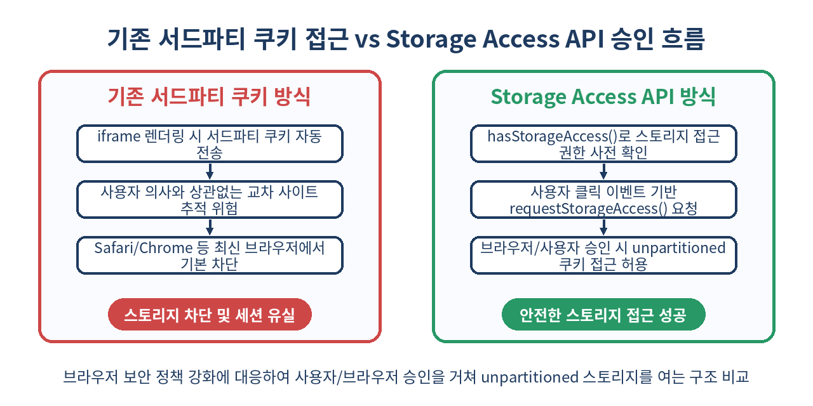
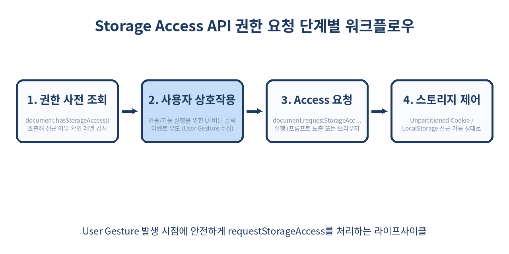

# 🔒 Storage Access API 완벽 가이드: 서드파티 쿠키 차단 시대의 iframe 크로스사이트 스토리지 접근 제어

> 서드파티 쿠키의 황혼기, 크로스사이트 iframe 내에서 기존 세션과 스토리지를 합법적이고 안전하게 유지하는 웹 표준 API를 깊이 파헤칩니다.

---

## 📌 목차
1. 🌐 서드파티 쿠키 차단과 크로스사이트 스토리지의 위기
2. 🔑 Storage Access API란 무엇인가?
3. ⚙️ 핵심 개념: Partitioned Storage vs Unpartitioned Storage
4. 🔍 document.hasStorageAccess()로 권한 상태 조회하기
5. 👆 document.requestStorageAccess() 요청 조건과 사용자 인터랙션
6. 🖼️ iframe sandbox 속성과의 연동
7. 🚀 실전 예제: 크로스사이트 인증 위젯 및 결제 모듈 구현
8. 📊 기존 쿠키 전송 방식 vs Storage Access API 방식 비교
9. 🛡️ 브라우저별 구현 차이 및 디버깅 가이드
10. ⚠️ 실무 적용 시 만나는 주요 함정과 기술적 제약
11. 🚫 이 API를 사용하지 말아야 하는 경우
12. 🧾 정리

---

## 🌐 1. 서드파티 쿠키 차단과 크로스사이트 스토리지의 위기

과거의 웹 생태계에서는 부모 창(`https://parent.com`)에 임베드된 서드파티 `iframe`(`https://widget.com`)이 자유롭게 자신의 쿠키(`Cookie`)와 `LocalStorage`에 접근할 수 있었습니다. 이를 통해 단일 로그인(SSO) 상태 유지, 임베드형 댓글 시스템, 챗봇, 결제 모듈 등이 원활하게 작동했습니다.

그러나 사용자의 웹 방문 이력을 무단으로 추적하는 **크로스사이트 트래킹(Cross-site Tracking)** 문제가 심각해짐에 따라 주요 브라우저 엔진들은 강력한 개인정보 보호 정책을 도입하기 시작했습니다.

- **Safari (ITP - Intelligent Tracking Prevention)**: 서드파티 쿠키 기본 차단 및 스토리지 분리(Partitioning)
- **Firefox (ETP - Enhanced Tracking Protection)**: 알려진 추적기에 대한 쿠키 차단 및 샌드박싱
- **Chrome (Privacy Sandbox)**: 단계적 서드파티 쿠키 제한 및 스토리지 파티셔닝 적용

이로 인해 정상적인 비즈니스 목적으로 상호작용하는 임베드 위젯조차 세션 쿠키를 읽지 못해 **"로그인을 했는데도 iframe 안에서는 로그인 상태가 해제되는 현상"**이 발생하게 되었습니다. 이러한 문제를 해결하기 위해 등장한 브라우저 표준이 바로 **Storage Access API**입니다.

---

## 🔑 2. Storage Access API란 무엇인가?

**Storage Access API**는 크로스사이트(Cross-site) 텍스트 context 내부(주로 `iframe`)에 위치한 문서가, 브라우저에 의해 차단되거나 격리된 **최상위(Unpartitioned) 스토리지 영역**에 대한 접근 권한을 명시적으로 요청하고 획득할 수 있도록 지원하는 W3C 표준 Web API입니다.

이 API를 활용하면 추적 방지 메커니즘을 우회하는 편법(예: 팝업 릴레이, 리다이렉트 트릭)을 사용하지 않고도, **사용자의 명시적 승인(User Gesture)** 기반 하에 임베드된 사이트의 퍼스트파티 스토리지와 세션을 복원할 수 있습니다.

```javascript
// iframe 내부 스크립트 예시
if (document.hasStorageAccess) {
  const hasAccess = await document.hasStorageAccess();
  if (!hasAccess) {
    // 권한 요청 시도
    try {
      await document.requestStorageAccess();
      console.log("Unpartitioned 스토리지 접근 승인됨!");
    } catch (err) {
      console.error("스토리지 접근 거부됨:", err);
    }
  }
}
```

---

## ⚙️ 3. 핵심 개념: Partitioned Storage vs Unpartitioned Storage

Storage Access API를 이해하려면 먼저 최신 브라우저의 스토리지 파티셔닝 개념을 파악해야 합니다.

| 구분 | Partitioned Storage (격리 스토리지) | Unpartitioned Storage (통합 스토리지) |
| :--- | :--- | :--- |
| **키 구조** | `(Top-level Site, Embedded Site)` 키 묶음 | `(Embedded Site)` 단일 키 |
| **접근 범위** | 해당 특정 부모 사이트에 속한 iframe 내에서만 유효 | 독립 탭에서 해당 사이트를 직접 방문했을 때와 동일한 스토리지 |
| **쿠키 공유** | 부모 사이트가 달라지면 쿠키 값이 완전히 분리됨 | 모든 사이트에 임베드되더라도 동일한 로그인 세션 쿠키 참조 |
| **보안/추적** | 교차 사이트 추적 불가능 (안전) | 사용자 승인 없이는 크로스사이트 추적 위험 존재 |

Storage Access API는 `Partitioned Storage` 상태로 갇혀 있는 iframe을, 권한 획득 후 **`Unpartitioned Storage` 접근이 가능한 상태로 전환**해 주는 역할을 합니다.



---

## 🔍 4. document.hasStorageAccess()로 권한 상태 조회하기

`document.hasStorageAccess()` 메서드는 현재 문서가 unpartitioned 스토리지에 접근할 수 있는 권한을 이미 가지고 있는지 여부를 나타내는 `Promise<boolean>`을 반환합니다.

### 💡 기본 조회 코드

```javascript
async function checkStorageAccess() {
  // 1. API 지원 여부 확인
  if (!('hasStorageAccess' in document)) {
    console.log("이 브라우저는 Storage Access API를 지원하지 않거나, 최상위 문서입니다.");
    return true;
  }

  try {
    // 2. 스토리지 접근 상태 확인
    const hasAccess = await document.hasStorageAccess();
    if (hasAccess) {
      console.log("이미 Unpartitioned 스토리지 접근 권한이 있습니다.");
      return true;
    } else {
      console.log("스토리지 접근 권한이 제한되어 있습니다.");
      return false;
    }
  } catch (error) {
    console.error("권한 상태 확인 중 에러 발생:", error);
    return false;
  }
}
```

### 📌 조회 결과에 따른 분기 전략
1. `hasAccess === true`: 추가 요청 없이 `document.cookie`를 읽거나 API 요청 시 쿠키가 자동으로 포함됩니다.
2. `hasAccess === false`: 사용자의 클릭이나 터치 동작(User Gesture)을 유도하는 UI 버튼을 화면에 렌더링해야 합니다.

---

## 👆 5. document.requestStorageAccess() 요청 조건과 사용자 인터랙션

`document.requestStorageAccess()` 메서드를 호출하면 브라우저에 권한을 요청합니다. 하지만 브라우저는 무분별한 요청을 방지하기 위해 엄격한 **전제 조건**을 요구합니다.



### ⚠️ 권한 요청 승인을 위한 필수 조건
1. **User Gesture (사용자 제스처)**: 반드시 `click`, `touchend` 등 사용자의 직접적인 상호작용 이벤트 핸들러 내부에서 호출되어야 합니다.
2. **Same-origin iframe 노출**: iframe의 `src` 주소와 요청하는 도메인의 origin이 동일해야 합니다.
3. **상위 사이트와의 상호작용 역사**: 사용자가 해당 서드파티 사이트(예: `widget.com`)를 과거에 최상위 탭으로 직접 방문하여 상호작용한 적이 있어야 합니다 (Safari/Chrome의 추적 방지 룰).

### 💻 사용자 제스처 연결 예제

```javascript
const loginButton = document.getElementById('btn-widget-login');

loginButton.addEventListener('click', async () => {
  try {
    // 사용자 제스처 이벤트 핸들러 안에서 호출
    await document.requestStorageAccess();
    
    // 권한 획득 성공! unpartitioned 쿠키를 참조하여 세션 복원
    console.log("스토리지 접근 승인 완료. 데이터 갱신 중...");
    fetchUserData();
  } catch (err) {
    // 사용자가 브라우저 팝업에서 거부했거나 조건 미충족
    console.warn("스토리지 접근 권한이 거부되었습니다.", err);
    showFallbackLoginUI();
  }
});
```

---

## 🖼️ 6. iframe sandbox 속성과의 연동

부모 페이지에서 `iframe`을 렌더링할 때 `sandbox` 속성을 사용하는 경우, Storage Access API가 작동하려면 반드시 **`allow-storage-access-by-user-activation`** 토큰을 포함해야 합니다.

이 토큰이 누락되면 iframe 내부에서 `document.requestStorageAccess()`를 호출할 때 즉시 거부(Reject) 예외가 발생합니다.

```html
<!-- 부모 페이지 HTML -->
<iframe 
  src="https://auth-widget.example.com/login"
  sandbox="allow-scripts allow-same-origin allow-storage-access-by-user-activation"
  title="인증 위젯">
</iframe>
```

### 📋 필수 sandbox 토큰 조합

| sandbox 토큰 | 역할 |
| :--- | :--- |
| `allow-scripts` | iframe 내부 자바스크립트 실행 허용 |
| `allow-same-origin` | iframe이 자신의 origin 맥락을 유지하도록 허용 |
| `allow-storage-access-by-user-activation` | Storage Access API 호출 및 프롬프트 팝업 허용 |

---

## 🚀 7. 실전 예제: 크로스사이트 인증 위젯 및 결제 모듈 구현

다음은 서드파티 댓글 위젯 또는 단일 로그인(SSO) 위젯에서 사용되는 실전 방어적 프로그래밍 코드 패턴입니다.

```javascript
// widget-app.js (https://comments-service.com 에서 실행되는 iframe 스크립트)

class StorageAccessManager {
  constructor() {
    this.hasAccess = false;
  }

  async initialize() {
    // 1. Storage Access API 지원 체킹
    if (!document.hasStorageAccess) {
      // API 미지원 브라우저는 기본 처리
      this.hasAccess = true;
      return;
    }

    this.hasAccess = await document.hasStorageAccess();
    
    if (this.hasAccess) {
      this.loadAuthenticatedContent();
    } else {
      this.renderPermissionRequestUI();
    }
  }

  renderPermissionRequestUI() {
    const container = document.getElementById('widget-container');
    container.innerHTML = `
      <div class="auth-prompt">
        <p>댓글을 작성하려면 로그인 세션 접근 승인이 필요합니다.</p>
        <button id="request-access-btn">로그인 상태 연동하기</button>
      </div>
    `;

    document.getElementById('request-access-btn').addEventListener('click', () => {
      this.handleRequestAccess();
    });
  }

  async handleRequestAccess() {
    try {
      // User Gesture 내에서 권한 요청
      await document.requestStorageAccess();
      this.hasAccess = true;
      console.log("스토리지 접근 승인 완료");
      
      // UI 갱신 및 데이터 로드
      this.loadAuthenticatedContent();
    } catch (error) {
      console.error("사용자가 스토리지 접근을 거부했거나 실패했습니다:", error);
      this.renderFallbackUI();
    }
  }

  async loadAuthenticatedContent() {
    // unpartitioned cookie가 세션 헤더로 자동 전송됨
    const res = await fetch('https://comments-service.com/api/user-session', {
      credentials: 'include'
    });
    const user = await res.json();
    
    if (user.isLoggedIn) {
      document.getElementById('widget-container').innerText = `환영합니다, ${user.name}님!`;
    } else {
      document.getElementById('widget-container').innerText = "로그인이 필요합니다.";
    }
  }

  renderFallbackUI() {
    document.getElementById('widget-container').innerHTML = `
      <p>세션 연동 실패. <a href="https://comments-service.com/login" target="_blank">새 창에서 로그인</a> 해주세요.</p>
    `;
  }
}

// 위젯 실행
const manager = new StorageAccessManager();
document.addEventListener('DOMContentLoaded', () => manager.initialize());
```

---

## 📊 8. 기존 쿠키 전송 방식 vs Storage Access API 방식 비교

| 항목 | 과거 기존 방식 (SameSite=None) | Storage Access API 사용 방식 |
| :--- | :--- | :--- |
| **사용자 개입** | 없음 (암묵적 자동 전송) | 명시적 클릭(User Gesture) 또는 브라우저 정책 승인 필요 |
| **보안/추적 방지** | 보안 취약 및 사용자 무단 추적 가능 | 사용자 동의 기반 접근으로 차세대 개인정보 규제 준수 |
| **Safari/Firefox** | 기본값으로 무조건 차단됨 | 조건 충족 시 정상 동작 지원 |
| **스토리지 형태** | 동일한 Unpartitioned Cookie 사용 | 요청 성공 시에만 Partitioned -> Unpartitioned 전환 |
| **개발자 구현 복잡도** | 단순 (`SameSite=None; Secure` 설정) | 상태 조회 및 클릭 이벤트 핸들러 연동 로직 필요 |

---

## 🛡️ 9. 브라우저별 구현 차이 및 디버깅 가이드

각 브라우저 제조사마다 사용자 경험 강화를 위해 Storage Access API를 처리하는 세부 정책이 조금씩 다릅니다.

### 🦊 Firefox
- 사용자가 최상위 서드파티 사이트를 방문한 기록이 있으면, `requestStorageAccess()` 호출 시 **브라우저 자체 프롬프트 팝업**을 띄워 사용자 동의를 구합니다.
- 동의하면 해당 부모 도메인-서드파티 도메인 쌍에 대해 권한을 저장합니다.

### 🧩 Safari (WebKit)
- 사용자가 서드파티 사이트와 직접 인터랙션한 적이 없으면 `requestStorageAccess()` 요청이 즉시 Reject됩니다.
- 과거 방문 기록이 있는 상태에서 호출 시 사용자에게 **"~사이트가 쿠키 및 데이터 접근 권한을 요구합니다"** 팝업을 표시합니다.

### 🌐 Chrome (Chromium)
- Privacy Sandbox 일환으로 **First-Party Sets (RWS - Related Website Sets)**와 연동됩니다.
- 같은 조직이 소유한 도메인 묶음(RWS)에 등록되어 있다면, `requestStorageAccess()` 호출 시 별도 프롬프트 팝업 없이 **자동으로 승인**됩니다.

---

## ⚠️ 10. 실무 적용 시 만나는 주요 함정과 기술적 제약

실무 환경에서 Storage Access API를 도입할 때 흔히 겪는 시행착오입니다.

### 1️⃣ User Gesture 누락으로 인한 `NotAllowedError` 예예
페이지 로드 시점(`DOMContentLoaded` 또는 `useEffect` 내)에서 `document.requestStorageAccess()`를 바로 실행하면 안 됩니다.

```javascript
// ❌ 잘못된 예시: 페이지 로드 시 자동 호출 (에러 발생)
window.addEventListener('load', async () => {
  await document.requestStorageAccess(); // Error: Must be handled during user interaction!
});

// ⭕ 올바른 예시: 사용자 버튼 클릭 내부 호출
myButton.addEventListener('click', async () => {
  await document.requestStorageAccess(); // 정상 작동
});
```

### 2️⃣ 최상위 문서 방문 이력 부재 (First-Party Interaction Rule)
사용자가 단 한 번도 `https://third-party.com`을 주소창에 직접 쳐서 들어간 적이 없다면, iframe 내에서 `requestStorageAccess()`는 사용자 프롬프트조차 띄우지 못하고 실패합니다. 이 경우 **팝업창(`window.open`)을 띄워 퍼스트파티 탭에서 1회 이상 상호작용**하도록 유도해야 합니다.

### 3️⃣ LocalStorage 및 IndexedDB 참조 타이밍
`requestStorageAccess()`가 Resolved(승인)된 후에도 기존에 렌더링된 iframe 맥락의 `window.localStorage`는 즉시 갱신되지 않고 여전히 partitioned 상태를 가리킬 수 있습니다. 안전한 쿠키 및 스토리지 동기화를 위해서는 권한 획득 후 **서버 통신(`fetch`)을 다시 호출하거나 iframe 내 데이터를 리로드**하는 것이 좋습니다.

---

## 🚫 11. 이 API를 사용하지 말아야 하는 경우

Storage Access API가 모든 크로스사이트 통신 문제의 만병통치약은 아닙니다. 다음과 같은 경우에는 다른 대안 기술을 사용하는 것이 훨씬 적절합니다.

1. **서로 다른 도메인 간 단순 데이터 전달만 필요한 경우**
   - 굳이 스토리지/쿠키 권한을 획득할 필요 없이 **`window.postMessage`** API를 사용하는 것이 안전하고 간단합니다.
2. **연관된 자사 도메인 간 크로스사이트 세션 공유**
   - Chrome/Edge 중심 환경에서는 **Related Website Sets (RWS)** 또는 **CHIPS (Partitioned Cookies)** 기술을 고려하는 것이 사용자 프롬프트 비노출 측면에서 유리합니다.
3. **단순 서드파티 인증(OAuth / OIDC) 흐름**
   - iframe 내부에서 쿠키를 복원하려고 시도하는 대신, 표준적인 **FedCM (Federated Credential Management API)** 또는 **팝업 기반 인증 래퍼**를 사용하는 것이 웹 표준 권장사항입니다.

---

## 🧾 12. 정리

- **서드파티 쿠키 종말 대응**: Storage Access API는 서드파티 쿠키 차단 환경에서 iframe 위젯의 스토리지 및 세션을 합법적으로 복원하는 W3C 표준 API입니다.
- **조회와 요청의 분리**: `hasStorageAccess()`로 현재 unpartitioned 스토리지 권한을 조회하고, 권한이 없을 경우 사용자 이벤트 기반으로 `requestStorageAccess()`를 호출합니다.
- **User Gesture 필수**: 권한 요청 메서드는 반드시 사용자 직접 클릭/터치 이벤트 핸들러 내부에서 호출되어야 합니다.
- **iframe Sandbox 주의**: iframe 태그에 `sandbox`를 적용할 경우 `allow-storage-access-by-user-activation` 속성을 추가해야 합니다.
- **폴백 전략 구축**: 사용자의 거부나 과거 방문 이력 부재로 인해 승인이 실패할 수 있으므로, 팝업 렌더링 등 예외 대안 UI(Fallback)를 반드시 준비해야 합니다.

> ✨ **한 줄 요약**  
> Storage Access API는 사용자 동의(User Gesture)를 다리로 삼아 서드파티 iframe에게 unpartitioned 스토리지 접근을 허용하는 현명한 브라우저 보안 표준입니다.

---

## 📚 참고 자료
- [MDN Web Docs - Storage Access API](https://developer.mozilla.org/en-US/docs/Web/API/Storage_Access_API)
- [WebKit - Introducing Storage Access API](https://webkit.org/blog/8124/introducing-storage-access-api/)
- [Google Chrome Developers - Storage Access API Guide](https://developer.chrome.com/docs/privacy-sandbox/storage-access-api/)
