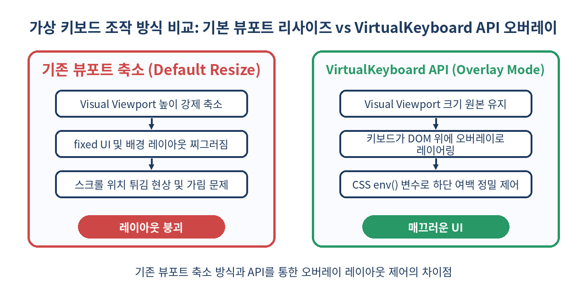
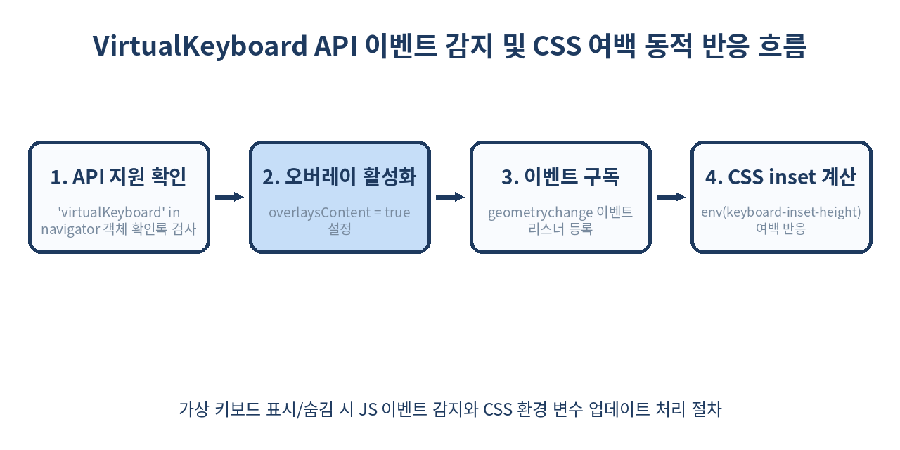

# ⌨️ VirtualKeyboard API 완벽 가이드: 모바일 키보드 레이아웃 찌그러짐과 가림 현상 해결

> 모바일 웹 앱에서 폼 입력 창을 터치할 때마다 하단 버튼이 찌그러지거나 입력 창이 키보드 뒤로 숨는 현상을 겪어보셨나요?
> `VirtualKeyboard API`를 활용하면 가상 키보드가 뷰포트를 강제로 축소하는 대신 오버레이(Overlay)로 작동하게 만들고, CSS 환경 변수로 정밀하게 레이아웃을 제어할 수 있습니다.

---

## 📌 목차
1. 📱 모바일 가상 키보드가 프론트엔드 개발자에게 주는 고통
2. 💡 VirtualKeyboard API란 무엇인가?
3. ⚙️ 기존 뷰포트 리사이즈 vs VirtualKeyboard API 오버레이 동작 원리
4. 🛠️ `navigator.virtualKeyboard` 기본 사용법과 인터페이스 구조
5. 📐 CSS env() 변수(`keyboard-inset-*`)로 스마트한 여백 제어하기
6. 🔔 `geometrychange` 이벤트를 이용한 키보드 높이 동적 추적
7. ⌨️ JavaScript에서 수동으로 가상 키보드 제어하기 (`show()`, `hide()`)
8. 💬 실무 적용 사례 1: 실시간 1:1 채팅 UI 높이 유지
9. 📝 실무 적용 사례 2: 고정 하단 CTA 버튼 가림 방지
10. 📊 모바일 뷰포트 및 가상 키보드 제어 방식 기술 비교
11. ⚠️ 실무 적용 시 주의할 주요 함정 (Pitfalls)
12. ❌ VirtualKeyboard API를 사용하지 말아야 하는 경우
13. 🧾 정리
14. 📚 참고 자료

---

## 📱 1. 모바일 가상 키보드가 프론트엔드 개발자에게 주는 고통

모바일 브라우저에서 `<input>`이나 `<textarea>` 요소를 포커스하면 운영체제(iOS, Android)의 소프트웨어 가상 키보드가 화면 하단에서 올라옵니다. 이때 브라우저는 전통적으로 두 가지 반응 중 하나를 보입니다.

1. **뷰포트 전체 높이 축소 (Resize)**: 브라우저 Window height가 갑자기 줄어들면서 `position: absolute` 또는 `position: fixed`로 하단에 붙여둔 UI(하단 탭바, 등록 버튼)가 키보드 바로 위로 튀어 올라오거나 화면이 찌그러집니다.
2. **뷰포트 팬/스크롤 (Pan/Scroll)**: 뷰포트 크기는 그대로 두고 화면을 위로 밀어 올리지만, 입력 폼이 상단 헤더에 가리거나 의도치 않은 스크롤이 남아 UI가 불쾌하게 엉킵니다.

특히 반응형 웹 웹앱(PWA)이나 하이브리드 앱 환경에서 카카오톡/슬랙 같은 **하단 입력창 고정 채팅 레이아웃**을 구현할 때 `visualViewport` API만으로는 iOS와 Android 간의 서로 다른 브라우저 기본 동작을 완전하게 통제하기 어려웠습니다.

`VirtualKeyboard API`는 바로 이 가상 키보드의 동작 방식을 웹 개발자가 직접 통제할 수 있도록 W3C 편집자 초안(Editor's Draft)으로 제안된 차세대 웹 표준 API입니다.

---

## 💡 2. VirtualKeyboard API란 무엇인가?

`VirtualKeyboard API`는 브라우저가 모바일 가상 키보드를 처리하는 방식을 **오버레이(Overlay) 모드**로 전환할 수 있는 기능을 제공합니다.

오버레이 모드가 활성화되면 키보드가 켜져도 레이아웃 뷰포트(Layout Viewport)나 비주얼 뷰포트(Visual Viewport)의 크기가 강제로 축소되지 않습니다. 키보드는 웹 콘텐츠 위에 떠 있는 Transparent Layer처럼 동작하며, 개발자는 브라우저가 제공하는 **CSS 환경 변수(`env()`)**와 **JS 이벤트**를 활용해 키보드가 가린 영역만큼만 정확히 요소에 padding이나 margin을 주어 레이아웃을 방어할 수 있습니다.

### 핵심 제공 기능
- `navigator.virtualKeyboard.overlaysContent`: 브라우저의 기본 키보드 리사이즈 동작 차단 설정 (Boolean)
- `geometrychange` 이벤트: 키보드가 나타나거나 사라질 때, 높이가 변경될 때 좌표 변경 알림
- CSS `env(keyboard-inset-top)`, `env(keyboard-inset-height)` 등 4가지 위치 변수 제공
- `show()`, `hide()` 메서드를 통한 프로그래밍 방식의 키보드 제어

---

## ⚙️ 3. 기존 뷰포트 리사이즈 vs VirtualKeyboard API 오버레이 동작 원리

두 방식이 브라우저 DOM 렌더링에 미치는 영향은 근본적으로 다릅니다.



- **기존 방식**: 키보드가 생성되는 순간 브라우저 엔진이 Layout Reflow를 발생시킵니다. `100vh` 또는 `100dvh`를 가진 최상위 컨테이너 높이가 줄어들며 전체 반응형 그리드가 다시 계산됩니다.
- **VirtualKeyboard API 방식**: 뷰포트 크기는 유지되고 키보드는 Z-index 상단에 오버레이 레이어로 뜹니다. DOM 요소의 고유 위치나 크기는 자동으로 변경되지 않으므로, 개발자가 원하는 요소에만 `keyboard-inset` 변수로 여백을 줘서 가림을 방지합니다.

---

## 🛠️ 4. `navigator.virtualKeyboard` 기본 사용법과 인터페이스 구조

`VirtualKeyboard API`는 `navigator` 객체의 하위 속성인 `virtualKeyboard`를 통해 접근합니다.

### 1) 브라우저 지원 여부 확인

```javascript
if ('virtualKeyboard' in navigator) {
  console.log('VirtualKeyboard API를 지원하는 브라우저입니다.');
} else {
  console.warn('VirtualKeyboard API를 지원하지 않습니다. 기본 뷰포트 동작이 적용됩니다.');
}
```

### 2) VirtualKeyboard 인터페이스 구조

```typescript
interface VirtualKeyboard extends EventTarget {
  readonly boundingRect: DOMRect;
  overlaysContent: boolean;
  show(): void;
  hide(): void;
  ongeometrychange: EventHandler;
}
```

### 3) 오버레이 모드 활성화하기

기본값은 `false`입니다. 이를 `true`로 설정하면 가상 키보드가 뷰포트 높이를 줄이지 않고 콘텐츠 위에 오버레이로 나타납니다.

```javascript
// 가상 키보드 오버레이 모드 활성화
navigator.virtualKeyboard.overlaysContent = true;
```

HTML 선언적 방식으로도 지정할 수 있습니다. `<meta>` 태그를 이용해 전체 문서 또는 특정 영역에 뷰포트 키보드 정책을 전달할 수 있는 사양도 논의 중이지만, 현재 가장 확실한 방법은 JS 초기화 코드에서 `overlaysContent` 값을 `true`로 설정하는 것입니다.

---

## 📐 5. CSS env() 변수로 스마트한 여백 제어하기

`overlaysContent = true`를 설정하면 가상 키보드가 올라왔을 때 하단 UI 요소(예: 입력 필드, 하단 탭바)가 키보드 밑에 깔려서 보이지 않게 됩니다.

이를 해결하기 위해 브라우저는 다음 4가지 CSS 환경 변수를 노출합니다.

- `env(keyboard-inset-top)`: 화면 최상단부터 키보드 시작점까지의 Y 좌표
- `env(keyboard-inset-height)`: 가상 키보드의 현재 높이 (키보드가 닫혀있으면 `0px`)
- `env(keyboard-inset-left)`: 키보드의 X 좌표 시작점
- `env(keyboard-inset-width)`: 키보드의 너비

### 실무 CSS 패턴예시

```css
/* 하단 고정 채팅 입력바 */
.chat-input-container {
  position: fixed;
  bottom: 0;
  left: 0;
  right: 0;
  background-color: #ffffff;
  padding: 12px;
  box-shadow: 0 -2px 10px rgba(0, 0, 0, 0.05);
  
  /* VirtualKeyboard API 지원 시 키보드 높이만큼 패딩/마진 동적 추가 */
  padding-bottom: calc(12px + env(keyboard-inset-height, 0px));
  transition: padding-bottom 0.1s cubic-bezier(0.2, 0, 0.2, 1);
}
```

`env(keyboard-inset-height, 0px)` 구문에서 두 번째 인자는 **Fallback(대체값)**입니다. 해당 API를 지원하지 않는 브라우저나 데스크톱 환경에서는 기본값인 `0px`로 안전하게 렌더링됩니다.

---

## 🔔 6. `geometrychange` 이벤트를 이용한 키보드 높이 동적 추적

가상 키보드가 열리거나, 닫히거나, 받아쓰기/이모지 키보드 전환 등으로 높이가 변경될 때 `geometrychange` 이벤트가 발생합니다.



### JS 이벤트 처리 코드

```javascript
if ('virtualKeyboard' in navigator) {
  navigator.virtualKeyboard.overlaysContent = true;

  navigator.virtualKeyboard.addEventListener('geometrychange', (event) => {
    // target 또는 navigator.virtualKeyboard에서 boundingRect 추출
    const { x, y, width, height } = event.target.boundingRect;
    
    console.log(`키보드 상태 변경 - 높이: ${height}px, Y좌표: ${y}px`);
    
    if (height > 0) {
      document.body.classList.add('keyboard-open');
      // 필요 시 Canvas 재그리기 또는 3D 뷰포트 카메라 위치 업데이트
      updateCanvasDimensions(height);
    } else {
      document.body.classList.remove('keyboard-open');
      resetCanvasDimensions();
    }
  });
}
```

`boundingRect`는 `DOMRect` 객체를 반환하므로, 키보드가 화면에서 차지하는 정확한 픽셀 단위의 X, Y, Width, Height 값을 얻을 수 있습니다.

---

## ⌨️ 7. JavaScript에서 수동으로 가상 키보드 제어하기 (`show()`, `hide()`)

기존에는 가상 키보드를 강제로 띄우거나 닫으려면 `<input>` 요소에 `.focus()`를 호출하거나 `.blur()` 처리하는 꼼수를 써야 했습니다. 하지만 `contenteditable` 요소나 커스텀 가상 입력기 환경에서는 이것이 원활하게 동작하지 않는 경우가 많았습니다.

`VirtualKeyboard API`는 명시적인 programmatic 키보드 제어 메서드를 제공합니다.

```javascript
const customInputArea = document.getElementById('editor');

// 특정 커스텀 엘리먼트 클릭 시 키보드 강제 표시
customInputArea.addEventListener('click', () => {
  if ('virtualKeyboard' in navigator) {
    // virtualKeyboard.show() 호출 시 현재 포커스된 편집 영역 기준으로 키보드 팝업
    navigator.virtualKeyboard.show();
  }
});

// 닫기 버튼 클릭 시 키보드 강제 숨김
document.getElementById('close-btn').addEventListener('click', () => {
  if ('virtualKeyboard' in navigator) {
    navigator.virtualKeyboard.hide();
  }
});
```

> ⚠️ **주의사항**: `show()` 메서드는 DOM 요소에 `inputmode`가 설정되어 있거나 `contenteditable` 속성이 활성화되어 있는 등 편집 가능한 상태의 입력 컨텍스트에서 포커스가 존재할 때 정상 동작합니다.

---

## 💬 8. 실무 적용 사례 1: 실시간 1:1 채팅 UI 높이 유지

모바일 메신저 UI에서는 키보드가 튀어나와도 대화 목록 스크롤 영역이 깜빡이거나 찌그러지지 않고 natural하게 슬라이딩되어야 합니다.

```html
<!DOCTYPE html>
<html lang="ko">
<head>
  <meta charset="UTF-8">
  <meta name="viewport" content="width=device-width, initial-scale=1.0">
  <title>VirtualKeyboard Chat App</title>
  <style>
    * { box-sizing: border-box; margin: 0; padding: 0; }
    html, body { height: 100%; overflow: hidden; font-family: sans-serif; }
    
    .app-layout {
      display: flex;
      flex-direction: column;
      height: 100vh;
      height: 100dvh;
    }
    
    .header {
      height: 56px;
      background: #1e3a5f;
      color: white;
      display: flex;
      align-items: center;
      padding: 0 16px;
      flex-shrink: 0;
    }
    
    .messages-list {
      flex: 1;
      overflow-y: auto;
      padding: 16px;
      background: #f9fbfe;
    }
    
    .input-bar {
      background: white;
      border-top: 1px solid #e0e0e0;
      padding: 12px;
      /* 가상 키보드 높이만큼 하단 padding 확보 */
      padding-bottom: calc(12px + env(keyboard-inset-height, 0px));
    }
    
    .input-bar input {
      width: 100%;
      padding: 12px;
      border: 1px solid #ccc;
      border-radius: 20px;
      outline: none;
    }
  </style>
</head>
<body>
  <div class="app-layout">
    <header class="header">
      <h3>Logic Chat</h3>
    </header>
    <main class="messages-list" id="chat-list">
      <div class="msg">안녕하세요! 모바일 키보드 최적화 테스트입니다.</div>
    </main>
    <footer class="input-bar">
      <input type="text" placeholder="메시지를 입력하세요..." />
    </footer>
  </div>

  <script>
    if ('virtualKeyboard' in navigator) {
      // 키보드가 화면을 밀어 올리지 않도록 오버레이 모드 활성화
      navigator.virtualKeyboard.overlaysContent = true;

      const chatList = document.getElementById('chat-list');
      
      // 키보드 높이 변동 시 메시지 목록을 최하단으로 스크롤 동기화
      navigator.virtualKeyboard.addEventListener('geometrychange', () => {
        chatList.scrollTop = chatList.scrollHeight;
      });
    }
  </script>
</body>
</html>
```

---

## 📝 9. 실무 적용 사례 2: 고정 하단 CTA 버튼 가림 방지

모바일 회원가입이나 양식 입력 페이지에서 화면 하단에 고정된 `[다음 단계]` 버튼이 가상 키보드에 가려지면 사용자는 키보드를 닫고 버튼을 눌러야 하는 불편을 겪습니다.

`VirtualKeyboard API`를 적용하면 입력 중에도 고정 버튼이 키보드 바로 상단에 깔끔하게 밀려 올라옵니다.

```css
.bottom-cta-button {
  position: fixed;
  left: 16px;
  right: 16px;
  /* 키보드가 올라오면 keyboard-inset-height 만큼 bottom 좌표 자동 조절 */
  bottom: calc(16px + env(keyboard-inset-height, 0px));
  height: 48px;
  background-color: #5b8fd4;
  color: white;
  border-radius: 8px;
  border: none;
  font-weight: bold;
  transition: bottom 0.15s ease-out;
}
```

---

## 📊 10. 모바일 뷰포트 및 가상 키보드 제어 방식 기술 비교

| 비교 항목 | 기존 Window Resize (`100vh`) | Visual Viewport API | VirtualKeyboard API |
| :--- | :--- | :--- | :--- |
| **뷰포트 변화** | Layout Viewport 변경 | Visual Viewport만 축소 | Viewport 변화 전혀 없음 (고정) |
| **키보드 레이어** | Document 영역 밀어냄 | Document 영역 밀어냄 | Transparent Overlay로 덮음 |
| **여백 제어 방식** | CSS Media Query / JS resize | JS resize 이벤트 수동 계산 | CSS `env(keyboard-inset-*)` 제어 |
| **Reflow 비용** | 전체 DOM 재배치 (높음) | 부분 재배치 (중간) | 해당 CSS 요소만 변경 (매우 낮음) |
| **수동 표시/숨김** | `input.focus()` / `blur()` | `input.focus()` / `blur()` | `virtualKeyboard.show()` / `hide()` |
| **크로스 브라우저** | 전 세계 브라우저 공통 | 현대 주요 모바일 브라우저 지원 | Chromium 94+ (Android Chrome, Edge) |

---

## ⚠️ 11. 실무 적용 시 주의할 주요 함정 (Pitfalls)

### 1. iOS Safari 미지원 문제 (2026년 기준)
`VirtualKeyboard API`는 현재 **Chromium 기반 브라우저(Android Chrome, Edge 등)**에서 강력하게 지원되며, iOS Safari / WebKit은 아직 보안 및 가상 키보드 아키텍처 차이로 인해 공식 구현이 지연되고 있습니다.

- **해결책**: 반드시 기능 감지(`'virtualKeyboard' in navigator`)를 수행하고, 미지원 브라우저에서는 기존 Visual Viewport API 또는 `100dvh` CSS 기반 대안 방식을 프로그레시브 인핸스먼트(Progressive Enhancement) 전략으로 사용해야 합니다.

```javascript
if ('virtualKeyboard' in navigator) {
  navigator.virtualKeyboard.overlaysContent = true;
} else if (window.visualViewport) {
  // iOS Safari 대안: visualViewport resize 이벤트 수동 핸들링
  window.visualViewport.addEventListener('resize', () => {
    const currentKeyboardHeight = window.innerHeight - window.visualViewport.height;
    document.documentElement.style.setProperty('--vh-keyboard', `${currentKeyboardHeight}px`);
  });
}
```

### 2. `overlaysContent = true` 설정 후 여백 미처리 시 UI 가림
`overlaysContent = true`를 켜놓고 CSS `env(keyboard-inset-height)` 처리를 잊어버리면, 가상 키보드가 입력 창 자체를 완전 덮어버려 사용자가 자신이 무엇을 입력하고 있는지 볼 수 없는 치명적인 UX 버그가 발생합니다.

### 3. `env()` 단단한 대안값(Fallback) 누락
`calc(20px + env(keyboard-inset-height))` 구문처럼 쉼표로 기본 fallback을 넣지 않으면, 변수를 인식하지 못하는 구형 브라우저에서 `calc()` 전체 구문이 무효화(Invalid CSS Value)될 수 있습니다. 항상 `env(keyboard-inset-height, 0px)`처럼 두 번째 대안 파라미터를 작성해야 합니다.

---

## ❌ 12. VirtualKeyboard API를 사용하지 말아야 하는 경우

모든 모바일 웹 페이지에 `overlaysContent = true`를 일괄 적용하는 것은 권장되지 않습니다.

1. **단순 텍스트 검색창 위주의 문서 페이지**: 사용자가 폼 하나 입력하고 곧바로 검색 결과를 확인하는 일반 웹페이지에서는 브라우저의 기본 뷰포트 스크롤 및 축소 동작이 더 자연스럽습니다.
2. **멀티 스텝 가입 폼 문서**: 입력 필드가 세로로 길게 나열된 스크롤 가능 페이지는 브라우저 네이티브가 포커스된 엘리먼트를 화면 중앙으로 자동 스크롤(Scroll into view)해 주는 기존 동작이 훨씬 안전합니다.
3. **iOS Safari 단독 타겟 PWA**: iOS 단독 대상 서비스에선 해당 API가 동작하지 않으므로 불필요한 코드 복잡성만 증가할 수 있습니다.

--- 

## 🧾 13. 정리

- **VirtualKeyboard API**는 모바일 가상 키보드가 브라우저 레이아웃 뷰포트를 강제로 찌그러뜨리는 현상을 방지하는 모듈입니다.
- `navigator.virtualKeyboard.overlaysContent = true` 설정을 통해 키보드를 오버레이 모드로 전환할 수 있습니다.
- CSS 환경 변수 `env(keyboard-inset-height)`와 `geometrychange` 이벤트를 이용해 가상 키보드의 높이에 실시간 반응하는 매끄러운 레이아웃을 구성할 수 있습니다.
- Chromium 브라우저 우선 지원 특성을 고려해 iOS Safari 환경에 대한 Fallback(Visual Viewport API) 처리를 함께 구성하는 것이 실무 모범 답안입니다.

> ✨ **한 줄 요약**
> 모바일 키보드 때문에 화면 찌그러짐에 고통받지 말고, `VirtualKeyboard API`와 `env(keyboard-inset-height)`로 완벽한 픽셀 단위 여백을 컨트롤하자!

---

## 📚 14. 참고 자료

- [W3C VirtualKeyboard API Specification](https://w3c.github.io/virtual-keyboard/)
- [MDN Web Docs - VirtualKeyboard API](https://developer.mozilla.org/en-US/docs/Web/API/VirtualKeyboard_API)
- [Chrome Developers - Full control with the VirtualKeyboard API](https://developer.chrome.com/docs/capabilities/web-apis/virtual-keyboard)
