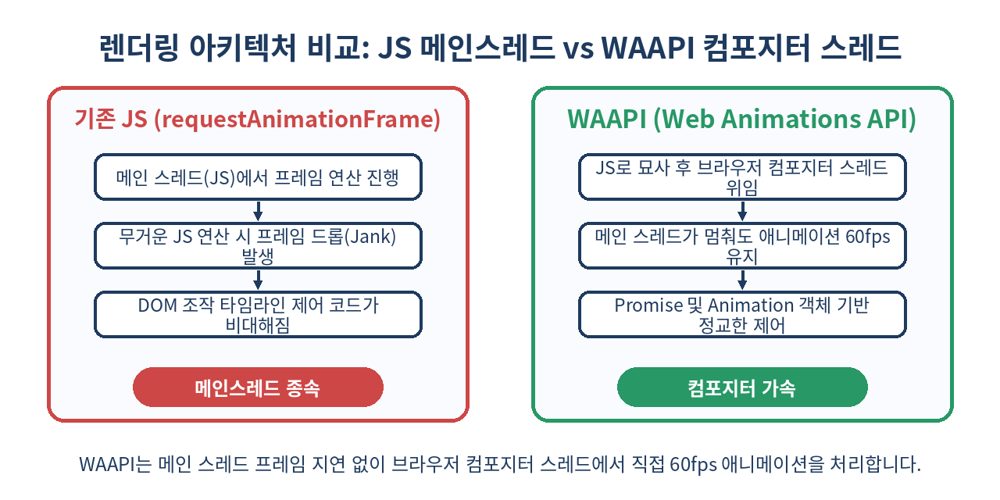
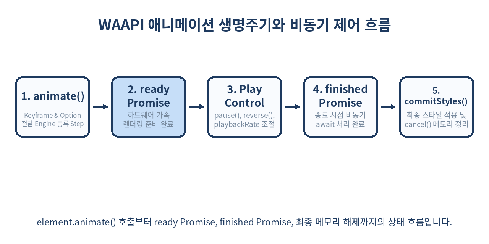

# 🎬 Web Animations API (WAAPI) 완벽 가이드: JS 코드로 제어하는 60fps 네이티브 키프레임 애니메이션

> CSS 애니메이션의 압도적인 렌더링 성능과 JavaScript의 정교한 동적 제어력을 하나로 융합합니다.
> GSAP나 외부 모션 라이브러리 없이 브라우저 네이티브 타임라인을 자유자재로 다루는 Web Animations API의 기초부터 실무 활용, 메모리 트랩 대응까지 완벽하게 정복합니다.

---

## 📌 목차
1. 💡 1. Web Animations API (WAAPI)란 무엇인가?
2. ⚔️ 2. CSS Animation vs JS (rAF) vs WAAPI 비교
3. 🚀 3. WAAPI 핵심 메서드: element.animate()
4. ⏱️ 4. KeyframeFormats와 KeyframeEffect Options 사양
5. 🎮 5. Animation 객체 인터랙티브 제어
6. 🔄 6. 동적 타임라인 및 재생 속도(playbackRate) 조절
7. 🤝 7. Promise 기반 비동기 흐름 제어 (ready & finished)
8. 🎨 8. Composite Operation: add, accumulate, replace 합성
9. ⚠️ 9. 실무 함정: fill: 'forwards' 메모리 누수와 commitStyles()
10. ❌ 10. WAAPI를 쓰면 안 되는 경우
11. 🧾 11. 정리
12. 📚 12. 참고 자료

---

## 💡 1. Web Animations API (WAAPI)란 무엇인가?

과거 웹 프론트엔드 개발 환경에서 복잡한 인터랙티브 애니메이션을 구현하려면 두 가지 극단적인 선택지 중 하나를 택해야 했습니다.

1. **CSS @keyframes 애니메이션 및 transition**: 브라우저의 컴포지터 스레드(Compositor Thread)에서 실행되어 60fps(또는 고주사율 모니터의 120fps+)의 뛰어난 성능을 제공하지만, 사용자 입력을 받아 중간에 멈추거나 역재생하고 시점을 동적으로 계산하는 등 **JS 동적 제어가 거의 불가능**했습니다. 클래스 토글 수준을 벗어나기 어려웠습니다.
2. **JavaScript (requestAnimationFrame 또는 GSAP)**: 애니메이션의 모든 순간에 대한 완전한 제어권을 가지지만, 모든 프레임 연산이 **JS 메인 스레드(Main Thread)**에서 실행되므로 복잡한 대시보드 연산, JSON 파싱, 네트워크 요청이 겹칠 때 프레임 드롭(Jank 현상)이 발생했습니다.

**Web Animations API (WAAPI)**는 이 두 방식의 장점만을 결합한 차세대 W3C 표준 브라우저 API입니다. JavaScript 문법으로 애니메이션 키프레임과 옵션을 정의하지만, 브라우저 엔진 내부에서는 **CSS 애니메이션 엔진과 동일한 하드웨어 가속 파이프라인**을 통해 렌더링을 처리합니다.

### 렌더링 파이프라인 구조와 컴포지터 스레드

브라우저의 렌더링 파이프라인은 일반적으로 `JS 연산 -> Style -> Layout (Reflow) -> Paint (Repaint) -> Composite` 단계를 거칩니다.

- **Layout (Reflow)**: `width`, `height`, `margin`, `top`, `left` 등을 변경할 때 발생하며 전체 레이아웃을 다시 계산하므로 가장 높은 CPU 비용이 듭니다.
- **Paint (Repaint)**: `background-color`, `color`, `box-shadow` 등을 변경할 때 발생하며 픽셀을 다시 그립니다.
- **Composite**: `transform`과 `opacity` 속성을 조작할 때 발생하며 GPU 층에서 이미 계산된 레이어를 합성하므로 **메인 스레드의 부하에 영향을 받지 않고 오직 컴포지터 스레드에서만 60fps로 독립 동작**합니다.

WAAPI는 `transform`과 `opacity` 속성을 제어할 때 JavaScript 코드 실행이 완료된 즉시 해당 연산을 컴포지터 스레드로 위임합니다. 따라서 메인 스레드가 무거운 동기 연산으로 차단되더라도 화면의 애니메이션은 멈추지 않고 매끄럽게 지속됩니다.



---

## ⚔️ 2. CSS Animation vs JS (rAF) vs WAAPI 비교

세 가지 웹 애니메이션 접근 방식을 실무 관점의 핵심 항목별로 상세히 비교해 보겠습니다.

| 비교 항목 | CSS Animations / Transitions | JS (requestAnimationFrame / Canvas) | Web Animations API (WAAPI) |
| :--- | :--- | :--- | :--- |
| **실행 스레드** | 컴포지터 스레드 (GPU 가속) | 메인 스레드 (JS Event Loop) | 컴포지터 스레드 (GPU 가속) |
| **메인 스레드 차단 영향** | 영향 없음 (60fps 고정 유지) | 심각함 (JS 연산 시 프레임드롭 발생) | 영향 없음 (60fps 고정 유지) |
| **동적 상태 제어** | 매우 제한적 (DOM 클래스 변경만 가능) | 완벽함 (프레임 단위 직접 계산) | 완벽함 (Animation 인스턴스 메서드 제공) |
| **실시간 속도 조절** | 불가능 (CSS 변경 시 처음부터 다시 시작) | 가능 (delta time 변수 직접 제어) | 완벽함 (`playbackRate` 동적 조작) |
| **의존성 & 번들 크기** | 0 KB (브라우저 내장) | 라이브러리 추가 시 10 ~ 60 KB | 0 KB (브라우저 네이티브 API) |
| **Promise / 비동기 체이닝** | `transitionend` 이벤트 (복잡함) | 직접 Promise wrapper 구현 필요 | Native Promise (`ready`, `finished`) 지원 |
| **키프레임 합성 (Composite)**| 불가능 (기존 값 덮어씀) | 직접 수식으로 가산 연산 | 지원 (`add`, `accumulate`, `replace`) |

### 실무 성능 비교 시뮬레이션 코드

메인 스레드에 3,000ms 동안 차단성 루프를 실행할 때 `requestAnimationFrame`과 `WAAPI`의 동작 차이를 보여주는 검증용 코드입니다.

```js
// 메인 스레드를 블로킹하는 무거운 연산 함수
function blockMainThread() {
  const start = Date.now();
  while (Date.now() - start < 3000) {
    // 3초간 메인 스레드 점유 (JS 연산 과부하)
  }
}

// 1. rAF 방식: 메인 스레드가 멈추면 애니메이션도 완전히 멈춤
function animateViaRAF(element) {
  let pos = 0;
  function step() {
    pos += 2;
    element.style.transform = `translateX(${pos}px)`;
    if (pos < 500) requestAnimationFrame(step);
  }
  requestAnimationFrame(step);
}

// 2. WAAPI 방식: 메인 스레드가 멈춰도 60fps로 매끄럽게 계속 움직임
function animateViaWAAPI(element) {
  element.animate(
    [{ transform: 'translateX(0px)' }, { transform: 'translateX(500px)' }],
    { duration: 3000, easing: 'ease-out' }
  );
}
```

---

## 🚀 3. WAAPI 핵심 메서드: element.animate()

WAAPI의 가장 기본적이고 강력한 진입점은 모든 DOM Element에 기본 탑재된 `element.animate()` 메서드입니다.

### 기본 구문과 파라미터 구조

```js
const animationInstance = element.animate(keyframes, options);
```

1. **`keyframes`**: 애니메이션 변화를 나타내는 키프레임 객체의 배열 또는 속성 중심 객체입니다.
2. **`options`**: 실행 시간, 이징, 반복 횟수 등을 지정하는 숫자(duration) 또는 `KeyframeEffectOptions` 객체입니다.

### 실무용 인터랙티브 카드 카드 애니메이션 예제

```html
<div class="product-card" id="card">
  
  <div class="content">
    <h3>프리미엄 무선 헤드셋</h3>
    <p>네이티브 60fps 가속 애니메이션 적용</p>
  </div>
</div>
```

```css
.product-card {
  width: 320px;
  padding: 24px;
  border-radius: 16px;
  background: #ffffff;
  box-shadow: 0 4px 20px rgba(0, 0, 0, 0.08);
  will-change: transform, opacity; /* 브라우저 힌트 전달 */
}
```

```js
const card = document.getElementById('card');

// 카드 호버 인터랙션 구현
card.addEventListener('mouseenter', () => {
  // element.animate() 호출 즉시 애니메이션이 생성되고 시작됨
  const hoverAnim = card.animate(
    [
      // Keyframe 1: 시작 상태 (offset: 0)
      { 
        transform: 'translateY(0px) scale(1)', 
        boxShadow: '0 4px 20px rgba(0,0,0,0.08)' 
      },
      // Keyframe 2: 중간 지점 (offset: 0.5)
      { 
        transform: 'translateY(-6px) scale(1.02)', 
        boxShadow: '0 12px 30px rgba(0,0,0,0.12)',
        offset: 0.5 
      },
      // Keyframe 3: 최종 상태 (offset: 1)
      { 
        transform: 'translateY(-12px) scale(1.03)', 
        boxShadow: '0 20px 40px rgba(0,0,0,0.16)' 
      }
    ],
    {
      duration: 350,
      easing: 'cubic-bezier(0.16, 1, 0.3, 1)', // 커스텀 베지어 곡선 적용
      fill: 'forwards' // 종료 위치 고정 (단, 9절 메모리 누수 주의)
    }
  );
});
```

`element.animate()`가 호출되는 순간 브라우저는 애니메이션 엔진을 가동하고 제어가 가능한 `Animation` 인스턴스를 반환합니다.

---

## ⏱️ 4. KeyframeFormats와 KeyframeEffect Options 사양

WAAPI는 애니메이션을 정의할 때 유연한 두 가지 키프레임 포맷과 풍부한 옵션 사양을 지원합니다.

### 1) Keyframe Formats (두 가지 표기 방식)

#### A. 배열 객체 형식 (Keyframe Array)
가장 보편적인 방식으로 각 키프레임을 독립된 객체로 정의합니다. 각 단계별로 개별 `easing`, `offset`, `composite`를 지정할 수 있어 세밀한 표현이 가능합니다.

```js
const keyframeArray = [
  { 
    transform: 'translateX(0px) rotate(0deg)', 
    opacity: 0, 
    easing: 'ease-in' // 구간 1 이징
  },
  { 
    transform: 'translateX(150px) rotate(180deg)', 
    opacity: 0.8, 
    offset: 0.7,     // 전체 timeline의 70% 시점
    easing: 'ease-out' // 구간 2 이징
  },
  { 
    transform: 'translateX(30px) rotate(360deg)', 
    opacity: 1 
  }
];
```

#### B. 속성 중심 객체 형식 (Property-indexed Keyframe Object)
동일한 변형을 한꺼번에 묶어서 나타내는 단축 표현 방식입니다. 속성별 변화 수치를 배열로 나열합니다.

```js
const keyframeObject = {
  transform: ['translateX(0px)', 'translateX(150px)', 'translateX(300px)'],
  opacity: [0, 0.8, 1],
  offset: [0, 0.7, 1],
  easing: ['ease-in', 'ease-out'] // 각 구간 이징 순서대로 적용
};
```

---

### 2) Timing Options 상세 가이드

`element.animate()`의 두 번째 인자로 전달되는 옵션 객체는 CSS 애니메이션 속성과 1:1로 대응됩니다.

| Option | 타입 | 기본값 | 대응하는 CSS 속성 / 설명 |
| :--- | :--- | :--- | :--- |
| `duration` | `number` (ms) | `0` | `animation-duration`: 애니메이션 1회 실행 시간 |
| `delay` | `number` (ms) | `0` | `animation-delay`: 애니메이션 시작 전 대기 시간 |
| `endDelay` | `number` (ms) | `0` | 애니메이션이 완료된 후 시퀀스가 끝날 때까지의 추가 대기 시간 |
| `iterations` | `number` | `1` | `animation-iteration-count`: 반복 횟수 (`Infinity` 지정 가능) |
| `iterationStart`| `number` | `0.0` | 애니메이션이 반복 구간 중 시작할 시점 (예: `0.5`는 50% 지점 시작) |
| `direction` | `string` | `'normal'` | `animation-direction`: `'normal'`, `'reverse'`, `'alternate'`, `'alternate-reverse'` |
| `easing` | `string` | `'linear'` | `animation-timing-function`: `'ease'`, `'cubic-bezier()'`, `'steps()'` |
| `fill` | `string` | `'none'` | `animation-fill-mode`: `'none'`, `'forwards'`, `'backwards'`, `'both'`, `'auto'` |
| `composite` | `string` | `'replace'` | 키프레임 간 속성 합성 방식 (`'replace'`, `'add'`, `'accumulate'`) |

---

### 3) KeyframeEffect 생성자를 활용한 재사용 객체 설계

동일한 애니메이션 효과를 여러 DOM 요소에 재사용하거나 제어를 분리하고 싶다면 `KeyframeEffect` 및 `Animation` 생성자를 직접 사용할 수 있습니다.

```js
// 1. 키프레임과 타임 옵션을 재사용 가능한 Effect 객체로 선언
const bounceEffect = new KeyframeEffect(
  null, // 생성 타겟 요소는 나중에 지정 가능
  [
    { transform: 'translateY(0)', easing: 'cubic-bezier(0,0,0.2,1)' },
    { transform: 'translateY(-30px)', easing: 'cubic-bezier(0.8,0,1,1)' },
    { transform: 'translateY(0)' }
  ],
  { duration: 600, iterations: 3 }
);

// 2. 여러 DOM 요소에 독립된 Animation 인스턴스로 복제 연결
const btn1 = document.querySelector('#btn-1');
const btn2 = document.querySelector('#btn-2');

// Effect 타겟을 btn1로 복사하여 재생
const anim1 = new Animation(bounceEffect.clone(), document.timeline);
anim1.effect.target = btn1;
anim1.play();

// Effect 타겟을 btn2로 복사하여 재생
const anim2 = new Animation(bounceEffect.clone(), document.timeline);
anim2.effect.target = btn2;
anim2.play();
```

---

## 🎮 5. Animation 객체 인터랙티브 제어

`element.animate()` 실행 시 반환되는 `Animation` 객체는 실시간으로 타임라인을 제어할 수 있는 풍부한 메서드와 상태 속성을 제공합니다.



### 핵심 제어 메서드 목록 및 동작 특징

- `play()`: 애니메이션을 현재 위치에서 정방향으로 재생합니다.
- `pause()`: 타임라인을 현재 진행 프레임 위치에 즉시 일시 정지합니다.
- `reverse()`: 현재 재생 방향을 역전시킵니다. 현재 시점부터 부드럽게 되돌아갑니다.
- `finish()`: 타임라인을 종료 위치로 즉시 이동시키고 완료 처리합니다.
- `cancel()`: 애니메이션을 즉시 중단하고 모든 효과를 제거하여 초기 CSS 상태로 복원합니다.

### 인터랙티브 UI 컨트롤러 완벽 실무 예제

아래 코드는 비디오 플레이어의 컨트롤러처럼 웹 요소의 애니메이션을 자유자재로 제어하는 실무 UI 구현 패턴입니다.

```html
<div class="box" id="target-box"></div>
<div class="controls">
  <button id="btn-play">▶ 재생</button>
  <button id="btn-pause">⏸ 일시정지</button>
  <button id="btn-reverse">🔄 역재생</button>
  <button id="btn-speed-up">⚡ 2배속</button>
  <button id="btn-cancel">❌ 취소</button>
</div>
```

```js
const box = document.getElementById('target-box');

// 애니메이션 생성 (자동 재생 상태로 시작)
const boxAnimation = box.animate(
  [
    { transform: 'translateX(0px) rotate(0deg)', borderRadius: '8px' },
    { transform: 'translateX(300px) rotate(180deg)', borderRadius: '50%' },
    { transform: 'translateX(600px) rotate(360deg)', borderRadius: '8px' }
  ],
  {
    duration: 2500,
    easing: 'ease-in-out',
    iterations: Infinity,
    direction: 'alternate'
  }
);

// 컨트롤러 버튼 이벤트 핸들러 바인딩
document.getElementById('btn-play').addEventListener('click', () => {
  if (boxAnimation.playState === 'paused') {
    boxAnimation.play();
  }
});

document.getElementById('btn-pause').addEventListener('click', () => {
  if (boxAnimation.playState === 'running') {
    boxAnimation.pause();
  }
});

document.getElementById('btn-reverse').addEventListener('click', () => {
  // 현재 위치에서 부드럽게 역방향으로 반전
  boxAnimation.reverse();
});

document.getElementById('btn-speed-up').addEventListener('click', () => {
  // 토글 방식으로 속도 조절
  if (boxAnimation.playbackRate === 1) {
    boxAnimation.playbackRate = 2;
  } else {
    boxAnimation.playbackRate = 1;
  }
});

document.getElementById('btn-cancel').addEventListener('click', () => {
  // 애니메이션 취소 및 초기화
  boxAnimation.cancel();
});
```

---

## 🔄 6. 동적 타임라인 및 재생 속도(playbackRate) 조절

WAAPI의 가장 매력적인 기능 중 하나는 재생 속도를 동적으로 변경하고 `currentTime`을 조작하여 유저 인터랙션(스크롤, 마우스 드래그, 슬라이더)에 반응하는 애니메이션을 작성하는 것입니다.

### 1) 재생 속도 (`playbackRate`) 조작

`playbackRate` 기본값은 `1`입니다. 수치를 조정하여 다양한 연출이 가능합니다.

```js
const loader = document.querySelector('.spinner').animate(
  [{ transform: 'rotate(0deg)' }, { transform: 'rotate(360deg)' }],
  { duration: 1200, iterations: Infinity }
);

// 슬로모션 효과 (0.2배속)
loader.playbackRate = 0.2;

// 가속 효과 (3배속)
loader.playbackRate = 3;

// 음수 설정 시 역재생 진행 (-1배속)
loader.playbackRate = -1;

// updatePlaybackRate()를 사용하면 pitch 변경이나 뚝 끊김 없이 부드럽게 속도 전환
loader.updatePlaybackRate(1.5);
```

---

### 2) 스크롤 위치 기반 타임라인 스크러빙 (Scroll-driven Scrubbing)

사용자의 패시브 스크롤 위치를 탐지하여 애니메이션 타임라인의 진행률(`currentTime`)에 매핑할 수 있습니다.

```js
const progressBar = document.querySelector('.scroll-progress-bar');

// 0%에서 100%로 늘어나는 애니메이션 사전 정의 (일시정지 상태)
const progressAnimation = progressBar.animate(
  [{ transform: 'scaleX(0)' }, { transform: 'scaleX(1)' }],
  { 
    duration: 1000, 
    fill: 'both',
    easing: 'linear'
  }
);

// 애니메이션 자동 재생 방지
progressAnimation.pause();

// 스크롤 이벤트 발생 시 타임라인 강제 이동
window.addEventListener('scroll', () => {
  const maxScroll = document.documentElement.scrollHeight - window.innerHeight;
  if (maxScroll <= 0) return;

  const currentScroll = window.scrollY;
  const scrollPercentage = Math.min(Math.max(currentScroll / maxScroll, 0), 1);

  // 스크롤 비율(0 ~ 1)을 애니메이션 전체 duration(1000ms)에 동기화
  progressAnimation.currentTime = progressAnimation.effect.getTiming().duration * scrollPercentage;
});
```

---

## 🤝 7. Promise 기반 비동기 흐름 제어 (ready & finished)

과거에는 여러 애니메이션을 연속적으로 체이닝할 때 `addEventListener('animationend', callback)`을 중첩하여 콜백 지옥(Callback Hell)이 자주 발생했습니다. WAAPI는 최신 JavaScript 비동기 패턴을 위한 네이티브 **Promise 객체**를 지원합니다.

### 1) `ready` 및 `finished` Promise 속성 사양

- **`anim.ready`**: 브라우저 엔진이 키프레임을 계산하고 하드웨어 GPU 가속 준비가 완료되어 첫 프레임을 그릴 준비가 되었을 때 이행(Resolve)되는 Promise입니다.
- **`anim.finished`**: 애니메이션 실행이 완전히 끝나고 최종 완료 상태에 도달했을 때 이행(Resolve)되는 Promise입니다. 만약 도중에 `anim.cancel()`이 호출되면 이 Promise는 Reject 상태가 됩니다.

---

### 2) 실무 시퀀스 애니메이션 Orchestration 예제

모달 창이 뜰 때 [배경 페이드인] -> [모달 카드 바운스 오픈] -> [내부 아이콘 순차 출력] 순서로 비동기 실행되는 예제입니다.

```js
async function openModalSequence() {
  const backdrop = document.querySelector('.modal-backdrop');
  const modalContent = document.querySelector('.modal-content');
  const checkIcon = document.querySelector('.check-icon');

  try {
    // 1단계: 배경 페이드인
    const backdropAnim = backdrop.animate(
      [{ opacity: 0 }, { opacity: 1 }],
      { duration: 300, fill: 'forwards' }
    );
    // 첫 프레임 가속 준비 완료 대기
    await backdropAnim.ready;
    console.log('배경 가속 준비 완료');
    
    // 페이드인 완전히 종료될 때까지 대기
    await backdropAnim.finished;

    // 2단계: 모달 카드가 팝업되며 등장
    const modalAnim = modalContent.animate(
      [
        { transform: 'scale(0.7) translateY(40px)', opacity: 0 },
        { transform: 'scale(1.05) translateY(-5px)', opacity: 1, offset: 0.8 },
        { transform: 'scale(1) translateY(0px)', opacity: 1 }
      ],
      { duration: 400, easing: 'cubic-bezier(0.175, 0.885, 0.32, 1.275)', fill: 'forwards' }
    );
    await modalAnim.finished;

    // 3단계: 체크 아이콘 펄스 애니메이션
    const iconAnim = checkIcon.animate(
      [
        { transform: 'scale(0) rotate(-45deg)', opacity: 0 },
        { transform: 'scale(1.2) rotate(10deg)', opacity: 1, offset: 0.7 },
        { transform: 'scale(1) rotate(0deg)', opacity: 1 }
      ],
      { duration: 300, fill: 'forwards' }
    );
    await iconAnim.finished;

    console.log('모든 시퀀스 애니메이션이 완료되었습니다!');

  } catch (error) {
    console.warn('애니메이션이 도중에 취소되었거나 오류가 발생했습니다:', error);
  }
}
```

---

## 🎨 8. Composite Operation: add, accumulate, replace 합성

WAAPI의 차별화된 고급 기능 중 하나는 기존 요소에 적용되어 있던 Inline CSS 속성이나 이전 애니메이션 수치와 키프레임을 어떻게 합성할지 결정하는 `composite` 속성입니다.

```js
element.animate(keyframes, {
  duration: 1000,
  composite: 'add' // 'replace' | 'add' | 'accumulate'
});
```

### 합성 모드 3가지 사양 비교

1. **`replace` (기본값)**: 새 키프레임 값이 이전의 모든 스타일이나 진행 중인 애니메이션 값을 완전히 덮어씁니다. CSS `@keyframes`와 동일한 동작 방식입니다.
2. **`add`**: 기존 스타일 문자열 뒤에 새 키프레임 수치를 덧붙입니다. 특히 `transform` 속성에서 여러 변형을 누적시킬 때 매우 유용합니다.
3. **`accumulate`**: 기존 수치와 새로운 수치를 수학적으로 합산하여 연산합니다. (`width: 100px` + `width: 50px` = `150px`)

---

### 실무 활용 예제: 호버 상태를 유지하면서 펄스 효과 중첩하기

이미 `translateX(200px)` 이동이 적용되어 있는 요소에 원래 위치를 깨뜨리지 않고 펄스(확대/축소) 애니메이션을 가산 중첩하는 코드입니다.

```js
const floatingBadge = document.querySelector('.badge');

// 기본 이동 애니메이션
floatingBadge.animate(
  [{ transform: 'translateX(0px)' }, { transform: 'translateX(200px)' }],
  { duration: 2000, fill: 'forwards' }
);

// 버튼 클릭 시 기본 transform: translateX(200px)를 유지하면서 scale(1.3) 효과를 중첩
floatingBadge.addEventListener('click', () => {
  floatingBadge.animate(
    [
      { transform: 'scale(1)' },
      { transform: 'scale(1.3)' },
      { transform: 'scale(1)' }
    ],
    {
      duration: 500,
      composite: 'add' // 기존 translateX(200px) 뒤에 scale() 변형을 추가합성!
    }
  );
});
```

---

## ⚠️ 9. 실무 함정: fill: 'forwards' 메모리 누수와 commitStyles()

WAAPI를 대규모 프로젝트나 단일 페이지 애플리케이션(SPA)에 도입할 때 **가장 심각하게 발생하는 함정**은 바로 `fill: 'forwards'` 남용에 따른 **스타일 레이어 메모리 누수**입니다.

### 💣 함정 메커니즘: fill: 'forwards'는 실제 DOM inline 스타일을 바꾸지 않는다!

개발자들은 애니메이션이 종료된 상태를 유지하기 위해 자주 `fill: 'forwards'`를 사용합니다. 하지만 브라우저는 이 때 DOM의 `element.style` 속성을 직접 변경하는 것이 아니라, **브라우저의 애니메이션 스택(Active Animation Stack) 메모리에 마지막 프레임의 상태를 계속 얹어 두고 우선순위 덮어쓰기**를 수행합니다.

#### 발생하는 3가지 치명적 문제:
1. **메모리 지속 증가**: 버튼을 클릭할 때마다 불필요한 `Animation` 객체가 애니메이션 스택에 영구적으로 쌓여 Garbage Collection(GC)이 불가능해집니다.
2. **DOM inline style 변경 불가**: 훗날 JS 코드로 `element.style.transform = 'translate(0)'`을 설정해도, 애니메이션 스택이 CSS 캐스케이딩 우선순위 상위에 위치하므로 **인라인 스타일 변경이 완전히 무시**됩니다.
3. **렌더링 성능 저하**: 애니메이션 스택의 깊이가 100개, 1000개로 늘어나면 브라우저가 매 프레임마다 스택 전체의 스타일 연산을 계산하므로 성능 렉이 발생합니다.

```js
// ❌ 심각한 메모리 누수를 유발하는 나쁜 예시
button.addEventListener('click', () => {
  // 클릭할 때마다 새로운 Animation 인스턴스가 스택에 영구히 누적됨!
  button.animate(
    [{ transform: 'scale(1)' }, { transform: 'scale(1.2)' }],
    { duration: 200, fill: 'forwards' }
  );
});
```

---

### ✅ 올바른 해결책: commitStyles() + cancel() 패턴

애니메이션이 완료된 시점에 `commitStyles()` 메서드를 호출하여 계산된 애니메이션 최종 상태를 **실제 DOM의 인라인 `element.style` 속성으로 동기화**시킨 후, `cancel()`을 호출하여 **애니메이션 스택에서 애니메이션 객체를 말끔히 제거**해야 합니다.

```js
// ✅ 프론트엔드 실무용 메모리 안전 애니메이션 유틸리티 함수
async function animateAndCommit(element, keyframes, options) {
  // 1. 애니메이션 실행
  const anim = element.animate(keyframes, {
    ...options,
    fill: 'forwards' // 계산을 위해 잠시 유지
  });

  // 2. 애니메이션 완료 시점 대기
  await anim.finished;

  // 3. 계산된 최종 키프레임 값을 실제 DOM element.style 에 기록 (commit)
  anim.commitStyles();

  // 4. 애니메이션 스택 메모리에서 제거 (GC 대상 전환)
  anim.cancel();
}

// 실무 사용 예시
const myButton = document.querySelector('.submit-btn');

myButton.addEventListener('click', async () => {
  await animateAndCommit(
    myButton,
    [
      { transform: 'translateY(0px)', opacity: 1 },
      { transform: 'translateY(-20px)', opacity: 0.5 }
    ],
    { duration: 300, easing: 'ease-out' }
  );
  
  // 이제 element.style.transform 에 translateY(-20px)가 직접 입력되었고,
  // 애니메이션 스택은 0개로 유지되어 메모리 누수가 발생하지 않습니다!
});
```

---

## ❌ 10. WAAPI를 쓰면 안 되는 경우

WAAPI는 브라우저 네이티브 애니메이션 제어의 강력한 도구이지만, 웹 개발의 모든 상황에 적용할 수 있는 만능 해결책은 아닙니다. 다음 5가지 케이스에서는 다른 기술이나 도구를 사용하는 것이 더 적합합니다.

### 1) 정적인 Hover / Focus 등의 단순 UI 마이크로 인터랙션
- **이유**: 마우스 오버 시 색상이 변하거나 크기가 살짝 늘어나는 UI는 CSS `:hover` 의사 클래스와 `transition` 속성만으로 구현하는 것이 코드 가독성과 유지보수 면에서 훨씬 뛰어납니다.
- **대안**: CSS Transitions (`transition: transform 0.2s ease;`)

### 2) WebGL, Canvas, 3D 파티클 렌더링
- **이유**: WAAPI는 DOM Element(HTML/SVG) 속성을 제어하는 표준 API입니다. Canvas 2D Context 내부 픽셀이나 Three.js의 3D 셰이더/메시 속성은 DOM 요소가 아니므로 WAAPI로 직접 제어할 수 없습니다.
- **대안**: `requestAnimationFrame` 렌더링 루프 또는 Three.js / GSAP 연동

### 3) 복잡한 물리학(Spring Physics) 및 드래그 앤 드롭 모션
- **이유**: 질량(Mass), 장력(Tension), 마찰력(Friction) 등의 수치 계산을 바탕으로 사용자의 손가락을 자연스럽게 따라오거나 튕기는 스프링 댐핑 애니메이션은 키프레임 기반인 WAAPI로 표현하기 매우 어렵습니다.
- **대안**: Framer Motion, Popmotion, React Spring

### 4) 정점(Vertex) 수나 노드 개수가 동적으로 바뀌는 SVG Path Morphing
- **이유**: SVG `<path d="...">` 속성의 패스 점 개수가 서로 다를 경우 WAAPI는 패스 간 매시업 보간을 지원하지 못하고 순간적으로 끊김이 발생합니다.
- **대안**: GSAP `MorphSVGPlugin`

### 5) 초고성능 스크롤 렌더링 시 메인 스레드 DOM 조작 최소화가 필요할 때
- **이유**: 스크롤에 맞춰 매 픽셀마다 JS로 `currentTime`을 수동 업데이트하는 구조는 결국 스크롤 이벤트 발생 시 JS 메인 스레드를 거치게 됩니다.
- **대안**: CSS 표준 **Scroll-driven Animations** (`animation-timeline: scroll()`) 사용

---

## 🧾 11. 정리

- **하드웨어 가속과 JS 제어권의 조화**: WAAPI는 브라우저 컴포지터 스레드의 60fps GPU 가속 성능과 JavaScript의 완벽한 타임라인 제어력을 하나로 통합한 W3C 표준 규격입니다.
- **외부 라이브러리 의존성 제로**: 번들 크기를 늘리지 않고도 GSAP 수준의 `play()`, `pause()`, `reverse()`, `playbackRate` 동적 제어를 브라우저 순수 기능으로 구현할 수 있습니다.
- **비동기 프로그래밍 체이닝**: `anim.ready` 및 `anim.finished` Promise를 적극 활용하여 복잡한 다단계 시퀀스 모션을 async/await 구문으로 깔끔하게 작성할 수 있습니다.
- **메모리 관리 표준 지침**: `fill: 'forwards'` 사용 시 발생하는 애니메이션 스택 레이어 누수를 예방하기 위해 완료 후 `commitStyles()`와 `cancel()`을 조합하는 생산적 실무 패턴을 반드시 준수해야 합니다.

> ✨ **한 줄 요약**
> 불필요한 모션 라이브러리 추가를 멈추고, 0KB 네이티브 60fps 애니메이션 엔진인 WAAPI로 정교하고 부드러운 웹 인터랙션을 만드세요!

---

## 📚 12. 참고 자료
- [MDN Web Docs: Web Animations API 개요](https://developer.mozilla.org/en-US/docs/Web/API/Web_Animations_API)
- [MDN Web Docs: Element.animate() 사용법 및 사양](https://developer.mozilla.org/en-US/docs/Web/API/Element/animate)
- [MDN Web Docs: Animation 인터페이스 상세 Spec](https://developer.mozilla.org/en-US/docs/Web/API/Animation)
- [W3C Web Animations 1차 레벨 공식 명세서](https://www.w3.org/TR/web-animations-1/)
- [Google Developers: Rendering Performance & Compositor Thread](https://developer.chrome.com/docs/multidevice/technotes/gpu-accelerated-rendering/)
