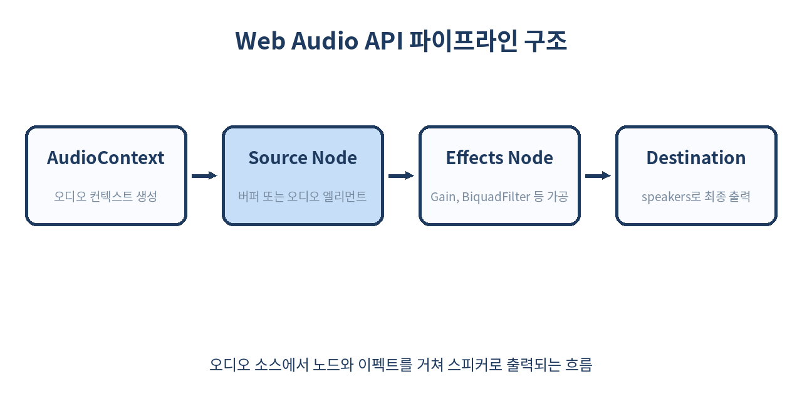
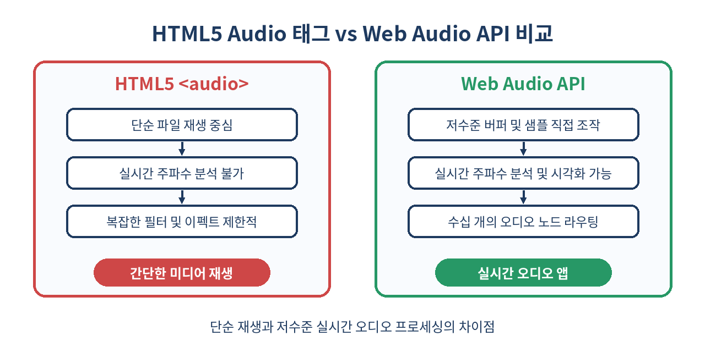

# 🔊 Web Audio API 완벽 가이드

> 브라우저는 더 이상 단순한 문서 뷰어가 아닙니다. 웹 오디오 API를 통해 네이티브 앱 수준의 실시간 사운드 합성과 가공을 구현할 수 있습니다.
> 이 글에서는 오디오 컨텍스트부터 노드 라우팅, 실시간 시각화, 그리고 실무에서 마주치는 함정까지 완벽하게 다룹니다.

---

## 📌 목차
1. 🌐 Web Audio API란 무엇인가
2. 🏗️ AudioContext와 오디오 그래프 개념
3. 🎵 소스 노드 만들기: BufferSource와 MediaElement
4. 🎛️ 이펙트 노드 적용: Gain과 BiquadFilter
5. 📊 AnalyserNode를 이용한 실시간 주파수 분석
6. 🧭 3D 공간 음향 구현하기 (PannerNode)
7. 
8. 🔄 HTML5 Audio 태그와의 명확한 비교
9. 
10. ⚠️ 실무 함정과 브라우저 자동재생 정책
11. 🚫 쓰면 안 되는 경우와 대안
12. 🧾 정리 및 요약

---

## 🧭 1. Web Audio API란 무엇인가
Web Audio API는 웹 브라우저 내에서 오디오를 제어, 합성, 처리할 수 있는 강력한 고수준 자바스크립트 API입니다. 단순히 `<audio>` 태그로 음악 파일을 재생하는 것을 넘어, 사운드의 파형을 직접 조작하고 필터를 씌우며 3차원 공간감을 부여하는 등 복잡한 오디오 엔진 역할을 수행합니다.

### 💡 실무 예제 코드
```javascript
// 브라우저 호환성을 고려한 AudioContext 초기화 및 상태 확인
const AudioContextClass = window.AudioContext || window.webkitAudioContext;
const audioCtx = new AudioContextClass();

console.log('초기 오디오 컨텍스트 상태:', audioCtx.state); // 'suspended' 또는 'running'
console.log('샘플 레이트(Sample Rate):', audioCtx.sampleRate, 'Hz'); // 예: 44100 또는 48000
console.log('현재 재생 시간(Current Time):', audioCtx.currentTime, '초');
```

### 📋 주요 특징 비교 표
| 기능 영역 | Web Audio API | 기존 HTML5 Audio |
| :--- | :--- | :--- |
| **처리 방식** | 디지털 신호 처리(DSP) 그래프 기반 | 단일 엘리먼트 재생/제어 중심 |
| **지연 시간 (Latency)** | 매우 낮음 (실시간 인터랙션 최적화) | 상대적으로 높음 |
| **동시 재생 제어** | 수백 개의 소스 동시 믹싱 및 제어 용이 | 태그 개수 제한 및 관리 복잡 |
| **시각화 및 필터링** | 주파수 분석, 공간계 이펙트 직접 구현 | 기본 제공 이펙트 없음 |

### ⚠️ 실무 함정 사례
- **컨텍스트 중복 생성**: 사용자 인터랙션마다 새로운 `AudioContext`를 생성하면 브라우저당 최대 생성 가능 개수(보통 6개)를 초과하여 사운드가 안 나오거나 브라우저가 강제로 오디오 채널을 닫아버립니다. 싱글톤 패턴으로 전역에서 단 하나의 `AudioContext`만 유지해야 합니다.

---

## 🧭 2. AudioContext와 오디오 그래프 개념
Web Audio API의 모든 작업은 `AudioContext` 내부에서 이루어집니다. 오디오 컨텍스트는 오디오 노드(AudioNode)들로 구성된 라우팅 그래프를 관리합니다. 소스에서 생성된 오디오 신호는 여러 개의 이펙트 노드를 거쳐 최종적으로 목적지(destination, 스피커)로 연결됩니다.

| 구분 | 설명 | 역할 |
|------|------|------|
| Source | 오디오의 시작점 | 버퍼, 마이크, 미디어 엘리먼트 |
| Effect | 신호 가공 노드 | 게인, 필터, 딜레이, 애널라이저 |
| Destination | 오디오의 종착지 | 스피커 또는 오디오 스트림 |

### 💡 실무 노드 라우팅 및 관리 예제
```javascript
// 오디오 그래프 파이프라인 구성 예시
class AudioPipeline {
  constructor(context) {
    this.ctx = context;
    this.source = null;
    this.gainNode = this.ctx.createGain();
    this.analyser = this.ctx.createAnalyser();
    
    // 기본 라우팅 연결: Source -> Gain -> Analyser -> Destination
    this.gainNode.connect(this.analyser);
    this.analyser.connect(this.ctx.destination);
  }

  setVolume(value) {
    // 0.0 ~ 1.0 사이의 값 설정 (지수 곡선 적용으로 자연스러운 볼륨 조절 가능)
    this.gainNode.gain.setValueAtTime(value, this.ctx.currentTime);
  }
}
```

---

## 🧭 3. 소스 노드 만들기: BufferSource와 MediaElement
오디오를 재생하기 위해 가장 먼저 해야 할 일은 소스 노드를 생성하는 것입니다. 서버에서 음원 파일을 fetch한 뒤 arrayBuffer로 변환하고, 이를 디코딩하여 `AudioBufferSourceNode`에 담아 재생할 수 있습니다.

### 💡 실무 BufferSource 구현 예제
```javascript
async function loadAndPlayAudio(url, audioCtx) {
  try {
    const response = await fetch(url);
    const arrayBuffer = await response.arrayBuffer();
    const audioBuffer = await audioCtx.decodeAudioData(arrayBuffer);

    const source = audioCtx.createBufferSource();
    source.buffer = audioBuffer;
    
    // 루프 설정 및 재생 속도 설정 (0.5배속 ~ 2.0배속)
    source.loop = true;
    source.playbackRate.setValueAtTime(1.0, audioCtx.currentTime);

    source.connect(audioCtx.destination);
    source.start(0); // 즉시 재생
    
    return source;
  } catch (error) {
    console.error('오디오 버퍼 로드 실패:', error);
  }
}
```

### 📋 소스 노드 유형별 설정 비교
| 소스 유형 | 장점 | 단점 | 권장 사용처 |
| :--- | :--- | :--- | :--- |
| `AudioBufferSourceNode` | 정밀한 타이밍, 루프, 역재생, 피치 조절 용이 | 전체 파일을 메모리에 로드해야 함 | 효과음(SFX), 짧은 UI 사운드, 리듬 게임 |
| `MediaElementAudioSourceNode` | 대용량 파일 스트리밍 재생, 메모리 효율적 | 정밀한 샘플 단위 제어 및 타이밍 어려움 | 긴 배경음악(BGM), 팟캐스트, 긴 음성 스트림 |

---

## 🧭 4. 이펙트 노드 적용: Gain과 BiquadFilter
사운드의 볼륨을 조절하거나 특정 주파수 대역을 깎아내는 필터링 작업을 하려면 `GainNode`와 `BiquadFilterNode`를 연결 그래프 중간에 삽입하면 됩니다.

### 💡 실무 이펙트 체인 구성 코드
```javascript
const gainNode = audioCtx.createGain();
gainNode.gain.setValueAtTime(0.7, audioCtx.currentTime);

const filterNode = audioCtx.createBiquadFilter();
filterNode.type = 'lowpass';
filterNode.frequency.setValueAtTime(1200, audioCtx.currentTime); // 1.2kHz 이상 주파수 감쇠
filterNode.Q.setValueAtTime(3.0, audioCtx.currentTime); // 레조넌스(공진) 설정

// 노드 연결: Source -> GainNode -> BiquadFilterNode -> Destination
// source.connect(gainNode);
// gainNode.connect(filterNode);
// filterNode.connect(audioCtx.destination);
```

### 📋 BiquadFilter 타입별 설정값 예시
| 필터 타입 (`type`) | 주된 역할 | 실무 활용 사례 | 주요 설정 파라미터 |
| :--- | :--- | :--- | :--- |
| `lowpass` | 지정 주파수 이하만 통과 | 저음 강조, 수중 사운드 효과 | `frequency`, `Q` |
| `highpass` | 지정 주파수 이상만 통과 | 전화기 목소리, 잡음 제거 | `frequency`, `Q` |
| `bandpass` | 특정 대역만 통과 | 무전기 효과, 라디오 사운드 | `frequency`, `Q` |
| `peaking` | 특정 대역 부스트/컷 | 이퀄라이저(EQ) 조절 | `frequency`, `gain`, `Q` |

---

## 🧭 5. AnalyserNode를 이용한 실시간 주파수 분석
음악 재생에 맞춰 반응하는 이퀄라이저 바나 시각화(Visualizer)를 만들 때는 `AnalyserNode`를 사용합니다. 주파수 데이터나 시간domain 데이터를 배열로 추출할 수 있습니다.

### 💡 실무 시각화 루프 코드
```javascript
const analyser = audioCtx.createAnalyser();
analyser.fftSize = 256; // 주파수 해상도 설정 (2의 제곱수: 32 ~ 32768)
analyser.smoothingTimeConstant = 0.85; // 애니메이션 부드러움 정도 (0.0 ~ 1.0)

const bufferLength = analyser.frequencyBinCount; // fftSize의 절반 (128)
const dataArray = new Uint8Array(bufferLength);

function drawVisualizer() {
  requestAnimationFrame(drawVisualizer);

  // 현재 주파수 데이터를 배열에 채움 (0 ~ 255 값)
  analyser.getByteFrequencyData(dataArray);

  // 캔버스 렌더링 예시 로직
  // ctx.clearRect(0, 0, canvas.width, canvas.height);
  // dataArray 값을 순회하며 막대그래프 렌더링 수행
  for (let i = 0; i < bufferLength; i++) {
    const barHeight = dataArray[i];
    // drawBar(i, barHeight);
  }
}

drawVisualizer();
```

---

## 🧭 6. 3D 공간 음향 구현하기 (PannerNode)
`PannerNode`를 이용하면 리스너(사용자의 귀)의 위치를 기준으로 오디오 소스의 위치를 3차원 공간상에 배치할 수 있습니다. 게임 사운드나 메타버스 환경에서 소리가 나는 방향을 다르게 들리게 할 때 유용합니다.

### 💡 실무 PannerNode 설정 코드
```javascript
const panner = audioCtx.createPanner();

panner.panningModel = 'HRTF'; // 머리전달함수 사용으로 입체감 극대화
panner.distanceModel = 'inverse';
panner.refDistance = 1;
panner.maxDistance = 10000;
panner.rolloffFactor = 1;

// 소스의 3차원 공간 좌표 설정
panner.positionX.setValueAtTime(5.0, audioCtx.currentTime); // 우측에 위치
panner.positionY.setValueAtTime(0.0, audioCtx.currentTime);
panner.positionZ.setValueAtTime(-2.0, audioCtx.currentTime); // 전방에 위치

// 리스너(플레이어) 위치 설정
const listener = audioCtx.listener;
if (listener.positionX) {
  listener.positionX.setValueAtTime(0, audioCtx.currentTime);
  listener.positionY.setValueAtTime(0, audioCtx.currentTime);
  listener.positionZ.setValueAtTime(0, audioCtx.currentTime);
} else {
  listener.setPosition(0, 0, 0);
}
```

---

## 🧭 7. 

---

## 🧭 8. HTML5 Audio 태그와의 명확한 비교
오디오를 다룰 때 단순히 미디어를 재생하는 목적이라면 `<audio>` 태그가 훨씬 간편하고 가볍습니다. 하지만 오디오 이펙트, 실시간 가공, 3D 사운드 등이 필요하다면 반드시 Web Audio API를 선택해야 합니다.

### 📋 상세 비교 표
| 비교 항목 | HTML5 `<audio>` 태그 | Web Audio API |
| :--- | :--- | :--- |
| **아키텍처** | DOM 기반 선언적 엘리먼트 | 자바스크립트 기반 프로그래밍 노드 그래프 |
| **이펙트 처리** | 불가 (브라우저 내장 이펙트 없음) | 무제한 (Gain, Filter, Delay, Convolver 등) |
| **메모리 소비** | 낮음 (브라우저 최적화 내장) | 오디오 버퍼 디코딩 시 상대적으로 높음 |
| **스트리밍 재생** | 기본 지원 (Range 요청 처리 내장) | 추가 구현 필요 (`MediaSource` 연동 등) |
| **학습 곡선** | 매우 낮음 | 높음 (오디오/DSP 지식 필요) |

---

## 🧭 9. 

---

## 🧭 10. 실무 함정과 브라우저 자동재생 정책
현대 브라우저는 사용자 상호작용(클릭, 터치 등) 없이 페이지 로드와 동시에 `AudioContext`를 실행하는 것을 엄격히 금지합니다. 따라서 사용자의 제스처 이벤트 안에서 `audioCtx.resume()`을 호출해야 합니다.

### 💡 자동재생 정책 대응 코드
```javascript
const playButton = document.querySelector('#play-btn');

playButton.addEventListener('click', async () => {
  if (audioCtx.state === 'suspended') {
    await audioCtx.resume();
    console.log('오디오 컨텍스트가 성공적으로 활성화되었습니다:', audioCtx.state);
  }
  
  // 이후 오디오 재생 로직 수행
  // playSound();
});
```

### ⚠️ 실무 함정 사례
- **메모리 누수(Memory Leak)**: 사용이 끝난 `AudioBufferSourceNode`나 연결된 이펙트 노드들은 `disconnect()`를 호출하지 않거나 레퍼런스가 남아있을 경우 가비지 컬렉션(GC) 대상이 되지 않아 메모리 누수가 발생합니다. 
- **iOS 사파리 사운드 무음 문제**: 무음 스위치나 하드웨어 볼륨 설정, 그리고 사용자 제스처 컨텍스트 해제 타이밍 문제로 인해 사파리에서 소리가 나지 않는 현상이 빈번합니다. 최초 터치 이벤트 핸들러 내부에서 빈 오디오 버퍼를 아주 짧게 재생(Unlock Audio)하는 관용적 패턴을 적용해야 합니다.

---

## 🧭 11. 쓰면 안 되는 경우와 대안
- 단순히 긴 배경음악이나 팟캐스트를 끊김 없이 재생하는 용도라면 오디오 컨텍스트 메모리 관리 및 배터리 소모 관점에서 `<audio>` 태그가 훨씬 안전합니다.
- 복잡한 사운드 스트리밍 서버 연동이 필요할 때는 WebRTC나 MediaSource Extensions(MSE)와의 조합을 고려해야 합니다.

### 📋 상황별 최적 기술 선택 가이드
| 요구사항 및 시나리오 | 권장 기술 | 대안 기술 |
| :--- | :--- | :--- |
| 단순 BGM 및 팟캐스트 재생 | HTML5 `<audio>` | Web Audio API (`MediaElementSource`) |
| 웹 게임 배경음 및 효과음 (SFX) | Web Audio API (`AudioBufferSource`) | Howler.js (래퍼 라이브러리) |
| 실시간 오디오 편집기 / DAW 웹앱 | Web Audio API | WebAssembly 기반 커스텀 오디오 엔진 |
| 실시간 화상회의 / 음성 채팅 | WebRTC (`MediaStream`) | Web Audio API (마이크 입력 처리) |

---

## 🧭 12. 정리 및 요약
- Web Audio API는 브라우저에서 사운드를 합성하고 제어하는 강력한 저수준 도구입니다.
- AudioContext와 다양한 노드(Source, Gain, Filter, Analyser)의 조합으로 파이프라인을 구성합니다.
- 사용자 제스처 기반의 AudioContext 활성화 정책을 반드시 준수해야 합니다.

> ✨ **한 줄 요약**
> 웹에서 완벽한 사운드 제어를 원한다면 AudioContext와 노드 라우팅을 마스터하자.

---

## 📚 참고 자료
- [MDN Web Audio API 공식 문서](https://developer.mozilla.org/en-US/docs/Web/API/Web_Audio_API)
- [W3C Web Audio API Specification](https://webaudio.github.io/web-audio-api/)
