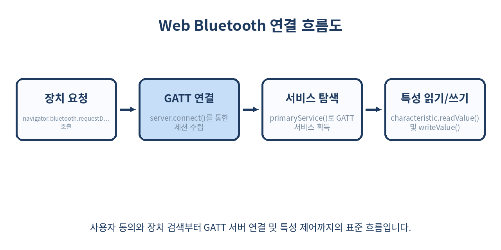
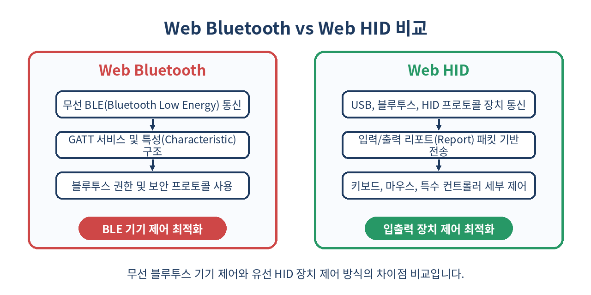

# 📡 브라우저에서 하드웨어를 직접 제어하는 Web Bluetooth와 Web HID API 완벽 가이드

> 웹 브라우저는 더 이상 문서와 이미지를 렌더링하는 수동적인 뷰어가 아닙니다. Web Bluetooth와 Web HID API를 통해 웹 애플리케이션은 로컬에 연결된 물리적 하드웨어 장치와 직접 통신하며, 데스크톱 애플리케이션과 동등한 사용자 경험을 제공할 수 있습니다.
> 이 글에서는 브라우저 기반 하드웨어 제어의 핵심 아키텍처부터 실무 구현 패턴, 보안 함정, 그리고 크로스 플랫폼 대응 전략까지 상세히 다룹니다.

---

## 📌 목차
1. 🧭 웹 하드웨어 통신 시대의 개막
2. 🔌 Web Bluetooth API 핵심 개념
3. 📱 실전 블루투스 장치 스캔과 연결
4. 📊 GATT 서버와 특성(Characteristic) 조작
5. ⌨️ Web HID API로 커스텀 장치 제어하기
6. 🛡️ 보안과 권한 관리 모델
7. 🔄 두 API의 차이점 비교
8. 💻 실제 구현 코드 예시
9. ⚠️ 실무 함정과 주의 사항
10. ❌ 쓰면 안 되는 경우와 대안
11. 🧾 정리
12. 📚 참고 자료

---

## 🧭 1. 웹 하드웨어 통신 시대의 개막

과거 웹 애플리케이션은 서버와의 HTTP 통신에 의존했으며, 클라이언트 측 주변기기를 제어하기 위해서는 별도의 데스크톱 앱이나 브라우저 플러그인(ActiveX, NPAPI 등)을 설치해야 했습니다. 이러한 방식은 보안 취약점을 유발하고 특정 운영체제에 종속되는 치명적인 단점이 있었습니다. 

그러나 모던 웹 표준과 W3C/WICG의 지속적인 개정 덕분에 이제는 별도의 플러그인 설치 없이도 브라우저가 직접 저수준(Low-level) 하드웨어와 통신할 수 있는 기반이 마련되었습니다. 특히 IoT(사물인터넷) 기기, 맞춤형 입력 장치, 의료용 센서, 스마트 가전과의 연동이 웹 환경 안에서 완벽하게 구현 가능해졌습니다.



---

## 🔌 2. Web Bluetooth API 핵심 개념

Web Bluetooth API는 블루투스 4.0 규격인 **BLE(Bluetooth Low Energy)** 기기와 브라우저 간의 안전한 통신을 지원합니다. 이 API는 블루투스 프로토콜의 표준 규격인 **GATT(Generic Attribute Profile)** 구조를 그대로 따르며, 개발자는 다음 핵심 개념을 반드시 이해해야 합니다.

- **Central / Peripheral**: 브라우저는 주로 중앙 장치(Central) 역할을 수행하며, 연결 대상 하드웨어가 주변 장치(Peripheral)가 됩니다.
- **Service**: 특정 기능을 수행하는 데이터와 프로시저의 논리적 모음입니다. 예를 들어 심박수 측정 서비스(`0x180D`) 등이 있습니다.
- **Characteristic**: 서비스에 속한 실제 데이터 값의 단위로, 읽기(Read), 쓰기(Write), 알림(Notify) 등의 권한(`Properties`)을 가집니다. 디스크립터(Descriptor)를 통해 추가 메타데이터를 제공할 수도 있습니다.

---

## 📱 3. 실전 블루투스 장치 스캔과 연결

브라우저에서 블루투스 장치를 검색하고 연결하려면 사용자 제스처(버튼 클릭 등)가 반드시 수반되어야 합니다. 악의적인 웹사이트가 사용자의 주변 장치 목록을 무단으로 스캔하거나 핑거프린팅(Fingerprinting)에 악용하는 것을 방지하기 위한 강력한 보안 정책입니다.

```js
// 실무에서 활용하는 블루투스 장치 연결 및 필터링 유틸리티 함수
async function connectBluetoothDevice() {
  try {
    console.log('블루투스 장치 검색 요청 중...');
    
    // 명시적인 필터 조건 설정 (서비스 UUID 또는 이름 기반)
    const options = {
      filters: [
        { services: ['heart_rate'] },
        { namePrefix: 'SmartSensor' }
      ],
      optionalServices: ['battery_service'] // 추가로 접근할 서비스 지정
    };

    const device = await navigator.bluetooth.requestDevice(options);
    
    // 장치 연결 끊김 이벤트 리스너 사전 등록
    device.addEventListener('gattserverdisconnected', onDisconnected);

    console.log(`선택된 장치: ${device.name} (ID: ${device.id})`);
    
    const server = await device.gatt.connect();
    console.log('GATT 서버 연결 성공:', server);
    
    return server;
  } catch (error) {
    console.error('블루투스 연결 실패 또는 사용자가 취소함:', error);
    throw error;
  }
}

function onDisconnected(event) {
  const device = event.target;
  console.warn(`장치와의 연결이 끊어졌습니다: ${device.name}`);
  // 재연결 로직 또는 UI 상태 업데이트 트리거
}
```

---

## 📊 4. GATT 서버와 특성(Characteristic) 조작

장치에 연결된 후에는 GATT 서버를 통해 원하는 서비스를 탐색하고, 특성(Characteristic) 값을 읽거나 쓸 수 있습니다. 센서나 모니터링 기기처럼 데이터가 실시간으로 변경되는 환경에서는 `startNotifications()` 메서드를 호출하여 변경 이벤트를 구독해야 합니다.

```js
async function initializeHeartRateMonitor(server) {
  try {
    // 1. 심박수 서비스 획득
    const service = await server.getPrimaryService('heart_rate');
    
    // 2. 심박수 측정 특성 획득
    const characteristic = await service.getCharacteristic('heart_rate_measurement');
    
    // 3. 알림(Notification) 활성화
    await characteristic.startNotifications();
    
    // 4. 데이터 변경 이벤트 리스너 등록
    characteristic.addEventListener('characteristicvaluechanged', (event) => {
      const value = event.target.value;
      
      // BLE 데이터 파싱 규칙 (Bluetooth SIG 표준 규격 준수)
      const flags = value.getUint8(0);
      const is16Bit = flags & 0x01;
      let heartRate;
      
      if (is16Bit) {
        heartRate = value.getUint16(1, true); // Little-endian
      } else {
        heartRate = value.getUint8(1);
      }
      
      console.log(`실시간 심박수: ${heartRate} bpm`);
      updateDashboardUI(heartRate);
    });

    console.log('심박수 모니터링이 시작되었습니다.');
  } catch (error) {
    console.error('GATT 데이터 조작 중 오류 발생:', error);
  }
}

function updateDashboardUI(bpm) {
  // DOM 업데이트 로직 예시
  const element = document.getElementById('bpm-display');
  if (element) element.textContent = `${bpm} BPM`;
}
```

---

## ⌨️ 5. Web HID API로 커스텀 장치 제어하기

Web HID(Human Interface Device) API는 키보드, 마우스, 조이스틱뿐만 아니라 특수한 매크로 패드, 산업용 제어 패널, LED 조명 컨트롤러, 의료용 입력 장치 등 운영체제의 기본 드라이버로 제어하기 까다로운 커스텀 하드웨어를 웹에서 직접 다룰 수 있게 해줍니다.

```js
async function connectCustomHIDDevice() {
  try {
    // 벤더 ID(VID)와 제품 ID(PID)로 특정 하드웨어 필터링
    const filters = [
      { vendorId: 0x1234, productId: 0x5678 } // 예시 Vender/Product ID
    ];

    const devices = await navigator.hid.requestDevice({ filters });
    
    if (devices.length === 0) {
      console.log('선택된 HID 장치가 없습니다.');
      return;
    }

    const device = devices[0];
    
    if (!device.opened) {
      await device.open();
    }
    
    console.log(`HID 장치 연결됨: ${device.productName} (VID: ${device.vendorId}, PID: ${device.productId})`);
    return device;
  } catch (error) {
    console.error('HID 장치 연결 중 오류:', error);
  }
}
```

---

## 🛡️ 6. 보안과 권한 관리 모델

웹 하드웨어 API는 시스템 내부 자원에 접근할 수 있는 강력한 기능인 만큼, 브라우저 벤더들은 엄격한 보안 모델을 적용하고 있습니다.

1. **보안 컨텍스트 필수 (HTTPS / Localhost)**: Web Bluetooth와 Web HID는 오직 보안 컨텍스트(`Secure Context`) 환경에서만 동작합니다. 프로덕션 환경에서는 반드시 HTTPS가 적용되어야 하며, 개발 환경에서는 `localhost` 또는 `127.0.0.1`에서만 허용됩니다.
2. **사용자 제스처 바인딩**: `requestDevice()` 등의 권한 요청 API는 반드시 `click`이나 `touchend`와 같은 명시적인 사용자 인터랙션 이벤트 핸들러 내부에서 호출되어야 합니다. 스크립트 로드 시점에 자동 실행하는 것은 브라우저에 의해 강제로 차단됩니다.
3. **오리진 격리 및 권한 영속성**: 사용자가 장치 접근을 허용하면 해당 출처(Origin)에 권한이 부여됩니다. 사용자는 언제든지 브라우저 설정에서 이 권한을 취소할 수 있습니다.

---

## 🔄 7. 두 API의 차이점 비교



| 비교 항목 | Web Bluetooth API | Web HID API |
| --- | --- | --- |
| **통신 프로토콜** | 무선 BLE (Bluetooth Low Energy) | 유선/무선 USB, 블루투스 HID 프로토콜 |
| **주요 대상 기기** | 스마트 밴드, 비콘, 체중계, IoT 센서 | 커스텀 매크로 패드, 조이스틱, 스트림 덱, 패널 기기 |
| **데이터 구조** | GATT 서비스(Service) 및 특성(Characteristic) | 입력/출력 리포트(Input/Output Report) 바이트 배열 |
| **권한 관리** | 개별 장치 단위 선택 및 영구 저장 | 장치 단위 선택 및 포트 오픈 제어 |
| **메모리 및 버퍼** | 특성 단위 읽기/쓰기 및 알림 스트림 | 바이트 배열 리포트 단위 전송 (`sendReport`, `inputreport`) |
| **지원 브라우저** | 크롬, 엣지, 안드로이드 크롬 (사파리 미지원) | 크롬, 엣지, 오페라 (데스크톱 중심, 파이어폭스/사파리 미지원) |

---

## 💻 8. 실제 구현 코드 예시

다음은 Web HID 장치로부터 수신되는 입력 리포트(Input Report)를 실시간으로 수신하고 파싱하여, 장치의 물리적 버튼 입력이나 노브 회전 값을 웹 애플리케이션 상태로 반영하는 완성도 높은 구현 패턴입니다.

```js
class CustomHardwareController {
  constructor() {
    this.device = null;
  }

  async init() {
    try {
      const devices = await navigator.hid.requestDevice({ filters: [] });
      if (devices.length === 0) return;

      this.device = devices[0];
      if (!this.device.opened) {
        await this.device.open();
      }

      // 입력 리포트 이벤트 리스너 등록
      this.device.addEventListener('inputreport', this.handleInputReport.bind(this));
      console.log('하드웨어 리스너가 성공적으로 초기화되었습니다.');
    } catch (error) {
      console.error('초기화 실패:', error);
    }
  }

  handleInputReport(event) {
    const { device, reportId, data } = event;
    
    // 데이터 뷰어(DataView)를 통한 바이트 파싱
    const firstByte = data.getUint8(0);
    const secondByte = data.getUint8(1);

    console.log(`[Report ID: ${reportId}] Device: ${device.productName}`);
    console.log(`Raw Bytes -> Byte 0: ${firstByte}, Byte 1: ${secondByte}`);

    // 특정 버튼 눌림 여부 판단 예시
    if (firstByte === 0x01) {
      this.triggerAction('BUTTON_A_PRESSED');
    } else if (firstByte === 0x02) {
      this.triggerAction('BUTTON_B_PRESSED');
    }
  }

  async sendOutputData(reportId, bufferData) {
    if (!this.device || !this.device.opened) {
      throw new Error('장치가 연결되어 있지 않습니다.');
    }
    // 장치로 제어 명령 전송 (예: LED 색상 변경 등)
    await this.device.sendReport(reportId, bufferData);
    console.log('출력 리포트 전송 완료');
  }

  triggerAction(actionName) {
    console.log(`액션 실행: ${actionName}`);
    // 비즈니스 로직 연동
  }
}

// 사용 예시
const controller = new CustomHardwareController();
document.getElementById('connect-btn').addEventListener('click', () => {
  controller.init();
});
```

---

## ⚠️ 9. 실무 함정과 주의 사항

프로덕션 레벨에서 Web Bluetooth와 Web HID를 도입할 때 마주치는 대표적인 함정과 대응 전략입니다.

- **브라우저 호환성 벽**: 애플(Apple)의 정책 및 사파리(Safari) 브라우저는 Web Bluetooth 지원에 매우 소극적이거나 제한적이며, Web HID는 아예 지원하지 않는 경우가 많습니다. 데스크톱 크롬 계열 브라우저 중심의 타겟층이 아니라면 대책이 필요합니다.
- **예기치 않은 연결 해제 (Disconnection)**: 무선 블루투스 기기는 배터리 방전, 전파 간격 이탈, 사용자 기기 전원 차단 등으로 언제든 연결이 끊어질 수 있습니다. 반드시 `gattserverdisconnected` 이벤트를 바인딩하고 재연결(Reconnection) UI를 제공해야 합니다.
- **메모리 누수 및 이벤트 리스너 관리**: 컴포넌트가 언마운트되거나 장치가 교체될 때 `removeEventListener`를 호출하지 않으면 메모리 누수나 중복 이벤트 핸들링 문제가 발생합니다.
- **버퍼 오버플로우 및 엔디안(Endian) 주의**: 하드웨어마다 바이트 정렬 방식(Little-endian vs Big-endian)이 다르므로 `DataView` 메서드 호출 시 `littleEndian` 인자 설정을 정확히 확인해야 합니다.

---

## ❌ 10. 쓰면 안 되는 경우와 대안

모든 기술이 모든 프로젝트에 적합한 것은 아닙니다. 다음의 경우에는 Web Bluetooth나 Web HID 도입을 피해야 합니다.

- **iOS(아이폰/아이패드) 사용자가 주 타겟인 경우**: 사파리(Safari)에서 Web HID를 지원하지 않고 Web Bluetooth 역시 제약이 심하므로, iOS 환경이 필수적이라면 하이브리드 앱(React Native, Flutter)이나 네이티브 앱 개발을 검토해야 합니다.
- **고속 대용량 스트리밍 데이터 전송**: BLE는 대역폭이 매우 좁고 지연 시간이 존재합니다(초당 전송량 제한). 고화질 오디오/비디오 스트리밍이나 대용량 파일 전송에는 전혀 적합하지 않으며, 이 경우 WebRTC, WebSockets, 또는 USB 기반의 WebUSB API(지원 제한적)를 검토해야 합니다.
- **기업 내부 네트워크 보안 정책이 엄격한 환경**: 일부 기업용 PC 환경에서는 브라우저를 통한 외부 장치 연결 자체가 보안 정책(DLP 솔루션 등)에 의해 차단될 수 있습니다.

---

## 🧾 정리

- **웹의 확장성**: Web Bluetooth와 Web HID API를 통해 웹 애플리케이션은 브라우저 창의 한계를 벗어나 물리적 하드웨어와 직접 통신할 수 있는 강력한 플랫폼으로 진화했습니다.
- **보안 중심 아키텍처**: HTTPS 보안 컨텍스트와 엄격한 사용자 제스처 기반의 권한 모델을 통해 시스템 보안을 철저히 유지합니다.
- **표준 규격 준수**: GATT 서비스/특성 모델과 HID 리포트 바이트 구조를 완벽하게 숙지하면 다양한 산업군(IoT, 헬스케어, 커스텀 입력 장치)의 웹 기반 솔루션을 구축할 수 있습니다.
- **크로스 플랫폼 한계 인지**: 특히 사파리 및 모바일 환경에서의 지원 제약을 사전에 파악하고, 이에 맞는 아키텍처(폴백 전략 또는 네이티브 전환)를 수립해야 합니다.

> ✨ **한 줄 요약**
> Web Bluetooth와 Web HID API는 복잡한 데스크톱 프로그램 설치 없이 브라우저 단독으로 하드웨어를 제어할 수 있게 만드는 모던 웹의 핵심 기술입니다.

---

## 📚 참고 자료
- [MDN Web Docs: Web Bluetooth API](https://developer.mozilla.org/en-US/docs/Web/API/Web_Bluetooth_API)
- [MDN Web Docs: Web HID API](https://developer.mozilla.org/en-US/docs/Web/API/Web_HID_API)
- [Google Developers: Communicating with Bluetooth devices](https://developer.chrome.com/docs/capabilities/bluetooth)
- [W3C WebHID API Specification](https://wicg.github.io/webhid/)
