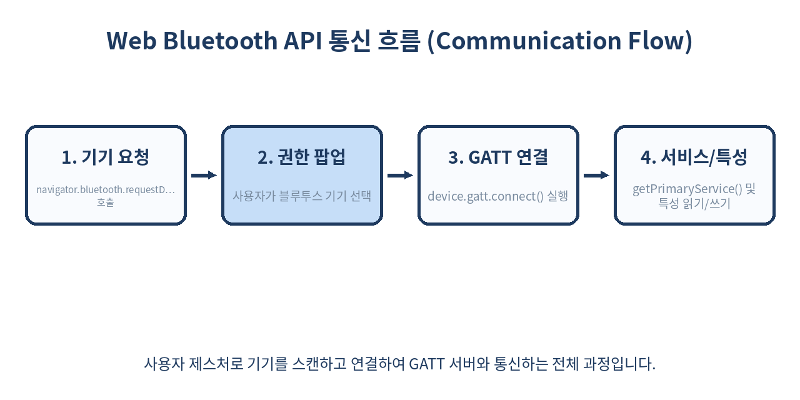
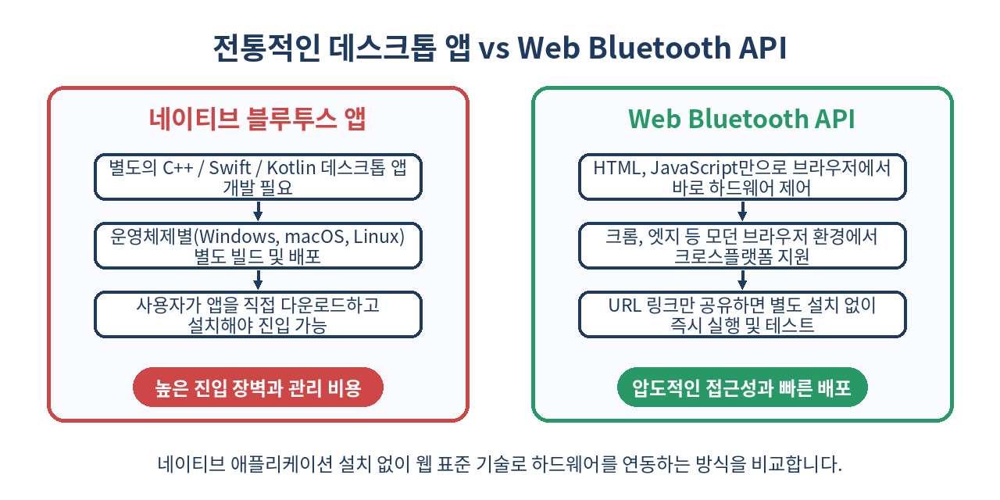

# 📡 Web Bluetooth API 완벽 가이드: 브라우저에서 하드웨어를 직접 제어하는 방법

> 웹 브라우저의 한계를 넘어 블루투스 저에너지(BLE) 기기와 직접 통신하는 방법을 알아봅니다.
> 별도의 플러그인이나 네이티브 앱 설치 없이 자바스크립트만으로 주변 하드웨어를 제어하는 현대적인 웹 기술을 다룹니다.

---

## 📌 목차
1. 🔍 Web Bluetooth API란 무엇인가?
2. 🛡️ 보안 모델과 필수 요구 사항
3. 📲 주변 블루투스 기기 스캔 및 요청하기
4. 🔗 GATT 서버 연결과 서비스 탐색
5. 📖 특성(Characteristic) 읽기와 쓰기
6. 🔔 알림(Notification)과 실시간 데이터 수신
7. ⚠️ 실무 함정 및 디버깅 팁
8. 🚫 쓰면 안 되는 경우와 대안
9. 🧾 정리 및 한 줄 요약
10. 📚 참고 자료

---

## 🔍 1. Web Bluetooth API란 무엇인가?

전통적으로 브라우저는 보안상의 이유로 로컬 하드웨어(USB, 블루투스, 시리얼 포트 등) 접근을 극도로 제한해 왔습니다. 하지만 웹 애플리케이션의 성능이 비약적으로 발전하고 사물인터넷(IoT) 생태계가 확장됨에 따라, 웹에서도 하드웨어를 직접 제어할 수 있는 표준 스펙이 필요해졌습니다.

Web Bluetooth API는 웹 브라우저가 블루투스 저에너지(BLE, Bluetooth Low Energy) 기기와 안전하게 통신할 수 있도록 돕는 W3C 표준 자바스크립트 API입니다. 이를 통해 개발자는 스마트 헬스케어 기기, 스마트 조명, 블루투스 프린터, 로보틱스 키트 등을 웹 앱 하나로 연동할 수 있습니다. 

BLE 프로토콜은 전통적인 블루투스(Classic Bluetooth)와 달리 저전력 소모에 최적화되어 있어, 코인 셀 배터리 하나로 수개월에서 수년 동안 동작하는 소형 센서 장치들과 통신하는 데 주로 사용됩니다. 웹 표준 기반의 이 API를 활용하면 사용자는 별도의 데스크톱 드라이버 설치나 복잡한 컴파일 과정 없이, 단 몇 초 만에 브라우저 창 안에서 하드웨어와 페어링하고 제어 명령을 내릴 수 있습니다.



---

## 🛡️ 2. 보안 모델과 필수 요구 사항

하드웨어를 직접 제어하는 API인 만큼 보안은 가장 중요한 요소입니다. 악성 웹사이트가 사용자의 허가 없이 주변 블루투스 기기를 스캔하거나 조작하는 것을 막기 위해 엄격한 브라우저 보안 정책이 적용됩니다.

- **HTTPS 필수**: Web Bluetooth API는 보안 컨텍스트(`Secure Context`)에서만 동작합니다. 프로덕션 환경에서는 반드시 HTTPS가 적용되어야 하며, 개발 단계에서는 `localhost` 또는 `127.0.0.1` 환경에서만 HTTP 허용이 예외적으로 인정됩니다.
- **사용자 제스처 필수**: `navigator.bluetooth.requestDevice()` 같은 기기 요청 메서드는 사용자의 명시적인 인터랙션(버튼 클릭, 터치 등) 이벤트 핸들러 내부에서만 호출할 수 있습니다. 페이지가 로드되자마자 백그라운드 스크립트에서 임의로 팝업을 띄우는 것은 원천 차단됩니다.
- **사용자 동의 팝업**: 브라우저는 사용자가 직접 어떤 기기를 연결할지 선택할 수 있도록 시스템 수준의 브라우저 권한 팝업을 반드시 표시합니다. 스크립트가 임의로 특정 기기의 MAC 주소를 강제 지정하여 연결하는 것은 불가능합니다.

| 구분 | 전통적 앱 개발 (Native) | Web Bluetooth API (Web) |
| --- | --- | --- |
| 실행 환경 | 네이티브 OS 환경 (Windows, macOS, Linux 등) | 크롬, 엣지, 안드로이드 브라우저, 크롬북 |
| 배포 방식 | 앱스토어 심사, 패키징 및 인스톨러 필요 | URL 접속만으로 즉시 이용 (Instant Delivery) |
| 보안 검증 | OS 권한 설정 모델 + 코드 서명 | 브라우저 샌드박스 + 사용자 제스처 프롬프트 |
| 메모리 관리 | OS 수준의 가비지 컬렉션 및 직접 제어 | 브라우저 가비지 컬렉터 및 세션 기반 해제 |

---

## 📲 3. 주변 블루투스 기기 스캔 및 요청하기

블루투스 통신의 첫 단계는 사용 가능한 기기를 스캔하고 사용자가 특정 기기를 선택하도록 유도하는 것입니다. `navigator.bluetooth.requestDevice()` 메서드를 사용하며, 필터링 조건을 상세히 지정할수록 사용자에게 노출되는 기기 리스트가 정제됩니다.

```javascript
async function scanBluetoothDevice() {
  try {
    const device = await navigator.bluetooth.requestDevice({
      filters: [
        { services: ['battery_service'] },
        { namePrefix: 'SmartDevice' }
      ],
      optionalServices: [
        'device_information',
        '0000ffe0-0000-1000-8000-00805f9b34fb' // 커스텀 서비스 UUID 예시
      ]
    });
    
    console.log(`선택된 기기 이름: ${device.name}`);
    console.log(`기기 ID: ${device.id}`);
    
    // 연결 끊김 이벤트 리스너 기본 등록
    device.addEventListener('gattserverdisconnected', onDisconnected);
    
    return device;
  } catch (error) {
    if (error.name === 'NotFoundError') {
      console.warn('사용자가 기기 선택 창을 닫았거나 일치하는 기기가 없습니다.');
    } else {
      console.error('블루투스 기기 스캔 중 오류 발생:', error);
    }
  }
}

function onDisconnected(event) {
  const device = event.target;
  console.log(`기기 연결이 끊어졌습니다: ${device.name}`);
}
```

- `filters`: 특정 서비스 UUID(`services`)나 기기 이름(`name`, `namePrefix`)을 필터링하여 사용자에게 보여줄 목록을 제한합니다. 보안 및 UX 측면에서 반드시 필터를 하나 이상 제공하는 것이 권장됩니다.
- `optionalServices`: 필터에 명시되지 않았지만, 연결 이후 GATT 서버를 통해 추가로 접근해야 하는 서비스 UUID가 있다면 이 배열에 반드시 미리 등록해야 합니다. 등록하지 않은 서비스는 연결 후 접근이 거부됩니다.

---

## 🔗 4. GATT 서버 연결과 서비스 탐색

기기가 선택되면 해당 기기의 GATT(Generic Attribute Profile) 서버에 연결해야 합니다. GATT 서버는 블루투스 기기의 데이터 구조를 계층적으로 관리하며, 프로파일 내부에는 여러 개의 서비스(Service)가 존재합니다.

```javascript
async function connectGATT(device) {
  if (device.gatt.connected) {
    console.log('이미 GATT 서버에 연결되어 있습니다.');
    return device.gatt;
  }

  try {
    // 타임아웃 방지 및 재시도 로직 포함 연결 시도
    const server = await device.gatt.connect();
    console.log('GATT 서버 연결 성공:', server.device.id);

    // 표준 배터리 서비스 가져오기
    const batteryService = await server.getPrimaryService('battery_service');
    console.log('배터리 서비스 획득 성공:', batteryService.uuid);
    
    // 커스텀 장치 정보 서비스 가져오기
    const deviceInfoService = await server.getPrimaryService('device_information');
    console.log('디바이스 정보 서비스 획득 성공:', deviceInfoService.uuid);

    return { server, batteryService, deviceInfoService };
  } catch (error) {
    console.error('GATT 서버 연결 실패:', error);
    throw error;
  }
}
```

- `device.gatt.connect()`는 비동기 함수로 네트워크 상태 및 기기 반응성에 따라 수백 밀리초에서 수 초가 소요될 수 있습니다.
- `getPrimaryService()` 메서드에는 표준 UUID 문자열(예: `'battery_service'`) 뿐만 아니라 16진수 단축형(`0x180F`) 또는 128비트 풀 UUID 형식 모두 사용할 수 있습니다.

---

## 📖 5. 특성(Characteristic) 읽기와 쓰기

서비스 내부에는 실제 데이터 값을 담고 있는 특성(Characteristic)이 존재합니다. 이 특성을 통해 기기의 상태 값을 읽거나(`readValue`), 제어 명령을 쓸(`writeValue`) 수 있습니다. 바이트 데이터를 다룰 때는 `DataView` 객체를 활용하여 엔디안(Endian)을 처리합니다.

```javascript
async function readBatteryLevel(batteryService) {
  try {
    const characteristic = await batteryService.getCharacteristic('battery_level');
    const value = await characteristic.readValue();
    
    // UInt8 형태로 첫 번째 바이트 읽기
    const batteryLevel = value.getUint8(0);
    console.log(`현재 배터리 잔량: ${batteryLevel}%`);
    return batteryLevel;
  } catch (error) {
    console.error('배터리 잔량 읽기 실패:', error);
  }
}

async function writeLedControl(deviceService, state) {
  try {
    const characteristic = await deviceService.getCharacteristic('0000ffe1-0000-1000-8000-00805f9b34fb');
    
    // 명령 데이터 포맷 설정 (예: 1바이트 정수형 명령 전송)
    const buffer = new Uint8Array([state ? 0x01 : 0x00]);
    
    // 쓰기 방식 결정 (writeValueWithResponse 또는 writeValueWithoutResponse)
    await characteristic.writeValue(buffer);
    console.log(`LED 상태 변경 완료: ${state ? 'ON' : 'OFF'}`);
  } catch (error) {
    console.error('LED 제어 명령 전송 실패:', error);
  }
}
```

- `writeValue()`는 기기 측에서 응답(Write Response)을 줄 때까지 기다리므로 신뢰성이 높지만 속도가 다소 느립니다. 실시간 제어가 필요한 경우 응답을 기다리지 않는 `writeValueWithoutResponse()`를 고려할 수 있습니다.
- 데이터 파싱 시 `DataView`의 `getUint8()`, `getUint16(offset, littleEndian)` 등을 사용하여 BLE 장치가 제공하는 규격에 맞춰 정확하게 언마샬링해야 합니다.

---

## 🔔 6. 알림(Notification)과 실시간 데이터 수신

센서 데이터(심박수, 온도, 가속도 등)처럼 수시로 값이 변경되는 경우, 매번 `readValue()`를 폴링(Polling)하는 것은 전력 소모가 극심하고 비효율적입니다. 이 경우 알림(Notification) 구독을 설정하여 값이 변경될 때마다 이벤트 형태로 수신하는 것이 표준 패턴입니다.

```javascript
async function subscribeToSensorData(service) {
  try {
    const characteristic = await service.getCharacteristic('heart_rate_measurement');
    
    // 알림 활성화
    await characteristic.startNotifications();
    console.log('센서 데이터 알림 구독 시작');
    
    // 값 변경 이벤트 리스너 등록
    characteristic.addEventListener('characteristicvaluechanged', (event) => {
      const value = event.target.value;
      
      // BLE 심박수 프로파일 스펙에 따른 데이터 파싱 (Flags 바이트 확인)
      const flags = value.getUint8(0);
      const is16Bit = flags & 0x01;
      let heartRate = 0;
      
      if (is16Bit) {
        heartRate = value.getUint16(1, true); // 리틀 엔디안
      } else {
        heartRate = value.getUint8(1);
      }
      
      console.log(`실시간 심박수 측정값: ${heartRate} BPM`);
    });
  } catch (error) {
    console.error('알림 구독 설정 중 오류 발생:', error);
  }
}

async function unsubscribeFromSensorData(service) {
  try {
    const characteristic = await service.getCharacteristic('heart_rate_measurement');
    await characteristic.stopNotifications();
    console.log('센서 데이터 알림 구독 해제 완료');
  } catch (error) {
    console.error('알림 해제 중 오류:', error);
  }
}
```

- `startNotifications()` 호출 성공 후 반드시 `characteristicvaluechanged` 이벤트 핸들러를 연결해야 실시간 데이터 스트림을 유실 없이 처리할 수 있습니다.
- 컴포넌트 언마운트나 페이지 이동 시 불필요한 배터리 소모와 메모리 누수를 방지하기 위해 반드시 `stopNotifications()`를 호출하여 구독을 해제해야 합니다.

---

## ⚠️ 7. 실무 함정 및 디버깅 팁

실무 프로젝트에서 Web Bluetooth API를 도입할 때 마주치는 대표적인 함정들과 해결 방법은 다음과 같습니다.

1. **브라우저 파편화 및 호환성 한계**: 크롬, 엣지, 삼성 인터넷 등 Chromium 기반 브라우저에서는 완벽하게 지원되지만, 애플 사파리(Safari)와 모질라 파이어폭스(Firefox)는 표준 지원 미비 또는 보안 정책상 제한이 큽니다. 타겟 유저의 브라우저 점유율을 사전에 면밀히 분석해야 합니다.
2. **블루투스 어댑터 상태 예외**: 사용자의 OS나 하드웨어에서 블루투스 기능 자체가 꺼져 있는 경우 `navigator.bluetooth.requestDevice()` 호출 시 `NetworkError`가 발생합니다. UI 레벨에서 블루투스 전원 상태를 안내하는 가이드를 제공해야 합니다.
3. **가비지 컬렉션과 기기 인스턴스 소실**: 연결된 `BluetoothDevice` 객체가 자바스크립트 메모리에서 해제되거나 세션이 꼬이는 경우 이벤트 수신이 끊길 수 있습니다. 싱글톤 패턴이나 전역 상태 관리를 통해 디바이스 참조를 안전하게 유지해야 합니다.
4. **연결 끊김(Disconnection) 복구 로직 미비**: 물리적 거리 멀어짐이나 배터리 방전으로 연결이 끊겼을 때 자동 재연결(Auto-reconnect) 프로세스를 구축하지 않으면 앱이 먹통으로 보일 수 있습니다.

```javascript
let bluetoothDevice = null;
let reconnectTimer = null;

async function handleDisconnection(event) {
  const targetDevice = event.target;
  console.warn(`기기 연결 해지 감지: ${targetDevice.name}. 3초 후 재연결을 시도합니다.`);
  
  reconnectTimer = setTimeout(async () => {
    try {
      if (!targetDevice.gatt.connected) {
        await targetDevice.gatt.connect();
        console.log('재연결 성공!');
      }
    } catch (err) {
      console.error('자동 재연결 실패, 재시도 대기 중...', err);
    }
  }, 3000);
}
```

---

## 🚫 8. 쓰면 안 되는 경우와 대안

모든 프로젝트에 Web Bluetooth API가 정답은 아닙니다. 다음의 경우에는 도입을 피하고 다른 기술 스택을 선택해야 합니다.

- **iOS Safari 사용자가 전체 유저의 과반수 이상인 경우**: 애플은 iOS 및 macOS 환경에서 사파리의 Web Bluetooth 지원에 매우 보수적입니다. iOS 환경에서 안정적인 블루투스 제어가 반드시 필요하다면, 순수 웹 기반 대신 **React Native**, **Flutter** 같은 크로스플랫폼 네이티브 앱 프레임워크를 선택하는 것이 유일한 안전장치입니다.
- **대용량 파일 전송 및 고속 스트리밍**: BLE(Bluetooth Low Energy) 프로토콜은 패킷 크기(MTU)가 작고 대역폭이 극도로 제한되어 있습니다(보통 실효 전송 속도가 수십 KB/s 수준). 펌웨어 업데이트 파일(수 메가바이트) 전송이나 오디오/비디오 스트리밍이 요구된다면 Web Bluetooth 대신 Wi-Fi 기반 통신(HTTP, MQTT, WebSocket, WebRTC)을 설계해야 합니다.
- **백그라운드 상시 모니터링**: 웹 탭이 백그라운드로 전환되거나 최소화되면 브라우저 정책에 의해 CPU 자원과 블루투스 이벤트 처리가 제한되거나 유예될 수 있습니다. 앱이 꺼져 있거나 백그라운드 상태에서도 센서 데이터를 24시간 수집해야 한다면 네이티브 서비스(Foreground Service) 구현이 가능한 네이티브 앱 개발이 필수적입니다.

---



---

## 🧾 9. 정리

- Web Bluetooth API를 사용하면 브라우저 창 하나만으로 별도의 드라이버나 데스크톱 프로그램 설치 없이 BLE 하드웨어를 직접 제어할 수 있습니다.
- 보안을 위해 반드시 HTTPS 환경과 사용자 인터랙션(클릭 등) 제스처가 동반되어야만 기기 스캔 및 연결이 허용됩니다.
- GATT 서버 연결, 서비스 탐색, 특성(Characteristic) 읽기/쓰기 및 실시간 알림 구독(Notification)의 라이프사이클을 이해하고 구현해야 합니다.
- 크롬 등 Chromium 계열 브라우저 중심의 제한적 지원과 iOS 사파리 제약 사항, 연결 끊김 예외 처리를 실무 단계에서 철저히 대비해야 견고한 IoT 웹 앱을 완성할 수 있습니다.

> ✨ **한 줄 요약**
> 웹 브라우저는 더 이상 정적인 문서 뷰어가 아니라, 세상의 모든 하드웨어를 직접 움직이는 강력하고 유연한 범용 플랫폼입니다.

---

## 📚 참고 자료
- [MDN Web Docs: Web Bluetooth API](https://developer.mozilla.org/en-US/docs/Web/API/Web_Bluetooth_API)
- [Google Developers: Communicating with Bluetooth Devices over JavaScript](https://developer.chrome.com/docs/capabilities/bluetooth)
- [W3C Web Bluetooth Draft Specification](https://webbluetoothcg.github.io/web-bluetooth/)
- [Bluetooth SIG: GATT Specification and UUID Registry](https://www.bluetooth.com/specifications/assigned-numbers/)
