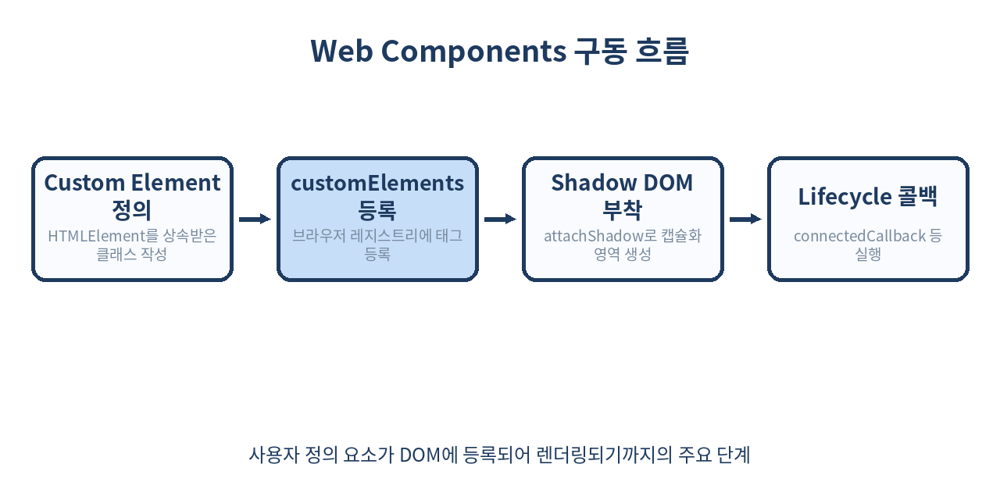
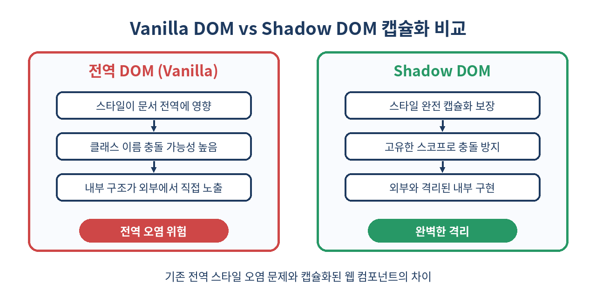

# 🧩 Web Components와 Shadow DOM 완벽 가이드

> 프레임워크의 흥망성쇠와 무관하게 브라우저 표준으로 살아남는 네이티브 컴포넌트의 핵심 기술을 파헤칩니다.
> Custom Elements, Shadow DOM, HTML Templates를 활용해 의존성 없는 독립형 UI를 구축하는 방법을 알아봅니다.

---

## 📌 목차
1. 🌐 Web Components 개요와 철학
2. 🛠️ Custom Elements API와 클래스 구조
3. 🔒 Shadow DOM과 캡슐화의 이해
4. 🎨 Shadow DOM 내부 스타일링과 CSS Scoping
5. 📝 HTML Template과 Slot을 이용한 마크업 재사용
6. 🔄 컴포넌트 생명주기(Lifecycle Callbacks)
7. 📡 외부와의 통신: 속성(Attributes)과 이벤트(Events)
8. 📊 기존 프레임워크 컴포넌트 모델과의 비교
9. ⚠️ 실무에서 마주치는 함정과 트러블슈팅
10. 🚫 Web Components를 쓰면 안 되는 경우
11. 🧾 정리 및 한 줄 요약
12. 📚 참고 자료

---

## 🧭 1. Web Components 개요와 철학

현대 웹 개발은 React, Vue, Svelte 같은 거대한 프레임워크 중심으로 이루어져 있습니다. 하지만 특정 프레임워크에 종속된 컴포넌트는 생태계가 변할 때마다 마이그레이션이라는 거대한 비용을 지불해야 합니다. Web Components는 W3C 표준 기술 스택을 활용해 어떤 프레임워크나 라이브러리에서도 동작하는 순수 브라우저 기반 컴포넌트를 만들 수 있게 해줍니다.



Web Components는 크게 세 가지 핵심 기술(Custom Elements, Shadow DOM, HTML Templates)의 조합으로 이루어집니다. 이 기술들은 브라우저 엔진 수준에서 동작하기 때문에 별도의 번들러나 무거운 가상 DOM(Virtual DOM) 런타임 없이도 고성능의 컴포넌트 기반 아키텍처를 구성할 수 있습니다. 예를 들어, 대규모 기업용 디자인 시스템(Design System)을 구축할 때 특정 팀은 React를 쓰고 다른 팀은 Vue나 바닐라 자바스크립트를 쓰더라도, Web Components로 작성된 UI 라이브러리는 모든 환경에서 동일하게 동작합니다.

---

## 🛠️ 2. Custom Elements API와 클래스 구조

Custom Elements는 개발자가 브라우저에 새로운 HTML 태그를 정의할 수 있는 API입니다. `HTMLElement`를 상속받은 JavaScript 클래스를 만들고 `customElements.define` 메서드를 통해 등록합니다. 태그 이름에는 반드시 하이픈(`-`)이 포함되어야 하며, 이는 기존 표준 HTML 태그와의 충돌을 방지하기 위한 W3C 규격입니다.

```js
class UserCard extends HTMLElement {
  constructor() {
    super();
    this.attachShadow({ mode: 'open' });
    this.shadowRoot.innerHTML = `
      <style>
        .card { padding: 16px; border: 1px solid #ccc; border-radius: 8px; }
      </style>
      <div class="card">
        <p>안녕하세요, 웹 컴포넌트입니다!</p>
      </div>
    `;
  }
}

// 브라우저에 커스텀 엘리먼트 등록
customElements.define('user-card', UserCard);
```

HTML에서 `<user-card></user-card>` 태그를 사용하는 순간 브라우저는 해당 클래스의 인스턴스를 생성하고 렌더링합니다. 실무에서는 클래스 내부에서 캡슐화된 상태를 유지하고, DOM 조작 로직을 응집도 있게 관리하기 위해 다음과 같은 구조적 패턴을 자주 활용합니다.

```js
class AdvancedCounter extends HTMLElement {
  constructor() {
    super();
    this.attachShadow({ mode: 'open' });
    this._count = 0;
  }

  connectedCallback() {
    this.render();
    this.setupListeners();
  }

  render() {
    this.shadowRoot.innerHTML = `
      <button id="btn">클릭 횟수: ${this._count}</button>
    `;
  }

  setupListeners() {
    this.shadowRoot.getElementById('btn').addEventListener('click', () => {
      this._count++;
      this.render();
    });
  }
}

customElements.define('advanced-counter', AdvancedCounter);
```

---

## 🔒 3. Shadow DOM과 캡슐화의 이해

웹 컴포넌트의 가장 강력한 무기 중 하나는 Shadow DOM입니다. 일반 DOM 트리의 하위에 숨겨진(Shadow) 독립된 DOM 트리를 부착하여, 외부의 CSS나 JavaScript가 내부 구현에 간섭하지 못하도록 막아줍니다.

```js
const shadowRoot = element.attachShadow({ mode: 'open' });
// mode가 'open'이면 element.shadowRoot로 외부에서 접근 가능
// mode가 'closed'이면 element.shadowRoot가 null을 반환하여 외부에서 접근 불가
```

| Shadow Root Mode | 특징 | 보안 및 디버깅 측면 |
| --- | --- | --- |
| `'open'` | `element.shadowRoot`를 통해 외부 스크립트에서 내부 DOM 접근 가능 | 디버깅이 용이하나, 캡슐화가 일부 약화될 수 있음 |
| `'closed'` | 외부에서 `shadowRoot` 직접 접근 원천 차단 (`null` 반환) | 강력한 캡슐화 제공, 단 외부 테스트나 조작이 까다로움 |

실무에서는 대부분 디버깅과 라이브러리 연동 편의성을 위해 `'open'` 모드를 기본적으로 선택합니다. `closed` 모드는 보안상 절대 외부에서 내부 요소를 조작하면 안 되는 특수한 위젯 형태에만 제한적으로 사용됩니다.

---

## 🎨 4. Shadow DOM 내부 스타일링과 CSS Scoping

Shadow DOM 내부의 스타일은 외부 문서에 영향을 주지 않으며, 반대로 외부의 스타일 규칙 역시 Shadow DOM 내부에 침투하지 않습니다. 이를 통해 전역 CSS 오염이나 클래스 이름 충돌을 원천 차단할 수 있습니다.

```js
const template = document.createElement('template');
template.innerHTML = `
  <style>
    :host {
      display: block;
      border: 2px solid #3b82f6;
      padding: 12px;
    }
    p {
      color: #1E3A5F;
      font-weight: bold;
    }
    .accent {
      color: #ef4444;
    }
  </style>
  <p>이 스타일은 컴포넌트 내부에만 적용됩니다.</p>
  <p class="accent">중요한 텍스트입니다.</p>
`;
```

여기서 `:host` 가상 클래스는 Shadow DOM을 포함하고 있는 커스텀 엘리먼트 자체를 선택할 때 사용합니다. 부모 컴포넌트에서 스타일을 일부 주입하고 싶을 때는 CSS Custom Properties(CSS Variables)를 활용하는 것이 표준적인 방법입니다.

```css
/* 부모 문서의 CSS */
user-card {
  --card-bg-color: #f3f4f6;
}
```

```js
/* 컴포넌트 내부 CSS */
:host {
  background-color: var(--card-bg-color, #ffffff);
}
```

---

## 📝 5. HTML Template과 Slot을 이용한 마크업 재사용

`<template>` 태그는 페이지가 로드될 때 즉시 렌더링되지 않고 이후에 클론하여 사용할 수 있는 마크업 조각을 담아둡니다. 여기에 `<slot>`을 결합하면 부모로부터 콘텐츠를 주입받을 수 있는 유연한 구조가 완성됩니다.

```html
<template id="card-template">
  <style>
    .card-wrapper {
      border: 1px solid #e5e7eb;
      border-radius: 8px;
      padding: 20px;
      box-shadow: 0 4px 6px -1px rgba(0,0,0,0.1);
    }
    .header { font-size: 1.25rem; margin-bottom: 8px; }
  </style>
  <div class="card-wrapper">
    <div class="header">
      <slot name="title">기본 제목</slot>
    </div>
    <div class="body">
      <slot name="content">기본 내용</slot>
    </div>
  </div>
</template>
```

```js
class ReusableCard extends HTMLElement {
  constructor() {
    super();
    const template = document.getElementById('card-template');
    const shadow = this.attachShadow({ mode: 'open' });
    shadow.appendChild(template.content.cloneNode(true));
  }
}

customElements.define('reusable-card', ReusableCard);
```

이 컴포넌트를 사용할 때는 아래와 같이 슬롯 이름을 지정하여 외부에서 마크업을 주입할 수 있습니다.

```html
<reusable-card>
  <span slot="title">사용자 프로필 설정</span>
  <p slot="content">이곳에 상세한 설정 내용이 동적으로 들어갑니다.</p>
</reusable-card>
```

---

## 🔄 6. 컴포넌트 생명주기(Lifecycle Callbacks)

Custom Element는 DOM에 부착되거나 제거될 때 특정한 생명주기 콜백 함수를 호출합니다. 이를 통해 리소스 할당, 이벤트 리스너 등록 및 해제, 비동기 데이터 패치 등을 안전하게 관리할 수 있습니다.

| 콜백 이름 | 호출 시점 | 주요 활용 사례 |
| --- | --- | --- |
| `connectedCallback()` | 요소가 문서의 DOM에 처음 추가될 때 | 초기 렌더링, 이벤트 리스너 등록, API 데이터 패치 |
| `disconnectedCallback()` | 요소가 문서의 DOM에서 제거될 때 | 타이머 해제, 전역 이벤트 리스너 제거, 메모리 누수 방지 |
| `adoptedCallback()` | 요소가 다른 문서로 이동될 때 (`document.adoptNode`) | iframe 간 이동 등 특수한 DOM 구조 조작 시 |
| `attributeChangedCallback()` | 관찰 중인 속성이 변경될 때 | 속성 변화에 따른 UI 실시간 동기화 |

`attributeChangedCallback`을 사용하기 위해서는 반드시 `observedAttributes` static getter를 정의해야 합니다.

```js
class LifecycleDemo extends HTMLElement {
  static get observedAttributes() {
    return ['status', 'theme'];
  }

  connectedCallback() {
    console.log('DOM에 부착됨');
  }

  disconnectedCallback() {
    console.log('DOM에서 제거됨');
  }

  attributeChangedCallback(name, oldValue, newValue) {
    if (oldValue !== newValue) {
      console.log(`${name} 속성이 ${oldValue}에서 ${newValue}로 변경됨`);
      this.updateStyle();
    }
  }

  updateStyle() {
    // 변경된 속성에 따른 처리 로직
  }
}

customElements.define('lifecycle-demo', LifecycleDemo);
```

---

## 📡 7. 외부와의 통신: 속성(Attributes)과 이벤트(Events)

부모 컴포넌트와 데이터를 주고받기 위해서는 속성(Attribute) 감지와 커스텀 이벤트(CustomEvent) 발송을 사용합니다. 데이터는 속성을 통해 아래로(Down) 흐르고, 이벤트는 디스패치를 통해 위로(Up) 전파됩니다.

```js
class CounterElement extends HTMLElement {
  constructor() {
    super();
    this.attachShadow({ mode: 'open' });
    this._count = 0;
  }

  static get observedAttributes() { 
    return ['count']; 
  }

  attributeChangedCallback(name, oldValue, newValue) {
    if (name === 'count') {
      this._count = parseInt(newValue, 10) || 0;
      this.render();
    }
  }

  connectedCallback() {
    this.render();
    this.shadowRoot.addEventListener('click', (e) => {
      if (e.target.id === 'inc-btn') {
        this.increment();
      }
    });
  }

  increment() {
    this._count++;
    // 상위 컴포넌트로 전달할 커스텀 이벤트 생성
    const event = new CustomEvent('increment', {
      detail: { val: this._count },
      bubbles: true,
      composed: true // Shadow DOM 경계를 넘어 외부로 전파 허용
    });
    this.dispatchEvent(event);
  }

  render() {
    this.shadowRoot.innerHTML = `
      <style>button { padding: 8px 16px; }</style>
      <button id="inc-btn">증가 (${this._count})</button>
    `;
  }
}

customElements.define('counter-element', CounterElement);
```

---

## 📊 8. 기존 프레임워크 컴포넌트 모델과의 비교



프레임워크의 컴포넌트 시스템과 Web Components는 상호 배타적인 것이 아니라 보완적인 관계로 발전하고 있습니다. 아래 비교표를 통해 각각의 특성을 명확히 파악할 수 있습니다.

| 비교 항목 | Web Components (Standard) | React 컴포넌트 | Vue 컴포넌트 (.vue) |
| --- | --- | --- | --- |
| **표준 여부** | W3C / WHATWG 브라우저 표준 | 라이브러리 종속 (Meta) | 프레임워크 종속 (Open Source) |
| **런타임 오버헤드** | 없음 (브라우저 내장 기능) | React 런타임 및 Virtual DOM 필요 | Vue 런타임 필요 |
| **스타일 캡슐화** | Shadow DOM을 통한 완벽한 네이티브 격리 | CSS Modules, Styled Components 등 별도 도구 필요 | `<style scoped>` 문법 지원 |
| **러닝 곡선** | 표준 Vanilla JS 지식 필요 | JSX 및 React Hooks 학습 필요 | Vue SFC 및 반응형 시스템 학습 필요 |
| **프레임워크 호환성** | 모든 프레임워크에서 완벽 호환 | React 생태계 내부로 제한 | Vue 생태계 내부로 제한 |

---

## ⚠️ 9. 실무에서 마주치는 함정과 트러블슈팅

1. **초기 렌더링 지연 (FOUC 현상)**: HTML 파싱 시점에 커스텀 엘리먼트 정의(`customElements.define`)가 아직 로드되지 않았다면 브라우저는 이를 일반 인라인 태그로 취급하여 스타일이 깨지거나 마크업이 노출되는 FOUC(Flash of Unstyled Content) 현상이 발생합니다. 이를 방지하기 위해 CSS에서 `:not(:defined)` 유사 클래스를 활용해 정의되기 전의 요소를 숨길 수 있습니다.
   ```css
   counter-element:not(:defined) {
     opacity: 0;
     transition: opacity 0.3s ease-in;
   }
   ```
2. **SSR(서버 사이드 렌더링)의 한계와 해법**: 순수 바닐라 Web Components는 브라우저 DOM API(`document.createElement`, `attachShadow` 등)에 강하게 의존하므로 Node.js 같은 서버 환경에서 곧바로 Shadow DOM을 완벽히 렌더링하기 어렵습니다. 프로덕션 환경에서 SSR을 구현하려면 Lit 같은 가벼운 라이브러리의 서버측 렌더링 패키지(`@lit-labs/ssr`)를 도입하거나, Adopted Style Sheets 및 Declarative Shadow DOM(DSD) 스펙을 지원하는 최신 서버 환경 설정을 구축해야 합니다.

---

## 🚫 10. Web Components를 쓰면 안 되는 경우

- 복잡한 상태 관리(State Management)와 반응형 데이터 바인딩(예: Redux, Pinia 수준의 전역 상태 동기화)이 프로젝트의 핵심인 경우 (React나 Vue의 생태계가 훨씬 높은 생산성을 제공합니다)
- 구형 브라우저(IE 등) 지원이 필수로 요구되는 폐쇄망 및 금융권 레거시 환경
- 팀원 전체가 이미 특정 프레임워크(React, Vue 등) 생태계에 깊게 익숙해져 있으며, 사내 재사용 가능한 컴포넌트가 아닌 단일 웹 애플리케이션을 빠르게 구축해야 하는 경우

---

## 🧾 11. 정리 및 한 줄 요약

- Web Components는 표준 기술로 프레임워크 종속성을 없애고 장기적인 유지보수성을 보장합니다.
- Custom Elements로 의미 있는 커스텀 태그를 직접 정의할 수 있습니다.
- Shadow DOM으로 스타일과 마크업을 완벽히 캡슐화하여 전역 CSS 충돌을 방지합니다.
- Template과 Slot으로 마크업 재사용성을 극대화하고 유연한 컴포넌트 구조를 설계합니다.
- 생명주기 메서드와 커스텀 이벤트 통신을 통해 견고한 상태 제어가 가능합니다.

> ✨ **한 줄 요약**
> 프레임워크를 넘어 영원히 지속되는 UI 컴포넌트를 만들려면 Web Components 표준을 마스터하자.

---

## 📚 참고 자료
- [MDN Web Docs: Web Components](https://developer.mozilla.org/en-US/docs/Web/Web_Components)
- [Web Components.org](https://www.webcomponents.org/)
- [Google Developers: Custom Elements v1](https://developers.google.com/web/fundamentals/web-components/customelements)
