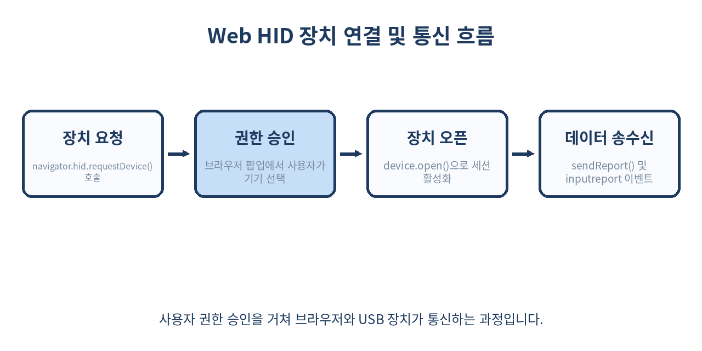
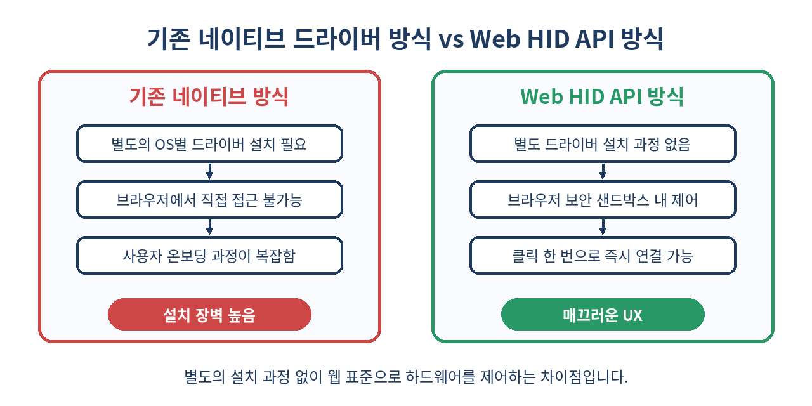

# 🔌 웹에서 하드웨어를 직접 제어하는 Web HID API 완벽 가이드

> 드라이버 설치의 번거로움 없이, 브라우저 안에서 키패드, 게임 컨트롤러, 특수 장치와 통신하는 방법을 알아봅니다.
> Web HID API의 핵심 개념부터 보안 제어, 실무 예제와 한계점까지 완벽하게 파헤칩니다.

---

## 📌 목차
1. 🧭 Web HID API란 무엇인가?
2. 🔍 기존 하드웨어 연동 방식의 한계
3. ⚙️ Web HID API의 핵심 작동 원리
4. 🚀 개발환경 세팅 및 기본 사용법
5. 📂 장치 연결 및 권한 요청 구현하기
6. 📥 하드웨어로부터 데이터 읽기 (Input Report)
7. 📤 하드웨어로 데이터 쓰기 (Output Report)
8. 🔄 장치 연결 해제 및 이벤트 감지
9. 🎨 실무 예제: 커스텀 키패드 대시보드 만들기
10. ⚠️ 실무 함정 및 보안 주의사항
11. ❌ 쓰면 안 되는 경우와 대안
12. 🧾 정리 및 요약
13. 📚 참고 자료

---

## 🧭 1. Web HID API란 무엇인가?

과거 웹 브라우저는 키보드, 마우스, 게임패드(Gamepad API)를 제외한 특수 USB 장치나 HID(Human Interface Device) 기기와 직접 통신할 수 없었습니다. 사용자가 커스텀 매크로 키패드나 특수 컨트롤러를 연결하려면 반드시 제조사가 제공하는 별도의 네이티브 프로그램을 설치해야 했습니다.

**Web HID API**는 웹 애플리케이션이 운영체제의 HID 드라이버 레이어와 직접 소통할 수 있도록 돕는 차세대 웹 표준 API입니다. 이제 사용자는 복잡한 프로그램 설치 없이, 웹사이트 방문 후 버튼 클릭 한 번으로 자신만의 하드웨어를 브라우저와 연동할 수 있습니다. 예를 들어, 사용자가 커스텀 매크로 패드를 PC에 연결하고 웹 페이지에서 키 배치나 RGB 백라이트 색상을 즉시 변경하는 시나리오가 가능해집니다.



---

## 🔍 2. 기존 하드웨어 연동 방식의 한계

기존 웹 환경에서 물리 장치와 통신하려면 다음과 같은 복잡한 파이프라인을 거쳐야 했습니다.

- **전용 데스크톱 앱 필요**: Electron, C++, 혹은 Qt 기반의 네이티브 프로그램을 OS별로 각각 별도로 다운로드받아야 합니다.
- **업데이트의 불편함**: 장치 펌웨어나 제어 프로그램 수정 시 사용자가 직접 최신 설치 파일을 받아 재설치해야 합니다.
- **플랫폼 종속성**: Windows(`msi`, `exe`), macOS(`dmg`), Linux(`AppImage`, `deb`) 등 OS별 빌드를 각각 관리해야 하는 극심한 유지보수 부담이 존재합니다.

아래 표는 전통적인 데스크톱 연동 방식과 Web HID API 연동 방식의 상세 스펙을 비교한 것입니다.

| 구분 | 전통적 데스크톱 연동 (Electron/C++) | Web HID API 연동 (Browser) |
|------|-----------------------------------|----------------------------|
| 설치 과정 | 필수 (msi, dmg 등 대용량 파일 다운로드) | 불필요 (웹 브라우저 즉시 구동) |
| 업데이트 반영 | 수동 다운로드 및 재부팅 필요 | 웹 서버 배포 즉시 자동 반영 |
| 크로스 플랫폼 | OS별 소스 분기 및 별도 빌드 필수 | 단일 웹 소스코드로 모든 OS 대응 |
| 보안 모델 | OS 루트 권한 의존 (잠재적 시스템 위험) | 브라우저 샌드박스 및 명시적 권한 모델 |
| 메모리 점유율 | 앱 당 수백 MB (Chromium 임베디드 등) | 브라우저 탭 내부 구동으로 경량화 |

---

## ⚙️ 3. Web HID API의 핵심 작동 원리

Web HID API는 USB 및 블루투스 스펙 중 HID 클래스를 준수하는 장치들과 통신합니다. 브라우저는 악성 스크립트가 사용자의 장치를 무단으로 탈취하는 것을 막기 위해 다음과 같은 엄격한 원칙으로 동작합니다.

- **사용자 제스처 기반 권한 모델**: 스크립트가 임의로 백그라운드에서 실행될 수 없으며, 반드시 사용자의 마우스 클릭 등 명시적 제스처(`navigator.hid.requestDevice`)를 거쳐 브라우저가 제공하는 시스템 장치 선택 팝업을 띄워야 합니다.
- **리포트(Report) 구조**: HID 장치는 입력(Input), 출력(Output), 기능(Feature) 리포트라는 일정한 패킷 단위로 데이터를 교환합니다. 
  - `Input Report`: 장치에서 PC(브라우저)로 들어오는 데이터 (예: 키 입력, 조이스틱 좌표)
  - `Output Report`: PC(브라우저)에서 장치로 나가는 제어 데이터 (예: LED 점등, 럼블 모터 작동)
  - `Feature Report`: 설정 값 읽기 및 쓰기를 위한 양방향 패킷

---

## 🚀 4. 개발환경 세팅 및 기본 사용법

Web HID API를 사용하기 위해서는 현대적인 모던 브라우저(Chrome 89+, Edge 등 Chromium 기반 엔진) 환경이 필수적입니다. 또한 웹 보안 정책(Secure Contexts)에 따라 **반드시 HTTPS 환경(또는 로컬 개발을 위한 localhost)**에서만 동작합니다. 프로덕션 환경에서는 HTTP 접속 시 객체 자체가 정의되지 않아 에러가 발생합니다.

현재 브라우저가 해당 API를 지원하는지 검증하고 초기화하는 실무 코드 예시는 다음과 같습니다:

```js
// 브라우저의 Web HID API 지원 여부 검증
function checkHidSupport() {
  if ('hid' in navigator) {
    console.log('✅ Web HID API를 지원하는 브라우저입니다.');
    return true;
  } else {
    console.warn('❌ 이 브라우저는 Web HID API를 지원하지 않습니다. Chromium 기반 브라우저를 이용해주세요.');
    return false;
  }
}

if (checkHidSupport()) {
  // 초기화 로직 실행
  console.log('HID 모듈 로딩 완료');
}
```

---

## 📂 5. 장치 연결 및 권한 요청 구현하기

사용자가 웹 페이지 내의 '장치 연결' 버튼을 클릭했을 때, 특정 벤더 ID(VID)와 제품 ID(PID)를 필터링하여 브라우저의 장치 선택 팝업을 띄우고 권한을 획득하는 실무 코드입니다.

```js
async function connectCustomHardware() {
  try {
    // 특정 제조사(Vendor ID: 0x1234, 예: 커스텀 키보드 제조사)의 장치만 필터링
    const filters = [
      {
        vendorId: 0x1234,
        productId: 0x5678, // 특정 모델 ID (생략 시 해당 벤더의 모든 기기 허용)
        usagePage: 0x01,   // Generic Desktop Controls
        usage: 0x06        // Keyboard
      }
    ];

    // 사용자에게 시스템 장치 선택 프롬프트 표시 (사용자 인터랙션 필수)
    const devices = await navigator.hid.requestDevice({ filters });
    
    if (devices.length === 0) {
      console.log('사용자가 장치를 선택하지 않았습니다.');
      return null;
    }

    const device = devices[0];

    // 장치가 이미 열려있지 않다면 세션 오픈
    if (!device.opened) {
      await device.open();
    }

    console.log(`🎉 장치 연결 성공: ${device.productName} (VID: ${device.vendorId}, PID: ${device.productId})`);
    return device;
  } catch (error) {
    console.error('🚨 장치 연결 중 치명적 오류 발생:', error);
    throw error;
  }
}
```

---

## 📥 6. 하드웨어로부터 데이터 읽기 (Input Report)

장치가 성공적으로 연결된 후, 사용자가 물리 버튼을 누르거나 다이얼을 돌릴 때 발생하는 `inputreport` 이벤트를 실시간으로 리스닝하여 바이트 데이터를 파싱하는 방법입니다.

```js
function attachInputReportListener(device) {
  device.addEventListener('inputreport', (event) => {
    const { device: sourceDevice, reportId, data } = event;
    
    // DataView 객체를 사용하여 바이트 배열을 안전하게 파싱
    // 예: 첫 번째 바이트는 키 상태, 두 번째 바이트는 조도 센서 값
    const keyState = data.getUint8(0);
    const sensorValue = data.getUint16(1, true); // 리틀 엔디언 적용
    
    console.log(`📥 [Input Report] ID: ${reportId} | 키 상태: 0x${keyState.toString(16)} | 센서: ${sensorValue}`);
    
    // UI 업데이트 함수 호출
    updateDashboardUI({ keyState, sensorValue });
  });
}
```

---

## 📤 7. 하드웨어로 데이터 쓰기 (Output Report)

웹 대시보드 조작을 통해 하드웨어로 제어 신호(예: RGB LED 색상 변경, LCD 화면 텍스트 전송 등)를 보낼 때는 `sendReport` 메서드를 사용합니다. 장치마다 요구하는 `reportId`와 페이로드 규격이 다르므로 제조사 스펙 문서를 참고해야 합니다.

```js
async function sendLedCommandToDevice(device, red, green, blue) {
  const reportId = 0x01; // 하드웨어 스펙에 정의된 LED 제어 리포트 ID
  
  // 페이로드 데이터 구성 (예: Report ID 제외한 데이터 바이트 배열)
  const data = new Uint8Array([
    red,   // Red 채널 (0-255)
    green, // Green 채널 (0-255)
    blue,  // Blue 채널 (0-255)
    0x01   // 모드 설정 플래그 (0x01: 고정 점등)
  ]);

  try {
    // 지정된 Report ID로 바이트 데이터 전송
    await device.sendReport(reportId, data);
    console.log(`📤 하드웨어로 LED 제어 명령 전송 완료 (RGB: ${red}, ${green}, ${blue})`);
  } catch (error) {
    console.error('🚨 하드웨어 데이터 전송 실패:', error);
  }
}
```

---

## 🔄 8. 장치 연결 해제 및 이벤트 감지

사용자가 USB 케이블을 물리적으로 뽑거나 전원을 강제로 차단했을 때, 브라우저는 전역 `navigator.hid` 객체를 통해 `disconnect` 이벤트를 발생시킵니다. 이를 감지하여 애플리케이션 상태를 안전하게 초기화할 수 있습니다.

```js
let activeConnectedDevice = null;

// 연결 해제 이벤트 글로벌 리스너 등록
navigator.hid.addEventListener('disconnect', (event) => {
  const disconnectedDevice = event.device;
  
  if (activeConnectedDevice && disconnectedDevice === activeConnectedDevice) {
    console.warn(`⚠️ 경고: 연결된 장치(${disconnectedDevice.productName})가 분리되었습니다.`);
    
    // 애플리케이션 상태 초기화 및 UI 비활성화
    activeConnectedDevice = null;
    resetDashboardUI();
  }
});

function resetDashboardUI() {
  const statusBadge = document.getElementById('status-badge');
  statusBadge.textContent = '연결 끊김';
  statusBadge.className = 'badge-disconnected';
}
```



---

## 🎨 9. 실무 예제: 커스텀 키패드 대시보드 만들기

실무 환경에서 커스텀 매크로 키패드의 펌웨어 설정을 웹 대시보드에서 실시간으로 제어하고 입력을 시각화하는 통합 애플리케이션 구조 예시입니다.

```html
<!-- 실무 대시보드 HTML 구조 예시 -->
<div id="app-container">
  <button id="connect-btn">하드웨어 키패드 연결</button>
  <div id="status-badge" class="badge-disconnected">연결 대기 중</div>
  <div id="log-console"></div>
</div>
```

```js
// 프론트엔드 연동 로직
document.addEventListener('DOMContentLoaded', () => {
  const connectBtn = document.getElementById('connect-btn');
  let currentDevice = null;

  connectBtn.addEventListener('click', async () => {
    try {
      currentDevice = await connectCustomHardware();
      if (currentDevice) {
        // UI 상태 업데이트
        document.getElementById('status-badge').textContent = `연결됨: ${currentDevice.productName}`;
        document.getElementById('status-badge').className = 'badge-connected';
        
        // 입력 리스너 활성화
        attachInputReportListener(currentDevice);
        
        // 초기화 명령 전송 (예: 백라이트 파란색 설정)
        await sendLedCommandToDevice(currentDevice, 0, 0, 255);
      }
    } catch (err) {
      console.error('대시보드 초기화 실패:', err);
    }
  });
});
```

---

## ⚠️ 10. 실무 함정 및 보안 주의사항

Web HID API를 도입할 때 개발자들이 흔히 빠지는 함정과 보안 제약 사항은 다음과 같습니다.

- **운영체제 시스템 보호 장치**: 사용자가 현재 사용 중인 주 키보드, 마우스, 내장 웹캠 등 OS 핵심 입력 장치는 브라우저가 제어권을 탈취할 수 없도록 OS 커널 수준에서 원천 차단됩니다. (단, 게이밍 마우스의 매크로 버튼 등 부가 기능은 별도 Usage Page 설정 시 허용될 수 있음)
- **사용자 제스처 필수 제약**: `navigator.hid.requestDevice()` 함수는 반드시 `click`, `touchend` 등 사용자의 명시적인 DOM 이벤트 핸들러 내부 콜백 스택에서만 호출되어야 합니다. `setTimeout`이나 비동기 통신 이후에 호출하면 보안 예외(`SecurityError`)가 발생합니다.
- **브라우저 호환성 한계**: 데스크톱 Chrome, Edge, Opera 등 Chromium 기반 브라우저에서는 완벽하게 동작하지만, **Apple Safari 및 모든 모바일 브라우저 환경에서는 아직 지원하지 않습니다**.

---

## ❌ 11. 쓰면 안 되는 경우와 대안

- **모바일 웹 서비스**: iOS Safari나 안드로이드 웹뷰 환경이 타겟인 서비스라면 Web HID API를 사용할 수 없습니다. 이 경우 React Native나 Flutter 등을 이용한 네이티브 앱 개발 방식을 채택해야 합니다.
- **저수준 펌웨어 플래싱(Low-level Flashing)**: 부트로더 진입 및 하드웨어 복구 단계와 같이 극도로 안정성이 요구되는 장치 제어는 웹 브라우저의 샌드박스 환경보다 네이티브 전용 툴(예: C++ 기반 펌웨어 업데이트 유틸리티)을 사용하는 것이 안전합니다.

---

## 🧾 12. 정리 및 요약

- Web HID API를 활용하면 사용자가 별도의 드라이버나 데스크톱 프로그램을 설치할 필요 없이 웹 브라우저 안에서 물리 하드웨어를 직접 제어할 수 있습니다.
- 프로덕션 환경에서는 반드시 HTTPS 보안 프로토콜과 사용자 제스처 기반의 명시적 권한 요청(`requestDevice`)이 수반되어야 합니다.
- `inputreport` 이벤트 수신과 `sendReport` 메서드 호출을 통해 손쉽게 양방향 통신 시스템을 구축할 수 있습니다.
- 크로스 플랫폼 웹 하드웨어 컨트롤러 및 대시보드 제작에 있어 매우 강력하고 현대적인 솔루션입니다.

> ✨ **한 줄 요약**
> Web HID API는 복잡한 드라이버 설치 장벽을 허물고, 웹 브라우저를 통해 안전하고 강력한 물리 하드웨어 제어 경험을 제공하는 최신 웹 표준입니다.

---

## 📚 참고 자료
- [MDN Web Docs: Web HID API](https://developer.mozilla.org/en-US/docs/Web/API/WebHID_API)
- [W3C Web HID API Specification](https://wicg.github.io/webhid/)
- [Google Developers: Connecting to HID Devices on the Web](https://developer.chrome.com/articles/hid/)
