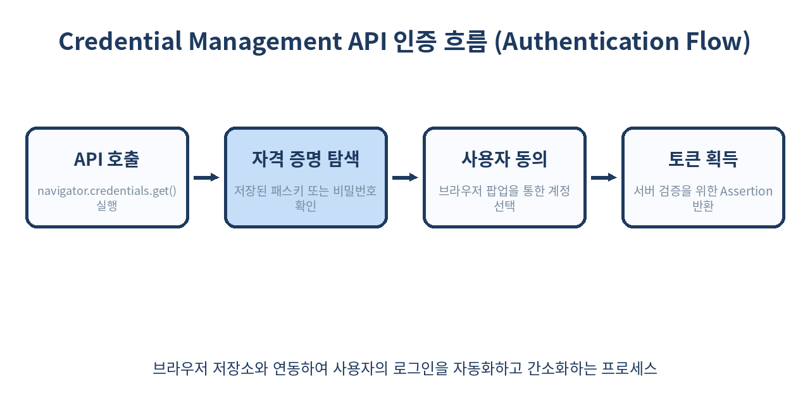
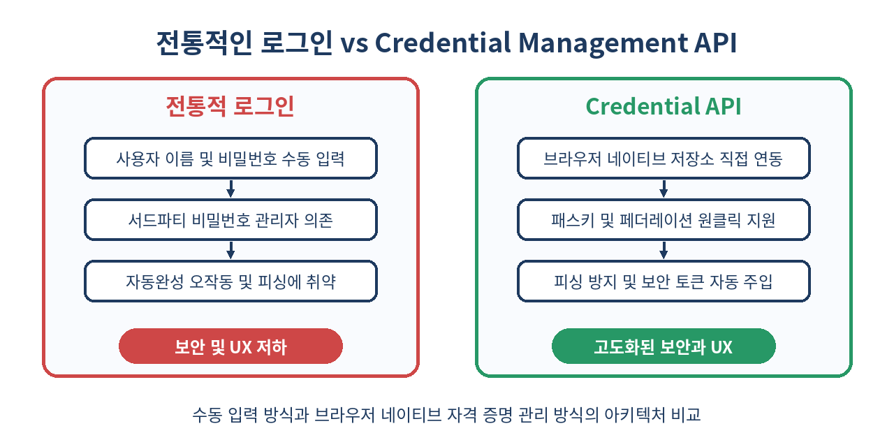

# 🪪 Credential Management API 완벽 가이드

> 브라우저 네이티브 저장소와 연동하여 사용자 인증 경험을 극적으로 혁신하는 Credential Management API의 모든 것
> 비밀번호 관리의 복잡성을 낮추고, 패스키(Passkeys) 및 페더레이션 로그인까지 통합 관리하는 차세대 웹 표준 기술을 파헤칩니다.

---

## 📌 목차
1. 🧭 1. Credential Management API란 무엇인가?
2. 🏗️ 2. API 아키텍처와 주요 인터페이스
3. 🔍 3. 자격 증명 요청 (`navigator.credentials.get`)
4. 💾 4. 자격 증명 저장 (`navigator.credentials.store`)
5. 🎫 5. 패스키 및 WebAuthn과의 연동
6. 🛡️ 6. 페더레이션(Federated) 로그인 처리
7. 📊 7. 기존 폼 로그인과의 비교
8. ⚠️ 8. 실무 함정 및 보안 고려사항
9. 🚫 9. 쓰면 안 되는 경우와 대안
10. 🧾 10. 정리

---

## 🧭 1. Credential Management API란 무엇인가?

웹 애플리케이션에서 사용자의 로그인은 서비스 진입의 첫 관문이지만, 오랫동안 보안과 사용자 경험(UX) 사이의 타협점만을 찾아 헤맸습니다. 사용자는 복잡한 비밀번호를 기억하기 어려워하고, 개발자는 자동완성(Autocomplete) 속임수나 서드파티 매니저의 오작동에 대응해야 했습니다.

**Credential Management API**는 브라우저 레벨에서 사용자의 자격 증명(Credentials)을 안전하게 저장, 검색, 관리할 수 있도록 제공하는 W3C 표준 웹 API입니다. 이를 통해 개발자는 DOM 기반의 폼 파싱에 의존하지 않고, 브라우저가 제공하는 신뢰할 수 있는 저장소와 직접 통신할 수 있습니다. 예를 들어, 기존에는 사용자가 이전에 입력한 이메일과 비밀번호를 가져오기 위해 브라우저의 휴리스틱(Heuristics)에 전적으로 의존해야 했지만, 이 API를 사용하면 명시적인 자격 증명 생명주기 관리가 가능해집니다.



실무 환경에서는 사용자가 로그인 페이지에 진입하는 순간부터 홈 화면으로 리다이렉트되는 과정 전체에서 불필요한 입력 단계를 제거하는 데 핵심적인 역할을 수행합니다. 글로벌 IT 기업들의 통계에 따르면, 로그인 과정에서 이탈하는 사용자의 약 35%가 비밀번호 분실 또는 입력 번거로움 때문인데, Credential Management API는 이 마찰을 극적으로 줄여줍니다.

---

## 🏗️ 2. API 아키텍처와 주요 인터페이스

API의 핵심은 `navigator.credentials` 객체입니다. 이 객체는 비밀번호 기반 자격 증명(`PasswordCredential`), 페더레이션 자격 증명(`FederatedCredential`), 그리고 강력한 공개키 암호화 기반의 `PublicKeyCredential`을 모두 아우르는 통합 인터페이스를 제공합니다.

```javascript
// 브라우저 지원 여부 및 보안 컨텍스트 확인
if ('credentials' in navigator && window.isSecureContext) {
  console.log('Credential Management API를 안전하게 사용할 수 있습니다.');
} else {
  console.warn('이 브라우저는 Credential Management API를 지원하지 않거나 보안 컨텍스트가 아닙니다.');
}
```

브라우저는 사용자가 사이트에 로그인할 때 자격 증명을 저장하겠냐고 묻고, 승인된 정보는 브라우저의 보안 자격 증명 저장소에 안전하게 암호화되어 보관됩니다. 내부적으로 각 인터페이스는 다음과 같은 속성과 메서드를 상속받아 동작합니다.

| 인터페이스 이름 | 주요 용도 | 생성자 및 주요 프로퍼티 |
|----------------|-----------|-------------------------|
| `PasswordCredential` | 전통적인 ID/PW 로그인 | `new PasswordCredential({ id, password, name, iconURL })` |
| `FederatedCredential` | 소셜 로그인 (Google 등) | `new FederatedCredential({ id, provider, name, iconURL })` |
| `PublicKeyCredential` | WebAuthn 및 패스키 인증 | `navigator.credentials.create({ publicKey })` |

---

## 🔍 3. 자격 증명 요청 (`navigator.credentials.get`)

페이지가 로드될 때 사용자가 이미 로그인된 상태인지 확인하거나, 자동 로그인을 유도하기 위해 `navigator.credentials.get()`을 호출합니다. 특히 `mediation: 'conditional'` 옵션을 활용하면 별도의 팝업 없이 입력 필드 내부의 드롭다운 형태로 매끄러운 자동완성 로그인을 구현할 수 있습니다.

```javascript
async function autoLogin() {
  try {
    const credential = await navigator.credentials.get({
      password: true,
      federated: {
        providers: ['https://accounts.google.com', 'https://appleid.apple.com']
      },
      mediation: 'conditional' // 'silent', 'optional', 'required', 'conditional' 중 택일
    });

    if (!credential) {
      console.log('사용가능한 저장된 자격 증명이 없습니다.');
      return;
    }

    console.log('가져온 자격 증명 타입:', credential.type);
    console.log('가져온 자격 증명 ID:', credential.id);

    if (credential.type === 'password') {
      console.log('비밀번호 자격 증명 감지됨. 자동 인증 시도...');
      await submitToServer({
        username: credential.id,
        password: credential.password,
        type: 'password'
      });
    } else if (credential.type === 'federated') {
      console.log('페더레이션 자격 증명 감지됨. 제공자:', credential.provider);
      await submitToServer({
        username: credential.id,
        provider: credential.provider,
        type: 'federated'
      });
    }
  } catch (err) {
    console.error('자격 증명 요청 중 예외 발생:', err);
  }
}

async function submitToServer(payload) {
  // 실제 백엔드 인증 엔드포인트 통신 로직
  const response = await fetch('/api/v1/auth/login', {
    method: 'POST',
    headers: { 'Content-Type': 'application/json' },
    body: JSON.stringify(payload)
  });
  if (response.ok) {
    window.location.href = '/dashboard';
  }
}
```

이 코드는 사용자가 페이지에 진입하자마자 백그라운드에서 자격 증명을 조회하고, 사용자가 입력 필드를 터치하거나 클릭할 때 자연스럽게 브라우저 저장소의 계정 목록을 제시합니다.

---

## 💾 4. 자격 증명 저장 (`navigator.credentials.store`)

사용자가 성공적으로 회원가입을 마치거나 새로운 비밀번호로 로그인했을 때, 브라우저에게 이 자격 증명을 저장하도록 요청할 수 있습니다. 이를 통해 사용자는 다음 방문 시 별도의 입력 없이 원클릭 로그인을 수행할 수 있습니다.

```javascript
async function saveUserCredential(username, password, displayName) {
  try {
    // 1. PasswordCredential 인스턴스 생성
    const cred = new PasswordCredential({
      id: username,
      password: password,
      name: displayName || username,
      iconURL: 'https://example.com/assets/default-avatar.png'
    });

    // 2. 브라우저 저장소에 저장 요청
    await navigator.credentials.store(cred);
    console.log('자격 증명이 브라우저 저장소에 성공적으로 저장되었습니다.');
  } catch (err) {
    console.error('자격 증명 저장 중 오류 발생:', err);
    // 사용자가 프롬프트를 거부했거나 브라우저 설정에 의해 차단된 경우 처리
  }
}

// 회원가입 완료 버튼 이벤트 리스너 예시
document.getElementById('signup-form').addEventListener('submit', async (e) => {
  e.preventDefault();
  const emailInput = document.getElementById('email').value;
  const passwordInput = document.getElementById('password').value;
  const nameInput = document.getElementById('name').value;

  // 회원가입 API 통신 성공 가정
  const isRegistered = true; 
  if (isRegistered) {
    await saveUserCredential(emailInput, passwordInput, nameInput);
  }
});
```

함정 사례로, 비밀번호 변경 페이지에서 기존 자격 증명을 업데이트하지 않고 새로 `store()`를 호출하면 브라우저 내에 중복된 계정 정보가 쌓이거나 잘못된 비밀번호가 덮어씌워질 수 있습니다. 최신 비밀번호 업데이트 시에는 기존 자격 증명을 지우거나 올바른 인스턴스를 전달해야 합니다.

---

## 🎫 5. 패스키 및 WebAuthn과의 연동

현대 웹 보안의 핵심인 패스키(Passkeys)는 Credential Management API의 `PublicKeyCredential` 인터페이스를 기반으로 작동합니다. 하드웨어 지문, 안면 인식, 스마트폰 연동 보안 키 등을 활용하여 비밀번호 없는 로그인을 완성합니다.

```javascript
async function registerPasskey(publicKeyCreationOptions) {
  try {
    // 서버로부터 전달받은 challenge 및 옵션을 파싱
    const options = {
      publicKey: {
        challenge: Uint8Array.from(publicKeyCreationOptions.challenge, c => c.charCodeAt(0)),
        rp: { name: "Example Corp", id: "example.com" },
        user: {
          id: Uint8Array.from(publicKeyCreationOptions.userId, c => c.charCodeAt(0)),
          name: "user@example.com",
          displayName: "홍길동"
        },
        pubKeyCredParams: [{ alg: -7, type: "public-key" }, { alg: -257, type: "public-key" }],
        timeout: 60000,
        attestation: "direct"
      }
    };

    // 플랫폼 인증기 호출 (TouchID, Windows Hello, Android Biometrics 등)
    const credential = await navigator.credentials.create(options);
    
    console.log('생성된 퍼블릭 키 자격 증명 ID:', credential.id);
    
    // 서버로 인증서 및 공개키 전달하여 등록 완료
    await sendPublicKeyToServer(credential);
  } catch (err) {
    console.error('패스키 등록 실패:', err);
  }
}

async function sendPublicKeyToServer(credential) {
  const payload = {
    id: credential.id,
    rawId: btoa(String.fromCharCode(...new Uint8Array(credential.rawId))),
    response: {
      clientDataJSON: btoa(String.fromCharCode(...new Uint8Array(credential.response.clientDataJSON))),
      attestationObject: btoa(String.fromCharCode(...new Uint8Array(credential.response.attestationObject)))
    },
    type: credential.type
  };

  await fetch('/api/v1/passkey/register-response', {
    method: 'POST',
    headers: { 'Content-Type': 'application/json' },
    body: JSON.stringify(payload)
  });
}
```

패스키 연동 시 서버 설정(RP ID와 현재 도메인 일치 여부)이 잘못되면 `DOMException: The operation is insecure` 에러가 발생하므로, 개발 환경과 프로덕션 환경의 도메인 설정을 철저히 검증해야 합니다.

---

## 🛡️ 6. 페더레이션(Federated) 로그인 처리

구글, 페이스북, 네이버 등 서드파티 소셜 로그인 제공 업체를 사용할 때도 `FederatedCredential`을 통해 브라우저가 자격 증명 생태계를 일관되게 관리할 수 있습니다. 사용자가 소셜 계정으로 로그인한 직후 브라우저에 해당 정보를 등록해두면, 향후 재방문 시 소셜 제공자 버튼을 직접 누르지 않아도 브라우저 자동완성을 통해 로그인을 시도할 수 있습니다.

```javascript
async function handleSocialLoginSuccess(socialProfile) {
  try {
    // 소셜 로그인 제공자로부터 받은 사용자 정보 구성
    const cred = new FederatedCredential({
      id: socialProfile.email,
      provider: 'https://accounts.google.com', // 소셜 제공자 고유 URI
      name: socialProfile.name,
      iconURL: socialProfile.picture
    });

    // 브라우저 저장소에 소셜 자격 증명 등록
    await navigator.credentials.store(cred);
    console.log('페더레이션 자격 증명이 성공적으로 저장되었습니다.');
  } catch (err) {
    console.error('페더레이션 자격 증명 저장 실패:', err);
  }
}

// 소셜 로그인 버튼 클릭 핸들러 내부 예시
document.getElementById('google-login-btn').addEventListener('click', async () => {
  // 실제 OAuth 2.0 인증 팝업 또는 리다이렉트 흐름 수행 후 프로필 획득 가정
  const mockProfile = {
    email: 'user@gmail.com',
    name: '김철수',
    picture: 'https://lh3.googleusercontent.com/a-/A'
  };
  await handleSocialLoginSuccess(mockProfile);
});
```

페더레이션 로그인 사용 시 `provider` 값은 반드시 완전한 URL 형식(예: `https://accounts.google.com`)이어야 하며, 형식이 잘못되면 `TypeError`가 발생하므로 주의해야 합니다.

---

## 📊 7. 기존 폼 로그인과의 비교

현대 웹 표준 환경에서 기존의 전통적인 HTML 폼 로그인 방식과 Credential Management API를 비교한 종합 분석 표입니다.

| 비교 항목 | 기존 HTML 폼 로그인 (`<form>`) | Credential Management API (`navigator.credentials`) |
|----------|------------------------------|----------------------------------------------------|
| **자동완성 제어** | `autocomplete="username"` 등 휴리스틱 속성에 의존 | API를 통한 명시적 데이터 수집 및 조건부 UI 제어 |
| **보안 수준** | 스크립트(XSS) 취약성 시 비밀번호 노출 위험 존재 | 브라우저 전용 암호화 저장소 활용으로 메모리 탈취 방어 강화 |
| **UX 일관성** | 브라우저/비밀번호 매니저마다 동작 방식이 상이함 | W3C 표준 인터페이스 기반으로 플랫폼 전반에 일관된 프롬프트 제공 |
| **지원 자격 증명** | 주로 단일 ID와 비밀번호 조합에 국한 | 비밀번호, 페더레이션(소셜), WebAuthn 패스키까지 통합 관리 |
| **구현 복잡도** | HTML 마크업만으로 구현 가능하여 매우 낮음 | 비동기 JavaScript 처리 및 에러 핸들링 로직 필요로 다소 높음 |



표에서 볼 수 있듯이, 개발 난이도는 다소 높지만 보안성과 사용자 경험 측면에서 Credential Management API가 압도적인 우위를 점하고 있습니다. 따라서 대규모 서비스일수록 두 방식을 혼용(하이브리드 폴백 구조)하여 도입하는 추세입니다.

---

## ⚠️ 8. 실무 함정 및 보안 고려사항

1. **HTTPS 환경 필수**: 이 API는 강력한 보안 기능들을 다루므로 보안 컨텍스트(`secure context`)에서만 동작합니다. 로컬 테스트 시 `localhost` 또는 `127.0.0.1`을 제외하면 반드시 HTTPS 환경이 구축되어 있어야 하며, 그렇지 않으면 `navigator.credentials`가 `undefined`로 반환됩니다.
2. **사용자 동의 대화상자 제어 불가**: 브라우저가 자동으로 띄우는 저장 및 불러오기 프롬프트(Prompt)는 개발자가 CSS 등으로 스타일링하거나 임의로 제어할 수 없습니다. 디자인 일관성을 중시하는 서비스라면 이 점을 UX 기획 단계에서 고려해야 합니다.
3. **크로스 오리진(Cross-Origin) 제한**: 서로 다른 도메인 간의 자격 증명 공유는 SOP(Same-Origin Policy) 및 페더레이션 규격에 의해 엄격하게 차단됩니다. 특히 서브도메인 간 공유 시 `document.domain` 설정에 의존하지 말고 올바른 오리진 매핑을 유지해야 합니다.
4. **비동기 타이밍 이슈**: 페이지 로드 직후 너무 이르게 `navigator.credentials.get()`을 호출하면 DOM 렌더링이나 사용자 상호작용과 충돌하여 브라우저가 요청을 무시할 수 있습니다. 적절한 `DOMContentLoaded` 시점이나 사용자 이벤트 훅 이후에 호출하는 것이 안전합니다.

---

## 🚫 9. 쓰면 안 되는 경우와 대안

- **구형 브라우저 지원이 절대적인 비즈니스 환경**: 사내 폐쇄망이나 구형 임베디드 웹뷰, 레거시 사파리 버전을 타겟으로 하는 서비스에서는 해당 API가 지원되지 않아 무한 대기 상태에 빠질 수 있습니다. 이 경우 반드시 기존 `<form>` 기반의 전통적인 로그인 구조를 폴백(Fallback)으로 구현해야 합니다.
- **엄격한 엔터프라이즈 보안 정책 대상 서비스**: 일부 금융, 공공, 군사 기관의 엄격한 사내 보안 정책에서는 브라우저 자체의 비밀번호 저장 기능(Password Manager)을 강제로 비활성화하도록 그룹 정책(GPO)이 설정되어 있습니다. 이 경우 API가 에러를 뱉거나 아무 동작도 하지 않으므로 수동 입력 모드를 기본값으로 설계해야 합니다.
- **단발성 일회용 인증(OTP, 간편 PIN) 처리**: Credential Management API는 영속적이거나 비교적 장기적인 자격 증명(비밀번호, 패스키, 페더레이션 토큰) 저장에 최적화되어 있습니다. 매번 바뀌는 일회용 인증번호(OTP)나 6자리 간편 PIN 입력에 이 API를 억지로 적용하면 저장소 오버플로우 및 불필요한 프롬프트 노출로 인해 오히려 UX가 저하됩니다.

---

## 🧾 10. 정리

- **표준화된 인증 생태계**: Credential Management API는 브라우저와 웹 애플리케이션 간의 자격 증명 교환을 표준화하여 개발자가 더 이상 DOM 파싱에 의존하지 않도록 돕습니다.
- **핵심 메서드 활용**: `navigator.credentials.get()`과 `store()`를 올바르게 조합하여 사용자에게 매끄러운 자동 로그인 및 저장 경험을 제공할 수 있습니다.
- **미래 지향적 보안**: 패스키(WebAuthn) 및 페더레이션 로그인과의 긴밀한 결합을 통해 피싱 공격을 방어하고 보안성을 극대화합니다.
- **엄격한 제약 사항 준수**: 반드시 HTTPS 보안 컨텍스트 환경에서 동작하며, 구형 브라우저에 대비한 폴백 전략을 반드시 마련해야 합니다.

> ✨ **한 줄 요약**
> 비밀번호 입력의 번거로움을 없애고 최고 수준의 웹 보안을 달성하려면 지금 바로 Credential Management API를 도입하세요.

---

## 📚 참고 자료
- [MDN Web Docs: Credential Management API](https://developer.mozilla.org/en-US/docs/Web/API/Credential_Management_API)
- [W3C Recommendation: Credential Management Level 1](https://www.w3.org/TR/credential-management-1/)
- [Google Developers: Credential Management API Best Practices](https://developers.google.com/web/fundamentals/security/credential-management)
