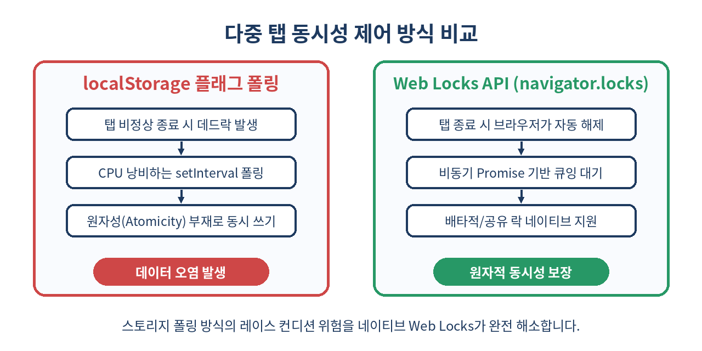
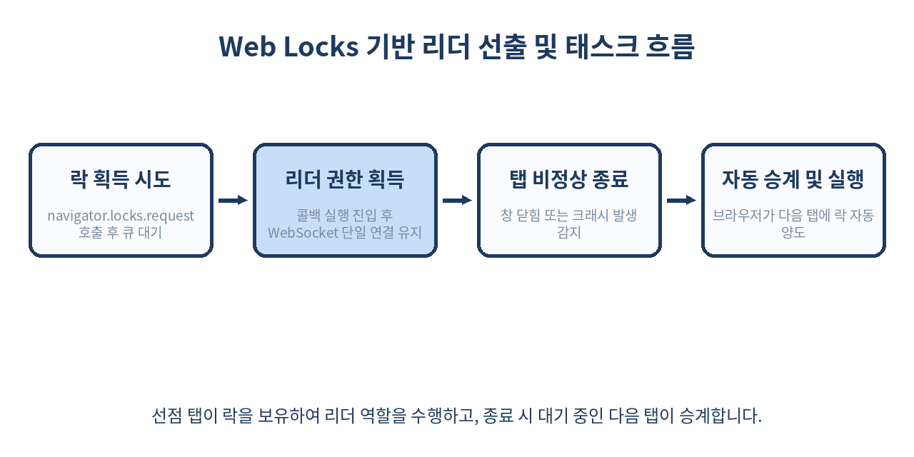

# 🔒 Web Locks API 완벽 가이드: 브라우저 다중 탭 동시성 제어와 리더 선출

> "사용자가 동일한 웹 앱을 10개 탭에 열어두었을 때, 데이터베이스 쓰기 충돌과 중복 네트워크 요청을 어떻게 제어할 것인가?"
> 본 글에서는 웹 플랫폼 표준 API인 Web Locks API(`navigator.locks`)의 동작 원리부터 공유/배타적 락, 다중 탭 리더 선출 패턴, 그리고 실무 함정까지 깊이 있게 파헤칩니다.

---

## 📌 목차
1. 🧭 다중 탭 환경에서 마주하는 동시성(Concurrency) 위기
2. 💡 Web Locks API란 무엇인가?
3. ⚙️ 기존 해결책(localStorage/IndexedDB)과의 비교
4. 🚀 핵심 인터페이스: navigator.locks.request 기본 문법
5. ⚖️ 배타적 락(Exclusive) vs 공유 락(Shared)
6. 🛡️ ifAvailable 옵션과 폴백(Fallback) 전략
7. 🛑 AbortSignal을 결합한 타임아웃 및 데드락 방지
8. 👑 실전 아키텍처: 다중 탭 단일 리더 선출(Leader Election)
9. 💾 IndexedDB 및 OPFS(파일 시스템)와의 환상적인 조합
10. 🔍 navigator.locks.query()를 통한 락 상태 디버깅과 관측성
11. ⚠️ 실무 도입 시 주의점과 안티 패턴 (쓰면 안 되는 경우)
12. 🧾 정리 및 요약
13. 📚 참고 자료

---

## 🧭 1. 다중 탭 환경에서 마주하는 동시성(Concurrency) 위기

현대 웹 애플리케이션은 단순한 정적 문서 뷰어가 아닙니다. IndexedDB에 대용량 데이터를 동기화하고, 백그라운드에서 서버와 WebSocket 연결을 맺으며, 로컬 캐시를 지속적으로 갱신하는 완전한 클라이언트 소프트웨어입니다.

하지만 사용자는 한 브라우저 안에서 같은 도메인의 탭을 수시로 여러 개 엽니다. 이때 다음과 같은 심각한 동시성 문제가 터져 나옵니다.

- **중복 작업 실행**: 탭 3개가 동시에 서버 폴링을 돌려 동일한 알림 데이터를 삼중으로 가져오고 IndexedDB에 쓰기 경쟁을 벌임.
- **데이터 레이스 컨디션(Race Condition)**: 탭 A가 로컬 설정을 읽어 변경하는 찰나에 탭 B가 다른 값으로 덮어써 버전 충돌 및 데이터 유실 발생.
- **소켓 연결 낭비**: 열린 탭마다 각자 WebSocket 또는 WebTransport 세션을 연결하여 서버 리소스를 고갈시킴.

이러한 문제를 해결하기 위해 과거 프론트엔드 엔지니어들은 눈물겨운 우회로를 찾아야 했습니다.

---

## 💡 2. Web Locks API란 무엇인가?

**Web Locks API**는 W3C 표준으로 제정된 네이티브 브라우저 API로, 동일 오리진(Origin) 내의 모든 윈도우(Tabs/Windows), iframe, 그리고 Worker(Dedicated, Shared, Service Worker) 간에 비동기 리소스 락(Lock)을 안전하게 획득하고 해제할 수 있도록 지원합니다.

핵심 특징은 다음과 같습니다.

1. **자동 수명 주기 관리(Scoped Lifetime)**: 락을 획득한 후 콜백 함수가 반환하는 Promise가 해결(Resolved/Rejected)되면 브라우저 런타임이 락을 자동으로 해제합니다. `unlock()` 같은 메서드를 수동 호출하다 실수할 여지가 없습니다.
2. **비정상 종료 안전성(Crash Safety)**: 사용자가 탭을 강제로 닫거나 브라우저 탭 프로세스가 크래시되어도, 브라우저 엔진이 관리하는 리소스 테이블에서 해당 락이 즉시 해제되어 데드락(Deadlock)에 빠지지 않습니다.
3. **크로스 컨텍스트(Cross-Context) 지원**: 브라우저 메인 스레드와 Web Worker, Service Worker 간에도 동일한 락 이름을 공유하며 조율할 수 있습니다.

---

## ⚙️ 3. 기존 해결책(localStorage/IndexedDB)과의 비교

과거에는 다중 탭 락을 구현하기 위해 `localStorage.setItem('lock', timestamp)`과 `window.addEventListener('storage', ...)`를 엮거나, IndexedDB의 트랜잭션 락에 의존했습니다. 왜 Web Locks API가 필수적인지 비교해 보겠습니다.



| 비교 항목 | localStorage 타임스탬프 방식 | IndexedDB 트랜잭션 락 | Web Locks API | 
| :--- | :--- | :--- | :--- |
| **원자성 (Atomicity)** | ❌ 지원 안 됨 (동시 읽기-쓰기 취약) | ⚠️ DB 스토어 범위로만 제한 | ✅ 브라우저 엔진 레벨 완벽 보장 |
| **탭 크래시 복구** | ❌ 타임아웃 만료 전까지 데드락 | ⚠️ 연결 종료 감지 지연 가능 | ✅ 탭 소멸 즉시 브라우저가 자동 해제 |
| **성능 오버헤드** | ❌ setInterval 폴링으로 CPU 낭비 | ⚠️ 무거운 트랜잭션 수명 주기 | ✅ 네이티브 큐잉(Promise 기반) 대기 |
| **워커(Worker) 지원** | ❌ Service Worker에서 접근 불가 | ✅ 지원 | ✅ Window, Worker 완벽 공유 |
| **공유 락(Reader-Writer)** | ❌ 구현 극도로 난해 | ❌ 지원 안 됨 | ✅ 네이티브 지원 (`mode: 'shared'`) |

---

## 🚀 4. 핵심 인터페이스: navigator.locks.request 기본 문법

Web Locks API의 사용법은 놀라울 정도로 직관적입니다. `navigator.locks.request()` 메서드를 호출하고, 락의 이름과 작업할 비동기 콜백을 전달하면 끝납니다.

```js
// exclusive 락 요청 (기본값)
async function updateSyncState(payload) {
  console.log('락 획득 시도 중...');

  await navigator.locks.request('sync_local_db', async (lock) => {
    // 이 블록 안의 코드는 동일 오리진 전체에서 단 하나의 탭/워커만 실행됩니다.
    console.log(`락 획득 성공! 락 이름: ${lock.name}, 모드: ${lock.mode}`);
    
    // 안전한 원자적 작업 수행
    const current = await readFromIndexedDB();
    const next = mergeState(current, payload);
    await writeToIndexedDB(next);

    // 작업 시뮬레이션
    await new Promise((resolve) => setTimeout(resolve, 1000));
    
    console.log('작업 완료, 콜백 Promise가 반환되면서 락이 자동 해제됩니다.');
  });

  console.log('락 해제 완료. 대기 중이던 다음 탭의 콜백이 실행됩니다.');
}
```

중요한 점은 콜백 함수가 반환하는 **Promise의 수명이 곧 락의 유지 시간**이라는 점입니다. 콜백이 비동기 함수(`async`)일 경우 반환된 Promise가 settled 상태가 되는 순간 락이 반납됩니다.

---

## ⚖️ 5. 배타적 락(Exclusive) vs 공유 락(Shared)

데이터베이스 시스템의 기본 원리인 **Reader-Writer Lock** 패턴을 네이티브로 제공합니다.

- `mode: 'exclusive'` (기본값): 단 1개의 컨텍스트만 실행 가능 (쓰기 작업에 적합)
- `mode: 'shared'`: 여러 탭이 동시에 실행 가능하지만, exclusive 락이 대기 중이거나 점유 중일 때는 진입 불가 (읽기 작업에 적합)

```js
// 여러 탭에서 동시에 읽기 가능 (Shared Lock)
async function readReport() {
  return await navigator.locks.request(
    'report_resource',
    { mode: 'shared' },
    async (lock) => {
      console.log('Shared 락 점유: 다른 shared 탭들과 병렬 실행 중...');
      return await fetchLocalCachedData();
    }
  );
}

// 오직 하나의 탭에서만 쓰기 가능 (Exclusive Lock)
async function writeReport(newData) {
  await navigator.locks.request(
    'report_resource',
    { mode: 'exclusive' }, // mode 생략 가능
    async (lock) => {
      console.log('Exclusive 락 점유: 모든 shared/exclusive 탭이 대기합니다.');
      await commitLocalCachedData(newData);
    }
  );
}
```

이 패턴을 사용하면 수많은 탭이 로컬 데이터를 읽는 작업은 막힘없이 동시에 처리하면서, 설정을 쓰거나 DB 마이그레이션을 진행할 때만 모든 읽기 작업을 안전하게 일시 정지시킬 수 있습니다.

---

## 🛡️ 6. ifAvailable 옵션과 폴백(Fallback) 전략

기본적으로 `navigator.locks.request()`는 락이 점유되어 있으면 큐에 들어가 차례를 기다립니다. 하지만 탭에서 "지금 당장 락을 잡을 수 없다면 굳이 기다리지 않고 작업을 건너뛰거나 다른 탭에 위임"하고 싶을 때는 `{ ifAvailable: true }` 옵션을 사용합니다.

```js
async function tryPeriodicHeartbeat() {
  await navigator.locks.request(
    'periodic_telemetry',
    { ifAvailable: true },
    async (lock) => {
      if (!lock) {
        // 다른 탭이 이미 락을 쥐고 하트비트를 보내는 중임
        console.log('다른 탭이 텔레메트리를 전송 중입니다. 본 탭은 작업을 스킵합니다.');
        return;
      }

      // 락 획득 성공
      console.log('본 탭이 텔레메트리 전송 권한을 얻었습니다.');
      await sendServerTelemetry();
    }
  );
}
```

`ifAvailable: true`를 지정하면 락을 선점할 수 없을 때 에러를 던지지 않고 콜백 인자로 `null`을 전달합니다. 이를 통해 폴백 로직을 매우 깔끔하게 작성할 수 있습니다.

---

## 🛑 7. AbortSignal을 결합한 타임아웃 및 데드락 방지

네트워크 지연이나 외부 원인으로 비동기 콜백이 영원히 끝나지 않거나, 락 대기열에 너무 오래 갇히는 상황을 막기 위해 표준 `AbortSignal`을 연결할 수 있습니다.

```js
async function performCriticalSyncWithTimeout(timeoutMs = 5000) {
  const controller = new AbortController();
  const timer = setTimeout(() => controller.abort(new Error('락 대기 타임아웃 초과')), timeoutMs);

  try {
    await navigator.locks.request(
      'critical_sync',
      { signal: controller.signal },
      async (lock) => {
        clearTimeout(timer);
        console.log('제한 시간 내에 락을 획득하여 동기화를 수행합니다.');
        await processHeavyOperation();
      }
    );
  } catch (err) {
    if (err.name === 'AbortError') {
      console.warn('락 획득 실패 (타임아웃 또는 취소됨)');
    } else {
      throw err;
    }
  } finally {
    clearTimeout(timer);
  }
}
```

`signal`이 abort되면 대기 큐에서 대기 중이던 요청은 즉시 `AbortError`와 함께 거부(reject)되므로 무한 대기 현상을 원천 차단할 수 있습니다.

---

## 👑 8. 실전 아키텍처: 다중 탭 단일 리더 선출(Leader Election)

Web Locks API의 가장 매력적인 사용처는 **단일 리더 탭 선출(Leader Election)**입니다. 수많은 탭 중 딱 하나만 리더가 되어 WebSocket 연결을 유지하고, 서버로부터 수신한 메시지를 `BroadcastChannel`을 통해 다른 팔로워(Follower) 탭들에 브로드캐스트하는 구조입니다.



```js
// leader-election.js
class TabCoordinator {
  constructor() {
    this.isLeader = false;
    this.channel = new BroadcastChannel('app_coordination_channel');
    this.setupListeners();
  }

  setupListeners() {
    this.channel.onmessage = (event) => {
      if (event.data.type === 'SERVER_EVENT') {
        this.handleServerEventAsFollower(event.data.payload);
      }
    };
  }

  start() {
    // 영구 락을 요청하여 리더십을 쥐고 대기
    navigator.locks.request('single_tab_leader', () => {
      return new Promise((resolve) => {
        this.isLeader = true;
        console.log('👑 본 탭이 리더로 선출되었습니다!');
        this.initializeLeaderDuties();

        // 창이 닫히거나 언로드될 때 resolve를 호출하여 락을 양도
        window.addEventListener('beforeunload', () => {
          this.cleanupLeaderDuties();
          resolve();
        }, { once: true });
      });
    }).catch((err) => {
      console.error('리더 선출 프로세스 예외:', err);
    });
  }

  initializeLeaderDuties() {
    // 단일 WebSocket 연결 생성
    this.ws = new WebSocket('wss://example.com/live-stream');
    this.ws.onmessage = (msg) => {
      const payload = JSON.parse(msg.data);
      // 모든 팔로워 탭에 데이터 중계
      this.channel.postMessage({ type: 'SERVER_EVENT', payload });
    };
  }

  cleanupLeaderDuties() {
    if (this.ws) {
      this.ws.close();
      this.ws = null;
    }
  }

  handleServerEventAsFollower(payload) {
    console.log('팔로워 탭: 리더로부터 메시지 수신', payload);
  }
}

const coordinator = new TabCoordinator();
coordinator.start();
```

리더 탭의 사용자가 창을 닫으면, 브라우저가 즉시 락을 해제하고 큐에서 대기하고 있던 다음 탭의 Promise 콜백이 실행되어 **0.1초 만에 새로운 리더로 즉시 승계**됩니다.

---

## 💾 9. IndexedDB 및 OPFS(파일 시스템)와의 환상적인 조합

IndexedDB는 자체적으로 트랜잭션 락을 지원하지만, **비동기 틱 간격(Microtask turn)** 사이에 트랜잭션이 비활성화되거나 자동 커밋되는 제약이 있습니다. 특히 OPFS(Origin Private File System)의 고성능 `FileSystemSyncAccessHandle`은 파일당 단 하나의 배타적 핸들만 허용하므로 다중 탭에서 충돌이 잦습니다.

Web Locks API를 상위 레이어의 가드(Guard)로 배치하면 이러한 문제를 완벽히 해결할 수 있습니다.

```js
async function writeLogToOPFS(logMessage) {
  // OPFS 접근을 위한 전역 네임스페이스 락 획득
  await navigator.locks.request('opfs_app_log_lock', async () => {
    const root = await navigator.storage.getDirectory();
    const fileHandle = await root.getFileHandle('app.log', { create: true });
    
    // SyncAccessHandle은 전용 워커에서 동기 실행되거나 파일 락이 필수적
    const accessHandle = await fileHandle.createWritable({ keepExistingData: true });
    await accessHandle.write(new TextEncoder().encode(logMessage + '\n'));
    await accessHandle.close();
  });
}
```

이처럼 복합 리소스(네트워크 + DB + 파일 시스템)를 아우르는 하나의 분산 트랜잭션 단위 락을 구성할 때 Web Locks API는 필수적인 빌딩 블록이 됩니다.

---

## 🔍 10. navigator.locks.query()를 통한 락 상태 디버깅과 관측성

개발자 도구에서 어떤 탭이 어떤 락을 잡고 있고, 큐에 대기 중인 요청이 몇 개인지 어떻게 확인할까요? `navigator.locks.query()`를 호출하면 현재 오리진의 전체 락 스냅샷을 검사할 수 있습니다.

```js
async function inspectLockState() {
  const snapshot = await navigator.locks.query();
  
  console.log('=== 현재 점유 중인 락(Held Locks) ===');
  snapshot.held.forEach((lock) => {
    console.log(`이름: ${lock.name}, 모드: ${lock.mode}, 클라이언트ID: ${lock.clientId}`);
  });

  console.log('=== 대기열에 쌓인 락(Pending Locks) ===');
  snapshot.pending.forEach((lock) => {
    console.log(`대기 중인 락: ${lock.name}, 요청 모드: ${lock.mode}, 클라이언트ID: ${lock.clientId}`);
  });
}
```

`clientId`는 서비스 워커의 `Clients API`와 연동되는 고유 ID로, 어느 탭(Window Client)이 리소스를 점유하고 있는지 식별하고 문제 발생 시 진단 지표로 전송할 수 있습니다.

---

## ⚠️ 11. 실무 도입 시 주의점과 안티 패턴 (쓰면 안 되는 경우)

Web Locks API는 강력하지만 오용하면 브라우저 탭 전체가 멈추는 재앙을 부를 수 있습니다.

### 1. 락 내부에서 끝나지 않는 UI 사용자 입력 대기 (절대 금지)
```js
// ❌ 안티 패턴: 락을 잡은 상태로 사용자 모달 확인을 기다림
await navigator.locks.request('order_lock', async () => {
  const confirmed = await showUserConfirmDialog('결제를 진행할까요?'); // 사용자가 밥 먹으러 가면 다른 탭 전부 멈춤
  if (confirmed) await processOrder();
});
```
사용자 인터랙션은 락 밖에서 완전히 끝마치고, 오직 원자적 실행이 필요한 비동기 구간에만 락을 최소 시간으로 걸어야 합니다.

### 2. 단일 탭 내의 일반 인메모리 변수 동기화에 남발
자바스크립트 메인 스레드는 기본적으로 단일 스레드(Single-Threaded Event Loop)입니다. 동일한 탭 내부의 단순 변수 상태 관리를 위해 Web Locks API를 사용하는 것은 불필요한 마이크로태스크 오버헤드와 비동기 래핑 비용을 초래합니다.

### 3. 브라우저 지원 범위 확인
Web Locks API는 Chrome 69+, Edge 79+, Safari 15.4+, Firefox 96+ 등 모던 브라우저 전반에서 지원되지만, 레거시 웹뷰나 구형 임베디드 브라우저 환경에서는 지원 여부를 사전에 가드해야 합니다.

```js
if ('locks' in navigator) {
  // Web Locks API 지원
} else {
  // 폴백 로직 (예: BroadcastChannel 기반 협상 또는 단순 실행)
}
```

---

## 🧾 12. 정리 및 요약

- Web Locks API는 동일 오리진의 다중 탭, 창, 워커 간 리소스 경쟁을 해결하는 브라우저 네이티브 동기화 표준입니다.
- 비동기 콜백 함수가 반환하는 Promise의 라이프사이클에 따라 브라우저 엔진이 자동으로 락을 획득하고 해제합니다.
- 탭이 크래시되거나 강제 종료되어도 브라우저가 즉각 락을 수거하여 데드락 위험이 없습니다.
- 배타적(Exclusive) 모드와 공유(Shared) 모드를 통해 읽기/쓰기 동시성을 최적화할 수 있습니다.
- `ifAvailable`과 `AbortSignal` 옵션을 통해 락 획득 실패 시 즉시 반환하거나 타임아웃 처리가 가능합니다.
- 다중 탭 단일 소켓 유지, IndexedDB/OPFS 동시 쓰기 보호, 리더 선출(Leader Election) 구축에 최적의 해법입니다.

> ✨ **한 줄 요약**
> 다중 탭 동시성 버그를 잡으려 스토리지 폴링 꼼수를 쓰지 말고, 네이티브 브라우저 표준인 Web Locks API로 안전하고 우아하게 락을 다루자.

---

## 📚 참고 자료
- [MDN Web Docs: Web Locks API](https://developer.mozilla.org/en-US/docs/Web/API/Web_Locks_API)
- [W3C Web Locks API Candidate Recommendation Snapshot](https://www.w3.org/TR/web-locks/)
- [Chrome for Developers: Web Locks API — Cross-tab resource coordination](https://developer.chrome.com/docs/web-platform/web-locks)
