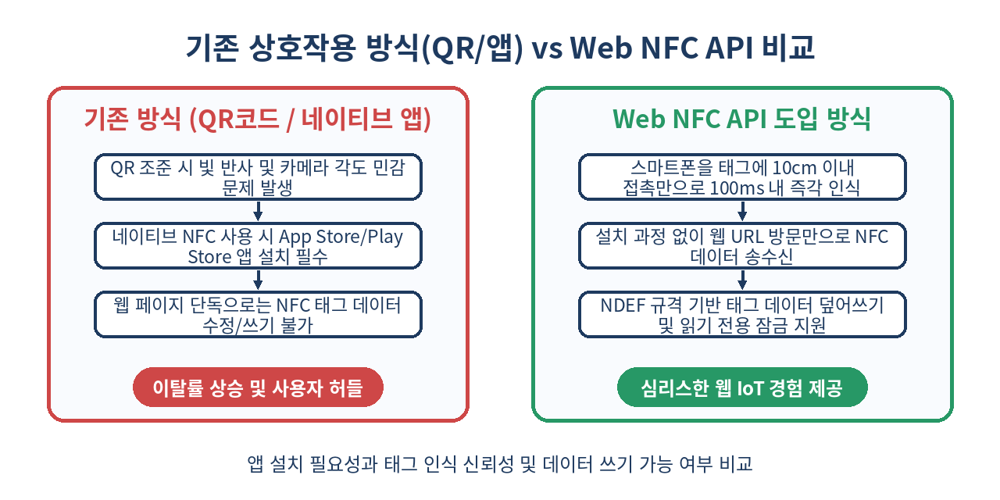
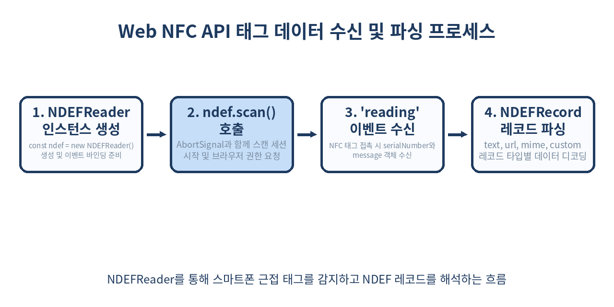

# 📱 Web NFC API 완벽 가이드: 브라우저에서 NFC 태그를 직접 읽고 쓰는 차세대 웹 IoT

> "스마트폰으로 NFC 태그를 터치하는 것만으로 자재 관리, 출입 인증, 스마트 티켓팅이 웹에서 완성된다."
> 네이티브 앱 설치 없이 W3C 표준 Web NFC API를 통해 웹 브라우저에서 근거리 무선 통신을 구현하는 실무 가이드입니다.

---

## 📌 목차
1. 🧭 1. Web NFC API란 무엇인가?
2. ⚔️ 2. QR 코드 vs 네이티브 NFC 앱 vs Web NFC API 비교
3. 🔐 3. Web NFC 보안 모델 및 필수 사전 요건
4. 📖 4. NDEFReader를 활용한 NFC 태그 읽기(Reading)
5. 🧩 5. NDEFRecord 레코드 유형 완벽 파싱 (Text, URL, MIME, External)
6. ✍️ 6. NFC 태그 데이터 쓰기(Writing)와 옵션 제어
7. 🔒 7. NFC 태그 불변화: 읽기 전용(Make Read-Only) 전환
8. 🏭 8. 실무 풀코드: 웹 기반 스마트 재고·출입 관리 시스템
9. ⚠️ 9. 실무 함정과 iOS / 브라우저 호환성 한계
10. 🚫 10. Web NFC API를 사용하면 안 되는 3가지 시나리오
11. 🧾 11. 정리
12. 📚 12. 참고 자료

---

## 🧭 1. Web NFC API란 무엇인가?

**Web NFC API**는 W3C 웹 인큐베이터 커뮤니티 그룹(WICG)에서 제안한 표준 브라우저 API로, 웹 애플리케이션이 NFC(Near Field Communication, 근거리 무선 통신) 태그 및 장치와 데이터를 주고받을 수 있게 해줍니다.

과거 웹 생태계에서는 NFC 태그를 이용하려면 React Native, Flutter, Swift, Kotlin 등의 네이티브 앱을 구축해 디바이스의 NFC 하드웨어 제어권을 획득해야 했습니다. 하지만 Web NFC API의 등장으로 Chrome 89+ (Android) 환경에서는 단순 웹페이지 접속만으로 **NDEF(NFC Data Exchange Format)** 표준 형식의 데이터를 읽고(Read) 쓸(Write) 수 있게 되었습니다.

웹 브라우저는 태그의 고유 식별자(`serialNumber`)와 NDEF 메시지(`NDEFMessage`)를 이벤트 수신 형태로 처리하며, 물류 자재 트래킹, 이벤트 참관객 출입증 스캔, 스마트 키오스크 주문 등 다양한 산업 현장에 빠르게 도입되고 있습니다.

---

## ⚔️ 2. QR 코드 vs 네이티브 NFC 앱 vs Web NFC API 비교

NFC와 가장 자주 비교되는 기술은 **QR 코드 스캔**과 **네이티브 NFC 개발**입니다. 세 기술의 특성과 차이점을 아래 비교표로 정리했습니다.



| 구분 | QR 코드 (카메라 기반) | 네이티브 앱 NFC | Web NFC API |
| :--- | :--- | :--- | :--- |
| **설치 허들** | 없음 (카메라/웹 접근) | **높음** (앱스토어 다운로드 필수) | **없음** (웹 URL 즉시 접근) |
| **인식 조건** | 밝은 조명, 카메라 초점 필요 | 스마트폰 태그 접촉 (NFC 온) | 스마트폰 태그 접촉 (NFC 온) |
| **데이터 쓰기** | 불가능 (인쇄된 고정 이미지) | 가능 (하드웨어 제어 가능) | **가능** (NDEFWriter 지원) |
| **인식 속도** | 1~3초 (포커싱 시간 지연) | **100ms 이내** (접촉 즉시) | **100ms 이내** (접촉 즉시) |
| **보안성** | QR 코드 복제 매우 쉬움 | 태그 암호화 및 락 제어 가능 | **NDEF 읽기 전용 락 지원** |
| **플랫폼 지원** | 모든 브라우저 및 OS | iOS / Android 전체 | **Android Chrome 중심** (iOS 미지원) |

---

## 🔐 3. Web NFC 보안 모델 및 필수 사전 요건

NFC 하드웨어 접근은 악의적인 웹사이트가 사용자의 무선 태그를 몰래 조작할 위험이 있으므로 강력한 보안 정책이 적용됩니다.

### 1) 보안 요구사항 (Security Requirements)
- **Secure Context (HTTPS 필수)**: `https://` 환경 또는 `localhost` 개발 환경에서만 작동합니다.
- **Top-Level Frame (최상위 컨텍스트)**: `<iframe>` 내부에서는 기본적으로 차단됩니다. 만약 `<iframe>`에서 사용하려면 parent frame이 `allow="nfc"` 속성을 iframe 태그에 명시해야 합니다.
- **User Activation (사용자 제스처)**: `scan()` 또는 `write()` 메서드는 최초 호출 시 사용자 클릭, 터치 등 이벤트 리스너 내부에서 실행되는 것을 권장합니다.
- **브라우저 탭 활성화 (Page Visibility)**: 사용자가 다른 브라우저 탭으로 이동하거나 화면을 전환(`document.hidden === true`)하면 NFC 스캔 및 쓰기 작업이 자동으로 일시 정지(Pause)됩니다.

```html
<!-- iframe 내부에서 Web NFC를 허용할 때 사용 -->
<iframe src="https://partner-system.com/nfc-reader" allow="nfc"></iframe>
```

---

## 📖 4. NDEFReader를 활용한 NFC 태그 읽기(Reading)

NFC 태그를 읽으려면 `NDEFReader` 객체를 생성하고 `scan()`을 호출한 뒤, `reading` 이벤트를 감지합니다.



### 기초 태그 스캔 코드 예제

```js
// Web NFC 지원 여부 확인
if (!('NDEFReader' in window)) {
  console.warn('이 브라우저는 Web NFC API를 지원하지 않습니다.');
}

async function startNFCScan() {
  try {
    const ndef = new NDEFReader();
    
    // 스캔 취소를 위한 AbortController 준비
    const controller = new AbortController();
    
    // 1. NFC 태그 스캔 세션 시작 (권한 팝업이 노출될 수 있음)
    await ndef.scan({ signal: controller.signal });
    console.log('NFC 태그 스캔이 시작되었습니다. 태그를 스마트폰 뒤에 대주세요.');

    // 2. 태그 읽기 오류 처리
    ndef.addEventListener('readingerror', () => {
      console.error('NFC 태그를 읽는 중 오류가 발생했습니다. 태그가 손상되었거나 손이 흔들렸습니다.');
    });

    // 3. 태그 감지 및 데이터 수신
    ndef.addEventListener('reading', ({ message, serialNumber }) => {
      console.log(`✅ 태그 감지 성공! Serial Number: ${serialNumber}`);
      console.log(`NDEF 레코드 개수: ${message.records.length}`);
      
      for (const record of message.records) {
        console.log(`레코드 타입: ${record.recordType}`);
        console.log(`MIME 타입: ${record.mediaType}`);
      }
    });

  } catch (error) {
    if (error.name === 'NotAllowedError') {
      console.error('사용자가 NFC 접근 권한을 거부했습니다.');
    } else {
      console.error(`NFC 스캔 시작 실패: ${error.message}`);
    }
  }
}
```

--- 

## 🧩 5. NDEFRecord 레코드 유형 완벽 파싱 (Text, URL, MIME, External)

NDEF 메시지는 1개 이상의 `NDEFRecord`로 구성되어 있습니다. 각 레코드 타입(`recordType`)에 따라 payload를 해석하는 디코딩 로직이 달라집니다.

### 1) Text 레코드 파싱 (`recordType === 'text'`)

텍스트 레코드는 언어 코드(예: `en`, `ko`)와 인코딩(UTF-8 또는 UTF-16) 정보를 포함합니다.

```js
function parseTextRecord(record) {
  const textDecoder = new TextDecoder(record.encoding || 'utf-8');
  const decodedText = textDecoder.decode(record.data);
  console.log(`[Text Record] 언어: ${record.lang}, 내용: ${decodedText}`);
  return decodedText;
}
```

### 2) URL 레코드 파싱 (`recordType === 'url'`)

스마트폰이 터치되었을 때 웹페이지로 이동시키는 URL 데이터입니다.

```js
function parseUrlRecord(record) {
  const textDecoder = new TextDecoder();
  const url = textDecoder.decode(record.data);
  console.log(`[URL Record] 접속 URL: ${url}`);
  return url;
}
```

### 3) JSON / MIME 데이터 파싱 (`recordType === 'mime'`)

앱 전용 복합 데이터(예: `application/json`)를 저장할 때 사용합니다.

```js
function parseMimeRecord(record) {
  if (record.mediaType === 'application/json') {
    const textDecoder = new TextDecoder();
    const jsonString = textDecoder.decode(record.data);
    const jsonObject = JSON.parse(jsonString);
    console.log('[MIME JSON Record]', jsonObject);
    return jsonObject;
  }
  return record.data;
}
```

### 4) 커스텀 도메인 외부 레코드 (`recordType === 'example.com:customType'`)

특정 도메인에 종속된 비표준 커스텀 바이너리 데이터입니다.

```js
function parseRecord(record) {
  switch (record.recordType) {
    case 'text':
      return parseTextRecord(record);
    case 'url':
      return parseUrlRecord(record);
    case 'mime':
      return parseMimeRecord(record);
    default:
      if (record.recordType.includes(':')) {
        console.log(`커스텀 외부 데이터 타입: ${record.recordType}`);
        const decoder = new TextDecoder();
        return decoder.decode(record.data);
      }
      return 'Unknown Record';
  }
}
```

---

## ✍️ 6. NFC 태그 데이터 쓰기(Writing)와 옵션 제어

`NDEFReader.write()` 메서드를 사용하면 빈 NFC 태그에 NDEF 메시지를 기록하거나 기존 데이터를 덮어쓸(Overwrite) 수 있습니다.

```js
async function writeToNFCTag() {
  const ndef = new NDEFReader();
  
  try {
    // 쓰기 모드 시작 (태그를 가져다 대면 데이터 기록)
    await ndef.write({
      records: [
        // 1. 텍스트 레코드 추가
        { recordType: 'text', data: '로직팬텀 물류 관리 자재 번호: #98421' },
        
        // 2. URL 레코드 추가
        { recordType: 'url', data: 'https://logic-phantom.tech/inventory/98421' },
        
        // 3. JSON 데이터 (MIME 타입) 추가
        {
          recordType: 'mime',
          mediaType: 'application/json',
          data: new TextEncoder().encode(JSON.stringify({
            itemId: 98421,
            owner: 'Logic-Phantom',
            updatedAt: new Date().toISOString()
          }))
        }
      ]
    }, {
      overwrite: true // 기존 데이터를 덮어쓸지 여부 (기본값 true)
    });
    
    console.log('✨ NFC 태그에 데이터가 성공적으로 기록되었습니다!');
  } catch (error) {
    console.error(`NFC 데이터 기록 실패: ${error.message}`);
  }
}
```

--- 

## 🔒 7. NFC 태그 불변화: 읽기 전용(Make Read-Only) 전환

위변조가 불가능해야 하는 스마트 출입증이나 상품 정품 인증 태그의 경우, 쓰기 작업 후 태그를 **읽기 전용(Read-Only)** 상태로 영구 잠금할 수 있습니다.

> ⚠️ **주의**: `makeReadOnly()` 작업은 **돌이킬 수 없으며(Irreversible)**, 한 번 읽기 전용으로 잠긴 태그에는 다시는 데이터를 쓸 수 없습니다.

```js
async function makeTagFinalReadOnly() {
  const ndef = new NDEFReader();
  
  try {
    console.log('잠글 NFC 태그를 스마트폰에 접촉하세요...');
    
    // makeReadOnly() 호출 후 태그 접촉 대기
    await ndef.makeReadOnly();
    
    console.log('🔒 NFC 태그가 성공적으로 읽기 전용으로 잠겼습니다. 더 이상 수정할 수 없습니다.');
  } catch (error) {
    console.error(`읽기 전용 잠금 실패: ${error.message}`);
  }
}
```

---

## 🏭 8. 실무 풀코드: 웹 기반 스마트 재고·출입 관리 시스템

아래 코드는 브라우저에서 NFC 태그 스캔, 데이터 파싱, 태그 신규 쓰기 및 스캔 중단을 지원하는 완전한 실무 컴포넌트 예제입니다.

```js
class WebNFCManager {
  constructor() {
    this.reader = null;
    this.abortController = null;
    this.isScanning = false;
  }

  // Web NFC 지원 여부 점검
  static isSupported() {
    return 'NDEFReader' in window;
  }

  // NFC 태그 스캔 시작
  async startScanning(onTagDiscovered, onError) {
    if (!WebNFCManager.isSupported()) {
      throw new Error('이 브라우저는 Web NFC를 지원하지 않습니다.');
    }

    this.reader = new NDEFReader();
    this.abortController = new AbortController();

    try {
      await this.reader.scan({ signal: this.abortController.signal });
      this.isScanning = true;

      this.reader.addEventListener('readingerror', (evt) => {
        if (onError) onError(new Error('NFC 태그 읽기 에러 발생'));
      });

      this.reader.addEventListener('reading', ({ message, serialNumber }) => {
        const parsedRecords = message.records.map((rec) => this.parseRecord(rec));
        onTagDiscovered({
          serialNumber,
          records: parsedRecords,
          timestamp: new Date()
        });
      });
    } catch (err) {
      this.isScanning = false;
      throw err;
    }
  }

  // NFC 스캔 중단
  stopScanning() {
    if (this.abortController) {
      this.abortController.abort();
      this.isScanning = false;
      console.log('NFC 스캔 세션이 중단되었습니다.');
    }
  }

  // 태그에 새로운 데이터 쓰기
  async writeProductTag(productId, productName) {
    if (!WebNFCManager.isSupported()) return;

    const writer = new NDEFReader();
    const payload = {
      recordType: 'mime',
      mediaType: 'application/json',
      data: new TextEncoder().encode(JSON.stringify({
        id: productId,
        name: productName,
        createdAt: Date.now()
      }))
    };

    await writer.write({ records: [payload] });
  }

  // 레코드 디코더 유틸리티
  parseRecord(record) {
    const textDecoder = new TextDecoder(record.encoding || 'utf-8');
    const rawString = textDecoder.decode(record.data);

    if (record.recordType === 'mime' && record.mediaType === 'application/json') {
      try {
        return { type: 'json', payload: JSON.parse(rawString) };
      } catch (e) {
        return { type: 'mime', payload: rawString };
      }
    }

    return {
      type: record.recordType,
      payload: rawString
    };
  }
}

// 사용 예시
const nfcManager = new WebNFCManager();

document.getElementById('btn-scan').addEventListener('click', async () => {
  try {
    await nfcManager.startScanning(
      (tagData) => {
        alert(`[태그 인식] 시리얼: ${tagData.serialNumber}\n내용: ${JSON.stringify(tagData.records)}`);
      },
      (err) => console.error(err)
    );
  } catch (err) {
    console.error('스캔 실패:', err);
  }
});
```

---

## ⚠️ 9. 실무 함정과 iOS / 브라우저 호환성 한계

Web NFC API를 프로덕션 환경에 도입할 때 반드시 숙지해야 하는 크리티컬한 함정과 제약 사항입니다.

### 1) Apple iOS Safari 미지원 문제 (가장 큰 함정)
현재 Web NFC API는 **Android의 Chrome, Edge, Opera** 등 Chromium 기반 모바일 브라우저에서만 정상 지원됩니다. **iOS(iPhone/iPad)의 Safari 및 WebKit 기반 브라우저**는 보안 및 사설 API 전점 정책으로 인해 Web NFC API를 지원하지 않습니다.
- **대응 전략**: 크로스 플랫폼 웹 앱을 서비스해야 한다면 iOS 사용자를 위해 **QR 코드 스캔 fallback**을 제공하거나, PWA 환경에서 네이티브 NFC 플러그인을 결합한 캐시 웹뷰 아키텍처를 선택해야 합니다.

### 2) 백그라운드 태그 감지 불가
Web NFC API는 사용자가 웹 브라우저 탭을 열어두고 화면이 활성화된 상태에서만 작동합니다. 브라우저가 백그라운드 상태이거나 화면이 꺼진(Screen Off) 상태에서는 NFC 태그를 읽을 수 없습니다.

### 3) ISO-DEP / FeliCa 저수준 커스텀 APDU 명령어 제약
Web NFC API는 **NDEF 규격 데이터 포맷**으로 제한됩니다. 금융 카드, 교통카드(T-Money, FeliCa)의 비표준 APDU(Application Protocol Data Unit) 저수준 암호화 바이너리 통신은 안전상의 이유로 브라우저 레벨에서 차단됩니다.

---

## 🚫 10. Web NFC API를 사용하면 안 되는 3가지 시나리오

Web NFC API가 강력하더라도 아래 3가지 프로젝트에서는 사용하지 않는 것이 좋습니다.

1. **iOS 아이폰 사용자가 주 고객층인 B2C 서비스**
   - iOS Safari가 Web NFC를 지원하지 않으므로 아이폰 사용자에게 서비스가 불가능해집니다. 이 경우 QR 코드가 훨씬 우수한 대안입니다.
2. **신용카드/교통카드 결제 단말기 개발**
   - 금융 결제에 사용되는 EMV 규격 및 카드 원천 APDU 통신은 NDEF 범주를 벗어나므로 Web NFC로 구현할 수 없습니다.
3. **디바이스가 닫혀 있는 백그라운드 자동 수신 서비스**
   - 앱이 꺼진 상태에서 NFC 접촉 시 웹사이트를 자동으로 띄우고 싶다면, Web NFC 쓰기 기능으로 NFC 태그 자체에 `https://your-domain.com` URL 레코드를 기록한 후, 스마트폰 OS의 네이티브 NDEF URL Auto-launch 기능을 이용해야 합니다.

---

## 🧾 11. 정리

- **Web NFC API**는 별도의 네이티브 앱 설치 없이 HTTPS 웹 환경에서 NFC 태그를 읽고 쓸 수 있는 W3C 표준 브라우저 기술입니다.
- **NDEFReader** 인스턴스를 통해 `scan()`, `write()`, `makeReadOnly()` 기능을 구동하며, Text, URL, MIME, JSON 등 다양한 데이터 구조를 손쉽게 송수신합니다.
- **보안 요구사항**: HTTPS(Secure Context) 환경과 사용자 클릭 제스처, 그리고 최상위 브라우저 프레임 규칙을 철저히 준수해야 합니다.
- **플랫폼 한계**: 현재 Android Chrome을 중심으로 지원되며, iOS Safari는 미지원이므로 QR 코드 Fallback 전략이 필수적입니다.
- **유용한 활용처**: 스마트 물류 재고 관리, 행사장 즉각 출입 체크인, 스마트 키오스크 및 무선 데이터 주입 시스템.

> ✨ **한 줄 요약**
> Web NFC API는 앱 설치 없이 브라우저 단 10줄의 자바스크립트로 스마트폰과 물리적 무선 태그를 연결하는 가장 가벼운 웹 IoT 열쇠다.

---

## 📚 12. 참고 자료
- [W3C Web NFC API Specification](https://w3c.github.io/web-nfc/)
- [MDN Web Docs: Web NFC API](https://developer.mozilla.org/en-US/docs/Web/API/Web_NFC_API)
- [Chrome Developers: Interact with NFC devices on Android](https://developer.chrome.com/docs/capabilities/nfc)
