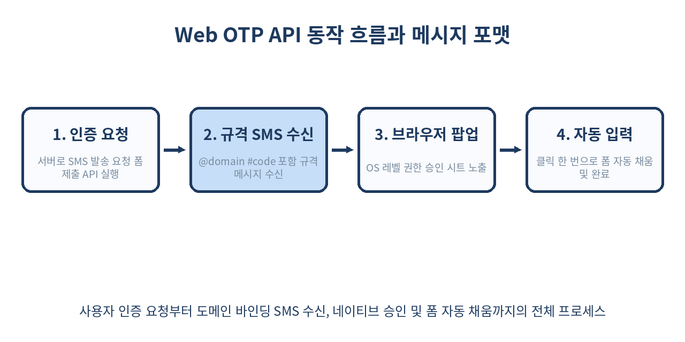
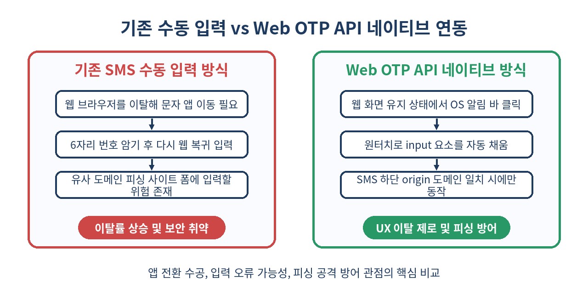

# 📲 Web OTP API 완벽 가이드: 외부 앱 이동 없는 네이티브 SMS 인증번호 자동 수신

> "문자 앱을 확인하고 오세요"라는 문구는 모바일 웹 전환율을 떨어뜨리는 주요 원인입니다.
> Web OTP API를 사용하면 사용자가 브라우저를 벗어나지 않고 탭 한 번으로 SMS 인증번호를 자동 입력받을 수 있습니다.

---

## 📌 목차
1. 🧭 1. 모바일 SMS 인증 UX의 한계와 Web OTP API
2. 🔑 2. Web OTP API 핵심 개념과 원리
3. 📐 3. SMS 메시지 포맷 규격화 (@domain #code)
4. 💻 4. navigator.credentials.get()을 활용한 기본 연동
5. 🔄 5. AbortController를 이용한 타임아웃 및 요청 취소
6. 📄 6. autocomplete="one-time-code"와의 연동 및 차이점
7. 🛡️ 7. 보안 메커니즘: 도메인 바인딩과 피싱(Phishing) 방지
8. 🌐 8. Cross-Origin iframe 환경에서의 처리 (Permission Policy)
9. ⚡ 9. 실무 백엔드 연동: SMS 발송 문자열 생성 알고리즘
10. ⚠️ 10. 실무 구현 시 자주 겪는 함정과 문제 해결
11. 🚫 11. Web OTP API를 사용하지 말아야 할 때
12. 📊 12. 주요 브라우저 및 OS 지원 현황과 Polyfill 전략
13. 🧾 13. 정리
14. 📚 14. 참고 자료

---

## 🧭 1. 모바일 SMS 인증 UX의 한계와 Web OTP API

모바일 웹 서비스에서 회원가입, 비밀번호 재설정, 결제 승인 시 SMS OTP(One-Time Password) 인증은 여전히 가장 널리 쓰이는 비상 인증 수단입니다. 하지만 기존의 SMS 인증 과정은 극심한 사용자 경험(UX) 파편화를 유발합니다.

1. 웹 브라우저에서 인증번호 요청 버튼 클릭
2. 홈 화면으로 나가거나 상단 알림 바를 내려 문자 메시지 앱 실행
3. 6자리 난수를 암기하거나 클립보드에 복사
4. 다시 웹 브라우저로 돌아와 input 엘리먼트에 직접 입력 또는 붙여넣기

이 과정에서 사용자가 입력을 포기하거나 다른 앱으로 이탈하는 비율이 전체 인증 시도의 10~15%에 달한다는 조사 결과가 있습니다. **Web OTP API**는 이 문제를 해결하기 위해 W3C Web Platform Incubator Community Group(WICG)에서 제안하고 Chromium 및 Safari 커널에 도입된 브라우저 네이티브 API입니다.

사용자의 개입을 최소화하여 SMS가 도착하는 즉시 브라우저 상단에 "인증번호 입력(Allow)" 시트를 띄우고, 탭 한 번으로 `input` 요소를 채워줍니다.

---

## 🔑 2. Web OTP API 핵심 개념과 원리

Web OTP API는 `Credential Management API`의 확장 사양입니다. 브라우저는 OS의 SMS 수신 이벤트를 수신 대기하다가, 특정 표준 형식으로 작성된 문자 메시지가 도착하면 이 메시지를 가로채 정규식으로 코드를 추출합니다.

```text
[ 사용자 기기 ]
+-------------------------------------------------------------+
| 1. Web App : navigator.credentials.get({ otp: ... }) 실행   |
| 2. OS SMS Service : 대기 상태 전환                           |
| 3. SMS 수신 : "[MyService] 123456 ... @myservice.com #123456"|
| 4. OS SMS Service : 도메인 검증 및 코드 추출                |
| 5. Browser UI : "myservice.com에서 123456 입력 허용?" 프롬프트  |
| 6. 사용자 클릭 : input.value = "123456" 자동 채움           |
+-------------------------------------------------------------+
```

중요한 점은 브라우저가 임의의 모든 문자 메시지를 읽을 수 없다는 것입니다. 사용자의 사생활 보호를 위해 **특정 규격을 준수한 메시지**만 수신하며, 수신된 직후에도 반드시 **사용자의 명시적 승인 클릭**이 있어야만 웹 페이지에 데이터가 전달됩니다.

---

## 📐 3. SMS 메시지 포맷 규격화 (@domain #code)

Web OTP API가 작동하려면 이동통신망을 통해 전달되는 SMS 문장이 **W3C 지정 Web OTP 템플릿 규격**을 따라야 합니다.

### 필수 구조 규칙
- 메시지 마지막 줄은 반드시 `@도메인 #인증코드` 형식으로 끝나야 합니다.
- `@` 뒤에는 포트번호를 제외한 현재 웹 사이트의 완전히 정규화된 도메인(Origin Domain)이 위치해야 합니다.
- `#` 뒤에는 추출할 OTP 인증 코드가 위치합니다.
- 다국어 및 안내 문구는 상단에 자유롭게 작성할 수 있으나, 마지막 도메인 라인 직전에는 반드시 줄바꿈(`\n`)이 들어가는 것이 권장됩니다.

```text
[본인확인] 인증번호는 [849204] 입니다. 타인에게 절대 노출하지 마세요.

@myservice.com #849204
```

### 서브도메인 및 포트가 지정된 경우
- 서브도메인 지원: `@sub.myservice.com #849204`
- 개발 환경(Port) 지정: `@localhost:8080 #849204` (일부 Chrome 개발자 옵션 활성화 시 가능)

만약 메시지 하단에 `@myservice.com #849204` 규격이 없으면 OS와 브라우저는 이 SMS를 Web OTP 이벤트로 인식하지 않고 무시합니다.

---

## 💻 4. navigator.credentials.get()을 활용한 기본 연동

실제 클라이언트 프론트엔드 JavaScript 코드 연동 방식입니다. `navigator.credentials.get()` 함수에 `otp` 옵션을 전달합니다.

```javascript
// Web OTP API 지원 여부 확인 함수
function isWebOTPSupported() {
  return 'OTPCredential' in window;
}

async function startOTPListener(inputElement) {
  if (!isWebOTPSupported()) {
    console.warn('Web OTP API를 지원하지 않는 브라우저입니다. 수동 입력을 유도하세요.');
    return;
  }

  try {
    // OTP 수신 대기 시작
    const content = await navigator.credentials.get({
      otp: { transport: ['sms'] },
    });

    if (content && content.code) {
      // 수신된 6자리 코드를 input 엘리먼트에 주입
      inputElement.value = content.code;
      
      // 선택 사항: 코드가 채워지면 즉시 폼 자동 제출
      const form = inputElement.form;
      if (form) {
        form.requestSubmit();
      }
    }
  } catch (err) {
    // 사용자가 네이티브 팝업에서 '취소'를 누르거나 타임아웃 발생 시 catch 블록으로 진입
    console.error('Web OTP 수신 실패 또는 취소됨:', err.name, err.message);
  }
}
```

`navigator.credentials.get()`은 Promise를 반환하며, 사용자가 프롬프트에서 승인 버튼을 누를 때 비로소 `OTPCredential` 객체가 반환됩니다.

---

## 🔄 5. AbortController를 이용한 타임아웃 및 요청 취소

Web OTP 비동기 요청은 문자 메시지가 올 때까지 무한정 대기할 수 있습니다. 사용자가 인증번호 재발송을 누르거나, 페이지를 이동하거나, 유효시간(예: 3분)이 초과되었을 때 기존 대기 건을 안전하게 취소해야 합니다.

이를 위해 `AbortController`를 사용합니다.

```javascript
class OTPManager {
  constructor(inputElement, timeoutMs = 180000) {
    this.inputElement = inputElement;
    this.timeoutMs = timeoutMs;
    this.abortController = null;
  }

  async startListen() {
    // 기존 대기 중인 요청이 있다면 취소
    this.stopListen();

    this.abortController = new AbortController();
    const signal = this.abortController.signal;

    // 지정된 유효시간 후 자동 취소 타임아웃 설정
    const timer = setTimeout(() => {
      this.abortController.abort();
      console.log('OTP 수신 대기 시간 초과');
    }, this.timeoutMs);

    try {
      const otp = await navigator.credentials.get({
        otp: { transport: ['sms'] },
        signal: signal
      });

      clearTimeout(timer);
      if (otp && otp.code) {
        this.inputElement.value = otp.code;
      }
    } catch (err) {
      clearTimeout(timer);
      if (err.name === 'AbortError') {
        console.log('OTP 수신 대기가 정상적으로 중단되었습니다.');
      } else {
        console.error('OTP 오류:', err);
      }
    }
  }

  stopListen() {
    if (this.abortController) {
      this.abortController.abort();
      this.abortController = null;
    }
  }
}
```



---

## 📄 6. autocomplete="one-time-code"와의 연동 및 차이점

많은 개발자가 HTML5의 `autocomplete="one-time-code"` 속성과 `Web OTP API`를 혼동합니다. 두 기술은 상보적 관계이지만 동작 원리가 다릅니다.

| 비교 항목 | HTML autocomplete="one-time-code" | JavaScript Web OTP API |
| :--- | :--- | :--- |
| **주체** | 키보드(IME) 수준의 자동 완성 기능 | 브라우저 및 JavaScript API 수준의 프로그래밍 제어 |
| **트리거** | 사용자가 input을 포커스하고 키보드 상단 띠를 클릭 | JS가 호출된 동안 OS 수신 이벤트를 모니터링하여 네이티브 팝업 노출 |
| **자동 제출** | 불가능 (사용자가 키보드 띠를 눌러야 함) | 가능 (`form.requestSubmit()` 연동 가능) |
| **문자 포맷 조건**| 규격이 다소 느슨함 (숫자 4~8자리 자동 인식) | 엄격함 (`@domain #code` 지침 필수) |
| **피싱 방지** | 도메인 일치 여부 검증 부족 | 도메인 미일치 시 코드 전달 차단 |

### 최고의 UX 모범 사례 (Hybrid Approach)
HTML input 태그에 `autocomplete="one-time-code"`를 기본으로 명시하고, 스크립트에서 `Web OTP API`를 동시에 실행하는 것입니다.

```html
<form id="otp-form">
  <label for="otp-input">인증번호 6자리</label>
  <input 
    type="text" 
    id="otp-input" 
    name="otp" 
    inputmode="numeric" 
    pattern="[0-9]*" 
    autocomplete="one-time-code" 
    required 
    maxlength="6"
  />
  <button type="submit">확인</button>
</form>
```

이렇게 작성하면 Web OTP API를 지원하지 않거나 문자가 규격에 약간 벗어나더라도 키보드 상단 자동완성 추천 띠를 통해 2차 백업 UX를 제공할 수 있습니다.

---

## 🛡️ 7. 보안 메커니즘: 도메인 바인딩과 피싱(Phishing) 방지

Web OTP API가 제공하는 가장 강력한 장점 중 하나는 **피싱 방어(Anti-Phishing)**입니다.

공격자가 `my-service-phishing.com`이라는 가짜 사이트를 만들어 사용자의 SMS 인증번호를 탈취하려 한다고 가정합시다. 사용자가 진짜 서비스(`myservice.com`)에 인증번호를 요청하면 SMS에는 다음과 같이 전달됩니다.

```text
[MyService] 인증번호 [123456]

@myservice.com #123456
```

사용자가 피싱 사이트(`my-service-phishing.com`)에 접속해 있는 상태라면, 브라우저는 수신된 SMS의 `@myservice.com`과 현재 접속 중인 피싱 사이트의 Origin 도메인을 비교합니다.
두 도메인이 일치하지 않으므로 **피싱 사이트의 JavaScript execution context로는 SMS 데이터가 전혀 전달되지 않습니다.** 사용자가 수동으로 문자를 복사해서 피싱 폼에 적지 않는 한, 네이티브 팝업조차 뜨지 않아 피싱 위험이 대폭 감소합니다.

---

## 🌐 8. Cross-Origin iframe 환경에서의 처리 (Permission Policy)

결제 모듈이나 외부 인증 솔루션(예: PG사 모듈)은 메인 도메인이 아닌 `iframe` 내부에서 동작하는 경우가 많습니다.

기본적으로 Web OTP API는 보안을 위해 최상위 프레임(Top-level Frame)과 일치하는 도메인에서만 동작하도록 제한됩니다. 그러나 `Permissions-Policy`를 선언하면 Cross-Origin iframe 내부에서도 Web OTP를 전달받을 수 있습니다.

### 1. Iframe HTML 태그 설정
```html
<!-- 메인 페이지 (https://myservice.com) -->
<iframe 
  src="https://auth-provider.com/otp-page" 
  allow="otp-credentials '*'">
</iframe>
```

### 2. SMS 메시지 포맷 변경 (중첩 도메인 명시)
Cross-origin iframe에서 동작하도록 하려면 SMS 하단 문자열 규격에 **최상위 도메인**과 **iframe 도메인**을 모두 명시해야 합니다.

```text
[MyService] 인증번호는 998877 입니다.

@myservice.com #998877 @auth-provider.com
```
- 첫 번째 `@myservice.com`: 최상위 브라우저 주소창 도메인
- 두 번째 `@auth-provider.com`: 실제로 `navigator.credentials.get()`을 호출하는 iframe 도메인

--- 

## ⚡ 9. 실무 백엔드 연동: SMS 발송 문자열 생성 알고리즘

백엔드(Node.js / Spring Boot 등)에서 SMS 발송 템플릿을 만들 때 도메인 파라미터를 동적으로 결합해야 합니다.

### Node.js (Express) 예시
```javascript
import crypto from 'crypto';

function generateOTP() {
  return crypto.randomInt(100000, 999999).toString();
}

export async function sendOTPSms(req, res) {
  const { phoneNumber } = req.body;
  const otpCode = generateOTP();
  
  // 클라이언트의 Request Origin 또는 고정 환경 변수 도메인 추출
  const clientDomain = process.env.NODE_ENV === 'production' 
    ? 'myservice.com' 
    : 'localhost:3000';

  // Web OTP 규격에 맞는 SMS 본문 작성
  const smsBody = `[MyService] 인증번호는 [${otpCode}]입니다. 타인에게 노출하지 마세요.\n\n@${clientDomain} #${otpCode}`;

  // Redis에 OTP 저장 (유효시간 3분)
  await redisClient.setEx(`otp:${phoneNumber}`, 180, otpCode);

  // SMS 발송 서비스 API 호출 (예: Twilio, CoolSMS 등)
  await smsProvider.send({ to: phoneNumber, text: smsBody });

  res.json({ success: true, message: '인증번호가 발송되었습니다.' });
}
```



---

## ⚠️ 10. 실무 구현 시 자주 겪는 함정과 문제 해결

### 1. 문자열 줄바꿈 누락 오류
가장 흔한 실수는 `@domain #code` 문장을 안내 문구 바로 뒤에 붙여 쓰는 것입니다.
- ❌ `[MyService] 인증번호 123456 @myservice.com #123456` (인식 불가율 높음)
- ⭕ `[MyService] 인증번호 123456 \n\n@myservice.com #123456` (정상 작동)

반드시 구분선 역할을 하는 줄바꿈이 포함되어야 parsing engine이 독립된 프레임 구조로 해석합니다.

### 2. HTTPS 미적용
Web OTP API는 `Secure Context`에서만 작동합니다. HTTP 환경에서는 `navigator.credentials` 내에 `otp` 속성이 정의되지 않거나 호출 시 `SecurityError`가 발생합니다. (단, `localhost`는 예외적으로 허용됨)

### 3. 통신사 및 서드파티 스팸 블록 앱 간섭
일부 스팸 차단 앱(T전화, 후후 등)이나 OS의 스팸 필터링 알고리즘이 `@` 문자가 포함된 메시지를 낚시성 스팸으로 오인하여 수신함 대신 스팸함으로 보낼 수 있습니다. 문구 상단에 브랜드명을 명확히 기재하는 것이 좋습니다.

--- 

## 🚫 11. Web OTP API를 사용하지 말아야 할 때

Web OTP API가 강력하더라도 다음 환경에서는 도입을 재검토하거나 수동 입력을 기본 fallback으로 유지해야 합니다.

1. **데스크톱 브라우저 전용 서비스**: PC 환경에서는 OS와 Cellular 통신 모듈이 결합되어 있지 않으므로 SMS 감지 팝업이 작동하지 않습니다.
2. **Passkey / WebAuthn 도입이 가능한 서비스**: SMS OTP는 SIM 스와핑(SIM Swapping)이나 SS7 통신망 취약점에 노출되어 있습니다. FIDO2 기반 패스키(Passkeys)나 생체 인증을 도입할 수 있다면 SMS OTP 대신 패스키를 우선 채택하는 것이 보안상 훨씬 우수합니다.
3. **알림톡 / 모바일 카카오톡 인증 위주의 서비스**: SMS가 아닌 카카오 알림톡이나 앱 푸시(FCM)로 6자리 코드를 발송하는 구조라면 Web OTP API는 이 메시지를 읽을 수 없습니다. (오직 네이티브 SMS/MMS 통신 채널만 감지 가능)

---

## 📊 12. 주요 브라우저 및 OS 지원 현황과 Polyfill 전략

### 지원 현황
- **Android Chrome**: v84+ 완벽 지원 (Android Google Play Services 연동)
- **iOS / iPadOS Safari**: iOS 14+ 지원 (Safari 14부터 메시지 자동완성 팝업 연동)
- **Desktop Chrome / Edge**: 제한적 지원 (Android 기기와 동일 구글 계정 크롬 동기화 시 데스크톱 팝업 전달 기능 지원)
- **Firefox**: 미지원 (기능 제안 상태)

### 안전한 Fallback 점진적 향상(Progressive Enhancement) 패턴

```javascript
export async function initOTPAutofill(inputEl, onVerified) {
  // 1. 기본 HTML 속성 보장
  inputEl.setAttribute('autocomplete', 'one-time-code');
  inputEl.setAttribute('inputmode', 'numeric');

  // 2. Web OTP API 지원 여부 확인
  if ('OTPCredential' in window) {
    const ac = new AbortController();
    
    // 폼이 사용자에 의해 수동 제출되면 listener 정리
    inputEl.form?.addEventListener('submit', () => ac.abort());

    try {
      const otp = await navigator.credentials.get({
        otp: { transport: ['sms'] },
        signal: ac.signal,
      });
      
      if (otp && otp.code) {
        inputEl.value = otp.code;
        if (typeof onVerified === 'function') {
          onVerified(otp.code);
        }
      }
    } catch (err) {
      // AbortError 등 발생 시 조용히 무시하여 사용자 수동 입력 흐름을 방해하지 않음
      if (err.name !== 'AbortError') {
        console.log('Web OTP 감지 생략:', err.message);
      }
    }
  }
}
```

---

## 🧾 13. 정리

- **UX 혁신**: 사용자가 문자 앱으로 이탈할 필요 없이, 웹 화면 내 네이티브 팝업을 클릭하여 1초 만에 SMS 인증번호를 자동 입력할 수 있습니다.
- **도메인 바인딩 보안**: SMS 하단의 `@domain`과 현재 접속 도메인을 브라우저가 직접 검증하므로 피싱 사이트로의 인증번호 유출을 근본적으로 방지합니다.
- **메시지 규격 준수**: SMS 수신 템플릿 마지막 줄에 반드시 `\n\n@domain #code` 형식의 규격화된 문장을 포함해야 합니다.
- **점진적 향상 전략**: `autocomplete="one-time-code"`와 `navigator.credentials.get()`을 결합하여 미지원 브라우저에서도 최적의 백업 UX를 보장할 수 있습니다.

> ✨ **한 줄 요약**
> SMS 메시지 끝에 `@domain #code` 한 줄을 더하고 `Web OTP API`를 연동하면, 모바일 웹 인증 이탈률을 획기적으로 낮출 수 있습니다.

---

## 📚 14. 참고 자료
- [W3C Web OTP API Specification](https://wicg.github.io/web-otp/)
- [web.dev: Verification code form best practices](https://web.dev/articles/verify-phone-numbers-for-user-intent)
- [MDN Web Docs: OTPCredential Interface](https://developer.mozilla.org/en-US/docs/Web/API/OTPCredential)
