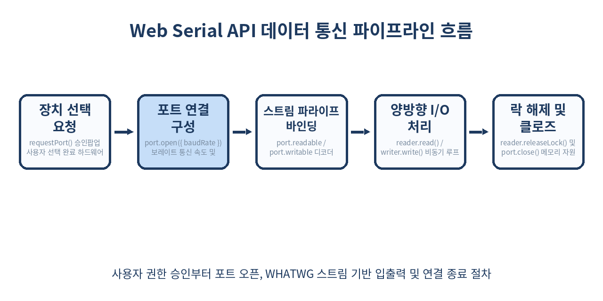
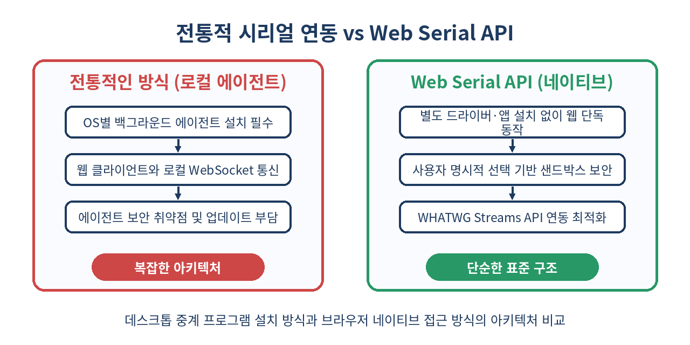

# 🔌 Web Serial API 완벽 가이드: 플러그인 없는 브라우저 기반 시리얼 장치 직접 통신

> 별도의 설치형 에이전트 프로그램이나 브라우저 플러그인 없이, 웹 애플리케이션에서 아두이노, 마이크로컨트롤러, POS 프린터, 바코드 스캐너 등의 시리얼(Serial Port / RS-232 / USB CDC-ACM) 하드웨어와 직접 바이너리 데이터 스트림을 주고받는 Web Serial API의 원리와 실무 구현 기법을 살펴봅니다.

---

## 📌 목차
1. 🔌 Web Serial API란 무엇인가?
2. 🏗️ 전통적인 방식 vs Web Serial API 비교
3. ⚙️ 데이터 통신 기본 아키텍처와 흐름
4. 🔓 포트 요청과 연결 승인 (requestPort)
5. 📥 시리얼 데이터 수신하기 (ReadableStream)
6. 📤 시리얼 데이터 전송하기 (WritableStream)
7. 🔀 TextEncoder / TextDecoderStream 파이프라인 구축
8. ⚡ 텍스트 라인 단위 렌더링 (TransformStream 패턴)
9. 🛡️ 보안 모델과 출처 보안 정책 (Origin & Security)
10. 🔌 장치 연결/해제 이벤트 감지 (connect / disconnect)
11. ⚠️ 실무에서 자주 만나는 함정과 주의사항
12. 🚫 Web Serial API를 쓰면 안 되는 케이스
13. 🧾 정리
14. 📚 참고 자료

---

## 🔌 1. Web Serial API란 무엇인가?

과거 웹 브라우저는 샌드박스 보안 모델로 인해 컴퓨터의 물리적 하드웨어 장치에 직접 접근하는 것이 엄격히 금지되어 있었습니다. 따라서 웹 기반 POS 시스템, 3D 프린터 제어 콘솔, 산업용 계측기 모니터링 모듈, 스마트 팜 IoT 센서 수집기와 같은 프로젝트에서는 시리얼 통신을 하기 위해 필수적으로 로컬 C#/Python 기반 백그라운드 에이전트 프로그램을 설치하고 `WebSocket`이나 `HTTP Localhost` 서버를 거쳐 데이터를 중계해야 했습니다.

**Web Serial API**는 이러한 번거로운 설치 과정을 제거하고, W3C 웹 표준 및 Chromium 브라우저 엔진을 바탕으로 **웹 브라우저가 직접 물리적/가상 시리얼 포트에 접근할 수 있게 해주는 표준 브라우저 I/O API**입니다.

USB를 통한 CDC-ACM(Communication Device Class), Bluetooth SPP(Serial Port Profile), RS-232/RS-485 변환기(FTDI, CH340, CP2102 등) 장치가 브라우저 단에서 즉시 인식되며, 표준 **WHATWG Streams API (`ReadableStream`, `WritableStream`)**와 완벽하게 통합되어 유연하고 빠른 데이터 처리를 지원합니다.

---

## 🏗️ 2. 전통적인 방식 vs Web Serial API 비교

하드웨어를 제어하는 프론트엔드 아키텍처는 Web Serial API의 등장으로 근본적인 변화를 맞이했습니다.

| 구분 | 기존 방식 (Local Agent / WebSocket) | Web Serial API (차세대 네이티브) |
| :--- | :--- | :--- |
| **프로그램 설치** | 데스크톱용 중계 에이전트 설치 필수 | **추가 프로그램 설치 0개 (웹 접속 즉시 제어)** |
| **통신 레이어** | `Web Client` ↔ `Local WebSocket` ↔ `Serial Port` | `Web Client` ↔ `Browser Kernel` ↔ `Serial Port` |
| **보안 체계** | Localhost 포트 개방으로 인한 보안 공격 위험 | **명시적 사용자 선택 팝업 및 보안 컨텍스트(HTTPS)** |
| **크로스 플랫폼** | OS(Windows, macOS, Linux)별 에이전트 빌드 필요 | 브라우저 엔진 지원을 통해 모든 OS 공통 동작 |
| **데이터 스트리밍** | 커스텀 JSON/바이너리 패킷 프로토콜 설계 필요 | **웹 표준 `ReadableStream` / `WritableStream` 연동** |
| **유지 보수** | 웹 코드와 로컬 에이전트 버전을 동시 관리해야 함 | 웹 애플리케이션 단일 코드베이스만 배포 및 관리 |

---

## ⚙️ 3. 데이터 통신 기본 아키텍처와 흐름

Web Serial API의 동작 알고리즘 방식은 포트 탐색, 사용자 승인, 스트림 락(Lock) 획득, 그리고 데이터 파이프라인 처리 구조로 이루어집니다.



1. **권한 획득 (`requestPort`)**: 사용자 이벤트(클릭 등)를 통해 시스템에 연결된 시리얼 장치 목록을 팝업으로 띄우고 권한을 얻습니다.
2. **포트 오픈 (`open`)**: 통신 속도(`baudRate`), 데이터 비트, 패리티 비트 등 통신 규격을 지정하여 디바이스와 연결 세션을 엽니다.
3. **스트림 락(Stream Lock)**: `port.readable` 및 `port.writable`에 접근하여 독점 읽기/쓰기 권한(Reader/Writer Lock)을 획득합니다.
4. **파이프라인 통신**: `Uint8Array` 형태의 청크(Chunk) 데이터를 읽어 들이거나 스트림 파이프(`pipeThrough`)를 거쳐 라인 단위/텍스트 단위로 변환합니다.
5. **해제 및 종료 (`close`)**: 스트림 락을 해제하고 포트를 닫아 자원을 회수합니다.

---

## 🔓 4. 포트 요청과 연결 승인 (requestPort)

Web Serial API를 사용하기 위해 가장 먼저 호출해야 하는 메서드는 `navigator.serial.requestPort()`입니다. 악성 웹사이트가 사용자의 모르게 하드웨어를 제어하는 것을 막기 위해 반드시 **사용자 인터랙션(버튼 클릭 이벤트) 내부에서만 실행**할 수 있습니다.

```js
// 특정 하드웨어(예: 특정 Vendor ID / Product ID)만 필터링하는 옵션
const filters = [
  { usbVendorId: 0x2341, usbProductId: 0x0043 }, // Arduino Uno
  { usbVendorId: 0x1a86, usbProductId: 0x7523 }  // CH340 Serial Converter
];

document.getElementById('connect-btn').addEventListener('click', async () => {
  try {
    // 브라우저 네이티브 장치 선택 팝업 표시
    const port = await navigator.serial.requestPort({ filters });
    
    // 통신 규격 설정 후 포트 열기
    await port.open({
      baudRate: 115200, // 데이터 전송 속도 (bps)
      dataBits: 8,      // 데이터 비트 (기본값: 8)
      stopBits: 1,      // 정지 비트 (기본값: 1)
      parity: 'none',   // 패리티 검사 ('none', 'even', 'odd')
      bufferSize: 255   // 수신 버퍼 크기
    });
    
    console.log('✅ 시리얼 포트 연결 성공:', port.getInfo());
  } catch (error) {
    if (error.name === 'NotFoundError') {
      console.warn('사용자가 장치 선택 창을 취소했습니다.');
    } else {
      console.error('❌ 포트 연결 실패:', error);
    }
  }
});
```

--- 

## 📥 5. 시리얼 데이터 수신하기 (ReadableStream)

포트가 성공적으로 열리면 `port.readable`을 통해 데이터가 바이너리 형태(`Uint8Array`)로 끊임없이 유입됩니다. 이를 수신하려면 `getReader()`로 독점 락을 얻은 후 비동기 무한 루프 패턴을 사용합니다.

```js
async function readSerialData(port) {
  // readable 스트림으로부터 독점 Reader 획득
  const reader = port.readable.getReader();

  try {
    while (true) {
      // value는 Uint8Array, done은 스트림 종료 여부
      const { value, done } = await reader.read();
      
      if (done) {
        console.log('스트림이 종료되었습니다.');
        break;
      }
      
      if (value) {
        console.log('📥 수신 바이너리 데이터 (바이트 수):', value.length);
        // Uint8Array 버퍼 처리
        handleIncomingBytes(value);
      }
    }
  } catch (error) {
    console.error('수신 중 오류 발생:', error);
  } finally {
    // 스트림 독점 락 해제 (포트를 닫거나 재연결 시 필수)
    reader.releaseLock();
  }
}
```

---

## 📤 6. 시리얼 데이터 전송하기 (WritableStream)

장치에 명령을 보낼 때는 `port.writable.getWriter()`를 사용합니다. 시리얼 장치는 바이너리 기반으로 통신하므로 JavaScript 문자열을 `TextEncoder`를 통해 `Uint8Array` 바이트 배열로 변환해야 합니다.

```js
async function sendSerialCommand(port, commandText) {
  if (!port.writable) {
    throw new Error('전송 가능한 포트 상태가 아닙니다.');
  }

  const writer = port.writable.getWriter();
  const encoder = new TextEncoder();
  
  try {
    // 문자열을 바이너리 Uint8Array로 변환 후 전송 (개행 문자 포함)
    const data = encoder.encode(commandText + '\r\n');
    await writer.write(data);
    console.log('📤 송신 완료:', commandText);
  } catch (error) {
    console.error('송신 중 오류 발생:', error);
  } finally {
    // 송신 락 즉시 해제
    writer.releaseLock();
  }
}
```

---

## 🔀 7. TextEncoder / TextDecoderStream 파이프라인 구축

매번 바이너리 청크를 직접 디코딩하는 것은 번거롭습니다. Web Serial API는 **WHATWG Stream Pipe API**를 지원하므로 `TextDecoderStream`을 결합하여 자동으로 텍스트 문자열 변환 파이프라인을 구축할 수 있습니다.

```js
async function startTextPipeline(port) {
  // 1. TextDecoderStream 파이프라인 연결
  const textDecoder = new TextDecoderStream();
  const readableStreamClosed = port.readable.pipeTo(textDecoder.writable);
  const reader = textDecoder.readable.getReader();

  try {
    while (true) {
      const { value, done } = await reader.read();
      if (done) break;
      
      // value는 Uint8Array가 아닌 디코딩된 문자열 (string)
      console.log('📥 수신 문자열 청크:', value);
    }
  } catch (error) {
    console.error('파이프라인 읽기 에러:', error);
  } finally {
    reader.releaseLock();
  }
}
```

---

## ⚡ 8. 텍스트 라인 단위 렌더링 (TransformStream 패턴)

시리얼 데이터 수신 시 흔히 겪는 문제 중 하나는 **데이터 패킷의 파편화(Fragmentation)**입니다. 센서가 `"TEMPERATURE: 25.5\r\n"`을 보냈을 때 수신측에는 `"TEMPERA"`와 `"TURE: 25.5\r\n"` 형태로 나누어 들어올 수 있습니다.

완전한 문장(Line) 단위로 파싱하려면 Custom `TransformStream`을 작성하여 개행 문자(`\n`)를 기준으로 조각을 이어 붙이는 라인 쪼개기 변환기(Line Transformer)를 구축해야 합니다.

```js
// 개행 문자 기반 라인 분할 Transformer
class LineBreakTransformer {
  constructor() {
    this.container = '';
  }

  transform(chunk, controller) {
    this.container += chunk;
    const lines = this.container.split('\r\n');
    
    // 마지막 완성되지 않은 조각은 버퍼에 남아있음
    this.container = lines.pop();
    
    for (const line of lines) {
      controller.enqueue(line);
    }
  }

  flush(controller) {
    if (this.container) {
      controller.enqueue(this.container);
    }
  }
}

// 완벽한 라인 단위 수신 파이프라인 실행
async function listenLines(port) {
  const textDecoder = new TextDecoderStream();
  const lineTransformer = new TransformStream(new LineBreakTransformer());
  
  // readable -> decoder -> lineTransformer 파이프 연결
  port.readable.pipeThrough(textDecoder).pipeTo(lineTransformer.writable);
  
  const reader = lineTransformer.readable.getReader();
  
  while (true) {
    const { value, done } = await reader.read();
    if (done) break;
    
    // 완전히 조립된 1줄의 데이터 수신
    console.log('📌 완성된 라인 수신:', value);
  }
}
```

---

## 🛡️ 9. 보안 모델과 출처 보안 정책 (Origin & Security)

Web Serial API는 브라우저가 물리 디바이스 제어권을 갖기 때문에 강력한 브라우저 보안 규격을 적용받습니다.



### 주요 보안 정책 3가지
1. **보안 컨텍스트 필수 (Secure Context Only)**: `https://` 도메인 또는 `http://localhost` 환경에서만 API 동작이 허용됩니다. 암호화되지 않은 HTTP 페이지에서는 `navigator.serial` 객체가 `undefined`로 노출됩니다.
2. **사용자 승인 필수 (User Activation)**: Script에 의해 무단으로 `requestPort()`가 팝업을 띄울 수 없으며, 사용자 클릭/키보드 입력 이벤트 핸들러 내부에서 호출되어야 합니다.
3. **Permissions Policy (Feature Policy)**: `iframe` 내부에서 사용할 경우 부모 창의 명시적 허용 태그가 있어야 합니다.

```html
<!-- iframe 내부에서 시리얼 API 허용하기 -->
<iframe src="https://hardware-app.com" allow="serial"></iframe>
```

---

## 🔌 10. 장치 연결/해제 이벤트 감지 (connect / disconnect)

웹 앱이 켜져 있는 동안 사용자가 USB 시리얼 케이블을 새로 꽂거나 뽑는 상황을 수신하고, 이전에 권한을 부여받았던 장치를 자동으로 재연결하는 패턴을 만들 수 있습니다.

```js
// 과거에 사용자가 승인했던 포트 목록 가져오기 (팝업 없음)
async function reconnectKnownPorts() {
  const ports = await navigator.serial.getPorts();
  
  if (ports.length > 0) {
    const port = ports[0];
    await port.open({ baudRate: 9600 });
    console.log('⚡ 이전 포트에 자동 재연결 성공!');
    return port;
  }
}

// 신규 장치 연결 감지 이벤트
navigator.serial.addEventListener('connect', (event) => {
  console.log('🔌 새로운 시리얼 장치가 꽂혔습니다:', event.target);
});

// 장치 뽑힘 감지 이벤트
navigator.serial.addEventListener('disconnect', (event) => {
  console.log('⚠️ 시리얼 장치 연결이 해제되었습니다:', event.target);
});
```

---

## ⚠️ 11. 실무에서 자주 만나는 함정과 주의사항

Web Serial API를 실제 상용 웹 서비스에 적용할 때 흔히 겪는 트러블슈팅 사례입니다.

### 1) Reader/Writer 락(Lock) 해제 누락 문제
`port.close()`를 호출하기 전에 반드시 `reader.releaseLock()` 또는 `writer.releaseLock()`을 진행하고, pipe 처리 중인 스트림을 취소(`cancel()`)해야 합니다. 락이 걸린 상태에서 `port.close()`를 실행하면 `InvalidStateError` 또는 `TypeError` 예외가 발생하며 포트가 닫히지 않습니다.

```js
// 올바른 포트 종료 순서
async function safeClosePort(port, reader) {
  if (reader) {
    await reader.cancel();
    reader.releaseLock();
  }
  await port.close();
  console.log('🔒 포트 안전 닫기 완료');
}
```

### 2) Baud Rate 불일치 및 깨진 문자 (Garbage Characters)
장치 장비(예: 9600 baud)와 브라우저 `open({ baudRate: 115200 })` 설정값이 틀리면 `` 또는 알 수 없는 외계어가 수신됩니다. 하드웨어 명세서의 보레이트 값을 반드시 일치시켜야 합니다.

### 3) 백그라운드 탭 렌더링 스루틀링
브라우저 탭이 백그라운드로 넘어가면 UI 렌더링 및 `requestAnimationFrame`이 지연되면서 시리얼 수신 버퍼가 차오를 수 있습니다. 대용량 센서 스트림 데이터를 수신할 때는 UI 연산을 줄이거나 `Web Worker`로 수신 루프를 이관하는 아키텍처가 권장됩니다.

---

## 🚫 12. Web Serial API를 쓰면 안 되는 케이스

모든 프로젝트에 Web Serial API가 정답은 아닙니다. 아래와 같은 케이스에서는 타 기술을 고려해야 합니다.

1. **iOS (Safari / Chrome Mobile) 환경이 필수인 프로젝트**: Safari iOS는 Web Serial API를 지원하지 않습니다. 모바일 웹 환경에서는 `Web Bluetooth API` 또는 네이티브 앱 개발이 필요합니다.
2. **무인 키오스크에서 최초 사용자 팝업 클릭이 불가한 경우**: 키오스크 브라우저에서 사용자 팝업 클릭 없이 자동으로 포트를 가져와야 한다면, Chrome Enterprise 관리자 정책으로 사전 포트 권한 허용 규칙(`SerialAllowAllPortsForOrigins`)을 주입하거나 기존 로컬 에이전트 방식을 사용하는 것이 유리합니다.
3. **TCP/IP 네트워크 기반 스마트 디바이스 통신**: 시리얼 통신(RS-232/USB)이 아니라 소켓 기반 단말기인 경우 `WebSocket` 또는 `WebTransport`가 더 적합합니다.

---

## 🧾 13. 정리

- **플러그인 제로**: 별도 백그라운드 에이전트 프로그램 없이 브라우저 단독으로 시리얼(RS-232/USB) 하드웨어 장치 제어가 가능합니다.
- **표준 스트림 연동**: WHATWG `ReadableStream`, `WritableStream`, `TransformStream` 구조를 활용하여 선언적 데이터 파이프라인을 구축할 수 있습니다.
- **강력한 보안**: HTTPS 보안 컨텍스트와 명시적 사용자 팝업 승인을 통해서만 장치 접근 권한이 부여됩니다.
- **파편화 대응**: 시리얼 수신 데이터는 파편화되어 유입되므로 `TransformStream` 기반 개행 파싱 레이어가 필수적입니다.
- **자원 해제 주의**: 연결을 끊거나 재연결할 때 `releaseLock()` 및 `cancel()` 흐름을 지키지 않으면 포트 락 오류가 발생합니다.

> ✨ **한 줄 요약**: Web Serial API를 사용하면 별도 에이전트 설치 없이 브라우저 표준 스트림 기술만으로 마이크로컨트롤러와 하드웨어 디바이스를 직접 제어하는 차세대 I/O 앱을 구축할 수 있습니다.

---

## 📚 참고 자료
- [W3C Web Serial API Specification](https://wicg.github.io/serial/)
- [MDN Web Docs - Web Serial API](https://developer.mozilla.org/en-US/docs/Web/API/Web_Serial_API)
- [Chrome Developers - Read from and write to a serial port](https://developer.chrome.com/docs/capabilities/serial)
