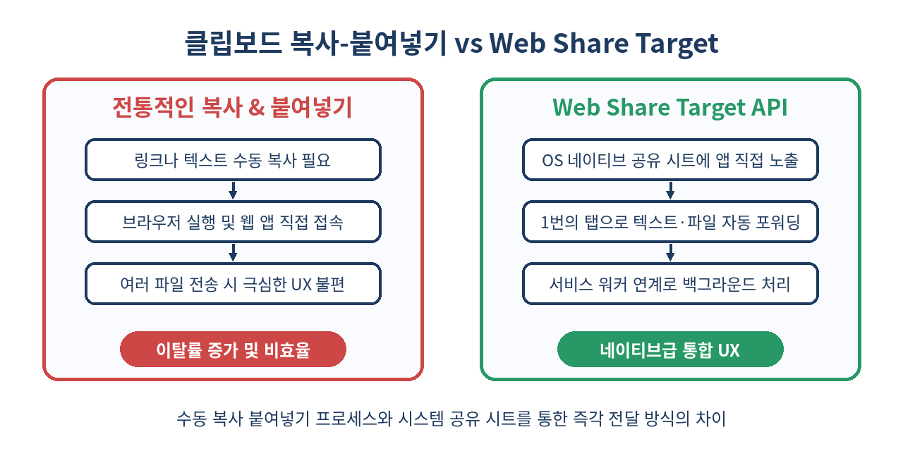
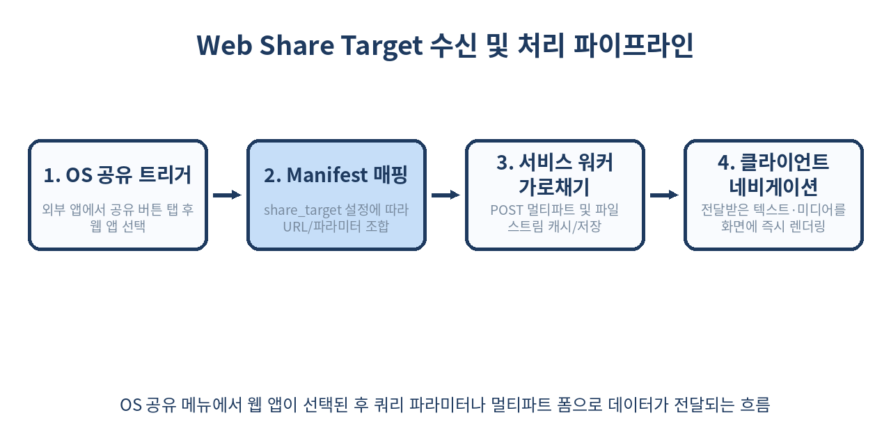

# 📲 Web Share Target API 완벽 가이드: 네이티브 공유 시트에 웹 앱 등록하기

> 다른 앱에서 사진, 링크, 텍스트를 내 웹 애플리케이션으로 바로 보낼 수 있다면 어떨까요?
> Web Share Target API를 통해 PWA를 모바일 OS의 일등 시민(First-class citizen)으로 만드는 방법을 깊이 있게 살펴봅니다.

---

## 📌 목차
1. [Web Share API와 Web Share Target API의 결정적 차이](#-1-web-share-api와-web-share-target-api의-결정적-차이)
2. [Web Share Target 동작 원리](#-2-web-share-target-동작-원리)
3. [기본 설정: Web App Manifest 작성법](#-3-기본-설정-web-app-manifest-작성법)
4. [GET 요청을 통한 텍스트 및 URL 공유 수신](#-4-get-요청을-통한-텍스트-및-url-공유-수신)
5. [POST 요청과 멀티파트(FormData) 파일 공유 수신](#-5-post-요청과-멀티파트formdata-파일-공유-수신)
6. [서비스 워커(Service Worker)와 연계한 대용량 파일 가로채기](#-6-서비스-워커service-worker와-연계한-대용량-파일-가로채기)
7. [다중 파일 및 특정 MIME 타입 필터링 전략](#-7-다중-파일-및-특정-mime-타입-필터링-전략)
8. [보안 요구사항과 PWA 설치 조건](#-8-보안-요구사항과-pwa-설치-조건)
9. [플랫폼 지원 현황과 브라우저별 차이점](#-9-플랫폼-지원-현황과-브라우저별-차이점)
10. [실무 함정 및 에지 케이스 핸들링](#-10-실무-함정-및-에지-케이스-핸들링)
11. [쓰면 안 되는 상황과 대안 설계](#-11-쓰면-안-되는-상황과-대안-설계)
12. [프로덕션 아키텍처 구현 예제](#-12-프로덕션-아키텍처-구현-예제)
13. [정리](#-13-정리)
14. [참고 자료](#-14-참고-자료)

---

## 🧭 1. Web Share API와 Web Share Target API의 결정적 차이

웹 생태계에서 '공유'라는 키워드는 크게 두 가지 방향성을 가집니다. 첫째는 **내 웹 페이지가 브라우저 외부의 다른 앱으로 데이터를 내보내는 것**이고, 둘째는 **외부의 다른 앱에서 전송한 데이터를 내 웹 페이지가 받아들이는 것**입니다.

많은 개발자가 `navigator.share()`를 사용하는 **Web Share API**에는 익숙합니다. 웹 페이지 내에 '공유하기' 버튼을 두고 시스템 네이티브 공유 팝업을 띄우는 기능입니다. 그러나 그 역방향인 **Web Share Target API**는 상대적으로 덜 알려져 있습니다.

| 구분 | Web Share API (`navigator.share`) | Web Share Target API | 
|---|---|---|
| **방향성** | Outbound (웹 앱 → 외부 앱) | Inbound (외부 앱 → 웹 앱) |
| **선언 위치** | 자바스크립트 메서드 호출 | Web App Manifest JSON 선언 |
| **트리거 시점** | 사용자가 웹 내부의 공유 UI 클릭 | 사용자가 OS 공유 시트에서 웹 앱 아이콘 선택 |
| **필수 조건** | User Activation (버튼 클릭 등) | PWA 설치 완료 (Installed PWA) |
| **데이터 전달 방식** | OS API에 JSON 객체 전달 | HTTP GET 쿼리 스트링 또는 POST 폼 전송 |

Web Share Target API를 등록하면 사용자가 갤러리 앱에서 사진을 보거나, 트위터(X)나 유튜브에서 링크를 공유할 때 나타나는 **OS 기본 공유 창(Share Sheet)**에 여러분의 웹 앱이 설치형 네이티브 앱들과 나란히 등록됩니다.



---

## ⚙️ 2. Web Share Target 동작 원리

Web Share Target의 핵심 아이디어는 **"웹 표준 폼(HTML Form)의 제출 메커니즘을 시스템 OS 수준으로 확장한 것"**입니다.

브라우저는 PWA가 설치될 때 매니페스트에 선언된 `share_target` 명세를 읽어 운영체제(Android, ChromeOS, Windows 등)의 인텐트(Intent) 시스템에 웹 앱을 공유 대상 수신자로 등록합니다. 외부 앱에서 공유 이벤트가 발생하면 다음과 같은 순서로 파이프라인이 실행됩니다.



1. 사용자가 타사 앱(예: 인스타그램, 브라우저, 사진첩)에서 '공유'를 누릅니다.
2. OS 공유 시트에 PWA의 이름과 아이콘이 노출됩니다.
3. 사용자가 웹 앱을 선택하면, 브라우저가 깨어나 매니페스트에 지정된 `action` URL로 라우팅을 시작합니다.
4. 이때 전송 방식(`method`)에 따라 GET이면 URL 쿼리 파라미터로, POST면 HTTP 요청 바디(FormData) 형태로 데이터가 전달됩니다.
5. 서비스 워커(Service Worker)가 이 요청을 가로채거나, 백엔드 서버가 이를 받아 처리할 수 있습니다.

---

## 📝 3. 기본 설정: Web App Manifest 작성법

Web Share Target을 사용하려면 `manifest.json`(또는 `manifest.webmanifest`)에 `share_target` 객체를 정의해야 합니다.

```json
{
  "name": "Logic Phantom Collector",
  "short_name": "LP Collector",
  "start_url": "/",
  "display": "standalone",
  "icons": [
    {
      "src": "/icons/icon-192.png",
      "sizes": "192x192",
      "type": "image/png"
    },
    {
      "src": "/icons/icon-512.png",
      "sizes": "512x512",
      "type": "image/png"
    }
  ],
  "share_target": {
    "action": "/share-target",
    "method": "GET",
    "params": {
      "title": "shared_title",
      "text": "shared_text",
      "url": "shared_url"
    }
  }
}
```

### 주요 프로퍼티 설명
- `action`: 공유된 데이터를 처리할 엔드포인트 URL입니다.
- `method`: `GET` 또는 `POST`를 지정합니다. 텍스트 위주는 GET으로 충분하지만 파일 전송은 반드시 POST여야 합니다.
- `enctype`: 기본값은 `application/x-www-form-urlencoded`이며, 파일을 다룰 때는 `multipart/form-data`로 지정해야 합니다.
- `params`: 외부 앱이 넘겨준 메타데이터 키를 내 웹 앱에서 사용할 파라미터 이름으로 매핑합니다.

---

## 🔗 4. GET 요청을 통한 텍스트 및 URL 공유 수신

링크 스크랩 앱, 북마크 도구, 메모 앱 등 단순 텍스트나 URL을 수신하는 서비스는 GET 방식을 사용합니다.

외부 앱에서 다음과 같은 데이터를 공유했다고 가정해 보겠습니다.
- Title: `"놀라운 오픈소스 프로젝트"`
- URL: `"https://github.com/example/repo"`

매니페스트 설정에 따라 브라우저는 아래와 같은 URL로 웹 앱을 엽니다.
```text
https://example.com/share-target?shared_title=놀라운%20오픈소스%20프로젝트&shared_url=https%3A%2F%2Fgithub.com%2Fexample%2Frepo
```

### 프론트엔드 라우트 컴포넌트 처리 코드
클라이언트 페이지에서는 `URLSearchParams`를 통해 즉시 데이터를 추출할 수 있습니다.

```javascript
// /pages/share-target.js 혹은 진입 컴포넌트
window.addEventListener('DOMContentLoaded', () => {
  const parsedUrl = new URL(window.location.href);
  
  const title = parsedUrl.searchParams.get('shared_title');
  const text = parsedUrl.searchParams.get('shared_text');
  const sharedUrl = parsedUrl.searchParams.get('shared_url');

  if (title || text || sharedUrl) {
    console.log('공유된 데이터 수신 성공:', { title, text, sharedUrl });
    
    // 인풋 폼에 자동 입력하거나 북마크 저장 팝업 오픈
    populateShareForm({ title, text, url: sharedUrl });
    
    // 중요: URL 정리를 통해 새로고침 시 중복 처리 방지
    window.history.replaceState({}, document.title, '/share-target');
  }
});

function populateShareForm({ title, text, url }) {
  const input = document.querySelector('#note-input');
  input.value = [title, text, url].filter(Boolean).join('\n');
}
```

> 💡 **주의**: 브라우저나 공유를 보낸 앱에 따라 URL이 `shared_url` 파라미터가 아니라 `shared_text` 내부에 포함되어 전달되는 경우가 빈번합니다. 정규표현식(`/(https?:\/\/[^\s]+)/g`)으로 `text` 안의 링크를 추가 파싱하는 방어 코드가 필수적입니다.

---

## 📁 5. POST 요청과 멀티파트(FormData) 파일 공유 수신

이미지, PDF, 동영상과 같은 바이너리 파일을 수신하려면 `POST` 방식과 `multipart/form-data` 인코딩을 사용해야 합니다. 이를 **Web Share Target Level 2**라고 부릅니다.

### Manifest 선언 (Level 2)

```json
{
  "share_target": {
    "action": "/handle-share",
    "method": "POST",
    "enctype": "multipart/form-data",
    "params": {
      "title": "name",
      "text": "description",
      "files": [
        {
          "name": "media",
          "accept": ["image/*", "application/pdf"]
        }
      ]
    }
  }
}
```

- `files`: 배열 형태로 수신할 파일 필드를 정의합니다.
- `name`: `FormData`에서 사용될 필드명입니다.
- `accept`: 허용할 MIME 타입 혹은 확장자 패턴(예: `image/png`, `.csv`)의 배열입니다.

POST 방식으로 전송될 경우, 서버 엔드포인트로 실제 HTTP 요청이 날아갈 수도 있지만, 오프라인 지원이나 로컬 퍼스트 앱을 지향한다면 **반드시 서비스 워커에서 이 요청을 가로채야 합니다.**

---

## ⚡ 6. 서비스 워커(Service Worker)와 연계한 대용량 파일 가로채기

POST 방식으로 전달된 파일은 서비스 워커의 `fetch` 이벤트 리스너를 통해 백엔드 서버를 거치지 않고 순수 클라이언트 로컬에서 완벽하게 처리할 수 있습니다.

### 서비스 워커 구현 (`sw.js`)

```javascript
self.addEventListener('fetch', (event) => {
  const url = new URL(event.request.url);

  // 매니페스트에 지정한 action URL과 POST 메서드 검사
  if (url.pathname === '/handle-share' && event.request.method === 'POST') {
    event.respondWith(handleSharedPayload(event.request));
  }
});

async function handleSharedPayload(request) {
  const formData = await request.formData();
  const title = formData.get('name');
  const description = formData.get('description');
  const files = formData.getAll('media'); // 'files[0].name'과 일치

  // 대용량 파일은 브라우저 Cache Storage나 IndexedDB에 임시 보관
  const cache = await caches.open('shared-media-cache');
  
  // 각 파일을 캐시에 저장
  for (let i = 0; i < files.length; i++) {
    const file = files[i];
    const cacheKey = `/temp-shared/${Date.now()}_${i}_${encodeURIComponent(file.name)}`;
    await cache.put(cacheKey, new Response(file, {
      headers: {
        'content-type': file.type,
        'x-file-name': encodeURIComponent(file.name)
      }
    }));
  }

  // 사용자가 볼 뷰 페이지로 303 Redirect 실행
  return Response.redirect('/gallery?shared=true', 303);
}
```

### 렌더링 클라이언트 페이지 (`gallery.js`)

```javascript
// /gallery 페이지 로드 시 캐시에서 파일 복원
window.addEventListener('DOMContentLoaded', async () => {
  const params = new URLSearchParams(window.location.search);
  if (params.get('shared') === 'true') {
    const cache = await caches.open('shared-media-cache');
    const requests = await cache.keys();

    for (const request of requests) {
      if (request.url.includes('/temp-shared/')) {
        const response = await cache.match(request);
        const blob = await response.blob();
        const filename = decodeURIComponent(response.headers.get('x-file-name'));
        
        renderPreview(blob, filename);
        
        // 처리 완료 후 임시 캐시 삭제
        await cache.delete(request);
      }
    }
    
    // 쿼리 스트링 청소
    window.history.replaceState({}, document.title, '/gallery');
  }
});

function renderPreview(blob, name) {
  const img = document.createElement('img');
  img.src = URL.createObjectURL(blob);
  img.alt = name;
  document.querySelector('#container').appendChild(img);
}
```

> ⚠️ **HTTP 303 See Other 리다이렉트의 중요성**: 브라우저 표준에 따라 POST 요청에 대한 `Response.redirect`는 반드시 `303` 상태 코드를 사용해야 합니다. 301, 302를 쓰면 페이지 이동 시 브라우저가 이동 대상 페이지에도 POST 요청을 시도하여 405 Method Not Allowed 에러가 발생할 수 있습니다.

---

## 🗂️ 7. 다중 파일 및 특정 MIME 타입 필터링 전략

운영체제는 매니페스트에 등록된 `accept` 필드를 기반으로 어떤 앱을 공유 시트에 띄울지 엄격하게 결정합니다.

### 복합 미디어 수신 구성

```json
{
  "share_target": {
    "action": "/import-assets",
    "method": "POST",
    "enctype": "multipart/form-data",
    "params": {
      "files": [
        {
          "name": "images",
          "accept": ["image/jpeg", "image/png", "image/webp", "image/svg+xml"]
        },
        {
          "name": "documents",
          "accept": [".pdf", ".md", "text/plain", "application/json"]
        }
      ]
    }
  }
}
```

### 필터링 가이드라인
1. **와일드카드 타입 사용 주의**: `image/*`는 직관적이지만 플랫폼에 따라 SVG나 WebP가 누락될 수 있으므로 자주 쓰이는 구체적인 MIME 타입을 함께 명시하는 것이 안전합니다.
2. **확장자 점(`.`) 표기**: 파일 확장자를 쓸 때는 반드시 `.pdf`, `.csv`처럼 점을 접두사로 포함해야 합니다.
3. **OS별 제한 수량**: Android는 다중 파일 공유를 완벽하게 지원하지만, 구형 기기에서는 한 번에 수십 장 이상의 고화질 이미지를 전달할 때 브라우저 힙 메모리 부족으로 프로세스가 크래시될 수 있습니다. 대용량 작업 시 배치 처리가 권장됩니다.

---

## 🛡️ 8. 보안 요구사항과 PWA 설치 조건

Web Share Target API는 아무 웹사이트나 악용할 수 없도록 엄격한 보안 샌드박스 정책을 적용받습니다.

1. **HTTPS 필수**: 당연하게도 전체 통신과 Service Worker는 보안 컨텍스트(`https://` 또는 로컬호스트)에서만 동작합니다.
2. **설치 완료 상태(Installed PWA)**: 단순 북마크나 브라우저 탭으로 열려 있는 웹사이트는 시스템 공유 창에 절대 노출되지 않습니다. 사용자가 브라우저 메뉴의 **"홈 화면에 추가"** 또는 **"앱 설치"**를 완료해야만 시스템 인텐트 레지스트리에 등록됩니다.
3. **단일 오리진 제약**: `action` 경로는 매니페스트가 호스팅된 오리진(Origin)과 동일해야 합니다. 타사 도메인으로의 direct 포워딩은 금지됩니다.
4. **신뢰할 수 없는 데이터 취급**: 외부 앱에서 전달된 `title`, `text`, 파일 이름은 악의적인 스크립트나 XSS 코드가 포함되어 있을 가능성이 높습니다. DOM에 직접 `innerHTML`로 바인딩하지 말고 적절한 새니타이징(Sanitization)을 거쳐야 합니다.

---

## 🌐 9. 플랫폼 지원 현황과 브라우저별 차이점

플랫폼마다 지원 수준이 크게 다릅니다. 현재 실무 기준 브라우저 매트릭스는 다음과 같습니다.

| OS / 브라우저 | 텍스트/링크 수신 (Level 1) | 파일 수신 (Level 2) | 비고 |
|---|---|---|---|
| **Android (Chrome)** | ✅ 완벽 지원 | ✅ 완벽 지원 | 가장 표준적이고 안정적인 동작 |
| **Android (Samsung Internet)** | ✅ 완벽 지원 | ✅ 완벽 지원 | 크로미움 기반으로 동일 동작 |
| **ChromeOS** | ✅ 완벽 지원 | ✅ 완벽 지원 | 시스템 셸과 완벽 통합 |
| **Windows (Edge / Chrome)** | ✅ 지원 | ✅ 지원 | Windows 10/11 시스템 공유 시트 연동 |
| **macOS (Chrome / Edge)** | ⚠️ 부분 지원 | ⚠️ 부분 지원 | macOS 공유 확장의 제한적 지원 |
| **iOS / iPadOS (Safari)** | ❌ 미지원 | ❌ 미지원 | 2026년 기준 WebKit 미구현 상태 |

> 📌 **iOS의 한계와 대안**: Safari는 PWA의 Web Share Target을 지원하지 않습니다. 따라서 iOS 사용자를 위해서는 여전히 클립보드 복사 안내 모달이나, 시스템 '단축어(Shortcuts)' 앱을 활용해 웹훅(Webhook) URL로 데이터를 쏘아주는 우회 방식을 안내해야 합니다.

---

## ⚠️ 10. 실무 함정 및 에지 케이스 핸들링

### 1. 이미 앱이 열려 있는 상태에서의 인스턴스 충돌
이미 PWA가 포그라운드나 백그라운드에서 실행 중일 때 사용자가 공유 시트에서 앱을 선택하면 브라우저는 어떻게 행동할까요?
- 기본적으로 브라우저는 새 윈도우나 탭을 열려고 시도합니다.
- `launch_handler` 명세를 설정하여 기존 윈도우로 포커스를 집중시키고 이벤트를 라우팅해야 UX가 매끄럽습니다.

```json
{
  "launch_handler": {
    "client_mode": "focus-existing"
  }
}
```

### 2. URL 인코딩 및 길이 한계 문제
일부 서드파티 앱은 URL이나 본문에 수 킬로바이트에 달하는 추적 쿼리를 달아 공유합니다. GET 방식을 사용할 경우 브라우저나 서버의 URL 길이 제한(보통 2,048자 또는 8,192자)에 걸려 `414 URI Too Long` 에러가 발생할 수 있습니다. 텍스트 수신량이 클 것으로 예상되는 앱은 GET 대신 POST 방식을 사용하는 것이 안전합니다.

### 3. Service Worker 미기동 상태での 대기 시간
PWA가 한동안 쓰이지 않아 서비스 워커가 유휴(Idle) 상태로 종료되었을 때 공유 요청이 들어오면, 워커의 부팅 지연(Cold Start)으로 인해 폼 파싱이 일시적으로 지연될 수 있습니다. `event.waitUntil`을 사용해 데이터 처리가 완료될 때까지 워커의 수명을 명시적으로 연장해야 합니다.

---

## 🚫 11. 쓰면 안 되는 상황과 대안 설계

Web Share Target API가 만능은 아닙니다. 다음과 같은 시나리오에서는 이 API를 단독 주력으로 삼아서는 안 됩니다.

1. **iOS 사용자 비중이 70% 이상인 서비스**
   - 앞서 언급했듯 iOS/Safari는 이 API를 지원하지 않습니다. Web Share Target에만 의존하는 UX 플로우를 기획하면 대다수 iOS 사용자는 기능을 인지조차 할 수 없습니다.
   - **대안**: 인앱 QR 코드 스캔, 복사된 클립보드 감지(`navigator.clipboard.readText`), 백엔드 동기화 단축 링크 제공.

2. **초대용량 기가바이트(GB) 단위 미디어 전송**
   - 수백 MB~GB 단위의 비디오 파일을 공유 시트를 통해 웹으로 전달할 경우, 브라우저 프로세스 간 IPC 메모리 복사 과정에서 OOM(Out of Memory) 충돌이 날 확률이 매우 높습니다.
   - **대안**: 앱 내부의 직접 청크 업로드(Chunked Upload) 또는 File System Access API 사용.

3. **엄격한 실시간 양방향 핸드셰이크가 필요한 경우**
   - 공유 시트는 일방적인 '던지기(Fire-and-forget)' 모델입니다. 전송한 앱에게 "데이터가 성공적으로 DB에 기록되었음"을 시스템 차원에서 응답해줄 방법이 없습니다.

---

## 🛠️ 12. 프로덕션 아키텍처 구현 예제

완성도 높은 아키텍처를 위해 프론트엔드와 서비스 워커 간의 통신을 `BroadcastChannel`과 연계한 구조를 구축합니다.

```text
[ 외부 앱 (OS 공유 시트) ]
          │
          ▼ POST multipart/form-data
[ Service Worker (sw.js) ]
  ├── Cache Storage에 Blob 저장
  ├── BroadcastChannel('share-bus')로 메시지 브로드캐스트
  └── 303 Redirect to /app
          │
          ▼
[ Client Page (/app) ]
  ├── 브로드캐스트 수신 시 인메모리 UI 갱신
  └── 직접 열렸을 경우 URL 파라미터 확인 후 캐시 소각
```

### 서비스 워커 코드
```javascript
// sw.js
const broadcast = new BroadcastChannel('lp_share_channel');

self.addEventListener('fetch', (event) => {
  const url = new URL(event.request.url);
  
  if (url.pathname === '/share-receive' && event.request.method === 'POST') {
    event.respondWith((async () => {
      const formData = await event.request.formData();
      const file = formData.get('file_payload');
      const text = formData.get('text_payload') || '';
      const shareId = crypto.randomUUID();

      if (file) {
        const cache = await caches.open('share-cache-v1');
        await cache.put(`/shares/${shareId}`, new Response(file, {
          headers: { 'Content-Type': file.type }
        }));
      }

      // 활성화된 클라이언트가 있다면 즉시 알림
      broadcast.postMessage({
        type: 'SHARE_RECEIVED',
        shareId,
        hasFile: Boolean(file),
        text
      });

      return Response.redirect(`/app?shared_id=${shareId}`, 303);
    })());
  }
});
```

### 클라이언트 수신 코드
```javascript
// app.js
const broadcast = new BroadcastChannel('lp_share_channel');

broadcast.onmessage = async (event) => {
  if (event.data?.type === 'SHARE_RECEIVED') {
    const { shareId, hasFile, text } = event.data;
    showToast('새로운 공유 데이터를 수신했습니다.');
    await processIncomingShare(shareId, hasFile, text);
  }
};

async function processIncomingShare(shareId, hasFile, text) {
  if (hasFile) {
    const cache = await caches.open('share-cache-v1');
    const res = await cache.match(`/shares/${shareId}`);
    if (res) {
      const blob = await res.blob();
      displaySharedImage(blob);
      await cache.delete(`/shares/${shareId}`);
    }
  }
  if (text) {
    displaySharedText(text);
  }
}
```

이와 같이 구성하면 PWA가 이미 켜져 있든, 새로 시작되든 누락 없이 매끄럽게 데이터를 인입받을 수 있습니다.

---

## 🧾 13. 정리

- **Web Share Target API**는 웹 애플리케이션을 모바일 및 데스크톱 OS의 네이티브 공유 시트에 정식 수신자로 등록해 주는 표준 PWA 명세입니다.
- 단순 링크나 텍스트 수집은 **GET 방식**의 매니페스트 설정과 `URLSearchParams`를 통해 즉시 구현할 수 있습니다.
- 이미지, PDF 등 바이너리 파일은 **POST 방식(Level 2)**과 **Service Worker의 Fetch 가로채기**를 결합하여 백엔드 부하 없이 클라이언트 단독으로 고속 처리가 가능합니다.
- POST 리다이렉션 시에는 브라우저 규약에 따라 반드시 **`303 See Other`** 응답을 반환해야 라우팅 에러를 방지할 수 있습니다.
- 2026년 기준 Android, Windows, ChromeOS에서는 완벽히 동작하지만, iOS WebKit의 미지원 상태를 감안한 점진적 향상(Progressive Enhancement) 전략이 필수적입니다.

> ✨ **한 줄 요약**
> PWA를 OS 공유 창에 등록하여 웹과 네이티브의 경계를 허무는 핵심 퍼즐 조각.

---

## 📚 참고 자료
- [W3C Web Share Target API Specification](https://w3c.github.io/web-share-target/)
- [MDN Web Docs: Web Share Target API](https://developer.mozilla.org/en-US/docs/Web/Manifest/share_target)
- [web.dev: Receiving shared data with the Web Share Target API](https://web.dev/articles/web-share-target)
- [web.dev: Receiving shared files with the Web Share Target Level 2](https://web.dev/articles/workbox-share-targets)
