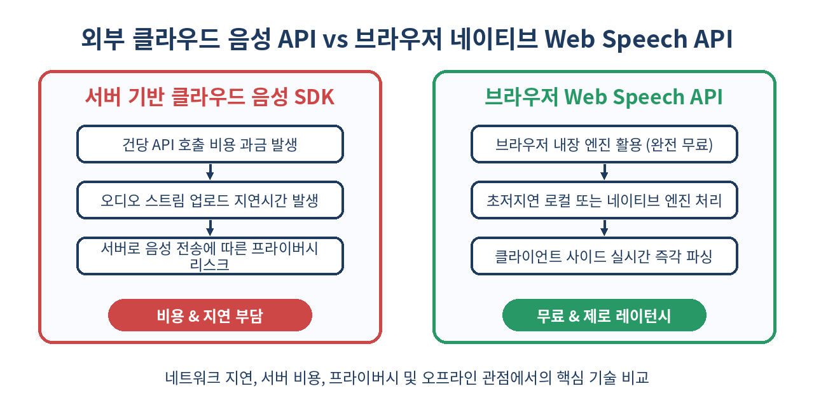
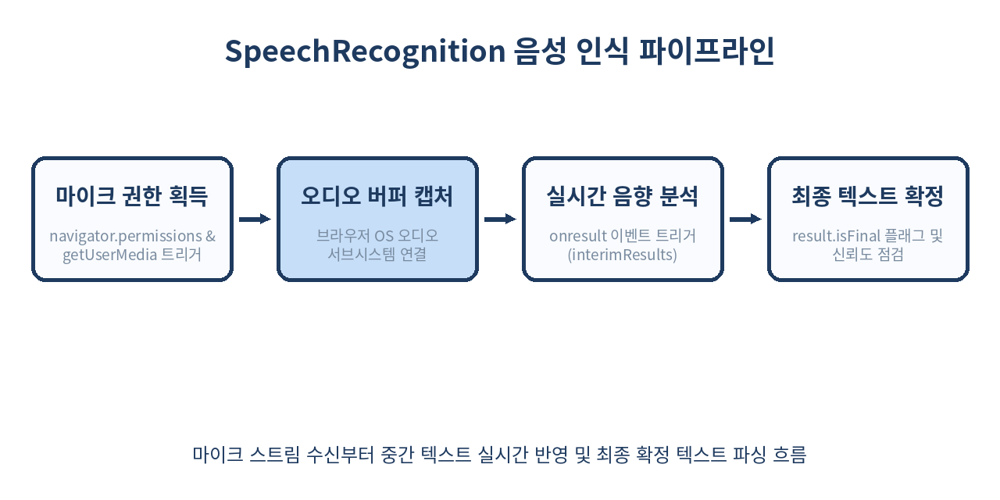

# 🎙️ Web Speech API 완벽 가이드: 외부 SDK 없는 브라우저 네이티브 실시간 음성 인식(STT)과 음성 합성(TTS)

> Google Cloud Speech, AWS Polly, OpenAI Whisper 같은 고비용 클라우드 API 없이도, 브라우저만으로 실시간 음성 인식(STT)과 자연스러운 음성 합성(TTS)을 무료로 구현할 수 있습니다.
> 사용자 발화를 실시간 텍스트로 전환하고 기기의 네이티브 보이스로 대답하는 음성 대화형 웹 인터페이스 구축의 모든 것을 다룹니다.

---

## 📌 목차
1. 🧭 Web Speech API란 무엇인가?
2. ⚖️ 클라우드 음성 서비스 vs 브라우저 네이티브 Web Speech API
3. 🗣️ SpeechSynthesis: 브라우저가 말하게 만드는 음성 합성(TTS) 기초
4. 🎛️ 음성 합성 제어: 목소리(Voice) 탐색, 피치, 속도, 볼륨 조절
5. 🎙️ SpeechRecognition: 마이크 입력으로 텍스트를 추출하는 음성 인식(STT)
6. ⚡ Interim Results: 타이핑하듯 실시간으로 텍스트를 출력하는 스트리밍 기법
7. 🌐 다국어 지원: 언어 코드 설정과 다국어 음성 인식/합성 전략
8. 🔄 양방향 음성 인터페이스(VUI): 에코 캔슬레이션과 루프 방지 아키텍처
9. 🛡️ 보안, 권한 모델 및 브라우저 제약 사항
10. ⚠️ 실무 함정: 크로스 브라우저 파편화와 모바일 백그라운드 끊김
11. 🚫 Web Speech API를 쓰면 안 되는 경우
12. 🧾 정리: 핵심 요약과 베스트 프랙티스
13. 📚 참고 자료

---

## 🧭 1. Web Speech API란 무엇인가?

현대 웹 애플리케이션은 텍스트와 시각적 요소를 넘어 청각적 인터랙션을 빠르게 수용하고 있습니다. 내비게이션, 핸즈프리 조리 레시피 뷰어, 언어 학습 서비스, AI 챗봇의 음성 인터페이스에 이르기까지 음성 입출력의 수요는 폭발적으로 증가했습니다.

과거 웹에서 음성을 다루려면 마이크 권한을 받아 오디오 스트림(`MediaRecorder`)을 캡처한 뒤, 이를 서버나 클라우드 음성 API(Google Cloud Speech, Amazon Transcribe, Whisper 등)로 웹소켓 스트리밍하거나 업로드해야 했습니다. 반대로 텍스트를 음성으로 바꿀 때도 서버에서 MP3/WAV 오디오 파일을 생성하여 클라이언트로 내려받아야 했습니다. 이는 **비용, 네트워크 지연, 서버 인프라 관리**라는 막대한 부담을 수반합니다.

W3C의 **Web Speech API**는 이 문제를 브라우저 단에서 완전히 해결하기 위해 설계된 표준 규격입니다. Web Speech API는 크게 두 개의 독립적인 인터페이스로 나뉩니다:

1. **SpeechSynthesis (음성 합성 - TTS)**: 브라우저와 OS에 내장된 음성 합성 엔진을 제어하여 텍스트를 인간의 음성으로 즉시 낭독합니다.
2. **SpeechRecognition (음성 인식 - STT)**: 사용자의 마이크 입력을 실시간으로 분석하여 텍스트 문자열과 신뢰도(Confidence) 점수로 변환합니다.

```javascript
// SpeechSynthesis (TTS) 지원 확인
const isTTSSupported = 'speechSynthesis' in window;

// SpeechRecognition (STT) 지원 확인 (웹킷 벤더 프리픽스 대응)
const SpeechRecognition = window.SpeechRecognition || window.webkitSpeechRecognition;
const isSTTSupported = typeof SpeechRecognition !== 'undefined';

console.log(`TTS 지원 여부: ${isTTSSupported}, STT 지원 여부: ${isSTTSupported}`);
```

외부 라이브러리 용량(Bundle Size) 0바이트, 서버 유지비용 0원으로 즉시 프로덕션에 적용 가능한 네이티브 기능입니다.

---

## ⚖️ 2. 클라우드 음성 서비스 vs 브라우저 네이티브 Web Speech API

브라우저 네이티브 API와 클라우드 음성 SaaS 엔진의 장단점을 명확히 파악해야 올바른 아키텍처 결정을 내릴 수 있습니다.



| 비교 항목 | 브라우저 Web Speech API | 클라우드 API (Whisper, Google Cloud 등) |
| :--- | :--- | :--- |
| **비용** | **완전 무료** (무제한 호출 가능) | API 호출 건당/시간당 과금 ($0.006~$0.024/분) |
| **지연 시간 (Latency)** | **수십 ms 단위** (로컬 엔진 사용 시 거의 제로 지연) | 네트워크 왕복 및 트랜스코딩으로 300ms ~ 2s 지연 |
| **번들 크기** | **0 KB** (브라우저 내장) | 오디오 레코더, 웹소켓 클라이언트 등 수십~수백 KB |
| **오프라인 지원** | OS 로컬 음성 엔진 탑재 기기는 오프라인 동작 가능 | 인터넷 연결 필수 |
| **브라우저 호환성** | TTS는 전 브라우저 지원, STT는 Chromium 중심 | 브라우저 무관 동일 품질 보장 |
| **인식 정확도** | 일상 대화 우수, 전문 도메인 용어 파인튜닝 불가 | 커스텀 어휘 사전 및 특화 모델 튜닝 가능 |

단순 명령어 제어, 핸즈프리 인터랙션, 고객 지원 챗봇의 낭독 기능, 언어 학습 기본 기능에는 Web Speech API가 압도적으로 경제적이고 빠릅니다.

---

## 🗣️ 3. SpeechSynthesis: 브라우저가 말하게 만드는 음성 합성(TTS) 기초

음성 합성은 `window.speechSynthesis` 인스턴스와 `SpeechSynthesisUtterance` 객체를 중심으로 동작합니다. `Utterance`(발화)는 읽을 텍스트와 음성 파라미터를 담는 단위입니다.

가장 기초적인 낭독 코드는 세 줄이면 충분합니다:

```javascript
// 1. 발화할 문장 객체 생성
const utterance = new SpeechSynthesisUtterance('안녕하세요! Logic-Phantom 기술 블로그에 오신 것을 환영합니다.');

// 2. 한국어 언어 코드 지정
utterance.lang = 'ko-KR';

// 3. 낭독 시작
window.speechSynthesis.speak(utterance);
```

### 발화 생명주기 이벤트 핸들링
`SpeechSynthesisUtterance`는 발화 상태를 추적할 수 있는 풍부한 이벤트 인터페이스(`onstart`, `onend`, `onerror`, `onpause`, `onresume`, `onboundary`)를 제공합니다.

```javascript
const utterance = new SpeechSynthesisUtterance('텍스트를 한 단어씩 읽으면서 하이라이트할 수 있습니다.');
utterance.lang = 'ko-KR';

utterance.onstart = () => {
  console.log('낭독이 시작되었습니다.');
};

utterance.onboundary = (event) => {
  // 단어(word) 또는 문장(sentence) 경계 도달 시 트리거
  console.log(`현재 읽고 있는 단어 인덱스: ${event.charIndex}, 길이: ${event.charLength}`);
};

utterance.onend = () => {
  console.log('낭독이 성공적으로 끝났습니다.');
};

utterance.onerror = (event) => {
  console.error('음성 합성 중 오류 발생:', event.error);
};

window.speechSynthesis.speak(utterance);
```

`onboundary` 이벤트를 활용하면 노래방 가사나 오디오북처럼 현재 재생 중인 단어를 화면에서 실시간으로 시각 하이라이트할 수 있습니다.

---

## 🎛️ 4. 음성 합성 제어: 목소리(Voice) 탐색, 피치, 속도, 볼륨 조절

`speechSynthesis`는 운영체제(macOS, Windows, Android, iOS)와 브라우저에 설치된 다양한 음성(Voice) 목록을 열거할 수 있습니다.

### 사용 가능한 보이스 목록 로드
음성 목록은 비동기적으로 로드되므로 반드시 `onvoiceschanged` 이벤트를 구독해야 빈 배열이 반환되는 버그를 방지할 수 있습니다.

```javascript
function loadVoices() {
  return new Promise((resolve) => {
    let voices = window.speechSynthesis.getVoices();
    if (voices.length > 0) {
      resolve(voices);
      return;
    }
    
    // 브라우저가 음성 팩을 로드할 때까지 대기
    window.speechSynthesis.onvoiceschanged = () => {
      voices = window.speechSynthesis.getVoices();
      resolve(voices);
    };
  });
}

async function setupVoiceSelector() {
  const voices = await loadVoices();
  console.log(`사용 가능한 전체 음성 수: ${voices.length}`);
  
  // 한국어 음성 필터링
  const koreanVoices = voices.filter(v => v.lang.startsWith('ko'));
  koreanVoices.forEach(v => {
    console.log(`이름: ${v.name} | 로컬 엔진 여부: ${v.localService} | 기본값: ${v.default}`);
  });
  
  return koreanVoices[0] || voices[0];
}
```

### 정밀 파라미터 조작

`SpeechSynthesisUtterance`는 음조, 속도, 음량을 미세 조정할 수 있는 프로퍼티를 제공합니다.

```javascript
async function speakCustomMessage(text) {
  const selectedVoice = await setupVoiceSelector();
  const utterance = new SpeechSynthesisUtterance(text);
  
  utterance.voice = selectedVoice;
  utterance.rate = 1.15;  // 속도 (0.1 ~ 10, 기본값: 1.0)
  utterance.pitch = 1.05; // 피치/음조 (0 ~ 2, 기본값: 1.0)
  utterance.volume = 0.9; // 볼륨 (0 ~ 1, 기본값: 1.0)
  
  // 이전 발화가 남아있다면 취소하고 즉시 새 발화 재생
  if (window.speechSynthesis.speaking) {
    window.speechSynthesis.cancel();
  }
  
  window.speechSynthesis.speak(utterance);
}
```

| 프로퍼티 | 유효 범위 | 기본값 | 설명 |
| :--- | :--- | :--- | :--- |
| `rate` | `0.1` ~ `10.0` | `1.0` | 말하기 속도. 실무에서는 `0.8` ~ `1.5` 사이 권장 |
| `pitch` | `0.0` ~ `2.0` | `1.0` | 목소리 높낮이. 높을수록 고음(어린아이/애니메이션 톤) |
| `volume` | `0.0` ~ `1.0` | `1.0` | 오디오 출력 음량 |
| `voice` | `SpeechSynthesisVoice` | `null` | 적용할 특정 음성 엔진 객체 |

---

## 🎙️ 5. SpeechRecognition: 마이크 입력으로 텍스트를 추출하는 음성 인식(STT)

음성 인식은 사용자가 말하는 자연어를 브라우저가 분석하여 텍스트로 치환합니다. Chrome, Edge, Safari 등 주요 브라우저는 웹킷 접두사(`webkitSpeechRecognition`)를 지원합니다.



### 기본 단발성 음성 인식 구현

```javascript
function startSingleRecognition() {
  const SpeechRecognition = window.SpeechRecognition || window.webkitSpeechRecognition;
  if (!SpeechRecognition) {
    alert('이 브라우저는 음성 인식을 지원하지 않습니다.');
    return;
  }

  const recognition = new SpeechRecognition();
  recognition.lang = 'ko-KR'; // 한국어 지정
  recognition.continuous = false; // 한 문장이 끝나면 자동 종료
  recognition.interimResults = false; // 최종 결과만 수신
  recognition.maxAlternatives = 1; // 가장 신뢰도 높은 결과 1개만 반환

  recognition.onstart = () => {
    console.log('마이크가 활성화되었습니다. 말씀을 시작하세요.');
  };

  recognition.onresult = (event) => {
    const transcript = event.results[0][0].transcript;
    const confidence = event.results[0][0].confidence;
    
    console.log(`인식된 문장: "${transcript}"`);
    console.log(`신뢰도(0~1): ${(confidence * 100).toFixed(1)}%`);
  };

  recognition.onerror = (event) => {
    console.error('인식 에러 발생:', event.error);
  };

  recognition.onend = () => {
    console.log('음성 인식이 종료되었습니다.');
  };

  recognition.start();
}
```

사용자가 마이크 사용을 허용하면 브라우저 상단에 마이크 탭 표시가 뜨며, 발화가 끝나고 침묵이 감지되면 자동으로 `onresult`와 `onend`가 차례로 발생합니다.

---

## ⚡ 6. Interim Results: 타이핑하듯 실시간으로 텍스트를 출력하는 스트리밍 기법

일반적인 단발성 인식은 문장이 완전히 끝날 때까지 화면에 아무것도 나타나지 않아 사용자가 답답함을 느낍니다. `recognition.interimResults = true` 옵션을 켜면 발화가 진행 중인 도중에도 추론 중인 중간 결과(Interim Results)를 실시간으로 받아 화면에 타이핑하듯 출력할 수 있습니다.

```javascript
class RealtimeSpeechTranscriber {
  constructor(onUpdate) {
    const SpeechRecognition = window.SpeechRecognition || window.webkitSpeechRecognition;
    this.recognition = new SpeechRecognition();
    this.recognition.lang = 'ko-KR';
    this.recognition.continuous = true; // 사용자가 멈출 때까지 계속 청취
    this.recognition.interimResults = true; // 중간 결과 수신 활성화
    
    this.finalTranscript = '';
    this.onUpdate = onUpdate;
    
    this.initEvents();
  }

  initEvents() {
    this.recognition.onresult = (event) => {
      let interimTranscript = '';

      for (let i = event.resultIndex; i < event.results.length; i++) {
        const result = event.results[i];
        const text = result[0].transcript;

        if (result.isFinal) {
          // 최종 확정된 텍스트 누적
          this.finalTranscript += text + ' ';
        } else {
          // 현재 실시간으로 분석 중인 미확정 텍스트
          interimTranscript += text;
        }
      }

      // 콜백으로 확정 텍스트와 중간 텍스트 분리 전달
      this.onUpdate({
        final: this.finalTranscript.trim(),
        interim: interimTranscript.trim()
      });
    };

    this.recognition.onerror = (e) => console.error('음성 인식 오류:', e.error);
  }

  start() {
    this.finalTranscript = '';
    this.recognition.start();
  }

  stop() {
    this.recognition.stop();
  }
}

// 사용 예시 (UI 렌더링)
const transcriber = new RealtimeSpeechTranscriber(({ final, interim }) => {
  const displayEl = document.getElementById('transcript-display');
  displayEl.innerHTML = `
    <span class="final-text">${final}</span> 
    <span class="interim-text" style="color: #888; font-style: italic;">${interim}</span>
  `;
});
```

이 스트리밍 기법은 받아쓰기 앱, 라이브 자막, AI 어시스턴트의 입력 피드백에 필수적입니다.

---

## 🌐 7. 다국어 지원: 언어 코드 설정과 다국어 음성 인식/합성 전략

Web Speech API는 BCP 47 언어 태그(예: `ko-KR`, `en-US`, `ja-JP`, `zh-CN`)를 표준으로 사용합니다.

### 언어 자동 매핑 전략
사용자의 브라우저 언어 환경 또는 UI 선택에 따라 인식과 합성을 동적으로 바인딩합니다.

```javascript
const SUPPORTED_LANGUAGES = {
  'ko': { code: 'ko-KR', voiceMatch: 'Korean' },
  'en': { code: 'en-US', voiceMatch: 'Google US English' },
  'ja': { code: 'ja-JP', voiceMatch: 'Japanese' }
};

function configureSpeechEngine(langKey) {
  const config = SUPPORTED_LANGUAGES[langKey] || SUPPORTED_LANGUAGES['en'];
  
  // 1. STT 언어 지정
  const recognition = new (window.SpeechRecognition || window.webkitSpeechRecognition)();
  recognition.lang = config.code;
  
  // 2. TTS 보이스 검색 및 지정
  const voices = window.speechSynthesis.getVoices();
  const matchedVoice = voices.find(v => v.lang.startsWith(langKey)) || voices[0];
  
  return {
    recognition,
    speak: (text) => {
      const utterance = new SpeechSynthesisUtterance(text);
      utterance.voice = matchedVoice;
      utterance.lang = config.code;
      window.speechSynthesis.speak(utterance);
    }
  };
}
```

사용자가 다국어로 말할 때 단일 `SpeechRecognition` 세션에서 여러 언어를 동시에 자동 감지(Auto-detect)하는 것은 현재 Web Speech API 명세상 지원되지 않으므로, UI 상에서 사용자가 발화 언어를 선택하도록 명시해야 오인식을 방지할 수 있습니다.

---

## 🔄 8. 양방향 음성 인터페이스(VUI): 에코 캔슬레이션과 루프 방지 아키텍처

AI 음성 비서처럼 **"사용자가 말함 → 음성 인식(STT) → 텍스트 답변 생성 → 브라우저가 음성 낭독(TTS)"** 구조를 만들 때 흔히 발생하는 치명적인 버그가 있습니다.

> **어쿠스틱 피드백 루프(Acoustic Feedback Loop)**:
> 브라우저가 스피커로 TTS 음성을 출력하는 순간, 켜져 있는 마이크가 그 소리를 다시 사용자의 음성으로 잘못 인식하여 자기 자신과 끝없이 대화하는 무한 루프에 빠집니다.

이를 해결하기 위한 상태 머신 기반 루프 차단 설계가 필수적입니다.

```javascript
class VoiceAssistantCoordinator {
  constructor() {
    const SpeechRecognition = window.SpeechRecognition || window.webkitSpeechRecognition;
    this.recognition = new SpeechRecognition();
    this.recognition.lang = 'ko-KR';
    
    this.isBotSpeaking = false;
    this.initCoordinator();
  }

  initCoordinator() {
    this.recognition.onresult = async (event) => {
      // 봇이 말하는 동안 들어온 마이크 입력은 강제 무시
      if (this.isBotSpeaking) return;
      
      const userQuery = event.results[0][0].transcript;
      console.log('사용자 입력:', userQuery);
      
      // 인식 즉시 마이크 잠정 중단
      this.recognition.abort();
      
      // AI 응답 생성 (예: LLM API 호출 모사)
      const botReply = await this.fetchBotReply(userQuery);
      
      // 봇 음성 출력
      this.speakReply(botReply);
    };
  }

  async fetchBotReply(query) {
    return `"${query}"에 대해 답변해 드리겠습니다.`;
  }

  speakReply(text) {
    const utterance = new SpeechSynthesisUtterance(text);
    utterance.lang = 'ko-KR';
    
    utterance.onstart = () => {
      this.isBotSpeaking = true;
      // 스피커 출력 중에는 마이크 확실히 정지
      try { this.recognition.abort(); } catch (e) {}
    };
    
    utterance.onend = () => {
      this.isBotSpeaking = false;
      // 발화 완료 후 약간의 딜레이(200ms 잔향 제거)를 두고 마이크 재청취 시작
      setTimeout(() => {
        try { this.recognition.start(); } catch (e) {}
      }, 200);
    };
    
    window.speechSynthesis.speak(utterance);
  }
}
```

이 상태 격리를 통해 스피커 출력과 마이크 입력 간의 충돌을 완벽히 차단할 수 있습니다.

---

## 🛡️ 9. 보안, 권한 모델 및 브라우저 제약 사항

Web Speech API는 사용자의 마이크 하드웨어에 접근하므로 엄격한 웹 보안 규칙이 적용됩니다.

### 1. 보안 컨텍스트(HTTPS) 필수
`localhost`를 제외한 모든 프로덕션 환경에서는 반드시 **HTTPS** 환경에서만 마이크 권한 요청 및 `SpeechRecognition` 실행이 허용됩니다. `http://`에서는 `not-allowed` 에러가 즉시 발생합니다.

### 2. 사용자 제스처(User Gesture) 필수 트리거
오디오 자동재생(Autoplay) 정책과 동일하게, 사용자의 명시적인 클릭이나 탭 인터랙션 없이 스크립트가 로드되자마자 `speechSynthesis.speak()`를 호출하면 차단되거나 무음 처리될 수 있습니다.

```javascript
document.getElementById('start-btn').addEventListener('click', () => {
  // 반드시 사용자 클릭 이벤트 핸들러 내부에서 최초 실행
  recognition.start();
});
```

### 3. Permission API를 통한 마이크 권한 상태 사전 점검

```javascript
async function checkMicrophonePermission() {
  try {
    const permissionStatus = await navigator.permissions.query({ name: 'microphone' });
    
    console.log(`마이크 권한 상태: ${permissionStatus.state}`); // 'granted' | 'denied' | 'prompt'
    
    permissionStatus.onchange = () => {
      console.log(`마이크 권한 변경됨: ${permissionStatus.state}`);
    };
  } catch (err) {
    console.warn('권한 쿼리 API 미지원 브라우저');
  }
}
```

---

## ⚠️ 10. 실무 함정: 크로스 브라우저 파편화와 모바일 백그라운드 끊김

실무 프로젝트에 Web Speech API를 도입할 때 반드시 마주치는 대표적인 3대 함정이 있습니다.

### 함정 1: Chrome의 SpeechSynthesis 15초 타임아웃 멈춤 버그
Chromium 기반 브라우저에는 긴 문장을 낭독할 때 약 15초가 지나면 음성이 예고 없이 뚝 끊기고 영원히 `onend` 이벤트가 발생하지 않는 오랜 버그가 존재합니다. 이를 해결하려면 주기적으로 `pause()`와 `resume()`을 호출하는 하트비트 핑을 주어야 합니다.

```javascript
function speakSafely(utterance) {
  let timer = null;
  
  utterance.onstart = () => {
    // 10초마다 브라우저 오디오 파이프라인 깨우기
    timer = setInterval(() => {
      if (window.speechSynthesis.speaking) {
        window.speechSynthesis.pause();
        window.speechSynthesis.resume();
      }
    }, 10000);
  };
  
  utterance.onend = utterance.onerror = () => {
    clearInterval(timer);
  };
  
  window.speechSynthesis.speak(utterance);
}
```

### 함정 2: 모바일 브라우저의 백그라운드 탭 차단
사용자가 모바일 웹 브라우저에서 홈 화면으로 나가거나 화면을 끄면 OS에 의해 마이크 입력이 강제 중단되며 `recognition.onerror`에 `not-allowed` 또는 `aborted`가 발생합니다. 음성 인식을 유지하려면 Screen Wake Lock API를 병행하여 화면 꺼짐을 방지하거나, 사용자가 탭을 벗어났을 때 정중히 인식을 일시중지해야 합니다.

### 함정 3: Chromium의 서버 전송 동작 방식
Chrome의 `SpeechRecognition`은 모든 음성을 온디바이스에서 처리하는 것이 아니라, 사용자의 음성 패킷을 Google의 음성 인식 서버(`*.google.com`)로 전송하여 결과를 반환받습니다. 따라서 인터넷 연결이 끊기면 `network` 에러가 발생할 수 있습니다. 반면 Safari나 일부 OS 네이티브 보이스는 온디바이스 엔진을 사용합니다.

---

## 🚫 11. Web Speech API를 쓰면 안 되는 경우

Web Speech API가 아무리 훌륭해도 모든 오디오 프로젝트의 만능 해결책은 아닙니다. 다음과 같은 요구사항이 있다면 전문 오디오 백엔드 솔루션을 도입해야 합니다.

| 상황 | 권장하지 않는 이유 | 대안 솔루션 |
| :--- | :--- | :--- |
| **Firefox 완벽 지원 필수** | Firefox는 데스크톱에서 `SpeechRecognition`이 기본 비활성화 상태임 | 백엔드 Whisper API 또는 WebAssembly 오디오 모델 |
| **오프라인 100% 보장 환경** | Chrome 등 일부 브라우저는 구글 서버 네트워크 통신 의존 | ONNX Runtime Web 기반 경량화 온디바이스 모델 |
| **의료·법률 전문 용어 인식** | 브라우저 내장 모델은 특화 도메인 어휘(Vocabulary) 커스터마이징 불가 | Custom Vocabulary 지원 클라우드 STT |
| **성우급 고음질 감정 표현 TTS** | 브라우저 TTS는 기계음 억양이 남아있어 감정 조절 불가 | ElevenLabs, OpenAI Audio TTS 등 고품질 뉴럴 보이스 |

반면 접근성 지원(화면 낭독), 키워드 기반 음성 컨트롤러, 사내 관리자 도구, 빠른 프로토타이핑에는 Web Speech API가 최고의 선택입니다.

---

## 🧾 12. 정리: 핵심 요약과 베스트 프랙티스

- **Web Speech API**는 외부 라이브러리 및 과금 없이 브라우저 네이티브로 실시간 음성 합성(TTS)과 음성 인식(STT)을 제공합니다.
- `speechSynthesis.getVoices()`는 비동기로 로드되므로 반드시 `onvoiceschanged` 이벤트를 대기해야 안전하게 음성을 선택할 수 있습니다.
- `SpeechRecognition`에서 `interimResults = true`를 활성화하면 사용자가 말하는 도중에도 스트리밍 타이핑 효과를 구현할 수 있습니다.
- 음성 인식과 합성을 결합한 양방향 대화 시스템에서는 스피커 음성이 마이크로 재유입되지 않도록 상태 머신 기반 에코 차단 로직이 필수입니다.
- 브라우저 정책상 HTTPS 보안 컨텍스트와 사용자의 명시적 제스처(클릭 이벤트) 하에서만 실행됩니다.

> ✨ **한 줄 요약**
> 복잡한 클라우드 API와 서버 비용 없이, 단 몇 줄의 Web Speech API 코드로 당신의 웹사이트에 귀와 입을 선물하세요.

---

## 📚 참고 자료
- [MDN Web Docs: Web Speech API](https://developer.mozilla.org/en-US/docs/Web/API/Web_Speech_API)
- [W3C Community Group: Web Speech API Specification](https://wicg.github.io/speech-api/)
- [MDN Web Docs: SpeechRecognition](https://developer.mozilla.org/en-US/docs/Web/API/SpeechRecognition)
- [MDN Web Docs: SpeechSynthesis](https://developer.mozilla.org/en-US/docs/Web/API/SpeechSynthesis)
