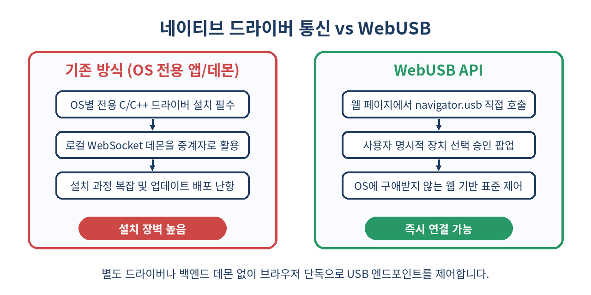
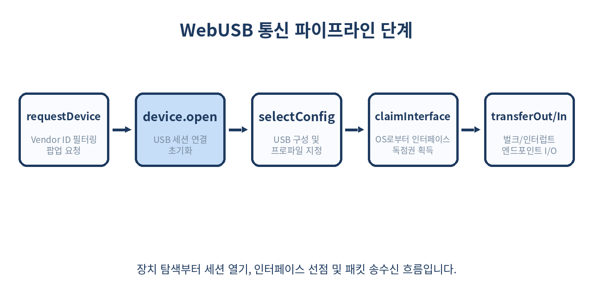

# 🔌 WebUSB API 완벽 가이드: 플러그인 없이 웹 브라우저에서 USB 하드웨어 직접 제어하기

> "하드웨어 제어를 위해 더 이상 전용 드라이버 인스톨러나 C++ 로컬 데몬을 배포할 필요가 없습니다."
> 브라우저 샌드박스 내부에서 안전하게 물리적 USB 장치와 직접 바이너리 패킷을 주고받는 WebUSB API의 원리부터 실무 프로덕션 구현, 보안 모델, 문제 해결까지 총정리합니다.

---

## 📌 목차
1. 🧭 WebUSB API의 등장 배경과 필요성
2. ⚙️ USB 아키텍처 기초: 엔드포인트, 인터페이스, 파이프
3. 🔒 브라우저 보안 모델과 사용자 권한 정책
4. 🔍 장치 검색과 페어링: requestDevice와 getDevices
5. 🚀 장치 초기화: open, selectConfiguration, claimInterface
6. 📦 데이터 송수신 메커니즘: Control, Bulk, Interrupt 전송
7. 🛠️ 아두이노/임베디드 하드웨어 제어 실전 예제
8. 🔄 장치 연결 상태 감지와 핫플러깅 대응
9. ⚖️ WebUSB vs Web Serial vs Web HID 상세 비교
10. ⚠️ 실무 함정과 엣지 케이스 (OS 드라이버 충돌 문제)
11. 🚫 WebUSB를 사용하면 안 되는 상황
12. 🧾 정리 및 핵심 요약
13. 📚 참고 자료

---

## 🧭 1. WebUSB API의 등장 배경과 필요성
과거 웹 애플리케이션에서 물리적인 외장 하드웨어(영수증 프린터, 바코드 라벨러, 임베디드 보드, 계측 장비 등)를 제어하려면 수많은 중간 단계가 강제되었습니다. 사용자는 운영체제별 전용 디바이스 드라이버를 수동으로 설치해야 했고, 로컬 머신에서 백그라운드로 실행되며 WebSocket이나 로컬 HTTP 서버(예: `localhost:8080`) 역할을 하는 전용 에이전트 프로그램을 깔아야 했습니다.

이러한 아키텍처는 다음과 같은 치명적인 문제를 안고 있었습니다:
- **극심한 온보딩 이탈**: 일반 사용자에게 알 수 없는 개발사 드라이버와 로컬 데몬을 설치하도록 유도하는 것은 엄청난 진입 장벽입니다.
- **플랫폼 파편화**: Windows, macOS, Linux, ChromeOS마다 드라이버 서명 규약과 C/C++ SDK 버전이 달라 유지보수 비용이 폭발합니다.
- **보안 위협**: 로컬 WebSocket 데몬은 임의의 로컬 웹사이트에서 루프백 포트로 악의적인 요청을 날릴 경우 하드웨어가 탈취당하는 CSRF 취약점에 노출되었습니다.



**WebUSB API**는 이러한 비효율을 해결하기 위해 W3C와 웹 표준 그룹에서 제정한 기술입니다. 사용자가 웹 브라우저의 전용 모달 창에서 명시적으로 허용한 특정 하드웨어에 한해, 브라우저가 직접 운영체제의 저수준 USB 서브시스템과 통신할 수 있는 표준 JavaScript 인터페이스를 제공합니다.

---

## ⚙️ 2. USB 아키텍처 기초: 엔드포인트, 인터페이스, 파이프
WebUSB를 올바르게 다루려면 USB(Universal Serial Bus) 하드웨어의 계층적 구조를 이해해야 합니다. USB는 단순한 시리얼 선이 아니라 고도로 구조화된 트리 구조로 작동합니다.

### USB 논리적 계층 구조
1. **Device (장치)**: 물리적인 USB 장치 자체입니다. 제조사 식별자(Vendor ID, VID)와 제품 식별자(Product ID, PID)를 갖습니다.
2. **Configuration (구성)**: 장치가 동작할 전원 및 대역폭 설정 모드입니다. 대부분의 일반 장치는 1개의 Configuration(보통 번호 `1`)을 가집니다.
3. **Interface (인터페이스)**: 장치 내부의 기능 단위입니다. 예를 들어 복합 장치(Composite Device)의 경우 '오디오 출력 인터페이스'와 '볼륨 조절 제어 인터페이스'가 분리되어 있을 수 있습니다.
4. **Endpoint (엔드포인트)**: 실제 데이터가 오고 가는 논리적 단말 파이프입니다. 각 엔드포인트는 번호와 방향(Direction: `in`은 장치→호스트, `out`은 호스트→장치)을 가집니다.

| 전송 유형 (Transfer Type) | 용도 및 특징 | WebUSB 메서드 |
| :--- | :--- | :--- |
| **Control Transfer** | 장치 설정, 상태 질의, 짧은 제어 명령 전달 (기본 엔드포인트 0 사용) | `controlTransferIn`, `controlTransferOut` |
| **Bulk Transfer** | 대용량 데이터의 오류 없는 무결성 전송 (프린터 출력, 펌웨어 전송 등) | `transferIn`, `transferOut` |
| **Interrupt Transfer** | 주기적이고 지연 시간에 민감한 소용량 데이터 (센서 데이터, 버튼 클릭 등) | `transferIn`, `transferOut` |
| **Isochronous Transfer** | 실시간 오디오/비디오 스트리밍 (일부 손실 허용) | `isochronousTransferIn`, `isochronousTransferOut` |

---

## 🔒 3. 브라우저 보안 모델과 사용자 권한 정책
USB 하드웨어는 임의의 물리적 메모리 조작이나 펌웨어 플래싱이 가능한 강력한 장치이므로, WebUSB API는 매우 엄격한 3중 보안 통제를 받습니다.

### 필수 보안 제약
- **보안 컨텍스트 (HTTPS)**: 암호화되지 않은 HTTP 환경에서는 `navigator.usb` 객체 자체가 `undefined`로 노출되지 않습니다. (단, 로컬 개발용 `localhost`는 예외적으로 허용)
- **일시적 사용자 활성화 (Transient User Activation)**: 장치 선택 다이얼로그(`requestDevice`)는 반드시 사용자의 클릭이나 키보드 입력 같은 명시적인 제스처 이벤트 핸들러 안에서만 호출되어야 합니다. 페이지 로드 시 자동으로 호출하면 보안 예외(`SecurityError`)가 발생합니다.
- **기능 정책 (Permissions-Policy)**: iframe 내부에서 WebUSB를 사용하려면 부모 페이지에서 `allow="usb"` 속성을 명시적으로 허용해야 합니다.
- **보호 대상 클래스 차단 (Protected Classes Blocklist)**: 키보드, 마우스 같은 기본 HID 장치나 USB 허브, 스마트카드 리더 등 악의적인 키로거 및 시스템 탈취에 악용될 수 있는 표준 장치 클래스는 브라우저 보안 정책상 WebUSB에서 접근이 원천 차단됩니다.

---

## 🔍 4. 장치 검색과 페어링: requestDevice와 getDevices
사용자에게 장치 접근 권한을 얻는 과정은 2가지 API로 나뉩니다.

### 1) 신규 장치 연결 요청 (`requestDevice`)
사용자에게 네이티브 브라우저 장치 선택창을 띄웁니다. 필터(`filters`)에 Vendor ID와 Product ID를 지정하여 우리 서비스와 호환되는 장치만 목록에 노출되도록 제한하는 것이 표준 패턴입니다.

```javascript
// 버튼 클릭 이벤트 리스너 내부
async function connectNewDevice() {
  try {
    // Arduino Uno (VID: 0x2341, PID: 0x0043) 예시
    const device = await navigator.usb.requestDevice({
      filters: [
        { vendorId: 0x2341 }
      ]
    });

    console.log(`선택된 장치: ${device.productName} (제조사: ${device.manufacturerName})`);
    return device;
  } catch (error) {
    if (error.name === 'NotFoundError') {
      console.log('사용자가 장치 선택 창을 취소했습니다.');
    } else {
      console.error('장치 접근 권한 요청 실패:', error);
    }
    return null;
  }
}
```

### 2) 기허가된 장치 자동 복구 (`getDevices`)
사용자가 과거에 이미 승인했던 장치는 브라우저에 저장됩니다. 서비스 접속 시 사용자 인터랙션 없이도 백그라운드에서 즉시 장치 목록을 조회할 수 있습니다.

```javascript
async function autoReconnect() {
  if (!('usb' in navigator)) {
    console.warn('현재 브라우저는 WebUSB API를 지원하지 않습니다.');
    return;
  }

  const pairedDevices = await navigator.usb.getDevices();
  for (const device of pairedDevices) {
    console.log(`기존 허가 장치 발견: ${device.productName}`);
    // 필요한 경우 즉시 open() 및 통신 재개
  }
}
```

---

## 🚀 5. 장치 초기화: open, selectConfiguration, claimInterface
장치 인스턴스를 얻었다고 해서 바로 데이터를 쏠 수 있는 것은 아닙니다. 운영체제와 USB 스택에 단계적으로 연결을 선언해야 합니다.



```javascript
async function setupUsbDevice(device) {
  // 1. USB 디바이스 세션 열기
  await device.open();
  console.log('USB 세션 개방 완료');

  // 2. Configuration 선택 (현재 구성이 null이거나 다른 경우)
  if (device.configuration === null) {
    await device.selectConfiguration(1);
  }

  // 3. 대상 인터페이스 독점 선점 (Interface #0 선점)
  const interfaceNumber = 0;
  await device.claimInterface(interfaceNumber);
  console.log(`인터페이스 #${interfaceNumber} 독점 선점 성공`);
}
```

> ⚠️ **`claimInterface`의 중요성**: 운영체제에게 "지금부터 이 웹 페이지가 이 인터페이스를 독점 제어하겠다"고 알리는 시스템 콜입니다. 만약 OS의 다른 시스템 프로세스가 이미 해당 인터페이스를 점유하고 있다면 `NetworkError: Unable to claim interface` 에러가 발생합니다.

---

## 📦 6. 데이터 송수신 메커니즘: Control, Bulk, Interrupt 전송
인터페이스를 선점했다면, 이제 실제 엔드포인트를 통해 바이너리 데이터를 주고받습니다. WebUSB의 모든 I/O는 `ArrayBuffer`, `Uint8Array`, `DataView` 기반으로 동작합니다.

### 1) 데이터 쓰기: transferOut
호스트(브라우저)에서 장치로 명령이나 페이로드를 전송합니다. 첫 번째 파라미터는 대상 엔드포인트 번호(Endpoint Number)입니다.

```javascript
async function sendCommand(device, endpointNumber, text) {
  const encoder = new TextEncoder();
  const payload = encoder.encode(text + '\n'); // 바이트 버퍼 생성

  const result = await device.transferOut(endpointNumber, payload);

  if (result.status === 'ok') {
    console.log(`${result.bytesWritten} 바이트 전송 성공`);
  } else {
    console.error(`전송 실패 상태: ${result.status}`);
  }
}
```

### 2) 데이터 읽기: transferIn
장치에서 호스트로 유입되는 데이터를 읽어들입니다. 수신할 최대 바이트 길이(`length`)를 지정해야 합니다.

```javascript
async function readLoop(device, endpointNumber) {
  const decoder = new TextDecoder();

  try {
    while (device.opened) {
      // 최대 64바이트 버퍼 대기
      const result = await device.transferIn(endpointNumber, 64);

      if (result.status === 'ok' && result.data.byteLength > 0) {
        const receivedString = decoder.decode(result.data);
        console.log(`수신된 데이터: ${receivedString}`);
      } else if (result.status === 'stall') {
        console.warn('엔드포인트 Stall 발생. 파이프를 리셋합니다.');
        await device.clearHalt('in', endpointNumber);
      }
    }
  } catch (error) {
    console.error('읽기 루프 중단:', error);
  }
}
```

--- 

## 🛠️ 7. 아두이노/임베디드 하드웨어 제어 실전 예제
다음은 웹 대시보드에서 버튼을 눌러 아두이노 보드의 온보드 LED를 켜고 끄며, 센서 값을 실시간으로 읽어오는 완전한 프로덕션 형태의 클래스 구현체입니다.

```javascript
class ArduinoWebUsbController {
  constructor(vendorId = 0x2341) {
    this.vendorId = vendorId;
    this.device = null;
    this.interfaceNumber = 2; // WebUSB 인터페이스 번호
    this.endpointIn = 4;     // 수신 엔드포인트
    this.endpointOut = 5;    // 송신 엔드포인트
    this.isReading = false;
  }

  async connect() {
    this.device = await navigator.usb.requestDevice({
      filters: [{ vendorId: this.vendorId }]
    });

    await this.device.open();
    await this.device.selectConfiguration(1);
    await this.device.claimInterface(this.interfaceNumber);
    
    this.startListening();
    return this.device.productName;
  }

  async setLedState(turnOn) {
    if (!this.device || !this.device.opened) throw new Error('장치가 연결되지 않았습니다.');
    const command = turnOn ? 'LED:ON' : 'LED:OFF';
    const data = new TextEncoder().encode(command);
    await this.device.transferOut(this.endpointOut, data);
  }

  async startListening() {
    this.isReading = true;
    const decoder = new TextDecoder();

    while (this.isReading && this.device && this.device.opened) {
      try {
        const response = await this.device.transferIn(this.endpointIn, 64);
        if (response.data && response.data.byteLength > 0) {
          const message = decoder.decode(response.data).trim();
          this.onMessageReceived(message);
        }
      } catch (err) {
        if (this.isReading) console.error('센서 수신 에러:', err);
        break;
      }
    }
  }

  onMessageReceived(msg) {
    // UI 업데이트 이벤트 디스패치
    window.dispatchEvent(new CustomEvent('sensor-data', { detail: msg }));
  }

  async disconnect() {
    this.isReading = false;
    if (this.device) {
      try {
        await this.device.releaseInterface(this.interfaceNumber);
        await this.device.close();
      } catch (e) {
        console.warn('종료 중 예외:', e);
      }
      this.device = null;
    }
  }
}
```

---

## 🔄 8. 장치 연결 상태 감지와 핫플러깅 대응
사용자가 하드웨어 케이블을 갑작스럽게 뽑거나 다시 꽂는 상황(핫플러깅, Hot-plugging)은 실무 환경에서 빈번하게 일어납니다. `navigator.usb`의 이벤트를 통해 이를 매끄럽게 처리할 수 있습니다.

```javascript
function setupDeviceLifecycleListeners() {
  // 장치가 물리적으로 연결되었을 때 (이미 권한이 부여된 장치인 경우)
  navigator.usb.addEventListener('connect', (event) => {
    console.log('장치 연결 감지:', event.device.productName);
    showToastNotification(`장치 연결됨: ${event.device.productName}`);
    // 자동 재연결 파이프라인 트리거
  });

  // 장치 케이블이 분리되었을 때
  navigator.usb.addEventListener('disconnect', (event) => {
    console.warn('장치 케이블 분리됨:', event.device.productName);
    showToastNotification(`장치 연결 끊김`, 'danger');
    // 내부 스트림 정리 및 UI를 '연결 대기' 상태로 전환
    cleanupActiveSession();
  });
}
```

---

## ⚖️ 9. WebUSB vs Web Serial vs Web HID 상세 비교
브라우저 하드웨어 접근 표준에는 WebUSB 외에도 Web Serial API와 Web HID API가 존재합니다. 어떤 API를 선택해야 할지 명확한 기준표를 제시합니다.

| 비교 항목 | WebUSB API | Web Serial API | Web HID API |
| :--- | :--- | :--- | :--- |
| **통신 프로토콜** | 원시 USB 엔드포인트 패킷 (Control, Bulk, Interrupt) | 직렬 스트림 (TX/RX 비동기 바이트 스트림) | HID Report 패킷 (인풋/아웃풋/피처 레포트) |
| **적합한 장비** | 맞춤형 USB 하드웨어, 특수 계측기, 펌웨어 플래셔 | 시리얼 통신 장비, RS-232/485 변환기, 표준 COM 포트 | 게임패드, 특수 키패드, 조이스틱, 바코드 스캐너 |
| **표준 OS 드라이버 점유** | OS 기본 드라이버가 붙으면 브라우저 점유 불가 | OS CDC/ACM 가상 COM 드라이버 위에서 동작 | OS HID 서브시스템과 공존 가능 |
| **데이터 모델** | 바이트 버퍼 기반 명시적 트랜스퍼 | `ReadableStream` / `WritableStream` 스트림 파이프 | 정형화된 입력/출력 레포트 구조체 |
| **보안 차단 대상** | 키보드, 마우스, 대용량 저장장치(Mass Storage) 등 | 시스템 콘솔 포트 등 일부 제한 | 시스템 표준 마우스/키보드 필수 필드 차단 |

---

## ⚠️ 10. 실무 함정과 엣지 케이스 (OS 드라이버 충돌 문제)
WebUSB를 실무 프로젝트에 도입할 때 개발자들을 가장 곤혹스럽게 만드는 함정들을 정리합니다.

### 1) Windows OS의 기본 드라이버 선점 문제 (WinUSB)
- **증상**: macOS와 Linux에서는 잘 열리는 장치가 Windows Chrome에서는 `claimInterface` 호출 시 `Access Denied` 또는 `Unable to claim interface` 에러를 뿜으며 실패합니다.
- **원인**: Windows는 USB 장치가 연결되면 INF 파일 매칭을 통해 특정 드라이버(예: 기본 시리얼 드라이버, 가상 COM 포트)를 자동으로 바인딩합니다. OS 드라이버가 해당 인터페이스를 선점하고 있으면 WebUSB가 인터페이스를 가로챌 수 없습니다.
- **해결책**: 
  1. 펌웨어 레벨에서 **Microsoft OS 2.0 Descriptors**를 탑재하여 Windows가 장치를 인식할 때 자동으로 `WinUSB` 드라이버를 로드하도록 하드웨어 펌웨어를 빌드해야 합니다.
  2. 펌웨어 수정이 어렵다면 클라이언트 머신에서 **Zadig** 유틸리티를 사용해 해당 장치의 드라이버를 강제로 `WinUSB`로 교체해야 합니다.

### 2) Endpoint Stall과 패킷 누락
- 장치 처리 속도보다 빠르게 대량의 `transferOut`을 쏟아부으면 엔드포인트 파이프가 멈추는 Stall 현상이 발생합니다.
- 반드시 이전 비동기 Promise의 완료(`await`)를 확인한 뒤 다음 트랜잭션을 전송해야 하며, Stall 발생 시 `device.clearHalt('out', endpointNumber)`를 호출하여 파이프의 에러 플래그를 복구해야 합니다.

---

## 🚫 11. WebUSB를 사용하면 안 되는 상황
모든 하드웨어 통신을 WebUSB로 해결할 수는 없습니다. 다음 상황에서는 다른 대안을 찾아야 합니다.

1. **표준 USB 키보드, 마우스, 범용 바코드 리더기를 다룰 때**: 브라우저 보안 규정상 HID 표준 키보드/마우스는 WebUSB에서 전면 차단됩니다. 이 경우 표준 DOM 키보드 이벤트나 **Web HID API**를 써야 합니다.
2. **USB 메모리나 외장 하드(Mass Storage Class)를 제어하려 할 때**: 보안상 OS 파일시스템이 직접 마운트하는 대용량 저장 장치 클래스는 WebUSB가 지원하지 않습니다. 로컬 파일 처리는 **File System Access API**를 사용해야 합니다.
3. **iOS 및 iPadOS Safari 지원이 필수인 서비스**: Apple의 WebKit 팀은 하드웨어 지문 채취(Fingerprinting) 및 디바이스 익스플로잇 보안 위협을 이유로 WebUSB 구현을 공식 거부했습니다. iOS 환경 지원이 필수라면 모바일 네이티브 앱(Swift/Kotlin)으로 개발해야 합니다.
4. **백그라운드 비활성 상태에서 무인 수집이 필요한 경우**: 사용자가 브라우저 탭을 완전히 닫거나 화면이 잠기면 통신 세션이 중단될 수 있습니다. 24시간 끊김 없는 데몬 통신이 필요하다면 네이티브 OS 서비스가 적합합니다.

---

## 🧾 12. 정리 및 핵심 요약
- **WebUSB API**는 웹 브라우저에서 플러그인, 전용 드라이버, 로컬 데몬 없이 물리 USB 장치와 직접 바이너리 패킷을 교환하는 웹 표준 기술입니다.
- **엄격한 보안**: 오직 HTTPS 보안 컨텍스트에서만 활성화되며, 사용자의 명시적인 클릭 제스처(`requestDevice`)를 거쳐야만 장치 핸들을 획득할 수 있습니다.
- **연결 파이프라인**: `requestDevice` → `device.open()` → `selectConfiguration()` → `claimInterface()` 순서로 인터페이스를 선점한 뒤 I/O를 수행합니다.
- **데이터 입출력**: `transferOut`(송신)과 `transferIn`(수신)을 통해 `Uint8Array` 및 `ArrayBuffer` 형태로 고성능 바이너리 제어를 달성합니다.
- **OS 호환성 주의**: Windows 환경에서는 장치가 `WinUSB` 드라이버로 인식되어야 인터페이스 선점이 가능하므로 하드웨어 펌웨어의 디스크립터 설계가 핵심입니다.

> ✨ **한 줄 요약**
> WebUSB API는 무거운 드라이버와 로컬 설치 프로그램을 웹 화면 뒤로 숨기고, 브라우저 클릭 한 번으로 하드웨어를 즉각 구동시키는 차세대 웹-물리 인터페이스의 핵심입니다.

---

## 📚 13. 참고 자료
- [W3C WebUSB API Specification Editor's Draft](https://wicg.github.io/webusb/)
- [MDN Web Docs: WebUSB API Reference](https://developer.mozilla.org/en-US/docs/Web/API/WebUSB_API)
- [web.dev: Access USB Devices on the Web](https://web.dev/devices-introduction/)
- [Google Chrome Developers: Building a Device for WebUSB](https://web.dev/build-for-webusb/)
