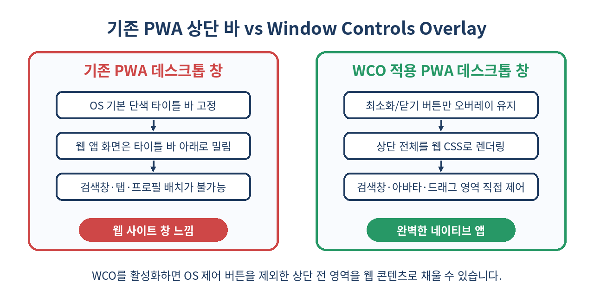
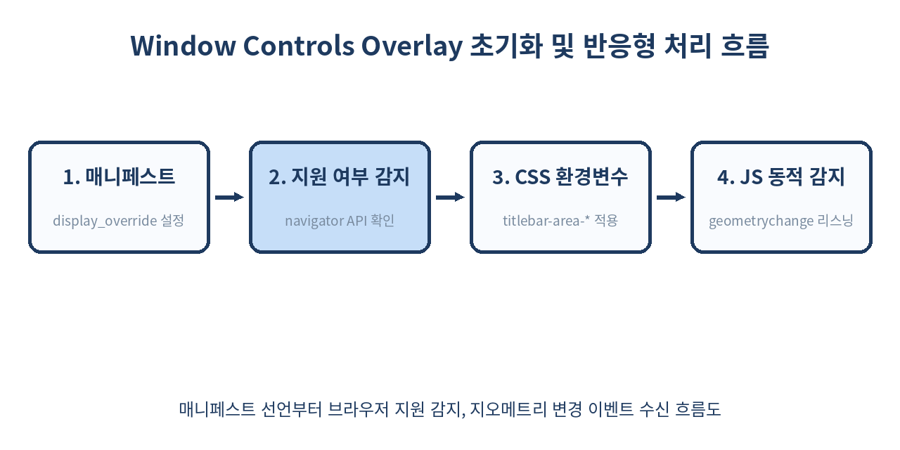

# 🪟 Window Controls Overlay API 완벽 가이드: PWA 타이틀 바를 정복하고 데스크톱 네이티브 앱 완성하기

> "설치형 웹 앱(PWA)은 훌륭하지만, 화면 상단에 턱 하니 자리 잡은 딱딱하고 텅 빈 OS 타이틀 바를 보는 순간 웹이라는 티가 확 납니다."
> Window Controls Overlay(WCO) API를 활용하면 운영체제의 최소화·최대화·닫기 버튼만 남기고 상단 전체 영역을 웹 DOM으로 채워 Visual Studio Code, Slack, Spotify 같은 완벽한 데스크톱 네이티브 UX를 구현할 수 있습니다.

---

## 📌 목차
1. 🪟 Window Controls Overlay(WCO)의 등장 배경과 필요성
2. 🔍 기존 PWA 창 vs WCO 아키텍처 구조 비교
3. 📄 웹 앱 매니페스트(Web App Manifest) 선언과 활성화
4. 🎨 CSS 환경 변수를 활용한 타이틀 바 영역 레이아웃 (`env()`)
5. 🖱️ 창 드래그와 클릭 인터랙션 제어 (`app-region`)
6. ⚙️ JavaScript `navigator.windowControlsOverlay` API 인터페이스
7. 🔄 `geometrychange` 이벤트를 이용한 반응형 동적 리사이징
8. 💻 실전 프로젝트: 네이티브 스타일 커스텀 헤더 컴포넌트 구현
9. 📱 플랫폼별 차이점: Windows, macOS, Linux, ChromeOS
10. ⚠️ 실무 개발 시 반드시 주의해야 할 함정 5가지
11. 🚫 WCO API를 적용하면 안 되는 안티패턴과 서비스 유형
12. 🧾 정리 및 핵심 요약
13. 📚 공식 문서 및 참고 자료

---

## 🪟 1. Window Controls Overlay(WCO)의 등장 배경과 필요성

프로그레시브 웹 앱(Progressive Web App, PWA)은 오프라인 캐싱, 서비스 워커 백그라운드 동기화, 푸시 알림 등을 통해 네이티브 앱과의 기능적 격차를 거의 없앴습니다. 그러나 데스크톱(Windows, macOS, Linux) 환경에 PWA를 설치했을 때 사용자 경험을 저해하는 결정적인 시각적 장벽이 하나 있었습니다.

바로 **운영체제 기본 타이틀 바(Title Bar)**입니다.

기존 데스크톱 PWA는 브라우저 창 프레임이 제거되는 대신, OS 고유의 단색 타이틀 바가 상단에 30~40px 높이로 강제 고정되었습니다. 이 공간에는 앱 이름과 최소화/최대화/닫기 캡션 버튼만 존재할 뿐, 웹 개발자가 커스텀 UI를 넣을 수 없었습니다.

반면 Electron 등으로 제작된 VS Code, Discord, Slack, Spotify 같은 모던 데스크톱 앱들은 타이틀 바 영역에 검색창(Command Palette), 프로필 아바타, 탭 바, 브레드크럼, 동기화 상태 표시기 등을 배치하여 화면 상단 공간을 극한으로 활용합니다.

`Window Controls Overlay API`는 이러한 한계를 극복하기 위해 W3C와 웹 브라우저(Chromium 기반 브라우저 주도)가 표준화한 웹 표준 기술입니다. 최소화·최대화·닫기 창 제어 버튼(Window Controls)을 웹 뷰 위의 작은 '오버레이'로 유지하고, 나머지 상단 전체 영역을 웹 애플리케이션의 렌더링 캔버스로 개방합니다.

---

## 🔍 2. 기존 PWA 창 vs WCO 아키텍처 구조 비교



기존 방식과 Window Controls Overlay 방식의 구조적 차이를 표로 비교하면 다음과 같습니다.

| 비교 항목 | 기존 데스크톱 PWA (`standalone`) | WCO 적용 PWA (`window-controls-overlay`) |
| :--- | :--- | :--- |
| **타이틀 바 영역** | 브라우저/OS 소유 영역 (접근 불가) | 웹 뷰 DOM 소유 영역 (자유로운 스타일링) |
| **창 제어 버튼** | 단색 타이틀 바의 우측(또는 좌측) 고정 | 웹 뷰 위에 투명 오버레이로 얹혀짐 |
| **화면 상단 공간 활용** | 30~40px의 상단 공간이 완전히 낭비됨 | 검색바, 내비게이션, 사용자 탭 배치 가능 |
| **창 이동 (Drag)** | OS 타이틀 바 빈 공간을 잡고 드래그 | CSS `-webkit-app-region: drag`로 지정 |
| **테마 일체감** | `theme_color`로 단색 채우기만 지원 | CSS 그라데이션, 블러, 다크모드 완벽 일치 |
| **지원 브라우저** | 데스크톱 Chromium 계열 브라우저 공통 | Chrome 105+, Edge 105+, Opera 지원 |

기존의 PWA는 단순히 웹 페이지를 크롬 프레임리스(frameless) 창 안에 가둬둔 느낌이었다면, WCO를 적용한 PWA는 창 프레임의 경계를 허물어 운영체제에 완전히 스며든 네이티브 앱의 외형을 완성합니다.

---

## 📄 3. 웹 앱 매니페스트(Web App Manifest) 선언과 활성화

WCO를 사용하기 위한 첫 번째 단계는 웹 앱의 `manifest.json` 파일에 `display_override` 속성을 추가하는 것입니다.

```json
{
  "name": "Flow Workspace",
  "short_name": "Flow",
  "start_url": "/",
  "display": "standalone",
  "display_override": [
    "window-controls-overlay",
    "standalone"
  ],
  "theme_color": "#1E3A5F",
  "background_color": "#F9FBFE",
  "icons": [
    {
      "src": "/icons/icon-192.png",
      "sizes": "192x192",
      "type": "image/png"
    },
    {
      "src": "/icons/icon-512.png",
      "sizes": "512x512",
      "type": "image/png"
    }
  ]
}
```

### 선언 시 주의사항
1. **`display_override` 우선순위**: 브라우저는 `display_override` 배열을 앞에서부터 검사합니다. WCO를 지원하는 환경(데스크톱 Chrome/Edge)에서는 `window-controls-overlay`를 우선 채택하고, 지원하지 않는 환경(구형 브라우저 또는 모바일)에서는 fallback으로 `display`에 정의된 `standalone` 모드를 실행합니다.
2. **`theme_color`의 역할**: WCO가 활성화되더라도 캡션 버튼(최소화, 최대화, 닫기) 주변의 기본 배경색과 창 로딩 중의 배경 처리를 위해 `theme_color`를 일치시켜 두어야 시각적 깜빡임이 발생하지 않습니다.

---

## 🎨 4. CSS 환경 변수를 활용한 타이틀 바 영역 레이아웃 (`env()`)

Window Controls Overlay가 켜지면 웹 페이지의 뷰포트가 창의 맨 꼭대기(Y: 0)까지 확장됩니다. 이때 웹 요소가 OS 캡션 버튼 밑에 깔려 가려지거나 클릭되지 않는 문제를 방지하기 위해, 브라우저는 4가지 **CSS 환경 변수(Environment Variables)**를 제공합니다.

```css
/* 브라우저가 자동으로 주입하는 4개의 환경 변수 */
env(titlebar-area-x);
env(titlebar-area-y);
env(titlebar-area-width);
env(titlebar-area-height);
```

각 변수의 의미는 다음과 같습니다.
- `titlebar-area-x`: 캡션 버튼과 겹치지 않고 안전하게 UI 요소를 놓을 수 있는 상단 바 영역의 시작 X 좌표
- `titlebar-area-y`: 상단 바 영역의 시작 Y 좌표 (대개 0)
- `titlebar-area-width`: 캡션 버튼을 제외한 사용 가능한 상단 바의 순수 너비
- `titlebar-area-height`: 타이틀 바의 전체 높이 (Windows 기준 보통 약 33px~40px)

### 표준 CSS 타이틀 바 레이아웃 코드

```css
/* 상단 커스텀 헤더 레이아웃 */
.custom-titlebar {
  position: fixed;
  top: env(titlebar-area-y, 0);
  left: env(titlebar-area-x, 0);
  width: env(titlebar-area-width, 100%);
  height: env(titlebar-area-height, 40px);
  display: flex;
  align-items: center;
  background-color: #1E3A5F;
  color: #F9FBFE;
  z-index: 9999;
  user-select: none;
}

/* 본문 콘텐츠는 타이틀 바 높이만큼 밀려 내려가도록 처리 */
.main-content {
  margin-top: env(titlebar-area-height, 0);
  padding: 1rem;
}
```

`env(titlebar-area-*, fallback)` 구조를 활용하면 일반 웹 브라우저 탭에서 페이지를 열었을 때는 fallback 값(0px 또는 100%)이 적용되어 일반적인 상단 헤더처럼 동작하고, 데스크톱 PWA 창으로 실행되었을 때만 타이틀 바 영역에 딱 맞춰지도록 우아한 하위 호환성을 보장할 수 있습니다.

---

## 🖱️ 5. 창 드래그와 클릭 인터랙션 제어 (`app-region`)

타이틀 바 영역이 웹 DOM으로 넘어왔기 때문에 발생하는 심각한 문제가 있습니다. 사용자가 상단 바를 마우스로 잡고 창을 움직이려 할 때, 창이 드래그되지 않고 텍스트가 드래그되거나 아무런 반응이 없는 현상입니다.

이를 제어하기 위해 CSS `app-region` (WebKit 접두어 포함) 속성을 사용합니다.

```css
.custom-titlebar {
  /* 타이틀 바 영역 전체를 창 이동 드래그 영역으로 지정 */
  -webkit-app-region: drag;
  app-region: drag;
}

/* 드래그 영역 내부에 위치한 버튼, 인풋, 링크는 클릭 가능해야 함! */
.custom-titlebar button,
.custom-titlebar input,
.custom-titlebar a {
  -webkit-app-region: no-drag;
  app-region: no-drag;
}
```

### 🚨 `no-drag` 미설정 시의 치명적 문제
상단 바 전체에 `app-region: drag`만 부여하고 내부의 `<input type="search">`나 `<button>`에 `no-drag` 처리를 하지 않으면, 사용자가 검색창을 클릭해도 포커스가 가지 않고 버튼을 눌러도 클릭 이벤트가 전혀 발생하지 않은 채 창만 끌려가게 됩니다. **클릭 또는 텍스트 입력이 필요한 모든 대화형 자식 요소에는 반드시 `app-region: no-drag;`를 명시**해야 합니다.

---

## ⚙️ 6. JavaScript `navigator.windowControlsOverlay` API 인터페이스

CSS 환경 변수뿐만 아니라 JavaScript 객체를 통해서도 현재 오버레이의 상태와 정확한 치수(Bounding Rect)를 얻을 수 있습니다.

데스크톱 PWA 환경에서 `navigator` 객체는 `windowControlsOverlay` 속성을 가집니다.

```javascript
// WCO 지원 여부 확인
if ('windowControlsOverlay' in navigator) {
  const wco = navigator.windowControlsOverlay;

  // 1. 현재 오버레이가 활성화되어 있는지 여부 (boolean)
  console.log('WCO 활성화 여부:', wco.visible);

  // 2. 사용 가능한 타이틀 바의 정밀한 DOMRect 반환
  const rect = wco.getTitlebarAreaRect();
  console.log(`타이틀 바 위치: x=${rect.x}, y=${rect.y}, w=${rect.width}, h=${rect.height}`);
} else {
  console.log('이 브라우저는 Window Controls Overlay를 지원하지 않습니다.');
}
```

### `getTitlebarAreaRect()`가 반환하는 값
`wco.getTitlebarAreaRect()`는 일반 `getBoundingClientRect()`와 동일하게 `{ x, y, width, height, top, right, bottom, left }` 값을 반환합니다.

Canvas를 직접 렌더링하거나 WebGL, 복잡한 SVG 툴바를 브라우저 윈도우 상단에 픽셀 단위로 정확하게 매핑해야 할 때 유용하게 활용할 수 있습니다.

---

## 🔄 7. `geometrychange` 이벤트를 이용한 반응형 동적 리사이징



창의 크기가 조절되거나, 듀얼 모니터 간 창 이동, 디스플레이 해상도(DPI) 스케일링 변경, 또는 사용자가 브라우저 제어 UI 토글 버튼을 눌렀을 때 타이틀 바의 가용 면적이 실시간으로 달라집니다.

`windowControlsOverlay`는 이러한 변화를 감지할 수 있도록 `geometrychange` 이벤트를 제공합니다.

```javascript
if ('windowControlsOverlay' in navigator) {
  navigator.windowControlsOverlay.addEventListener('geometrychange', (event) => {
    // event.titlebarAreaRect 를 통해 새로 계산된 Rect에 즉각 접근
    const rect = event.titlebarAreaRect;
    const isOverlayVisible = event.visible;

    console.log('[geometrychange 감지]');
    console.log(`새 너비: ${rect.width}px, 가시성: ${isOverlayVisible}`);

    // 필요한 경우 상태 업데이트 또는 UI 재계산
    updateAppHeaderLayout(rect, isOverlayVisible);
  });
}
```

일반적인 `window.resize` 이벤트는 전체 뷰포트 크기 변화만 알려주지만, `geometrychange`는 OS 창 제어 버튼의 상태 변화와 타이틀 바 가용 사각형 영역의 크기 변화만을 격리하여 정밀하게 통지합니다.

---

## 💻 8. 실전 프로젝트: 네이티브 스타일 커스텀 헤더 컴포넌트 구현

실무에서 흔히 쓰이는 '검색창과 사용자 메뉴가 포함된 일체형 네이티브 헤더'를 순수 JavaScript 및 CSS로 구현해 보겠습니다.

### HTML 마크업

```html
<!DOCTYPE html>
<html lang="ko">
<head>
  <meta charset="UTF-8" />
  <meta name="viewport" content="width=device-width, initial-scale=1.0" />
  <link rel="manifest" href="/manifest.json" />
  <link rel="stylesheet" href="style.css" />
  <title>Logic Studio PWA</title>
</head>
<body>
  <!-- 데스크톱 네이티브 커스텀 타이틀바 -->
  <header id="app-titlebar" class="titlebar">
    <div class="titlebar-branding">
      <span class="app-icon">⚡</span>
      <span class="app-title">Logic Studio</span>
    </div>

    <!-- 검색창 (명령 팔레트 형태) -->
    <div class="titlebar-center">
      <div class="search-box">
        <input type="search" placeholder="프로젝트 검색 또는 명령 입력 (Ctrl+K)" aria-label="앱 검색" />
      </div>
    </div>

    <!-- 오른쪽 액션 아이콘들 -->
    <div class="titlebar-actions">
      <button type="button" class="icon-btn" title="동기화 상태">🔄</button>
      <button type="button" class="icon-btn" title="내 프로필">👤</button>
    </div>
  </header>

  <!-- 메인 애플리케이션 뷰 -->
  <main class="app-body">
    <h1>대시보드</h1>
    <p>완벽한 네이티브 데스크톱 경험을 제공하는 PWA 애플리케이션입니다.</p>
  </main>

  <script src="app.js"></script>
</body>
</html>
```

### CSS 스타일 시트 (`style.css`)

```css
:root {
  --titlebar-bg: #1E3A5F;
  --titlebar-fg: #F9FBFE;
  --accent-color: #5B8FD4;
}

* {
  box-sizing: border-box;
  margin: 0;
  padding: 0;
}

body {
  font-family: -apple-system, BlinkMacSystemFont, "Segoe UI", Roboto, sans-serif;
  background-color: #F9FBFE;
  color: #1E3A5F;
}

/* 타이틀 바 기본 스타일 및 WCO 환경 변수 적용 */
.titlebar {
  position: fixed;
  top: env(titlebar-area-y, 0);
  left: env(titlebar-area-x, 0);
  width: env(titlebar-area-width, 100%);
  height: env(titlebar-area-height, 42px);
  background: var(--titlebar-bg);
  color: var(--titlebar-fg);
  display: flex;
  align-items: center;
  justify-content: space-between;
  padding: 0 12px;
  z-index: 1000;

  /* 창 드래그 기능 부여 */
  -webkit-app-region: drag;
  app-region: drag;
}

.titlebar-branding {
  display: flex;
  align-items: center;
  gap: 8px;
  font-size: 13px;
  font-weight: 600;
}

.titlebar-center {
  flex: 1;
  max-width: 420px;
  margin: 0 16px;
}

.search-box input {
  width: 100%;
  height: 26px;
  padding: 0 10px;
  border-radius: 6px;
  border: 1px solid rgba(255, 255, 255, 0.2);
  background-color: rgba(255, 255, 255, 0.1);
  color: #fff;
  font-size: 12px;
  outline: none;

  /* 입력창은 드래그에서 제외되어 클릭 및 텍스트 선택 가능 */
  -webkit-app-region: no-drag;
  app-region: no-drag;
}

.search-box input:focus {
  background-color: rgba(255, 255, 255, 0.2);
  border-color: var(--accent-color);
}

.titlebar-actions {
  display: flex;
  align-items: center;
  gap: 6px;
}

.icon-btn {
  background: transparent;
  border: none;
  color: inherit;
  font-size: 14px;
  cursor: pointer;
  padding: 4px 6px;
  border-radius: 4px;

  /* 버튼 역시 드래그 불가 구역 */
  -webkit-app-region: no-drag;
  app-region: no-drag;
}

.icon-btn:hover {
  background: rgba(255, 255, 255, 0.15);
}

/* 메인 본문 */
.app-body {
  padding-top: calc(env(titlebar-area-height, 42px) + 20px);
  padding-left: 24px;
  padding-right: 24px;
}
```

### 스크립트 제어 (`app.js`)

```javascript
function initWindowControlsOverlay() {
  if (!('windowControlsOverlay' in navigator)) {
    console.info('Window Controls Overlay 미지원 브라우저입니다. 기본 레이아웃 유지.');
    return;
  }

  const wco = navigator.windowControlsOverlay;
  const titlebarEl = document.getElementById('app-titlebar');

  function updateTitlebarUI() {
    if (wco.visible) {
      titlebarEl.classList.add('wco-active');
      const rect = wco.getTitlebarAreaRect();
      console.log(`[WCO 가용 영역] X: ${rect.x}, 폭: ${rect.width}px`);
    } else {
      titlebarEl.classList.remove('wco-active');
    }
  }

  // 최초 실행 시 상태 반영
  updateTitlebarUI();

  // 크기 및 오버레이 상태 변화 리스너 등록
  wco.addEventListener('geometrychange', updateTitlebarUI);
}

document.addEventListener('DOMContentLoaded', initWindowControlsOverlay);
```

---

## 📱 9. 플랫폼별 차이점: Windows, macOS, Linux, ChromeOS

운영체제마다 창 제어 버튼의 위치와 크기가 완전히 다르기 때문에 크로스 플랫폼 환경을 고려해야 합니다.

| OS | 창 제어 버튼 위치 | 버튼 너비 및 높이 | 레이아웃 주의점 |
| :--- | :--- | :--- | :--- |
| **Windows 11 / 10** | **우측 상단** | 약 140px × 34px | 좌측 X 좌표는 0부터 시작, 우측에 버튼 배치 |
| **macOS** | **좌측 상단** (신호등 버튼) | 약 70px × 28px | 좌측 X 좌표가 약 70px 이상부터 시작됨 (`env(titlebar-area-x)` 활용 필수) |
| **Linux (GNOME/KDE)** | 배포판 설정에 따라 좌측 또는 우측 | 테마마다 가변적 | 고정 px 하드코딩 시 100% 겹침 버그 발생 |
| **ChromeOS** | **우측 상단** | 약 100px × 32px | 태블릿 모드 전환 시 WCO가 자동 비활성화됨 |

특히 **macOS에서는 창 닫기/최소화/전체화면 버튼이 좌측에 존재**합니다. 만약 CSS에서 좌측 마진을 고정값(`left: 0`)으로 두고 로고를 배치하면 macOS에서는 사과 신호등 버튼 바로 뒤에 로고가 겹치게 됩니다. 따라서 **절대로 좌표를 픽셀 단위로 하드코딩하지 말고 반드시 `env(titlebar-area-x)`를 사용**해야 합니다.

---

## ⚠️ 10. 실무 개발 시 반드시 주의해야 할 함정 5가지

### 1. `app-region: drag` 영역 아래의 드롭다운 메뉴 클릭 불가
타이틀 바에 위치한 프로필 아바타를 클릭하여 아래로 떨어지는 드롭다운 메뉴를 띄웠을 때, 드롭다운 메뉴 자체에 `app-region: no-drag`를 주지 않으면 메뉴 항목을 클릭하려 해도 창이 드래그되는 치명적인 버그가 발생합니다. 드롭다운 컨테이너나 모달 레이어에는 무조건 `no-drag`가 걸려 있어야 합니다.

### 2. 고정 픽셀(px) 높이 설정에 의한 잘림 현상
Windows의 캡션 버튼 높이(약 33~40px)와 macOS의 타이틀 바 높이는 상이하며 사용자의 OS 배율(125%, 150%, 200%) 설정에 따라 동적으로 변합니다. `height: 40px`로 고정하면 폰트 크기나 버튼이 위아래로 잘려 나갈 수 있으므로 반드시 `height: env(titlebar-area-height)`를 기준으로 유동적으로 늘어나도록 설계해야 합니다.

### 3. PWA 설치 전 웹 탭 상태에서의 시각적 깨짐
사용자가 Chrome 일반 탭으로 사이트에 접속했을 때는 `env(titlebar-area-*)` 값이 0이거나 미정의 상태가 됩니다. CSS 작성 시 fallback 값을 제대로 적어주지 않으면 일반 브라우저에서 상단 헤더의 가로 너비가 `0px`로 찌그러질 수 있습니다.

```css
/* ❌ 위험한 방식: fallback 없음 */
width: env(titlebar-area-width);

/* ⭕ 안전한 방식: 웹 브라우저 탭 대비 기본값 설정 */
width: env(titlebar-area-width, 100%);
height: env(titlebar-area-height, 48px);
```

### 4. 모바일 환경에서의 오동작
모바일 기기(Android, iOS)에서는 `window-controls-overlay` 개념이 존재하지 않으며 대신 Safe Area(`env(safe-area-inset-top)`)가 동작합니다. `display_override`에 `standalone`을 함께 적어주지 않으면 모바일에서 PWA의 디스플레이 모드가 비정상적으로 폴백될 수 있습니다.

### 5. 더블 클릭을 통한 창 최대화 제어
데스크톱 환경에서는 타이틀 바의 빈 공간을 더블 클릭하면 창이 최대화되거나 복원됩니다. `app-region: drag`가 적용된 영역은 운영체제가 이 더블 클릭 이벤트를 자동으로 가로채 창 최대화 동작을 수행합니다. 따라서 커스텀 더블 클릭 이벤트 핸들러를 타이틀 바 빈 영역에 바인딩하면 OS 동작과 충돌할 수 있습니다.

---

## 🚫 11. WCO API를 적용하면 안 되는 안티패턴과 서비스 유형

Window Controls Overlay가 모든 PWA에 적합한 것은 아닙니다. 다음의 경우에는 도입하지 않는 것이 좋습니다.

1. **단순 블로그 및 읽기 전용 매거진 웹**: 상단에 복잡한 도구 모음(툴바)이나 검색창이 전혀 필요 없는 순수 텍스트 위주 사이트에서는 기존 `standalone` 타이틀 바만으로 충분하며, 오히려 여백 관리의 복잡도만 가중됩니다.
2. **모바일 전용 타깃 PWA**: 데스크톱 사용자가 1% 미만인 모바일 중심 서비스는 WCO를 구현할 실익이 없습니다.
3. **상단 네비게이션이 지나치게 복잡한 레거시 웹**: 타이틀 바 35px 안팎의 좁은 높이 안에 수많은 GNB 탭과 텍스트 메뉴를 욱여넣으려 하면 OS 캡션 버튼과 겹쳐서 레이아웃이 붕괴될 위험이 큽니다.

반면 **생산성 도구(메모, 캘린더, 칸반 보드), IDE/코드 에디터, 음악 스트리밍 플레이어, 메신저/협업 툴**에는 WCO 적용이 압도적인 완성도를 부여합니다.

---

## 🧾 12. 정리 및 핵심 요약

- **Window Controls Overlay(WCO)**는 PWA 데스크톱 창의 OS 기본 타이틀 바를 없애고, 최소화/닫기 버튼을 오버레이로 띄워 상단 전체를 웹으로 제어하는 웹 표준 기술입니다.
- `manifest.json`의 `display_override: ["window-controls-overlay", "standalone"]`을 선언하여 활성화합니다.
- CSS에서는 `env(titlebar-area-x)`, `env(titlebar-area-width)`, `env(titlebar-area-height)` 환경 변수를 사용하여 안전 영역을 계산합니다.
- 상단 헤더 컨테이너에는 `app-region: drag`를 주어 창을 마우스로 잡고 끌 수 있게 하되, 검색창이나 버튼 같은 대화형 요소에는 반드시 `app-region: no-drag`를 선언해야 합니다.
- JavaScript `navigator.windowControlsOverlay`의 `geometrychange` 이벤트를 구독하여 해상도 변경이나 창 리사이즈에 실시간으로 반응할 수 있습니다.

> ✨ **한 줄 요약**
> 텅 빈 OS 타이틀 바를 지우고 WCO API로 상단 캔버스를 정복할 때, PWA는 진정한 네이티브 데스크톱 앱으로 완성됩니다.

---

## 📚 13. 공식 문서 및 참고 자료

- [W3C Window Controls Overlay 명세 초안](https://wicg.github.io/window-controls-overlay/)
- [MDN Web Docs: Window Controls Overlay API](https://developer.mozilla.org/en-US/docs/Web/API/Window_Controls_Overlay_API)
- [Chrome for Developers: Customize the window controls overlay of your PWA's title bar](https://developer.chrome.com/docs/web-platform/window-controls-overlay/)
- [Microsoft Learn: PWA의 창 컨트롤 오버레이 사용자 지정](https://learn.microsoft.com/ko-kr/microsoft-edge/progressive-web-apps-chromium/how-to/window-controls-overlay)
